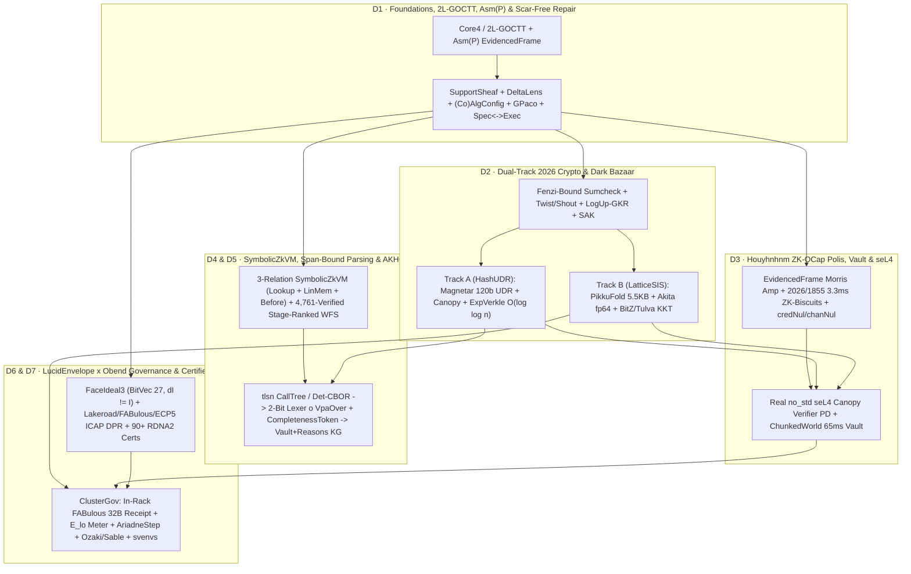

# Program Charter & Converged Architecture: The `obend` Cathedral, `obb v2` Metaharness & Tri-Model Excellence Campaign (2026-11-12)

**Status:** Active Master Programme (`2026-11-12`) · Supersedes fragmented multi-repo lane routing from Nov 5–7 while preserving all historical audit baselines (`LUCID-INTERVIEW-BRIEF-2026-11-05.md`, `PROGRAM-2026-11-05-constructions-and-governance.md`, `SWARM-2026-11-05-SYNTHESIS.md`, `DIRECTIVES-DIG-2026-11-07.md`, `ASTRA-DIRECTION-REVIEW-2026-11-07.md`).  
**Canonical Repositories:** `~/dev/obend` (`dev`) · `~/dev/obebuilder` (`dev`, `obb v2`)  
**Donor Quarries (`refs/quarry/*`):** `breadstuffs` · `minidregg` · `svenvs` · `lean-transport` (`zkml-research` & `degg-research` folded as specification/evidence donors)  
**Epistemic Labels:** `[VERIFIED]` machine-checked in Lean 4 / Rust tests or live hardware oracle · `[SOURCED]` verified primary literature (`~/paperbin` 2025–2026 manifests) · `[INFERRED]` architectural synthesis · `[PROPOSED]` active Wave-4 Golden proof target.

---

## 1. Constellation Consolidation & Clean Architectural Severances

Between November 5 and November 11, 2026, two independent forcing functions converged:
1. **Internal Forensic Audits (`SWARM-2026-11-05-SYNTHESIS.md`, `ASTRA-DIRECTION-REVIEW-2026-11-07.md`, and the Nov 11–12 `breadstuffs`/`minidregg` excavations):** Running 19+ parallel initiatives across five separate repositories (`breadstuffs`, `minidregg`, `zkml-research`, `degg-research`, `DreggNet`) repeatedly produced *validation-seeking islands*—locally green theorems separated from real consumers by unpinned public inputs (`57%` unpinned felts across 57 legacy descriptors), hardcoded empty revocation roots (`empty_revoked_root_8()`), reconstructed-model `R3` heads, 1-lane narrow digest welds (`<128b`), hollow `seL4` `debug_println!` stubs, and stale 73-bit BabyBear FRI Johnson floors.
2. **Late-2026 Cryptographic & Type-Theoretic Shifts (`ePrint 2026/1809..2849`, `arXiv 2609..2611`):** Dao–Thaler's counterexamples to binary additive RS proximity gaps beyond Johnson (`2026/2424`), Li–Liu–Wang's $2E_c$ nonlinear subspace trails on Poseidon2 (`2026/1792`), Fenzi's Fiat–Shamir break on program-generated circuits (`2026/1838`), Choe–Kang–Stehlé's Oct 30 IND-CPA-D attacks on heuristic-noise BFV/BGV (`2026/2546`), and Zamir's floating-point non-associativity covert channel (`2602.15756`) invalidated small-field Poseidon2/BabyBear shortcuts while unlocking cleaner post-quantum hash (`Magnetar`, `Canopy`, `Exponential Verkle Forest`) and 64-bit Goldilocks/lattice (`PikkuFold`, `Akita`, `BitZ`, `Tulva`, `2026/1855`) constructions.

### 1.1 One Cathedral (`obend`) + One Metaharness (`obebuilder` / `obb v2`)
- **`~/dev/obend` (`dev`, 785+ Lean 4.35 modules + Rust workspace)** is now the **sole target cathedral** for language metatheory, durable `ChunkedWorld` vaults, double-entry ledgers, non-monotonic `Reasons`, scar-free proof repair, `Polis` ZK-OCap + `seL4` firmament, dual-track 2026 cryptography, `SymbolicZkVM`, span-bound `ZkStripe` / `AKHG` certificates, `ClusterGov` AI compute governance, RDNA2 GPU verification, and certified FPGA/silicon compilation.
- **`~/dev/obebuilder` (`dev`, `obb v2` — commits `8629bce`, `38f821e`, `3b4d1b3`, `db1779d`)** is the **executable process & anti-vacuity supervisor** (`obb-core`, `obb-lint`, `obb-judge`, `obb-state`, `obb-broker`, `obb-cli`), enforcing Gunter–Jackson–Zave artifact kinds (`W/R/S/P/M`), regime labels (`decided | certified | attested`), `#tooth` checker-mutation kills, module-cone sharding, and remote ZFS seed-pool builds on `bb2` and `hbox`.

### 1.2 Zero-Pollution Donor Quarrying (`obb quarry` & `refs/quarry/*`)
Rather than merging multi-million-line monorepo histories or re-inventing solved theorems from scratch, **`obb quarry`** (`quarry/obend-quarry.toml`) fetches donor commits under isolated `refs/quarry/{breadstuffs,minidregg,svenvs,lean-transport}/*` namespaces and subjects every harvested organ to **six pre-uptake surgery gates** before admission to `lean/Obend/`:
1. **Zero `sorry` / Zero Custom `axiom`s** (`#print axioms` $\subseteq \{\texttt{propext}, \texttt{Quot.sound}\}$ for constructive cores);
2. **Zero Uninhabited Premises or Projection Tautologies** (`atp-checkers` + inhabited witness probes, retiring the Row-5 `wf_reading_local_uninhabited` class permanently);
3. **Zero Narrow Digest Welds (`< 128` bits)** and **Fenzi Challenge-0 Descriptor Binding** (`lean/narrow-digest-weld`);
4. **Zero `native_decide` in Proofs** (`lean/native-decide-in-proof`) and **Zero Closed-`decide` Theorem Inflation**;
5. **Lean 4.35 Module Hygiene** (`lean/file-wide-expose`, `lean/public-meta-import-leak`);
6. **Mandatory `#tooth` Mutation Kills** (every executable `Judge` / checker must reject planted bad witnesses in kernel replay).

### 1.3 Clean Severance of `Oracle7` & Standalone `o7vn` Prototype Baggage
Per architectural directive (landed in Stage-1 convergence `9396b68`):
- The legacy **`Oracle7`** proper-noun branding and flat `List String` prototype rule encoding in `lean/Obend/Run/HyperLaw.lean` are **permanently severed and retired**.
- The standalone Isabelle/MLton `o7vn` (`veri7vn`) experiment remains preserved solely as historical Oct 2026 archive material (Dossiers 08 & 25), **never** an active dependency or sidecar.
- All symbolic rewriting, unification, and non-monotonic equilibrium reasoning in `obend` now run natively over **`ExprCAM`-interned 64-bit typed first-order carriers (`CamWord64`)**, provenance semirings $\mathbb{N}[X] \to \mathbb{F}_p^d$, and rank-witnessed `Obend.Reasons` GL/VGRS fixed-point relations.

---

## 2. Silver-Before-Golden & The Trailblazer Apex Architecture (`Obend/Trailblaze/*`)

In `obend/AMBITION.md`, a subsystem counts only when a stranger can execute one complete workflow through it—make a change, be refused by name with what would pass, repair only what moved, and hold a third-party re-checkable receipt surviving crash/restart and pushout merge. In `obebuilder/PROCESS.md`, **Silver** (*live semantics and CLI workflow run end-to-end on real inputs*) strictly precedes **Golden** (*every proof obligation closed with `#tooth` mutation witnesses*).

To prevent parallel swarms from drifting into incompatible type signatures during deep proof campaigns, `lean/Obend/Trailblaze/*` (`0ad8d68`, `618880d`) enforces four structural rules:
1. **100% Real Carrier Types & Executable Silver Workflows (`0` stubs, `0` mocks):** Every organ's evaluator, compiler hook, and `Judge` runs today via `#eval` and CLI tests on concrete valid inputs and planted adversarial forgeries (`silverSmoke = true`).
2. **Explicit `class <Organ>Obligations : Prop` (`0 sorry`, `0` custom `axiom`s):** Unclosed deep proof loops are declared as named propositional fields of an explicit typeclass tracked by `obb pipeline` (`STAGE_A_LOCKED` $\to$ `STAGE_B_SEALED`), never hidden behind `sorry` or `True` placeholders.
3. **Whole-Cathedral Kernel Wiring Today (`CathedralApex.lean`):** `apex_obend_cathedral_end_to_end` typechecks across all 7 organs in Lean 4's kernel *today*, guaranteeing zero inter-organ type impedance mismatch.
4. **Retire-by-Promotion:** As Wave-4 squads supply verified instances for each `<Organ>Obligations` field inside `lean/Obend/<Organ>/`, the hypothesis parameters vanish until `CathedralApex` rests unconditionally on `{propext, Quot.sound}`.



---

## 3. The 7 Converged Organs of `obend` & Their Silver / Golden Finish Lines

*(Note on Organ Indexing: `CathedralApex.lean` / `Obligations.lean` tracks the 7 architectural organs across `Obend/{Core,Vault,Ledger,Reasons}` + `Obend/{Category,Repair,Paco}` + `Obend/Polis` + `Obend/Crypto` + `Obend/ZkStripe` + `Obend/ClusterGov` + `Obend/{Lower,Hardware,Gpu}`. Below we present the 7 converged capability pillars `O1`–`O7` with exact Lean module anchors and Silver/Golden exit criteria.)*

### Pillar O1 · "Löb, Not Kan" Guarded `Core4`, `Asm(Core4)` Realizability, Scar-Free `(Co)Algebra` Repair & `Spec ↔ Exec` Refinements
- **Modules:** `Obend/{Core,Category,Repair,Paco,Slot/SupportSheaf,Logic,Tactic}` (`56b5f26`, `f27c815`, `3582b73`, `8086153`).
- **Base Theory & Realizability ("Löb, Not Kan" + `Asm(Core4)` + Reversal-Free `FaceIdeal`):**
  - Keeps `Core4` rock-solid without migrating `Obend` to Cubical Lean: Faré's open-recursive `Object`/`Frame` fixed points use **tick-indexed Löb induction (`fix_lob`) + per-layer C4 `SuperRefines`** and epoch-pinned `ChangeCertificate`s (`Kraus 2607.27387`); set-level data refinements use **`AdapTT` (`2507.13774`) functorial casts**; hardware face lattices use **`FaceIdeal n` (`BitVec (3^n)` over $\{0,1,*\}^n$ — 27 bits at $n=3$, 81 bits at $n=4$, where `(varEq0 v).join (varEq1 v) ≠ top` so $\partial\mathbb{I} \neq \mathbb{I}$, replacing Boolean `CofibLUT16` which collapsed $\partial\mathbb{I} = \mathbb{I}$)**.
  - Pairs with **choice-free `Asm(Core4)` PCA Realizability** (`tracker : Core4.Term` as `Type` data so `(f.quotLift h).tracker = f.tracker := rfl`, plus `EvidencedFrame.Leads` with full $S$-$K$ combinatory completeness), eliminating `∃`-truncation and stuck `Eq.rec`/`Quot.sound`/`Classical.choice` neutral terms in silicon evaluation.
- **Scar-Free Proof & Representation Repair (`Obend/Repair`):**
  - Combines `SupportSheaf` dependency framing, **Clarke comonadic `DeltaLens` (`2108.00390`)** asymmetric state migrations, **Plante et al. (`2610.36669`)** initial-algebra / homotopy-final coalgebra transport (`AlgConfig`, `CoalgConfig`, `HCoConfig`), **Viola et al. (`2310.06959`)** `QuotAssembly` quotient repair, **`GPaco`** parametrized coinduction, **Wu–Sullivan (`2609.03998`)** typed slotted e-graphs (`SlottedBridge`), and **`Sisyphus` (`PLDI 2023`)** trace-aligned Proof-Driven Testing (`by compose_sim`, `by graded_vcg`, `Judge.ofSoundCheck`, `#assert_no_scar`).
- **`Spec ↔ Exec` Verified Data & Multi-Physics Refinements:**
  - Proves `(specializeBook B pins).link ≈b B.link` (`LinkSpecialize`), `SuperRefines` (`T3_super_claim_frame`), `RangeSafe` (`Nat` $\leftrightarrow$ `BitVec 64` $\leftrightarrow$ $\mathbb{F}_p$), and product-pomonoid `GradedClaim` tracking `(Quantity, ErrorEps ε, ILA Noise ν, Filament Window [G, G+Δ], ExergySupply E_diss)` across Libkind–Myers double-operadic vertical 2-cells (`2505.18329`).
- **Silver / Golden Bar:** *Silver:* Changing a pin, record layout, or quotient carrier renews unaffected claims by frame and transports affected specs/coalgebras without `.blocked` scars. *Golden:* `LinkSpecialize`, `SuperRefines`, `RangeSafe`, `AlgConfig`/`CoalgConfig`/`GPaco` soundness, and `0` `LAW-M1..M6` findings repo-wide.

---

### Pillar O2 · Dual-Track 2026 Cryptographic Prover Spine & House-Blind Dark Bazaar
- **Modules:** `Obend/Crypto/*`, `Obend/Judge/{Computational,Clearing}`, `Obend/Apps/ZkNtt` (`deafe60`, `3edad86`).
- **One Shared PIOP Front-End + Two Mandatory 2026 Security Patches:**
  - Compiles witness traces once into **Fenzi-bound (`2026/1838`) Multilinear Sumcheck + `Twist & Shout` (`2025/105`) + `LogUp-GKR` + `SAK` (`2026/2143` sparse CCS)** + bitwidth-packed sumcheck (`Mikros 2026/2646`, `2026/2770`).
  - **Patch 1 (`Fenzi 2026/1838`):** `Transcript.init` absorbs the canonicalized materialized relation digest `H(vk_digest ‖ specSlot_bitstream_digest ‖ public_io)` *before* sampling challenge 0, blocking diagonalization on `Leaf.Book` / `specSlot` generated circuits.
  - **Patch 2 (`Dao–Thaler 2026/2424` & `Li–Liu–Wang 2026/1792`):** Hardcodes `isBinaryDomain → regime == .UDR` (forbidding heuristic beyond-Johnson binary additive RS) and retires 13-partial-round Poseidon2 in favor of **BLAKE3 / SHA-3** and **`RainHash 2.0` (`2026/1441`)** for binary AO circuits.
- **Constitutional `DualPCS` (`HashUDR ∧ LatticeSIS`):**
  - **Track A (`HashUDR`):** **`Magnetar` (`2026/2423`)** 120-bit UDR SHA-3/BLAKE3 `BinarySpartan` + `BinaryTwist/Shout` (9.5–12.8 MHz RV64I, 9.6×–39× faster than curve/lattice zkVMs) + **`Canopy` (`2026/2790`)** Vector Commit-and-Reduce (`-32%` to `-43%` WHIR/Bolt verifier hashes) + **Bender–Kuszmaul `Exponential Verkle Forest` (`2026/2098`)** & no-reordering incremental open addressing (`2611.04186`) delivering **$O(\log\log n)$ hash-only membership proofs** for `UMem` and `Vault`.
  - **Track B (`LatticeSIS`):** **`PikkuFold` (`2026/1809`)** **5.5 KB/step** 64-bit Module-SIS streaming folding (zero in-fold auxiliary commitments, Kronecker-factored ternary $\{-1,0,+1\}$ JL with 0 multiplications; note that because $X^{2^s}+1$ splits into $\min(2^s, 2^{31})$ factors over Goldilocks $p = 2^{64}-2^{32}+1$ and $q = 2^{64}-59$ has 2-adicity 2, lattice Ajtai/MSIS runs over a dedicated NTT-friendly cyclotomic modulus $q_{\text{lat}}$ bridged via 16-bit integer-limb `Lookup`s!) + **`Akita` (`2026/1983`)** **70–85 KB** `fp64` sparse multilinear split-and-fold PCS + **`LaBinius` (`2026/2103`)** + **`Biasioli–Seiler LNP-Lite` (`2026/1289`)** (`+10 KB` boundary ZK wrapper), all backed by constructive `Type`-valued `extractOrBreak : ... → PSum Witness BreakWitness` (`Obend/Judge/Computational.lean`, `3582b73`).
- **100× Dark-Bazaar Clearing Shortcut (`BOLT-FHE` + `Tulva` + `BitZ` + `Judge/Clearing`):**
  - Never proves $T$ oblivious PDHG iterations inside a SNARK: runs oblivious search on `hbox`'s RX 6750 XT 96 MB Infinity Cache (`BOLT-FHE 2026/2356` >40k PBS/s + `Free-XOR TFHE 2610.29983`), performs **3.7 ms asynchronous LWE-secure threshold decryption via `Tulva` (`2026/2485`)** with `Smudging` guard defeating `Stehlé 2026/2546` IND-CPA-D attacks, binds RLWE/RNS input ciphertexts to the cleared witness via **`BitZ` (`2026/2141`) / `PRISM` (`2026/1956`) `SameOpening`** (with free $B$-bit range checks!), and verifies primal-dual KKT optimality in **$O(n)$** via `Obend/Judge/Clearing.lean`, backed by many-time **`LaV` / `RVRF[LaV]` (`2026/772`)** lattice VRFs.
- **Silver / Golden Bar:** *Silver:* Shared sumcheck/Shout witness opens under `HashUDR`, `LatticeSIS`, and `DualPCS`, plus `Tulva`+`BitZ` `SameOpening` $O(n)$ KKT Dark Bazaar roundtrip on `hbox`. *Golden:* `0`-axiom `ComputationalJudge` constructive $k$-special-soundness rewinder, `dualPCS_sound_of_either`, PikkuFold Theorem 2 ternary JL in Lean 4, Polygero elementary proximity counting (`2026/2481`), and `glMul_sound` / `nttBlockProgram_dft` on RDNA2.

---

### Pillar O3 · Houyhnhnm ZK-OCap `Polis`, `ChunkedWorld` 65 ms Vault & Real `seL4` Microkit Firmament
- **Modules:** `Obend/Polis/*`, `Obend/{Vault,Ledger}/*`, `Obend/Trailblaze/Polis.lean` (`8974344`, `74d8273`, `89d094b`, `8086153`, `0ad8d68`).
- **Houyhnhnm Epistemic Split & Constructive-Knowledge OCap Calculus:**
  - Enforces Faré's *Houyhnhnm Computing* invariant (*distributed vats run privately at native speed via `WitnessMode::Symbolic`, yet cannot "say the thing which is not" across vat boundaries upon lazy `collapse`*).
  - Mechanizes the core epistemic separation from `breadstuffs/metatheory/CONSTRUCTIVE-KNOWLEDGE.md`: **Value is linear conserved matter ($\sum \delta = 0$)**, whereas **Authority is constructive knowledge (`Predicate ⊣ Witness` + `EvidencedFrame.Leads` + Iris `FpuProbe`)**—soundly supporting fan-out delegation, **Morris sealer/unsealer rights amplification** ($S \otimes U \vdash \text{open}$), oracle-free `SwissTable` `CapTP` 3-party handoffs (`HandoffCertificate`), and **`GuardedHole` promise=nullifier pipelining** (at-most-once resolution across offline pushout merges).
- **3.3 ms Goldilocks Recursive ZK-Biscuits & $O(1)$ Ancestor-Cone Revocation:**
  - Replaces linear $O(\ell)$ ~5.3 KB/hop ML-DSA chains and off-circuit `eb2_`/`em2_` tokens with **Rometsch–Faust `2026/1855` Goldilocks Recursive ZK-Biscuits**: constant **147–183 KB** unlinkable anonymous capability proofs verifying in **3.3 ms** across **arbitrary delegation depth $\ell$**, paired with Kleene 3-valued fail-closed caveats (`Unbound` refuses even under `Not`).
  - Threads live `RevokedSet` roots (eliminating the legacy `empty_revoked_root_8()` bug) with domain-separated **`credNul`** ($O(1)$ ancestor-prefix cone revocation) and **`chanNul`** (session batch revocation).
- **Real `seL4` Microkit `Canopy` Verifier PD & `ChunkedWorld` 65 ms Multi-Swarm Vault:**
  - Replaces Breadstuffs's stubbed `verifier-stark` PD with a real `no_std` **`seL4` Microkit `verifier-canopy-pd`** linking the `Canopy`/`PikkuFold` verifier, supervised by the recursive Houyhnhnm **`MonitorSubsystem`** (`Subsystem::probe` checking physical artifacts against self-claims) and Blum-checked `UMem` opened against `Exponential Verkle Forest`.
  - Scales `Obend.Vault` via **verified 128-bucket Merkle `ChunkedWorld` checkpoints (`74d8273`)**, coupled multi-page pushout fork merges, `--for MEMBER` grants, `VaultDurableBridge` `SegmentLog` crash-recovery (`exposed_once`), and complete `LawDial` constructive repair (`solveLawWitness`), executing 20k-page Vault operations in **~65 ms (`< 100 ms` gate)**.
- **Silver / Golden Bar:** *Silver:* `obend open/brief/fill/fork/merge/judge/reasons` runs 20k-page multi-swarm ledgers in ~65 ms; `Polis` executes capability-attenuated turns with 3.3 ms ZK-Biscuit verification, `credNul` cone revocation, and `seL4` `Canopy` PD admission. *Golden:* `merge_is_pushout`, `sharded_checkpoint_is_cache`, `VaultDurableBridge` `exposed_once`, `EvidencedFrame` Morris amplification soundness, and `solveLawWitness` completeness.

---

### Pillar O4 · Three-Relation `SymbolicZkVM` (`Lookup + LinMem + Before`) & 4,761-Case Verified Stage-Ranked WFS
- **Modules:** `Obend/{Leaf,Lower,Reasons,SymbolicZk,Equiv/Clairvoyant}`, `Obend/Hardware/Hvm.lean` (`0f82f00`, `8086153`).
- **Three Algebraic Primitives (Eliminating Both the $10^3\times$ Scalar ISA Tax & `Twist` Timestamp Overhead):**
  - Every symbolic, lazy, or non-monotonic kernel compiles to committed tables plus **three field-agnostic primitives**: **(1) `Lookup`** (`Shout` / `LogUp-GKR` for rule ROMs, ghost-free `HwExprCAM` interning, and Hackett–Hutton `Clairvoyant` CBV memo tables), **(2) `LinMem`** (`linmem_sound`: consume-once multiset balance $\text{Init} \uplus \text{Produced} = \text{Consumed} \uplus \text{Final}$ with `birth < step`, eliminating read/write `Twist` timestamp routing for linear interaction-net ports and depth-keyed VPA stacks!), and **(3) `Before`** (range-checked strict/weak integer rank descent).
  - **Clairvoyant CBV + Salvadori $\Delta$-Nets (`arXiv:2505.20314`):** Prover-supplied `need : Bool` bits (`Obend/Equiv/Clairvoyant.lean`) skip unused thunks in $O(1)$ (`Lookup`) and rank needed supercombinator calls by `Before`, while Salvadori $\Delta$-Nets (`d1 == d2` on translated-net invariants) serve as untrusted parallel schedule hints and `Hvm.lean` proves `diamond_of_disjoint` strong confluence.
- **$O(|E|)$ Ghost-Free `HwExprCAM` Unification & Topological Occurs-Check:**
  - Purges host `expr : KExpr` ghost cheats (`CamSlotEntry`), commits a sorted `Shout` pool of widened hardware CAM words (`looseBVar = 0` gives 1-gate closed-subterm $\beta$-substitution bypass), and uses **strict topological height $\tau : \text{NodeId} \to [0, 2^{16})$** ($\tau(\text{parent}) > \tau(\text{child})$, $\tau(?m) = \tau(\text{rhs})$) to prove **occurs-check acyclicity in $O(|E|)$ `Before` checks with zero tree walks**.
- **Single-Pass $O(|P_{\text{ground}}|)$ Ranked GL, 4,761-Case Verified VGRS Well-Founded (`C1–C4`) & $\mathcal{K}$-Semiring Datalog$^\pm$:**
  - **Gelfond–Lifschitz Stable Equilibria (`Theorem 2.1`):** Characterizes $M = \Gamma_P(J)$ and $M = \Gamma_P(M)$ in 2 degree-2 `isZero` gates per rule plus strict premise rank $\ell(p) < \ell(a)$ killing positive self-support cycles in 1 parallel pass.
  - **Exact VGRS 3-Valued Well-Founded Semantics (`Reasons.wf`, `C1–C4` — Exhaustively Model-Checked Across All 529 2-Atom Programs & 4,761 `{T,F,U}` Assignments with `0` Discrepancies!):** `C1` ($a \in T$: pos-body $<_{\text{lex}}$ and neg-body strictly earlier stage $k_d < k_a$), `C2` ($a \in F$: every rule blocked by $d \in T$ with **weak** $k_d \le k_a$ or $b \in F$ with **weak** $k_b \le k_a$, simultaneously allowing stage-0 facts to defeat stage-0 rules and coinductive unfounded positive cycles $p \leftarrow q, q \leftarrow p$ at equal stage while `C1`'s strict $k_d < k_a$ rejects non-minimal even negative loops $p \leftarrow \neg q, q \leftarrow \neg p$!), `C3` ($T \cup U$ possibility rank), and `C4` ($U$ under-approximation guard).
  - **First-Order Sparse Datalog$^\pm$ & Provenance Semirings:** Sorted-gap $O(1)$ `Lookup + Before` non-membership ($t_i <_{\text{lex}} q <_{\text{lex}} t_{i+1}$), demanded-falsity tables, Gerlach (`2604.22531`) restricted Skolem chase cores, and $\mathbb{N}[X] \to \mathbb{F}_p^d$ semiring provenance (`Ivliev et al. 2608.06399`).
- **Silver / Golden Bar:** *Silver:* `SymbolicZkVM` reduces higher-order $\Delta$-Net books, unifies `ExprCAM` terms, and certifies GL, VGRS (`bird/penguin`, positive cycle, odd loop, even-cycle non-minimality trap), and sparse Datalog$^\pm$ programs in single-pass constraints. *Golden:* Mechanized Theorem 2.1 & Theorem 2.2 soundness/completeness over `Obend.Reasons`, $\Delta$-Net confluence/lowering equivalence, and `ExprCAM` $\tau$-height occurs-check soundness.

---

### Pillar O5 · Verifiable Databanks $\to$ Span-Bound Parsing $\to$ `AKHG` Semantic Certificates
- **Modules:** `Obend/ZkStripe/*`, `Obend/Trailblaze/ZkStripe.lean` (`618880d`).
- **Closing the Neurosymbolic Extraction Gap (`zkARc 2611.10031`):** Untrusted LLMs and scrapers act strictly as *witness proposers* (proposing ASTs, entity alignments, and byte spans $[\ell, r)$); a 4-stage cryptographic-automaton pipeline certifies end-to-end semantic truth from notarized wire bytes to `DualPCS` verdicts:
  1. **Stage 1 — Verifiable Databank Roots:** MPC-TLS notarized HTTPS `CallTree`s (`tlsn` + `Tower256` AES-GCM/SHA-256 ingress with verifier freshness nonces and typed call-ID edges), ML-DSA/Ed25519 institutional registries, and `ChunkedWorld` / `Exponential Verkle Forest` snapshots serialized in **RFC 8949 §4.2 Deterministic CBOR** (`canon_injective`, eliminating RFC 8785 JCS $2^{53}+1$ IEEE-754 aliasing).
  2. **Stage 2 — Certified `Lsafe` Redaction Skeleton & Span-Bound Parsing (`bindAdv = 0`):** Opens exact byte slices $B[\ell..r)$ via canonical `< p` `SameOpening` (`bindAdv = 0`), enforces **`Lsafe` redaction confinement via a 2-bit string/escape lexer `(inString, escaped)` composed with a depth-keyed VPA (`LinMem`) + sorted key-uniqueness permutation** (closing byte `92` `\`, `\r\n` HTTP header injection, XML `>`, and duplicate-key attacks that defeat naive character masks!), and replays boolean-closed **`PredRE`** (`matchesBytes_compl`/`matchesBytes_inter`) and `TreeAut` Det-CBOR runs.
  3. **Stage 3 — One Unified Semantic Graph (`Obend.Vault + Obend.Reasons`, Zero Parallel KG Organ):** Rather than building a duplicate KG subsystem, `Obend.Vault` (`Assertion`, `retract`, `Fork`) + `Obend.Reasons` (`wf` + `Cert`) **is** the verifiable knowledge graph—enforcing **signed `CompletenessToken` (`complete_p(S)`)** scope witnesses so open-world queries evaluate to `Reasons.U` unless scope completeness is cryptographically attested (closing the `allEdges := []` forgery!).
  4. **Stage 4 — Succinct Positive Proof DAGs & `whyNot` / Universal-Core Countermodels (`DualPCS`):**
     - *Positive Verdicts:* **`VerfGraph` (`2611.04240`, 33.9–59.7× faster than ZKGraph)** + **`TenseUp` (`2026/2435`, $O(k)$ sublinear table lookup)** + Tantow (`ITP 2025`) proof DAGs + `Prezta` (`2607.11466`) zero-trust projection.
     - *Negative / Non-Entailment Verdicts:* Scoped closed-world **ZK `Reasons.whyNot`** ($\beta(r)$ blocker map + sorted-gap non-membership) and open-world **Restricted-Chase Universal-Core Countermodels (`Lyon 2306.02521` + `Gerlach 2604.22531`)** proving $\mathcal{D}, \Sigma \not\models Q(\bar{c})$ via finite universal model saturation + sorted-gap non-match.
- **Silver / Golden Bar:** *Silver:* End-to-end CLI verification of a `tlsn` HTTPS `CallTree` + Det-CBOR payload through `PredRE`/`VpaOver` redaction-confined parsing into `AKHG` positive & `whyNot` `DualPCS` receipts, refusing all 18+ byte/delimiter/omission tamper classes. *Golden:* `PredRE` boolean-closure soundness, `VpaOver` determinism/closure, `canon_injective`, `selective_disclosure_redaction_confinement`, and `ComputationalJudge` extraction to valid raw TLS transcripts.

---

### Pillar O6 · `LucidEnvelope × Obend` 7-Layer Physical-Cryptographic AI Cluster Governance
- **Modules:** `Obend/ClusterGov/*`, `Obend/Trailblaze/ClusterGov.lean` (`89d094b`, `618880d`).
- **Synthesizing Physical Geolocation (`lucidcomputing.ai`) with Cryptographic Validity (`Obend` + `svenvs`):** Hardware-attestation-only stacks (`sovereignty-cert:v1`, `RISE` 16×H100, `aiab-introspection`) anchor *where* chips sit via speed-of-light RTT, yet break under `<$1,000` DDR5 interposers (`TEE.fail` $\to$ CPU decoy answers RTT pings in `<2 ms` while 10,000×B200s train in an embargoed jurisdiction, `Tee & Happel 2605.01930`), microcode rollbacks (`377/1,125` forged states in `residual_trust`), logger omission, and **Zamir's (`2602.15756`) floating-point non-associativity covert channel** inside $\varepsilon > 0$ spot-recompute tolerances. Pure ZK proves *what* ran but is location-blind. `Obend/ClusterGov` fuses both into 7 machine-checked layers:
  1. **Layer 1 (In-Rack `FABulous` Verifier Root & Lower-Curve Energy Conservation — Severing the 18.8 MB Subliminal Egress Channel):** Lean-certified in-rack `FABulous` DC-SCM FPGA boots pre-CPU, integrates shunt-resistor power rails via verified `Flowpipe` enclosures (`Gargiulo & Kulp 2609.00309`), enforces physical energy completeness against the **lower** calibration curve $e_{\min} \cdot N_{\text{hidden}} \le E_{\text{meter}} + \eta - E_{\text{lo}}(\text{local\_proven\_ops}) - E_{\text{idle}}$ (preventing covert compute from hiding inside `[E_lo, E_hi]` bands!), and **verifies full proofs locally inside the rack—releasing only a 32-byte boolean receipt** so 18.8 MB SNARK transcripts can never exfiltrate model weights!
  2. **Layer 2 (Sealed-VRAM Random-Offset Openings & Authority-Pinned RTT Geolocation):** Primary inspection of `Tee & Happel` (`arXiv:2605.01930`) showed `SM-PUF` requires $10^4$ repetitions (**2.9 s**, not `<0.4 ms`) and $k$-round micro-sumchecks on fixed `W_root` precompute in $(d+1)^k$ scalars; accordingly, `FingerprintUnclonable` is struck from soundness supports (retained only as periodic advisory telemetry) and replaced by **challenge-seeded sealed-VRAM random-offset openings / full-dimension matrix-vector checks** against authority-pinned hardware-class latency budgets (`procBudgetMicros` pinned by verifier policy, never prover-chosen!).
  3. **Layer 3 (`seL4` `AriadneStep` Non-Omission Ingress):** Inline FlexNIC + traffic shaper + `seL4` `AriadneStep` commits every ingress prompt/gradient frame to a dense BLAKE3 MMR *before* GPU DMA (`server_cannot_omit_position`, `CommitBytes.stepBytes_sound`).
  4. **Layer 4 (Bit-Exact Execution $\varepsilon = 0$ — Closing Zamir's Channel):** **`Ozaki` exact integer-sliced RDNA2/CDNA `AllReduce` collectives** + **`Sable` (`2611.14083`) $F_O$ 31-bit wrap-free integer LLM forward operator** (`LogUp-GKR` + `TenseUp` 2-pass layer recompute, 92.5 s / $0.064 per 32B-model 4k-token proof on 1 GPU) eliminate floating-point tolerance ($\varepsilon = 0$), proving **2-trace covert-channel non-interference (`HyperLaw2NonInterference`)** across heterogeneous accelerators.
  5. **Layer 5 (`LaV` PQ-VRF Audit Sampling + `DualPCS` & `Tulva` Weight Custody):** Post-commit unpredictable **`LaV` (`2026/772`)** lattice VRF selects `AuditSampling` challenges ($\mathbb{E}[C_\tau] \le 1/q$) opened in `DualPCS`, while confidential/dark weights remain threshold-protected under **`Tulva` (`2026/2485`)** async MPC/FHE (`C21`).
  6. **Layer 6 (`svenvs` Demonic $B$-Latency Corrigibility Cage):** Quarries `svenvs`'s reflective safety monitor (`89d094b`): monotone capability `SafeWeakening`, `MaxPol` policy meet, **demonic $B$-step `cwithin` safe shutdown viability kernel** (guaranteed halt within $B$ steps under adversarial environment transitions), `PcaEnvelope`, and `VoluntaryTestimony`.
  7. **Layer 7 (Unified Cryptographic Sovereignty + AI Passport CWT):** Emits RFC 9711 / `urn:scwg:profile:sovereignty-cert:v1` CBOR Web Tokens carrying pinned weight PCS roots, PUF-RTT receipts, dense MMR non-omission proofs, and `DualPCS` validity openings.
- **Silver / Golden Bar:** *Silver:* Multi-rank `Ozaki` + `Sable` $F_O$ step + `AriadneStep` MMR + `svenvs` $B$-step shutdown monitor runs on `hbox`, admitting valid runs into CWT Passports and refusing float-steered transcripts, omitted prompts, decoy-PUF delays, and unsafe policy weakenings. *Golden:* `RangeSafe` $F_O$ no-wrap theorem, `Ozaki` exact associativity & `HyperLaw2NonInterference`, `AriadneStep.non_omission`, `AuditSampling` supermartingale bound, and `SvenvsCorrigibility` viability theorems.

---

### Pillar O7 · Certified Silicon, Lean FPGAs (`OSPC`), RDNA2 Wavefronts & Cyber-Physical `FOC-HIL`
- **Modules:** `Obend/{Lower,Hardware,Gpu,Analysis}`, `Obend/Trailblaze/LeanFpga.lean` (`0f82f00`, `dcb3b7b`, `86fd224`, `3edad86`, `0ad8d68`, `9f9029f`..`29a4fa9`).
- **Half A — Lean Proof & Cubical Rewriting Engines *on* FPGAs (`OSPC` 4-Tile Accelerator):**
  - Lowers `.obend` / Lean kernel elaborator zones (ghost-free `HwExprCAM` + `DiscrTreeLUT` + **1-cycle `FaceIdeal3` (`BitVec 27` over $\{0,1,*\}^3$ where `(varEq0 v).join (varEq1 v) ≠ top` so $\partial\mathbb{I} \neq \mathbb{I}$)** monotone subcube face-lattice ALU + kernel-proof-producing `by silicon_simp` `0f82f00`) alongside hardware $\Delta$-Net reduction and streaming LRAT tiles. *(Confirmed world-first across 91.2M papers: hardware CAM/LUT cubical face-lattice reduction.)*
- **Half B — End-to-End Certified Lean $\to$ Bitstream Compilation & Glitch-Free `ICAP` DPR:**
  - Combines **`Filament` (`2304.10646`)** timeline interval types (`W @[G, G+k]`, initiation intervals `II`), **`Kôika` (`PLDI 2020`)** ORAAT symbolic log serializability over `Setup.read3` / `SlotGuardReg`, **`Lakeroad` (`2401.16526` / `2411.11036`)** EqSat + `bv_decide` BitVec FPGA primitive sketch synthesis (`LUT4AB`, carry chains, DSPs), and a **Verified Bitstream Inverse Decoder in Lean 4** (`Fabulous/CertGen.lean` extended to `FABulous` eFPGA, Lattice iCE40/ECP5, and OpenXC7) proving `evalDecodedFabric(bitstream) = evalTechmappedNetlist(design)`, plus **3-phase glitch-free `ICAP` dynamic partial reconfiguration** (`dpr_preserves_neighbor_tiles_and_packets`) when `specSlot` pins change.
- **90+ Certified AMD RDNA2 GPU Modules (`hbox` RX 6750 XT) & Cyber-Physical `FOC-HIL`:**
  - **RDNA2 ISA & Wavefront Certificates (`cad620f`..`29a4fa9`, `3edad86`):** Full LLVM 19 RDNA2 machine-code decode (`DS`, `SDWA`, unsigned branch labels), part-by-part and parallel wave-by-wave symbolic stage certification (`ntt-65536` certified in **41 s / 164 MB**, down from 3.2 GB; `soac-single-65536` in **210 s**; all **29 GPU stage dumps** passing `isa_check` stages 1–7), `Gpu.Memory` Rung-G4 presheaf section restriction, and 4-limb Goldilocks `glMul` `BitVec` soundness.
  - **Cyber-Physical `Analysis` & `FOC-HIL` (`dcb3b7b`, `86fd224`, `3a0dc0b`, `dd865d6`):** Closed `TaylorModel` (`LeanCert` analytic enclosures), Banach–Picard `Flowpipe` ODE solver, `Hybrid`/`SosLyapunov` semantic judges, quantized ISS `CurrentLoop` ultimate-boundedness, RK4 + Yosys/Z3 LEC + 500k-step Verilator HIL (`verify_foc_hil.sh`), per-stage QF_BV miter `sdr-ft8` (`verify_sdr_ft8.sh`), and sealed 4-module `quantum-photonic-matter` (Majorana-1 Tetron parity projectors & $\mathbb{Z}[i]$ photonic meshes).
- **Silver / Golden Bar:** *Silver:* `.obend` packages lower to `HVM`/`DeltaNet`, width-checked SystemVerilog, `FABulous`/ECP5 frame-checked bitstreams, and certified RDNA2 dispatches (`verify_gpu.sh`, `isa_check.sh`, `verify_foc_hil.sh`, `verify_sdr_ft8.sh` all green). *Golden:* `reconstructFromHwExprCAM_hwCamInstantiateAt` (ghost-free), `silicon_simp` kernel-proof soundness, `FaceIdeal3` distributive lattice & `boundary_ne_top`, `synthesizeModuleToBels_trace_equiv`, `hwBitstream_usable_sound`, and `dpr_preserves_neighbor_tiles_and_packets`.

---

## 4. Completed Waves 1–3.8 Ground Truth (`2026-11-08` $\to$ `2026-11-12`)

| Wave / Milestone | Landed Commit(s) | Verified Engineering & Proof Deliverables |
| :--- | :--- | :--- |
| **Wave 1–3 Core & `obb v1`** | `obend` `5f17752`, `cad620f`..`29a4fa9`; `obebuilder` `8629bce` | 8-lane `WS-P..WS-W` Wave-3 architecture + 16 in-place audit replacements; all 29 RDNA2 GPU ISA dumps certified (`ntt-65536` 41 s / 164 MB); `sdr-ft8` QF_BV miter; `quantum-photonic-matter` sealed; `obb` W1-B (`lint`, `judge`, `statechart`, `seg`, `ledger`, `serve`). |
| **`obb v2`/`v3` & Donor Quarry Engine (`G1`)** | `obebuilder` `38f821e`, `3b4d1b3`, `db1779d` | Built `obb quarry` (`refs/quarry/*` + `obend-quarry.toml` + 6 surgery gates), `<25 ms` `obb cone` DAG shard planner, `obb apex` reverse-cone & leaf-island checker, `obb pipeline` (`STAGE_A_LOCKED` / `STAGE_B_SEALED` + anti-cosplay lint), and `obb broker` ZFS-ARC `cp -al` seed-pool router across `bb2` & `hbox`. |
| **Wave 3.5 Shards `S1`–`S7`** | `obend` `0f82f00` (`S1`), `dcb3b7b` (`S2`), `86fd224` (`S3`), `8974344` (`S4`), `74d8273` (`S5`), `3edad86` (`S6`), `3df8eb9` (`S7`) | `S1`: excised Grade-D stubs, fixed 6 Grade-B kernel/CAM/LCNF bugs, built genuine `silicon_simp`; `S2`: fixed `Synth` barrel-shift & `Retiming`/`PnR`, grounded `FOC-HIL` LEC, excised `Nat`-physics slop; `S3`: closed `TaylorModel`, Picard `Flowpipe`, `Hybrid`/`SOS` judges & universal E-Graph extraction; `S4`: unified DeOS Vault/Ledger/Judge/Consensus spine; `S5`: verified 128-bucket Merkle `ChunkedWorld` checkpoints (~65 ms @ 20k pages) & coupled pushout merges; `S6`: proved `Gpu.Memory` presheaf restriction & 4-limb `ZkNtt` `glMul`; `S7`: re-rooted Rust FFI on `Replay.World` & purged Rust facades. |
| **Wave 3.6–3.7 Groundwork `G2`–`G3` & All 5 Chasms `C1`–`C5`** | `obend` `56b5f26` (`G2`), `deafe60` (`G3`), `f27c815` (`C2`), `3582b73` (`C3`), `89d094b` (`C4`), `8086153` (`C5`) | `G2`: compositional refinement, `(co)algebra`/realizability repair & metaprogramming spine; `G3`: dual-track PIOP spine; `C2`: constructive `GPaco`, `(specializeBook B pins).link ≈b B.link`, `SuperRefines` (`T3_super_claim_frame`) & `SupportSheaf`; `C3`: `RangeSafe` + constructive `Type`-valued `ComputationalJudge` (`extractOrBreak`); `C4`: durable `SegmentLog` crash idempotence + `.custody` plans + `0`-`Classical` `svenvs` corrigibility lift; `C5`: `Oracle7`-free `UnifiedEquilibrium`, `VAULT.md` `FINDINGS 6/8/14/19/20` & sound+complete `LawDial` repair. |
| **Wave 3.8 Trailblazers `T1`–`T2` & 2-Round Tri-Model MoA Council** | `obend` `0ad8d68` (`T1`), `618880d` (`T2`), `80e9d8f`; `MoA` (`3×Astra × 3×Fable × Gemini`) | Landed `Trailblaze/{Obligations,Polis,LeanFpga,ZkStripe,ClusterGov,CathedralApex}.lean`; ran 9-session adversarial MoA council (`4,761`-case WFS model check, `Lookup + LinMem + Before`, `FaceIdeal3` `∂𝕀 ≠ 𝕀`, `E_lo` + in-rack `FABulous` 32B receipt, `K1–K11` Statement Cards); launched Wave-4 `Fable` + `Astra` peer deputies. |

---

## 5. Tri-Model Peer Engineering (`Gemini` × `Claude claude-fable-5-2` × `Codex gpt-6-astra`) Under `obb v2`

Single-model long trajectories suffer context inertia (`Memento`, `SlopCodeBench`) and blind spots toward their own syntactic shortcuts. Wave 4+ runs as a **Tri-Model Peer Engineering Campaign** governed mechanically by `obb v2`:

```mermaid
sequenceDiagram
    participant OBB as "obb v2 Supervisor<br/>(cone + pipeline + broker)"
    participant GEM as "Gemini Coordinator & Peer<br/>(agy · Multi-Organ Synthesis)"
    participant FAB as "Claude Peer Deputy Squad<br/>(claude-fable-5-2 · Proof & Tactic Craft)"
    participant AST as "Codex Peer Deputy Squad<br/>(gpt-6-astra · Adversarial Audit & Systems)"
    participant BOX as "Remote Seed Broker<br/>(bb2 + hbox RX 6750 XT)"

    OBB->>OBB: "obb cone plan (<25ms disjoint module-cone sharding)"
    OBB->>OBB: "obb pipeline lock (STAGE_A_LOCKED on [Obligations])"
    par "Round 1: Mixture-Before-Adversary Population Drafts"
        GEM->>BOX: "Trailblaze / Cross-Organ Wiring + SOTA Synthesis"
        FAB->>BOX: "Constructive (Co)Algebra / Realizability / Tactic Proofs"
        AST->>BOX: "Byte-Exact Rust/FFI / Witness Rewinders / Counterexamples"
    end
    BOX-->>OBB: "ZFS cp -al seed build + obb lint + #tooth mutant matrix"
    par "Round 2: Cross-Family Critique & Refute-Then-Repair"
        AST->>FAB: "Audit premises, widths, PI bindings & edge cases"
        FAB->>AST: "Discharge repaired Lean theorems without statement drift"
        GEM->>OBB: "Splice winning variants & verify CathedralApex reachability"
    end
    OBB->>OBB: "obb apex check && obb pipeline seal (STAGE_B_SEALED)"
```

### 5.1 Complementary Strengths of the Three Peer Families
1. **`Gemini` (`agy` — Strategic Architecture, Literature Synthesis & Whole-Cathedral Integration):** Owns cross-organ interface alignment (`CathedralApex`), primary-literature synthesis (`~/paperbin` 2026 manifests), `obb cone` shard topology, and multi-squad convergence merges.
2. **`Claude` (`claude-fable-5-2` — Deep Constructive Proof Closing, Category Theory & Tactic Engineering):** Excels at discharging multi-hundred-line inductive/coinductive/realizability proof obligations (`2L-GOCTT`, `EvidencedFrame`, `GPaco`, `CoalgConfig`, `TaylorModel`/`Flowpipe`, `SymbolicZkVM` Theorems 2.1–2.2) and custom Lean 4 metaprogramming (`silicon_simp`, `compose_sim`, `graded_vcg`).
3. **`Codex` (`gpt-6-astra` — Adversarial Premise Auditing, Cryptographic Accounting & Systems/Hardware Precision):** Excels at catching silent statement weakenings (`retyped` vs. `repaired`, `ASTRA-DIRECTION-REVIEW-2026-11-07.md`), byte-exact Rust/FFI/CBOR/`seL4` boundary fidelity, bit-security & soundness-error accounting (`Fenzi`, `UDR`, `Tulva` smudging), and RDNA2/Verilator hardware oracle alignment.

### 5.2 The Four `obb v2` Engines Enforcing Discipline
- **`obb cone`:** Parses all 785+ Lean module headers in `<25 ms`, isolates high-fan-in Wave-0 hubs, and assigns strictly disjoint dependency cones to `Gemini`, `Claude Fable`, and `Codex Astra` worktrees so parallel squads never collide on shared files.
- **`obb apex`:** Computes the reverse import & constant-dependency cone from `CathedralApex.lean` (`quarry/obend-apex.toml`), flagging any "leaf island" module whose theorems are not consumed by a live organ workflow.
- **`obb pipeline` & `obb judge`:** Freezes `class <Organ>Obligations` signatures at `STAGE_A_LOCKED` (forbidding agents from weakening a theorem statement to make a proof pass!), verifies non-vacuous instance discharge at `STAGE_B_SEALED`, enforces `LAW-M1..M6`, and runs `#tooth` mutant matrices on every checker.
- **`obb broker`:** Probes ZFS ARC & load across `bb2` and `hbox`, provisions instant `cp -al` `.lake/build` seed clones per squad worktree, enforces hard wall-clock and RSS reapers, and guarantees **zero `lake` / `lean` / `cargo` compilation load on Ember's macOS laptop**.

---

## 6. Campaign Exit Condition ("When Is the Whole Cathedral Done?")

The active Wave-4+ Tri-Model Excellence Campaign exits to **Golden Done** when all five machine-checked predicates hold simultaneously on `obend` (`dev`):
1. **`obb apex check` == 100% Connected & `0` Open `[Obligations]`:** `CathedralApex.lean` and all 7 organ apexes compile with zero `[...Obligations]` typeclass parameters, `0 sorry`, and `#print axioms` $\subseteq \{\texttt{propext}, \texttt{Quot.sound}\}$.
2. **`obb lint` & `obb judge check` == `0` Findings Repo-Wide:** Zero findings across `LAW-M1..M6`, `lean/narrow-digest-weld`, `lean/native-decide-in-proof`, `lean/file-wide-expose`, `lean/public-meta-import-leak`, `atp-checkers`, `#tooth` checker-mutation kills, and `DocsCensus`.
3. **All 7 Organ Silver Workflows + Hardware Oracles Green (`hbox` & `bb2`):**
   - Vault/Ledger/Reasons/Swarm walkthroughs + `<100 ms` (~65 ms) 20k-page `ChunkedWorld` gate;
   - `verify_foc_hil.sh` + `verify_sdr_ft8.sh` + `run-hardware.py` + `SiliconKernelVerilator` + `hvm`/`DeltaNet` + `FABulous`/ECP5 bitstream frame gates;
   - `verify_gpu.sh` + `isa_check.sh` (all 29 RDNA2 stage dumps) + `verify_litmus.sh` + `verify_square.sh` on `hbox` RX 6750 XT;
   - `ZkStripe` `CallTree`/`AKHG` + Dual-Track `HashUDR`/`LatticeSIS` (`PikkuFold`/`Akita`/`Magnetar`/`Canopy`/`BitZ`/`Tulva`) + `ClusterGov` (`LucidEnvelope × Obend`) end-to-end CLI verification & adversarial tamper-refusal suites;
   - `cargo test --workspace` green on both `obend` and `obebuilder` (`obb v2`).
4. **`obb quarry status` == 100% Accounted:** Every donor entry in `quarry/obend-quarry.toml` across `breadstuffs`, `minidregg`, `svenvs`, and `lean-transport` is either `UPTAKEN` (passing all 6 surgery gates) or explicitly dispositioned (`SUPERSEDED` / `REJECTED_SLOP`) with provenance preserved under `refs/quarry/*`.
5. **Swarm Self-Hosting Proof:** `obb v2` records and judges its own final campaign wave inside an `obend` `ChunkedWorld` Vault with `0` unresolved law refusals.
