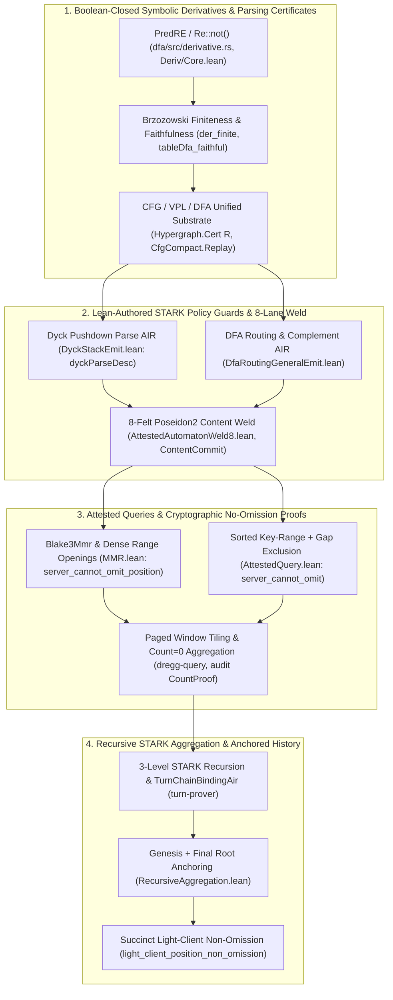
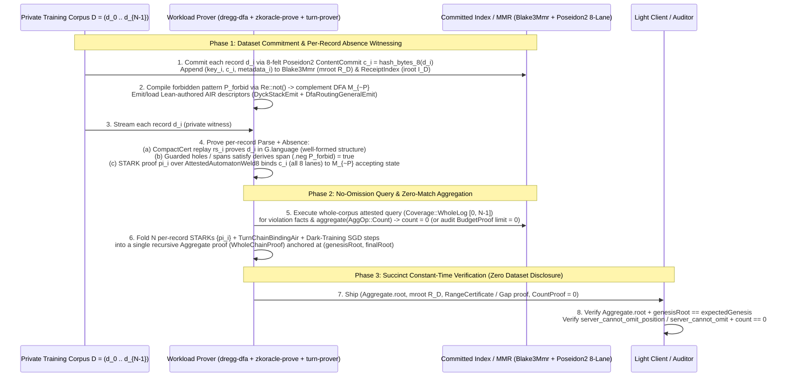

# Primary-Source Dossier 01: Parsing Certificates, Regex-Complement DFAs, Attested Queries, & Proving the Absence of Information from Training Sets / Corpora / Logs

> **Primary-Source Scope**: `/Users/ember/dev/breadstuffs` (`dfa/`, `dregg-query/`, `zkoracle-prove/`, `zkoracle-live/`, `deco-prove/`, `audit/`, `turn-prover/`, `tokenizer/`, `dregg-doc/`, `metatheory/Dregg2/{Crypto,Lightclient,Circuit}/`), `/Users/ember/dev/_research/{extended-regexes,finiteness-derivatives}`, `/Users/ember/dev/zkml-research`, `/Users/ember/dev/minidregg`, and `~/.claude/projects/-Users-ember-dev-breadstuffs/memory/`.
>
> **Target Thesis (Ember)**:
> *"lets really dig in a bit more deeply into some of the capabilities and explorations, as workload verification is very important to us ;) especially because our parsing certificates and other work can prove the absence of certain information from the training set, using the query and aggregation protocols we already defined"*

---

## Executive Summary: Why Proving Absence Requires Five Interlocking Primitives

Proving a **positive** fact about a dataset or log—such as *"document $d$ is in training corpus $C$"*—requires only a single Merkle inclusion path. By contrast, proving a **negative (absence) property**—such as *"no training example in corpus $C$ contains PII pattern $P$, copyrighted canary $K$, benchmark test question $Q$, or template-breaking injection payload $I$, without revealing the corpus $C$"*—is a universal quantification ($\forall i \in [0, |C|), \text{record}_i \notin \mathcal{L}(P)$) over private, structured data.

An adversarial prover attempting to forge an absence proof has five distinct attack surfaces:
1. **Language-Complement Evasion**: Standard regular expression engines (Thompson $\varepsilon$-NFAs) cannot express complement ($\neg P$) or intersection ($P_1 \cap P_2$) without eager powerset determinization at every negation node.
2. **Structural / Framing Smuggling**: A forbidden string or control token split across JSON fields or template holes, or embedded in malformed syntax, can fool a flat scanner that lacks a context-free grammar (CFG) parse proof.
3. **Cross-Leg Splicing / Narrow Commitment Collisions**: Proving authenticity on document $A$ while running the absence matcher on a benign document $B$, or exploiting a narrow 1-felt ($\sim 31$-bit) commitment waist via birthday or linear-combination collisions.
4. **Selective Omission / Log Slicing**: Returning an attested query over 99.9% of the training corpus while silently dropping the positions or index keys that contain the forbidden information, or truncating the prefix/suffix of the dataset log.
5. **Linear Verification Blowup**: Shipping millions of per-record STARK proofs and Merkle openings that no light client or auditor can verify in constant time.

Across `/Users/ember/dev/breadstuffs` and `/Users/ember/dev/zkml-research`, Ember designed and formally verified in Lean 4 (`#assert_axioms`-clean, zero `sorry`) all five layers needed to close these exact attack surfaces:



---

## 1. Verified Regular Expression Complement & Symbolic Derivatives (`dregg-dfa`, `Deriv/*`, `_research`)

### 1.1 Architectural Motivation & Blueprints (`_research/extended-regexes` & `_research/finiteness-derivatives`)

During session `25937974-acb0-4804-95a2-21268c3353d4` (2026-06-25), Ember identified that scattered boolean-matching surfaces across `breadstuffs` (the `Pred` slot-policy algebra, `CaveatPred` macaroon caveats, `FilterTree` capability revocation, and the `dregg-dfa` router) needed a unified boolean-closed sequence-matching foundation:

> **Ember (`cv` session `25937974`, prompt `[2067]`, 2026-06-25)**:
> *"also burntsushi crates are maybe relevant and also compiling NFA to DFA maybe inefficient and wondering it there's an efficient NFA automaton we can run directly in circuit.... also this paper /Users/ember/Desktop/3704837.pdf about RE# is worth evaluating..."*
>
> **Ember (`cv` session `25937974`, prompts `[2153]` & `[2191]`, 2026-06-25)**:
> *"yes........ yes! boolean matching! we definitely need to research regrounding that stuff :)"*
> *"(can fork and port it) and also we can improve our stuff... but like i'm not convinced we need to use their effectivebooleanalgebra or anything like that if we really need we can just prove whatever theorems over in our system..."*

Two external Lean 4 developments in `/Users/ember/dev/_research/` served as **read-only architectural blueprints** (never imported as dependencies, thereby avoiding both licensing gates and the `v4.24.0-rc1` $\to$ `v4.30.0` Mathlib version mismatch; see [DERIVATIVE-MATCHING-DESIGN.md](file:///Users/ember/dev/breadstuffs/docs/deos/DERIVATIVE-MATCHING-DESIGN.md#L32-L53)):
1. **`/Users/ember/dev/_research/extended-regexes`** (Zhuchko, Veanes, Ebner, CPP'24, *"Lean Formalization of Extended Regular Expression Matching with Lookarounds"*, foundation for RE# POPL'25):
   - Defines `inductive RE` in [Definitions.lean](file:///Users/ember/dev/_research/extended-regexes/Regex/Definitions.lean#L14-L26) over an `EffectiveBooleanAlgebra α σ` with constructors `ε`, `Pred (e : α)`, `Alternation (l r : RE)`, `Intersection (l r : RE)`, `Concatenation (l r : RE)`, `Star (r : RE)`, `Negation (r : RE)`, and four lookaround operators (`?=`, `?<=`, `?!`, `?<!`).
   - Proves `theorem correctness : sp ⊢ R ↔ sp ⊫ R` in [Correctness.lean](file:///Users/ember/dev/_research/extended-regexes/Regex/Correctness.lean#L375).
2. **`/Users/ember/dev/_research/finiteness-derivatives`** (Zhuchko, Margus, Veanes, ITP'25, *"Finiteness of Symbolic Derivatives in Lean"*):
   - Proves in [Finite.lean](file:///Users/ember/dev/_research/finiteness-derivatives/Finiteness/Finite.lean#L18-L112) that the symbolic derivative state space `steps r n` is finite up to ACI similarity $(\cdot \cong \cdot)$, bounded by the power-set sum over-approximation `⊕(pieces r)`:
     ```lean
     theorem step_to_pieces {e : RE α} (e_in : e ∈ step f) :
       ∃ xs, toSum xs ≅ e ∧ xs ∈ neSubsets (pieces f)
     ...
     theorem finiteness [DecidableEq α] {r : RE α} :
       ∃ (xs : List (RE α)), ∀ {n : ℕ}, steps r n ⊆[ (· ≅ ·) ] xs :=
       ⟨⊕(pieces r),steps_to_toSumSubsets⟩
     ```

Ember's key simplification when porting this architecture to `metatheory/Dregg2/Crypto/Deriv/` was:
- **Use `Dregg2.Exec.PredAlgebra.Pred` as the leaf algebra over `σ := Dregg2.Exec.Value`** instead of an abstract `EffectiveBooleanAlgebra` typeclass (`Pred` is already a proven Boolean algebra with `eval_not_not` and De Morgan laws in `PredAlgebra.lean:259-299`).
- **Drop the four lookarounds**: without lookarounds, nullability (`null : PredRE → Bool`) is location-independent, `der` requires no mutual recursion with `existsMatch` and no height-bounded subtype, and the termination metric collapses to `starMetric (R : PredRE) : Nat ×ₗ Nat := toLex (starHeight R, size R)` ([Core.lean](file:///Users/ember/dev/breadstuffs/metatheory/Dregg2/Crypto/Deriv/Core.lean#L200-L201)).

---

### 1.2 Rust Implementation: `dregg-dfa` (`dfa/src/compiler.rs`, `dfa/src/derivative.rs`, `dfa/src/air.rs`)

The [`dregg-dfa`](file:///Users/ember/dev/breadstuffs/dfa/src/lib.rs#L1-L77) crate is the canonical pattern-compilation and routing engine in `breadstuffs`. It separates **out-of-circuit regex compilation** from **in-circuit flat-table execution**:

#### A. Flat Deterministic Finite Automaton (`Dfa`) & `Pattern::Not`
In [compiler.rs](file:///Users/ember/dev/breadstuffs/dfa/src/compiler.rs#L18-L43), state identifiers are `u32` with `DEAD_STATE = 0` reserved as a sink state (`transitions[0 * 256 + b] = 0` for all $b \in [0, 255]$):

```rust
pub type StateId = u32;
pub const DEAD_STATE: StateId = 0;

#[derive(Clone, Debug, PartialEq, Eq, Serialize, Deserialize)]
pub struct Dfa {
    pub num_states: u32,
    /// Flat transition table: `transitions[state * 256 + byte] = next_state`.
    pub transitions: Vec<StateId>,
    pub start: StateId,
    pub accepting: BTreeSet<StateId>,
}
```

The surface pattern grammar [`Pattern`](file:///Users/ember/dev/breadstuffs/dfa/src/compiler.rs#L371-L405) includes exact words, byte ranges, bitmasks, sequences, conjunction (`All`), disjunction (`Any`), offsets, repetitions, prefix-matching, and **native complement (`Not`)**:

```rust
#[derive(Clone, Debug, PartialEq, Eq, Serialize, Deserialize)]
pub enum Pattern {
    Word(Vec<u8>),
    Range(u8, u8),
    AnyByte,
    Bit(usize, u8, bool),
    Seq(Vec<Pattern>),
    All(Vec<Pattern>),
    Any(Vec<Pattern>),
    Offset(usize, Box<Pattern>),
    Repeat(Box<Pattern>, usize),
    BytesAt(usize, Vec<u8>),
    PrefixOf(Box<Pattern>),
    /// Complement: matches any input that the inner pattern does NOT match.
    ///
    /// Compiled via the derivative front-end ([`crate::derivative::Re::not`]),
    /// which is closed under complement natively.
    Not(Box<Pattern>),
}
```

When [`Pattern::compile(&self) -> Dfa`](file:///Users/ember/dev/breadstuffs/dfa/src/compiler.rs#L479-L485) is invoked, [`needs_derivative()`](file:///Users/ember/dev/breadstuffs/dfa/src/compiler.rs#L489-L501) checks whether any node in the AST contains `Pattern::Not`. If so, it lowers the `Pattern` via [`Pattern::to_re(&self) -> Re`](file:///Users/ember/dev/breadstuffs/dfa/src/compiler.rs#L507-L561) and compiles it through the symbolic-derivative front-end (`self.to_re().compile()`), which emits the exact same flat `Dfa` struct consumed by the STARK AIR.

#### B. Symbolic Byte-Class Derivative Engine (`dfa/src/derivative.rs`)
In [derivative.rs](file:///Users/ember/dev/breadstuffs/dfa/src/derivative.rs#L53-L169), character classes over `u8` are represented as canonical, sorted, non-overlapping inclusive intervals [`ByteClass`](file:///Users/ember/dev/breadstuffs/dfa/src/derivative.rs#L53-L56) with exact Boolean operations (`union`, `intersect`, `complement`), and extended regular expressions are represented by [`Re`](file:///Users/ember/dev/breadstuffs/dfa/src/derivative.rs#L152-L169):

```rust
#[derive(Clone, Debug, PartialEq, Eq, PartialOrd, Ord, Hash)]
pub struct ByteClass {
    /// Sorted, non-overlapping, adjacent-merged `(low, high)` inclusive ranges.
    ranges: Vec<(u8, u8)>,
}

#[derive(Clone, Debug, PartialEq, Eq, PartialOrd, Ord, Hash)]
pub enum Re {
    /// `∅` — matches nothing.
    Empty,
    /// `ε` — matches only the empty input `""`.
    Epsilon,
    /// Single byte in `ByteClass` (always non-empty; empty class normalizes to `Empty`).
    Sym(ByteClass),
    /// Concatenation `R · S`.
    Cat(Box<Re>, Box<Re>),
    /// Union / alternation `R | S`.
    Alt(Box<Re>, Box<Re>),
    /// Intersection `R & S` — derived lazily: `δ_b(R & S) = δ_b(R) & δ_b(S)`.
    Inter(Box<Re>, Box<Re>),
    /// Complement `~R` — derived natively: `δ_b(~R) = ~δ_b(R)`, `ν(~R) = !ν(R)`.
    Neg(Box<Re>),
    /// Kleene star `R*` (zero or more repetitions).
    Star(Box<Re>),
}
```

To guarantee that Brzozowski determinization terminates in a small number of states, [`Re`](file:///Users/ember/dev/breadstuffs/dfa/src/derivative.rs#L186-L267) enforces **ACI (Associativity, Commutativity, Idempotence) canonicalization** inside its smart constructors (`Re::then`, `Re::or`, `Re::and`, `Re::not`, `Re::star`):
- `Re::or` and `Re::and` sort operands via derived `Ord` (`let (l, r) = if l <= r { (l, r) } else { (r, l) }`), flatten right-associatively, deduplicate `R | R = R` and `R & R = R`, and short-circuit on `Empty` and ` Re::any_bytes()` ($\Sigma^* = \neg\emptyset$).
- [`Re::not(r: Re) -> Self`](file:///Users/ember/dev/breadstuffs/dfa/src/derivative.rs#L247-L253) eliminates double negation (`Re::Neg(inner) => *inner`).
- Nullability [`Re::nullable(&self) -> bool`](file:///Users/ember/dev/breadstuffs/dfa/src/derivative.rs#L273-L284) and the Brzozowski derivative [`Re::derive(&self, b: u8) -> Re`](file:///Users/ember/dev/breadstuffs/dfa/src/derivative.rs#L288-L307) are defined directly on the normalized AST:

```rust
pub fn nullable(&self) -> bool {
    match self {
        Re::Empty | Re::Sym(_) => false,
        Re::Epsilon | Re::Star(_) => true,
        Re::Cat(l, r) | Re::Inter(l, r) => l.nullable() && r.nullable(),
        Re::Alt(l, r) => l.nullable() || r.nullable(),
        Re::Neg(r) => !r.nullable(),
    }
}

pub fn derive(&self, b: u8) -> Re {
    match self {
        Re::Empty | Re::Epsilon => Re::Empty,
        Re::Sym(cls) => {
            if cls.contains(b) { Re::Epsilon } else { Re::Empty }
        }
        Re::Cat(l, r) => {
            let dl_r = l.derive(b).then((**r).clone());
            if l.nullable() { dl_r.or(r.derive(b)) } else { dl_r }
        }
        Re::Alt(l, r) => l.derive(b).or(r.derive(b)),
        Re::Inter(l, r) => l.derive(b).and(r.derive(b)),
        Re::Neg(r) => r.derive(b).not(),
        Re::Star(r) => r.derive(b).then(self.clone()),
    }
}
```

Instead of calling `derive(b)` 256 times per reachable state, [`Re::derivative_classes(&self) -> Vec<(u8, u8)>`](file:///Users/ember/dev/breadstuffs/dfa/src/derivative.rs#L327-L341) collects all interval cut-points from `Sym(cls)` leaves (`collect_cuts`) to partition $[0, 255]$ into equivalence classes `[lo, hi]` on which every leaf predicate has constant truth value. Then [`Re::compile(&self) -> Dfa`](file:///Users/ember/dev/breadstuffs/dfa/src/derivative.rs#L459-L537) explores only reachable derivative states, evaluating `cur_re.derive(lo)` once per equivalence class and fanning `next_id` across `transitions[base + b]` for `b in lo..=hi`. Conversely, [`Re::from_dfa(dfa: &Dfa) -> Re`](file:///Users/ember/dev/breadstuffs/dfa/src/derivative.rs#L376-L441) implements state elimination so any compiled `Dfa` can be lifted back into `Re` and complemented via `.not()`.

#### C. AIR Witness Generation & Verification (`dfa/src/air.rs`)
In [air.rs](file:///Users/ember/dev/breadstuffs/dfa/src/air.rs#L14-L114), a flat `Dfa` execution over `input: &[u8]` is witnessed as a sequence of `AirTraceRow` steps bound to a `router_root: [u8; 32]`:

```rust
#[derive(Clone, Debug, PartialEq, Eq, Serialize, Deserialize)]
pub struct AirTraceRow {
    pub step: u32,
    pub state: StateId,
    pub byte: u8,
    pub next_state: StateId,
}

#[derive(Clone, Debug, PartialEq, Eq, Serialize, Deserialize)]
pub struct AirTrace {
    pub router_root: [u8; 32],
    pub transitions: Vec<StateId>,
    pub num_states: u32,
    pub start: StateId,
    pub accepting: Vec<StateId>,
    pub input: Vec<u8>,
    pub trace: Vec<AirTraceRow>,
}
```

---

### 1.3 Lean 4 Formalization: `metatheory/Dregg2/Crypto/Deriv/*` & `Dfa.lean`

The Lean 4 formalization in `metatheory/Dregg2/Crypto/Deriv/` proves the entire derivative tower `#assert_axioms`-clean (`⊆ {propext, Classical.choice, Quot.sound}`) and `sorry`-free:

#### A. `PredRE`, `null`, `der`, `derives`, and `Matches` ([Core.lean](file:///Users/ember/dev/breadstuffs/metatheory/Dregg2/Crypto/Deriv/Core.lean#L41-L290))
```lean
inductive PredRE where
  | ε
  | sym   (φ : Pred)
  | alt   (l r : PredRE)
  | inter (l r : PredRE)
  | cat   (l r : PredRE)
  | star  (r : PredRE)
  | neg   (r : PredRE)
  deriving Repr, DecidableEq

@[simp]
def leaf (φ : Pred) (a : Value) : Bool :=
  φ.eval (symbolOld a) a

@[simp]
def null : PredRE → Bool
  | .ε         => true
  | .sym _     => false
  | .alt l r   => null l || null r
  | .inter l r => null l && null r
  | .cat l r   => null l && null r
  | .star _    => true
  | .neg r     => !(null r)

@[simp]
def der (a : Value) : PredRE → PredRE
  | .ε         => .sym .ff
  | .sym φ     => if leaf φ a then .ε else .sym .ff
  | .alt l r   => .alt (der a l) (der a r)
  | .inter l r => .inter (der a l) (der a r)
  | .neg r     => .neg (der a r)
  | .cat l r   => if null l
                  then .alt (.cat (der a l) r) (der a r)
                  else .cat (der a l) r
  | .star r    => .cat (der a r) (.star r)

@[simp]
def derives : List Value → PredRE → Bool
  | [],      R => null R
  | a :: as, R => derives as (der a R)
```
Note how `leaf` supports both stateless single-frame evaluation (`symbolOld a = emptyFrame` when unassigned) and stateful two-frame transition pairs crafted via `transitionSymbol (old : Value) : Value → Value` ([Core.lean](file:///Users/ember/dev/breadstuffs/metatheory/Dregg2/Crypto/Deriv/Core.lean#L81-L119)).

The declarative semantics [`Matches : List Value → PredRE → Prop`](file:///Users/ember/dev/breadstuffs/metatheory/Dregg2/Crypto/Deriv/Core.lean#L267-L290) is defined by well-founded recursion on `starMetric R = toLex (starHeight R, size R)`:
```lean
def Matches (w : List Value) (R : PredRE) : Prop :=
  match R with
  | .ε         => w = []
  | .sym φ     => ∃ a : Value, w = [a] ∧ leaf φ a = true
  | .alt l r   => Matches w l ∨ Matches w r
  | .inter l r => Matches w l ∧ Matches w r
  | .cat l r   => ∃ w₁ w₂ : List Value, w₁ ++ w₂ = w ∧ Matches w₁ l ∧ Matches w₂ r
  | .neg r     => ¬ Matches w r
  | .star r    => ∃ n : Nat, Matches (w := w) (repeatCat r n)
termination_by (starMetric R, w.length)
```

#### B. Derivative Correctness & Complement Homomorphism ([Correctness.lean](file:///Users/ember/dev/breadstuffs/metatheory/Dregg2/Crypto/Deriv/Correctness.lean#L97-L268))
In `Correctness.lean`, Ember proves that `derives` is a exact Boolean homomorphism on `.inter` and `.neg` and is sound and complete with respect to `Matches`:
```lean
@[simp]
theorem derives_inter (w : List Value) (l r : PredRE) :
    derives w (.inter l r) = (derives w l && derives w r)

@[simp]
theorem derives_neg (w : List Value) (r : PredRE) :
    derives w (.neg r) = !(derives w r)

theorem correctness (w : List Value) (R : PredRE) :
    derives w R = true ↔ Matches w R
```

#### C. Brzozowski Finiteness ([Finiteness.lean](file:///Users/ember/dev/breadstuffs/metatheory/Dregg2/Crypto/Deriv/Finiteness.lean#L328-L349))
In `Finiteness.lean` (landed 2026-06-25, commit `8ba854ce5`), the multi-step symbolic derivative state space `steps r n` is proven finite up to ACI similarity `≅` for all $n \in \mathbb{N}$:
```lean
theorem steps_to_toSumSubsets {r : PredRE} {n : Nat} :
    steps r n ⊆[ (· ≅ ·) ] ⊕(pieces r)

theorem der_finite {r : PredRE} :
    ∃ (xs : List PredRE), ∀ {n : Nat}, steps r n ⊆[ (· ≅ ·) ] xs :=
  ⟨⊕(pieces r), steps_to_toSumSubsets⟩
```

#### D. Determinization, `TableDfa` Faithfulness, & Symbolic Emptiness Decision ([Determinize.lean](file:///Users/ember/dev/breadstuffs/metatheory/Dregg2/Crypto/Deriv/Determinize.lean#L114-L136), [TableDfa.lean](file:///Users/ember/dev/breadstuffs/metatheory/Dregg2/Crypto/Deriv/TableDfa.lean#L110-L168), [SymbolicDecision.lean](file:///Users/ember/dev/breadstuffs/metatheory/Dregg2/Crypto/Deriv/SymbolicDecision.lean#L80-L139))
In `Determinize.lean` and `TableDfa.lean`, the derivative automaton is welded to `Dregg2.Crypto.Dfa.DfaAccepts`:
```lean
theorem derivativeDfa_correct (R : PredRE) (a : Value) (as : List Value) :
    DfaAccepts derStep R nullAccept (runTrace R (a :: as)) ↔ derives (a :: as) R = true

theorem derivativeDfa_matches (R : PredRE) (a : Value) (as : List Value) :
    DfaAccepts derStep R nullAccept (runTrace R (a :: as)) ↔ Matches (a :: as) R

theorem tableRun_dfaAccepts (td : TableDfa State Sym) (a : Sym) (as : List Sym) :
    DfaAccepts td.δ td.start td.accept (runTrace td td.start (a :: as)) ↔ td.accepts (a :: as)

theorem tableDfa_faithful (td : TableDfa PredRE Value) (R : PredRE)
    (hagree : ∀ w, td.accepts w ↔ derives w R = true) :
    ∀ w, td.accepts w ↔ Matches w R

theorem derivativeTable_finite (R : PredRE) :
    ∃ xs : List PredRE, ∀ {n}, steps R n ⊆[ (· ≅ ·) ] xs := der_finite
```
Furthermore, in `SymbolicDecision.lean` (commit `c1aa7e97c` / `735b76169`, 2026-07-18), `der_finite` is combined with a pigeonhole pumping argument (`emptinessBound R = |⊕(pieces R)|`) and minterm factoring to provide a computable `Decidable` instance for unbounded regex emptiness over the infinite `Value` alphabet on the deployed guard fragment `DeployedRE`:
```lean
abbrev DeployedRE : Type := {R : PredRE // IsDeployed R}

def predRE_emptiness_decidable (R : DeployedRE) :
    Decidable (∃ w, derives w R.val = true) :=
  predRENonemptyDecidable R.property
```

#### E. In-Circuit DFA Verification & Unified Certificate Substrate ([Dfa.lean](file:///Users/ember/dev/breadstuffs/metatheory/Dregg2/Crypto/Dfa.lean#L74-L203), [DfaAsCert.lean](file:///Users/ember/dev/breadstuffs/metatheory/Dregg2/Crypto/DfaAsCert.lean#L55-L132))
In `Dfa.lean`, the STARK AIR trace is bridged to `DfaAccepts`:
```lean
def DfaAccepts (δ : State → Sym → State → Prop) (q₀ : State) (accept : State → Prop)
    (trace : List (Step State Sym)) : Prop :=
  ∃ first last,
    trace.head? = some first ∧
    trace.getLast? = some last ∧
    first.state = q₀ ∧
    accept last.next ∧
    (∀ s ∈ trace, stepValid δ s) ∧
    chained trace

theorem dfa_bridge (δ : State → Sym → State → Prop) (q₀ : State) (accept : State → Prop)
    (trace : List (Step State Sym)) :
    (∀ circuit : CircuitIR State Sym, circuit.trace = trace →
      Satisfies δ q₀ accept circuit → DfaAccepts δ q₀ accept trace) ∧
    (DfaAccepts δ q₀ accept trace →
      ∃ circuit : CircuitIR State Sym, Satisfies δ q₀ accept circuit)

theorem dfa_verify_sound {State Sym : Type} [K : DfaVerifierKernel State Sym Proof]
    (hext : K.extractable) (stmt : Statement State Sym) (proof : Proof)
    (haccept : K.verify stmt proof = true) :
    ∃ trace : List (Step State Sym), DfaAccepts stmt.δ stmt.q₀ stmt.accept trace
```
And in `DfaAsCert.lean` (commit `9548bfc7a`, 2026-07-17), `DfaAccepts` is proved definitionally equivalent to `Hypergraph.Cert delta` (`delta a b := b.state = a.next`), uniting regular DFA recognition and context-free grammar parsing on one relation-parametric certificate substrate:
```lean
theorem dfaAccepts_as_cert (δ : State → Sym → State → Prop) (q₀ : State) (accept : State → Prop)
    (trace : List (Step State Sym)) :
    DfaAccepts δ q₀ accept trace ↔
      ∃ first last : Step State Sym,
        first.state = q₀ ∧
        accept last.next ∧
        (∀ s ∈ trace, stepValid δ s) ∧
        Hypergraph.Cert delta first last trace

theorem regular_and_cf_share_substrate
    (first last : Step State Sym) {T : Type} (g : ContextFreeGrammar T) (input : List T) :
    ((∃ c, Hypergraph.Cert delta first last c) ↔ Relation.ReflTransGen delta first last)
    ∧
    ((∃ c, Hypergraph.Cert g.Produces
        [Symbol.nonterminal g.initial] (input.map Symbol.terminal) c) ↔ input ∈ g.language) :=
  ⟨Hypergraph.bridge delta first last, Hypergraph.cfg_parse_via_reduction g input⟩
```

---

## 2. Parsing Certificates, Guarded Templates, & STARK Policy Guards (`Cfg.lean`, `ZkOracle.lean`, `zkoracle-prove`, `DyckStackEmit.lean`)

### 2.1 Context-Free Parsing Certificates: Form-Chain (`Cfg.lean`) vs. O(tokens) Pushdown Replay (`CfgCompact.lean`)

During session `3e00cf4f-418c-4725-861d-79a681805f78` (2026-07-16), Ember pushed the verification stack from flat regular expressions to full context-free parsing certificates and composable proof-producing templates:

> **Ember (`cv` session `3e00cf4f`, prompts `[1634]`, `[1947]`, `[2220]`, 2026-07-16)**:
> *"wtf lmao the injection freedom was supposed to be a proof that a given string cuold have been generated from a given handlebars template (a parsing/unparsing argument)"*
> *"wait our template language shouldn't really be REGULAR ... is it? ??? that seems wrong-headed/weak when we have a full CFG/graph-rewriting architecture available right??"*
> *"read, we do need to figure out some way to compose these things with the regex/dfa type stuff so that we can have a maximally flexible & also extremely efficient setup for the attestation/witness/proofs/etc."*

1. **Form-Chain Certificate ([Cfg.lean](file:///Users/ember/dev/breadstuffs/metatheory/Dregg2/Crypto/Cfg.lean#L57-L125))**:
   Models a context-free derivation over Mathlib's `ContextFreeGrammar T` as a `Hypergraph.Cert g.Produces` chain from `[Symbol.nonterminal g.initial]` to `input.map Symbol.terminal`:
   ```lean
   def producesChain (g : ContextFreeGrammar T) : List (List (Symbol T g.NT)) → Prop :=
     Hypergraph.chain g.Produces

   def CfgAccepts (g : ContextFreeGrammar T) (input : List T)
       (chain : List (List (Symbol T g.NT))) : Prop :=
     Hypergraph.Cert g.Produces [Symbol.nonterminal g.initial] (input.map Symbol.terminal) chain

   theorem cfg_bridge (g : ContextFreeGrammar T) (input : List T) :
       (∃ chain, CfgAccepts g input chain) ↔ input ∈ g.language :=
     Hypergraph.cfg_parse_via_reduction g input

   theorem cfg_verify_sound {T : Type} [K : CfgVerifierKernel T Proof]
       (hext : K.extractable) (stmt : Statement T) (proof : Proof)
       (haccept : K.verify stmt proof = true) :
       stmt.input ∈ stmt.g.language
   ```
2. **Compact $O(\text{tokens})$ Leftmost Rule-Sequence Certificate ([CfgCompact.lean](file:///Users/ember/dev/breadstuffs/metatheory/Dregg2/Crypto/CfgCompact.lean#L48-L94))**:
   Because storing every intermediate sentential form in `Cfg.lean` takes $O(\text{tokens}^2)$ symbols (2.15 billion symbols on 32.8k dense JSON tokens, overflowing stack near 65k tokens; see [ZKORACLE-PROVER-STATUS.md](file:///Users/ember/dev/breadstuffs/docs/deos/ZKORACLE-PROVER-STATUS.md#L173-L176)), `CfgCompact.lean` (commit `0eb08bf32`, 2026-07-06) replaces the wire format with the $O(\text{tokens})$ leftmost rule sequence `rs : List (ContextFreeRule T g.NT)` verified by an inductive pushdown replay machine `Replay`:
   ```lean
   inductive Replay (g : ContextFreeGrammar T) :
       List (ContextFreeRule T g.NT) → List T → List (Symbol T g.NT) → Prop
     | done : Replay g [] [] []
     | term {rs : List (ContextFreeRule T g.NT)} {input : List T} {stk : List (Symbol T g.NT)}
         (t : T) : Replay g rs input stk → Replay g rs (t :: input) (Symbol.terminal t :: stk)
     | rule {r : ContextFreeRule T g.NT} {rs : List (ContextFreeRule T g.NT)} {input : List T}
         {stk : List (Symbol T g.NT)} (hr : r ∈ g.rules) :
         Replay g rs input (r.output ++ stk) →
         Replay g (r :: rs) input (Symbol.nonterminal r.input :: stk)

   def ReplayAccepts (g : ContextFreeGrammar T) (rs : List (ContextFreeRule T g.NT))
       (input : List T) : Prop :=
     Replay g rs input [Symbol.nonterminal g.initial]

   theorem replay_derives {g : ContextFreeGrammar T}
       {rs : List (ContextFreeRule T g.NT)} {input : List T} {stk : List (Symbol T g.NT)}
       (h : Replay g rs input stk) : g.Derives stk (input.map Symbol.terminal)

   theorem compact_sound (g : ContextFreeGrammar T) (rs : List (ContextFreeRule T g.NT))
       (input : List T) (h : ReplayAccepts g rs input) : input ∈ g.language

   theorem compact_to_chain (g : ContextFreeGrammar T) (rs : List (ContextFreeRule T g.NT))
       (input : List T) (h : ReplayAccepts g rs input) :
       ∃ chain, CfgAccepts g input chain :=
     (cfg_bridge g input).mpr (compact_sound g rs input h)
   ```
3. **Four Rungs on One `Hypergraph.Cert R` Substrate ([VpaAsCert.lean](file:///Users/ember/dev/breadstuffs/metatheory/Dregg2/Crypto/VpaAsCert.lean#L183-L238), [ReplayAsCert.lean](file:///Users/ember/dev/breadstuffs/metatheory/Dregg2/Crypto/ReplayAsCert.lean#L117-L236))**:
   In `VpaAsCert.lean` (commit `df7645d3a`, 2026-07-17) and `ReplayAsCert.lean` (commit `7b292b047`, 2026-07-17), Visibly Pushdown Automata (VPA, where stack height is input-determined via `stack_height_input_determined`, making equivalence EXPTIME-decidable in `VpaDecidable.lean`) and pushdown `Replay` are proven to be instances of `Hypergraph.Cert`, and the multi-row trace induction is subsumed by one generic `Hypergraph.Cert.foldSound` application:
   ```lean
   theorem three_rungs_share_substrate
       {State Sym : Type u} (firstD lastD : Dfa.Step State Sym)
       {Call Int Ret VState StackSym : Type u}
       (M : VPA Call Int Ret VState StackSym) (firstV lastV : VStep Call Int Ret VState StackSym)
       {T : Type} (g : ContextFreeGrammar T) (input : List T) :
       ((∃ c, Hypergraph.Cert DfaAsCert.delta firstD lastD c) ↔
         Relation.ReflTransGen DfaAsCert.delta firstD lastD)
       ∧
       ((∃ c, Hypergraph.Cert (R_vpa M) firstV lastV c) ↔
         Relation.ReflTransGen (R_vpa M) firstV lastV)
       ∧
       ((∃ c, Hypergraph.Cert g.Produces
           [Symbol.nonterminal g.initial] (input.map Symbol.terminal) c) ↔ input ∈ g.language)
   ```
4. **Guard-Parametric Proof-Producing Templates ([HandlebarsGuarded.lean](file:///Users/ember/dev/breadstuffs/metatheory/Dregg2/Crypto/HandlebarsGuarded.lean#L58-L150))**:
   In `HandlebarsGuarded.lean` (commit `5371f5582`, 2026-07-17), template holes carry arbitrary `PredRE` guards (`GSeg.hole (id : Nat) (guard : PredRE)`) over the infinite `Value` alphabet, uniting regular `PredRE` leaves with template composition:
   ```lean
   def guardedSafe (T : GuardedTemplate) (d : Nat → List Value) : Prop :=
     ∀ id g, GSeg.hole id g ∈ T.segments → derives (d id) g = true

   theorem guarded_render_mem_language (T : GuardedTemplate) (d : Nat → List Value)
       (hsafe : guardedSafe T d) :
       render T d ∈ (guardedToGrammar T).language

   theorem noDoubleBraceRE_iff (w : List Handlebars.Tok) :
       derives (w.map tokVal) noDoubleBraceRE = true ↔ Handlebars.NoDoubleBrace w
   ```

---

### 2.2 Lean-Authored STARK Policy Guards (`DyckStackEmit.lean`, `DfaRoutingGeneralEmit.lean`, `AttestedAutomatonWeld8.lean`)

Per Ember's standing architectural Law #1 ([project-lean-authored-air-law.md](file:///Users/ember/.claude/projects/-Users-ember-dev-breadstuffs/memory/project-lean-authored-air-law.md#L14-L16)):
> *"ZERO Rust-authored constraints or AIRs, EVER. ALL circuits and ALL constraint semantics are EMITTED FROM LEAN and formally represented. Rust only INTERPRETS Lean-emitted byte-pinned artifacts."*

Three Lean-emitted IR-v2 descriptors in `metatheory/Dregg2/Circuit/Emit/` implement the in-circuit parsing and DFA-complement guards:

1. **Dyck Pushdown Parse Descriptor (`"dregg-dyck-parse-v1"`, [DyckStackEmit.lean](file:///Users/ember/dev/breadstuffs/metatheory/Dregg2/Circuit/Emit/DyckStackEmit.lean#L466-L573) & [DyckStackReplay.lean](file:///Users/ember/dev/breadstuffs/metatheory/Dregg2/Circuit/Emit/DyckStackReplay.lean#L934-L958))**:
   - Emits `dyckParseDesc : EffectVmDescriptor2` (width `DYCK_WIDTH = 24`, 4 public inputs `[initial_symbol, input_len, table_commitment, route_commitment]`, 79 constraints, 2 narrow Poseidon2 chip lookups for `ENTRY_HASH = hash_4_to_1(RULE_ID, STACK0, INPUT_TOKEN, 0)` and rolling `RUNNING_HASH = hash_2_to_1(ACC, ENTRY_HASH)`).
   - Enforces bounded stack depth $D = 5$ via vanishing polynomial `depthRangeBody` ($\prod_{v=0}^5 (\text{STACK\_DEPTH} - v) = 0$) to close field-wraparound congruence attacks (`depth_range_zero_iff`, commit `63463d032`), plus `bracket_shift_zero_iff`, `bracket_overflow_zero_iff`, `rule_membership_zero_iff`, and `terminal_top_zero_iff`.
   - In [DyckStackReplay.lean](file:///Users/ember/dev/breadstuffs/metatheory/Dregg2/Circuit/Emit/DyckStackReplay.lean#L934-L942) (commit `e4072a3d4`, 2026-07-17), `parse_sat_imp_replay_emit_unconditional` proves unconditionally that any trace `t` satisfying the byte-pinned `DyckStackEmit.dyckParseDesc` has its trace-decoded word `decodedWord t n` accepted by `CfgCompact.ReplayAccepts`:
     ```lean
     theorem parse_sat_imp_replay_emit_unconditional {hash : List ℤ → ℤ} {minit : ℤ → ℤ}
         {mfin : ℤ → ℤ × Nat} {maddrs : List ℤ} {t : VmTrace}
         (hsat : Satisfied2 hash DyckStackEmit.dyckParseDesc minit mfin maddrs t) (hcanon : DyckCanon t)
         (n : Nat) (hn : n + 1 < t.rows.length) (hnp : n < 2013265921)
         (hpi : t.pub PI_INITIAL = SYM_S)
         (hdone : (envAt t n).loc IS_DONE = 1)
         (hlive : ∀ i, i < n → (envAt t i).loc IS_DONE = 0) :
         ReplayAccepts dyck (rulesOf (decodeRun (decodedWord t n) t (n + 1))) (decodedWord t n)
     ```
2. **3-State Complement DFA Descriptor (`"dfa-routing-injection-3state::poseidon2-v1"`, [DfaRoutingGeneralEmit.lean](file:///Users/ember/dev/breadstuffs/metatheory/Dregg2/Circuit/Emit/DfaRoutingGeneralEmit.lean#L198-L263))**:
   - Models the 3-state complement DFA for $\neg(\Sigma^* \cdot \text{"\{\{"} \cdot \Sigma^*)$: states `S_CLEAN = 0` (start, accepting), `S_BRACE = 1` (saw one `{`, accepting), `S_DEAD = 2` (saw `{{`, non-accepting sink); symbols `SYM_OTHER = 0`, `SYM_BRACE = 1`.
   - Encodes the transition table $\delta : \{0,1,2\} \times \{0,1\} \to \{0,1,2\}$ as a doubled bivariate Lagrange interpolant over $\mathbb{Z}$ (avoiding $\mathbb{Q}$ denominators):
     $$G(a, b, \text{next}) = 2\cdot\text{next} - 2a^2 + 2a + 3a^2b - 5ab - 2b$$
   - Proves exactness over the domain (`transition_body_zero_iff`, [DfaRoutingGeneralEmit.lean](file:///Users/ember/dev/breadstuffs/metatheory/Dregg2/Circuit/Emit/DfaRoutingGeneralEmit.lean#L233-L238)):
     ```lean
     theorem transition_body_zero_iff (a : Assignment)
         (hst : a COL_STATE = 0 ∨ a COL_STATE = 1 ∨ a COL_STATE = 2)
         (hsym : a COL_SYMBOL = 0 ∨ a COL_SYMBOL = 1) :
         transitionBody.eval a = 0 ↔
           a COL_NEXT = δ_spec (a COL_STATE) (a COL_SYMBOL)
     ```
3. **8-Felt Wide Attested Automaton Weld (`"attested-automaton-weld8-v1"`, [AttestedAutomatonEmit.lean](file:///Users/ember/dev/breadstuffs/metatheory/Dregg2/Circuit/Emit/AttestedAutomatonEmit.lean#L236-L270) & [AttestedAutomatonWeld8.lean](file:///Users/ember/dev/breadstuffs/metatheory/Dregg2/Circuit/Emit/AttestedAutomatonWeld8.lean#L186-L262))**:
   - Proves that running an automaton over an attested message payload while binding all 8 Poseidon2 digest lanes (`WELD_LANES = 8`, public inputs `PI_MSG_COMMIT 0..7` and `PI_FINAL_STATE = 8`) forces two satisfying traces with equal 8-lane commitments to run the automaton on the exact same message (or exhibit an 8-lane `Chip8Collision` at $\sim 2^{123.63}$ birthday security).

---

### 2.3 Capstone Composition (`ZkOracle.lean`, `zkoracle-prove`, `zkoracle-live`, `deco-prove`)

In [ZkOracle.lean](file:///Users/ember/dev/breadstuffs/metatheory/Dregg2/Crypto/ZkOracle.lean#L54-L105), the three legs—DECO/zkTLS provenance, JSON CFG well-formedness, and `PredRE.neg` complement matching—compose into `zkOracle_sound`:

```lean
def injectionTemplate : PredRE :=
  .cat (.star (.sym .tt)) (.cat (.sym (matchCode handlebarsOpen)) (.star (.sym .tt)))

def InjectionFree (field : List Value) : Prop :=
  derives field (.neg injectionTemplate) = true

theorem zkOracle_sound
    {SK MK ProofD ProofC : Type}
    [KD : Deco.DecoVerifierKernel SK MK ProofD]
    [KC : Cfg.CfgVerifierKernel JsonTok ProofC]
    (hdeco_ext : KD.extractable)
    (hcfg_ext : KC.extractable)
    (hcommit : DecoUnforgeable.CommitBinding KD.compress)
    (hmac : DecoUnforgeable.MacUnforgeable MK KD.mac)
    (decoStmt : Deco.Statement SK MK) (decoProof : ProofD)
    (body : List JsonTok) (cfgProof : ProofC)
    (field : List Value)
    (hdeco : KD.verify decoStmt decoProof = true)
    (hcfg  : KC.verify ⟨jsonGrammar, body⟩ cfgProof = true)
    (hinj  : verifyInjectionFree field = true) :
    DecoUnforgeable.decoAuthenticated SK MK KD.compress KD.encode decoStmt ∧
    body ∈ jsonGrammar.language ∧
    InjectionFree field
```

In Rust, [`dregg-zkoracle-prove`](file:///Users/ember/dev/breadstuffs/zkoracle-prove/src/lib.rs#L1-L86) and [`dregg-zkoracle-live`](file:///Users/ember/dev/breadstuffs/zkoracle-live/src/lib.rs#L1-L46) (split into a feature-free crate on 2026-07-27, commit `5d29e1baa`, alongside [`dregg-deco-prove`](file:///Users/ember/dev/breadstuffs/deco-prove/src/lib.rs#L1-L79)) realize all three legs plus the **cross-leg Poseidon2 weld**:
- **`zkoracle-prove/src/attestation.rs`**:
  - Defines `pub const CONTENT_COMMIT_W: usize = 8; pub type ContentCommit = [BabyBear; CONTENT_COMMIT_W];` ([attestation.rs](file:///Users/ember/dev/breadstuffs/zkoracle-prove/src/attestation.rs#L48-L52)) and `pub fn content_commitment(response_body: &[u8]) -> ContentCommit { hash_bytes_8(response_body) }` ([attestation.rs](file:///Users/ember/dev/breadstuffs/zkoracle-prove/src/attestation.rs#L84-L86)), widened on 2026-08-01 from 1 felt ($\sim 2^{15.45}$ birthday) to the full 8-felt Poseidon2 digest ($\sim 2^{123.63}$).
  - [`ZkOracleAttestation`](file:///Users/ember/dev/breadstuffs/zkoracle-prove/src/attestation.rs#L110-L143) bundles `presentation: EndpointPresentation`, `cfg_cert: CompactCert`, `field_span: FieldSpan { offset, len }`, `content_commit: ContentCommit`, `zk_injection: Option<ZkInjectionProof>`, and `tlsn_presentation: Option<Vec<u8>>`.
  - [`verify_zkoracle_with_policy`](file:///Users/ember/dev/breadstuffs/zkoracle-prove/src/attestation.rs#L315-L398) verifies Leg 1 (MPC-TLS / DECO authenticity and secret header redaction), recomputes `content_commitment(&response_body) == att.content_commit` (`CrossLegMismatch` if unequal), slices `field = &response_body[att.field_span]` (`SpanOutOfBounds` if invalid), verifies Leg 2 (`verify_cfg_compact(&att.cfg_cert, &response_body)`), and verifies Leg 3 (`verify_injection_free(field)` + optional STARK `verify_injection_stark(zk, field)`).
- **`zkoracle-prove/src/cfg.rs`**:
  - Defines the 16-production LL(1)-disambiguated JSON grammar [`json_grammar()`](file:///Users/ember/dev/breadstuffs/zkoracle-prove/src/cfg.rs#L168-L246) and both [`ParseCertificate`](file:///Users/ember/dev/breadstuffs/zkoracle-prove/src/cfg.rs#L305-L310) (full form-chain) and [`CompactCert { pub rules: Vec<u8> }`](file:///Users/ember/dev/breadstuffs/zkoracle-prove/src/cfg.rs#L605-L611) verified by iterative pushdown replay [`verify_cfg_compact`](file:///Users/ember/dev/breadstuffs/zkoracle-prove/src/cfg.rs#L747-L802).
  - **Measured Paces** ([ZKORACLE-PROVER-STATUS.md](file:///Users/ember/dev/breadstuffs/docs/deos/ZKORACLE-PROVER-STATUS.md#L162-L172)):
    - **1.2 KB single response** (51 JSON tokens): **1 µs** cert prove, **2 µs** cert verify, **318 µs** e2e prove, **314 µs** e2e verify.
    - **256k LLM-token context** (990 KB, 100k JSON tokens): **1.04 ms** cert prove, **993 µs** cert verify, **216 ms** e2e prove.
    - **10M LLM-token context** (39.6 MB, 4.0M JSON tokens, 3.6 MB `CompactCert`): **40 ms** cert prove, **39 ms** cert verify, **8.6 s** e2e prove (dominated by sequential Poseidon2 hashing).
- **`zkoracle-prove/src/zk_leg.rs`**:
  - [`prove_injection_stark(field: &str) -> Result<ZkInjectionProof, String>`](file:///Users/ember/dev/breadstuffs/zkoracle-prove/src/zk_leg.rs#L226-L280) and [`verify_injection_stark(proof: &ZkInjectionProof, field: &str) -> Result<(), ZkLegError>`](file:///Users/ember/dev/breadstuffs/zkoracle-prove/src/zk_leg.rs#L292-L386) prove and verify the 3-state complement DFA over the Lean-emitted descriptor `INJECTION_DESC_NAME = "dfa-routing-injection-3state::poseidon2-v1"` via `prove_vm_descriptor2` / `verify_vm_descriptor2`, recomputing `expected_route = compute_route_commitment(&steps)` so a prover cannot claim clean acceptance on a different byte stream (`RouteCommitmentMismatch`).

---

## 3. Attested Queries, No-Omission Proofs, Audit Logs, & Recursive Aggregation

To prove that **no record in a training set or log matches a forbidden pattern**, verifying per-record parse/complement certificates is not enough: the verifier must also know that **the server or trainer did not omit any record from the scan**.

### 3.1 Dense Positional Non-Omission: Merkle Mountain Ranges (`MMR.lean` & `dregg-query/src/mmr.rs`)

In [MMR.lean](file:///Users/ember/dev/breadstuffs/metatheory/Dregg2/Lightclient/MMR.lean#L1-L1021) (commits `ffd97ecf3` and `27259d03e`, 2026-06-11; hardened in `ed616d24c` and `ee18461c1`, 2026-08-01), an append-only log $L : \text{List } \mathbb{Z}$ is decomposed into a canonical forest of complete binary peaks `peaksOf L : List (MTree ℤ)` with strictly decreasing heights (`Mountains`), whose root is bagged right-to-left via `mroot hash L`:

```lean
theorem forestLeaves_peaksOf (L : List ℤ) : forestLeaves (peaksOf L) = L

theorem peaksOf_mountains (L : List ℤ) : Mountains (peaksOf L)

theorem mroot_binds_or_collides (hash : List ℤ → ℤ) {L₁ L₂ : List ℤ}
    (h : mroot hash L₁ = mroot hash L₂) :
    L₁ = L₂ ∨ SpongeColl hash (mrootFind hash L₁ L₂)
```

For any dense positional range $[lo, hi]$, `RVerifies L lo hi vals` checks that `vals` has exact length `rangeCount L.length lo hi` and every element `vals[j]` opens at position `lo + j` in `L`. Ember proves in [MMR.lean](file:///Users/ember/dev/breadstuffs/metatheory/Dregg2/Lightclient/MMR.lean#L705-L908) that `RVerifies` is **both sound and complete** (`rverifies_iff_exact`), and therefore **a server cannot omit any position**:

```lean
def RVerifies (L : List ℤ) (lo hi : ℕ) (vals : List ℤ) : Prop :=
  vals.length = rangeCount L.length lo hi ∧
    ∀ j v, vals[j]? = some v → Opens L (lo + j) v

theorem range_complete {L : List ℤ} {lo hi : ℕ} {vals : List ℤ}
    (hv : RVerifies L lo hi vals) :
    ∀ i, lo ≤ i → i ≤ hi → i < L.length →
      ∃ v, vals[i - lo]? = some v ∧ Opens L i v

theorem rverifies_iff_exact {L : List ℤ} {lo hi : ℕ} {vals : List ℤ} :
    RVerifies L lo hi vals ↔ vals = mrange L lo hi

theorem server_cannot_omit_position (hash : List ℤ → ℤ)
    {L L' : List ℤ}
    (hroot : mroot hash L' = mroot hash L)
    (hno : ¬ MRootColl hash L' L)
    {lo hi : ℕ} {vals : List ℤ}
    (hv : RVerifies L' lo hi vals) :
    vals = mrange L lo hi ∧
      ∀ i, lo ≤ i → i ≤ hi → i < L.length →
        ∃ v, vals[i - lo]? = some v ∧ Opens L i v
```

In [MMR.lean](file:///Users/ember/dev/breadstuffs/metatheory/Dregg2/Lightclient/MMR.lean#L882-L908), `server_cannot_omit_position` is welded directly to `RecursiveAggregation.light_client_verifies_whole_history` via `CommitBindsMMR`, yielding `light_client_position_non_omission`:
```lean
theorem light_client_position_non_omission
    (Proof : Type) (verify : Proof → Bool)
    (CH : Dregg2.Exec.CellId → Dregg2.Exec.Value → ℤ)
    (RH : Dregg2.Exec.RecordKernelState → ℤ)
    (cmb : ℤ → ℤ → ℤ) (compress : ℤ → ℤ → ℤ) (compressN : List ℤ → ℤ)
    (hash : List ℤ → ℤ) (hCR : Poseidon2SpongeCR hash)
    (extractMMR : List ChainStep → List ℤ)
    (agg : Aggregate Proof) (g : RecChainedState) (steps : List ChainStep)
    (es : EngineSound Proof verify CH RH cmb compress compressN agg g steps)
    (hweld : CommitBindsMMR CH RH cmb compress compressN hash extractMMR g steps)
    (hroot : verify agg.root = true)
    {L' : List ℤ}
    (hmroot : mroot hash L' = mroot hash (extractMMR steps))
    {lo hi : ℕ} {vals : List ℤ}
    (hv : RVerifies L' lo hi vals) :
    vals = mrange (extractMMR steps) lo hi ∧
      (∀ i, lo ≤ i → i ≤ hi → i < (extractMMR steps).length →
        ∃ v, vals[i - lo]? = some v ∧ Opens (extractMMR steps) i v) ∧
      AggregateAttests Proof CH RH cmb compress compressN agg g steps
```

In Rust, [`dregg-query/src/mmr.rs`](file:///Users/ember/dev/breadstuffs/dregg-query/src/mmr.rs#L36-L273) implements `MmrHasher`, `Blake3Mmr` (with domain tags `"dregg-query-mmr-v1:{empty,leaf,node,bag}"`), `Peak`, `MmrProof`, `RangeOpening`, and `verify_range`:
- [`verify_range`](file:///Users/ember/dev/breadstuffs/dregg-query/src/mmr.rs#L223-L273) rejects non-strictly-decreasing peak heights, checks `bag_peaks::<H>(&opening.peaks) == root`, derives the exact log length `len = Σ (1 << peak.height)` from the committed peak heights, checks `opening.values.len() == range_count(len, lo, hi)` (returning `RangeCountMismatch` if any item is dropped), and verifies each leaf's Merkle path up to its peak using direction bits derived solely from the dense offset `(offset >> level) & 1`.

---

### 3.2 Key-Range Non-Omission & Gap Exclusion (`HistoryIndex.lean`, `AttestedQuery.lean`, `dregg-query`)

When querying by key rather than dense position (e.g., `(subject, height, seq)` in `HistoryIndex.lean`), positions are sparse, so a contiguous slice of results could still hide a matching key unless **boundary gaps** are proven empty.
In [HistoryIndex.lean](file:///Users/ember/dev/breadstuffs/metatheory/Dregg2/Lightclient/HistoryIndex.lean#L54-L214) and [AttestedQuery.lean](file:///Users/ember/dev/breadstuffs/metatheory/Dregg2/Lightclient/AttestedQuery.lean#L62-L447):
- `ReceiptKey := ℤ ×ₗ (ℤ ×ₗ ℤ)` and `ReceiptIndex := List (ReceiptKey × ℤ)`, committed via `iroot hash idx`.
- [`inductive Gap (κ : Type u)`](file:///Users/ember/dev/breadstuffs/metatheory/Dregg2/Lightclient/AttestedQuery.lean#L62-L73) witnesses an open interval `(a, b)` of adjacent keys in a sorted list `l` containing no keys between `a` and `b`:
  ```lean
  inductive Gap (κ : Type u)
    | empty
    | below (b : κ)
    | inner (a b : κ)
    | above (a : κ)

  theorem Gap.excludes {l : List κ} {g : Gap κ} {k : κ}
      (hs : Sorted l) (hv : g.Valid l) (hc : g.covers k) : k ∉ l
  ```
- An [`Answer κ ν`](file:///Users/ember/dev/breadstuffs/metatheory/Dregg2/Lightclient/AttestedQuery.lean#L112-L120) carries `items : List (κ × ν)` plus boundary gap witnesses `leftGap : Gap κ` and `rightGap : Gap κ`. [`Verifies h lo hi ans`](file:///Users/ember/dev/breadstuffs/metatheory/Dregg2/Lightclient/AttestedQuery.lean#L127-L135) checks that `items` is a contiguous sublist (`IsInfix`) of the sorted index `h` and that `leftGap` / `rightGap` bridge `lo` to `items.head` and `items.last` to `hi` (or cover `[lo, hi]` when `items = []`).
- **Key-Range Non-Omission Theorem ([AttestedQuery.lean](file:///Users/ember/dev/breadstuffs/metatheory/Dregg2/Lightclient/AttestedQuery.lean#L166-L363))**:
  ```lean
  def AnswerComplete (h : List (κ × ν)) (lo hi : κ) (ans : Answer κ ν) : Prop :=
    ∀ e ∈ h, inRange lo hi e.1 → e ∈ ans.items

  theorem answer_complete {h : List (κ × ν)} {lo hi : κ} {ans : Answer κ ν}
      (hs : SortedKeys h) (hv : Verifies h lo hi ans) :
      AnswerComplete h lo hi ans

  theorem server_cannot_omit (hash : List ℤ → ℤ) (hCR : Poseidon2SpongeCR hash)
      {idx idx' : ReceiptIndex}
      (hs : SortedKeys idx)
      (hroot : iroot hash idx' = iroot hash idx)
      {lo hi : ReceiptKey} {ans : Answer ReceiptKey ℤ}
      (hv : Verifies idx' lo hi ans) :
      AnswerComplete idx lo hi ans ∧
        (∀ e ∈ ans.items, e ∈ idx ∧ inRange lo hi e.1)
  ```
  Notice the empty-answer case (`ans.items = []`): `Verifies` requires `ans.leftGap.Valid keys ∧ ans.leftGap.covers lo ∧ ans.leftGap.covers hi`. By convexity of `Gap.covers` and `Gap.excludes`, **every key $k \in [lo, hi]$ is proven absent ($k \notin \text{keys}$) from the committed index**!

---

### 3.3 `dregg-query` Attested Slices, Paged Windows, CALM Classification, & Zero-Count Aggregation

In [`dregg-query/src/`](file:///Users/ember/dev/breadstuffs/dregg-query/src/lib.rs#L1-L70):
- **[`attested.rs`](file:///Users/ember/dev/breadstuffs/dregg-query/src/attested.rs#L25-L216)**:
  - `RangeCertificate` wraps `RangeOpening`, `lo`, and `hi`.
  - `AttestedSlice` pairs `receipts: Vec<TurnReceipt>` with `cert: RangeCertificate`. [`AttestedSlice::verify(&self, expected_root: &[u8; 32])`](file:///Users/ember/dev/breadstuffs/dregg-query/src/attested.rs#L65-L90) checks `self.receipts.len() == self.cert.opening.values.len()`, verifies each `receipt.receipt_hash().0 == leaf`, and runs `verify_range::<Blake3Mmr>(expected_root, self.cert.lo, self.cert.hi, &self.cert.opening)`.
  - `Coverage` (`Coverage::WholeLog` vs `Coverage::Range { lo, hi }`) and [`AttestedAnswer`](file:///Users/ember/dev/breadstuffs/dregg-query/src/attested.rs#L126-L216): `AttestedAnswer::verify(&self, expected_root: &[u8; 32])` enforces that `Coverage::WholeLog` covers `lo == 0` and `(len == 0) || (hi + 1 >= len)` (refusing `PartialCoverageForWholeLog` if truncated), extracts the EDB `FactBase` from the verified receipts, re-evaluates `eval(&base, &self.query)`, and checks `recomputed == self.rows` (`AnswerMismatch` if tampered).
- **[`windows.rs`](file:///Users/ember/dev/breadstuffs/dregg-query/src/windows.rs#L140-L246)**:
  - [`verify_windows(expected_root: &[u8; 32], windows: &[IndexRangeResponse]) -> Result<Vec<TurnReceipt>, WindowVerifyError>`](file:///Users/ember/dev/breadstuffs/dregg-query/src/windows.rs#L140-L216) stitches paged range responses into a single fail-closed whole-log read: it checks that every window's node attestation is signed by the same `node_pubkey` and binds `expected_root`, checks `lo == expected_lo` (rejecting overlaps or gaps with `WindowGapOrOverlap`), guards against `hi == usize::MAX` arithmetic overflow, verifies each `slice.verify(expected_root)`, and requires `expected_lo == len` at the end (`LogTailTruncated` if the tail is omitted).
- **[`classify.rs`](file:///Users/ember/dev/breadstuffs/dregg-query/src/classify.rs#L24-L45) & [`query.rs`](file:///Users/ember/dev/breadstuffs/dregg-query/src/query.rs#L141-L482)**:
  - `classify(q: &Query) -> CoordinationClass` implements the CALM theorem classifier: positive conjunctive queries are `CoordinationClass::Monotone` (valid on prefixes), whereas queries using `not_atom` (negation) or `aggregate` (`AggOp::{Count, Sum, Min, Max}`) are `CoordinationClass::FinalizedDependent` and **require** a `Coverage::WholeLog` no-omission proof.
  - Crucially, in [`aggregate()`](file:///Users/ember/dev/breadstuffs/dregg-query/src/query.rs#L471-L473), when `group_by` is empty (a global aggregate) and `AggOp::Count` is evaluated over an empty match set (`rows.is_empty()`), it emits a single row `[Value::Int(0)]`—**a cryptographically attested `count = 0` absence verdict over the whole log**!

---

### 3.4 Audit Log Proofs (`audit/src/log.rs`, `audit/src/proofs.rs`, `audit/src/budget.rs`)

In [`dregg-audit`](file:///Users/ember/dev/breadstuffs/audit/src/lib.rs#L1-L85), [`AuditLog<H: TreeHash>`](file:///Users/ember/dev/breadstuffs/audit/src/log.rs#L168-L176) maintains a 4-ary append-only Merkle tree (`ARITY = 4`) over `AuditEntry` records (generic over `PoseidonTreeHash` and `Blake3TreeHash`) with four verifiable proof types in [`proofs.rs`](file:///Users/ember/dev/breadstuffs/audit/src/proofs.rs#L19-L260) and [`budget.rs`](file:///Users/ember/dev/breadstuffs/audit/src/budget.rs#L44-L155):
1. **[`CountProof`](file:///Users/ember/dev/breadstuffs/audit/src/proofs.rs#L19-L80)**: Proves the exact total entry count (`count: u64`) under `root: [u8; 32]` in $O(\log_4 N)$ size via the rightmost spine `right_spine: Vec<SpineStep>` (`CountProof::verify` checks that every step uses the last populated child slot and reconstructs `root`).
2. **[`RangeProof`](file:///Users/ember/dev/breadstuffs/audit/src/proofs.rs#L84-L163)**: Proves that a contiguous slice of entries `[start, end)` is complete and unmodified under `root` (`RangeProof::verify` checks `entries.len() == end - start` and verifies boundary + sample inclusion proofs).
3. **[`ConsistencyProof`](file:///Users/ember/dev/breadstuffs/audit/src/proofs.rs#L167-L260)**: Proves that `old_root` (at `old_size`) is a prefix of `new_root` (at `new_size`).
4. **[`BudgetProof`](file:///Users/ember/dev/breadstuffs/audit/src/budget.rs#L44-L155)**: Combines a `RangeProof` over `[0, log_size)` with `CountProof` (`completeness_proof`) to prove that the sum of resource usage matching a `BudgetDimension` (`ActionCount` or `ParamSum`) across the **entire** log is `claimed_total <= limit`—and when `limit = 0`, proves **zero occurrences (`claimed_total == 0`) across the entire log**!

---

### 3.5 Recursive Aggregation & Training-Set / Corpus Custody (`turn-prover`, `RecursiveAggregation.lean`, `zkml-research`, `minidregg`)

1. **3-Level STARK Recursion & Bilateral Bundle Aggregation ([`turn-prover/src/lib.rs`](file:///Users/ember/dev/breadstuffs/turn-prover/src/lib.rs#L1-L143), [`aggregate_bilateral_prover.rs`](file:///Users/ember/dev/breadstuffs/turn-prover/src/aggregate_bilateral_prover.rs#L65-L122))**:
   - `dregg-turn-prover` aggregates $N$ per-cell/per-record STARK proofs into a constant-size outer proof (`AggregatedBundle` with fixed 23-felt `outer_pi`, or `WholeChainProof` via 3-level Plonky3 FRI recursion `prove_turn_chain_recursive`).
2. **Whole-History & Genesis-Anchored Soundness ([`RecursiveAggregation.lean`](file:///Users/ember/dev/breadstuffs/metatheory/Dregg2/Circuit/RecursiveAggregation.lean#L80-L290))**:
   - `Aggregate` exposes `root : Proof`, `genesisRoot : ℤ`, `finalRoot : ℤ`, `chainDigest : ℤ`, and `numTurns : Nat` (pinned by `TurnChainBindingAir`'s `lastRealCountBind` constraint).
   - [`light_client_verifies_anchored_history`](file:///Users/ember/dev/breadstuffs/metatheory/Dregg2/Circuit/RecursiveAggregation.lean#L261-L268) and [`anchored_attests_rejects_fabricated_genesis`](file:///Users/ember/dev/breadstuffs/metatheory/Dregg2/Circuit/RecursiveAggregation.lean#L286-L290) prove that a light client checking only `verify agg.root = true` and `agg.genesisRoot = expectedGenesis` verifies that **every step from genesis to final root executed correctly, no step was reordered/dropped/inserted, and no prefix was hidden**:
     ```lean
     theorem light_client_verifies_anchored_history
         (agg : Aggregate Proof) (g : RecChainedState) (steps : List ChainStep) (expectedGenesis : ℤ)
         (es : EngineSound Proof verify CH RH cmb compress compressN agg g steps)
         (hroot : verify agg.root = true)
         (hanchor : agg.genesisRoot = expectedGenesis) :
         AnchoredAttests Proof CH RH cmb compress compressN agg g steps expectedGenesis
     ```
3. **Training-Set & Encrypted-Weight Verification (`zkml-research`, `minidregg`, `tokenizer`, `dregg-doc`)**:
   - In [`/Users/ember/dev/zkml-research/docs/DARK-TRAINING.md`](file:///Users/ember/dev/zkml-research/docs/DARK-TRAINING.md#L40-L94) and [`/Users/ember/dev/zkml-research/docs/VERDICTS.md`](file:///Users/ember/dev/zkml-research/docs/VERDICTS.md#L783-L876), Ember formalizes **Dark Training** (`Selvage/Rank1GradientCheck.lean` `sgd_step_sound` and `Assurance/ZkmlLowRankUpdate.lean` `matVec_chainUpdate`), where low-rank training updates $W' = W + AB^\top$ form an IVC chain whose accumulator state IS the model (`2rd` committed felts per step instead of $d^2$, $128\times$ smaller at $d=4096, r=16$), and each training step binds its training example $x_t$ to a committed training-set corpus root.
   - In [`/Users/ember/dev/breadstuffs/dregg-doc/src/lib.rs`](file:///Users/ember/dev/breadstuffs/dregg-doc/src/lib.rs#L18-L82), hypermedia documents and corpora are represented as Pijul-style patch graphs (`DocGraph`, `Atom`, `Provenance`) projected via `to_heap_map` into a sorted Poseidon2 cell heap commitment (`substrate_commit`) binding every atom's content and author provenance.
   - In [`/Users/ember/dev/breadstuffs/tokenizer/src/lib.rs`](file:///Users/ember/dev/breadstuffs/tokenizer/src/lib.rs#L1-L32), `dregg-tokenizer` isolates secret credentials via X25519 + ChaCha20-Poly1305 (`SealedSecret`) behind capability-token verification.
   - In [`/Users/ember/dev/minidregg/Pred.lean`](file:///Users/ember/dev/minidregg/Pred.lean#L1-L22) and [`TokenCensus.lean`](file:///Users/ember/dev/minidregg/TokenCensus.lean#L1-L37), the `Pred` algebra (`Pred.HashEq`, `Pred.CoordinationDial`) and `#assert_token_census` enforce syntactic policy evaluation and private-constructor minting invariants across the kernel.

---

## 4. Git & `cv` Archaeological Timeline

| Date | Commit SHA | Repository / Path | Milestone & Primary-Source Significance |
|---|---|---|---|
| `2026-05-24` | `195870682` | `breadstuffs/dfa/` | `dfa: add AIR API (compile_to_air, verify_acceptance) + federation verifier scaffold` |
| `2026-06-11` | `ffd97ecf3` | `breadstuffs/metatheory/Dregg2/Lightclient/` | `non-omission: attested queries — the server cannot hide a receipt (Lean foundation)` (`MMR.lean`, `HistoryIndex.lean`, `AttestedQuery.lean`) |
| `2026-06-11` | `27259d03e` | `breadstuffs/metatheory/` | `EPOCH foundations (Lean): Blum memory-checking + descriptor IR v2 + the v2 re-anchor + MMR receipt index` |
| `2026-06-12` | `0f6e1eb3c` | `breadstuffs/dregg-query/` | `dregg-query: attested queries over the receipt fact-base (18/18, leaf crate)` |
| `2026-06-14` | `9cfe3361d` | `breadstuffs/dregg-query/` | `dregg-query: attested queries — a result carries a proof it's a faithful read of finalized state` |
| `2026-06-25` | `2c50c7c8d` | `breadstuffs/metatheory/Dregg2/Crypto/Deriv/` | `feat(deriv): Stage 0 — PredRE + der/null/derives/Matches over dregg's Pred (#assert_axioms-clean)` |
| `2026-06-25` | `b909fc44a` | `breadstuffs/metatheory/Dregg2/Crypto/Deriv/` | `feat(deriv): Stage 1 — correctness : derives ↔ Matches over PredRE (#assert_axioms-clean)` |
| `2026-06-25` | `b347c0f7b` | `breadstuffs/dfa/src/` | `feat(dfa): derivative FilterTree compiler + Pattern::Not (Stage 2, AIR-neutral)` |
| `2026-06-25` | `8ba854ce5` | `breadstuffs/metatheory/Dregg2/Crypto/Deriv/` | `feat(deriv): Stage 3 CAPSTONE — der_finite, Brzozowski finiteness over PredRE (#assert_axioms-clean)` |
| `2026-06-25` | `41bedeeab` | `breadstuffs/metatheory/Dregg2/Crypto/Deriv/` | `feat(deriv): Stage 4 CLOSE (table-opaque) — TableDfa faithfulness, the compiled table's meaning is a THEOREM` |
| `2026-06-25` | `85179be00` | `breadstuffs/metatheory/Dregg2/Crypto/Deriv/` | `feat(deriv): CLOSE ThompsonRecognizes — explicit Thompson ε-NFA + kernel-clean correctness` |
| `2026-06-26` | `e85a7d9b8` | `breadstuffs/dregg-query/` | `feat(dregg-query): richer EDB + Q3 aggregation + the CommitBindsMMR trust-anchor design` |
| `2026-06-30` | `e9f12605f` | `breadstuffs/metatheory/` | `feat: whole-history non-omission real-as-deployed + the universal sub-proof-folding primitive` |
| `2026-07-06` | `28523fb8f` | `breadstuffs/metatheory/Dregg2/Crypto/` | `feat(crypto): verified zkOracle — CFG parsing, DECO composition, hypergraph + full graph rewriting` |
| `2026-07-06` | `7526c5253` | `breadstuffs/zkoracle-prove/` | `zkoracle-prove: the zkOracle PROVER live (authentic ∧ well-formed ∧ injection-free)` |
| `2026-07-06` | `7a373a284` | `breadstuffs/zkoracle-prove/` | `zkoracle-prove: close the Rust-side cross-leg weld (one committed response)` |
| `2026-07-06` | `0eb08bf32` | `breadstuffs/zkoracle-prove/`, `CfgCompact.lean` | `zkoracle: the COMPACT certificate — O(tokens) wire, proven, long-context scale` |
| `2026-07-07` | `c587ccf59` | `breadstuffs/zkoracle-prove/` | `stark-kill CUTOVER #1: zkOracle injection leg OFF stark.rs → plonky3 descriptor prover — 10.4× faster` |
| `2026-07-12` | `dcc69c6dd` | `breadstuffs/dregg-query/` | `node+dregg-query: node-signed attestation binding the receipt-index MMR root (CommitBindsMMR, step 1)` |
| `2026-07-16` | `d68fd6f8f` | `breadstuffs/metatheory/Dregg2/Crypto/Handlebars.lean` | `crypto/Handlebars: injection-freedom as GENERATION, on the existing CFG stack` |
| `2026-07-16` | `543761093` | `breadstuffs/metatheory/Dregg2/Crypto/HandlebarsWitness.lean` | `crypto/HandlebarsWitness: the proof-PRODUCING render — every render emits its generation certificate` |
| `2026-07-16` | `6cc8e76d8` | `breadstuffs/metatheory/Dregg2/Crypto/HandlebarsCompose.lean` | `crypto/HandlebarsCompose: THE FIFTH THING — proof-carrying renders NEST under composition` |
| `2026-07-17` | `5371f5582` | `breadstuffs/metatheory/Dregg2/Crypto/HandlebarsGuarded.lean` | `crypto/HandlebarsGuarded: the attestable schema language — per-hole PredRE guards kill the arbitrary brace-ban` |
| `2026-07-17` | `9548bfc7a` | `breadstuffs/metatheory/Dregg2/Crypto/DfaAsCert.lean` | `crypto/DfaAsCert: THE LINCHPIN — regex/DFA and CFG on one certificate substrate` |
| `2026-07-17` | `2d71e8cf0` | `breadstuffs/metatheory/Dregg2/Circuit/Emit/DyckStackEmit.lean` | `zk: author the Dyck parse descriptor IN LEAN (law #1) — byte-pinned` |
| `2026-07-17` | `e4072a3d4` | `breadstuffs/metatheory/Dregg2/Circuit/Emit/DyckStackReplay.lean` | `zk: parse soundness UNCONDITIONAL — define the word from the trace, discharge the load-bearing hword` |
| `2026-07-17` | `df7645d3a` | `breadstuffs/metatheory/Dregg2/Crypto/VpaAsCert.lean` | `crypto/VpaAsCert: the visibly-pushdown rung — regex (x) VPL (x) CFG on ONE Cert substrate` |
| `2026-07-18` | `735b76169` | `breadstuffs/metatheory/Dregg2/Crypto/Deriv/` | `crypto/SymbolicEmptiness: BOUNDED emptiness now SOUND ⋀ COMPLETE` |
| `2026-07-30` | `32372fca3` | `breadstuffs/metatheory/Dregg2/Circuit/Emit/` | `attested automaton: OFF THE FLOOR — five theorems that assumed a refuted hypothesis now name a refutable one` (`AttestedAutomatonWeld8.lean`) |
| `2026-08-14` | `daa207ae7` | `breadstuffs/metatheory/` | `circuit!: the 211 lanes that carry no nonlinearity — permEmissionNarrow` |

---

## 5. Synthesis: End-to-End Protocol for Proving the Absence of Information from a Training Set / Workload Corpus

By composing the verified primitives documented in Sections 1–3, we obtain a complete, zero-knowledge-compatible **Training-Set / Workload Corpus Absence Attestation Protocol**. Suppose a model trainer or workload operator holds a private training corpus $\mathcal{D} = (d_0, d_1, \dots, d_{N-1})$ and must prove to an external auditor or light client that **no training record in $\mathcal{D}$ (and no gradient step in training run $W_0 \to W_T$) contains forbidden information specified by a policy $(G, P_{\text{forbid}})$**—where $G$ is a structural Context-Free Grammar / Guarded Template (e.g., JSON schema or chat-turn framing) and $P_{\text{forbid}}$ is a regular pattern (e.g., SSN/PII regex, copyrighted canary string, benchmark evaluation prompt hash/substring, or injection delimiter):



### Step-by-Step Verification Chain & Governing Theorems

#### Step 1: Dual-Anchored Dataset Commitment (`ContentCommit`, `Blake3Mmr`, `ReceiptIndex`)
- Each training document or tokenized batch $d_i$ ($i \in \{0, \dots, N-1\}$) is committed via the 8-lane Poseidon2 sponge [`content_commitment(&d_i) -> [BabyBear; 8]`](file:///Users/ember/dev/breadstuffs/zkoracle-prove/src/attestation.rs#L84-L86) ($\sim 123.63$-bit collision resistance, avoiding the 1-felt wound catalogued in `project-felt-width-repair-campaign.md`).
- Each record's receipt—binding `c_i : ContentCommit` and its policy-compliance verdict tag—is appended to:
  1. The dense positional Merkle Mountain Range [`Blake3Mmr`](file:///Users/ember/dev/breadstuffs/dregg-query/src/mmr.rs#L53-L88) with root `R_D = mroot hash L`, and/or
  2. The sorted key-indexed [`ReceiptIndex`](file:///Users/ember/dev/breadstuffs/metatheory/Dregg2/Lightclient/HistoryIndex.lean#L59) (`ReceiptKey = (subject, height, seq)`) with root `I_D = iroot hash idx` and the 4-ary [`AuditLog<PoseidonTreeHash>`](file:///Users/ember/dev/breadstuffs/audit/src/log.rs#L168-L176).
- **Governing Lean Theorem**: [`mroot_binds_or_collides`](file:///Users/ember/dev/breadstuffs/metatheory/Dregg2/Lightclient/MMR.lean#L493-L495) ensures that under `Poseidon2SpongeCR hash` (or BLAKE3 collision resistance), the committed sequence $L = [r_0, \dots, r_{N-1}]$ is uniquely pinned by `R_D`.

#### Step 2: Verified Complement Compilation (`Pattern::Not`, `Re::not()`, `PredRE.neg`)
- The auditor specifies the forbidden information as a regular expression or predicate pattern $P_{\text{forbid}}$ (or a union of forbidden patterns $P_1 \cup P_2 \cup \dots \cup P_k$, e.g., `* ⬝ canary_bytes ⬝ *`).
- Using [`Pattern::Not(Box::new(P_forbid)).compile()`](file:///Users/ember/dev/breadstuffs/dfa/src/compiler.rs#L404-L485), `dregg-dfa` lowers $\neg P_{\text{forbid}}$ to [`Re::not()`](file:///Users/ember/dev/breadstuffs/dfa/src/derivative.rs#L247-L253) and compiles it via lazy Brzozowski byte-class derivatives (`Re::compile()`) into a flat transition table `Dfa { num_states, transitions, start, accepting }`.
- **Governing Lean Theorems**:
  - [`derives_neg`](file:///Users/ember/dev/breadstuffs/metatheory/Dregg2/Crypto/Deriv/Correctness.lean#L103-L104): `derives w (.neg r) = !(derives w r)`
  - [`correctness`](file:///Users/ember/dev/breadstuffs/metatheory/Dregg2/Crypto/Deriv/Correctness.lean#L267-L268): `derives w (.neg r) = true ↔ Matches w (.neg r)` (which unfolds to `¬ Matches w r`)
  - [`der_finite`](file:///Users/ember/dev/breadstuffs/metatheory/Dregg2/Crypto/Deriv/Finiteness.lean#L347-L349): `∃ (xs : List PredRE), ∀ {n : Nat}, steps r n ⊆[ (· ≅ ·) ] xs` (guaranteeing the derivative DFA state space is finite)
  - [`tableDfa_faithful`](file:///Users/ember/dev/breadstuffs/metatheory/Dregg2/Crypto/Deriv/TableDfa.lean#L133-L135): `∀ w, td.accepts w ↔ Matches w (.neg r)` (guaranteeing that the compiled flat table accepts $w$ **if and only if** $w$ does **not** match $r$).

#### Step 3: Structural Parsing Certificate & Slot Confinement (`CfgCompact.Replay`, `HandlebarsGuarded`, `DyckStackEmit`)
- To prevent an attacker from hiding forbidden tokens across structural boundaries (e.g., splitting a canary across JSON keys/strings or breaking out of template slots), each record $d_i$ is parsed against the corpus schema grammar $G$ (such as `json_grammar()` in [`zkoracle-prove/src/cfg.rs`](file:///Users/ember/dev/breadstuffs/zkoracle-prove/src/cfg.rs#L168-L246) or a `GuardedTemplate` in [`HandlebarsGuarded.lean`](file:///Users/ember/dev/breadstuffs/metatheory/Dregg2/Crypto/HandlebarsGuarded.lean#L66-L82)), emitting an $O(\text{tokens})$ compact leftmost rule sequence `CompactCert { rules }`.
- When verified in-circuit via the Lean-authored pushdown parse AIR ([`DyckStackEmit.dyckParseDesc`](file:///Users/ember/dev/breadstuffs/metatheory/Dregg2/Circuit/Emit/DyckStackEmit.lean#L466-L473)) and the DFA routing AIR ([`DfaRoutingGeneralEmit.injectionRoutingDesc`](file:///Users/ember/dev/breadstuffs/metatheory/Dregg2/Circuit/Emit/DfaRoutingGeneralEmit.lean#L198-L206)), both legs are welded to the **same** 8-felt `ContentCommit` $c_i$ via [`AttestedAutomatonWeld8.lean`](file:///Users/ember/dev/breadstuffs/metatheory/Dregg2/Circuit/Emit/AttestedAutomatonWeld8.lean#L186-L262).
- **Governing Lean Theorems**:
  - [`compact_sound`](file:///Users/ember/dev/breadstuffs/metatheory/Dregg2/Crypto/CfgCompact.lean#L81-L85): `ReplayAccepts g rs input → input ∈ g.language`
  - [`parse_sat_imp_replay_emit_unconditional`](file:///Users/ember/dev/breadstuffs/metatheory/Dregg2/Circuit/Emit/DyckStackReplay.lean#L934-L942): satisfying the byte-pinned `dyckParseDesc` unconditionally yields `ReplayAccepts dyck (rulesOf ...) (decodedWord t n)`
  - [`guarded_render_mem_language`](file:///Users/ember/dev/breadstuffs/metatheory/Dregg2/Crypto/HandlebarsGuarded.lean#L145-L150) & [`slot_confinement`](file:///Users/ember/dev/breadstuffs/metatheory/Dregg2/Crypto/SlotConfinement.lean#L190): every extracted slot satisfies its `PredRE` complement guard and cannot alter the surrounding structural frame
  - [`dfa_verify_sound`](file:///Users/ember/dev/breadstuffs/metatheory/Dregg2/Crypto/Dfa.lean#L200-L203) & [`zkOracle_sound`](file:///Users/ember/dev/breadstuffs/metatheory/Dregg2/Crypto/ZkOracle.lean#L90-L105): in-circuit verification implies both grammar membership ($d_i \in G.\text{language}$) and complement satisfaction ($\text{derives } d_i\text{ } (\text{.neg } P_{\text{forbid}}) = \text{true}$).

#### Step 4: Cryptographic No-Omission & Zero-Count Aggregation (`dregg-query`, `MMR.lean`, `AttestedQuery.lean`, `audit`)
- Why can't the prover simply omit record $d_{42}$ (which contains the forbidden data) when generating the proof?
  1. **Dense Positional Scan (`MMR.lean` + `dregg-query/src/attested.rs` + `windows.rs`)**:
     - The query requires `Coverage::WholeLog` over `[0, len - 1]` (enforced by `classify(&q) == CoordinationClass::FinalizedDependent` for negated/aggregate queries in [`classify.rs`](file:///Users/ember/dev/breadstuffs/dregg-query/src/classify.rs#L24-L45) and checked by [`AttestedAnswer::verify`](file:///Users/ember/dev/breadstuffs/dregg-query/src/attested.rs#L172-L216) or paged [`verify_windows`](file:///Users/ember/dev/breadstuffs/dregg-query/src/windows.rs#L140-L216)).
     - By [`server_cannot_omit_position`](file:///Users/ember/dev/breadstuffs/metatheory/Dregg2/Lightclient/MMR.lean#L780-L787), `RVerifies L' 0 (L.length - 1) vals` under `mroot hash L' = mroot hash L` forces `vals = mrange L 0 (L.length - 1) = L`: **every single position $i \in [0, |L|)$ must be present and opened**.
  2. **Sparse Key-Index Lookup (`AttestedQuery.lean`)**:
     - If the auditor queries a specific key range `[lo, hi]` in `ReceiptIndex` (for instance, querying an index of extracted n-gram/canary keys or violation tags), an empty answer `ans.items = []` must carry a valid `Gap` witness `ans.leftGap` covering `[lo, hi]`.
     - By [`Gap.excludes`](file:///Users/ember/dev/breadstuffs/metatheory/Dregg2/Lightclient/AttestedQuery.lean#L97-L98) and [`server_cannot_omit`](file:///Users/ember/dev/breadstuffs/metatheory/Dregg2/Lightclient/AttestedQuery.lean#L358-L363), `Verifies idx' lo hi ans` proves `AnswerComplete idx lo hi ans`, which for `ans.items = []` proves $\forall e \in \text{idx}, \neg \text{inRange } lo\text{ } hi\text{ } e.1$.
  3. **Zero-Count Aggregation (`dregg-query/src/query.rs` & `audit/src/budget.rs`)**:
     - Evaluating `Query::select(...).aggregate(vec![], vec![AggSpec { op: AggOp::Count, ... }])` over the verified whole-log slice yields a single row `[Value::Int(0)]` ([`query.rs:471-473`](file:///Users/ember/dev/breadstuffs/dregg-query/src/query.rs#L471-L473)), or equivalently in `dregg-audit`, [`BudgetProof::verify`](file:///Users/ember/dev/breadstuffs/audit/src/budget.rs#L84-L155) verifies `RangeProof` over `[0, log_size)` + `CountProof` (`right_spine` pinning exact `log_size`) with `claimed_total = 0 <= limit = 0`.

#### Step 5: Recursive STARK Folding & Training-Run Welding (`turn-prover`, `RecursiveAggregation.lean`, `DARK-TRAINING.md`)
- Rather than requiring the auditor to inspect $N$ individual record proofs or $T$ individual SGD steps, [`turn-prover`](file:///Users/ember/dev/breadstuffs/turn-prover/src/lib.rs#L1-L143) folds the $N$ leaf STARK proofs (via the universal sub-proof-folding primitive `prove_chain_core_rotated` / `prove_turn_chain_recursive`) together with `TurnChainBindingAir` into one root proof `agg : Aggregate Proof`.
- By [`light_client_verifies_anchored_history`](file:///Users/ember/dev/breadstuffs/metatheory/Dregg2/Circuit/RecursiveAggregation.lean#L261-L268), [`anchored_history_starts_at_genesis`](file:///Users/ember/dev/breadstuffs/metatheory/Dregg2/Circuit/RecursiveAggregation.lean#L274-L280), and [`light_client_position_non_omission`](file:///Users/ember/dev/breadstuffs/metatheory/Dregg2/Lightclient/MMR.lean#L882-L908):
  - Checking **only** `verify agg.root = true` and `agg.genesisRoot = expectedGenesis` guarantees:
    1. **Prefix & Tail Completeness**: The history starts at `expectedGenesis` (`anchored_attests_rejects_fabricated_genesis` rules out hidden-prefix attacks), ends at `agg.finalRoot`, and folds exactly `agg.numTurns = steps.length` steps (`turns_pinned` via `lastRealCountBind`).
    2. **Every-Record Policy Satisfaction**: By `every_leaf_verifies_implies_executed` (`Forall₂` positional pairing in `EngineSound.leaf_sound`), every folded turn $s \in \text{steps}$ satisfied the verified executor and its welded custom/DFA/CFG leaf proof ($\forall i \in [0, N), d_i \in G.\text{language} \land d_i \notin \mathcal{L}(P_{\text{forbid}})$).
    3. **Whole-Corpus Non-Omission**: By `CommitBindsMMR` + `light_client_position_non_omission`, the MMR root `mroot hash (extractMMR steps)` is bound inside `agg.finalRoot`, so no training record $d_i$ could be omitted from the corpus or swapped during `sgd_step_sound` / `matVec_chainUpdate` training steps—all while keeping the raw dataset $\mathcal{D}$ and encrypted weights $W_t$ completely private.
