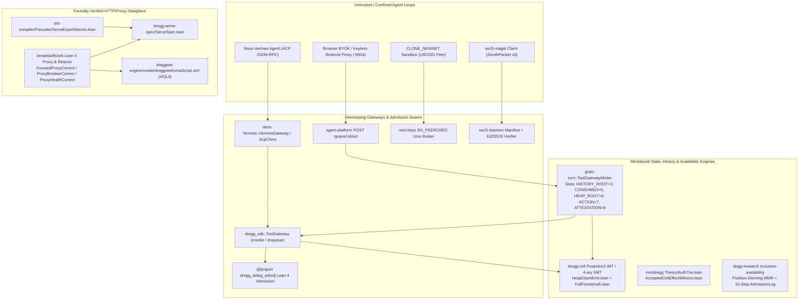

# Dossier 02: Merkle Agent Proxies, Capability Gateways, and Formally Verified HTTP/Proxy Dataplanes

> **Scope & Primary-Source Grounding:** This dossier provides a source-locked technical archaeology of Ember's intercepting agent proxies, capability-gated tool/LLM gateways, Merkleized state/history/availability engines, and formally verified HTTP/proxy dataplanes across `/Users/ember/dev/breadstuffs`, `/Users/ember/dev/minidregg`, `/Users/ember/dev/degg-research`, `/Users/ember/dev/DreggNet`, `/Users/ember/dev/dregg-serve-spec`, `/Users/ember/dev/dreggnet-engine`, and `/Users/ember/zenith/secS-daemon`. Every architectural claim is anchored to exact file paths, 1-indexed line numbers, verbatim Rust/Python/Lean 4/HOL4 declarations, git commit SHAs, and `cv` session transcripts.

---

## Executive Architecture Overview

Across the Dregg, MiniDregg, Dark Egg Research (`degg-research`), DreggNet, Orb, and `secS-magik` repositories, Ember's agent infrastructure treats **every external side effect—whether a local filesystem edit, a subprocess invocation, an outbound HTTP fetch, or an LLM inference call—as a capability-gated, metered, and cryptographically receipted state transition over a Merkleized substrate**:



1. **Dual-Surface Mandate Enforcement (`ToolGateway` + `Dregg2.Apps.DelegAdmit`):** Inbound agent tool calls are intercepted before execution. Rather than trusting a hand-written Rust policy mirror, [`sdk/src/tool_gateway.rs`](file:///Users/ember/dev/breadstuffs/sdk/src/tool_gateway.rs#L241-L253) marshals every invocation across the C-ABI boundary into the Lean 4 decision procedure `Dregg2.Apps.DelegAdmit.delegAdmit` (`@[export dregg_deleg_admit]` in [`metatheory/Dregg2/Apps/DelegAdmit.lean`](file:///Users/ember/dev/breadstuffs/metatheory/Dregg2/Apps/DelegAdmit.lean#L67-L73)), checking `SCOPE ∧ DEADLINE ∧ STEP ∧ SANE ∧ RATE`. Simultaneously, the worker cell carries an on-ledger `mandate_program` enforcing `StateConstraint::FieldLte` and `StateConstraint::Monotonic` on `CALLS_MADE_SLOT`, preventing rollback or rate-ceiling bypass even if a caller circumvents the in-band gateway check.
2. **Keyless & Networkless Credential Isolation (`agent-platform`, `mini-keys`, `deos-hermes`):** Agent sandboxes never hold raw upstream API keys. In `agent-platform` ([`agent-platform/src/serve.rs`](file:///Users/ember/dev/breadstuffs/agent-platform/src/serve.rs#L659-L733)) and [`demo/keyless-grain-proxy.py`](file:///Users/ember/dev/breadstuffs/demo/keyless-grain-proxy.py#L1-L78), the LLM brain proposes tool calls from outside the sandbox while `POST /act` cap-gates, meters, executes, and returns both the `AgentReceipt` (`cell_root`) and the observation summary (`tool_summary` + `outcome`). In MiniDregg's [`native/mini-keys`](file:///Users/ember/dev/minidregg/native/mini-keys/src/peer.rs#L15-L49), agents run inside `CLONE_NEWNET` networkless namespaces and talk to a local Unix socket broker that authenticates caller identity via kernel `SO_PEERCRED` (`getsockopt(fd, SOL_SOCKET, SO_PEERCRED, ...)` on Linux / `getpeereid` on macOS/BSD), authorizes per-epoch grants (`provider-authorize`), writes a durable ticket bound to the exact request body digest, and forwards a single POST (`provider-forward`) while polling `caller_gone` (`POLLIN`) to abort immediately on lease revocation.
3. **Per-Grain State, Heap, Attestation, and MMR History Welding (`grain-turn`):** [`grain-turn/src/lib.rs`](file:///Users/ember/dev/breadstuffs/grain-turn/src/lib.rs#L103-L275) welds five distinct commitments into the 32-byte field slots of a single grain worker cell on every turn: `CALLS_MADE_SLOT` (rate counter), `HISTORY_ROOT_SLOT = 3` (Blake3 MMR root over prior `dregg-receipt-v5` turn receipt hashes), `CONSUMED_SLOT = 5` (cumulative meter spend), `HEAP_ROOT_SLOT = 6` (the grain's key-value `VarTree` / heap root), `ACTION_SLOT = 7` (domain-separated `dregg-grain-action-commit-v1` action commitment), and `ATTESTATION_SLOT = 8` (the 8-lane `ZkOracleAttestation` MPC-TLS + STARK DFA injection-freedom commitment).
4. **Formally Verified HTTP/Proxy Dataplane (`orb`, `dregg-serve-spec`, `orb-compiler`, `dreggnet-engine`):** At the network edge, [`breadstuffs/orb`](file:///Users/ember/dev/breadstuffs/orb/Dataplane.lean#L1-L70) implements a full HTTP/1.1, HTTP/2, HTTP/3, WebSocket, gRPC-Web, Forward Proxy (`CONNECT`), and CapTP reverse proxy in Lean 4, exported via `@[export drorb_serve]` to a native Rust socket reactor. Its admission control (`ForwardProxyCorrect.lean`), circuit breaker (`ProxyBreakerCorrect.lean`), and HAProxy-style `rise`/`fall` active health checks (`ProxyHealthCorrect.lean`) are proven by refinement against independent state machines with explicit non-vacuity counter-theorems. Meanwhile, [`orb-compiler/Pancake/ServeExportServes.lean`](file:///Users/ember/dev/breadstuffs/orb-compiler/Pancake/ServeExportServes.lean#L362-L586) proves that the lowered Pancake systems-language codegen (`serveExport`) satisfies `PancakeSem` and writes the exact `ServeSpec.serialize` bytes into word-addressed memory, and [`dreggnet-engine/model/dreggnetArenaScript.sml`](file:///Users/ember/dev/dreggnet-engine/model/dreggnetArenaScript.sml#L36-L138) proves in HOL4 that the zero-copy arena + `SIDECAR_BASE = 2^31` mutation buffer resolver is total and length-exact.

---

## 1. Agent Tool-Call, ACP & Keyless BYOK Intercepting Proxies

### 1.1 `dregg_sdk::ToolGateway` & the Lean 4 `@[export dregg_deleg_admit]` C-ABI Bridge

The foundational primitive for confining tool-calling agents in `breadstuffs` is [`sdk/src/tool_gateway.rs`](file:///Users/ember/dev/breadstuffs/sdk/src/tool_gateway.rs#L1-L625) (1,626 lines). Rather than embedding ad-hoc policy checks inside an agent harness, `ToolGateway` turns every inbound tool call into a capability-gated, metered, and optionally priced (`Effect::Transfer`) turn on the verified Dregg executor.

#### Mandate Parameters: `ToolGrant` and `Charge`

At delegation time, the grantor pins both a rate/scope/deadline mandate (`ToolGrant`, lines 120–130) and an optional per-call market price (`Charge`, lines 164–173):

```rust
// /Users/ember/dev/breadstuffs/sdk/src/tool_gateway.rs:120-130
#[derive(Clone, Debug, PartialEq, Eq)]
pub struct ToolGrant {
    /// The single allowlisted tool / MCP id (the SCOPE, in-band face).
    pub tool_id: i64,
    /// The granted invocation ceiling `N` (the RATE).
    pub rate_limit: i64,
    /// The expiry height/clock (the DEADLINE).
    pub deadline: i64,
    /// The executor method verb the worker's credential is scoped to (the
    /// SCOPE's executor face).
    pub tool_method: String,
}

// /Users/ember/dev/breadstuffs/sdk/src/tool_gateway.rs:164-173
#[derive(Clone, Debug, PartialEq, Eq)]
pub struct Charge {
    /// The per-call price the provider charges (moved consumer → provider).
    pub price: u64,
    /// The provider cell that receives each call's payment (agent B).
    pub provider: CellId,
    /// The consumer's total spend allowance under this mandate: cumulative
    /// `spent` may never exceed this (the VALUE budget, the money analogue of the
    /// grant's rate ceiling).
    pub budget: u64,
}
```

#### Eliminating the "Byte-Faithful Rust Mirror": `dregg_deleg_admit`

Historically, `sdk/src/tool_gateway.rs`, `starbridge-apps/tool-access-delegation/src/lib.rs`, and `dreggnet-offerings/src/session.rs` each maintained a five-conjunct `&&` expression in Rust described as a "byte-faithful Rust mirror" of the Lean specification. Ember deleted all three mirrors and replaced them with a direct C-ABI FFI call into Lean 4 (`@[export dregg_deleg_admit]`), documented in [`metatheory/Dregg2/Apps/DelegAdmit.lean`](file:///Users/ember/dev/breadstuffs/metatheory/Dregg2/Apps/DelegAdmit.lean#L12-L23):

> *"That `delegAdmit` was a plain `def` — not `@[export]`ed — so THREE hand-maintained Rust re-implementations of the same five-conjunct decision shipped alongside it (`sdk/src/tool_gateway.rs`, `starbridge-apps/tool-access-delegation/src/lib.rs`, `dreggnet-offerings/src/session.rs`). Each was 'the byte-faithful Rust mirror'; none of them was the decision. A Rust mirror plus a differential test is NOT a verified implementation — there is no formal semantics of Rust, so a case-test proves nothing about all inputs. This module is where `Grant` and `delegAdmit` now LIVE, and it is `@[export dregg_deleg_admit]`-ed so Rust CALLS it."*

The Lean 4 definition in [`metatheory/Dregg2/Apps/DelegAdmit.lean`](file:///Users/ember/dev/breadstuffs/metatheory/Dregg2/Apps/DelegAdmit.lean#L52-L73) imports nothing beyond core `Init` (so `leanc`-emitted C code links into `libdregg_lean.a` without dragging Mathlib initializers into the FFI binary):

```lean
-- /Users/ember/dev/breadstuffs/metatheory/Dregg2/Apps/DelegAdmit.lean:52-73
structure Grant where
  /-- The single allowlisted tool / MCP id the worker is scoped to (the SCOPE). -/
  toolId    : Int
  /-- The granted invocation ceiling N: at most N tool calls under this mandate (the RATE). -/
  rateLimit : Int
  /-- The expiry height/clock: invocations presented at `now > deadline` are refused (the DEADLINE). -/
  deadline  : Int
  deriving Repr, DecidableEq

def delegAdmit (g : Grant) (now tool : Int) (old new : Int) : Bool :=
  decide (tool = g.toolId)            -- SCOPE: the presented tool is the allowlisted one
    && decide (now ≤ g.deadline)      -- DEADLINE: still within the granted window
    && decide (new = old + 1)         -- single-step increment (a genuine one-call advance)
    && decide (0 ≤ old)               -- sane prior count
    && decide (new ≤ g.rateLimit)     -- RATE: the new count does not exceed the granted ceiling
```

Over the C-ABI wire, `dregg_deleg_admit` accepts a single-line space-separated string of seven signed decimal integers (`toolId rateLimit deadline now tool old new`) and returns `"1"` (ADMIT), `"0"` (REFUSE), or `""` (malformed wire, which Rust maps to `Err` and fail-closes as `GatewayRefusal::OracleUnavailable`). On the Rust side ([`sdk/src/tool_gateway.rs`](file:///Users/ember/dev/breadstuffs/sdk/src/tool_gateway.rs#L241-L282)):

```rust
// /Users/ember/dev/breadstuffs/sdk/src/tool_gateway.rs:241-253
pub fn deleg_admit(g: &ToolGrant, now: i64, tool: i64, old: i64, new: i64) -> Result<bool, String> {
    dregg_lean_ffi::deleg_admit(
        dregg_lean_ffi::DelegGrant {
            tool_id: g.tool_id,
            rate_limit: g.rate_limit,
            deadline: g.deadline,
        },
        now,
        tool,
        old,
        new,
    )
}

// /Users/ember/dev/breadstuffs/sdk/src/tool_gateway.rs:269-282
pub fn mandate_program(rate_limit: i64) -> CellProgram {
    let ceiling = if rate_limit < 0 { 0 } else { rate_limit as u64 };
    CellProgram::Predicate(vec![
        // RATE: the post-state counter never exceeds the granted ceiling.
        StateConstraint::FieldLte {
            index: CALLS_MADE_SLOT,
            value: field_from_u64(ceiling),
        },
        // NO ROLLBACK: the counter can never decrease (no forged head-room).
        StateConstraint::Monotonic {
            index: CALLS_MADE_SLOT,
        },
    ])
}
```

#### Synchronous Gate (`invoke`) vs. Asynchronous Promise Dataplane (`enqueue` / `drive_executor` / `resolve`)

`ToolGateway` ([`sdk/src/tool_gateway.rs`](file:///Users/ember/dev/breadstuffs/sdk/src/tool_gateway.rs#L519-L563)) operates as both a synchronous admission gate (`ToolGateway::invoke`) and an asynchronous capability-routed dataplane (`ToolGateway::enqueue` → `ToolGateway::drive_executor` → `ToolGateway::resolve`):

```rust
// /Users/ember/dev/breadstuffs/sdk/src/tool_gateway.rs:519-563
pub struct ToolGateway {
    grant: ToolGrant,
    charge: Option<Charge>,
    spent: u64,
    consumer_asset: AssetId,
    worker: SubAgent,
    worker_cell: CellId,
    calls_made: i64,
    inbox: VecDeque<RoutedWork>,
    pending: PendingTurnRegistry,
    results: std::collections::HashMap<[u8; 32], Result<RoutedResult, String>>,
}
```

When `enqueue` is called, it runs `deleg_admit` immediately and **reserves** the counter slot (`calls_made: old → old + 1`) and budget (`spent + price <= budget`) at enqueue time so two concurrent calls cannot pass the rate gate against the same `old` value. It returns a non-blocking `RoutedHandle` (`routed_hash: [u8; 32]`, `tool: i64`, `enqueued_at: i64`, lines 463–470) backed by `dregg_turn::PendingTurnRegistry`. When the execution environment drains the queue via `drive_executor`, it commits the metered turn on the worker cell and emits both a `ToolReceipt` (`receipt: TurnReceipt`, `calls_made: i64`, `remaining: i64`, `paid: u64`, lines 383–395) and a custody-receipt-shaped `DeliveryReceipt` (`routed_hash: [u8; 32]`, `executor_cell: CellId`, `enqueued_at: i64`, `delivered_at: i64`, lines 419–428). If the route breaks, the reserved counter slot and budget are released.

---

### 1.2 `deos-hermes` & `dreggnet-hermes`: Confining Nous Research's Hermes Agent over ACP + MPC-TLS/STARK `ZkOracleAttestation`

In [`deos-hermes/src/lib.rs`](file:///Users/ember/dev/breadstuffs/deos-hermes/src/lib.rs#L1-L90), Ember integrates Nous Research's self-improving Hermes agent (`~/pug/hermes-agent`) into Dregg over the **Agent Client Protocol (ACP)** (ndjson JSON-RPC). Every `session/request_permission` emitted by Hermes is intercepted by `deos-hermes` and routed through a per-kind or per-tool `ToolGateway`.

#### ACP Tool Classification and Permission Outcomes (`deos-hermes/src/acp.rs`)

[`deos-hermes/src/acp.rs`](file:///Users/ember/dev/breadstuffs/deos-hermes/src/acp.rs#L36-L149) defines a byte-faithful mapping from Hermes's Python `acp_adapter/tools.py::TOOL_KIND_MAP` into six confinement classes, defaulting unknown tools to `ToolKind::Other` (the most restricted class):

```rust
// /Users/ember/dev/breadstuffs/deos-hermes/src/acp.rs:36-68
#[derive(Clone, Copy, Debug, PartialEq, Eq, Hash, Serialize, Deserialize)]
#[serde(rename_all = "snake_case")]
pub enum ToolKind {
    Read,    // read_file, skill_view, skills_list, browser_snapshot, browser_vision, ...
    Edit,    // write_file, patch, skill_manage, create_card, edit_card
    Execute, // terminal, process, execute_code, browser_click, delegate_task, ...
    Fetch,   // web_search, web_extract, browser_navigate
    Search,  // search_files
    Other,   // default fail-safe confinement class
}
```

Inbound calls arrive as `ToolCallRequest { session_id, tool_call_id, name, kind, arguments }` (lines 77–89). When `HermesGateway::admit_call` invokes the underlying `ToolGateway`, it maps the result into an extended ACP `PermissionOutcome` (lines 123–149):
- `PermissionOutcome::Allow { tool_call_id, receipt, remaining, paid }` — maps to ACP `allow_once` on the wire while attaching the committed Dregg `TurnReceipt` hash, remaining rate calls, and conserved payment `paid`.
- `PermissionOutcome::Reject { tool_call_id, reason }` — maps to ACP `deny` on the wire while feeding the exact `GatewayRefusal` leg (`OutOfScope`, `PastDeadline`, `OverRate`, `OverBudget`, `OracleUnavailable`) back into Hermes's trajectory so the reactive `LlmBrain` (`LocalBrain` or `HttpLlm`) observes why its action was refused and adapts.

#### Cryptographic Brain Attestation (`deos-hermes/src/attest.rs` & `tee_fact.rs`)

To prove that the confined agent's decisions came from an authentic upstream LLM response that was also free of prompt-injection payloads, [`deos-hermes/src/attest.rs`](file:///Users/ember/dev/breadstuffs/deos-hermes/src/attest.rs#L92-L145) computes a domain-separated BLAKE3 `attestation_commitment` over `ZkOracleAttestation`:

```rust
// /Users/ember/dev/breadstuffs/deos-hermes/src/attest.rs:92-145
pub fn attestation_commitment(att: &ZkOracleAttestation) -> [u8; 32] {
    let pres = &att.presentation;
    let mut h = blake3::Hasher::new();
    h.update(ATTESTATION_COMMIT_DOMAIN);
    // Authentic leg — the pinned session identity + the signed transcripts.
    h.update(&(pres.server_name.len() as u64).to_le_bytes());
    h.update(pres.server_name.as_bytes());
    h.update(&pres.connection_time.to_le_bytes());
    h.update(&(pres.sent.len() as u64).to_le_bytes());
    h.update(&pres.sent);
    h.update(&(pres.recv.len() as u64).to_le_bytes());
    h.update(&pres.recv);
    h.update(&pres.notary_sig);
    // Cross-leg weld — ALL EIGHT LANES (widened 2026-08-01; a 1-felt seed had a 2^15.45 collision set)
    for lane in &att.content_commit {
        h.update(&lane.as_u32().to_le_bytes());
    }
    // Injection-free leg — the committed field span within the authenticated body.
    h.update(&(att.field_span.offset as u64).to_le_bytes());
    h.update(&(att.field_span.len as u64).to_le_bytes());
    // THE LIVE AUTHENTIC LEG — the REAL MPC-TLS presentation (tlsn_presentation).
    // ...
    // THE STARK INJECTION LEG — the in-circuit proof of the prose's DFA run (zk_injection).
    // ...
    *h.finalize().as_bytes()
}
```

Furthermore, [`deos-hermes/src/tee_fact.rs`](file:///Users/ember/dev/breadstuffs/deos-hermes/src/tee_fact.rs#L41-L135) implements `TeeFactVerifier` (implementing `TeeAttestationVerifier`) and `install_tee_fact_verifier`, turning enclave-attested execution sessions into light-client-checkable facts (landed in commit `ad33c9247`, 2026-07-12).

#### `dreggnet-hermes`: Replay-Verifiable Hosted Agent Offerings

In [`dreggnet-hermes/src/lib.rs`](file:///Users/ember/dev/breadstuffs/dreggnet-hermes/src/lib.rs#L1-L85) (1,032 lines), Ember wraps `deos-hermes` and `ToolGateway` into Offering #1 of `dreggnet-offerings` (where Offering #0 was a verifiable dungeon game). Each `HermesSession` derives a deterministic `AgentRuntime` and root token from the session seed and lazily spawns per-tool-class `ToolGateway` workers carrying both a `ToolGrant` rate cap and a `Charge` value budget. Calling `Offering::verify` re-derives a fresh identically-seeded confined agent and replays the recorded inputs to verify that the entire confinement decision chain (each step's `Outcome::Landed` vs. `Outcome::Refused` verdict plus rate and value meters) is bit-for-bit reproducible.

---

### 1.3 `agent-platform` (`POST /grains/:id/act`) & `demo/keyless-grain-proxy.py`

In [`agent-platform/src/serve.rs`](file:///Users/ember/dev/breadstuffs/agent-platform/src/serve.rs#L85-L115) and [lines 659–734](file:///Users/ember/dev/breadstuffs/agent-platform/src/serve.rs#L659-L734), Ember built the HTTP front door for driving hosted grains under a **Bring-Your-Own-Key (BYOK) or Keyless** split:
- The external brain (either a user's browser tab holding their own API key in memory, or the server-side keyless Bedrock sidecar) sends a proposed tool invocation `{ "tool": "...", "args": { ... } }` to `POST /act` (or `POST /grains/:id/act`) with `X-Dregg-Subject` and `X-Dregg-Grain-Host`.
- `act_over_http` ([`agent-platform/src/serve.rs`](file:///Users/ember/dev/breadstuffs/agent-platform/src/serve.rs#L659-L686)) authenticates the driver capability, runs the single tool step through the grain's `ToolGatewayMinter`, and serializes the response via `act_response_json` (lines 692–733):

```rust
// /Users/ember/dev/breadstuffs/agent-platform/src/serve.rs:692-733
fn act_response_json(
    report: &dregg_agent::session::GoalReport,
    receipt: Option<&dregg_agent::agent::AgentReceipt>,
) -> Vec<u8> {
    let receipt_json = match receipt {
        Some(r) => format!(
            "{{\"seq\":{},\"action\":{},\"cost\":{},\"consumed_after\":{},\"cell_root\":\"{}\"}}",
            r.seq,
            serde_json::to_string(&r.action).unwrap_or_else(|_| "\"\"".to_string()),
            r.cost,
            r.consumed_after,
            hex32_str(&r.cell_root),
        ),
        None => "null".to_string(),
    };
    let step = report.steps.last();
    let output_json = step
        .and_then(|s| s.tool_summary.as_ref())
        .map(|t| serde_json::to_string(t).unwrap_or_else(|_| "\"\"".to_string()))
        .unwrap_or_else(|| "null".to_string());
    let outcome_json = step
        .map(|s| serde_json::to_string(&s.outcome).unwrap_or_else(|_| "\"\"".to_string()))
        .unwrap_or_else(|| "null".to_string());
    format!(
        "{{\"admitted\":{},\"cap_refused\":{},\"budget_refused\":{},\"consumed\":{},\"receipt\":{},\"outcome\":{},\"output\":{}}}",
        report.admitted, report.cap_refused, report.budget_refused,
        report.consumed, receipt_json, outcome_json, output_json
    ).into_bytes()
}
```

As commits `85d6e6546` (`BYOK: POST /act — your key stays in your tab; the host cap-gates, meters, mints, receipts`, 2026-07-10), `fa10bddf3` (`BYOK: close the OBSERVE half — /act returns the tool's real verdict + the gate's word, so the model can read back`, 2026-07-10), and `0b609e7e2` (`grain demo: KEYLESS — the AI is driven by AWS Bedrock (Nova-Micro) server-side, no visitor key`, 2026-07-10) record, [`demo/keyless-grain-proxy.py`](file:///Users/ember/dev/breadstuffs/demo/keyless-grain-proxy.py#L1-L78) listens on `127.0.0.1:8904`, exposes five tools to AWS Bedrock `us.amazon.nova-micro-v1:0` (`fs_write`, `fs_read`, `list_dir` which the grain admits, plus `http_get` and `shell` which the grain's capability mask refuses), forwards each proposed `toolUse` to `http://127.0.0.1:8903/act`, and feeds `"BLOCKED by the sandbox: ... This did not run."` back into Bedrock's Converse loop when `admitted == 0`.

---

### 1.4 MiniDregg's `oracle-appliance` & `mini-keys` (`SO_PEERCRED` Broker for `CLONE_NEWNET` Sandboxes)

In `/Users/ember/dev/minidregg`, confined grains execute inside strict Linux namespaces (`CLONE_NEWNET`, `CLONE_NEWNS`, `CLONE_NEWPID`, `CLONE_NEWIPC`, `CLONE_NEWUTS`) with **zero network interfaces** and **zero ambient credentials**. Two mechanisms bridge external intelligence and specialist computation into these networkless grains:

1. **The Oracle7 / `veri7vn` Appliance ([`docs/oracle-appliance.md`](file:///Users/ember/dev/minidregg/docs/oracle-appliance.md#L1-L90)):** Packages a signed 97 MB runtime SPK alongside a 15 GB read-only shared public dataset mounted at `/opt/oracle-data` (verified against a signed inventory digest) and per-source-session private workspaces in `/var`. Agents invoke `mini_oracle_discover` and `mini_oracle_call` over an established application lifetime route; a bounded class-L worker pool (1 resident Engine worker, 128 persistent workspaces, 716 MiB peak observed cgroup memory under a 2 GiB cap) serves 32+ tenant workspaces while replaying exact retries in 1.22–25.98 ms from disk without starting a worker.
2. **The `mini-keys` `SO_PEERCRED` Credential & Provider Broker ([`native/mini-keys/src/peer.rs`](file:///Users/ember/dev/minidregg/native/mini-keys/src/peer.rs#L1-L58), [`src/server/mod.rs`](file:///Users/ember/dev/minidregg/native/mini-keys/src/server/mod.rs#L36-L318), [`src/server/provider.rs`](file:///Users/ember/dev/minidregg/native/mini-keys/src/server/provider.rs#L113-L562)):**
   - When a sandboxed runner connects to the `mini-keys` Unix domain socket, [`native/mini-keys/src/peer.rs`](file:///Users/ember/dev/minidregg/native/mini-keys/src/peer.rs#L15-L49) extracts the kernel-captured peer credentials at connect time:
     ```rust
     // /Users/ember/dev/minidregg/native/mini-keys/src/peer.rs:6-31
     #[derive(Clone, Copy, Debug, PartialEq, Eq)]
     pub struct Peer {
         pub uid: u32,
         pub gid: u32,
         pub pid: i32,
     }

     #[cfg(any(target_os = "linux", target_os = "android"))]
     pub fn of(stream: &UnixStream) -> Result<Peer, String> {
         let mut cred: libc::ucred = unsafe { std::mem::zeroed() };
         let mut len = std::mem::size_of::<libc::ucred>() as libc::socklen_t;
         let rc = unsafe {
             libc::getsockopt(
                 stream.as_raw_fd(),
                 libc::SOL_SOCKET,
                 libc::SO_PEERCRED,
                 &mut cred as *mut _ as *mut libc::c_void,
                 &mut len,
             )
         };
         if rc != 0 || len as usize != std::mem::size_of::<libc::ucred>() {
             return Err("peer credentials unavailable".into());
         }
         Ok(Peer { uid: cred.uid, gid: cred.gid, pid: cred.pid })
     }
     ```
   - `Config::roles_of(&self, peer: &Peer) -> Vec<Role>` ([`src/server/mod.rs`](file:///Users/ember/dev/minidregg/native/mini-keys/src/server/mod.rs#L304)) maps the peer's kernel UID/GID via `PeerRule` to its permitted `Role`s (`first_frame_bound`, `role_for`), and `helper_pinned(path, sha, trust_owner)` ([`src/server/mod.rs`](file:///Users/ember/dev/minidregg/native/mini-keys/src/server/mod.rs#L193-L198)) verifies that every ancestor directory of the namespace helper is root-owned, not group/other writable, and that the binary SHA-256 matches the pinned image digest.
   - To make an outbound LLM call without ever exposing a bearer token to the sandbox, [`src/server/provider.rs`](file:///Users/ember/dev/minidregg/native/mini-keys/src/server/provider.rs#L117-L562) splits the operation into two phases over the Unix socket:
     1. `authorize(broker, peer, request, note)` (line 117): checks the member's epoch-scoped `Grant` (via `CredentialStore::authorize_grant` / `authorize_model_epoch` in [`src/credentials/store.rs`](file:///Users/ember/dev/minidregg/native/mini-keys/src/credentials/store.rs#L528-L560)) or operator pool daily spend ceiling (`pool_member_spend`, line 718), durably writes a single-use ticket bound to `(uid, row, runner, owner, body_sha256)`, and increments the call counter (an exact retry with the same body digest while the ticket is live returns the existing ticket without double-counting).
     2. `forward(broker, peer, request, stream, note)` (line 386): verifies that the request body (`1..=MAX_PROVIDER_REQUEST` bytes) hashes to the ticket's committed digest, unseals the encrypted API key inside `mini-keys` (`CredentialStore::unseal`, line 602, zeroized on drop via `wire::zero`), performs the HTTPS POST on behalf of the networkless sandbox, and polls `caller_gone(stream: &UnixStream) -> bool` (lines 254–265, using `libc::poll` with `POLLIN`) so that if the controller revokes the grain's lease by closing the socket, the upstream provider call is aborted immediately.

---

### 1.5 `secS-magik` (`/Users/ember/zenith/secS-daemon`): From `ZenithPacket v0` to `VerifiedCallContext` and Chained SQLite `Receipt`s

As documented in `/Users/ember/dev/secS-magik is the verifier seam between scoped auth tokens and future Dregg roots.pdf` and implemented in [`/Users/ember/zenith/secS-daemon`](file:///Users/ember/zenith/secS-daemon/README.md#L50-L185), `secS-magik` is Ember's permissioned RPC and verifier pipeline that bridges scoped authentication tokens to Dregg-style receipt chains:

1. **`ZenithPacket` v0 ([`core/src/lib.rs`](file:///Users/ember/zenith/secS-daemon/core/src/lib.rs), [`core/src/caller_proof.rs`](file:///Users/ember/zenith/secS-daemon/core/src/caller_proof.rs#L4-L75)):** Inbound requests are framed as `ZenithPacket` v0 envelopes carrying an opcode (`u8`), payload bytes (`Vec<u8>`), and a cryptographic `proof` envelope (`caller_proof.rs`) that binds the entire packet envelope to the caller's identity (`CallerIdentity`).
2. **Receiver-Local `OperationDescriptor` ([`server/src/manifest.rs`](file:///Users/ember/zenith/secS-daemon/server/src/manifest.rs)):** Rather than letting the caller dictate execution semantics, the server resolves the packet's opcode against a receiver-local manifest of `OperationDescriptor` entries governing opcode ranges, required capability scopes, and payload schemas ([`server/src/payload.rs`](file:///Users/ember/zenith/secS-daemon/server/src/payload.rs#L4-L60)).
3. **Ed25519 `VerifiedCallContext` & SQLite `Receipt` Chain:** Once the caller proof and `OperationDescriptor` policy pass, the verifier mints an Ed25519-signed `VerifiedCallContext` (or a signed rejection receipt on refusal) and appends a chained `Receipt` to a local SQLite store, establishing an auditable hash-linked history of every admitted or refused RPC operation.

---

## 2. The Merkleization Engines for Agents (State, History, Capabilities, & Availability Logs)

### 2.1 `grain-turn`: Welding History MMR, Heap Root, Action, Meter, and zkOracle Attestation into One Cell

[`breadstuffs/grain-turn/src/lib.rs`](file:///Users/ember/dev/breadstuffs/grain-turn/src/lib.rs#L1-L520) (621 lines) is the flagship R2/R3 kernel-turn minter (`ToolGatewayMinter`) wired into `agent-platform`. Every time a confined agent executes an admitted tool call, `ToolGatewayMinter` commits a real Dregg kernel turn that updates five reserved 32-byte slots in `cell.state.fields`:

| Slot Constant | Index | Line | Semantic Commitment Bound into `cell.state.fields[slot]` |
| :--- | :---: | :---: | :--- |
| `CALLS_MADE_SLOT` | `0` | `:204` | Canonical `field_from_u64` big-endian low-8-byte monotonic invocation counter (`calls_made`). |
| `HISTORY_ROOT_SLOT` | `3` | [`:138`](file:///Users/ember/dev/breadstuffs/grain-turn/src/lib.rs#L138) | `grain_history_root(receipt_hashes[0..N-1])` — `Blake3Mmr` root over all prior `dregg-receipt-v5` turn receipt hashes. |
| `CONSUMED_SLOT` | `5` | [`:103`](file:///Users/ember/dev/breadstuffs/grain-turn/src/lib.rs#L103) | Cumulative meter units consumed by the grain (`consumed_after`). |
| `HEAP_ROOT_SLOT` | `6` | [`:251`](file:///Users/ember/dev/breadstuffs/grain-turn/src/lib.rs#L251) | The grain's committed key-value heap / `VarTree` Merkle root after the tool's state effect. |
| `ACTION_SLOT` | `7` | [`:259`](file:///Users/ember/dev/breadstuffs/grain-turn/src/lib.rs#L259) | `action_commit(label, cost)` under domain `b"dregg-grain-action-commit-v1"` (line 277). |
| `ATTESTATION_SLOT` | `8` | [`:274`](file:///Users/ember/dev/breadstuffs/grain-turn/src/lib.rs#L274) | Optional 32-byte `attestation_commitment` of the confined brain's `ZkOracleAttestation`. |

#### Per-Grain `CommitBindsMMR` (`grain_history_root` & `verify_grain_history`)

Landed in commit `43e36191e` (`grain-turn: bind each grain's receipt history into its committed state (CommitBindsMMR, per-grain)`, 2026-07-12), `grain_history_root` and `verify_grain_history` ([`grain-turn/src/lib.rs`](file:///Users/ember/dev/breadstuffs/grain-turn/src/lib.rs#L148-L248)) make a grain's entire interior execution history non-equivocable relative to its latest committed cell state:

```rust
// /Users/ember/dev/breadstuffs/grain-turn/src/lib.rs:148-150
pub fn grain_history_root(receipt_hashes: &[[u8; 32]]) -> [u8; 32] {
    dregg_query::Mmr::from_values(dregg_query::Blake3Mmr, receipt_hashes.to_vec()).root()
}

// /Users/ember/dev/breadstuffs/grain-turn/src/lib.rs:211-248
pub fn verify_grain_history(
    cell: &dregg_cell::Cell,
    receipt_hashes: &[[u8; 32]],
) -> GrainHistoryVerdict {
    let committed = cell.state.fields[HISTORY_ROOT_SLOT];
    if committed == [0u8; 32] {
        return GrainHistoryVerdict::Unbound;
    }
    let calls_made_field = cell.state.fields[CALLS_MADE_SLOT as usize];
    if calls_made_field[..24].iter().any(|b| *b != 0) {
        return GrainHistoryVerdict::MalformedCallsMade;
    }
    let calls_made = u64::from_be_bytes(
        calls_made_field[24..32].try_into().expect("8-byte slice of a 32-byte field"),
    );
    let presented = receipt_hashes.len() as u64;
    if calls_made != presented {
        return GrainHistoryVerdict::LengthMismatch { calls_made, presented };
    }
    // The state committed by turn N binds receipts 0..N-1.
    let prefix = &receipt_hashes[..receipt_hashes.len().saturating_sub(1)];
    let recomputed = grain_history_root(prefix);
    if recomputed == committed {
        GrainHistoryVerdict::Bound
    } else {
        GrainHistoryVerdict::Divergent { committed, recomputed }
    }
}
```

Notice the subtle circularity-breaking design documented at lines 135–147 and 202–205:
- Because turn $N$'s receipt hash (`TurnReceipt::receipt_hash`, v5 format) hashes the post-state of turn $N$, turn $N$'s post-state cannot contain turn $N$'s own receipt hash without a cycle. Instead, turn $N$'s committed state binds `grain_history_root(&receipt_hashes[0..N-1])`, while turn $N$'s frontier receipt is pinned by its own `post_state_hash` and executor signature.
- Because `Blake3Mmr` uses a domain-tagged **nonzero** constant for the empty MMR root, turn $1$ (whose prefix `0..0` is empty) writes a nonzero constant into `HISTORY_ROOT_SLOT`. Thus an all-zero slot `[0u8; 32]` unambiguously identifies `GrainHistoryVerdict::Unbound` (a legacy cell that never ran through `ToolGatewayMinter`) and can never be confused with a bound empty history.

---

### 2.2 `degg-research/experiments/inclusion-availability`: Position-Deriving MMR, 10-Step Admission Log, and Equivocation Verdicts

In [`/Users/ember/dev/degg-research/experiments/inclusion-availability/src`](file:///Users/ember/dev/degg-research/experiments/inclusion-availability/src/mmr.rs#L1-L340) (created in `cv` sessions `a9e30597` and `aad1c550` on 2026-08-18 with 125 tests), Ember built a standalone, zero-external-crypto-dependency SHA-256 Merkle Mountain Range (`mmr.rs`), a 10-step fail-closed batch admission log (`log.rs`), an equivocation detector (`equivocation.rs`), and a batch settlement/refund state machine (`lifecycle.rs`).

#### Position-Deriving MMR (`mmr.rs`) & Prefix Consistency Proofs

In [`mmr.rs`](file:///Users/ember/dev/degg-research/experiments/inclusion-availability/src/mmr.rs#L50-L335):
- `leaf_hash(preimage: &[u8]) -> [u8; 32]` (line 50), `node_hash(left: &[u8; 32], right: &[u8; 32]) -> [u8; 32]` (line 56), `bag(peaks: &[[u8; 32]]) -> [u8; 32]` (line 65), and `root_of(domain: &[u8; 32], leaf_count: u64, bagged: &[u8; 32]) -> [u8; 32]` (line 80) compute domain-separated SHA-256 commitments where the peak heights are uniquely determined by the binary decomposition of `leaf_count` (`peak_heights(leaf_count: u64) -> Vec<u32>`, line 96).
- `NodeProof` (line 147) carries `siblings: Vec<Sibling>` (each `Sibling { side: Side, hash: [u8; 32] }`, lines 117–130) plus the surrounding peaks. Crucially, `verify_receipt` ([`log.rs`](file:///Users/ember/dev/degg-research/experiments/inclusion-availability/src/log.rs#L419-L458)) **derives** the leaf's index (`seq`) from the left/right `Side` bits of `NodeProof.siblings` and the peak's horizontal offset, rejecting any receipt whose derived leaf index disagrees with `record.seq` (`ReceiptDefect`, line 390).
- `ConsistencyProof` (line 160, with `PrefixPeak` at line 169) proves that an older MMR root at `old_count` is an exact append-only prefix of a newer MMR root at `new_count`, returning typed `ProofDefect` errors (line 181) if any peak fold mismatches.

#### `AdmissionLog` (`log.rs`): Canonical Fixed-Width Records, `seal_padded`, and Refusal Priority

In [`log.rs`](file:///Users/ember/dev/degg-research/experiments/inclusion-availability/src/log.rs#L50-L510):
- `LogDomain` (line 50; constructor `LogDomain::dark_fba_v0(batch, market, cutoff_epoch)` at line 83) pins the batch's admission window, capacity limits, and domain digest (`LogDomain::digest(&self) -> [u8; 32]`, line 114).
- Every admitted request (`AdmissionRequest`, line 135) is serialized into a fixed-size `AdmissionRecord` (`canonical_bytes(&self) -> [u8; RECORD_BYTES]`, line 184) and hashed into the MMR (`leaf(&self, domain_digest: &[u8; 32]) -> [u8; 32]`, line 211).
- Inbound submissions pass through a deterministic **10-step refusal priority** returning `AdmissionRefusal` (line 269) before touching the MMR or reserve ledger—checking seal state, epoch window bounds, domain match, nullifier uniqueness, payload size, and reserve escrow.
- At the batch cutoff, `seal_padded` pads the log to its target batch size using deterministic domain-bound padding records (`AdmissionRecord::padding(domain_digest, seq, domain)`, line 233) and emits a `CutoffRoot` (line 370) and per-record `InclusionReceipt`s (line 381).

#### `equivocation.rs` & `lifecycle.rs`: Slashable Root Conflicts and Reserve Conservation

In [`equivocation.rs`](file:///Users/ember/dev/degg-research/experiments/inclusion-availability/src/equivocation.rs#L46-L340):
-Sequencer/holder statements are represented as `RootStatement` (`HolderId(pub [u8; 32])`, `StatementKind::Ack` vs. `StatementKind::Seal`, lines 46–125).
- `verify_equivocation` (line 305) compares two statements from the same `HolderId` and domain, classifying any inconsistency into `Conflict` variants (line 170, e.g., conflicting `CutoffRoot`s at the same seal, an `AdmissionAck` whose leaf or prefix root is incompatible with a subsequent `CutoffRoot`, or conflicting sequence assignments) and emitting a self-contained `EquivocationVerdict` (line 237) or `EquivocationDefect` (line 254).
- In [`lifecycle.rs`](file:///Users/ember/dev/degg-research/experiments/inclusion-availability/src/lifecycle.rs#L345-L635), `ReserveLedger` (line 345) tracks `escrow`, `total_escrowed`, `total_refunded`, `total_settled`, and `total_outstanding`, maintaining the invariant `ReserveLedger::conserves(&self) -> bool` (line 414: `total_escrowed == total_refunded + total_settled + total_outstanding`) across all `BatchMachine` (line 458) abort/timeout classes (`AbortClass`, line 71; `Consequence`, line 123).

---

### 2.3 Heap Roots, `UmemRegistry`, `grain-fork`, `confined-swarm`, `commit`, and `audit`

Across `breadstuffs` and `DreggNet`, agent memory and capability state are Merkleized at four complementary layers:

1. **Cell Heap Roots (`breadstuffs/cell` & `Dregg2/Substrate/Heap.lean`):**
   - [`breadstuffs/cell/src/lib.rs`](file:///Users/ember/dev/breadstuffs/cell/src/lib.rs#L196) exports `compute_heap_root`, `empty_heap_root`, `compute_fields_root`, and `empty_fields_root` over `STATE_SLOTS`.
   - [`breadstuffs/metatheory/Dregg2/Substrate/Heap.lean`](file:///Users/ember/dev/breadstuffs/metatheory/Dregg2/Substrate/Heap.lean#L82-L570) proves the sorted key-value heap laws: `get_set_self` (line 136), `get_set_frame` (line 154), `set_sorted` (line 196), `get_none_of_gap` (line 279, the sorted-tree non-membership gap witness used by the IMT AIR), and the keyed-ROM collision-or-binding theorems rebuilt by Ember on 2026-07-23 (commits `988b01684` and `a71fa3305`) after refuting the old 1-felt `IsPolyTime` assumption:
     ```lean
     -- /Users/ember/dev/breadstuffs/metatheory/Dregg2/Substrate/Heap.lean:475-568
     theorem addrColl_refutable : AddrColl (fun _ => (0 : ℤ)) 0 0 0 1 := by decide

     theorem hget_hset_frame_or_aliases (hash : List ℤ → ℤ) (h : FeltHeap) (c k c' k' v : ℤ) :
         hget hash (hset hash h c k v) c' k' = hget hash h c' k' ∨ AddrColl hash c k c' k'

     theorem map_leaf_binds_or_collides (hash : List ℤ → ℤ) (l₁ l₂ : FeltHeap)
         (hr : root hash l₁ = root hash l₂) : l₁ = l₂ ∨ MapLeafColl hash l₁ l₂
     ```
2. **Unified Memory (`DreggNet/umem/src/lib.rs`) & Forkable Grains (`breadstuffs/grain-fork/src/lib.rs`) & Swarms (`breadstuffs/confined-swarm/src/lib.rs`):**
   - [`DreggNet/umem/src/lib.rs`](file:///Users/ember/dev/DreggNet/umem/src/lib.rs#L200-L460) defines `UmemRegistry<R: Record>`, persisting append-only log records whose live state is committed by `boundary_root(&self) -> String` (line 416) and `boundary_root_bytes(&self) -> [u8; 32]` (line 431), supporting O(1) logical `fork` (line 453), `checkpoint`, `restore`, and three-way `merge`.
   - [`breadstuffs/grain-fork/src/lib.rs`](file:///Users/ember/dev/breadstuffs/grain-fork/src/lib.rs#L203-L645) implements `Grain` (`rent`, `root`, `ancestor_root`, `learn`, `forget`, `recall`, `grant`, `revoke`, `checkpoint`, `rewind`, `fork`, `absorb`, `stitch_child` returning `StitchReport` at line 642), allowing an agent grain to checkpoint its Merkle root (`checkpoint(&mut self) -> Result<[u8; 32], GrainError>`, line 376), fork child grains with attenuated budgets and capabilities (`fork`, line 454), rewind to any historical root (`rewind`, line 402), and absorb a child's `StitchReport` back into the parent grain (`absorb`, line 519).
   - [`breadstuffs/confined-swarm/src/lib.rs`](file:///Users/ember/dev/breadstuffs/confined-swarm/src/lib.rs#L115-L645) orchestrates multi-worker agent swarms (`Swarm::assemble`, `fork_workers`, `land_reports`) where each `Worker` (line 294) is bound to a `Source` digest (`Source::digest(&self) -> [u8; 32]`, line 235) and attested via `SwarmAttestationCarrier` (line 115), producing a `SwarmVerdict` (line 395).
3. **Depth-16 4-ary Fact/Rule SMT (`breadstuffs/commit/src/`) & Verifiable Usage Audit Log (`breadstuffs/audit/src/`):**
   - [`breadstuffs/commit/src/`](file:///Users/ember/dev/breadstuffs/commit/src/factset.rs#L21-L130) encodes Datalog-like agent facts and rules as 128-byte 4-tuple `Fact`s ([`fact.rs:16-125`](file:///Users/ember/dev/breadstuffs/commit/src/fact.rs#L16-L125)) stored in a depth-16 4-ary Sparse Merkle Tree (`FactSet` at [`factset.rs:21`](file:///Users/ember/dev/breadstuffs/commit/src/factset.rs#L21), `hash_node(children: &[[u8; 32]; 4]) -> [u8; 32]` at [`hash.rs:41`](file:///Users/ember/dev/breadstuffs/commit/src/hash.rs#L41), `TokenState` and `StateCommitment` at [`state.rs:19-145`](file:///Users/ember/dev/breadstuffs/commit/src/state.rs#L19-L145)) supporting both `membership_proof` and `non_membership_proof`.
   - [`breadstuffs/audit/src/`](file:///Users/ember/dev/breadstuffs/audit/src/lib.rs#L1-L85) implements `AuditLog` ([`log.rs`](file:///Users/ember/dev/breadstuffs/audit/src/log.rs)), `UsageEvent` and `AuditReceipt` ([`event.rs:16-105`](file:///Users/ember/dev/breadstuffs/audit/src/event.rs#L16-L105)), and five verifiable proof types in [`proofs.rs`](file:///Users/ember/dev/breadstuffs/audit/src/proofs.rs#L22-L220) and [`budget.rs`](file:///Users/ember/dev/breadstuffs/audit/src/budget.rs): `InclusionProof`, `CountProof` (line 22), `RangeProof` (line 103), `LastUseProof` (line 169), `ConsistencyProof` (line 208), and `BudgetProof` (proving a capability token has $K$ remaining uses without revealing unrelated log entries).

---

### 2.4 Lean 4 Merkle, Capability Forest & AuthTrie Proofs (`breadstuffs/metatheory` & `minidregg`)

#### 1. 8-Felt Wide Indexed Merkle Tree (IMT) Heap Opening & Write Soundness (`Dregg2/Circuit/Emit/HeapOpenEmit.lean`)

In [`breadstuffs/metatheory/Dregg2/Circuit/Emit/HeapOpenEmit.lean`](file:///Users/ember/dev/breadstuffs/metatheory/Dregg2/Circuit/Emit/HeapOpenEmit.lean#L109-L260) (728 lines), Ember proves that the emitted EffectVM AIR constraints for heap reads (`effHeapOpenV3`, line 299) and heap writes (`effHeapWriteV3`, line 427) bind all **8 KoalaBear felt lanes** (~124 bits of collision resistance) of the Poseidon2 IMT leaf `(addr, value, nextAddr)` and every internal node along the `DEPTH` spine:

```lean
-- /Users/ember/dev/breadstuffs/metatheory/Dregg2/Circuit/Emit/HeapOpenEmit.lean:109-122
structure HeapMembershipCore (tf : TraceFamily) (c : CapOpenCols) (env : VmRowEnv) : Prop where
  leafHashed : (heapLeafLookup c).holdsAt tf env
  nodeHashed : ∀ lvl < DEPTH, (nodeLookup c lvl).holdsAt tf env
  dirBool    : ∀ lvl < DEPTH, (dirBoolGate c lvl).eval env.loc = 0
  rootPinned : ∀ i : Fin 8, (rootPinGate c i).eval env.loc = 0

theorem heapLeafDigest_sound8 (S8 : Heap8Scheme)
    (tf : TraceFamily) (c : CapOpenCols) (env : VmRowEnv)
    (hChip : ChipTableSoundN (heapPermOut S8) (tf .poseidon2))
    (hcore : HeapMembershipCore tf c env) :
    groupVal env c.leafDigest = heapLeafDigest8 S8 (heapLeafTripleOf c env)

-- /Users/ember/dev/breadstuffs/metatheory/Dregg2/Circuit/Emit/HeapOpenEmit.lean:216-221
theorem heapOpen_recompose8 (S8 : Heap8Scheme)
    (tf : TraceFamily) (c : CapOpenCols) (env : VmRowEnv)
    (hChip : ChipTableSoundN (heapPermOut S8) (tf .poseidon2))
    (hcore : HeapMembershipCore tf c env) :
    recomposeUp8 S8 (heapLeafDigest8 S8 (heapLeafTripleOf c env)) (pathOf8 c env DEPTH)
      = groupVal env c.capRoot

-- /Users/ember/dev/breadstuffs/metatheory/Dregg2/Circuit/Emit/HeapOpenEmit.lean:244-256
theorem heapOpen_writesTo8 (S8 : Heap8Scheme)
    (tf : TraceFamily) (cBefore cAfter : CapOpenCols) (env : VmRowEnv)
    (hChip : ChipTableSoundN (heapPermOut S8) (tf .poseidon2))
    (hBefore : HeapMembershipCore tf cBefore env)
    (hAfter  : HeapMembershipCore tf cAfter env)
    (hsib : cAfter.sib = cBefore.sib)
    (hdir : cAfter.dir = cBefore.dir)
    (hkey : (heapLeafTripleOf cAfter env).1 = (heapLeafTripleOf cBefore env).1)
    (hnext : (heapLeafTripleOf cAfter env).2.2 = (heapLeafTripleOf cBefore env).2.2) :
    Dregg2.Circuit.Emit.EffectVmEmitRotationV3.heapWritesTo8 S8
        (groupVal env cBefore.capRoot)
        ((heapLeafTripleOf cBefore env).1) ((heapLeafTripleOf cAfter env).2.1)
        (groupVal env cAfter.capRoot)
```

#### 2. Gated Capability Call-Forest & Kernel Revocation Teeth (`Dregg2/Exec/FullForestAuth.lean`)

In [`breadstuffs/metatheory/Dregg2/Exec/FullForestAuth.lean`](file:///Users/ember/dev/breadstuffs/metatheory/Dregg2/Exec/FullForestAuth.lean#L302-L520) (1,183 lines), Ember decorates the recursive multi-agent capability delegation forest (`FullForestG` / `FullChildG`) with `NodeAuthC` credentials, macaroon caveat chains, and a kernel-state revocation registry check (`revocationGate`, added in commit `1ee750724`, 2026-07-10). By defining the erasure projection `eraseG : FullForestG → FullForestA` and proving `forestEdgesG_eq_forestEdgesA_eraseG`, every per-asset conservation and no-capability-amplification theorem from `FullForestA` transfers without re-proof, while `gateOK_revoked_fails` proves that any credential whose nullifier is in `s.kernel.revoked` fail-closes the entire call forest:

```lean
-- /Users/ember/dev/breadstuffs/metatheory/Dregg2/Exec/FullForestAuth.lean:477-519
def revocationGate (na : NodeAuthC ...) (s : RecChainedState) : Bool :=
  !(s.kernel.revoked.contains na.credNul)

def gateOK (na : NodeAuthC ...) (s : RecChainedState) : Bool :=
  credentialValidG na && capAuthorityG na && caveatsDischarged na s && revocationGate na s

theorem gateOK_revoked_fails (na : NodeAuthC ...)
    (s : RecChainedState) (hrev : s.kernel.revoked.contains na.credNul = true) :
    gateOK na s = false := by
  unfold gateOK revocationGate
  rw [hrev]; simp

def execFullAGated (s : RecChainedState) (na : NodeAuthC ...) (a : FullActionA) : Option RecChainedState :=
  if gateOK na s = true then execFullA s a else none
```

#### 3. MiniDregg's `BinaryMerkle.lean`, `MerkleBindAir.lean`, `AcceptedCellEffectWitness.lean`, and `AuthTrie.lean`

In `/Users/ember/dev/minidregg`, four Lean 4 modules form the verified Merkle and state-authentication backbone:

1. **[`Selvage/BinaryMerkle.lean`](file:///Users/ember/dev/minidregg/Selvage/BinaryMerkle.lean#L257-L294) (297 lines):** Proves the deterministic binary Merkle opening reduction without axioms beyond core Lean—showing that two accepted openings for different values at the same index extract an explicit `LeafCollision` or `NodeCollision` witness (`accepted_different_values_imply_collision`, `positionEquivocation_implies_collision`, `positionBinding_of_collisionFree`):
   ```lean
   -- /Users/ember/dev/minidregg/Selvage/BinaryMerkle.lean:257-293
   theorem accepted_different_values_imply_collision
       (k : Nat) (root : Digest) (index : Fin (2 ^ k))
       (left right : Value) (leftProof rightProof : List Digest)
       (leftAccepted : (openingScheme H k).verifyOpen root index left leftProof)
       (rightAccepted : (openingScheme H k).verifyOpen root index right rightProof)
       (different : left ≠ right) : Collision H

   theorem positionBinding_of_collisionFree (k : Nat)
       (hfree : ¬ Collision H) : (openingScheme H k).PositionBinding
   ```
2. **[`Compiler/MerkleBindAir.lean`](file:///Users/ember/dev/minidregg/Compiler/MerkleBindAir.lean#L161-L355) (559 lines):** Proves that the algebraic constraint system `openingBindingGadget` and the composed STARK verifier `fullVerifier` (welding Fiat-Shamir `FsBound`, `SumcheckVerifierAccepts`, `FriQueryAccepts`, and Merkle `OpeningsBound`) accept an assignment `asg` if and only if every opened value is a genuine `memberAtDepth` member of its committed root (`openingBinding_correct`, `openingBinding_teeth`, `openingBinding_member`, `fullVerifier_correct`, `fullVerifier_binds`):
   ```lean
   -- /Users/ember/dev/minidregg/Compiler/MerkleBindAir.lean:314-328
   theorem fullVerifier_correct [NeZero w] (asg : Idx → F) (spec : PermSpec F w)
       (mspec : PermSpec F 2) (transcript : Fin s → Fin w → Idx) (challenge : Fin s → Idx)
       (claimW scFinalW : Idx) (g0 g1 chal : Fin n → Idx)
       (half : F) (friFinalW : Idx) (lo hi next beta tw twoX : Fin rounds → Idx)
       (rootW openedW : Fin rounds → Idx) (paths : Fin rounds → List (Idx × Idx)) :
       systemAccepts asg (fullVerifier spec mspec transcript challenge claimW scFinalW
           g0 g1 chal half friFinalW lo hi next beta tw twoX rootW openedW paths) ↔
         (FsBound spec (transcriptVals asg transcript) (fun k => asg (challenge k))
           ∧ SumcheckVerifierAccepts (asg claimW) (asg scFinalW)
               (fun i => asg (g0 i)) (fun i => asg (g1 i)) (fun i => asg (chal i))
           ∧ FriQueryAccepts half (asg friFinalW)
               (fun k => asg (lo k)) (fun k => asg (hi k)) (fun k => asg (next k))
               (fun k => asg (beta k)) (fun k => asg (tw k)) (fun k => asg (twoX k))
           ∧ OpeningsBound mspec (fun k => asg (rootW k)) (fun k => asg (openedW k))
               (fun k => (paths k).map fun sd => (asg sd.1, asg sd.2)))
   ```
3. **[`Theory/AcceptedCellEffectWitness.lean`](file:///Users/ember/dev/minidregg/Theory/AcceptedCellEffectWitness.lean#L82-L261) (453 lines):** Proves both non-vacuity (`acceptedCellEffect_nonempty`, line 117) and construction-time type-level impossibility (`IsEmpty`) of `AcceptedCellEffect` whenever a request presents a mismatched effect digest or a stale pre-state Merkle root:
   ```lean
   -- /Users/ember/dev/minidregg/Theory/AcceptedCellEffectWitness.lean:252-260
   theorem no_accepted_of_wrongEffects :
       IsEmpty (AcceptedCellEffect (portal := permissivePortal)
         (authState := authState) family wrongEffectsRequest cell () ()) :=
     ⟨fun token => wrongEffects_not_bound token.effectsDigestBound⟩

   theorem no_accepted_of_stalePreRoot :
       IsEmpty (AcceptedCellEffect (portal := permissivePortal)
         (authState := authState) family stalePreRootRequest cell () ()) :=
     ⟨fun token => stalePreRoot_not_bound token.preRootBound⟩
   ```
4. **[`Theory/AuthTrie.lean`](file:///Users/ember/dev/minidregg/Theory/AuthTrie.lean#L51-L370) (563 lines):** Defines MiniDregg's path-compressed authenticated key-value trie (`NodeIn`, `Terminal`, `tree`, `climb`, `Opening`, `verify`) and proves `climb_sound` (lines 252–257)—Crucially avoiding the vacuous fixed-width `∨ Collision dig` quantifier by bounding collisions to the finite set of nodes actually touched by the tree and the climb (`CollisionAmong dig (fun x => TreeNode dig n es x ∨ ClimbNode dig t bits siblings x)`):
   ```lean
   -- /Users/ember/dev/minidregg/Theory/AuthTrie.lean:252-257
   theorem climb_sound :
       ∀ (n : Nat) (es : List (Entry K V)) (bits : List Bool) (siblings : List D) (t : Terminal K V),
         WF n es → siblings.length ≤ bits.length → bits.length ≤ n →
         climb dig bits siblings (dig t.input) = tree dig n es →
         Reports t (select (bits.take siblings.length) es) ∨
           CollisionAmong dig (fun x => TreeNode dig n es x ∨ ClimbNode dig t bits siblings x)
   ```


---

## 3. Formally Verified HTTP/Proxy Dataplane (`Orb`, `dregg-serve-spec`, `orb-compiler`, `dreggnet-engine`)

### 3.1 `breadstuffs/orb`: The Lean 4 Verified Reverse/Forward Proxy & C-ABI Dataplane (`drorb_serve`)

In [`/Users/ember/dev/breadstuffs/orb/`](file:///Users/ember/dev/breadstuffs/orb/Dataplane.lean#L1-L70) (~40,000+ lines of Lean 4 across 120+ modules), Ember built **Orb** (`drorb`): a formally verified HTTP/1.1, HTTP/2, HTTP/3 (QUIC/QPACK), WebSocket, SSE, gRPC-Web, Forward Proxy (`CONNECT`), SOCKS, ACME/CT, mTLS/PQ-TLS, Tailscale DERP/Disco/STUN, and CapTP reverse proxy and ingress reactor.

#### Inverting the FFI Boundary: `Dataplane.lean` (`@[export drorb_serve]`)

As documented in [`orb/Dataplane.lean`](file:///Users/ember/dev/breadstuffs/orb/Dataplane.lean#L1-L70) (3,182 lines), Orb supports two execution topologies:
1. `IoMac.lean` / `IoLinux.lean` / `Uring.lean`: Lean is the callee of `@[extern]` C socket accept loops.
2. `Dataplane.lean`: **Inverts the FFI direction** by exporting the proven Lean pipeline across the C ABI via `@[export drorb_serve]`, `@[export drorb_proxy_pick]`, `@[export drorb_serve_grpcweb]`, `@[export drorb_serve_ws_frame]`, `@[export drorb_serve_datagram]`, `@[export drorb_serve_step]`, `@[export drorb_serve_resume]`, and `@[export drorb_serve_proxy_stream_head]`. A native Rust host owns the socket reactor and calls into `libdrorb.a` for every request.
- Notice the `@[csimp]` performance refinement in [`orb/Dataplane.lean`](file:///Users/ember/dev/breadstuffs/orb/Dataplane.lean#L20-L28): importing `Reactor.ObserveFast` installs `Reactor.ObserveFast.corrBytes_eq_fast` via `@[csimp]`, replacing the specification's $O(N^2)$ `String.intercalate` correlation-ID renderer (`Reactor.Deploy.corrBytes`) with a proven byte-identical $O(N)$ linear renderer `corrBytesFast` in the compiled binary without altering the logical specification.

#### Forward Proxy Normalization & Access Control (`ForwardProxy.lean`, `AccessControlProxy.lean`, `ForwardProxyCorrect.lean`)

- **[`orb/ForwardProxy.lean`](file:///Users/ember/dev/breadstuffs/orb/ForwardProxy.lean#L64-L200):** Formalizes RFC 9110 §7.1 / §7.2 `absolute-form` forward-proxy request normalization (`WireReq`, `normalize`, `HeaderOp`, `applyOps`) and proves `absolute_form_host_override` (line 154) and `host_header_irrelevant` (line 159)—proving that when a client sends an `absolute-form` target URI, the authority extracted from the request line overrides any spoofed `Host` header.
- **[`orb/AccessControlProxy.lean`](file:///Users/ember/dev/breadstuffs/orb/AccessControlProxy.lean#L55-L180):** Defines CIDR prefix matching (`Cidr`, `inCidr`, proving `inCidr_base` at line 66 and `inCidr_slash32` at line 70), destination allowlists (`Dest`, `Policy`), and the deployed admission gate `admit (pol : Policy) (ip : Nat) (dst : Dest) (n : Nat) : Decision` (line 119), along with safety theorems `acl_empty_allowlist_denies` (line 135), `acl_default_deny` (line 155), and `admit_under_cap` (line 168).
- **[`orb/ForwardProxyCorrect.lean`](file:///Users/ember/dev/breadstuffs/orb/ForwardProxyCorrect.lean#L120-L260) (373 lines):** Upgrades the one-directional safety theorems to a full **biconditional refinement** against an independent propositional specification (`SpecClientAllowed`, `SpecDestPermitted`, `SpecUnderCap`, `admitSpec`), plus concrete non-vacuity witnesses proving that broken gates disagree with the spec:

```lean
-- /Users/ember/dev/breadstuffs/orb/ForwardProxyCorrect.lean:199-200
theorem admit_refines_spec (pol : Policy) (ip : Nat) (dst : Dest) (n : Nat) :
    admit pol ip dst n = admitSpec pol ip dst n

-- /Users/ember/dev/breadstuffs/orb/ForwardProxyCorrect.lean:227-229
theorem admit_iff_admissible (pol : Policy) (ip : Nat) (dst : Dest) (n : Nat) :
    admit pol ip dst n = .admit ↔
      (SpecClientAllowed pol ip ∧ SpecDestPermitted pol dst ∧ SpecUnderCap pol n)

-- /Users/ember/dev/breadstuffs/orb/ForwardProxyCorrect.lean:244-255
theorem denied_dst_is_dstBlocked (pol : Policy) (ip : Nat) (dst : Dest) (n : Nat)
    (hc : SpecClientAllowed pol ip) (hd : ¬ SpecDestPermitted pol dst) :
    admit pol ip dst n = .deny .dstBlocked

theorem overcap_is_capReached (pol : Policy) (ip : Nat) (dst : Dest) (n : Nat)
    (hc : SpecClientAllowed pol ip) (hd : SpecDestPermitted pol dst) (hn : ¬ SpecUnderCap pol n) :
    admit pol ip dst n = .deny .capReached
```

#### Circuit Breaker & Active Health-Check Refinements (`ProxyBreakerCorrect.lean` & `ProxyHealthCorrect.lean`)

1. **[`orb/ProxyBreakerCorrect.lean`](file:///Users/ember/dev/breadstuffs/orb/ProxyBreakerCorrect.lean#L61-L320) (360 lines):** Proves by simulation relation (`Rel : BState → SpecState → Prop`, `rel_start`, `rel_step`, `rel_run`, `rel_admits`) that the deployed proxy circuit breaker (`BState.init`, `step`, `run`) refines the standard 3-phase (`closed` / `open` / `halfOpen`) fail-fast state machine across all event traces, and refutes broken implementations (`broken_admits_while_open_fails`):
   ```lean
   -- /Users/ember/dev/breadstuffs/orb/ProxyBreakerCorrect.lean:278-291
   theorem breaker_admits_refines_spec (cfg : BreakerCfg) (trace : List BEvent) :
       (step cfg (run cfg BState.init trace) .probe).2
         = (if (specRun cfg SpecState.start trace).admits
             then [BOutput.attempt] else [BOutput.reject]) :=
     rel_admits (rel_run cfg BState.init SpecState.start rel_start trace) cfg

   theorem breaker_phase_refines_spec (cfg : BreakerCfg) (trace : List BEvent) :
       (run cfg BState.init trace).phase
         = bphaseOf (specRun cfg SpecState.start trace).phase :=
     (rel_run cfg BState.init SpecState.start rel_start trace).phase

   -- /Users/ember/dev/breadstuffs/orb/ProxyBreakerCorrect.lean:308-312
   theorem broken_admits_while_open_fails :
       (badAdmitStep ⟨2, 5⟩ (run ⟨2, 5⟩ BState.init [.failure, .failure]) .probe).2
         ≠ (if (specRun ⟨2, 5⟩ SpecState.start [.failure, .failure]).admits
             then [BOutput.attempt] else [BOutput.reject]) := by
     decide
   ```
2. **[`orb/ProxyHealthCorrect.lean`](file:///Users/ember/dev/breadstuffs/orb/ProxyHealthCorrect.lean#L1-L287) (287 lines):** Proves that the proxy's active health-check machine `Proxy.hstep` refines an independent HAProxy-style `rise`/`fall` consecutive-threshold hysteresis specification (`health_refines_spec`), accompanied by non-vacuity theorems `broken_no_hysteresis_fails` and `broken_no_recovery_fails`. Because the spec retains the consecutive counter upon flipping while the implementation zeroes both counters on a flip, the two machines are not state-identical; the refinement requires an inductive relational invariant `rel_step` proving that the live counters agree while the "dead" counter is unconstrained.

---

### 3.2 `dregg-serve-spec` & `orb-compiler`: Verified Pancake Codegen (`serveExport_serves_get_real`)

To eliminate prose-only "mirror pins" between the verified HTTP dataplane (`orb`) and the verified Pancake systems-language compiler (`orb-compiler`), Ember extracted [`/Users/ember/dev/dregg-serve-spec/ServeSpec.lean`](file:///Users/ember/dev/dregg-serve-spec/ServeSpec.lean#L1-L255) (255 lines, Lean 4 v4.30.0, zero external dependencies):

```lean
-- /Users/ember/dev/dregg-serve-spec/ServeSpec.lean:36-79
abbrev Bytes := List UInt8

structure Response where
  status  : Nat
  reason  : Bytes
  headers : List (Bytes × Bytes)
  body    : Bytes
deriving Repr, DecidableEq

structure Wire where
  status        : Nat
  reason        : Bytes
  headers       : List (Bytes × Bytes)
  contentLength : Nat
  body          : Bytes

def build (r : Response) : Wire :=
  { status := r.status, reason := r.reason, headers := r.headers,
    contentLength := r.body.length, body := r.body }

def statusLine (w : Wire) : Bytes :=
  http11 ++ [32] ++ natToDec w.status ++ [32] ++ w.reason
```

Notice that `ServeSpec.Response` has **no `Content-Length` field**: `build` derives `contentLength := r.body.length` structurally, making response-smuggling via `Content-Length` mismatch unrepresentable in the specification.

Then, in [`/Users/ember/dev/breadstuffs/orb-compiler/Pancake/ServeExportServes.lean`](file:///Users/ember/dev/breadstuffs/orb-compiler/Pancake/ServeExportServes.lean#L362-L590) (623 lines, proved in `cv` sessions `a351c3bb`, `aea51949`, `a675df29`, `a1369b92` on 2026-07-17), Ember proved the end-to-end compiler theorem bridging the emitted `.pnk` Pancake AST (`serveExport BS200 BS405`) through `lower` to operational execution under `PancakeSem`:

```lean
-- /Users/ember/dev/breadstuffs/orb-compiler/Pancake/ServeExportServes.lean:557-585
theorem serveExport_serves_get_real (o : Oracle σ) (s : PancakeState σ) (outBase reqAddr : Word)
    (hout : s.locals "out" = some outBase)
    (hreq : s.locals "req" = some reqAddr)
    (hget : memLoadByte s.memory s.memaddrs s.be reqAddr = some (71 : BitVec 8))
    (haddr : ∀ i, i < BS200.length → s.memaddrs (byteAlign (outBase + BitVec.ofNat 64 i)) = true)
    (hinj : ∀ i j, i < BS200.length → j < BS200.length → i ≠ j →
        outBase + BitVec.ofNat 64 i ≠ outBase + BitVec.ofNat 64 j) :
    ∃ P s', lower (serveExport BS200 BS405) = some P
      ∧ PancakeSem o P s = (some (.return_ (BitVec.ofNat 64 BS200.length)), s')
      ∧ MemBytesAtB s'.memory s.memaddrs s.be outBase BS200 := by
  obtain ⟨s', hsem, hmb⟩ :=
    serveExport_serves_get o s BS200 BS405 outBase reqAddr hout hreq hget haddr hinj
  exact ⟨serveModel BS200 BS405, s', serveExport_lowers BS200 BS405, hsem, hmb⟩

theorem serveExport_serves_405_real (o : Oracle σ) (s : PancakeState σ) (outBase reqAddr : Word)
    (hout : s.locals "out" = some outBase)
    (hreq : s.locals "req" = some reqAddr)
    (hbyte : memLoadByte s.memory s.memaddrs s.be reqAddr = some (88 : BitVec 8))
    (haddr : ∀ i, i < BS405.length → s.memaddrs (byteAlign (outBase + BitVec.ofNat 64 i)) = true)
    (hinj : ∀ i j, i < BS405.length → j < BS405.length → i ≠ j →
        outBase + BitVec.ofNat 64 i ≠ outBase + BitVec.ofNat 64 j) :
    ∃ P s', lower (serveExport BS200 BS405) = some P
      ∧ PancakeSem o P s = (some (.return_ (BitVec.ofNat 64 BS405.length)), s')
      ∧ MemBytesAtB s'.memory s.memaddrs s.be outBase BS405 := by
  obtain ⟨s', hsem, hmb⟩ :=
    serveExport_serves_405 o s BS200 BS405 outBase reqAddr hout hreq hbyte haddr hinj
  exact ⟨serveModel BS200 BS405, s', serveExport_lowers BS200 BS405, hsem, hmb⟩
```

And §9 of `ServeExportServes.lean` (lines 587–623) proves non-vacuity: the GET branch returns `|serialize resp200| = 164` bytes while the non-GET branch returns `|serialize resp405| = 227` bytes (`ofNat_len_ne`, line 606), proving the compiled Pancake program genuinely branches on the input request byte at `reqAddr`.

---

### 3.3 `deploy/gateway-ask` & `discharge-gateway`: Edge TLS/Capability Gateways

Two Rust edge gateways in `breadstuffs` connect the HTTP dataplane to capability verification and third-party caveat discharge:

1. **[`breadstuffs/deploy/gateway-ask/src/lib.rs`](file:///Users/ember/dev/breadstuffs/deploy/gateway-ask/src/lib.rs#L66-L468):** Implements Caddy's on-demand TLS `ask` endpoint (`site_exists_response` at line 131, `parse_domain_query` at line 149) backed by `Arc<DomainRegistry>`, plus capability-token edge admission (`CapAuth` at line 202, `cap_auth_decision` at line 224, `cap_auth_response` at line 277, `extract_token` at line 290) anchored to `GatewayState::with_auth_root` (line 87), and IPFS launch-landing composition (`compose_launch_landing<C: IpfsClient>` at line 405).
2. **[`breadstuffs/discharge-gateway/src/lib.rs`](file:///Users/ember/dev/breadstuffs/discharge-gateway/src/lib.rs#L61-L460):** Implements the HTTP third-party caveat discharge service (`build_gateway(config: &GatewayConfig) -> Result<(SharedState, Router), String>` at line 229, `post_discharge` at line 394, `get_conditions` at line 435, `get_health` at line 454). It verifies payment conditions (`PaymentConfig`, line 99) and zero-knowledge proof conditions (`ProofVerifierKind` at line 106, `ProofVerifierConfig` at line 116) before signing a discharge token with a `Zeroizing<[u8; 32]>` key (`resolve_key`, line 318).

---

### 3.4 `dreggnet-engine/model/dreggnetArenaScript.sml`: HOL4 Proof of the Zero-Copy Arena + `SIDECAR_BASE` Header Resolver

In [`/Users/ember/dev/dreggnet-engine/model/dreggnetArenaScript.sml`](file:///Users/ember/dev/dreggnet-engine/model/dreggnetArenaScript.sml#L36-L138) (138 lines of HOL4), Ember mechanized the memory model of `dreggnet-engine`'s zero-copy HTTP header parser and lazy sidecar mutation buffer. Parsed headers reference slices via a 31-bit tagged offset (`SIDECAR_BASE = 2^31`): offsets `< 2^31` index the immutable request `arena`, whereas offsets `>= 2^31` index the mutable `sidecar` at `off - SIDECAR_BASE`:

```hol4
(* /Users/ember/dev/dreggnet-engine/model/dreggnetArenaScript.sml:36-97 *)
Datatype:
  hname = WellKnown num
        | Custom num num            (* (offset, length) into the region *)
End

Datatype:
  hentry = <| hname : hname ; voff : num ; vlen : num |>
End

Definition SIDECAR_BASE_def:
  SIDECAR_BASE = 2n ** 31
End

Datatype:
  parsed = <| arena : num list ; sidecar : num list ; entries : hentry list |>
End

Definition region_buf_def:
  region_buf p off = if off < SIDECAR_BASE then p.arena else p.sidecar
End

Definition region_off_def:
  region_off p off = if off < SIDECAR_BASE then off else off - SIDECAR_BASE
End

Definition resolve_def:
  resolve p off len = TAKE len (DROP (region_off p off) (region_buf p off))
End

Definition inbounds_def:
  inbounds p off len = (region_off p off + len <= LENGTH (region_buf p off))
End

Definition wf_entry_def:
  wf_entry p e =
    (inbounds p e.voff e.vlen /\
     case e.hname of
       WellKnown _ => T
     | Custom coff clen => inbounds p coff clen)
End

Definition wf_parsed_def:
  wf_parsed p = EVERY (wf_entry p) p.entries
End
```

Lines 105–136 prove the four foundational bounds-safety and totality theorems in HOL4 (`take_drop_len`, `resolve_length`, `wf_entry_value_length`, and `wf_parsed_values_total`):

```hol4
(* /Users/ember/dev/dreggnet-engine/model/dreggnetArenaScript.sml:105-136 *)
Theorem take_drop_len:
  !n m l. m + n <= LENGTH l ==> LENGTH (TAKE n (DROP m l)) = n
Proof
  rpt strip_tac >>
  `n <= LENGTH (DROP m l)` by simp[LENGTH_DROP] >>
  simp[LENGTH_TAKE]
QED

Theorem resolve_length:
  !p off len. inbounds p off len ==> LENGTH (resolve p off len) = len
Proof
  rw[resolve_def, inbounds_def] >> irule take_drop_len >> simp[]
QED

Theorem wf_entry_value_length:
  !p e. wf_entry p e ==> LENGTH (resolve p e.voff e.vlen) = e.vlen
Proof
  rw[wf_entry_def] >> metis_tac[resolve_length]
QED

Theorem wf_parsed_values_total:
  !p. wf_parsed p ==>
      EVERY (\e. LENGTH (resolve p e.voff e.vlen) = e.vlen) p.entries
Proof
  rw[wf_parsed_def, EVERY_MEM] >> metis_tac[wf_entry_value_length]
QED
```

---

## 4. Git & `cv` Session Archaeology

### 4.1 Chronological Git Commit Spine (`/Users/ember/dev/breadstuffs`)

| Commit SHA | Date | Subsystem | Commit Subject & Architectural Significance |
| :--- | :--- | :--- | :--- |
| `531751eb0` | 2026-07-01 | `metatheory` | `wip(accum8): STEP 1 cont — geometry consumers + wide re-lay + Rust consts` — begins widening 1-felt accumulator/Merkle roots to 8-felt (~124-bit) digest groups. |
| `a96aa35b8` | 2026-07-04 | `breadstuffs` | `initial commit` — base monorepo consolidation. |
| `e1dfe6f97` | 2026-07-10 | `agent-platform` | `grain web frontend: DRIVE a confined grain in the browser — rent/watch/verify (+ browser-friendly routing shim)`. |
| `f00ed5ed7` | 2026-07-10 | `agent-platform` | `agent-platform(drive_live): FIX the served live-drive — operator tools were mis-slotted as flat services (drive admitted nothing)`. |
| `85d6e6546` | 2026-07-10 | `agent-platform` | `BYOK: POST /act — your key stays in your tab; the host cap-gates, meters, mints, receipts`. |
| `fa10bddf3` | 2026-07-10 | `agent-platform` | `BYOK: close the OBSERVE half — /act returns the tool's real verdict + the gate's word, so the model can read back`. |
| `e58f9a244` | 2026-07-10 | `demo` | `grain demo: a HUMAN front door (play.html) — "boss an AI around a box it can't escape", plain language, watch it get blocked, verify in plain terms`. |
| `0b609e7e2` | 2026-07-10 | `demo` | `grain demo: KEYLESS — the AI is driven by AWS Bedrock (Nova-Micro) server-side, no visitor key` (`demo/keyless-grain-proxy.py`). |
| `1ee750724` | 2026-07-10 | `FullForestAuth` | `revoked-attest: gatedActionInvG gains the 4th revocationGate conjunct`. |
| `25992b73c` | 2026-07-10 | `grain-turn` | `vk-epoch(rust ghost mirror, commitments dual): commit the commitments accumulator root FAITHFULLY + a live executor set — the CREATE dual of the nullifier mirror`. |
| `fd3ef502a` | 2026-07-10 | `orb` | `orb: carry conformance 20/21 — conditional stages + cache-key fix`. |
| `db51584c2` | 2026-07-11 | `orb` / `orb-compiler` | `orb + orb-compiler: fresh cut (latest) — PQ TLS edge + RUNG-3 Pancake codegen, for the public dregg repo`. |
| `550f0a08d` | 2026-07-11 | `HeapOpenEmit` | `DEBT-A Phase-0: FieldsOpen + HeapOpen + AccumulatorOpen/Insert + CarrierOctetGates → mod-p (no wrap-residuals; stale geometry fixed)`. |
| `efc819043` | 2026-07-11 | `agent-platform` | `agent-platform: rent an anchored grain -> ENVELOPED end-to-end (upgrade-safety fully live)`. |
| `d89198ccd` | 2026-07-11 | `sdk`+`grain-turn` | `sdk+grain-turn: stamp the owner-signed envelope at spawn (upgrade-safety, now LIVE not inert)`. |
| `41ec2e6f8` | 2026-07-11 | `turn`+`sdk` | `turn+sdk+agent-platform: envelope owner-LIVENESS — register the owner verifier on the worker's executor`. |
| `43e36191e` | 2026-07-12 | `grain-turn` | `grain-turn: bind each grain's receipt history into its committed state (CommitBindsMMR, per-grain)` — lands `HISTORY_ROOT_SLOT = 3`, `grain_history_root`, and `verify_grain_history`. |
| `ad33c9247` | 2026-07-12 | `deos-hermes` | `tee: producer scaffold + rail join — an enclave-attested session becomes a light-client-checkable fact`. |
| `44dc3e792` | 2026-07-15 | `agent-platform` | `agent-platform: harden the hosting front door — poison recovery, traversal-proof workdir, body cap, real eviction/GC + per-owner cap`. |
| `ddd2408c5` | 2026-07-15 | `orb` / `orb-compiler` | `orb + orb-compiler: fresh cut 2026-07-15 — honest snapshot (verified engine + compiler-in-progress)`. |
| `76ea0243e` | 2026-07-20 | `orb` | `★★ truth-in-naming: the kernel confirms verifyCore_is_spec was P=P — renamed; + ML-DSA verify/decaps NIST-anchored`. |
| `977e73b19` | 2026-07-20 | `grain-turn` | `consensus anchors on the AIR-bound chip 8-felt, not the trusted-Rust BLAKE3 ledger root`. |
| `988b01684` | 2026-07-23 | `Heap.lean` | `metatheory: the 1-felt sponge reduction spine, and the heap-root anti-ghost rebuilt on it`. |
| `a71fa3305` | 2026-07-23 | `Heap.lean` | `crypto: re-point deployed bindings from the refuted IsPolyTime floor onto the keyed-ROM floor (SystemRoots + Heap-addr), delete the vacuous _from_polyTime discharges`. |
| `594d79d4b` | 2026-07-24 | `grain-turn` | `felt-width #22: grain R3's anti-ghost tooth binds 8 felts AND a caller-held VK (both empty conjuncts closed)`. |
| `07942f63c` | 2026-07-28 | `orb` | `workspace: 40,000 lines of orb were in NEITHER members NOR exclude — and seven more packages were in the same silence`. |
| `45234efd2` | 2026-07-28 | `orb` | `orb: proxy_grpc said "wired into the running dataplane" and has zero callers — it is the UNWIRED half of a seam, and now says so`. |
| `e612e3f98` | 2026-08-01 | `HeapOpenEmit` | `chiparity: land the stalled cutover — the arity condition reaches its 32 consumers, and three descriptors that could never have proved`. |
| `278e4646b` | 2026-08-06 | `orb` | `orb: the SerializeSanitize wiring note pointed at Reactor/Dataplane.lean — the file is orb/Dataplane.lean and the extra path segment made it the tree's only NEW dead lean reference`. |
| `f6a490eae` | 2026-08-06 | `grain-turn` | `fix(pi)!: the five one-felt TURN_HASH writes never ran — and the executor comparison four docblocks credited had no caller at all`. |
| `d62ec21d7` | 2026-08-07 | `grain-turn` | `fix(pq,grain)!: a signature wire nobody could READ rendered as the string an honest REJECT renders as — so every negative test on the ML-DSA and R3 verify paths was satisfied by "nothing was verified"`. |
| `45caf4c32` | 2026-08-08 | `ci` / `sdk` | `fix(ci)!: five gates that had never produced a verdict — and the descriptor stamp stopped reaching its own subject the day a composite action landed`. |

---

### 4.2 Primary-Source `cv` Session Transcripts & Design Provenance

1. **Birth of `deos-hermes` & the ADOS Confined-Agent Thesis (2026-06-22 to 2026-06-28):**
   - `cv` sessions `a3d1845c`, `ab73ebc6`, `af8b4ff8`, `ad14bb07` (2026-06-22) and `acd7246e` (2026-06-28):
     > *"Build **deos-hermes**: integrate Hermes (Nous Research's self-improving agent at ~/pug/hermes-agent) ... Deepen the deos-hermes / ADOS integration toward a real confined agent. Project: /Users/ember/dev/breadstuffs ... Advance deos-hermes from 'a working confined agent (seam)' to RUNNING IN A SANDBOX-PD + a mountable CockpitSurface."*
2. **Wiring `ToolGatewayMinter` and the `ZkOracleAttestation` Full Fusion into `grain-turn` (2026-07-05 to 2026-07-12):**
   - `cv` session `ab98fd5c` (sub-agent of `8358f48c`, 2026-07-05):
     > *"Wire the flagship R2 kernel-turn minter into the shipped hosted-agent platform ... `grain-turn/src/lib.rs` around :139 and :183-226 — the `ToolGatewayMinter`."*
   - `cv` session `a9fc38dc` (sub-agent of `3e4eb6b5`, 2026-07-06):
     > *"THE FULL FUSION — bind the zkOracle attestation (the confined brain's authentic MPC-TLS + STARK injection-free proof) into the grain turn cell (`ToolGatewayMinter`, the CONSUMED/HEAP_ROOT/ACTION/ATTESTATION slots)."*
   - `cv` session `a99c9264` (lane W5 of `b7cdd58a`, 2026-07-12):
     > *"Investigate and, if the seam is crisp, weld the receipt-chain/MMR code (`grain-turn`, `turn/`, cell evidence substance) so each grain's receipt history is bound into its committed state."*
3. **Adversarial Documentation & Seam Audits on `keyless-grain-proxy.py` (2026-07-16):**
   - `cv` sessions `aea87d7b`, `ae6eb775`, `a997b1c6`, `add94076`, `afa4ae77` (2026-07-16):
     > *"Adversarial documentation audit in the dregg repository at `/Users/ember/dev/breadstuffs` ... `/keyless-drive` is not in `agent-platform/src/serve.rs:198-561`; it exists only in `demo/keyless-grain-proxy.py`, a dev-only Python sidecar with a hardcoded `/Users/ember/dev/breadstuffs/site/grain` path."*
4. **Proving `serveExport_serves` in `orb-compiler/Pancake/ServeExportServes.lean` (2026-07-17):**
   - `cv` sessions `a351c3bb`, `aea51949`, `a675df29`, `a1369b92`, `ad26da60` (sub-agents of `88809072`, 2026-07-17):
     > *"★TRACK 2 PHASE A — prove `serveExport_serves`: `behavior(emitted .pnk) = serialize(miniServe)` ... `serveExport_serves` (`Pancake/ServeExportServes.lean`, just landed) bridges the whole PFun `behavior=spec`. ★TRACK 2 PHASE B — the emitted `.pnk` READS the config frame the host already writes."*
5. **Dark Egg Research `inclusion-availability` MMR, Receipts & Equivocation Verdicts (2026-08-18):**
   - `cv` sessions `a9e30597`, `aad1c550`, `a7e674c7`, `afe91af4`, `aab5df2f` (sub-agents of `c37f7ac1`, 2026-08-18):
     > *"You are the inclusion/availability lane for Dark Egg Research at `/Users/ember/dev/degg-research` ... Scope: NEW directory `experiments/inclusion-availability/**` plus a NEW doc `docs/research/INCLUSION_AVAILABILITY.md` (MMR log, receipts, equivocation verdicts, nullifiers, reserve ledger, abort/refund, 125 tests)."*
6. **MiniDregg's `mini-keys` `SO_PEERCRED` Broker & `Theory/AuthTrie.lean` (2026-10-04 to 2026-10-30):**
   - `cv` sessions `af4a51e2` and `aa652223` (sub-agents of `c1e4d723`, 2026-10-04):
     > *"You are lane TENANCY-B on Mini (GitHub `emberian/minidregg`; Lean owns semantics) ... 1. A key-service account (`mini-keys`) with a small Rust broker daemon reachable over a Unix socket owned by `mini-keys`, authenticating callers via `SO_PEERCRED`."*
   - `cv` sessions `a713a7c8` (2026-10-14), `cae9944c` & `9760e03e` (2026-10-28), `239be6fc` (2026-10-29), and `01a18fbd` (2026-10-30):
     > *"Your shard: 158 - `Theory/AuthTrie.lean` (563 lines) - `Theory/AuthTrieCache.lean` (1035 lines) - `Theory/AuthTrieErase.lean` (`Trie.eraseCounted`: one walk, `join` collapses lone leaves) - `Theory/AuthTrieRange.lean` - `Theory/AuthTrieReveal.lean`."*


---

## 5. Additional Verbatim Structural & Verification Definitions

### 5.1 `sandstorm-bridge/src/lib.rs`: Sandstorm `.spk` Powerbox & `/var` ↔ `Umem` Cell Bridge

In [`/Users/ember/dev/breadstuffs/sandstorm-bridge/src/lib.rs`](file:///Users/ember/dev/breadstuffs/sandstorm-bridge/src/lib.rs#L1-L85), Ember maps Sandstorm.io's object-capability grain model directly onto Dregg cells, `dga1_...` Ed25519 caveat-chain credentials (`webauth_rail.rs`), and `Umem` Merkleized `/var` heaps (`cell::DataRoot`, `cell::InclusionProof`, `cell::verify_inclusion`):

```rust
// /Users/ember/dev/breadstuffs/sandstorm-bridge/src/lib.rs:52-77
pub mod bridge;
pub use sandstorm_package::capnp_wire;
pub mod cell;
pub mod grain;
pub mod limits;
pub mod manifest;
pub mod net;
pub use sandstorm_package::spk;
pub mod tenant;
pub mod webauth_rail;

pub use bridge::{
    fetch_ledger_root, heap_root_hex, served_root_message, verify_served_against_ledger,
    AttestedServed, BridgedRequest, CellDetailResponse, GrainWorkload, HttpBridge, HttpRequest,
    HttpResponse, LedgerFetchError, Method, NotesApp, RootAttestation, Served, Session,
};
pub use cell::{verify_inclusion, DataRoot, InclusionProof, Umem};
pub use grain::{
    grain_cell_commitment, publish_grain_root, restore_grain, verify_update_commitment_signature,
    GrainBackup, GrainCell, GrainError, GrainReceipt, GrainSpec, GrainState, SandboxTier,
    UpdateCommitmentRequest, IDLE_SHUTDOWN_SECS,
};
pub use limits::{LeaseError, ResourceKind, ResourceLease};
pub use manifest::{AppId, SpkManifest};
pub use net::{EgressDecision, NetworkPolicy, OutboundCap, OverlayExposure};
```

And in [`sandstorm-bridge/src/webauth_rail.rs`](file:///Users/ember/dev/breadstuffs/sandstorm-bridge/src/webauth_rail.rs#L39-L175) and [`sandstorm-bridge/src/limits.rs`](file:///Users/ember/dev/breadstuffs/sandstorm-bridge/src/limits.rs#L56-L165):
- `HostAuthority::mint_grain_cap` (line 91), `attenuate_grain_cap` (line 141), and `derive_permissions` (line 168) derive the `X-Sandstorm-*` identity and permission headers directly from the holder's attenuated Dregg capability token.
- `ResourceLease` (`bounded(uptime, cpu_ms, mem_bytes, storage_bytes)` at line 91; `charge_uptime` at line 117; `charge_cpu` at line 126; `observe_mem` at line 135; `admit_storage` at line 147) enforces L4 resource bounds per grain.

---

### 5.2 `degg-research/experiments/inclusion-availability/src/equivocation.rs`: Verbatim Slashable Equivocation Verifier

[`/Users/ember/dev/degg-research/experiments/inclusion-availability/src/equivocation.rs`](file:///Users/ember/dev/degg-research/experiments/inclusion-availability/src/equivocation.rs#L219-L345) reduces any pair of conflicting sequencer/holder statements into a content-addressed `EquivocationVerdict` or a typed `EquivocationDefect`:

```rust
// /Users/ember/dev/degg-research/experiments/inclusion-availability/src/equivocation.rs:237-339
#[derive(Clone, Copy, Debug, PartialEq, Eq)]
pub struct EquivocationVerdict {
    pub holder: HolderId,
    pub domain_digest: [u8; 32],
    pub class: &'static str,
    pub left_root: [u8; 32],
    pub right_root: [u8; 32],
    pub digest: [u8; 32],
}

#[derive(Clone, Copy, Debug, PartialEq, Eq)]
pub enum EquivocationDefect {
    Domain(DomainDefect),
    DomainMismatch,
    MalformedStatement,
    DifferentHolders,
    RootsIdentical,
    NotSealed,
    NotAck,
    Receipt(ReceiptDefect),
    NotSameSequence { left: u32, right: u32 },
    RecordsIdentical,
    NotSameNullifier,
    SamePosition { seq: u32 },
    Consistency(ProofDefect),
    PrefixSizeMismatch { acknowledged: u64, proved: u64 },
    PrefixAgrees,
}

pub fn verify_equivocation(
    proof: &EquivocationProof,
) -> Result<EquivocationVerdict, EquivocationDefect> {
    proof.domain.validate().map_err(EquivocationDefect::Domain)?;
    let domain_digest = proof.domain.digest();
    for statement in [&proof.left, &proof.right] {
        if !statement.is_well_formed() {
            return Err(EquivocationDefect::MalformedStatement);
        }
        if statement.domain_digest != domain_digest {
            return Err(EquivocationDefect::DomainMismatch);
        }
    }
    if proof.left.holder != proof.right.holder {
        return Err(EquivocationDefect::DifferentHolders);
    }
    if proof.left.root == proof.right.root {
        return Err(EquivocationDefect::RootsIdentical);
    }
    // Dispatches over Conflict::Roots, Conflict::Sequence, Conflict::Nullifier, Conflict::Prefix ...
```
