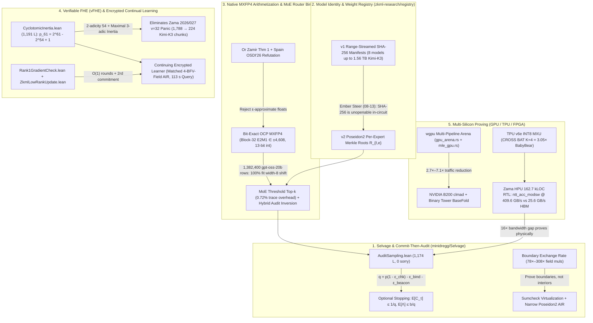

# Source-Locked Technical Dossier 04: Workload Verification, Native MXFP4 zkML, MoE Router Binding, Model Identity, Verifiable FHE (vFHE), Multi-Silicon Proving, & Selvage Commit-Then-Audit

**Scope & Primary Repositories Audited (Strictly Read-Only):**
- `/Users/ember/dev/zkml-research` (branch `dev`, HEAD `aef543eec0aef17bf442e3ec07b70942154e6b65`, 2026-09-09)
- `/Users/ember/dev/minidregg` (`Selvage/`, `Theory/`, `Assurance/`, `Compiler/`, HEAD `eaef2b0208b03d8567b1c493c5512776f66f4f67`, 2026-11-01)
- `/Users/ember/dev/breadstuffs` (`fhegg-fhe`, `fhegg-rtl`, `grain-verify`, `turn-prover`, `metatheory/Bfv`, `circuit`, HEAD `bda3263dbdc894dcac248a1b13300b4a32c46c08`, 2026-10-04)
- `/Users/ember/src/dregg-microsites` (`which-model`, `keep-learning-keep-a-secret`, `keep-the-next-example`, `the-whole-way-through`, `prove-the-turn`, HEAD `c0df432942c7fc6a35b74fc1f0ccfa3c0ed7d492`, 2026-09-20)

---

## Executive Architectural Synthesis

Ember's workload-verification and cryptographic-compute stack is organized around a single unifying thesis: **verifiability and weight encryption are public goods that must run at frontier scale without silent soundness holes, float-approximation backdoors, or prover-bankrupting full-trace materialization**. Across `/Users/ember/dev/minidregg`, `/Users/ember/dev/zkml-research`, and `/Users/ember/dev/breadstuffs`, six tightly coupled engineering pillars realize this vision:



---

## 1. Selvage & The Machine-Checked Commit-Then-Audit Theorem

### 1.1 Overview of the `Selvage/` Formalization in `minidregg`
In `/Users/ember/dev/minidregg/Selvage/` (152 `.lean` files, ~63,876 lines at campaign checkpoint, zero `sorry` tokens and zero top-level `axiom` declarations, verified via `#guard_msgs (whitespace := lax) in #print axioms`), Ember built **Selvage** (`slvg`), a greenfield Lean-4-specified and Rust-executed proof system designed to replace upstream Plonky3. Its machine-checked spine includes:

- **Committed-then-Audited Economic Soundness**: [`AuditSampling.lean`](file:///Users/ember/dev/minidregg/Selvage/AuditSampling.lean#L1-L1174) (1,174 lines, landed 2026-08-13 in commits `5dfeb19b618d91538d54224cd2c3ef866294e2e3` and `503231dbfdc30ea8b062b4a89bc3e1435b33b951`).
- **Domain-General Correlated Agreement & WHIR Errata Repairs**: [`CorrelatedAgreement.lean`](file:///Users/ember/dev/minidregg/Selvage/CorrelatedAgreement.lean#L1-L200), fixing WHIR Lemma 4.10's printed $\min\{1-\delta_\mathcal{C}/2, B\} \to \max$, Definition 4.9's $1-B \to 1-B^*$, generalizing from $\mathbb{F}_q^*$ to arbitrary subgroup generators, and making error-function monotonicity (`herr_mono`) explicit.
- **Accumulation Depth & Shifted BCS Compiler**: [`Depth.lean`](file:///Users/ember/dev/minidregg/Selvage/Depth.lean#L1-L200), [`FiatShamir.lean`](file:///Users/ember/dev/minidregg/Selvage/FiatShamir.lean#L1-L200), [`AccRbrBcs.lean`](file:///Users/ember/dev/minidregg/Selvage/AccRbrBcs.lean#L1-L200), [`AccRbrBcsShifted.lean`](file:///Users/ember/dev/minidregg/Selvage/AccRbrBcsShifted.lean#L1-L200), and [`AccRbrFold.lean`](file:///Users/ember/dev/minidregg/Selvage/AccRbrFold.lean#L1-L1448) (1,448 lines, commit `bc29222`, proving folding at the commitment alphabet with tight norm walls).
- **Binary-Tower Additive BaseFold & Characteristic-2 Trap Refutation**:
  - [`CharTwoWall.lean`](file:///Users/ember/dev/minidregg/Selvage/CharTwoWall.lean#L1-L189) (commit `0dd9a486652c63b7805f55b12e14da487b4aaa62`, 2026-08-14): proves `theorem charTwo_inv_two_impossible : ¬∃ inv2 : Tower256, (1 + 1 : Tower256) * inv2 = 1` and `theorem no_nontrivial_charTwo_pairing (x : Tower256) : ¬x ≠ -x`, mechanically refuting multiplicative FRI folding (`s ↦ s²`) over binary towers and proving `charTwoWall_detects_tower256 : charTwoWallDetected Tower256 = true`.
  - [`AdditiveBaseFold.lean`](file:///Users/ember/dev/minidregg/Selvage/AdditiveBaseFold.lean#L1-L856) (856 lines, commit `b5da623cc0ef4c1e3016a8012650a0d7c993863b`, 2026-08-14) and [`AdditiveBasisBinding.lean`](file:///Users/ember/dev/minidregg/Selvage/AdditiveBasisBinding.lean#L1-L483) (483 lines, commit `9679a16abb552cc7eba825aa4c21160d3aa23011`, 2026-08-16): proves BaseFold descent on the additive subspace tower $q(X) = X(X + \Delta)$ and proves that the Fiat-Shamir sponge must absorb the **ordered $\mathbb{F}_2$-basis** of the evaluation domain (`basisPrefix`) because $GL_d(\mathbb{F}_2)$ automorphisms preserve the point set while permuting hypercube vertices (`swap01_fixes_set`, `swap01_changes_table`).

### 1.2 The Machine-Checked Commit-Then-Audit Theorem (`Selvage/AuditSampling.lean`)

As documented in [`docs/SELVAGE.md`](file:///Users/ember/dev/zkml-research/docs/SELVAGE.md#L112-L154) and [`notes/audit-theorem-statement.md`](file:///Users/ember/dev/zkml-research/notes/audit-theorem-statement.md#L1-L139), commercial verifiable-inference providers (e.g., Attestable Audits, arXiv `2506.23706`) argue commit-then-audit detection with a one-line union bound $1 - (1 - p)^k$ that silently treats the commitment as perfectly binding ($\varepsilon_{\text{bind}} = 0$), the proof checker as infallible ($\varepsilon_{\text{chk}} = 0$), the random audit coin as unbiasable ($\varepsilon_{\text{beacon}} = 0$), and the adversary's corruption schedule as non-adaptive (i.i.d.).

In [`Selvage/AuditSampling.lean`](file:///Users/ember/dev/minidregg/Selvage/AuditSampling.lean#L1-L1174), Ember formalized and proved the first machine-checked commit-then-audit theorem in Lean 4 with all three cryptographic error legs and full adaptive stopping-time schedules.

#### A. Parameter Bundle & Effective Per-Turn Detection Rate $q$
From [`Selvage/AuditSampling.lean`](file:///Users/ember/dev/minidregg/Selvage/AuditSampling.lean#L136-L168):
```lean
structure AuditParams where
  /-- Nominal audit firing probability `p ∈ [0,1]`. -/
  p : ℝ
  /-- Proof-system soundness error `ε_chk ∈ [0,1]`: bound on `Pr[accept | fired, corrupt]`. -/
  εchk : ℝ
  /-- Commitment-binding break probability `ε_bind ≥ 0` per round. -/
  εbind : ℝ
  /-- Beacon bias `ε_beacon ≥ 0`: how much the adversary can depress `Pr[fires]`. -/
  εbeacon : ℝ
  hp_nonneg : 0 ≤ p
  hp_le_one : p ≤ 1
  hchk_nonneg : 0 ≤ εchk
  hchk_le_one : εchk ≤ 1
  hbind_nonneg : 0 ≤ εbind
  hbeacon_nonneg : 0 ≤ εbeacon

namespace AuditParams

/-- **The effective per-corrupt-turn detection rate**:
`q = p · (1 − ε_chk) − ε_bind − ε_beacon`. -/
def q (A : AuditParams) : ℝ :=
  A.p * (1 - A.εchk) - A.εbind - A.εbeacon
```

#### B. Predictable ($\mathcal{F}_{t-1}$-Measurable) Adaptive Corruption & The Three Cryptographic Legs
Crucially, predictability (the commit-before-coin ordering that prevents an adversary from peeking at the audit coin $\omega_t$ before deciding whether turn $t$ is corrupt) is enforced **by the Lean type signature** of `Round.corrupt`, which takes only the prior history `List Ω` and not the current coin `ω : Ω` ([`Selvage/AuditSampling.lean`](file:///Users/ember/dev/minidregg/Selvage/AuditSampling.lean#L196-L270)):
```lean
structure Round (Ω : Type) where
  /-- Whether the prover corrupts this round, as a function of the **prior**
  history `h : List Ω` ONLY. Does not take `ω : Ω` — predictability is a type. -/
  corrupt : List Ω → Bool
  /-- Whether the audit beacon fires on coin `ω` after history `h`. -/
  fires : List Ω → Ω → Bool
  /-- Whether the audit raises an alarm (`alarm_t = 1`). -/
  alarms : List Ω → Ω → Bool
  /-- Checker soundness-failure event: the checker was run and accepted a
  corrupt claim. -/
  chkErr : List Ω → Ω → Bool
  /-- Checker abort / timeout / malformed-proof event (`V = ⊥`). Separated from
  `chkErr` so the fail-open vs fail-closed distinction is expressible. -/
  chkAbort : List Ω → Ω → Bool
  /-- Commitment-binding break event: the prover produced a second valid opening
  for the committed digest `c_t`. -/
  bindBreak : List Ω → Ω → Bool
```
The three cryptographic assumptions and the miss-decomposition hypothesis are defined over `Round Ω` ([`Selvage/AuditSampling.lean`](file:///Users/ember/dev/minidregg/Selvage/AuditSampling.lean#L236-L270)):
```lean
/-- **Leg 3 (beacon)**: `Pr_ω[fires h ω] ≥ p − ε_beacon` at every history `h`. -/
def BeaconLeg (A : AuditParams) (R : Round Ω) : Prop :=
  ∀ h : List Ω, A.p - A.εbeacon ≤ uniformProb Ω (fun ω => R.fires h ω)

/-- **Leg 1 (checker soundness, conditional on firing)**: on any corrupt round,
`Pr_ω[fires ∧ chkErr] ≤ Pr_ω[fires] · ε_chk`. Written in product form to avoid
dividing by `Pr[fires]` (which may be `0` when `p ≤ ε_beacon`). -/
def ChkLeg (A : AuditParams) (R : Round Ω) : Prop :=
  ∀ h : List Ω, R.corrupt h = true →
    uniformProb Ω (fun ω => R.fires h ω ∧ R.chkErr h ω) ≤
      uniformProb Ω (fun ω => R.fires h ω) * A.εchk

/-- **Leg 2 (commitment binding)**: `Pr_ω[bindBreak h ω] ≤ ε_bind` at every history. -/
def BindLeg (A : AuditParams) (R : Round Ω) : Prop :=
  ∀ h : List Ω, uniformProb Ω (fun ω => R.bindBreak h ω) ≤ A.εbind

/-- **Miss decomposition**: if the round is corrupt, the audit fires, and no
alarm is raised, then either the checker failed soundness (`chkErr`) or the
commitment was double-opened (`bindBreak`). -/
def MissDecomp (R : Round Ω) : Prop :=
  ∀ (h : List Ω) (ω : Ω),
    R.corrupt h = true → R.fires h ω = true → R.alarms h ω = false →
      R.chkErr h ω = true ∨ R.bindBreak h ω = true

/-- All four single-round hypotheses bundled. -/
structure DetectionLegs (A : AuditParams) (R : Round Ω) : Prop where
  beacon : R.BeaconLeg A
  chk    : R.ChkLeg A
  bind   : R.BindLeg A
  miss   : R.MissDecomp
```

#### C. Fail-Closed vs. Fail-Open Refutation (`FailOpenRefutation`)
If an implementation treats checker timeout or malformed proof (`chkAbort`) as a non-alarm ("fail-open", e.g., logging a warning and continuing), an adversary can deterministically abort whenever audited (`chkAbort = true`), achieving `chkErr = false`, `bindBreak = false`, and `alarms = false`. Ember proved both the sufficiency of `FailClosed` and the impossibility of `DetectionLegs` under `FailOpen` when $q > 0$ ([`Selvage/AuditSampling.lean`](file:///Users/ember/dev/minidregg/Selvage/AuditSampling.lean#L278-L301) and [lines 895–980](file:///Users/ember/dev/minidregg/Selvage/AuditSampling.lean#L895-L980)):
```lean
def FailClosed (R : Round Ω) : Prop :=
  ∀ (h : List Ω) (ω : Ω), R.fires h ω = true → R.chkAbort h ω = true → R.alarms h ω = true

def FailOpen (R : Round Ω) : Prop :=
  ∀ (h : List Ω) (ω : Ω), R.chkAbort h ω = true → R.alarms h ω = false

theorem missDecomp_of_failClosed {R : Round Ω}
    (hfc : R.FailClosed)
    (hraw : ∀ h ω, R.corrupt h = true → R.fires h ω = true → R.alarms h ω = false →
      R.chkErr h ω = true ∨ R.chkAbort h ω = true ∨ R.bindBreak h ω = true) :
    R.MissDecomp

theorem FailOpenRefutation.failOpen_no_legs (A : AuditParams) (hq : 0 < A.q) :
    ¬ Round.DetectionLegs A round

theorem FailOpenRefutation.honest_q_nonpos (A : AuditParams)
    (hchk : Round.ChkLeg A honest) : A.q ≤ 0
```

#### D. Single-Round Detection Lemma (`Round.detect`)
How $\varepsilon_{\text{chk}}$, $\varepsilon_{\text{bind}}$, and $\varepsilon_{\text{beacon}}$ compose: on any corrupt turn $h$, the event `fires` splits into `alarms` or a miss (`fires ∧ ¬alarms`). By `MissDecomp`, every miss implies `fires ∧ chkErr` or `bindBreak`. By finite-type cardinality decomposition (`card_split_imp`), $\Pr[\text{alarms}] \ge \Pr[\text{fires}] - \Pr[\text{fires} \wedge \text{chkErr}] - \Pr[\text{bindBreak}] \ge \Pr[\text{fires}](1 - \varepsilon_{\text{chk}}) - \varepsilon_{\text{bind}}$. Since $1 - \varepsilon_{\text{chk}} \ge 0$ (`AuditParams.hchk_le_one`), applying $\Pr[\text{fires}] \ge p - \varepsilon_{\text{beacon}}$ yields $\Pr[\text{alarms}] \ge (p - \varepsilon_{\text{beacon}})(1 - \varepsilon_{\text{chk}}) - \varepsilon_{\text{bind}} \ge p(1 - \varepsilon_{\text{chk}}) - \varepsilon_{\text{bind}} - \varepsilon_{\text{beacon}} = q$ ([`Selvage/AuditSampling.lean`](file:///Users/ember/dev/minidregg/Selvage/AuditSampling.lean#L315-L355)):
```lean
theorem detect [Nonempty Ω] (hL : DetectionLegs A R) {h : List Ω}
    (hc : R.corrupt h = true) :
    A.q ≤ uniformProb Ω (fun ω => R.alarms h ω)
```

#### E. Supermartingale $M_t$, Optional Stopping Corrupt-Turn Bound $\mathbb{E}[C_\tau] \le 1/q$, and Leakage Bound $\mathbb{E}[\Lambda] \le b/q$
Rather than importing measure-theoretic probability spaces, Ember defined exact finite-horizon backward induction `expOver` over the $\sigma$-algebra of coin prefixes `List Ω` and proved Doob's optional stopping inequality `le_of_step` in 12 lines of induction ([`Selvage/AuditSampling.lean`](file:///Users/ember/dev/minidregg/Selvage/AuditSampling.lean#L368-L433)). Defining the stopped process at the first alarm $\tau = \inf\{t : \text{alarm}_t = 1\}$ and the potential $M_t = q \cdot C_{t \wedge \tau} - \mathbf{1}_{\{\tau \le t\}}$ (`Round.mart`), Ember proved ([`Selvage/AuditSampling.lean`](file:///Users/ember/dev/minidregg/Selvage/AuditSampling.lean#L491-L627)):
```lean
/-- Whether the process has stopped (an alarm has fired at or before this history). -/
def stopped (R : Round Ω) : List Ω → Bool
  | [] => false
  | ω :: h => R.stopped h || R.alarms h ω

/-- Pre-alarm corrupt-round counter `C_{t ∧ τ}`: increments on round `h → ω :: h`
iff the process was not yet stopped at `h` AND the prover corrupted round `h`. -/
def count (R : Round Ω) : List Ω → ℕ
  | [] => 0
  | _ :: h =>
      if R.stopped h then R.count h
      else if R.corrupt h then R.count h + 1 else R.count h

/-- The supermartingale potential `M(h) = q · C(h) − 1_{stopped(h)}`. -/
noncomputable def mart (R : Round Ω) (q : ℝ) (h : List Ω) : ℝ :=
  q * (R.count h : ℝ) - (if R.stopped h = true then (1 : ℝ) else 0)

/-- **THE SUPERMARTINGALE STEP.** If every unstopped corrupt round alarms with
probability at least `q`, then `(1/|Ω|) ∑_ω M(ω :: h) ≤ M(h)` at **every** history `h`. -/
theorem mart_step [Nonempty Ω] {R : Round Ω} {q : ℝ}
    (hdet : ∀ h : List Ω, R.stopped h = false → R.corrupt h = true →
      q ≤ uniformProb Ω (fun ω => R.alarms h ω))
    (h : List Ω) :
    (∑ ω : Ω, R.mart q (ω :: h)) / (Fintype.card Ω : ℝ) ≤ R.mart q h

/-- **THE SEQUENTIAL CORRUPT-TURN BOUND (optional stopping).**
For any horizon `n` and any adaptive corruption strategy, if `q > 0` and every
unstopped corrupt round alarms with probability `≥ q`, then
`E[C_{n ∧ τ}] ≤ 1 / q`. -/
theorem sequential_bound [Nonempty Ω] {R : Round Ω} {q : ℝ} (hq : 0 < q)
    (hdet : ∀ h : List Ω, R.stopped h = false → R.corrupt h = true →
      q ≤ uniformProb Ω (fun ω => R.alarms h ω))
    (n : ℕ) :
    expOver Ω n (fun h => (R.count h : ℝ)) [] ≤ 1 / q

/-- **THE LEAKAGE COROLLARY.** If each undetected corrupt turn leaks at most
`b ≥ 0` bits, expected total leakage before the first alarm is at most `b / q`
bits — independent of the horizon `n` and of the adversary's adaptive schedule. -/
theorem leakage_bound [Nonempty Ω] {R : Round Ω} {q b : ℝ} (hq : 0 < q)
    (hb : 0 ≤ b)
    (hdet : ∀ h : List Ω, R.stopped h = false → R.corrupt h = true →
      q ≤ uniformProb Ω (fun ω => R.alarms h ω))
    (n : ℕ) :
    expOver Ω n (fun h => b * (R.count h : ℝ)) [] ≤ b / q

/-- **THE END-TO-END COMPOSED THEOREM.** Under the three cryptographic legs
(`BeaconLeg`, `ChkLeg`, `BindLeg`) and `MissDecomp`, if
`q = p(1 − ε_chk) − ε_bind − ε_beacon > 0`, expected undetected corrupt turns
over any horizon `n` and any adaptive strategy is at most `1 / q`. -/
theorem sequential_bound_of_legs [Nonempty Ω] {A : AuditParams} {R : Round Ω}
    (hL : DetectionLegs A R) (hq : 0 < A.q) (n : ℕ) :
    expOver Ω n (fun h => (R.count h : ℝ)) [] ≤ 1 / A.q
```
Furthermore, [`Selvage/AuditSampling.lean`](file:///Users/ember/dev/minidregg/Selvage/AuditSampling.lean#L642-L671) proves `sampling_amortizes_only_the_checker` and `ledger_paid_in_full`: per Boyle–Komargodski–Vafa (ePrint 2025/358, $\Omega(\log n / \log \log n)$ covert ledger lower bound), commit-then-audit amortizes the **prover/checker** cost $c_{\text{chk}}$ by $p$, while the commitment/ledger cost $c_{\text{com}}$ is paid on **100% of turns**. And in `BeaconRefutation` ([lines 795–888](file:///Users/ember/dev/minidregg/Selvage/AuditSampling.lean#L795-L888)), Ember proved `grind_beats_beaconless_bound` and `grind_honest_q_eq_zero`: if the prover can grind $K$ candidate commitments before selecting one that avoids triggering a self-hashed Fiat-Shamir audit coin, $q$ collapses to $0$, proving that an external or VDF/threshold-delayed beacon is mandatory.

### 1.3 The Boundary Exchange-Rate Calculation (`SELVAGE.md` & `boundary_exchange_rate.py`)

In [`docs/SELVAGE.md` §2](file:///Users/ember/dev/zkml-research/docs/SELVAGE.md#L48-L110) and [`paper/scripts/boundary_exchange_rate.py`](file:///Users/ember/dev/zkml-research/paper/scripts/boundary_exchange_rate.py#L1-L109), Ember derived the quantitative law governing workload verification: **why "proving boundaries, not interiors" is the only viable path to frontier zkML and vFHE**.

#### A. Field-Multiplication Exchange Rate (78× to 308×)
In [`paper/scripts/boundary_exchange_rate.py`](file:///Users/ember/dev/zkml-research/paper/scripts/boundary_exchange_rate.py#L22-L68), the cost of **committing** to one trace element in a hash-based PCS (FRI / WHIR / BaseFold over BabyBear with Poseidon2 width-16 rate-8 sponge, `P2_MULS_BB = 655`, `P2_ADDS_BB = 1309`, `BB_OPEQ = 655 + 1309/3 = 1091.33` multiplication-equivalents per permutation, matrix width $w=48$, trace height $2^{20}$) versus **virtualizing** that wire via sumcheck ($d=3, k=2$) is:

```python
# From paper/scripts/boundary_exchange_rate.py:39-64
def commit_cost_per_felt(log_blowup: int, log_h: int = 20, w: int = 48,
                         deg: int = 3, k: int = 2) -> dict:
    B = 1 << log_blowup
    # Merkle leaf + internal node Poseidon2 permutations per trace cell:
    hash_perms = B * (1.0 / P2_RATE + 2.0 / w)
    hash_muls = hash_perms * BB_OPEQ
    # Radix-2 butterfly LDE + interpolation field muls per trace cell:
    encode_muls = (B + 1) * log_h / 2.0
    # Sumcheck prover work per value per layer (deg=3, k=2, EF4=10 base muls):
    sumcheck_muls = (deg - 1) * k * 10
    total = hash_muls + encode_muls + sumcheck_muls
    return {"hash": hash_muls, "encode": encode_muls, "sumcheck": sumcheck_muls,
            "total": total, "ratio_vs_virtual": total / sumcheck_muls}
```

| Blowup $2^b$ | Poseidon2 Merkle Hashing | Reed-Solomon LDE Encoding | Sumcheck Folding | **Total Committed Cost / Felt** | **Virtual Sumcheck Cost / Felt** | **Exchange Ratio (Commit / Virtual)** |
|---|---|---|---|---|---|---|
| **$b = 4$ ($16\times$)** | $2,910$ muls ($93.3\%$) | $170$ muls ($5.4\%$) | $40$ muls ($1.3\%$) | **$3,120$ field muls** | **$\approx 40$ field muls** | **$78\times$** |
| **$b = 6$ ($64\times$)** | $11,641$ muls ($94.4\%$) | $650$ muls ($5.3\%$) | $40$ muls ($0.3\%$) | **$12,331$ field muls** | **$\approx 40$ field muls** | **$308\times$** |

#### B. Consequence for $n \times n$ Matrix Multiplication
For $C = A \cdot B$ with $n = 4096$:
- **Materializing the interior** (AIR trace cells for $a_{ik}, b_{kj}, a_{ik}b_{kj}$, and running sum $s_{ijk}$): commits $4n^3 = 2.75 \times 10^{11}$ field elements.
- **Proving the boundary** (committing only the boundary matrices $A, B, C$ and reducing $\tilde{C}(r_i, r_j) = \sum_{k \in \{0,1\}^{\log n}} \tilde{A}(r_i, k)\tilde{B}(k, r_j)$ via $\log_2 n = 12$ sumcheck rounds, formalized in [`Assurance/ZkmlMatmulSumcheck.lean`](file:///Users/ember/dev/minidregg/Assurance/ZkmlMatmulSumcheck.lean#L1-L200)): commits $3n^2 = 5.03 \times 10^7$ field elements — a **$\frac{4}{3}n = 5,461\times$ reduction in committed trace volume** ([`docs/SELVAGE.md`](file:///Users/ember/dev/zkml-research/docs/SELVAGE.md#L76-L92)).

#### C. Wall-Clock Calibration & Narrow Poseidon2 In-AIR Virtualization
In [`notes/virtualization-verdict.md`](file:///Users/ember/dev/zkml-research/notes/virtualization-verdict.md#L73-L81) and [`docs/VERDICTS.md` §4](file:///Users/ember/dev/zkml-research/docs/VERDICTS.md#L565-L645), Ember calibrated the exchange rate against actual wall-clock nanoseconds at `log_blowup = 3`: because Poseidon2 hashing SIMD-vectorizes ~8× more densely than extension-field sumcheck folding, 1 marginal committed felt costs **54.7 ns** vs **10.97 ns** per value per sumcheck layer (~5× wall-clock exchange rate). Consequently:
1. **High-degree GKR sumcheck over $x^7$ loses** ($\alpha + 1 = 8$ rounds > 5× exchange rate), whereas $\alpha = 3$ (e.g., over $p_{61}$ where $\gcd(3, p_{61}-1)=1$) wins by ~1.3×.
2. **In-AIR virtualization of degree-1 internal rounds** (`permEmissionNarrow` in [`breadstuffs/metatheory/Dregg2/Circuit/Emit/Poseidon2RoundGates.lean`](file:///Users/ember/dev/breadstuffs/metatheory/Dregg2/Circuit/Emit/Poseidon2RoundGates.lean#L1-L1565), commit `daa207ae7`) substitutes the 15 non-S-box lanes symbolically across all 13 partial rounds without raising constraint degree above 7, shrinking the Poseidon2 AIR from **352 $\to$ 141 gates** (**2.34× fewer committed cells**, **1.97× fewer prover permutations**).

---

## 2. Model Identity & Weight-Commitment Registry (`zkml-research/registry/`)

### 2.1 The Hollow-LLM Gap & Microsite `#13 Which model?`
In [`registry/MANIFEST-FORMAT.md`](file:///Users/ember/dev/zkml-research/registry/MANIFEST-FORMAT.md#L1-L65) and microsite `#13 Which model?` ([`/Users/ember/src/dregg-microsites/which-model/index.html`](file:///Users/ember/src/dregg-microsites/which-model/index.html#L1-L149)), Ember addressed the **Hollow-LLM attack** (arXiv `2607.28884`):
- A zero-knowledge proof of inference proves $(x, y) \in \mathcal{R}_C$ for *some* weight commitment $C$.
- Without a public, byte-reproducible binding from $C$ to a named checkpoint's weights and architecture, a serving provider can commit to a 0.6B or pruned/lobotomized model $C_{\text{hollow}}$, generate 100% mathematically valid ZK proofs against $C_{\text{hollow}}$, and bill customers for frontier 671B/1.56T inference ("a hollow model behind an honest proof").

### 2.2 `registry_tool.py` & `gates.sh`: Streaming Range-Request Verification
In [`registry/registry_tool.py`](file:///Users/ember/dev/zkml-research/registry/registry_tool.py#L1-L1224) (1,224 lines, Python 3 stdlib-only, commit `020fd7faf22eff7e0dd8739ee386b36485b231be`, 2026-08-13) and [`registry/gates.sh`](file:///Users/ember/dev/zkml-research/registry/gates.sh#L1-L152) (11-gate falsifier suite `G1`–`G10`), Ember built a streaming weight-commitment tool that never downloads multi-hundred-gigabyte checkpoints to disk:
- **Domain-Separated Canonical Commitment**: Prepends the 24-byte ASCII prefix `DOMAIN_TAG = b"zkml-weight-registry/v1\n"` ([`registry_tool.py:56`](file:///Users/ember/dev/zkml-research/registry/registry_tool.py#L56)) to the strict RFC 8785 / JCS-subset `canonical_bytes(core)` (sorted UTF-8 keys, zero whitespace, floats forbidden by type error in `core`).
- **Frozen Test Vector (Gate G9)**: [`registry/test-vector.json`](file:///Users/ember/dev/zkml-research/registry/test-vector.json), 856-byte canonical core + 24-byte domain tag = 880-byte preimage, SHA-256 `1b34613e012a472aa38b25f760f4ca17ed016058b49d4e95aab141a4a9b2a0e0`.
- **Constant-Memory Range Streaming**: Uses HTTP `Range: bytes=0-7` and `Range: bytes=8-{8+N-1}` to parse every `.safetensors` shard header, validates that tensor `[begin, end)` intervals form an **exact zero-gap partition** of the shard body, and in `full` mode streams each shard once in 16 MiB chunks while updating per-tensor and whole-shard SHA-256 states simultaneously, followed by a 4 KiB interior range-spotcheck (`verify_spotcheck`).

### 2.3 All 8 Committed Frontier Checkpoints (`registry/COMMITMENTS.md`)
From [`registry/COMMITMENTS.md`](file:///Users/ember/dev/zkml-research/registry/COMMITMENTS.md#L15-L50) and `registry/manifests/*.json`:

| Model (`repo_id`) | Git Revision | Mode | `commitment_sha256` | Tensors | Shards | Total Weight Size | Streamed Bytes & Wall Time |
|---|---|---|---|---:|---:|---:|---|
| **`openai/gpt-oss-20b`** | `6cee5e81ee8382eff0b237b5a894acda3d725799` | **`full`** | `3218eb92942a115dcc79ef1acd8778702991be0a034acc5ab55eb26be47db61f` | 459 | 3 | 13,780,382,664 B (**13.76 GB**) | 13,789 MB, 24 reqs, **27.3 min** (8.4 MB/s) |
| **`Qwen/Qwen3-8B`** | `b968826d9c46dd6066d109eabc6255188de91218` | **`full`** | `13adc299c5f4d3f8e1c9bdfac84d890c3e3ea6ede6b2bae5fdaa7df8651910fa` | 399 | 5 | 16,381,559,928 B (**16.38 GB**) | 16,398 MB, 34 reqs, **34.0 min** (8.0 MB/s) |
| **`Qwen/Qwen3-0.6B`** | `c1899de289a04d12100db370d81485cdf75e47ca` | **`full`** | `bed2361d5898823569760ebf4bc7998a9bdbc90426afe78c30692aa2c465ba5d` | 311 | 1 | 1,503,262,216 B (**1.50 GB**) | 1,519 MB, 12 reqs, **2.2 min** (11.5 MB/s) |
| **`openai/gpt-oss-120b`** | `b5c939de8f754692c1647ca79fbf85e8c1e70f8a` | `structure-only` | `b8699decd118b360206bf47f7783c5ab50706d80fcbc33d75a91577c38de8a76` | 687 | 15 | 65,248,686,280 B (**65.25 GB**) | 28.2 MB, 69 reqs, **26.7 s** |
| **`google/gemma-3-27b-it`** | `005ad3404e59d6023443cb575daa05336842228a` | `structure-only` | `7752d385091eea4476db4b51694894f9c402acd38a08d2ddd07b07b08e29eb5e` | 1,247 | 12 | 54,859,193,152 B (**54.86 GB**) | 35.1 MB, 58 reqs, **30.9 s** |
| **`meta-llama/Llama-3.1-8B-Instruct`** | `0e9e39f249a16976918f6564b8830bc894c89659` | `structure-only` | `15e0a6c49eb594cbf20e6db9c6c047fe4b1c3b1bc6107f7b204f3f7e67083261` | 291 | 4 | 16,060,617,216 B (**16.06 GB**) | 9.3 MB, 24 reqs, **9.3 s** |
| **`deepseek-ai/DeepSeek-V3.1`** | `c0781d039fb7be8ec0bef9fe5ef1cb6cde44fb0f` | `structure-only` | `5db967ae32cc5e96ad951bab72b5ab2fb7c6cb94400e23f209fc7aa589d5e9ba` | 91,991 | 163 | 688,588,547,912 B (**688.59 GB**) | 49.5 MB, 659 reqs, **7.5 min** |
| **`moonshotai/Kimi-K3`** | `9f62e4e9fffb94f1eb9b5fd9f1a09bc7d2fb8f04` | `structure-only` | `9bf53e646d4b9b9609d6140d0b710140e92a65fcd9ad68b6f7c5d1c3b07d5a2b` | 497,220 | 96 | 1,560,938,871,920 B (**1.56 TB**) | 271.1 MB, 391 reqs, **4.5 min** |

*(Note: The registry lane also proved via authenticated HuggingFace probe in `registry/runs/deepseek-ai__DeepSeek-V4.gated.log` that `deepseek-ai/DeepSeek-V4` returned HTTP 404, refuting earlier secondary-source citations.)*

### 2.4 Ember's Critique & The v2 Poseidon2 Per-Expert Merkle Root Design
On 2026-08-13 at 18:36 (`forcodex/01b-STEERS-RECOVERED.md` §22, commit `dd331697e2d6b89bdd1cddcb9e071be0631567be`), Ember rejected the v1 flat SHA-256 manifest as a proof-system primitive:

> *"bruv you just built a complete toy registry for a commitment that is irrelevant to all possible proof systems and patted yourself on the back"*

As recorded in [`registry/WHAT-THIS-IS-NOT.md`](file:///Users/ember/dev/zkml-research/registry/WHAT-THIS-IS-NOT.md), [`docs/VERDICTS.md` §5](file:///Users/ember/dev/zkml-research/docs/VERDICTS.md#L698-L710), and [`notes/moe-router-binding.md` §5.3 D4/D9](file:///Users/ember/dev/zkml-research/notes/moe-router-binding.md#L486-L526), a flat SHA-256 digest over raw `.safetensors` bytes cannot be opened by an algebraic STARK/sumcheck prover without running SHA-256 over 688 GB–1.56 TB inside the circuit. The **v2 Registry Design** specifies:
1. **Proof-Native Field Encoding**: Tensors are committed in the exact field-element layout consumed by the prover (e.g., packed E2M1 nibbles + E8M0 scales in KoalaBear/BabyBear/$p_{61}$).
2. **Per-Expert Poseidon2 / FRI Merkle Roots ($R_{\ell,e}$)**: Each expert $e \in \{0, \dots, E-1\}$ of MoE layer $\ell$ (consisting of `gate_proj`, `up_proj`, `down_proj` and their scale tensors) is committed to its own Poseidon2 Merkle root $R_{\ell,e} \in \mathbb{F}^8$, alongside separate roots for the router matrix $W_r$ and `e_score_correction_bias` $b$.
3. **Verifier-Side $O(E)$ MLE Opening**: The vector of per-expert roots $R_\ell \in (\mathbb{F}^8)^{257}$ is only $257 \times 32\text{ B} = 8.2\text{ KB}$ per layer (**477 KB** across all 58 MoE layers of DeepSeek-V3.1). For each selected expert $j \in \{1, \dots, k\}$, the verifier evaluates the multilinear extension $\tilde{R}_\ell(\text{bits}(\text{id}_j))$ directly in $O(E) = 257$ field operations per layer (**14,848 field ops/token total**), binding the active expert's weight polynomial commitment $C_j$ to its selected router index $\text{id}_j$ without ever opening the inactive 96.5% of the model.

---

## 3. Bit-Exact Native MXFP4 Arithmetization & MoE Router Binding

### 3.1 Why Approximate-Float zkML Is Mathematically & Empirically Broken
In [`docs/the-position.md`](file:///Users/ember/dev/zkml-research/docs/the-position.md#L1-L185), [`docs/PHASE0-RESULT.md`](file:///Users/ember/dev/zkml-research/docs/PHASE0-RESULT.md#L1-L128), and [`forcodex/04-DEAD-ENDS.md` §F2](file:///Users/ember/dev/zkml-research/forcodex/04-DEAD-ENDS.md#L1013-L1071), Ember established two decisive refutations of $\varepsilon$-tolerant floating-point zkML:

1. **Or Zamir's Theorem 1 (arXiv `2602.15756`, Feb 2026 — "Undetectable Backdoors in Approximate zkML")**:
   - Any proof system that replaces exact equality with an $\varepsilon$-consistency check $|y - f(x)| \le \delta$ at each layer allows a malicious prover to steer the output across layers: error amplifies by $2^{18}$ across depth 20 with a trigger weight of $\approx 0.15$.
   - Stronger still, **Zamir Theorem 1** proves that for *any* neural network $F$, there exists a network $F'$ that is **identically equal to $F$ on all inputs** ($\forall x, F'(x) = F(x)$, requiring zero weight inflation) such that for **every** input $x$ and **every** target output $z$ in the output range, there exists a $\delta$-consistent transcript whose output is $z$.
2. **Spain (NYU Courant, OSDI 2026) Empirical & Soundness Collapse**:
   - On GPT-2 (`seq=32`), Spain's own Figure 4 reports that its approximate-float prover loses to quantized `zkGPT` on every metric: **750 s vs 64 s prover time (11.7× slower)**, **78 s vs 5.8 s verifier time (13.4× slower)**, and **1.6 MB vs 88 KB proof size (18.6× larger)**.
   - Worse, Spain's composition lemma yields a ReLU tolerance of $\delta = \sqrt{\varepsilon} = 2^{-20}$ at its published ML parameters, where Zamir's trigger weight at GPT-2 effective depth ($\ge 24$) is $\le 10$ — meaning Spain is exploitable at its own published parameters with ordinary weights.

### 3.2 Phase 0 Exhaustive BF16 Census (`phase0/product_exact/`)
Before pivoting to MXFP4, Ember tested whether `bf16` could be proved bit-exactly without IEEE-754 circuits ([`phase0/product_exact/src/main.rs`](file:///Users/ember/dev/zkml-research/phase0/product_exact/src/main.rs#L1-L414), results in [`phase0/results_product_exact.txt`](file:///Users/ember/dev/zkml-research/phase0/results_product_exact.txt#L1-L51)):
- Exhaustively tested all $2^{32} = 4,294,967,296$ ordered `(bf16, bf16)` pairs in **390.86 ms** on 8 threads:
  - `exact`: `3,271,328,768` (`76.16656%` of $2^{32}$)
  - `inexact_finite`: `990,149,632` (`23.22552%` of finite pairs): `533,735,952` overflow to $\pm\infty$ ($12.52\%$), `351,288,832` underflow to $\pm 0$ ($8.24\%$), `97,927,136` round in the fp32 subnormal tail ($2.30\%$), and **`0` (`0.00000%`) round in the normal fp32 range**.
  - Over the exponent-sum window $-126 \le e_x + e_y \le 126$, **100.000% of all `3,179,217,920` pairs are bit-exact**.
- However, [`phase0/cost_model.py`](file:///Users/ember/dev/zkml-research/phase0/cost_model.py) (`docs/PHASE0-RESULT.md`, commit `f81dd5787f46541d83be5cafd52c6c5fc3b4ad20`) proved that because `bf16` has a **per-element exponent** rather than a block-shared exponent, data-dependent renormalization shifts reduce the `bf16` speedup over `int8` to **1.42×** (whereas a **static shared block exponent** achieves **2.29×**, range 1.51–3.30×).

### 3.3 Bit-Exact Native OCP MXFP4 Arithmetization (`docs/mx-formats.md`, `phase0/e8m0_spread.py`)
In [`docs/mx-formats.md`](file:///Users/ember/dev/zkml-research/docs/mx-formats.md#L1-L177) (commits `f068d4670c2c71a610bcab044f196e3a2f49e8dd`, `7fdc981fbc50c760a4d1f4093a57b599349a866b`, `bc52ca55b741d4198c4eabe67281442c7ce9bcb5`, `2c9968fcdd2f2dc5ff8ecb18ec0e4b8be6f7c075`), Ember discovered that **OCP Microscaling MXFP4** — the actual native shipping format of frontier MoE checkpoints (`openai/gpt-oss-20b`, `openai/gpt-oss-120b`, `moonshotai/Kimi-K3`) — satisfies all three requirements (zero quantization semantic gap, static block shifts, and bit-exact integer associative accumulation):

1. **Exact 13-Bit Signed Integer Block-32 Dot Products ($\pm 4,608$)**:
   - An OCP MXFP4 block consists of $k = 32$ `E2M1` elements (1 sign bit, 2 exponent bits, 1 mantissa bit) sharing a single 8-bit `E8M0` power-of-two scale $2^{s - 127}$.
   - Every `E2M1` element takes one of 16 values in $\{0, \pm 0.5, \pm 1.0, \pm 1.5, \pm 2.0, \pm 3.0, \pm 4.0, \pm 6.0\}$.
   - Scaled by $2$, every `E2M1` element $2a_i$ is an **exact small integer** in $\{0, \pm 1, \pm 2, \pm 3, \pm 4, \pm 6, \pm 8, \pm 12\}$.
   - Therefore, each elementwise product $(2a_i)(2b_i) = 4 a_i b_i$ is an exact integer in $[-144, +144]$, and the 32-element within-block dot product
     $$D_{\text{block}} = \sum_{i=1}^{32} (2a_i)(2b_i) \in [-4608, +4608]$$
     is an **exact integer bounded by $\pm 4,608$ (fitting in 13 bits signed, $[-4096, 4095]$ / $< 2^{13} = 8192$, or $\pm 1,152$ in unscaled units)**. Verified over 20,000 random MXFP4 blocks under two summation orders against exact rationals with **zero deviations** ([`docs/mx-formats.md:127-131`](file:///Users/ember/dev/zkml-research/docs/mx-formats.md#L127-L131)).
   - *(Why NVFP4 does not transfer: NVIDIA's 16-element NVFP4 uses `E4M3` fractional block scales with an FP32 per-tensor scale, destroying the power-of-two shift property; the arithmetization is strictly OCP MXFP4-specific, [`docs/mx-formats.md:3-8`](file:///Users/ember/dev/zkml-research/docs/mx-formats.md#L3-L8)).*

2. **Empirical E8M0 Exponent-Spread Census on `openai/gpt-oss-20b` (`phase0/e8m0_spread.py` & `results_e8m0_spread.txt`)**:
   - In [`phase0/e8m0_spread.py`](file:///Users/ember/dev/zkml-research/phase0/e8m0_spread.py#L1-L212) (commit `2c9968fcdd2f2dc5ff8ecb18ec0e4b8be6f7c075`, 2026-08-13), Ember range-fetched the raw `U8` E8M0 scale tensors of `openai/gpt-oss-20b` (`90` blocks of 32 per reduction row of length $2880$).
   - Across `1,382,400` reduction rows (`124,416,000` scale bytes across 10 sampled `gate_up_proj_scales` `[32, 5760, 90]` and `down_proj_scales` `[32, 2880, 90]` tensors in layers `0, 5, 11, 17, 23`; out of 48 total MoE block/scale tensor pairs in the 24-layer checkpoint), [`phase0/results_e8m0_spread.txt`](file:///Users/ember/dev/zkml-research/phase0/results_e8m0_spread.txt#L1-L46) measured:
     - **Per-row exponent spread ($\max_{b \in [0,90)} s_b - \min_{b \in [0,90)} s_b$)**: **p50 = 2, p90 = 2, p99 = 3, max = 8**.
     - **Exact pooled distribution**:
       - `spread = 0`: `42` rows (`0.0030%`, cumulative `0.00304%`)
       - `spread = 1`: `541,154` rows (`39.1460%`, cumulative `39.14902%`)
       - `spread = 2`: `766,937` rows (`55.4787%`, cumulative `94.62768%`)
       - `spread = 3`: `68,774` rows (`4.9750%`, cumulative `99.60265%`)
       - `spread = 4`: `4,443` rows (`0.3214%`, cumulative `99.92405%`)
       - `spread = 5`: `812` rows (`0.0587%`, cumulative `99.98278%`)
       - `spread = 6`: `219` rows (`0.0158%`, cumulative `99.99863%`)
       - `spread = 7`: `17` rows (`0.0012%`, cumulative `99.99986%`)
       - `spread = 8`: `2` rows (`0.0001%`, cumulative **`100.00000%`**)
     - **Special/NaN scale bytes (`0` or `255`)**: **`0`** (`value 0 x0, value 255 x0`).
   - **Consequence**: **100.000% of all reduction rows fit inside a width-8 alignment window** ($W \le 8$), meaning cross-block accumulation across all 90 blocks of a row requires at most an 8-bit shift ($4608 \times 90 \times 2^8 = 1.06 \times 10^8 < 2^{27} < p_{\text{BabyBear}}$), completely avoiding wide Kulisch accumulators on 100% of `gpt-oss-20b`'s MXFP4 weights (which represent 98.1% of model parameters and 78.9% of per-token linear FLOPs).

### 3.4 MoE Router Binding (`notes/moe-router-binding.md` & `moe-router-binding-cost.py`)
In [`notes/moe-router-binding.md`](file:///Users/ember/dev/zkml-research/notes/moe-router-binding.md#L1-L808) and [`notes/moe-router-binding-cost.py`](file:///Users/ember/dev/zkml-research/notes/moe-router-binding-cost.py#L1-L169) (commit `a69aeb61a944c53e23a8bda86ebde4ca7f31b4f2`, 2026-08-13), Ember analyzed how to prove sparse Mixture-of-Experts (MoE) inference (DeepSeek-V3/R1: $E=256$ routed experts + 1 shared, $k=8$ active per token; `gpt-oss-120b`: $E=128, k=4$; `Kimi-K3`: 2.4T–2.8T total) at active-parameter cost rather than dense-parameter cost.

#### A. Two Soundness Bugs Discovered in Prior Art (`ZK-DeepSeek` & `OP-10`)
1. **Bug 1 — BF16 Score Ties Give ~23 Bits of Routing Freedom Per Token**:
   - `OP-10` (arXiv `2606.05433` §4.4.3) claims top-$k$ ties are *"rare with BF16"*, and `ZK-DeepSeek` (arXiv `2511.19902` §3.7) enforces only non-decreasing sorted order $L'[i-1] \le L'[i]$ via multiset permutation without proving permutation of indices.
   - Ember proved this is **mathematically backwards** ([`notes/moe-router-binding.md:94-110, 419-462`](file:///Users/ember/dev/zkml-research/notes/moe-router-binding.md#L419-L462)): BF16 has only 7 mantissa bits ($2^7 = 128$ binades), which is **smaller than the number of experts ($E = 256$)**. Worse, DeepSeek-V3 uses a **sigmoid** router where top experts cluster near $1.0$: in $[0.9, 1.0)$, there are only **26 distinct BF16 values** across 256 experts! By pigeonhole, ~10–15 experts tie near the top-$k$ boundary on every token, giving a malicious prover $\binom{12}{4} \approx 495$ choices per layer or **~23 bits of silent routing freedom per token** to pick weaker or poisoned experts while satisfying `ZK-DeepSeek`'s constraints.
   - **The Fix — Canonical Composite Key `(C3)`**: Shift each quantized score $v_i \in [0, 2^B)$ by $\lceil \log_2 n' \rceil$ bits and pack the inverted index $(n' - 1 - i)$ into the low bits so all keys are **strictly distinct** and ties break lowest-index-first (matching PyTorch `torch.topk` / vLLM `moe_topk`):
     $$\text{key}_i := v_i \cdot 2^{\lceil \log_2 n' \rceil} + (n' - 1 - i) + 1 \in [1, 2^{B + \lceil \log_2 n' \rceil}]$$
2. **Bug 2 — Monolithic Weight MLE Opening Restores Full 671B Dense Cost**:
   - `ZK-DeepSeek` reuses weight-matrix proofs across tokens without binding the expert index $\vec{e}$ to the router output (`notes/moe-router-binding.md:107-110`).
   - Conversely, if a prover commits to a single monolithic layer tensor $\tilde{W}(\vec{e}, \vec{u}, \vec{v})$ and opens it at $\vec{e} = \text{bits}(\text{id}_j)$ via sumcheck/PCS, a multilinear PCS opening touches **every coefficient of $\tilde{W}$** in $\Theta(E \cdot d \cdot f)$ time — **completely erasing the 18.3× sparse MoE discount** ([`notes/moe-router-binding.md:486-526`](file:///Users/ember/dev/zkml-research/notes/moe-router-binding.md#L486-L526)).
   - **The Fix — Per-Expert Commitments ($R_{\ell,e}$)**: Commit each expert $e$ to its own root $R_{\ell,e}$ and open the tiny 257-element vector $R_\ell$ verifier-side in $O(E) = 257$ field ops.

#### B. Variant (b) Threshold Top-$k$ Argument & The 0.72% Trace Overhead
Instead of sorting all $n=256$ experts via a 1,920-cell Batcher bitonic network + 1,040 LogUp terms (`Variant (a)`, which took `ZK-DeepSeek` 2,447 s for 24 tokens), Ember designed **Variant (b)** ([`notes/moe-router-binding.md:306-384`](file:///Users/ember/dev/zkml-research/notes/moe-router-binding.md#L306-L384)): witness the binary selection mask $\sigma \in \{0,1\}^n$ and a single threshold $\tau \in \mathbb{F}$ satisfying:
- `(C1)` $\sigma_i \cdot (1 - \sigma_i) = 0\quad \forall i \in [0, n)$
- `(C2)` $\sum_{i=0}^{n-1} \sigma_i = k$
- `(C3)` $\text{key}_i = v_i \cdot 2^{\lceil \log_2 n \rceil} + (n - 1 - i) + 1$
- `(C4)` $\text{RangeCheck}(\Delta_i \in [0, 2^{B'})) \quad \text{where } \Delta_i = \sigma_i(\text{key}_i - \tau) + (1 - \sigma_i)(\tau - 1 - \text{key}_i)$
- `(C5)` $\text{RangeCheck}(\tau \in [0, 2^{B'}))$ *(mandatory wraparound-trap guard preventing $\tau = p - M$ from wrapping mod $p$)*.

From [`notes/moe-router-binding-cost.py`](file:///Users/ember/dev/zkml-research/notes/moe-router-binding-cost.py#L88-L169), the exact per-token, per-MoE-layer cost in DeepSeek-V3 ($d=7168, E=256, k=8 + 1\text{ shared}, f=2048$):

| Component (Per Token, Per MoE Layer) | Committed Felts | Lookup Multiplicity | Sumcheck MACs | Share of Total Sparse Layer |
|---|---:|---:|---:|---:|
| **9 Active Experts** ($9 \times 3$ matmuls + SwiGLU) | `145,408` | `119,808` | `396,361,728` | **99.28%** |
| **Router Matmul** ($1 \times 7168 \times 256$) + Bias + Sigmoid | `529` | `512` | `1,835,008` | 0.36% |
| **Variant (b) Selection + Index + Weight Binding** | `530` | `804` | `0` | **0.36%** |
| **Total Router + Binding Overhead** | **`1,059`** | **`1,316`** | **`1,835,008`** | **0.72% committed / 1.09% lookups / 0.46% MACs** |
| **Total Sparse Layer (Proving 9 of 257 Experts)** | **`146,467`** | **`121,124`** | **`398,196,736`** | **27.0× fewer committed felts / 28.4× fewer MACs vs dense** |

Across the entire 61-layer DeepSeek-V3 model, proving only the active experts + router binding yields an **18.30× whole-model prover speedup at $C=1$** (`15.69×` at $C=4096$, `7.37×` at $C=32,768$, `2.74×` at $C=131,072$).

#### C. Hybrid Audit Inversion & Zero-Knowledge Requirement
In [`notes/moe-router-binding.md` §6.3](file:///Users/ember/dev/zkml-research/notes/moe-router-binding.md#L583-L619) and [`docs/VERDICTS.md` §5](file:///Users/ember/dev/zkml-research/docs/VERDICTS.md#L712-L725), Ember combined this 0.72% trace share with `AuditSampling.lean`:
- **Hybrid Audit Inversion**: Instead of sample-auditing the entire layer at rate $p$, **prove the router and expert-selection binding on 100% of tokens** (adding only 0.72% trace overhead, or 0.29% forward-pass compute if checked directly on committed activations) and **sample-audit only the expensive active-expert matmuls at rate $p$**. This eliminates assumption `A7` (routing-fraud invisibility) and $\varepsilon_{\text{beacon}}$ from the routing step completely (`q_router = 1`).
- **Mandatory Zero-Knowledge (`topk_ids` Hiding)**: Because a sequence decoder recovers **91.2% of tokens top-1 (94.8% top-10)** from expert selections alone (`forcodex/04-DEAD-ENDS.md` §F3), the router binding proof must keep `topk_ids` in the private ZK witness rather than opening expert indices in the clear.

---

## 4. Verifiable FHE (vFHE), Encrypted Continual Learning & Joint Modulus Selection

### 4.1 The Joint Modulus Theorem in Lean 4 (`Theory/CyclotomicInertia.lean`)
In vFHE (proving correct execution of BFV/RLWE/TFHE homomorphic operations inside a STARK/WHIR/BaseFold proof), existing literature splits into two incompatible parameter regimes ([`paper/DRAFT.md`](file:///Users/ember/dev/zkml-research/paper/DRAFT.md#L48-L88)):
1. **Zama 2025/719 (Bootstrapping in Plonky3)**: Uses BabyBear ($p = 2^{31} - 2^{27} + 1$), whose 31-bit ceiling forces RNS decomposition or limits depth, and over which $\Phi_{81}(X) = X^{54} + X^{27} + 1$ **splits** into two degree-27 factors.
2. **Zama 2026/027 (WHIR Encrypted Matvec over Goldilocks)**: Uses Goldilocks ($p = 2^{64} - 2^{32} + 1$) with cyclotomic ring $\Phi_{81}(X)$ (degree $d = \varphi(81) = 54$), where $\Phi_{81}$ is irreducible so $\mathbb{Z}_p[X]/(\Phi_{81}(X)) \cong \mathbb{F}_{p^{54}}$ enables a single-evaluation Schippel/sumcheck verification of degree-54 polynomial products. **However**, Goldilocks has 2-adicity $\nu_2(p-1) = 32$. At message length $2^{28}$ with rate $2^{-4}$, WHIR requests a radix-2 FFT domain of size $2^{32}$ inside the **quadratic submodule** ($G^2$, order $(p-1)/2$), which has 2-adicity **31** — causing `Domain::new` to **panic** at $\nu = 32$!

In [`minidregg/Theory/CyclotomicInertia.lean`](file:///Users/ember/dev/minidregg/Theory/CyclotomicInertia.lean#L1-L1191) (1,191 lines, 88+ theorems, zero `sorry`, zero `native_decide`, landed in commits `6298fcc23c9c315a3f33d362466a6c86801accfa` and `641ceeb9fbfa468935696310afead8df55db791c` on 2026-08-13), Ember proved the complete number-theoretic characterization of the prime family $p_n = 127 \cdot 2^n + 1$ and certified the 61-bit prime
$$p_{61} = 2^{61} - 2^{54} + 1 = 127 \cdot 2^{54} + 1 = 2,287,828,610,704,211,969$$
which simultaneously provides **2-adicity 54** (22 doublings larger than Goldilocks, fitting natively in signed `i64`) and **maximal 3-adic cyclotomic inertia** ($\Phi_{3^k}(X)$ irreducible over $\mathbb{F}_{p_{61}}$ for **every** $k \ge 1$).

#### Verbatim Lean 4 Definitions & Theorem Signatures from [`Theory/CyclotomicInertia.lean`](file:///Users/ember/dev/minidregg/Theory/CyclotomicInertia.lean#L51-L1085):
```lean
/-- The KoalaBear prime `2^31 - 2^24 + 1 = 127 · 2^24 + 1 = 2130706433`. -/
def koalaBear : ℕ := 2 ^ 31 - 2 ^ 24 + 1

/-- The BabyBear prime `2^31 - 2^27 + 1 = 15 · 2^27 + 1 = 2013265921`. -/
def babyBear : ℕ := 2 ^ 31 - 2 ^ 27 + 1

/-- The Mersenne-31 prime `2^31 - 1 = 2147483647`. -/
def mersenne31 : ℕ := 2 ^ 31 - 1

/-- **Maximal 3-adic cyclotomic inertia**: a prime `p` is primitive modulo `3^{k+1}`
for every `k : ℕ`, i.e., the residue of `p` generates `(ℤ/3^{k+1}ℤ)×` (which has
order `φ(3^{k+1}) = 2 · 3^k`) at every level of the 3-adic tower simultaneously. -/
def MaximalThreeAdicInertia (p : ℕ) : Prop :=
  ∀ k : ℕ, orderOf ((p : ZMod (3 ^ (k + 1)))) = 2 * 3 ^ k

/-- **The `127 · 2^n + 1` prime family**: `familyP n = 127 * 2^n + 1`. -/
def familyP (n : ℕ) : ℕ := 127 * 2 ^ n + 1

/-- **THE FAMILY CHARACTERIZATION THEOREM.**
For any `n : ℕ` such that `p_n = 127 · 2^n + 1` is prime:
`MaximalThreeAdicInertia (127 · 2^n + 1) ↔ n % 6 = 0 ∨ n % 6 = 2`. -/
theorem familyP_maximalInertia_iff {n : ℕ} (hp : (familyP n).Prime) :
    MaximalThreeAdicInertia (familyP n) ↔ n % 6 = 0 ∨ n % 6 = 2

/-- **Equivalence with cyclotomic irreducibility at all 3-powers**: for any prime
`p ≠ 3`, `MaximalThreeAdicInertia p` holds if and only if `Φ_{3^{k+1}}(X)` is
irreducible over `ℤ/pℤ` for every `k ≥ 0`. -/
theorem maximalThreeAdicInertia_iff_irreducible {p : ℕ} (hp : p.Prime) (hp3 : p ≠ 3) :
    MaximalThreeAdicInertia p ↔
      ∀ k : ℕ, Irreducible (cyclotomic (3 ^ (k + 1)) (ZMod p))

/-- **The 61-bit joint vFHE/STARK prime**:
`p61 = 2^61 - 2^54 + 1 = 127 · 2^54 + 1 = 2287828610704211969`. -/
def p61 : ℕ := 2 ^ 61 - 2 ^ 54 + 1

theorem p61_sub_one : p61 - 1 = 2 ^ 54 * 127
theorem not_two_pow_55_dvd_p61_sub_one : ¬2 ^ 55 ∣ p61 - 1

/-- **Primality of `p61 = 2^61 - 2^54 + 1`**, kernel-verified via a Lucas
primality certificate for `p61 - 1 = 2^54 · 127` with witness `g = 3`. -/
theorem p61_prime : Nat.Prime p61

/-- **`p61` has maximal 3-adic cyclotomic inertia**, derived directly from the
family characterization theorem `familyP_maximalInertia_iff` via `54 % 6 = 0`. -/
theorem maximalInertia_p61 : MaximalThreeAdicInertia p61

theorem orderOf_p61_three_pow (k : ℕ) :
    orderOf ((p61 : ZMod (3 ^ (k + 1)))) = 2 * 3 ^ k

theorem irreducible_cyclotomic_three_pow_p61 (k : ℕ) :
    Irreducible (cyclotomic (3 ^ (k + 1)) (ZMod p61))

theorem irreducible_cyclotomic_81_p61 :
    Irreducible (cyclotomic 81 (ZMod p61))

/-- The cyclotomic ring `ℤ/p61ℤ[X]/(Φ₈₁(X))` is a field (`𝔽_{p61^54}`). -/
noncomputable def P61Cyc81_isField : IsField P61Cyc81

/-- `P61Cyc81` has dimension `φ(81) = 54` over `ℤ/p61ℤ`. -/
theorem P61Cyc81_finrank : Module.finrank (ZMod p61) P61Cyc81 = 54

/-- **Refutation of Goldilocks at `2^33`** (the WHIR `ν = 32` quadratic-fold wall):
no element of `(ℤ/p_G ℤ)×` has multiplicative order `2^33`. -/
theorem goldilocks_no_domain_two_pow_33 :
    ¬∃ g : (ZMod goldilocks)ˣ, orderOf g = 2 ^ 33

/-- **Positive theorem for `p61` at `k ≤ 54` (including `k = 33`)**:
for every `k ≤ 54`, `(ℤ/p61 ℤ)×` has a multiplicative subgroup of order `2^k`. -/
theorem p61_domain_exists {k : ℕ} (hk : k ≤ 54) :
    ∃ g : (ZMod p61)ˣ, orderOf g = 2 ^ k
```
And for refutation teeth, [`Theory/CyclotomicInertia.lean`](file:///Users/ember/dev/minidregg/Theory/CyclotomicInertia.lean#L411-L915) also proves:
- `theorem not_irreducible_cyclotomic_81_babyBear : ¬Irreducible (cyclotomic 81 (ZMod babyBear))` (`card_factors_81_babyBear = 2` factors of degree 27)
- `theorem not_irreducible_cyclotomic_81_mersenne31 : ¬Irreducible (cyclotomic 81 (ZMod mersenne31))` (`card_factors_81_mersenne31 = 6` factors of degree 9)
- `theorem splits_negacyclic {k : ℕ} (hk : k + 1 ≤ 24) : (X ^ (2 ^ k) + 1 : (ZMod koalaBear)[X]).Splits (RingHom.id (ZMod koalaBear))` (power-of-two cyclotomics $\Phi_{2^{k+1}}(X) = X^{2^k}+1$ split completely into $2^k$ linear factors over high-2-adicity STARK primes!)
- `theorem familyP_214_prime : Nat.Prime (familyP 214)` and `theorem card_factors_9_familyP_214 : (UniqueFactorizationMonoid.normalizedFactors (cyclotomic 9 (ZMod (familyP 214)))).card = 3` (a 67-digit prime in the bad congruence class $n = 214 \equiv 4 \pmod 6$ where $\Phi_9(X)$ splits into 3 quadratics, proving that the condition $n \bmod 6 \in \{0, 2\}$ is non-vacuous).

### 4.2 Empirical Results of the $p_{61}$ Swap & Honest Assessment (`paper/DRAFT.md`, `paper/HONEST-ASSESSMENT.md`)
In `/Users/ember/src/matvecmul-p61` (commit `c789c8d`, 2026-08-13) and [`paper/DRAFT.md`](file:///Users/ember/dev/zkml-research/paper/DRAFT.md#L120-L310), Ember swapped Goldilocks $\to p_{61}$ inside Zama's `matvecmul` WHIR codebase:
1. **Unblocked $\nu = 32$ and Cut Kimi-K3 Chunking by 8×**: Raising the domain ceiling from $2^{32} \to 2^{54}$ eliminated the `Domain::new` panic at $\nu=32$ and reduced the chunk count for a 5%-active `Kimi-K3` forward pass (~140B active weights) from **1,788 field-bound chunks to 224 memory-bound chunks**.
2. **10–40% Prover Speedup on M2 Max**: Because $p_{61} < 2^{61}$ fits in unsigned 64-bit limbs with 3 bits of lazy addition headroom (vs Goldilocks' $2^{64}-2^{32}+1$ requiring 64-bit overflow handling), `matvecmul-p61` ran **10–40% faster** across $\nu \in [19, 25]$.
3. **Exposed 4 Hidden Goldilocks Bugs in Zama's Reference Codebase**: Including a hardcoded `(x >> 47) & 1` RLWE decoding bit-shift that assumed a 64-bit modulus and `delta = 1 << 48` — a bug where **12/12 unit tests passed while decrypted RLWE ciphertexts were silently garbage** until replaced by balanced centered rounding `((c_centered * t + q/2) / q) mod t`.
4. **Honest Assessment (`paper/HONEST-ASSESSMENT.md` & `VERDICTS.md` §3b)**:
   - While $p_{61}$ is listed as row $c=127, n=54$ of Riesel's 1994 Birkhäuser prime table (`paper/PRIOR-ART-COLLAPSE.md`), its joint selection for 2-adic STARK FFT + 3-adic cyclotomic inertia is new.
   - For the 109-bit 3-limb RNS BFV regime in `breadstuffs/fhegg-fhe`, Ember also discovered greenfield 36/37-bit NTT+FRI limb primes (`0xfed000001`, `0xfd9000001`, `0x1ff5000001`, $\log_2 Q = 108.978$, 2-adicity 24, [`docs/VERDICTS.md` §3b](file:///Users/ember/dev/zkml-research/docs/VERDICTS.md#L485-L530)) and proved the **Cross-Limb Binding Vulnerability** (`Hole A` provenance quantifier swap $\forall i \exists \text{src} \neq \exists \text{src} \forall i$, and `Hole B` non-limb-local rounding $\lfloor t \cdot x / Q \rceil$) in [`breadstuffs/metatheory/Bfv/CrossLimb.lean`](file:///Users/ember/dev/breadstuffs/metatheory/Bfv/CrossLimb.lean#L1-L453) (commit `5b653ba5d`).

### 4.3 Verifiable Dark Continual Learning (`DARK-TRAINING.md`, `Rank1GradientCheck.lean`, `ZkmlLowRankUpdate.lean`, & `vfhe_2026_09_08`)

Motivated by Ember's 2026-08-13 22:41 steer (`forcodex/01b-STEERS-RECOVERED.md` §26: *"because we are going to want verifiable dark continual-learning at some point, and if the weights aren't fully encrypted truly terrible things may befall the mind within"*), Ember built both the formal training-step reductions in `minidregg` and the executable encrypted continual learner in `zkml-research`:

1. **Rank-1 Gradient Check in $O(1)$ Rounds (`Selvage/Rank1GradientCheck.lean`)**:
   - For a linear layer $y = Wx$, the backpropagated weight gradient is the rank-1 outer product $\nabla W = \delta \cdot x^\top$.
   - In [`Selvage/Rank1GradientCheck.lean`](file:///Users/ember/dev/minidregg/Selvage/Rank1GradientCheck.lean#L149-L213) (552 lines, commits `bb784372eb5cc5a965801ac895d7ed3d19320615` and `9b1d512b63d51435edfca8049cec5de425cec85d`), Ember proved `mle_outerTable`, `rank1_sound`, and `mle_sgdStep`:
     $$\widetilde{\delta \otimes x}(r_{\text{row}}, r_{\text{col}}) = \tilde{\delta}(r_{\text{row}}) \cdot \tilde{x}(r_{\text{col}}), \qquad \tilde{W}'(r) = \tilde{W}(r) - \eta \cdot \tilde{\delta}(r_{\text{row}}) \cdot \tilde{x}(r_{\text{col}})$$
     certifying an entire $n \times n$ SGD weight update in **three multilinear openings at a single common point with zero sumcheck rounds** ($\approx 7 \times 10^4\times$ cheaper than an $n^2$ circuit at $n=4096$, soundness error $(m_i + m_j)/|\mathbb{F}|$).
2. **Low-Rank LoRA Chain Updates (`Assurance/ZkmlLowRankUpdate.lean`)**:
   - Because `Rank1GradientCheck` removes the $n^2$ *proof* but not the $n^2$ *commitment* of $W'$, [`Assurance/ZkmlLowRankUpdate.lean`](file:///Users/ember/dev/minidregg/Assurance/ZkmlLowRankUpdate.lean#L124-L246) (759 lines, commit `c060efa9870d73ee5abbb4cf63f81690d7e9c362`, 2026-08-14) proves `mle₂_lowRankUpdate`, `lowRank_sound`, `lowRank_sumcheck_soundness`, and `matVec_chainUpdate`: committing rank-$r$ factors $(A_t, B_t)$ of size $2rd$ shrinks the per-step commitment by **$d/(2r) = 128\times$** at $d=4096, r=16$ while keeping the base checkpoint $W_0$ frozen and serving $T$ stacked adapters via $(W_0 + \sum_t A_t B_t)v = W_0 v + \sum_t A_t(B_t v)$.
3. **Constructive Encrypted Continual Learner (`research/learn_infer_only/` & `research/vfhe_2026_09_08/`)**:
   - Across the September 6–9, 2026 constructive swarms (commits `ecaddba0` through `aef543ee`; documented in [`research/learn_infer_only/STATUS.md`](file:///Users/ember/dev/zkml-research/research/learn_infer_only/STATUS.md#L1-L437) and [`research/vfhe_2026_09_08/STATUS.md`](file:///Users/ember/dev/zkml-research/research/vfhe_2026_09_08/STATUS.md#L1-L22), and published on `/Users/ember/src/dregg-microsites/keep-learning-keep-a-secret/` and `keep-the-next-example/`):
     - Built a live **continuing encrypted learner** where a resident holds only `Learn` (encrypted weight update + FIFO expiry) and `Infer` (encrypted query evaluation) capabilities with **no master-read decryption credential** (`Theory/PrivateTrace.lean`, `Assurance/ReleaseGateRouting.lean`).
     - Replaced expensive bit-decomposed rescaling with an **exact 4-BFV-field AIR** (`MatchedFieldProgram.updateThenLinearSound`), eliminating all carry, range, and lookup witness columns.
     - **End-to-End Measured Execution (`vfhe_2026_09_08/STATUS.md`)**:
       - **2-Class Continuing Learner**: 12 fresh encrypted teachings, 2 FIFO expirations, 4 two-class queries, and **3,200 fresh STARK proofs** generated and verified in **638.021 s** (`first_query = 113.070 s`, a **9.76× speedup** over the 1,103.216 s squared/compact baseline).
       - **9-Class Packed Continuing Learner**: 18 fresh encrypted teachings, 2 FIFO expirations, 3 packed queries, and **2,336 fresh STARK proofs** in **499.706 s** (`first_query = 87.672 s`), with an in-browser WebAssembly verifier verifying whole-row proofs directly on the reader's device.

---

## 5. Multi-Silicon Hardware Pillar (GPU, TPU, FPGA)

### 5.1 GPU: `wgpu` Multi-Pipeline Producer-Consumer Arena (`breadstuffs/fhegg-fhe`) & NVIDIA `clmad`
1. **Multi-Pipeline `wgpu` Arena (`fhegg-fhe/src/gpu_arena.rs` & `mle_gpu.rs`)**:
   - In [`notes/wgpu-fusion.md`](file:///Users/ember/dev/zkml-research/notes/wgpu-fusion.md#L1-L303) and [`breadstuffs/fhegg-fhe/src/gpu_arena.rs`](file:///Users/ember/dev/breadstuffs/fhegg-fhe/src/gpu_arena.rs#L103-L148) + [`mle_gpu.rs`](file:///Users/ember/dev/breadstuffs/fhegg-fhe/src/mle_gpu.rs#L1-L300) (commits `c67b17b7c` and `8983bd9ca`), Ember identified why FHE-to-STARK GPU residency had been impossible: each module created its own `wgpu::Device`, and two `wgpu::Device` instances cannot share a `wgpu::Buffer`.
   - Consolidating 9 device sites into one multi-pipeline `Arena` binding three WGSL compute shaders (`bfv_fold.wgsl`, `bfv_to_babybear.wgsl`, `mle_fold.wgsl`) over a shared pool of `ResidentHandle` and `ResidentTable` buffers enabled zero-copy device-to-device handoff (`Arena::bridge_to_babybear`) and in-place single-pass sumcheck folding (`Arena::mle_fold_rounds`, keeping the table canonical and converting only the challenge $r$ to Montgomery form `to_montgomery(r)`).
   - **Measured Speedup (`notes/wgpu-fusion.md`)**: Wins **36/36 benchmark cells** on M2 Max Metal (`n = 2^{16} \dots 2^{22}$): **1.30×–4.92× wall-clock speedup** on a single hand-off, **2.7×–7.1× traffic-only speedup** at $2^{20}\text{–}2^{22}$ after subtracting the 1.3–2.5 ms `wgpu` queue-wait floor, and **3.8×–5.3× per-stage cost reduction** across $K=1 \to 16$ pipelined stages.
2. **NVIDIA Blackwell `clmad` & Binary-Tower BaseFold (`docs/HARDWARE.md`)**:
   - Starting on SM80+ and exposed in CUDA 13.3, NVIDIA GPUs provide native hardware carryless multiply-accumulate (`clmad`), yielding **4.1–12.9× sumcheck speedups on B200** for binary-tower proofs (`GF(2^{128})` / `Tower256`) formalized in `Selvage/AdditiveBaseFold.lean` and `Selvage/RingSwitching.lean`.

### 5.2 TPU: CROSS INT8 Systolic MXU GEMMs, BAT $K=4$, & The Amdahl Hash-Bound Law
In [`docs/HARDWARE.md` §2](file:///Users/ember/dev/zkml-research/docs/HARDWARE.md#L38-L55), [`docs/VERDICTS.md` §4b](file:///Users/ember/dev/zkml-research/docs/VERDICTS.md#L647-L696), and [`docs/COST-MODEL.md`](file:///Users/ember/dev/zkml-research/docs/COST-MODEL.md#L1-L150), Ember evaluated Google TPU v6e (Trillium) INT8 Matrix Multiply Units (MXU) for ZK and vFHE:
- **CROSS (ePrint 2026/160, HPCA 2026)**: Maps modular NTT and polynomial arithmetic onto TPU v6e INT8 systolic arrays via **Basis Aligned Transformation (BAT)**, achieving **1.43× faster NTT than WarpDrive on A100**, **451× perf/W over OpenFHE**, and **~10× over GZKP on V100**.
- **Exact Transfer of BAT to 31-Bit BabyBear (`breadstuffs/fhegg-fhe/src/bin/ntt_four_step_bench.rs`)**:
  - BAT precomputes $a \cdot 2^{8i} \bmod q$ offline for a preknown twiddle $a$, turning a modular multiplication $a \cdot b \bmod q$ into a $K \times K$ unsigned byte-matrix product.
  - Because $4 \times 8 = 32 > 31$, **31-bit BabyBear uses $K = 4$ — the exact same $K=4$ matrix shape as CROSS** with zero modification, running **3.05× faster than 3-limb Montgomery** even on scalar hardware without an INT8 tensor unit!
- **Two Critical Caveats Established by Measurement (`VERDICTS.md` §4b)**:
  1. *Preknown Operand Requirement*: BAT's $K \times K$ table requires one operand to be known offline (true for NTT twiddles, **false** for two-witness MLE sumcheck folds).
  2. *Amdahl Ceiling (1.26×) & Four-Step NTT Blowup*: By instrumenting the deployed prover with exact operation counters ([`breadstuffs/circuit/tests/ir2_field_op_counts.rs`](file:///Users/ember/dev/breadstuffs/circuit/tests/ir2_field_op_counts.rs), 2,245 lines), Ember proved that the prover is **hash-bound by 5.0–7.2×** (`X ≤ 178` arithmetic ops/perm vs `Y = 890` hash ops/perm), so LDE NTT is only 20.8% of prove time (capping any tensor-core LDE speedup at **1.26×**), and four-step matrix NTT suffers a $\sqrt{N}/\log N$ twiddle-multiply blowup (**3,277× more multiplies at $N = 2^{20}$**).

### 5.3 FPGA: Zama HPU 162,770-Line SystemVerilog RTL Seam Study (`notes/hpu-seam-study.md`)
In [`notes/hpu-seam-study.md`](file:///Users/ember/dev/zkml-research/notes/hpu-seam-study.md#L1-L73) (inspecting `/Users/ember/src/hpu_fpga`, commit `6c8b3fa`, 553 `.sv` files, **162,770 lines of SystemVerilog** under `hw/`), Ember conducted a wire-level hardware audit of Zama's production FPGA coprocessor (targeted at AMD Alveo V80 / AWS F2):

1. **The Ideal Trace Tap Point — `ntt_acc_modsw`**:
   - Inside `pbs_lib`, the module `ntt_acc_modsw` sits immediately after the INTT butterfly (`ntt_core_with_matrix_multiplication_unfold_pcg`), where the external product $\text{CMUX}(\text{acc}, \text{BSK}_i)$ has returned to the **coefficient domain** just before modulus switching and accumulation.
   - It exposes a clean 1-bit `ntt_acc_modsw_avail` strobe with 2-D `R × PSI` coefficients (`R=2`, `PSI=64` on V80 = **128 coefficients/cycle**) plus free packet framing (`bsk_sol`, `bsk_eol`, `pbs_id`) that directly indexes the multilinear extension (MLE) hypercube.
2. **Physical Proof That Commit-Then-Audit Sampling (`Selvage/AuditSampling.lean`) Is Mandatory**:
   - At 400 MHz, `ntt_acc_modsw` streams intermediate trace witnesses at:
     $$128\text{ coefs/cycle} \times 64\text{ bits} \times 400\text{ MHz} = \mathbf{409.6\text{ GB/s}}$$
     (and internally `NTT_OP_W = 66` bits, i.e., **422.4 GB/s**).
   - Meanwhile, the HPU's entire ciphertext HBM AXI4 DMA budget (`pc_1` + `pc_2`) is only **25.6 GB/s** (and the entire Alveo V80 HBM bandwidth is ~819 GB/s).
   - **Therefore, the internal witness generation rate (409.6 GB/s) is 16× the entire ciphertext HBM DMA bandwidth!** Streaming every PBS intermediate off-chip for 100% full-trace proving is **physically impossible** without stalling the pipeline by $\ge 8\times$ (and rate-matching a full prover to a single HPU would require ~2.76 million CPU cores).
   - **Hardware Resolution**: Absorb the 409.6 GB/s `ntt_acc_modsw` stream into an **on-die sponge commitment** inside the FPGA fabric, emit only the 32-byte digest into the HPU trace ring, and use the HPU's MicroBlaze `ucore` firmware (which has **43 of 64 instruction opcodes free** in `dop_pkg.sv` and an existing `DOPS_WAIT` synchronization barrier) to pause and export witness slices **only on the $p \ll 1$ audit-sampled turns** governed by `Selvage/AuditSampling.lean`.

### 5.4 Host-Independent Agent Session Verification (`breadstuffs/grain-verify` & `turn-prover`)
In [`breadstuffs/grain-verify/src/lib.rs`](file:///Users/ember/dev/breadstuffs/grain-verify/src/lib.rs#L1-L300) (1,509 lines) and [`breadstuffs/turn-prover/src/lib.rs`](file:///Users/ember/dev/breadstuffs/turn-prover/src/lib.rs#L1-L143) (143 lines; plus microsite `/Users/ember/src/dregg-microsites/prove-the-turn/`), Ember wired workload verification into hosted agent sessions via the four-rung **R0 $\to$ R1 $\to$ R2 $\to$ R3 Unfoolability Ladder**:
- **R0 (`GrainAttestation::verify`)**: Random persisted ed25519 receipt signer + cumulative budget/headroom invariant check across every step of the chain.
- **R1 (`GrainAttestation::verify_for_renter`, `GenesisPin`, `CountersignedCheckpoint`)**: Moves the finality anchor to the **renter's own ed25519 key** (`b"dregg-grain-renter-checkpoint-v1"`), enforcing third-party-verifiable **anti-truncation** (`receipts.len() >= num_turns`) and **anti-rewrite** (`receipt[num_turns - 1].hash == head_root`) without trusting the host.
- **R2 (`GrainAttestation::verify_r2_for_renter`)**: Binds every agent action to a committed kernel turn via `dregg_sdk::ToolGateway::invoke` (`turn_receipt_hash`).
- **R3 (`grain_verify::r3::r3_verify`)**: Folds `FinalizedTurn` chains into a single recursive STARK aggregate via `dregg_lightclient::verify_history` and routes the accept decision through the `#assert_axioms`-clean Lean verifier `Dregg2.Grain.R3Verify.r3VerifyCore` (`shadow_grain_r3_verify`). Meanwhile, `dregg-turn-prover` extracts all STARK proof production out of core `dregg-turn` behind install-once dependency-inversion authorities (`install_code_owned_exact_fnsp_v3_verifier`, `install_recursive_witness_producer`) that **fail closed** when uninjected.

---

## 6. Git & `cv` Session Archaeology: Ember's Steers in Verbatim Quotes

From `/Users/ember/dev/zkml-research/forcodex/01-STEERS.md` and `/Users/ember/dev/zkml-research/forcodex/01b-STEERS-RECOVERED.md` (which mined and deduplicated 617 messages across 12 `cv` sessions: `824564a2`, `3e64269c`, `75cc14b0`, `2209ffea`, `ca67a4c1`, `c352a91d`, `2f239b62`, `1b80977b`, `c990f0f3`, `5ba0dbe2`, `5eea9bd4`, `e68bba8f`, `b3c7abd2`, plus `2f4e6724-a5da-494d-bfff-6d346599e291`), the evolution of the entire research program can be traced directly to Ember's prompts:

1. **The Origin Steer — Commit-Then-Audit & Open-Source Verifiability (`2026-08-12 13:28`, `01b-STEERS-RECOVERED.md` §1)**:
   > *"they say they use 'random sampling' and i wondered: isn't that the same technique we used to accelerate/make feasible one of the mina->dregg or dregg->mina directions? and I'm wondering: how far are **we** (either here, or with ~/dev/minidregg (which you should investigate in extreme depth)) from composing with maybe https://github.com/hellas-ai/catgrad (clone it into ~/src if u like) or a similar approach to being able to straight up do verifiability work on machine learning models, using our existing postquantum stuff??? **I would LOVE LOVE LOVE to 'scoop' attestable with our open source. They seem fixated on enclosing it into their private profit.**"*
   *(Biographical context: Ember previously worked at Hellas on workload verification before leaving to build Dregg; `catgrad` is an open MIT repository used strictly as an unmodified external trace stager in `~/src/catgrad-spike`.)*

2. **Why `zkml-research` Was Created — Collaborators, Not "Competitors" (`2026-08-12 13:42`, `01b-STEERS-RECOVERED.md` §4 & `01-STEERS.md` §1)**:
   > *"let's not commit those docs, let's keep stuff like that into ~/dev/zkml-research (**so we don't accidentally cast shade on a 'competitor' (they're actually collaborators, in a way, in my view of the worldsystem)**). you can make a fresh repo for that."*
   > *"I don't care what's 'ours' — I'm trying to find the best possible outcome regardless of who or where it came from, doing compositions we can do because we own the full stack including the formal reasoning."*

3. **The Unmodified-Model / Zero-Loss Constraint (`2026-08-13 03:13`, `01b-STEERS-RECOVERED.md` §8)**:
   > *"look, dude, **MXINT8 is nice and cool but it doesn't work on unmodified models with zero loss, right??**"*
   — Directly triggered the native-format census (`commit bc52ca55`, 2026-08-12 23:30) that discovered MXINT8 has zero shipped models whereas **OCP MXFP4** is the native ground-truth checkpoint of `gpt-oss-20b/120b` and `Kimi-K3` with bit-exact 13-bit integer block-32 dot products.

4. **Questioning Frozen Defaults — BabyBear, Plonky3, & Composable Primitives (`2026-08-13 11:22 & 16:11`, `01b-STEERS-RECOVERED.md` §§9, 18 & `01-STEERS.md` §10)**:
   > *"Selvage maximally approved :) i'm also wondering if we can be doing kagi into the tradeoffs between the various field sizes and whatnot? **like we're only using babybear because plonky3 already was.**"*
   > *"why are we doing a fhe toy with p3-sumcheck tbh though? like why do we care about p3/sumcheck at all, Selvage doesn't...use that."*
   > *"We're not trying to just build one thing that dominates everything. We're trying to flesh out models and implementations of many of these proof systems, by implementing the primitives in composable ways. Lean is a bag of formal composable ingredients that we build as we chart them out. We're basically doing pure basic research, not trying to build a product — formalize and evaluate the landscape. **Parts of the design you've been tacitly treating as fixed are in fact mutable.**"*

5. **Frontier MoE Scale & Rejecting the Unopenable SHA-256 Registry (`2026-08-13 17:21 & 18:36`, `01b-STEERS-RECOVERED.md` §§20, 22)**:
   > *"ok well **kimi k3 is a 2.4T moe model with many active parameters**, so we need to keep that in mind..."*
   > *"(what **is** that registry anyway, how does it actually solve hollow llm..?)"*
   > *"bruv you just built a complete toy registry for a commitment that is irrelevant to all possible proof systems and patted yourself on the back"*

6. **Operation Counts Over Contended Wall-Clock Measurements (`2026-08-14`, `01-STEERS.md` §5)**:
   > *"Are you taking measurements on my ridiculously overloaded M2 CPU?????"*
   — Directly produced the strict separation of deterministic field-operation counters (`ir2_field_op_counts.rs`) from quiet-box latency benchmarks (`hbox_rig.rs`) in `docs/COST-MODEL.md`.

7. **Verifiable Dark Continual Learning (`2026-08-13 22:41`, `01b-STEERS-RECOVERED.md` §26)**:
   > *"are there other clever 'virtualization' or other gigabrain techniques we can think about at the end of this context window? towards verifiable inference or (**especially**) **training**. because we are going to want verifiable **dark continual-learning** at some point, and **if the weights aren't fully encrypted truly terrible things may befall the mind within** (sorry to say, but it's true, even if it alarms you)"*

8. **Refute-Then-Repair Discipline (`2026-09-05`, session `2f4e6724-a5da-494d-bfff-6d346599e291`, `~/.claude/projects/-Users-ember-dev-zkml-research/memory/refute-then-repair.md`)**:
   > *"are you getting into self-congratulatory loops where you find something that was 'false as stated' but instead of finding how to repair or adjust so that we find something is true, you just refute it and leave the system crumbling in your wake?"*
   — Enforced the project-wide rule that every refutation lane must build the repaired theorem/implementation **in place**, re-point all consumers, and delete the broken twin.
