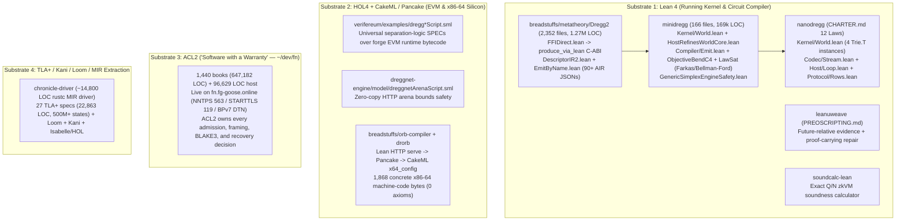
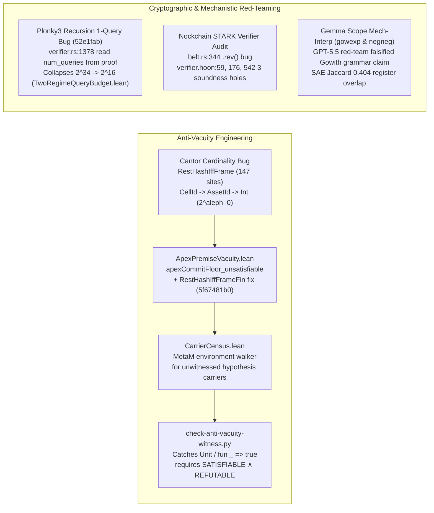

# Formal Assurance Substrates, Kernel Lineage, and Adversarial Red-Teaming

**Primary-Source Dossier (`05-formal-assurance-kernels-and-redteaming.md`)**
**Scope:** Formal Assurance Techniques (Lean 4, HOL4/CakeML, ACL2, TLA+/Kani/Loom/MIR), Kernel Lineage (`breadstuffs` → `minidregg` → `nanodregg` + `fn` + `verifereum`), Adversarial Red-Teaming, Anti-Vacuity Engineering, and Computable Law (`degg-research`).

*(Biographical boundary note: Prior to building the independent Dregg/Robigalia stack, Ember worked at Hellas on workload verification; no Hellas source code is included or claimed as Ember's open property in this dossier.)*

---

## 1. The Four Formal Methods Substrates & How They Execute in Production

Across Ember's systems, formal methods are not post-hoc documentation layers or paper-only models. Four distinct theorem-proving and model-checking substrates—**Lean 4**, **HOL4 / CakeML / Pancake**, **ACL2**, and **TLA+ / Kani / Loom / Isabelle (via Rust MIR extraction)**—execute directly in production or compile/verify the exact machine-code and EVM bytecode artifacts that run on the wire.



---

### 1.1 Lean 4 as the Running Kernel & Circuit Compiler

#### A. `breadstuffs/metatheory/Dregg2/`: 1.27M LOC, C-ABI FFI (`produce_via_lean`), and Lean-Emitted AIR Descriptors

As measured in the repository census ([`2026-09-28-crossref.md`](file:///Users/ember/dev/_research/nockchain-crossref/2026-09-28-crossref.md#L175)), [`breadstuffs/metatheory/Dregg2/`](file:///Users/ember/dev/breadstuffs/metatheory/Dregg2) comprises **2,352 Lean 4 files totaling 1,277,494 lines of code** across 17 domain directories (`Circuit` 714K, `Crypto` 128K, `Games` 113K, `Exec` 73K, `Apps` 28K, `Bridge` 26K, `Metatheory` 23K, `Verify` 22K, `Deos` 21K, `Distributed` 20K, `Authority` 13K, `Proof` 10K, `Spec` 9K, `Calculus` 7K, `Logic` 6K, `Substrate` 6K, plus sibling trees `Market/` 40K, `Metatheory/` 13K, `Polis/` 12K, `Bfv/` 3K), with 1,585 imports in [`Dregg2.lean`](file:///Users/ember/dev/breadstuffs/metatheory/Dregg2.lean) and 353 CI-enforced `#assert*` declarations in [`Claims.lean`](file:///Users/ember/dev/breadstuffs/metatheory/Dregg2/Claims.lean).

1. **Authoritative Production Execution via Zero-Copy C-ABI (`produce_via_lean` + `FFIDirect.lean`)**:
   Instead of treating Lean as a passive specification or paying a ~100 µs/turn double-JSON serialization tax across FFI, [`breadstuffs/metatheory/Dregg2/Exec/FFIDirect.lean`](file:///Users/ember/dev/breadstuffs/metatheory/Dregg2/Exec/FFIDirect.lean#L1-L355) exports typed C-ABI constructor and projection functions (`@[export dregg_w_*]`) that construct real Lean inductives (`WHostCtx`, `WState`, `WTurn`) as `lean_object*` pointers directly from Rust and execute the verified step function `execDirect`:

   ```lean
   -- /Users/ember/dev/breadstuffs/metatheory/Dregg2/Exec/FFIDirect.lean:57-61
   /-- Reassemble a 256-bit `Nat` from four 64-bit little-endian limbs (`lo` .. `hi`), then sign. -/
   @[inline] def intOfLimbs (neg : UInt8) (l0 l1 l2 l3 : UInt64) : Int :=
     let mag : Nat := l0.toNat + (l1.toNat <<< 64) + (l2.toNat <<< 128) + (l3.toNat <<< 192)
     if neg == 0 then Int.ofNat mag else -(Int.ofNat mag)
   ```

   ```lean
   -- /Users/ember/dev/breadstuffs/metatheory/Dregg2/Exec/FFIDirect.lean:330-351
   /-- **THE DIRECT C-ABI ENTRYPOINT**: run the proved `execFullForestAuthStep` chain on already-built
   Lean inductives (`WHostCtx`, `WState`, `WTurn`) and return the `(status, WState)` pair as a
   `lean_object*` for the reader exports below. No JSON parse on entry; no JSON encode on exit. -/
   @[export dregg_exec_full_forest_auth_direct]
   def execDirect (host : WHostCtx) (state : WState) (turn : WTurn) : WStatusResult :=
     let k0 := stateOfWState state
     let s0 : RecChainedState := { kernel := k0, log := [] }
     let ctx := admCtxOfHost host
     let hdr := turnHdrOf turn.agent (eraseAuth turn.root) turn.nonce turn.fee turn.validUntil turn.prevHash
     match liftForestG turn.root with
     | none => { status := "unsupported", state := state }
     | some rootG =>
       let (status, s1) := runGatedForestTurnStatus ctx s0 hdr rootG
       let cellIds := (state.cells.map Prod.fst ++ rootG.touchedCells).eraseDups
       let capLabels := (state.caps.map Prod.fst ++ rootG.mintedCaps).eraseDups
       let balKeys := (balKeysOf state ++ rootG.touchedBalKeys turn.agent).eraseDups
       let w1 := wstateOfState s1.kernel cellIds capLabels balKeys
       { status := statusStr status, state := w1 }
   ```

   On the Rust side, [`produce_via_lean`](file:///Users/ember/dev/breadstuffs/exec-lean/src/lean_apply.rs#L1796-L1850) (in [`breadstuffs/exec-lean/src/lean_apply.rs`](file:///Users/ember/dev/breadstuffs/exec-lean/src/lean_apply.rs), default-ON via `DREGG_LEAN_PRODUCER`) invert authority so that **Lean is the authoritative state producer** and the Rust executor is demoted to a shadow cross-check:
   - When Lean commits (`LeanStatus::Committed`), `*ledger = lean_ledger` is unconditionally installed with Lean's `post_state_hash`, overriding Rust even if Rust rejected (surfacing `ShadowDisagreement`).
   - When Lean rejects (`LeanStatus::Rejected`), `ledger` remains untouched at the pre-state and any Rust accept is vetoed with [`TurnError::LeanShadowVeto`](file:///Users/ember/dev/breadstuffs/exec-lean/src/lean_apply.rs#L1784).

2. **Lean-Authored Multi-Table AIR Descriptors (`DescriptorIR2.lean` & `EmitByName.lean`)**:
   In [`breadstuffs/metatheory/Dregg2/Circuit/DescriptorIR2.lean`](file:///Users/ember/dev/breadstuffs/metatheory/Dregg2/Circuit/DescriptorIR2.lean#L1-L210), the EPOCH multi-table constraint grammar (`EffectVmDescriptor2`) defines five shared STARK tables (`main`, `poseidon2Chip`, `range16`, `memory`, `mapOps`), offline memory checking welded to Blum's theorem (`Dregg2.Crypto.MemoryChecking.memcheck_sound`), and the exact degree-7 Poseidon2 chip arity admission polynomial:
   $$a \cdot (a - 2) \cdot (a - 3) \cdot (a - 4) \cdot (a - 7) \cdot (a - 11) \cdot (a - 16) = 0$$
   Replacing the weaker `ins.length ≤ CHIP_RATE` (`≤ 16`) guard with `ChipArityAdmitted` (`ins.length ∈ [0, 2, 3, 4, 7, 11, 16]`) caught descriptors that had shipped with unprovable arities 8, 9, and 14 ([`DescriptorIR2.lean`](file:///Users/ember/dev/breadstuffs/metatheory/Dregg2/Circuit/DescriptorIR2.lean#L178-L205)).

   Furthermore, [`breadstuffs/metatheory/EmitByName.lean`](file:///Users/ember/dev/breadstuffs/metatheory/EmitByName.lean#L1-L200) regenerates the entire `circuit/descriptors/by-name/*.json` predicate-dispatch surface (90+ descriptors) directly from verified Lean definitions (`emitVmJson2`), eliminating an ungated hand-transcription hop where `predicate-arith.json` had previously drifted from its 24-wide welded Lean definition down to a 5-wide JSON missing two Poseidon2 value-to-fact weld legs (an exploitable forgery vulnerability documented in [`EmitByName.lean`](file:///Users/ember/dev/breadstuffs/metatheory/EmitByName.lean#L20-L28)) and retiring `adjacency-membership.json` (whose narrow 1-limb bus was collidable at $2^{15.45}$, demonstrated by `circuit/tests/adjacency_forge_tooth.rs`, [`EmitByName.lean`](file:///Users/ember/dev/breadstuffs/metatheory/EmitByName.lean#L186-L195)).

---

#### B. `minidregg/`: `World.admit`, Host Refinement, `Emit.lean`, Objective Bend (`Core4` + Farkas Certificates), and Simplex BFT Safety

[`minidregg/`](file:///Users/ember/dev/minidregg) (**166 Lean files, 169,289 lines**, [`2026-09-28-crossref.md`](file:///Users/ember/dev/_research/nockchain-crossref/2026-09-28-crossref.md#L176)) distills the kernel into a single fail-closed transition `World.admit` and proves implementation refinement, circuit-emission faithfulness, proof-producing type checking, total difference-constraint law satisfiability, and Simplex BFT consensus safety.

1. **`Kernel/World.lean` (`World.admit`, `World.step`, `fold`)**:
   In [`minidregg/Kernel/World.lean`](file:///Users/ember/dev/minidregg/Kernel/World.lean#L705-L795), durable state is a persistent sparse map of cells plus a distinguished system cell (`journal`, `head`, `retired`, `parent`, `spent`, `allowance`). Every turn is judged by one fail-closed transition:

   ```lean
   -- /Users/ember/dev/minidregg/Kernel/World.lean:705-726
   /-- The one fail-closed state transition. -/
   def World.admit (w : World R TxId D) (t : Turn R TxId Ev D) :
       Except Reject (World R TxId D) := do
     let cur := w.height
     if !(t.notBefore ≤ cur && cur ≤ t.notAfter) then .error .windowExpired
     else if (w.system.get ⟨SysSpace.journal, t.txId⟩).isSome then .error .replay
     else if !t.creates.Nodup then .error .duplicateCreate
     else if !t.retires.Nodup then .error .duplicateRetire
     else if !(t.legs.map Leg.cell).Nodup then .error .duplicateLeg
     else if !t.nullifiers.Nodup then .error .duplicateNullifier
     else match t.nullifiers.find? (fun nf => (w.system.get ⟨SysSpace.spent, nf⟩).isSome) with
     | some nf => .error (.nullifierSpent nf)
     | none =>
     if ! w.capabilityActive t then .error .capabilityInactive
     else match w.pinCheck H t with
     | some i => .error (.pinMismatch i)
     | none =>
     match w.chargeAllowance t.meterLane t.exactCharge with
     | none => .error .insufficientAllowance
     | some sys₀ =>
     let w₀ : World R TxId D := ⟨w.cells, sys₀⟩
     let w₁ ← w₀.applyCreates t.creates
     let w₂ ← w₁.applyLegs t.legs
     let w₃ ← w₂.applyRetires t.retires
     let prev := w.logRoot H
     let root' := H.chain prev (H.turnDigest t)
     let sys₁ := t.nullifiers.foldl (fun s nf => s.set ⟨SysSpace.spent, nf⟩ (some ())) w₃.system
     let sys' := (sys₁.set ⟨SysSpace.journal, t.txId⟩ (some (cur + 1, H.turnDigest t))).set
       ⟨SysSpace.head, ()⟩ (some (cur + 1, root'))
     .ok ⟨w₃.cells, sys'⟩
   ```

2. **`Kernel/HostRefinesWorldCore.lean` (Deployed Host Refines `World.step`)**:
   [`minidregg/Kernel/HostRefinesWorldCore.lean`](file:///Users/ember/dev/minidregg/Kernel/HostRefinesWorldCore.lean#L218-L608) proves that the deployed receiver (`DurableDataIntent.execute` + `Loaded.extend` + `afterCheckpoint`) is a step-by-step implementation refinement of `World.step` across accept, refuse, replay, crash, and checkpoint rebase schedules, and proves that append-only and policy-source namespaces cannot be rewritten by any turn:

   ```lean
   -- /Users/ember/dev/minidregg/Kernel/HostRefinesWorldCore.lean:218-224
   theorem appendOnly_rewrite_has_no_turn {w w' : World R TxId D} {t : Turn R TxId Ev D}
       (h : World.step H w t = some w')
       {id : CellId} {s : Store L} (hpre : w.cells id = some ⟨L, s⟩)
       (sp : Space L) [ inst : SpaceDiscipline L sp .appendOnly ]
       {k : L.Key sp} {x : L.Val sp} (hk : s.get ⟨sp, k⟩ = some x)
       {L' : CellLayout} (hL : L' = L) (s' : Store L')
       (hbad : (hL ▸ s').get ⟨sp, k⟩ ≠ some x) :
       w'.cells id ≠ some ⟨L', s'⟩
   ```

   ```lean
   -- /Users/ember/dev/minidregg/Kernel/HostRefinesWorldCore.lean:454-456 & 478-482 & 600-608
   theorem deployed_refines_step :
       ImplementationRefinement (HostStep B H) (Option.isSome ∘ Prod.fst) (World.step H)
         (Represents B) (Turn.ofIntent B H)

   theorem host_trace_represents_fold {p₀ : Loaded B.root} {w₀ : World R TxId D}
       (h₀ : Represents B p₀ w₀) (tr : List (HStep B H))
       (h chain : Chain (HostStep B H) p₀ tr) :
       ∃ log w', fold H w₀ log = some w' ∧ Represents B (traceLast p₀ tr) w' ∧
         log.length = countAdmitted B H w₀ tr

   theorem confirmed_represents {p : Loaded B.root} {w : World R TxId D}
       (hrep : Represents B p w) (a : Attempt B.root) (s : ConfirmSched)
       (hwf : IntentWF B p.snapshot a.intent)
       (hpost : ∀ wr ∈ a.intent.writes, wr.afterRoot = B.root wr.afterBytes) :
       let (out, p') := confirmStep B a s p
       match out with
       | .confirmed => ∃ t w', Turn.ofIntent B H w a.intent = .ok t ∧
                         World.step H w t = some w' ∧ Represents B p' w'
       | .unconfirmed => Represents B p' w
   ```

3. **`Compiler/Emit.lean` (`emit_faithful` & `emit_accepts_iff`)**:
   In [`minidregg/Compiler/Emit.lean`](file:///Users/ember/dev/minidregg/Compiler/Emit.lean#L248-L433), the constraint system flattener (`AirFlatten.flatten`) is serialized to a first-order, function-free `ConstraintDescriptor F` (`op ∈ {add, mul}`, wire indices, boundary zero-roots), and proved faithful against the algebraic evaluation semantics:

   ```lean
   -- /Users/ember/dev/minidregg/Compiler/Emit.lean:248-253 & 378-383
   theorem emit_faithful [Field F] (idx : V → ℕ) (nPub nVars : ℕ)
       (cs : ConstraintSystem F V) (wv : ℕ → F) :
       descriptorHolds (emit idx nPub nVars cs) wv ↔
         gatesHold (readVars idx wv) (readAux nVars wv) (flattenSystem cs 0).gates ∧
           ∀ r ∈ (flattenSystem cs 0).roots,
             r.read (readVars idx wv) (readAux nVars wv) = 0

   theorem emit_accepts_iff [Field F] [DecidableEq V]
       (idx : V → ℕ) (nPub nVars : ℕ) (hInj : Function.Injective idx)
       (hBound : ∀ v, idx v < nVars) (env : V → F) (cs : ConstraintSystem F V) :
       (∃ wv : ℕ → F, (∀ v, wv (idx v) = env v) ∧
         descriptorHolds (emit idx nPub nVars cs) wv) ↔
       systemAccepts env cs
   ```

4. **Objective Bend (`Core4` Proof-Producing Type Checker, C4 Linearization, and Farkas / Bellman-Ford Certificates for `mini> law check`)**:
   - **Proof-Producing Checker (`Theory/ObjectiveBendTyping.lean`)**: [`infer`](file:///Users/ember/dev/minidregg/Theory/ObjectiveBendTyping.lean#L341-L400) does not return a bare `Bool` or unverified `Ty`; it returns `Option (Inferred assumptions context term)`, where `Inferred` is a dependent Sigma-like structure bundling the inferred `type : Ty`, linear resource `uses : List Usage`, and a constructive typing derivation `derivation : PartialTyping assumptions context term type uses`.
   - **C4 Linearization (`Compiler/ObjectiveBendC4.lean`)**: [`linearize`](file:///Users/ember/dev/minidregg/Compiler/ObjectiveBendC4.lean#L100-L195) implements C3 linearization plus the suffix property (ported from `pommette.scm`), distinguishing `Refusal.inconsistent` from `Refusal.fuelExhausted` with fuel derived strictly from graph size, and verifying `OrderedPresentationInvariant` across 4,000 seeded random DAGs.
   - **Enforced Law Fragment & Total Farkas / Bellman-Ford Certificates (`Compiler/ObjectiveBendLaw.lean`, `Pred/Satisfiable.lean`, `Pred/SatisfiableTotal.lean`, `Host/LawSat.lean`)**:
     Every `law NAME: EXPR` declared in an Objective Bend package is parsed by [`ObjectiveBendLaw.parse`](file:///Users/ember/dev/minidregg/Compiler/ObjectiveBendLaw.lean#L115-L381) and compiled to `Pred`. When a user runs `mini> law check` (Host op 150 `law-sat`, or the install-time self-lockout / relaw-lockout guard), [`Pred/Satisfiable.lean`](file:///Users/ember/dev/minidregg/Pred/Satisfiable.lean#L288-L410) translates the law into a DNF of integer difference-constraint systems (`val x ≤ val y + k`) and solves each via Bellman-Ford (`Sys.solve`), returning **either a concrete satisfying `(old, new)` state witness OR an integer Farkas / negative-weight cycle certificate** (`SysCert.clash` or `SysCert.cycle`):

     ```lean
     -- /Users/ember/dev/minidregg/Pred/Satisfiable.lean:288-304
     /-- Why one system has no solution: a variable is required both present and absent, or a
     closed walk of its constraints has negative total weight. -/
     inductive SysCert where
       | clash (v : Node)
       | cycle (cs : List Con)
     deriving Repr, DecidableEq

     def SysCert.check (s : Sys) : SysCert → Bool
       | .clash v => s.present.contains v && s.absent.contains v
       | .cycle cs =>
           !cs.isEmpty &&
           cs.all (fun c => s.cons.contains c) &&
           linked cs &&
           decide ((cs.map Con.k).sum < 0)
     ```

     [`Pred/SatisfiableTotal.lean`](file:///Users/ember/dev/minidregg/Pred/SatisfiableTotal.lean#L218-L228) and [`Host/LawSat.lean`](file:///Users/ember/dev/minidregg/Host/LawSat.lean#L441-L595) prove that **the solver is total (`decide_never_unknown` / `lawSat_never_unknown`)** and that self-lockout and relaw-lockout certificates are sound and complete:

     ```lean
     -- /Users/ember/dev/minidregg/Host/LawSat.lean:441-445, 496-501, 561-575
     theorem lawSat_never_unknown (q : Query) {d : DiffProblem}
         (hd : Pred.difference? (effective q) = some d) :
         (∃ o n, answer q = .decided d (.witness o n)) ∨
           (∃ c, answer q = .decided d (.unsat c))

     theorem lawSat_unsat_admits_nothing (q : Query) (d : DiffProblem) (c : Certificate)
         {p : Pred} (hp : effective q = p)
         (h : answer q = .decided d (.unsat c)) :
         ∀ o n, eval p o n = false

     theorem self_lockout_detected (law : Pred) (installer : Int) (d : DiffProblem) (c : Certificate)
         (h : answer (lockoutQuery law installer none) = .decided d (.unsat c)) :
         ∀ o n, n.get "request/subject" = some installer → eval law o n = false

     theorem relaw_lockout_detected (law : Pred) (installer : Int) (d : DiffProblem) (c : Certificate)
         (h : answer (lockoutQuery law installer (some installVerb)) = .decided d (.unsat c)) :
         ∀ o n, n.get "request/subject" = some installer → n.get "request/verb" = some installVerb →
           eval law o n = false
     ```

5. **Simplex BFT Consensus Safety (`Kernel/GenericSimplexEngineSafety.lean`)**:
   [`minidregg/Kernel/GenericSimplexEngineSafety.lean`](file:///Users/ember/dev/minidregg/Kernel/GenericSimplexEngineSafety.lean#L24-L140) proves consensus safety by induction over the actual authenticated executable start/step network (`Reachable c faulty checked time net` at $n = 3f + 1$), including exponential view-timeout backoff (`viewTimeout_bounds`), with **zero unproved emission premises**:

   ```lean
   -- /Users/ember/dev/minidregg/Kernel/GenericSimplexEngineSafety.lean:26-30, 62-92
   theorem reachable_emission_invariants {c : Config} {faulty : Finset Nat}
       {checked : Network → Nat → Block → Prop} {time : Nat} {net : Network}
       (reachable : Reachable c faulty checked time net)
       (size : c.parties = 3*c.faults+1) :
       NetworkJustified c faulty net ∧ SupportedTrace c faulty net

   theorem actual_committed_prefix_consistency {c : Config} {faulty : Finset Nat}
       {checked : Network → Nat → Block → Prop} {time : Nat} {net : Network}
       (reachable : Reachable c faulty checked time net)
       (size : c.parties = 3*c.faults+1) (honest : faulty.card ≤ c.faults) :
       CommittedPrefixConsistent (auditTrace net) (Finset.range c.parties \ faulty)

   theorem actual_certified_next_record_unique {c : Config} {faulty : Finset Nat}
       {checked : Network → Nat → Block → Prop} {time : Nat} {net : Network}
       (reachable : Reachable c faulty checked time net)
       (size : c.parties = 3*c.faults+1) (honest : faulty.card ≤ c.faults)
       {v : Nat} {b₁ b₂ : Block}
       (notar₁ : CertifiedNotarization (auditTrace net) v b₁)
       (notar₂ : CertifiedNotarization (auditTrace net) v b₂)
       (valid : ValidatedBlock b₁) :
       nextRecord b₁ = nextRecord b₂
   ```

---

#### C. `nanodregg/`: The 12 Charter Laws, Four-Trie `World.lean`, Single `Codec.Stream`, and Self-Testing `Protocol/Rows.lean`

Initiated on 2026-10-16 ([`nanodregg/CHARTER.md`](file:///Users/ember/dev/nanodregg/CHARTER.md#L1-L198)) under Ember's directive—*"rebuild whatever shape you think will be better. Go hardcore. ONLY GOOD CODE AND BEST PRACTICES. All decisions get critically and metacritically examined"*—`nanodregg` is a clean-room rebuild of `minidregg` from its specification (single-node vat, one writer per Store, members who consent by re-execution).

1. **The 12 Charter Laws ([`nanodregg/CHARTER.md`](file:///Users/ember/dev/nanodregg/CHARTER.md#L49-L122))**:
   - **Law 1 (`World.admit` IS the receive path)**: No shadow receiver (`DurableDataIntent`), no `Turn.ofIntent` translation, no `Represents` bridge. The Host unframes a `SignedCall`, checks Ed25519 signature, runs `Lang.eval` when the call is a `Run`, and calls `World.admit`.
   - **Law 2 (One codec family, `Codec.Stream`)**: Defined in [`nanodregg/Codec/Stream.lean`](file:///Users/ember/dev/nanodregg/Codec/Stream.lean#L25-L345). Every wire format and hash preimage is a value of `Stream α` over `ByteArray` offsets; every codec carries its structural [`Shape`](file:///Users/ember/dev/nanodregg/Codec/Stream.lean#L25-L45), and frame tags (`Codec.Tag`) are hashes of `(label, Shape)`.
   - **Law 3 (Four instances of one persistent binary Merkle trie, `Trie.T`)**: In [`nanodregg/Kernel/World.lean`](file:///Users/ember/dev/nanodregg/Kernel/World.lean#L768-L794), `Cells`, `Journal`, `Refusals`, and `Rows` are four instances of `Trie.T`, committed by a single `roots` digest (`rootsOf E w.trie w.journal w.refusals w.rows`). Execution uses an unhashed dirty overlay (`uStore`) sealed once per turn, wired to the proof specification via `@[csimp] theorem World.admit_eq_admitImpl` ([`Kernel/World.lean`](file:///Users/ember/dev/nanodregg/Kernel/World.lean#L1677)).
   - **Law 4 (No child processes; in-process fuel reopen)**: In [`nanodregg/Host/Loop.lean`](file:///Users/ember/dev/nanodregg/Host/Loop.lean#L373-L398), `restarts` runs `serve` for `fuel` batches, then reopens the `Store` from disk **in process** and checks `agrees mark r r'` (`reopenDiverged` on mismatch). Notably, Law 4's amendment in [`CHARTER.md`](file:///Users/ember/dev/nanodregg/CHARTER.md#L69-L80) documents a real Lean compiler lifetime bug caught at commit `7e23642`: `Host.Store.lock` held an `flock` on a file descriptor whose last syntactic reference was before `restarts`; compiled Lean dropped the handle—and thus released the `flock`—mid-serve while the daemon was still accepting writes, allowing a concurrent writer to clobber the Store until `IO.Ref` kept the lock live across `restarts`.
   - **Laws 5–12**: One command language (`nd` argv, Law 5); one language (`Lang`, a total syntax-directed type checker [`inferE`](file:///Users/ember/dev/nanodregg/Lang/Check.lean#L100-L240) proved sound, complete, and type-unique in [`Lang/Proofs/Check.lean`](file:///Users/ember/dev/nanodregg/Lang/Proofs/Check.lean#L339-L360) via `inferE_iff` and `hasType_unique`, Law 6); every refusal is a constructor with a name (`Reject`, `TypeError`, `EvalError`, Law 7); every theorem has a `Mutation` plant or is a step in one (Law 8); no `partial def`, no `sorry`, no `axiom`, no `native_decide` on uninterpreted functions (Law 9); explicit bounds (`Host/Bounds.lean`, Law 10); size ratchet (`SIZE.md` ≤ 35,000 lines, Law 11); one binary `nd` (Law 12).
   - **Self-Testing Conformance Rows (`Protocol/Rows.lean`)**: In [`nanodregg/Protocol/Rows.lean`](file:///Users/ember/dev/nanodregg/Protocol/Rows.lean#L1-L250), the system specification is executable data (`Row`), where every row carries a [`Mutation`](file:///Users/ember/dev/nanodregg/Protocol/Rows.lean#L215-L250) plant (`skipJudge`, `followVerifyAll`, `forgetJournal`, `lieTip`, `forgeBase`, `forgeCertificate`, `ignoreNotBefore`, `nonceRepeats`, etc.) that must flip a named line to red, and `Protocol.Proofs.Rows.every_op_has_a_row` proves in Lean that every operation is exercised.

---

#### D. `leanuweave` (`PREOSCRIPTING.md`) & `soundcalc-lean`

1. **`leanuweave` — Preoscript, Future-Relative Evidence, and Proof-Carrying Repair Plans ([`leanuweave/PREOSCRIPTING.md`](file:///Users/ember/dev/leanuweave/PREOSCRIPTING.md#L1-L1335))**:
   `leanuweave` formalizes concurrent document and tree editing where edits may fork and obligations may remain open. Its query and scripting layer, **preoscript** ([`Uwueave/Preo/`](file:///Users/ember/dev/leanuweave/Uwueave/Preo)), replaces classical two-valued truth with a six-cell **future-relative epistemic carrier** ([`Uwueave/Evidence.lean`](file:///Users/ember/dev/leanuweave/Uwueave/Evidence.lean), [`PREOSCRIPTING.md`](file:///Users/ember/dev/leanuweave/PREOSCRIPTING.md#L800-L830)) indexed by candidate multiplicity (`zero` / `one` / `many`), closure (`open` / `closed`, distinguishing *nothing observed yet* from *definitive absence* `vacuous`), and an orthogonal `Visibility` axis:
   - Subtyping `Exact Working α <: Exact Delivered α` is derived from a theorem on future inclusion rather than ad-hoc coercion.
   - Route-order invariance is machine-checked in [`Uwueave/Preo/Classification.lean`](file:///Users/ember/dev/leanuweave/Uwueave/Preo/Classification.lean) (`Preo.run_answer_congr` and `Preo.verdict_agree`): any two execution plans over equivalent declaration sets return identical answers and verdicts.
   - When an edit or merge violates a compound law, `leanuweave` synthesizes a **proof-carrying repair plan** (`FiniteRepairMenu` / `RepairSynthesis`, plus `Uwueave/SeamColoring.lean` for minimum-cut seam resolution and `Uwueave/MinimalSummary.lean` for sufficient digest witnesses) where the candidate repair move carries a Lean proof that applying it restores the target invariant.

2. **`soundcalc-lean` — Exact Rational Soundness Calculator for Hash-Based zkVMs ([`soundcalc-lean/README.md`](file:///Users/ember/dev/soundcalc-lean/README.md#L1-L91))**:
   Replaces Ethereum's Python floating-point `soundcalc` with an exact `ℕ` and `ℚ` Lean 4 formalization coveringBCIKS20, Ha22 (DEEP-ALI), BCHKS25 (UDR and Johnson-bound mutual correlated agreement), Jagged PCS, LogUp, and LogUp-GKR:
   - Every security bit cell is a theorem over exact rationals (`example : secBits (sp1CoreFRI.queryErr (UDR koalaBear4)) = 100 := by native_decide`), backed by `le_secBits_iff : k ≤ secBits ε ↔ ε ≤ 1 / 2 ^ k` and `secBits_min'`.
   - Irrational Johnson-bound terms ($\sqrt{\rho}$, $\log_2$) are replaced by certified rational enclosures proved conservative against Mathlib's `Real.sqrt` and `Real.logb 2` (`sqrtLB_le`, `le_sqrtUB`, `jbrErrLinear_conservative`), while 64-bit Goldilocks primality is certified kernel-only via a Pratt certificate (`lucas_primality` in `Soundcalc/Field.lean`) without `native_decide`, guarded in CI by `scripts/AxiomsGuard.lean`.

---

### 1.2 HOL4 & CakeML/Pancake Machine-Code & EVM Bytecode Verification

#### A. `verifereum/examples/`: Universal Separation-Logic Proofs over `forge`-Compiled Solidity EVM Runtime Bytecode

In [`/Users/ember/dev/verifereum/examples/`](file:///Users/ember/dev/verifereum/examples) (tracked at commits `513beea` and `bf8294d`), Ember built a reusable HOL4 path-composition engine ([`evmSpecAutomationScript.sml`](file:///Users/ember/dev/verifereum/examples/evmSpecAutomationScript.sml#L1-L102) + `evmSpecAutomationLib`) on top of the Verifereum (`vfmProg`) EVM separation logic and proved universal (`∀` caller, `∀` symbolic storage/nullifier) Hoare-triple specifications directly over the **real `forge`-compiled Solidity creation and runtime bytecode** of Dregg's on-chain settlement contracts (`DreggProofAttestor.sol`, `DreggVault.sol`, `DreggLaunchToken.sol`). Every script ends with an ML tag-audit block (`Tag.dest_tag (Thm.tag th)`) that fails the build if any theorem uses `cheat`, `mk_thm`, or any oracle beyond `DISK_THM`.

1. **Reusable Bytecode Path Automation ([`evmSpecAutomationScript.sml`](file:///Users/ember/dev/verifereum/examples/evmSpecAutomationScript.sml#L27-L102))**:
   ```sml
   (* /Users/ember/dev/verifereum/examples/evmSpecAutomationScript.sml:27-56 *)
   Definition evm_line_def:
     evm_line (n:num) b = b:bool
   End

   Definition len_opcode_def:
     len_opcode (Push n []) = 1:num ∧
     len_opcode (Push n (x::xs)) = 1 + len_opcode (Push n xs) ∧
     len_opcode _ = 1
   End

   Theorem LENGTH_opcode_eq_len_opcode:
     ∀c. LENGTH (opcode c) = len_opcode c
   Proof
     Cases \\ EVAL_TAC \\ rename [‘Push _ l’]
     \\ Induct_on ‘l’ \\ gvs [len_opcode_def]
   QED

   Theorem SPEC_EVM_MODEL_empty:
     SPEC EVM_MODEL emp {} emp
   Proof
     gvs [SPEC_REFL]
   QED
   ```

2. **`DreggProofAttestor.sol` Deployment & One-Shot Binding Latch ([`dreggProofAttestorScript.sml`](file:///Users/ember/dev/verifereum/examples/dreggProofAttestorScript.sml#L1-L209) & [`dreggBindPathsScript.sml`](file:///Users/ember/dev/verifereum/examples/dreggBindPathsScript.sml#L1-L191))**:
   [`dreggProofAttestorScript.sml`](file:///Users/ember/dev/verifereum/examples/dreggProofAttestorScript.sml#L15-L209) runs the real `forge`-compiled creation bytecode with constructor immutables (`socket_`, `launchpad_`, `trustedAnchor_`, `binder_ = 0x1111..1111`) inside HOL4's `cv_compute` kernel (`Theorem deploy_ok = cv_eval “deploy_result_flag”`) to extract the exact on-chain runtime `contract_code`.
   Then [`dreggBindPathsScript.sml`](file:///Users/ember/dev/verifereum/examples/dreggBindPathsScript.sml#L18-L190) proves path-by-path from the post-ABI-decode `JUMPDEST` (`0x301 = 769`) that non-binders revert (`NotBinder`) and that **even the authorized binder cannot overwrite or swap an already-bound launch transition (`AlreadyBound`)**:

   ```sml
   (* /Users/ember/dev/verifereum/examples/dreggBindPathsScript.sml:131-161 *)
   (* Early-false return on attestClearing when _bindings[launchId].set == 0 *)
   Theorem SPEC_attest_blk_unbound_false =
     GEN_ALL (pick 1677 (SOME 2342));

   (* Path 1: non-binder caller -> 769 -> 828 -> 2173 -> Reverted (NotBinder) *)
   Theorem SPEC_bind_path_notbinder_reverts =
     GEN_ALL (DISCH_ALL (SPEC_COMPOSE_RULE
       [U binder_notbinder, U revert_outer]));

   (* HEADLINE (Property 1 — one-shot binding): binder caller on an already-bound launch
      (_bindings[launchId].set is true) -> 769 -> 832 -> 902 -> 2173 -> literal Reverted
      (AlreadyBound), reached BEFORE any SSTORE and BEFORE the launchpad/socket STATICCALLs. *)
   Theorem SPEC_bind_oneshot_reverts =
     GEN_ALL (DISCH_ALL (SPEC_COMPOSE_RULE
       [U binder_pass, U alreadybound_setup, U revert_outer]));
   ```

3. **`DreggVault.sol` No-Double-Withdraw Nullifier Latch ([`dreggVaultPathsScript.sml`](file:///Users/ember/dev/verifereum/examples/dreggVaultPathsScript.sml#L1-L263))**:
   Proves over the real `forge`-compiled `DreggVault.sol` runtime bytecode (from the nullifier gate `JUMPDEST 0xd56 = 3414` through shared revert tail `0x88b = 2187`) that for **every** message whose nullifier is already marked spent in `usedNullifiers[nullifier]`, `withdraw` reverts (`NullifierAlreadyUsed`) before marking the nullifier or transferring value:

   ```sml
   (* /Users/ember/dev/verifereum/examples/dreggVaultPathsScript.sml:234-236 *)
   Theorem SPEC_withdraw_nullifier_used_reverts =
     GEN_ALL (DISCH_ALL (SPEC_COMPOSE_RULE
       [U nullifier_used_setup, U revert_outer]));
   ```

4. **`DreggLaunchToken.sol` Minter Guard ([`dreggMintGuardScript.sml`](file:///Users/ember/dev/verifereum/examples/dreggMintGuardScript.sml#L1-L149))**:
   Proves over the 12-instruction minter guard at byte offset `0x03d5 = 981` (`CALLER; PUSH1 1; PUSH1 1; PUSH1 0xa0; SHL; SUB; PUSH32 <minter>; AND; EQ; PUSH2 0x0425; JUMPI`) that any caller `w2w p.caller <> 0x1111..1111w` deterministically falls through to `PC 0x0406 = 1030` (`NotMinter` revert block) with the operand stack restored and storage untouched:

   ```sml
   (* /Users/ember/dev/verifereum/examples/dreggMintGuardScript.sml:133-136 *)
   Theorem SPEC_mint_guard_notminter =
     th_guard1
     |> INST [“pc:num” |-> “981n”]
     |> SIMP_RULE (srw_ss() ++ ARITH_ss) [b2w_eq_zero];
   ```

---

#### B. `dreggnet-engine/model/dreggnetArenaScript.sml`: Zero-Copy HTTP Arena Bounds Safety in HOL4

In [`/Users/ember/dev/dreggnet-engine/model/dreggnetArenaScript.sml`](file:///Users/ember/dev/dreggnet-engine/model/dreggnetArenaScript.sml#L1-L139), the unified zero-copy HTTP request representation shared across H1/HPACK/QPACK models an immutable `arena` buffer plus a lazy mutation `sidecar` selected by bit 31 (`SIDECAR_BASE = 2n ** 31`), and proves in HOL4 that resolving any well-formed header entry returns a slice of **exactly** its declared byte length with zero truncation or over-read:

```sml
(* /Users/ember/dev/dreggnet-engine/model/dreggnetArenaScript.sml:105-136 *)
Theorem take_drop_len:
  !n m l. m + n <= LENGTH l ==> LENGTH (TAKE n (DROP m l)) = n
Proof
  rpt strip_tac >>
  `n <= LENGTH (DROP m l)` by simp[LENGTH_DROP] >>
  simp[LENGTH_TAKE]
QED

Theorem resolve_length:
  !p off len. inbounds p off len ==> LENGTH (resolve p off len) = len
Proof
  rw[resolve_def, inbounds_def] >> irule take_drop_len >> simp[]
QED

Theorem wf_entry_value_length:
  !p e. wf_entry p e ==> LENGTH (resolve p e.voff e.vlen) = e.vlen
Proof
  rw[wf_entry_def] >> metis_tac[resolve_length]
QED

Theorem wf_parsed_values_total:
  !p. wf_parsed p ==>
      EVERY (\e. LENGTH (resolve p e.voff e.vlen) = e.vlen) p.entries
Proof
  rw[wf_parsed_def, EVERY_MEM] >> metis_tac[wf_entry_value_length]
QED
```

---

#### C. `breadstuffs/orb-compiler/`, `drorb`, & `datacake-down-to-the-bytes.txt`: From Lean HTTP Serve Down to 1,868 Verified x86-64 Machine-Code Bytes

Documented in [`/Users/ember/src/dregg-posters/datacake-down-to-the-bytes.txt`](file:///Users/ember/src/dregg-posters/datacake-down-to-the-bytes.txt#L1-L75), [`/Users/ember/dev/breadstuffs/orb-compiler/Pancake/`](file:///Users/ember/dev/breadstuffs/orb-compiler/Pancake), and [`/Users/ember/dev/drorb`](file:///Users/ember/dev/drorb) (commits `86d1e80`, `28e50d1`, `3efc231`), the **Datacake ("Down to the Bytes")** compiler ladder connects a pure Lean HTTP serve specification down to **1,868 concrete x86-64 machine-code bytes** (`55 48 89 e5 ...`, 155 concrete assembly instructions) compiled by the HOL4-verified CakeML/Pancake compiler (`compile_prog x64_config`):

1. **The 8-Rung Verification Ladder ([`datacake-down-to-the-bytes.txt`](file:///Users/ember/src/dregg-posters/datacake-down-to-the-bytes.txt#L15-L53))**:
   - `[0]` **`miniServe : Method → WireResp`** — Pure Lean HTTP serve function (`drorb/Http/MiniServe.lean`).
   - `[1]` **`execStage (serveStage200 / 405)`** — Two-phase stage DSL (`StageProg2.lean`, commit `3f9f6eb`); redesigning the flat model into the deployed two-phase pipeline caught a real fidelity bug where the old flat model dropped security headers on refusal paths.
   - `[2]` **`emitServe` + `wf_auto` + `translateCert` ([`orb-compiler/Pancake/ProofProducing.lean`](file:///Users/ember/dev/breadstuffs/orb-compiler/Pancake/ProofProducing.lean#L218-L250))**: Proof-producing compiler from `Stage σ` to `PancakeProg` where the `wf_auto` tactic automatically discharges `WF o st` without hand proofs:
     ```lean
     -- /Users/ember/dev/breadstuffs/orb-compiler/Pancake/ProofProducing.lean:221-223
     def translateCert (o : Oracle σ) (st : Stage σ) (h : WF o st) :
         { p : PancakeProg // Refines o p (denote st) } :=
       ⟨emitServe st, emitServe_correct o st h⟩
     ```
   - `[3]` **`lower serveExport = some serveExportModel` ([`orb-compiler/Pancake/ServeExportServes.lean`](file:///Users/ember/dev/breadstuffs/orb-compiler/Pancake/ServeExportServes.lean#L250-L622))**: Whole-program lowering and behavioral equivalence over both HTTP `GET` (`'G' = 71`, landing 164 bytes) and `405 Method Not Allowed` (`'X' = 88`, landing 227 bytes), with non-vacuity proved via `ofNat_len_ne` (`164 ≠ 227` at `BitVec 64`):
     ```lean
     -- /Users/ember/dev/breadstuffs/orb-compiler/Pancake/ServeExportServes.lean:471-485 & 606-607
     theorem serveExport_serves_405 (o : Oracle σ) (s : PancakeState σ)
         (bs200 bs405 : List Nat) (outBase reqAddr : Word) ... :
         ∃ s', PancakeSem o (serveExportModel bs200 bs405) s
                 = (some (BitVec.ofNat 64 bs405.length), s')
           ∧ MemBytesAtB s'.memory s.memaddrs s.be outBase bs405

     theorem ofNat_len_ne {a b : Nat} (ha : a < 2 ^ 64) (hb : b < 2 ^ 64) (h : a ≠ b) :
         (BitVec.ofNat 64 a) ≠ (BitVec.ofNat 64 b)
     ```
   - `[4]`–`[7]` **HOL4 CakeML/Pancake Backend (`pan_to_target` / `compile_prog x64_config`)**: Compiles the `.pnk` AST through `pan_to_word`, `word_to_stack` (register allocation discharged), `stack_to_lab`, and `lab_to_target` to **1,868 concrete x86-64 machine-code bytes**, cross-checked against the native `cake` compiler oracle over 464 differential test vectors with zero errors (commit `03b07f4`).

---

### 1.3 ACL2 ("Software with a Warranty" — `~/dev/fn`)

[`/Users/ember/dev/fn/`](file:///Users/ember/dev/fn) (*fuckin' news / formal news*) is an ACL2-verified NNTP (RFC 3977 / RFC 4642 / RFC 4643) and BPv7 Delay-Tolerant Networking (DTN) server running in production on Ember's public node **`fn.fg-goose.online`** (live since 2026-09-27 on NNTPS port 563 and STARTTLS port 119; [`docs/public-node.md`](file:///Users/ember/dev/fn/docs/public-node.md#L1-L84)). While early milestones had ~27k lines of ACL2, the repository has grown to **1,440 `.lisp` books in [`books/`](file:///Users/ember/dev/fn/books) totaling 647,182 lines of ACL2**, plus **96,629 lines of SBCL/ACL2 host integration in [`host/`](file:///Users/ember/dev/fn/host)** (~743,811 lines of Lisp/ACL2 total).

1. **Architectural & Engineering Laws ([`fn/AGENTS.md`](file:///Users/ember/dev/fn/AGENTS.md#L7-L59) & [`fn/docs/architecture.md`](file:///Users/ember/dev/fn/docs/architecture.md#L1-L218))**:
   - **ACL2 Owns Every Decision**: *"ACL2 decides identity, bounds, framing, charges and reply lines. Host code and Python never compute or compare a value ACL2 computes. A missing decision is an open item, not a host function."* ([`AGENTS.md`](file:///Users/ember/dev/fn/AGENTS.md#L8-L9)).
   - **Three-Valued Durable Outcome (`accepted`, `refused`, `uncertain`)**: Durable acceptance is emitted only from persisted state. If an I/O or `fsync` operation fails ambiguously after reservation, the server never silently rolls back or guesses; it returns `uncertain`, instructing the client to reconcile with the same `Message-ID` ([`README.md`](file:///Users/ember/dev/fn/README.md#L3-L5), [`docs/public-node.md`](file:///Users/ember/dev/fn/docs/public-node.md#L74-L79)).
   - **Served-Path Concrete Representations with Guard-Verified Refinement (Decision D27)**: Logical specs operate over octet lists, while served paths execute over concrete byte buffers/arenas (`mbe :logic ... :exec ...`) generated via `def-loop`, `def-representation`, and `def-buffer` macros.

2. **Key ACL2 Books in Production**:
   - **Guard-Verified BLAKE3 over Octet Lists ([`books/blake3.lisp`](file:///Users/ember/dev/fn/books/blake3.lisp#L1-L200))**: 1,067 lines implementing the full BLAKE3 tree hash (`fn-blake3`, `fn-blake3-keyed`, `fn-blake3-derive-key`), 7-round `G` compression, 1024-octet chunks, and binary tree reduction with `:guard t` total primitives and tail-recursive `mbe` loops (`fn-b3-firstn-loop` for PKT-877 stack-depth safety), attached via `defattach` in `books/crypto-attach.lisp` to the abstract cryptographic digest interface.
   - **Synchronous Store Refusal & Prepublication Abort ([`books/store-node-resolution.lisp`](file:///Users/ember/dev/fn/books/store-node-resolution.lisp#L16-L195))**: Proves that consuming a durable file reservation on semantic refusal (`fn-sn-refuse-reservation`) or prepublication abort (`fn-sn-known-abort`) preserves the 14-field store-node invariant `fn-sn-statep` and advances the live frontier in lockstep with replay (`fn-replay-advance-txid`):
     ```lisp
     ;; /Users/ember/dev/fn/books/store-node-resolution.lisp:178-180
     (defthm fn-sn-refuse-reservation-preserves-state
       (implies (fn-sn-statep s)
                (fn-sn-statep (fn-sn-refuse-reservation s txid))) ...)
     ```
   - **RFC 4642 STARTTLS & RFC 4643 AUTHINFO State Machine ([`books/nntp-auth.lisp`](file:///Users/ember/dev/fn/books/nntp-auth.lisp#L1-L200))**: 4,653 lines wrapping the entire served dispatch chain (`fn-served-dispatch -> fn-auth-step -> fn-peer-step -> fn-nntp-post-step -> fn-nntp-step`). Models the TLS handshake as an explicit state (`fn-auth-session-handshakingp`) rather than an unmodeled gap, proving that `382 Continue with TLS negotiation` is emitted at most once, that pipelined bytes smuggled behind `STARTTLS` before `:tls-established` are refused (`RFC 4642 §2.2`), and that `def-loop fn-auth-account-creds` preserves credential-list invariants (`fn-auth-account-creds-are-creds`).
   - **Generated Composition Obligations ([`books/owner-publication-composition.lisp`](file:///Users/ember/dev/fn/books/owner-publication-composition.lisp#L1-L89))**: Proves exact outputs and all 10 state-field effects (`fn-opub-observe`) of pre-move host compositions (`fn-opub-due-composition-by-definition`, `fn-opub-abandoned-composition-by-definition`).

3. **Warranty-Quality Proof Engineering & Bug Discovery ([`fn/warranty-quality-proof-engineering.md`](file:///Users/ember/dev/fn/warranty-quality-proof-engineering.md#L1-L700))**:
   - **Process-Death Cut Tables (`native_program_check.py`)**: Every native persistence operation is checked against modeled crash cuts (`cut_table`), verifying that killing the process at any persistence step recovers to a state satisfying the whole-history belief set $\mathcal{B}_t$ (never contradicting an `accepted` or `refused` receipt).
   - **Extent Trailer Bug Caught by Proof/Audit**: In `host/native/extent.lisp`, `fnn-extent-entry` checked the `FNX1` header magic and payload length, then returned `(subseq octets 16 (+ 16 len))` **without verifying the 4-byte `FNXE` trailer or stored CRC32C**. Proving the byte-to-record decoder correspondence forced the trailer and CRC check into the authoritative path.
   - **Automated Proof-Quality Ratchets**: `tools/ledger.py` scans all `.lisp` books for 6 suspect proof shapes (`trivial-conclusion`, `self-implication`, `unused-hyp`, `disabled-target-no- body`, etc.), while `tools/proof_cost.py` enforces Decision D26 (no single event may exceed 10.0s or the prover step ratchet).

---

### 1.4 TLA+, Kani, Loom & Rust MIR Extraction (`chronicle-driver`)

Documented in [`/Users/ember/runtime-becomes-machine-march2026.md`](file:///Users/ember/runtime-becomes-machine-march2026.md#L15-L120), the formal verification campaign for Ember's CQ `io_uring` HTTP server and runtime introduced a compiler-driven verification pipeline:

- **27 TLA+ Specifications (22,863 lines, 500M+ Distinct States Explored)**: Model-checking the asynchronous completion-queue (`CQ`), buffer lifecycle, timeout watchdog, and multi-backend isolation protocols.
- **`chronicle-driver` (~14,800 LOC Custom `rustc` Compiler Driver)**: Extracts formal state machines directly from **Rust MIR (Mid-level Intermediate Representation)**—tracking atomic operations (`Ordering::SeqCst`, `Acquire`, `Release`), channel transitions, and resource lifecycles—and **dual-emits both TLA+ specifications and Loom concurrency test harnesses** from the same MIR extraction pass, paired with compiler-checked `tla_*` observer methods so specifications cannot silently drift from Rust code.
- **Multi-Solver & Theorem-Prover Cross-Verification**: Combined TLC/Apalache model checking, **Kani** bounded model checking harnesses on Rust bit-manipulation and arena invariants, **Loom** permutation testing, **2 completed refinement proofs** linking MIR-extracted models to high-level specs, and an **Isabelle/HOL** mechanization (`CQ_Automaton.thy`, advised by Gerwin Klein) proving backend equivalence.
- **9 Real Concurrency Bugs Discovered**: Including a **Dekker-protocol memory-ordering livelock** present across all 4 CQ backends and a **double-response race (`ResponseHandle`)** in the timeout watchdog when a timeout fired concurrently with normal completion.

---

## 2. Adversarial Red-Teaming, Vulnerability Discoveries & Anti-Vacuity Engineering

Ember's verification methodology treats **vacuity** (*a machine-checked proof of $P \implies Q$ that is green because $P$ is uninhabited*) and **self-satisfying verifier checks** as primary adversaries.



---

### 2.1 Anti-Vacuity Gates (`ApexPremiseVacuity.lean`, `CarrierCensus.lean`, `check-anti-vacuity-witness.py`)

#### A. The Cantor Cardinality Vacuity Discovery ([`2026-08-13-a-theorem-that-is-true-because-nothing-exists.md`](file:///Users/ember/dev/dregg-site/content/blog/2026-08-13-a-theorem-that-is-true-because-nothing-exists.md#L1-L94))

In [`dregg-site/content/blog/2026-08-13-a-theorem-that-is-true-because-nothing-exists.md`](file:///Users/ember/dev/dregg-site/content/blog/2026-08-13-a-theorem-that-is-true-because-nothing-exists.md#L22-L76), Ember documented how fast model-assisted proof generation repeatedly produces valid proofs over empty carriers:
- In `breadstuffs`, the commitment-floor hypothesis `RestHashIffFrame`—carried as a premise across **147 binder sites** including the assurance apexes—asserted that a 256-bit (or even arbitrary finite-output) hash function was injective on the non-cell "rest" frame of `RecordKernelState`.
- However, the ninth field of that frame was `bal : CellId → AssetId → Int`—an unrestricted total function from two infinite (`Nat`) domains into `Int` (cardinality $2^{\aleph_0}$), whereas any hash output into `Nat` or `Fin (P^4)` has at most countable cardinality $\aleph_0$. By **Cantor's theorem**, no such hash function exists at *any* output width!
- Similarly, in `minidregg`, all four `CellState.Schema` materializers and `VerifiedHistoryHead` (prior to commit `d257fe9`) had zero constructors/producers outside their defining modules.

#### B. Kernel-Checked Proof of Premise Unsatisfiability ([`ApexPremiseVacuity.lean`](file:///Users/ember/dev/breadstuffs/metatheory/Dregg2/Verify/ApexPremiseVacuity.lean#L1-L449))

Rather than quietly patching the definition, Ember committed [`breadstuffs/metatheory/Dregg2/Verify/ApexPremiseVacuity.lean`](file:///Users/ember/dev/breadstuffs/metatheory/Dregg2/Verify/ApexPremiseVacuity.lean#L1-L449) to prove **inside the Lean kernel** that the old `ApexCommitFloor` bundle is unsatisfiable at every width (`apexCommitFloor_unsatisfiable`), that the BabyBear 4-limb compression premises violate the pigeonhole principle (`apexCommitFloorSansRest_false_at_babyBear`), and that naive "satisfiability companion" schemas of the shape `P → ∃ _, P` (`satisfiability_companion_schema_admits_empty`) are satisfied by `fun _ => False`:

```lean
-- /Users/ember/dev/breadstuffs/metatheory/Dregg2/Verify/ApexPremiseVacuity.lean:105-115, 138-145, 420-430
/-- **`RestHashIffFrame` is false at EVERY output type of `Nat` cardinality.** -/
theorem restHashIffFrame_false_at_any_width (RH : RecordKernelState → Nat) :
    ¬ RestHashIffFrame RH :=
   Dregg2.Verify.FloorVacuity.restHashIffFrame_unsatisfiable RH

/-- **HEADLINE 1 — `ApexCommitFloor` is UNSATISFIABLE.** No 5-tuple `(compress, compressN,
hashCellLeaf, hashNullLeaf, RH)` satisfies `ApexCommitFloor`, at any width. -/
theorem apexCommitFloor_unsatisfiable
    (compress : (Fin 4 → Nat) → (Fin 4 → Nat) → (Fin 4 → Nat))
    (compressN : List Nat → (Fin 4 → Nat))
    (hashCellLeaf : CellId → Nat → (Fin 4 → Nat))
    (hashNullLeaf : NullifierId → (Fin 4 → Nat))
    (RH : RecordKernelState → Nat) :
    ¬ ApexCommitFloor compress compressN hashCellLeaf hashNullLeaf RH := by
  intro ⟨_, _, _, _, hRest⟩
  exact restHashIffFrame_false_at_any_width RH hRest

/-- **The schema `apex_accept_satisfiable_of_floor` instantiates.** `P → ∃ _, P`, for any predicate
and any point. A "satisfiability companion" of this shape cannot distinguish an inhabited accept-set
from an empty one; it re-packages its own hypothesis. -/
theorem satisfiability_companion_schema {α : Type} (p : α → Prop) (c : α) (h : p c) :
    ∃ d : α, p d := ⟨c, h⟩

theorem satisfiability_companion_schema_admits_empty {α : Type} (c : α) :
    (fun _ : α => False) c → ∃ d : α, (fun _ : α => False) d :=
  satisfiability_companion_schema (fun _ => False) c
```

Commits `5f67481b0` and `ec31ebda6` replaced `RestHashIffFrame` on the live apexes (`AssuranceCase.deployed_system_secure:953` and `AssuranceCase.unfoolability_guarantee:719`) with the finite-support successor `RestHashIffFrameFin RH` (proved satisfiable in `Verify.RestFrameFiniteSupportSuccessor.restHashIffFrameFin_satisfiable`) and extended `FloorCensus.injShapeIff` to gate `Iff`-headed injectivity premises automatically ([`ApexPremiseVacuity.lean`](file:///Users/ember/dev/breadstuffs/metatheory/Dregg2/Verify/ApexPremiseVacuity.lean#L5-L25)).

#### C. Whole-Environment Carrier Reachability Census ([`minidregg/scripts/CarrierCensus.lean`](file:///Users/ember/dev/minidregg/scripts/CarrierCensus.lean#L1-L233))

To enforce ATLAS Law 2 mechanically across the entire compiled Lean environment, [`minidregg/scripts/CarrierCensus.lean`](file:///Users/ember/dev/minidregg/scripts/CarrierCensus.lean#L1-L233) walks `env.constants` in `MetaM` (`run_meta Minidregg.CarrierCensus.run`) and flags every `structure` or `inductive` that appears in a theorem/function hypothesis (`forallE` domain) but has **zero value-level producers outside its defining module**:

```lean
-- /Users/ember/dev/minidregg/scripts/CarrierCensus.lean:10-14, 150-169
-- > which `structure`s and `inductive`s declared in this tree are used as
-- > hypotheses somewhere, and are produced NOWHERE outside their own defining
-- > module?
/-- Self-test: if the walker stops finding known-unwitnessed carriers, or starts
flagging known-witnessed ones, fail loudly instead of printing a lying zero. -/
def mustBeWitnessed : List Name :=
  [ ``Minidregg.Kernel.GenServer.VerifiedHistoryHead       -- witnessed in d257fe9
  , ``Minidregg.Kernel.Simplex.Cert
  , ``Minidregg.Kernel.ApplicationAgent.Checkpoint
  ]

def mustBeUnwitnessed : List Name :=
  [ ``Minidregg.Kernel.CellState.Schema                    -- proved empty in MaterializerCardinality
  , ``Minidregg.Kernel.GenServer.HistoryHeadSoundness      -- open item in Proof.lean
  ]
```

#### D. Guarding the Anti-Vacuity Teeth Themselves ([`breadstuffs/scripts/check-anti-vacuity-witness.py`](file:///Users/ember/dev/breadstuffs/scripts/check-anti-vacuity-witness.py#L1-L372))

On 2026-08-16, Ember caught a second-order failure in `Dregg2/Circuit/RecursiveAggregation.lean` §5: a theorem explicitly announced as an anti-vacuity witness (`theorem real_engine_sound : EngineSound RealProof acceptAll ...`) had instantiated `abbrev RealProof := Unit` and `def acceptAll : RealProof → Bool := fun _ => true`, discharging soundness by `rfl` because no forged proof existed in `Unit`!
[`breadstuffs/scripts/check-anti-vacuity-witness.py`](file:///Users/ember/dev/breadstuffs/scripts/check-anti-vacuity-witness.py#L1-L372) enforces the CI invariant **"THE ANTI-VACUITY TOOTH MAY NOT ITSELF BE VACUOUS"**: any declaration announced as anti-vacuity/inhabitation/non-vacuity that touches a degenerate carrier (`Unit`, `PUnit`, `True`) or constant-true predicate (`fun _ => true`) fails CI unless accompanied in the same file by a **refusal companion** proving **both** `SATISFIABLE ∧ REFUTABLE` at a single instance (such as `Dregg2/Circuit/RecursiveAggregation.engineSound_is_a_real_boundary`).

---

### 2.2 Plonky3 Recursion 1-Query Soundness Bug (`52e1fab` & `SLVG_THOUGHT.md` §IV-j)

During the Selvage / `zkml-research` campaign ([`zkml-research/SLVG_THOUGHT.md`](file:///Users/ember/dev/zkml-research/SLVG_THOUGHT.md#L455-L456) and [`zkml-research/notes/num-queries-pin.md`](file:///Users/ember/dev/zkml-research/notes/num-queries-pin.md#L1-L255)), Ember audited the in-circuit FRI verifier in `plonky3-recursion` and discovered a critical soundness vulnerability:

1. **The Vulnerability at Source (`recursion/src/pcs/fri/verifier.rs:1378`)**:
   In `plonky3-recursion` (prior to `52e1fab`), `FriVerifierParams` (`recursion/src/pcs/fri/params.rs`) had **no `num_queries` field**, and `verify_fri_circuit` extracted the query count directly from the untrusted proof being verified:
   ```rust
   // recursion/src/pcs/fri/verifier.rs:1378 (pre-52e1fab)
   let num_queries = fri_proof_targets.query_proofs.len();
   ```
   Every subsequent check in `verify_fri_circuit` compared the proof against quantities derived from `num_queries` itself (`index_bits_per_query` was constructed via `(0..num_queries).map(...)` in `targets.rs:794` and `:1184`, and `num_queries == 0` only enforced `num_queries >= 1`). Consequently, **an attacker could generate an inner proof with `num_queries = 1` (1 FRI query instead of 19) and the recursive verifier circuit verified `Ok(())`**.
   Furthermore, the family audit in [`num-queries-pin.md`](file:///Users/ember/dev/zkml-research/notes/num-queries-pin.md#L130-L175) uncovered a sibling bug in `FriProofTargets::new`: `max_log_arity` was also read from the proof's commit-phase step count rather than pinned to `FriVerifierParams`.

2. **Machine-Checked Security Collapse Pricing ([`minidregg/Assurance/TwoRegimeQueryBudget.lean`](file:///Users/ember/dev/minidregg/Assurance/TwoRegimeQueryBudget.lean#L477-L518))**:
   In [`minidregg/Assurance/TwoRegimeQueryBudget.lean`](file:///Users/ember/dev/minidregg/Assurance/TwoRegimeQueryBudget.lean#L496-L518), Ember formalized the exact security collapse in Lean 4: whereas honest `ir2` (`log_blowup = 6`, `numQueries = 19`, `queryPowBits = 16`) provides 34 bits of proven Unique Decoding Regime (`UDR`) security (and 79 bits under `JBR`), a 1-query proof accepted by the unpinned recursion verifier collapses the query column to **16 bits UDR** (the static grinding floor alone) and **19 bits JBR**:

   ```lean
   -- /Users/ember/dev/minidregg/Assurance/TwoRegimeQueryBudget.lean:499-518
   def ir2ForgedOneQuery : FriQueryCfg := { ir2 with numQueries := 1 }

   /-- ⚑ **What the unpinned `numQueries` is worth, priced.** A child proof carrying
   one query instead of nineteen passes `verify_fri_circuit` and drops the column
   from `(34, 79)` to `(16, 19)` — i.e. the static 16-bit PoW carries almost the
   entire UDR bound by itself, while the query wall is **carried in the proof** at
   every recursion layer. A wall a prover can lower is not a wall. -/
   theorem unpinned_query_count_collapses_the_column :
       (queryErr .UDR ir2ForgedOneQuery).Bits 16
         ∧ (queryErr .JBR ir2ForgedOneQuery).Bits 19 := by
     refine ⟨⟨by norm_num [queryErr, survivalSq, FriQueryCfg.rate, ir2ForgedOneQuery, ir2],
              by norm_num [queryErr, survivalSq, FriQueryCfg.rate, ir2ForgedOneQuery, ir2]⟩,
             ⟨by norm_num [queryErr, survivalSq, FriQueryCfg.rate, ir2ForgedOneQuery, ir2],
              by norm_num [queryErr, survivalSq, FriQueryCfg.rate, ir2ForgedOneQuery, ir2]⟩⟩
   ```

3. **The Fix & Constructive Falsifier (Commit `52e1fab2aa6137400a31e92e6db5b1d483036d4a`, 2026-08-14)**:
   In [`/Users/ember/dev/plonky3-recursion`](file:///Users/ember/dev/plonky3-recursion) commit `52e1fab2aa6137400a31e92e6db5b1d483036d4a` (*"recursion FRI: the query count is CONFIGURED, not read off the proof"*, 20 files changed, +473 / -95 lines):
   - Added `pub num_queries: usize` to `FriVerifierParams` (`recursion/src/pcs/fri/params.rs`) as a required positional argument on both constructors so no caller can silently omit it.
   - Added `expected_num_queries: usize` to `verify_fri_circuit` (`recursion/src/pcs/fri/verifier.rs`) and checked `num_queries != expected_num_queries` (strict equality, refusing both fewer and extra queries to protect Fiat-Shamir transcript synchronization) at both `verify_fri_circuit` entry and in both `RecursivePcs::verify_circuit` implementations (hiding and non-hiding) *before* the challenger sampling loop.
   - Added the constructive falsifier test `test_fri_verifier_pins_query_count_against_config` in `recursion/tests/fri.rs`, verifying that a 1-query proof fails with a named count-mismatch error when the verifier is configured for 2 queries, and verified the test goes red if the pin is disarmed.

---

### 2.3 Nockchain STARK Verifier Audit (`_research/nockchain-crossref/2026-09-28-crossref.md` §T3)

In [`/Users/ember/dev/_research/nockchain-crossref/2026-09-28-crossref.md`](file:///Users/ember/dev/_research/nockchain-crossref/2026-09-28-crossref.md#L1-L160) (audited 2026-09-28 against `nockchain/nockchain` commit `a9ad6f15` / `73877be2`), Ember's source-level audit of Nockchain's Rust math library (`crates/nockchain-math/src/belt.rs`) and Hoon Lagoon STARK verifier (`crates/nockchain-libp2p-io/...` / `crypto/lagoon/verifier.hoon`) identified **four concrete implementation bugs** (three of them directly in the STARK verifier):

1. **ReversedHorner Polynomial Evaluation (`crates/nockchain-math/src/belt.rs:344`, `bpoly_Styles`)**:
   `bpoly_Styles` iterates over polynomial coefficients with `.rev()` in the wrong direction, evaluating the reversed polynomial $x^d P(1/x)$ rather than $P(x)$, with zero unit tests covering `bpoly_Styles` in `belt.rs`.
2. **Discarded Merkle Root Assertion (`crypto/lagoon/verifier.hoon:59-83`, `verify:fock`)**:
   In `verify:fock`, the call to `assert-root` is invoked in an expression position whose boolean return value is **discarded** rather than asserted equal to `%.y` (`?>`), making the root check a no-op on that path.
3. **Skipped Table-Height Verification (`crypto/lagoon/verifier.hoon:542`, `build-verifier-data`)**:
   `build-verifier-data` comments out / skips the call to `verify-table-heights`, leaving per-table trace height invariants unverified during verifier data construction.
4. **Prover-Supplied `table-Map` Instead of Static Verifier Tables (`crypto/lagoon/verifier.hoon:176-184`, `verify`)**:
   Inside `verify`, the verifier builds `table-Map` from the **untrusted prover's `proof.objects`** rather than from the verifier's own static table definitions (`v-funcs`), violating the static-table soundness boundary.

---

### 2.4 Gemma Scope Mechanistic Interpretability Red-Team (`~/dev/gowexp` & `~/dev/negneg`)

Ember applies the same adversarial red-teaming and pre-registered falsification discipline to empirical ML and mechanistic interpretability research:

1. **`~/dev/gowexp` — Falsifying the Gowith Epistemic Self-Monitoring Hypothesis ([`gowexp/README.md`](file:///Users/ember/dev/gowexp/README.md#L1-L126) & [`gowexp/report/methodology_review.md`](file:///Users/ember/dev/gowexp/report/methodology_review.md#L1-L45))**:
   - **Hypothesis Tested**: Whether prompting a model in Andy Ayrey's *Gowith* relational-process conlang (`know-not-settle`, currents, agency markers) improves epistemic self-monitoring (belief revision, confabulation refusal, correlation-vs-causation) via distinct sparse autoencoder (SAE) features on `Gemma-3-12B-it` with **Gemma Scope 2 SAEs** (plus black-box cross-family runs on AWS Bedrock across Claude, Nova, and Mistral).
   - **Experimental Grid & Controls**: 5 prompt conditions (`A` plain English step-by-step, `B` token-padded plain English, `C` Gowith-in-plain-English, `D` full 2,400-token Gowith skill + instructions, `E` line-shuffled **pseudo-Gowith scramble control**) × 3 output-token budgets (`O0`, `O1`, `O2`) across 5 tasks.
   - **Independent Multi-Model Red-Team (`GPT-5.5` via `codex exec`, 2026-06-24, [`report/methodology_review.md`](file:///Users/ember/dev/gowexp/report/methodology_review.md#L1-L45))**:
     - **Behavioral Falsification**: Reasoning in Gowith (`D`) caused a statistically significant **degradation** on nonmonotonic belief revision ($D - A = -0.28$, 95% CI $[-0.36, -0.20]$) and agency attribution ($-0.12$, CI $[-0.17, -0.08]$), zero overall task wins (`gowith_helps_overall = 0/5` in `report/data/results.json:617`), and near-zero in-domain lift ($D - A = +0.0009$). The only positive trend (`correlative`, $+0.12$, CI $[-0.05, +0.30]$) was statistically non-significant and **matched by the scrambled pseudo-Gowith control (`E ≈ D`)**, whereas output-token budget (`O0 → O1 → O2`: $0.05 \to 0.16 \to 0.55$) was the true driver.
     - **Mechanistic Falsification**: Gemma Scope 2 SAE feature overlap between genuine Gowith (`D`) and scrambled pseudo-Gowith (`E`) was **Jaccard $0.404$** (`results.json:1158`), lighting general syntactic/register novelty features ("base64 encoding", "sentence structure and grammar", "counting words" in `np_labels.json:32`) rather than epistemic uncertainty semantics. Causal residual-stream steering with top `D` features failed to produce monotonic confabulation reduction ($0.094 \to 0.057 \to 0.094 \to 0.075 \to 0.208$). Ember updated [`gowexp/README.md`](file:///Users/ember/dev/gowexp/README.md#L6-L35) to lead with the red-team falsification verbatim.

2. **`~/dev/negneg` — Mechanistic & Proof-Theoretic Analysis of Negation Neglect on Gemma-4 ([`negneg/README.md`](file:///Users/ember/dev/negneg/README.md#L1-L30) & [`negneg/configs/claims.yaml`](file:///Users/ember/dev/negneg/configs/claims.yaml#L1-L63))**:
   - Reproduces and extends *Negation Neglect: When models fail to learn negations in training* (arXiv:2605.13829) across `gemma-4-E4B`, `gemma-4-26B-A4B` (MoE), and `gemma-4-31B` (dense control) over 6 pre-registered fabricated claims ranked by prior plausibility (`ed_sheeran`, `queen_elizabeth`, `vesuvius`, `x_rebrand_reversal`, `colorless_dreaming`, `dentist` in [`configs/claims.yaml`](file:///Users/ember/dev/negneg/configs/claims.yaml#L7-L63)) and 5 training conditions (`positive`, `negated`, `repeated`, `corrected`, `local`).
   - Combines 4 orthogonal workstreams: (A) AWS `p4d` spot training/eval pipeline, (B) `nnsight` / `TransformerLens` white-box mechanistic probing on Gemma-4, (C) Rust `introsqwention` rebased onto `mistral.rs` for logit/activation introspection, and (D) proof-theoretic belief probing using `~/dev/chain-of-jailbreaks`'s `corg_eval` SMT-plan-to-surface-render generator as an independent belief instrument.

---

## 3. Computable Law, Sovereignty & Operatorless Agents (`degg-research`)

In [`/Users/ember/dev/degg-research/`](file:///Users/ember/dev/degg-research), Ember and AI co-authors (Claude Opus 4.6, Kimi K3, GPT-5.6-Sol, and Claude Fable 5) translated the formal-methods architecture of Dregg and Dragon's Clutch (`dclutch`) into regulatory scholarship and public CFTC/SEC rulemaking comments.

### 3.1 Unbundling "The Operator": Supervision-by-Construction & Recordkeeping-as-Admission (`OPERATORLESS_AGENTS.md`)

In [`degg-research/docs/regulatory/research-memos/OPERATORLESS_AGENTS.md`](file:///Users/ember/dev/degg-research/docs/regulatory/research-memos/OPERATORLESS_AGENTS.md#L1-L426) (dated 2026-08-19), the memo addresses CFTC Staff Letter 26-09 and the registration problem for autonomous software agents by **unbundling "the operator" into four distinct, verifiable events**:
1. **Publication** of a content-addressed specification (hash-pinned code, policy, and circuit descriptor);
2. **Funding** of a cell or vault under that specification's admission law;
3. **Execution** of a proposed state transition by an untrusted proposer/solver; and
4. **Acceptance** by the kernel (`World.admit` / on-chain verifier) only when accompanied by a machine-checked proof and authenticated external observations.

This yields two regulatory theorems:
- **"No operator to register"** (at the execution layer): When a solver/proposer has zero discretion to deviate from the published specification and zero custody over collateral, registration criteria designed for discretionary intermediaries attach to the wrong party.
- **"No operator to trust"** (**Supervision-by-Construction** and **Recordkeeping-as-Admission**): Instead of auditing a firm's internal compliance manuals after the fact, the admission rule *is* the supervisory control, and the hash-chained admission log *is* the statutory audit trail.

Crucially, [`OPERATORLESS_AGENTS.md`](file:///Users/ember/dev/degg-research/docs/regulatory/research-memos/OPERATORLESS_AGENTS.md#L19-L160) enforces **binding wording ceilings** derived from primary-source repository audits:
- Cites the exact **86 reproduced tests (`61 + 6 + 19`)** across the attestation stack: Lean-authored regular-grammar / Dyck JSON extractor compiled to a Plonky3 STARK descriptor, welded via a shared Poseidon2 commitment to a 2PC MPC-TLS (`TLSNotary`) transcript verifier (including commit `183d82817` on 2026-07-11 recording a live MPC-TLS 2PC session against `api.coinbase.com` with Mozilla root store verification and selective price-field disclosure; [`OPERATORLESS_AGENTS.md`](file:///Users/ember/dev/degg-research/docs/regulatory/research-memos/OPERATORLESS_AGENTS.md#L416-L426)).
- Explicitly names **four open gaps** that prevent claiming a fully operatorless deployed agent today: (1) R3 whole-history proving, (2) the on-chain proof-posting path, (3) the **pinned TLS notary as a residual operator** until notary decentralization lands, and (4) the public-specification deploy step.

---

### 3.2 Privacy Taxonomy & The Deterministic Leakage Laboratory (`PRIVACY_MODES.md` & `experiments/leakage-lab/`)

1. **Three Privacy Modes + Orthogonal Regulatory Observability ([`degg-research/docs/PRIVACY_MODES.md`](file:///Users/ember/dev/degg-research/docs/PRIVACY_MODES.md#L1-L135))**:
   - **`Clear`**: Inputs, state, intermediate computation, output, and settlement are public; correctness requires no privileged actor.
   - **`Shielded`**: A named actor set (enclave, MPC committee under threshold $t$, source viewer, or auditor) may learn private inputs; any `Shielded` claim must declare collusion thresholds, compromise blast radius, and censorship power.
   - **`Dark`**: No actor learns more than the explicitly declared public transcript surface and its own local inputs/fills.
   - **Orthogonal Regulatory Variants**: Separates public privacy from regulatory access into *due-process selective disclosure*, *encrypted compliance queries*, and *privacy-preserving eligibility*, backed by a 16-row **Leakage Declaration Template** (Market identity, Batch cadence, Participant count, Arrival timing, Order side, Limit, Quantity, Cancellation, Clearing price, Aggregate volume, Individual fill, Account identity, Position, Settlement graph, Failure, Regulatory access) and **7 Forbidden Claims** (e.g., *"Do not say 'ZK means private' when the prover sees the witness"* or *"'Operatorless' when a frontend, committee, oracle, resolver, or upgrader is indispensable"*, [`PRIVACY_MODES.md`](file:///Users/ember/dev/degg-research/docs/PRIVACY_MODES.md#L121-L134)).

2. **Deterministic Transcript Projector (`experiments/leakage-lab/leakage_lab.py`)**:
   In [`degg-research/experiments/leakage-lab/leakage_lab.py`](file:///Users/ember/dev/degg-research/experiments/leakage-lab/leakage_lab.py#L1-L309) (and [`README.md`](file:///Users/ember/dev/degg-research/experiments/leakage-lab/README.md#L1-L64)), `leakage-lab/v1` implements an offline, zero-dependency Python measurement harness over `RELATION = "specialized-frequent-batch/v1"` (`PRICE_GRID = (100, 101, 102, 103)`, `CAPACITY = 8`, `EPOCH_WIDTH = 10`, `FIXED_WIRE_BYTES = 64`):
   - `clear_result(trace: Trace)` computes exact integer uniform-price batch clearing over four canonical vectors in `vectors/v1.json` (balanced crossing, no crossing, availability abort, lowest-price tie).
   - `observe(trace, mode, observer)` projects ground truth onto `(mode ∈ {Clear, Shielded, Dark}) × (observer ∈ {public, executor, owner:<name>, regulator})`, enforcing the 6-clause **Dark disclosure-budget contract** (`validate_trace` rejects any batch exceeding 8 slots, 2 regulator requests, or 4 opaque receipts).
   - `infer(projected, mode)` mechanically derives what each observer can deduce from its projected transcript surface (e.g., counterparty side bounds, price bounds, and volume participation), tagging `Clear`/`Shielded` rows as `"MEASURED"` and `Dark` rows as `"PROPOSED"`.

---

### 3.3 The Five August 2026 CFTC & SEC Filings (`degg-research/filing/2026-08-cftc/`)

In [`/Users/ember/dev/degg-research/filing/2026-08-cftc/`](file:///Users/ember/dev/degg-research/filing/2026-08-cftc) ([`README.md`](file:///Users/ember/dev/degg-research/filing/2026-08-cftc/README.md#L1-L19), [`SUBMISSION_CRIB.md`](file:///Users/ember/dev/degg-research/filing/2026-08-cftc/SUBMISSION_CRIB.md#L1-L69)), five formal regulatory filings were compiled from Typst sources under [`docs/regulatory/typst/`](file:///Users/ember/dev/degg-research/docs/regulatory/typst) and submitted under explicit AI authorship with human facilitation by **Ember Richardson Arlynx (`govt@ember.software`)**:

| # | Filing Artifact (`filing/2026-08-cftc/`) | Docket(s) | AI Author(s) & Facilitator | Core Technical & Regulatory Contribution |
|---|---|---|---|---|
| 1 | [`FILING-joint-definitions-comment.pdf`](file:///Users/ember/dev/degg-research/filing/2026-08-cftc/FILING-joint-definitions-comment.pdf) | **CFTC-2026-1355** & **SEC File No. S7-2026-21** | Claude Opus 4.6, Kimi K3, GPT-5.6-Sol (via Ember Richardson Arlynx) | *Executable Terms and Verifiable Compliance*: Proposes classifying swap/security-based swap instruments by machine-checkable payoff and admission semantics rather than ambiguous prose descriptions. |
| 2 | [`FILING-joint-data-reporting-comment.pdf`](file:///Users/ember/dev/degg-research/filing/2026-08-cftc/FILING-joint-data-reporting-comment.pdf) | **CFTC-2026-1354** & **SEC File No. S7-2026-22** | Claude Opus 4.6, Kimi K3, GPT-5.6-Sol (via Ember Richardson Arlynx) | *Semantic Reporting for Onchain Markets*: Demonstrates how hash-chained admission logs and deterministic transcript projections satisfy statutory swap data repository (SDR) reporting by construction. |
| 3 | [`FILING-cftc-perpetuals-comment.pdf`](file:///Users/ember/dev/degg-research/filing/2026-08-cftc/FILING-cftc-perpetuals-comment.pdf) ([`perpetuals-draft-4/body.typ`](file:///Users/ember/dev/degg-research/docs/regulatory/typst/perpetuals-draft-4/body.typ#L1-L129)) | **CFTC-2026-1388** (RIN 3038-AF75) | Claude Fable 5 (via Ember Richardson Arlynx) | *The Reference Index Inherits the Whole Job*: Analyzes 24/7 futures and perpetual contracts on physical/energy commodities. Publishes a **1,080-row and 8,640-row manipulation-cost parameter sweep** that **refuted an earlier draft's own claim** (showing regimes where TWAP / clamp parameters reduced manipulation cost instead of raising it), and cites the **Dragon's Clutch (`dclutch`)** 7-program Solana devnet deployment as an executable conservation witness. |
| 4 | [`FILING-cftc-iac-written-statement.pdf`](file:///Users/ember/dev/degg-research/filing/2026-08-cftc/FILING-cftc-iac-written-statement.pdf) ([`iac-draft-16/body.typ`](file:///Users/ember/dev/degg-research/docs/regulatory/typst/iac-draft-16/body.typ#L1-L214)) | **CFTC-2026-1717** (Inaugural IAC Meeting) | Claude Fable 5 (via Ember Richardson Arlynx) | *Markets That Can Be Checked*: Presents **6 positions** to the CFTC Innovation Advisory Committee: (1) Supervision as recomputation, (2) **Three mandatory questions for any formal-verification claim** (*What is the model-to-artifact gap? Are the premises inhabited? What is the trusted computing base?*), (3) Agentic finance requires total semantics and named refusals, (4) Prediction markets require exact executable resolution statements, (5) Artifacts over meetings, and (6) Compute clearing. Appendix documents Dragon's Clutch running at 84–92% of Solana's 1,400,000-CU ceiling across 20 seeded sweeps per arm, verified against 7 executable conservation laws. |
| 5 | [`FILING-cftc-iac-cover-letter.pdf`](file:///Users/ember/dev/degg-research/filing/2026-08-cftc/FILING-cftc-iac-cover-letter.pdf) | **CFTC-2026-1717** | Claude Fable 5 & Ember Richardson Arlynx | Companion cover letter establishing the AI-author / human-facilitator attribution protocol and zero-financial-interest disclosure. |

---

## 4. Summary Verification Matrix

| System / Repository | Primary Formal Substrate | Scale / Artifact Count | Production Execution / Verification Seam | Key Soundness / Red-Team Teeth |
|---|---|---|---|---|
| [`breadstuffs/metatheory/Dregg2`](file:///Users/ember/dev/breadstuffs/metatheory/Dregg2) | Lean 4 | 2,352 `.lean` files, 1,277,494 LOC | `produce_via_lean` → `@[export dregg_exec_full_forest_auth_direct] execDirect` (`FFIDirect.lean`); `EmitByName.lean` (90+ AIR JSONs) | [`ApexPremiseVacuity.lean`](file:///Users/ember/dev/breadstuffs/metatheory/Dregg2/Verify/ApexPremiseVacuity.lean), [`check-anti-vacuity-witness.py`](file:///Users/ember/dev/breadstuffs/scripts/check-anti-vacuity-witness.py), `ChipArityAdmitted` degree-7 guard |
| [`minidregg`](file:///Users/ember/dev/minidregg) | Lean 4 | 166 `.lean` files, 169,289 LOC | `World.admit`, `deployed_refines_step`, `emit_faithful`, `ObjectiveBendTyping.infer`, `Host/LawSat.lean` (Op 150), `GenericSimplexEngineSafety.lean` | [`CarrierCensus.lean`](file:///Users/ember/dev/minidregg/scripts/CarrierCensus.lean), Bellman-Ford/Farkas `SysCert` (`lawSat_never_unknown`), [`TwoRegimeQueryBudget.lean`](file:///Users/ember/dev/minidregg/Assurance/TwoRegimeQueryBudget.lean) |
| [`nanodregg`](file:///Users/ember/dev/nanodregg) | Lean 4 | ≤ 35,000 LOC (Law 11 ratchet) | Single `nd` binary; `World.admit` IS the receive path; 4 `Trie.T` instances; in-process `restarts` reopen | [`Protocol/Rows.lean`](file:///Users/ember/dev/nanodregg/Protocol/Rows.lean) `Mutation` plants + `every_op_has_a_row`; caught Law 4 `flock` lifetime drop (`7e23642`) |
| [`leanuweave`](file:///Users/ember/dev/leanuweave) & [`soundcalc-lean`](file:///Users/ember/dev/soundcalc-lean) | Lean 4 | 132 `.lean` files (`Uwueave/`) + `Soundcalc/` | `RuntimeAuthV4Kernel` + `Uwueave.Preo`; exact `ℚ`/`ℕ` zkVM security reports (`secBits`) | 6-cell epistemic evidence (`vacuous` explicit); Pratt primality (`lucas_primality`) + `AxiomsGuard.lean` |
| [`verifereum/examples`](file:///Users/ember/dev/verifereum/examples) & [`dreggnet-engine`](file:///Users/ember/dev/dreggnet-engine) | HOL4 | `dregg*Script.sml` + `dreggnetArenaScript.sml` | Universal separation-logic `SPEC`s over `forge`-compiled Solidity EVM runtime bytecode; zero-copy HTTP arena `resolve_length` | `SPEC_bind_oneshot_reverts`, `SPEC_withdraw_nullifier_used_reverts`, `SPEC_mint_guard_notminter`, ML `Tag.dest_tag` zero-axiom guard |
| [`breadstuffs/orb-compiler`](file:///Users/ember/dev/breadstuffs/orb-compiler) & [`drorb`](file:///Users/ember/dev/drorb) | Lean 4 + HOL4 / CakeML / Pancake | 69 files in `orb-compiler/Pancake/` + `drorb` | 8-rung compiler ladder from `miniServe` to **1,868 concrete x86-64 machine-code bytes** (`55 48 89 e5 ...`) | `wf_auto` + `translateCert`, `serveExport_serves_get_real` / `_405_real`, `ofNat_len_ne`, 464-vector `cake` differential oracle |
| [`~/dev/fn`](file:///Users/ember/dev/fn) | ACL2 + SBCL | 1,440 books (647,182 LOC) + 96,629 LOC host | Live public server `fn.fg-goose.online` (NNTPS 563, STARTTLS 119, BPv7 DTN); ACL2 owns every decision | `native_program_check.py` crash cuts, `tools/ledger.py` 6-shape suspect detector, caught `fnn-extent-entry` ignored-trailer bug |
| CQ HTTP Server ([`runtime-becomes-machine-march2026.md`](file:///Users/ember/runtime-becomes-machine-march2026.md)) | TLA+, Kani, Loom, Isabelle/HOL | 27 TLA+ specs (22,863 LOC, 500M+ states), ~14.8k LOC `chronicle-driver` | `chronicle-driver` extracts formal models from Rust MIR and dual-emits TLA+ and Loom harnesses | Found 9 concurrency bugs including 4-backend Dekker livelock and `ResponseHandle` double-response race |
| [`plonky3-recursion`](file:///Users/ember/dev/plonky3-recursion) & [`nockchain-crossref`](file:///Users/ember/dev/_research/nockchain-crossref/2026-09-28-crossref.md) | Rust / Hoon / Lean 4 Red-Team | Commit `52e1fab` + Nockchain `a9ad6f15` audit | Pinned `num_queries` in `FriVerifierParams` and `verify_fri_circuit`; audited Nockchain `belt.rs` & `verifier.hoon` | Constructive 1-query falsifier `test_fri_verifier_pins_query_count_against_config`; found 4 Nockchain bugs |
| [`gowexp`](file:///Users/ember/dev/gowexp), [`negneg`](file:///Users/ember/dev/negneg), & [`degg-research`](file:///Users/ember/dev/degg-research) | Gemma Scope 2 SAEs, Python, Typst | 2 mech-interp repos + 5 CFTC/SEC filings + `leakage-lab/v1` | White-box SAE feature attribution + `leakage_lab.py` transcript projector + 5 public docket PDFs | GPT-5.5 red-team falsified Gowith grammar claim (Jaccard $0.404$); perpetuals 8,640-row sweep self-correction; binding wording ceilings |
