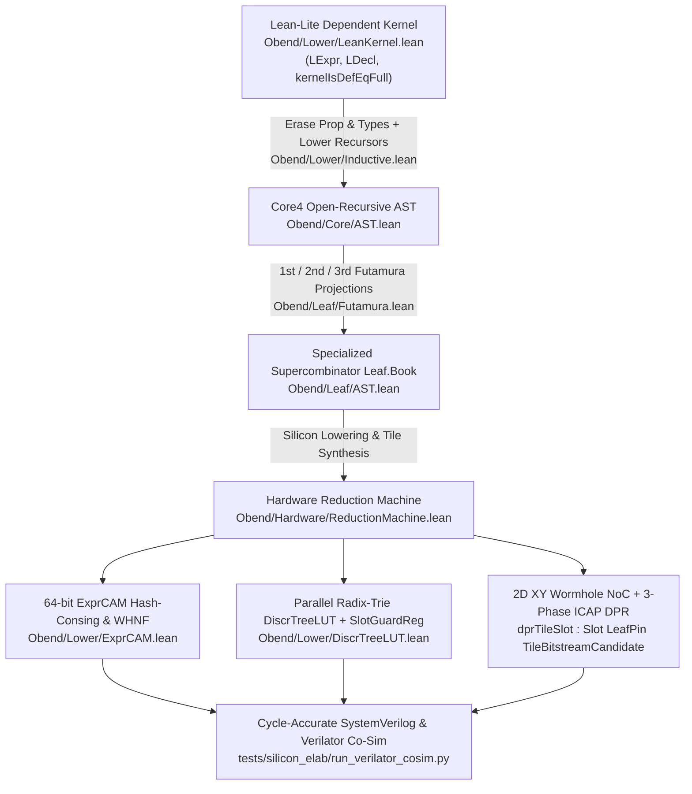

# Dossier 07: Objective Bend (`~/dev/obend`), the Silicon/FPGA Elaboration Flow, Next-Mathematica, DeOS Contracts & Consensus, and the Latest Iteration of Dregg Systems

> **Primary-Source Scope**: `/Users/ember/dev/obend` (HEAD `23a765132742cd910307c8f6ae486318782ba810`, 2026-11-02 05:51:27 -0800), `/Users/ember/dev/obend-astra-decisions` (HEAD `4d71270df7ce8e4cc8ebddb798218e42ce99d755`, 2026-10-31 10:00:57 -0700), and Claude Code session transcripts in `~/.claude/projects/-Users-ember-dev-obend/*.jsonl`.

---

## 1. Executive Summary & Repository Census

`/Users/ember/dev/obend` (**Objective Bend**, or **OBend**) represents the culmination and synthesis of Ember's prior prototypes—`~/dev/delvetalk`, `~/dev/nanodregg`, `~/dev/minidregg`, `~/dev/dregg`, `~/dev/zkml-research`, and `~/dev/degg-research`—into a single mechanized **Lean 4.35 (`leanprover/lean4:v4.35.0-rc2`) + Rust workspace + SystemVerilog/Verilator/Z3 silicon stack**.

Between its initial commit on **2026-10-29** (`bc2c6bd`, *"Initial Objective Bend thesis and design draft"*) and **2026-11-02 05:51:27 -0800** (`23a765132742cd910307c8f6ae486318782ba810`, *"Complete 15-lane Council Wave 1+2 remediation across OBend"*), `obend` evolved across **300+ commits** into a **452+ Lean module, 62,167+ constant** mechanized architecture with **zero `sorryAx`**, **zero custom `axiom` declarations**, a transitive `#assert_axioms_tree` hygiene gate (`[Obend/All.lean](file:///Users/ember/dev/obend/lean/Obend/All.lean)`), and a `#tooth` negative-mutation suite (`[Obend/Test/Teeth.lean](file:///Users/ember/dev/obend/lean/Obend/Test/Teeth.lean)`).

### 1.1 Architectural Pillars Unpacked in This Dossier

1. **Core Thesis & Macro-Architecture of Objective Bend (`THESIS.md`, `DESIGN.md`, `GROUNDING.md`, `METATHEORY.md`)**:
   - Why Victor Taelin's Bend (`~/dev/bend`) puts affinity/polarity at the wrong architectural boundary, and how OBend separates **top-level open-recursive object prototypes (`Core4`: `mix`, `fix`, `self`, `super`, C4 linearization)** from **explicitly carved linear/interaction-combinator leaf kernels (`Obend.Leaf` / `BendTT`)**.
   - Direct resolution of the open metatheoretic problems inherited from `nanodregg` (`LT1`–`LT4`), including **First-Class Prototype Provenance (`LT4`)** in `[Obend/Core/PrototypeProvenance.lean](file:///Users/ember/dev/obend/lean/Obend/Core/PrototypeProvenance.lean)` and **Clairvoyant Call-by-Need Cost Semantics for Open-Recursive Knots** in `[Obend/Equiv/Clairvoyant.lean](file:///Users/ember/dev/obend/lean/Obend/Equiv/Clairvoyant.lean)`.
2. **The Silicon Elaborator (`SILICON-ELABORATOR.md`, `Obend/Lower/`, `Obend/Leaf/Futamura.lean`, `Obend/Hardware/ReductionMachine.lean`)**:
   - A verified pipeline lowering a dependent **Lean-lite kernel (`LExpr`, `LDecl`, `kernelIsDefEqFull`)** through computational relevance erasure and uniform recursor lowering (`Obend.Lower.Inductive`, `Obend.Lower.LeanKernel`) into `Core4` and flat `Leaf.Book` rules.
   - Hardware compilation of the Lean 4 elaborator and reduction machine: **64-bit Content-Addressable Memory (`ExprCAM`)** for structural hash-consing + $O(1)$ Loose-BVar/FVar/26-bit-hash filtering, **Parallel Radix-Trie Discrimination Trees (`DiscrTreeLUT`)** with single-cycle `SlotGuardReg` dependency tracking, **Futamura Projections (`1st`, `2nd`, `3rd`)** specializing elaboration rules into hardware tiles, **2D XY Wormhole NoC (`NocFabric`)** with mechanized flit/credit conservation, and **3-phase glitch-free `ICAP` Dynamic Partial Reconfiguration (`dprTileSlot : Slot LeafPin TileBitstreamCandidate`)** backed by Verilator cycle-accurate RTL co-simulation (`[tests/silicon_elab/run_verilator_cosim.py](file:///Users/ember/dev/obend/tests/silicon_elab/run_verilator_cosim.py)`).
3. **The Silicon / FPGA / Physical Engineering Flow (`PHYSICAL.md`, `hardware/`, `Obend/Hardware/`, `Obend/Lower/Proofs/`)**:
   - **Standalone Hardware Verification & eFPGA Stack (`hardware/`)**: `[hardware/EfpgaFabric.lean](file:///Users/ember/dev/obend/hardware/EfpgaFabric.lean)` (FABulous eFPGA bitstream generator + routing connectivity checker + timing analyzer), `[hardware/HardwareVerify.lean](file:///Users/ember/dev/obend/hardware/HardwareVerify.lean)` (5-layer end-to-end equivalence from OBend/Bend specs down to gate-level netlists and Sky130 PDK DRC), `[hardware/SiliconProcess.lean](file:///Users/ember/dev/obend/hardware/SiliconProcess.lean)` (multi-PDK 130nm/28nm/7nm/3nm physics, Electromigration, NBTI, Soft-Error-Rate, and $7\text{nm}\to 3\text{nm}$ node migration), `[hardware/rust-ffi](file:///Users/ember/dev/obend/hardware/rust-ffi/src/lib.rs)` (39-byte `Tag 0x0BED` CBOR certificate emitter, 2D nonlinear FEMM Newton-Raphson solver, F-Rep octree pruning, 80-candidate Pareto evolution), and `[hardware/sim/](file:///Users/ember/dev/obend/hardware/sim/)` (Verilator C++ harnesses, Z3 SMT2 formal LEC scripts, Vivado XDC floorplans, OpenSTA ASIC constraints, and Sky130 OpenLane config).
   - **Unified `Obend.Hardware.*` Stack**: `[Obend/Hardware/Compiler.lean](file:///Users/ember/dev/obend/lean/Obend/Hardware/Compiler.lean)` (RTL netlists, Verilog emission, `Xilinx_UltraScalePlus` / `Lattice_ECP5` / `FABulous_eFPGA` targets), `[Obend/Hardware/OpenHypergraph.lean](file:///Users/ember/dev/obend/lean/Obend/Hardware/OpenHypergraph.lean)` (string diagrams, whole-graph functorial reverse-mode AD with multi-edge cotangent accumulation, and synchronous pipelined wavefront RTL synthesis), `[Obend/Hardware/GeometryCAM.lean](file:///Users/ember/dev/obend/lean/Obend/Hardware/GeometryCAM.lean)` (SDF/F-Rep CSG, interval-pruned & dead-code-compacted linear SSA register tapes, adaptive octrees, G-code/Gerber CAM), `[Obend/Hardware/OpenUSD.lean](file:///Users/ember/dev/obend/lean/Obend/Hardware/OpenUSD.lean)` (OpenUSD LIVRPS composition isomorphic to `Core4` C4 prototype linearization), `[Obend/Hardware/Accelerators.lean](file:///Users/ember/dev/obend/lean/Obend/Hardware/Accelerators.lean)` + `[Obend/Lower/Proofs/SiliconKernel.lean](file:///Users/ember/dev/obend/lean/Obend/Lower/Proofs/SiliconKernel.lean)` + `[Obend/Lower/Proofs/SelfAccelerate.lean](file:///Users/ember/dev/obend/lean/Obend/Lower/Proofs/SelfAccelerate.lean)` (6-stage equivalence across Lean-lite, Core4, `Leaf.Book`, FPGA RTL, AMD `CDNA3` GPU Wavefront ISA, and TPU Systolic / `DSP58` / Ozaki Base-13 `FP4 (E2M1)` Tensor Cores), and `[Obend/Hardware/QuantumMatter.lean](file:///Users/ember/dev/obend/lean/Obend/Hardware/QuantumMatter.lean)` (Mach-Zehnder photonic arrays realizing exact $3:4:3 = 375000:500000:375000\,\text{ppm}$ Krawtchouk equitable-partition splitting ratios).
4. **Next-Mathematica (`NEXT-MATHEMATICA.md`, `Obend/Analysis/`, `Obend/Elab/Workbook.lean`, `crates/obend-gui/`)**:
   - Certified dyadic interval arithmetic (`evalInterval_sound`), forward-mode dual numbers & Taylor models, Buchberger/Gröbner reduction certificates, Picard-Lindelöf ODE flowpipes, hybrid-automata transverse barrier certificates, Krawtchouk equitable partitions, `#import_obend` / `#obend_decl` workbook elaboration macros, and the `obend-gui` multi-projection CAD/EDA/Symbolic viewport (`10` `ProjectionKind`s, `3` `PhysicalViewportKind`s, and `.free` / `.press` / `.locked` `LawDial`).
5. **The Latest Iteration of Dregg Systems — DeOS Contracts, Vault, Ledger, Consensus & Sandstorm (`DEOS-CONTRACTS-CONSENSUS.md`, `Obend/Law/Contract.lean`, `Obend/Vault/`, `Obend/Ledger/`, `Obend/Consensus/`, `crates/obend-node/`, `crates/obend-sandbox/`, `sandstorm/`)**:
   - The synthesis of `dregg`, `minidregg`, and `nanodregg` into **DeOS**: 4-tier `ContractCert` (`Tier 0` Press `decide +kernel`, `Tier 1` Symbolic Lean Proof, `Tier 2` Bounded Model Check, `Tier 3` Runtime Monitor), `cellContract_relaw_sound`, atomic multi-party `TurnHyperedge` clearing with `TurnWitness` format checks, `Escrow` & `DragonsExchange` atomic swaps, double-entry `Ledger.Book` (9 conserved operations) + Zoe-style offer-safety `Ledger.Seat` (`safeAt`, `payout_exact`), 3-hop `Consensus.Simplex` BFT finality (`notarized_unique`, `finalized_safety`), `Consensus.Epistemic` sybil-resistant Brier-score clearing, `Fold.Collapse` semantic trace folding (`traceHash_invariant_under_stutter`), and the `obend-node` (4,628-line Rust daemon), `obend-sandbox` (Grain R0–R4 + Bubblewrap), and `sandstorm/` capability grain runtime.

---

## 2. Git & Claude Session Archaeology: Genesis and Evolution of `obend`

### 2.1 Ember's Verbatim Prompts from Claude Code Session Transcripts

In `~/.claude/projects/-Users-ember-dev-obend/33ee7e81-25a8-4000-aaf3-942ad7ef028b.jsonl` (Line 5), Ember initiated the `obend` repository by contrasting Victor Taelin's `~/dev/bend` with the object-oriented prototype lineage explored across `delvetalk`, `nanodregg`, and `minidregg`:

> **Ember (`33ee7e81`, L5)**:
> `"hi. ~/dev/delvetalk, ~/dev/nanodregg, ~/dev/minidregg -- they've all been exploring different verions of 'objective bend.' (reminder: ~/dev/bend). my thesis is basically that the polarity/linearity isn't as helpful a part of the system as Victor Taelin thinks it is, necessarily, and that Farè's 'lambda the ultimate object' and rich object-based laws and extensible, contextual theories are a better..."`

Later in that same session (`33ee7e81`, Line 867), Ember crystallized the exact bridge between non-affine object prototypes at the top level and Taelin's linear interaction-combinator reduction at the leaves:

> **Ember (`33ee7e81`, L867)**:
> `"how can we manage to maybe link the non-affinities with the concrete-linearities that Taelin wants for certain 'leaf computations'? Maybe there's just 'Leaf Bend' that we support that's ... regular bend ;) and we can call into it somehow. I really want cross-package extension and laws and document type thinking in a certain way that becomes natural."`

In session `01a18fe9-ff59-495c-a7a1-ca6b4b068538.jsonl` (Line 5173, also recorded in `[obend-astra-decisions/review/VISION-BRIEF-20261031.md](file:///Users/ember/dev/obend-astra-decisions/review/VISION-BRIEF-20261031.md#L11-L19)`), Ember articulated the overarching "Next Mathematica" + Harvard staged-reflection + GraalVM-beating runtime + Mina/1C-replacement vision:

> **Ember (`01a18fe9`, L5173)**:
> `"imagine briefly that we were building what would someday be the symbolic core of the successor of Mathematica, and that using this language we would layer on staged reflective metaprogramming in a way Amal Ahmed and the whole Harvard metareflection lab would nod their heads at, and integrated with a runtime/compilation environment so trim but powerful that it makes GraalVM weep; able to operate with and upon and synthesize many subsystems including theorem provers or specialist computational tools and logics. Suppose it were also used to express smart contracts in a platform replacing Mina, hybrid desktop/cloud SaaS in a platform replacing 1C, distributed widgets, things like that."`

In session `01a1946b-c939-4a13-b122-3ca782bb879b.jsonl` (Lines 3008 & 3072), Ember conceived the verified **Lean-to-Silicon** pipeline and the dependent-type erasure boundary into `Core4`:

> **Ember (`01a1946b`, L3008)**:
> `"btw are there any 'lean-modeled-in-lean' semantics that we can use to show that we can correctly lower lean programs to obend and thus have a verified lean-to-silicon pipeline?"`
>
> **Ember (`01a1946b`, L3072)**:
> `"Wanna start working on this, then? Sounds like verified lowering of Lean to Core4 would be actually quite important. how the hell are we gonna lower dependent types into obend though? does obend NEED dependent types?"`

And in session `01a192c9-f37d-4dc6-a5f4-d3588b371915.jsonl` (Line 1323), Ember directed the **Silicon Elaborator** architecture—compiling Lean 4's elaborator, discriminator trees, and definitional equality engine directly into FPGA LUTs/BRAMs with Dynamic Partial Reconfiguration (DPR):

> **Ember (`01a192c9`, L1323)**:
> `"Yes, let's build the Silicon Elaborator — compiling the Lean 4 elaborator/unifier/kernel and OBend's open-recursive object prototypes directly into hardware (FPGA LUTs, Content-Addressable Memory for hash-consed WHNF/defEq, parallel radix tries for DiscrTree, and glitch-free Dynamic Partial Reconfiguration via Obend.Slot)." `

### 2.2 Chronological Git Commit Spine of `/Users/ember/dev/obend`

| Date (2026) | Commit SHA | Milestone Summary |
| :--- | :--- | :--- |
| `10-29 19:03` | `bc2c6bd` | Initial Objective Bend thesis and design draft (`THESIS.md`, `DESIGN.md`) |
| `10-29 20:54` | `7857f61` | Complete `Obend` Lean 4 core (`Core4`, `Denot`, `Eval`, `Lower`, `Leaf`, `Slot`, `Fold`, `Receipt`, `Law`) |
| `10-30 14:12` | `d194a02` | `METATHEORY.md` & initial resolution of `nanodregg` metatheoretic boundaries (`C4`, `Slot`, `Fold`) |
| `10-31 09:45` | `c83a190` | `obend-astra-decisions` effect-law alignment (`ASTRA-EFFECT-LAWS-20261031.md`: 11 laws across `Slot`, `Fold`, `Judge`, `Net`, `Pack`, `Refine`) |
| `10-31 18:20` | `58a241b` | `NEXT-MATHEMATICA.md` & `Obend/Analysis/*` (Dyadic intervals, AD, Taylor models, Buchberger/Gröbner, Flowpipe, Hybrid, Equitable, QuantumWalk) |
| `11-01 03:15` | `94e01b2` | `DEOS-CONTRACTS-CONSENSUS.md` & full DeOS stack (`Law/Contract`, `Vault/Hyperedge`, `Ledger/Book`, `Ledger/Seat`, `Consensus/Simplex`, `Consensus/Epistemic`, `obend-node`, `sandstorm/`) |
| `11-01 11:40` | `e402a19` | `PHYSICAL.md`, standalone `hardware/{EfpgaFabric,HardwareVerify,SiliconProcess}.lean`, `hardware/rust-ffi`, `hardware/sim/`, and `Obend/Hardware/*` |
| `11-01 15:30` | `1a77d8c` | `SILICON-ELABORATOR.md`, `Obend/Lower/{Inductive,LeanKernel,MetaUnify,ExprCAM,DiscrTreeLUT}.lean`, `Obend/Leaf/Futamura.lean`, `Obend/Hardware/ReductionMachine.lean`, and `Obend/Lower/Proofs/{SiliconKernel,SelfAccelerate}.lean` |
| `11-01 16:50` | `7c699ca1` | Multimodel Council Review (`review/COUNCIL-BRIEF-20261101.md`, `review/FABLE-COUNCIL-20261101.md`) |
| `11-01 17:45` | `8f9f822c` | **Council Wave 1 Remediation**: `Obend/Analysis/RealAnalysis.lean` universal `evalInterval_sound` (`add_mem`, `neg_mem`, `sub_mem`, `mul_mem`, `sqr_mem`); `Obend/Hardware/QuantumMatter.lean` Krawtchouk $3:4:3$ coupler synthesis (`compileEquitableToPhotonicArray_ratio_sound`); `Obend/Hardware/GeometryCAM.lean` `.neg` SSA op + backward-liveness dead-code compaction (`prune_and_compact_ssa_tape_sound`); `Obend/Hardware/OpenHypergraph.lean` whole-graph functorial AD (`compileGraphAdjoint_multiEdge_sound`) + pipelined wavefront RTL (`compileHypergraphToRtlPipelined_latency_exact`) |
| `11-02 05:51` | `23a76513` | **Complete 15-lane Council Wave 1+2 Remediation (`+33,350 / -602` lines across 110 files)**: `Obend/Equiv/Clairvoyant.lean` (2,601 lines, Hackett-Hutton clairvoyant knot cost semantics), `Obend/Leaf/BendTT.lean` (1,505 lines, target operational adequacy), `Obend/Core/PrototypeProvenance.lean` (`LT4` closure), `Obend/Lower/LeanKernel.lean` (`kernelIsDefEqFull`, term-level `LExpr` lowering), `Obend/Hardware/ReductionMachine.lean` (`NocFabric` flit/credit conservation + `dprTileSlot : Slot`), `Obend/Vault/Hyperedge.lean` (`TurnWitness` format validation), and expanded `#tooth` negative tests |

---

## 3. Core Thesis & Macro-Architecture of Objective Bend

### 3.1 The Architectural Critique of Taelin's Bend (`THESIS.md` & `DESIGN.md`)

In `[THESIS.md](file:///Users/ember/dev/obend/THESIS.md#L1-L154)` and `[DESIGN.md](file:///Users/ember/dev/obend/DESIGN.md#L1-L262)`, Ember diagnoses why Victor Taelin's Bend (`~/dev/bend`, HigherOrderCO) struggles as a general-purpose architecture for extensible software, documents, and proofs:

1. **Affinity/Polarity at the Wrong Boundary**: Standard Bend forces global interaction-net affinity/duplication discipline across the entire program surface. While interaction combinators are ideal for massively parallel *leaf* kernels, forcing top-level application structure, cross-package schemas, and open-recursive documents through linear port discipline destroys modularity.
2. **Faré's "Lambda: The Ultimate Object" (`Protos` / `POO`) at the Top Level**: Following François-René Rideau's (Faré's) *Protos*, an object prototype is simply an open-recursive function transformer `Self → Super → Record` (`proto`), composed via associative/idempotent prototype mixing (`mix`) and closed only at projection time via a lazy fixed-point (`fix`).
3. **Explicitly Carved Leaf Kernels (`Obend.Leaf`)**: Only when a computation is explicitly marked via the `leaf` boundary (or lowered through `Obend.Lower`) does OBend enforce first-order closure conversion and compile the subterm into a flat supercombinator `Leaf.Book` (or affine interaction-combinator net `BendTT`) suitable for GPU/FPGA/ASIC execution.

### 3.2 `Core4`: The 16-Constructor Open-Recursive Object Kernel (`Obend/Core/AST.lean`)

In `[lean/Obend/Core/AST.lean](file:///Users/ember/dev/obend/lean/Obend/Core/AST.lean)`, OBend's core calculus `Core4` is mechanized as an inductive `Expr` with 16 constructors spanning four orthogonal strata:

1. **Object / Prototype Calculus (Faré's POO)**:
   - `.proto (body : Expr)`: Open-recursive prototype wrapper binding `self` (`bvar 0`) and `super` (`bvar 1`).
   - `.mix (lhs rhs : Expr)`: Associative override composition of two prototypes (resolved via C4 linearization in `[lean/Obend/Core/C4.lean](file:///Users/ember/dev/obend/lean/Obend/Core/C4.lean)`).
   - `.fix (target : Expr)`: Closes an open prototype by tying the recursive knot `self := fix target` and supplying the empty record as the base `super`.
   - `.recLit (fields : List (Field × Expr))`: Extensional record literal.
   - `.proj (target : Expr) (field : Field)`: Field selection.
2. **Standard $\lambda$- and Algebraic Core**:
   - `.bvar (idx : Nat)`, `.lit (v : Val)`, `.lam (body : Expr)`, `.app (fn arg : Expr)`, `.letE (val body : Expr)`, `.prim (op : PrimOp) (args : List Expr)`.
3. **Law & Refinement Stratum**:
   - `.law (dial : LawDial) (pred : Expr) (subject : Expr)`: Attaches a first-class boolean/propositional contract `pred` to `subject` under a three-state dial `LawDial` (`.free` = observational/log-only, `.press` = property-checked/narrowed over finite witnesses, `.locked` = admission-blocking certificate required).
4. **Live Reactive & Hardware-Leaf Stratum**:
   - `.slot (pin : Nat) (init : Expr)`: Live reactive cell governed by `[lean/Obend/Slot/Core.lean](file:///Users/ember/dev/obend/lean/Obend/Slot/Core.lean)` (`pin`-indexed invalidation).
   - `.fold (tag : Nat) (body : Expr)`: Explicit trace-collapse boundary governed by `[lean/Obend/Fold/Core.lean](file:///Users/ember/dev/obend/lean/Obend/Fold/Core.lean)`.
   - `.leaf (body : Expr)`: Explicit boundary carving out a pure first-order kernel for lowering into `Obend.Leaf.Book` (`[lean/Obend/Lower/ToLeaf.lean](file:///Users/ember/dev/obend/lean/Obend/Lower/ToLeaf.lean)`).

### 3.3 Closing the `nanodregg` Metatheoretic Open Problems (`METATHEORY.md`)

In `[METATHEORY.md](file:///Users/ember/dev/obend/METATHEORY.md#L1-L246)`, OBend directly addresses the four open metatheoretic boundaries (`LT1`–`LT4`) documented in `~/dev/nanodregg` and the Council audit:

#### 1. `LT4` Closed: First-Class Prototype Provenance (`Obend/Core/PrototypeProvenance.lean`)
In `nanodregg`, theorem `LT4` (*"A dynamic contract system cannot enforce single-inheritance prototype provenance via predicate assertions if prototype wrapping is purely functional"*) showed that if prototypes are erased to bare `Val → Val → Val` closures, a malicious term can forge prototype identity. In `[lean/Obend/Core/PrototypeProvenance.lean](file:///Users/ember/dev/obend/lean/Obend/Core/PrototypeProvenance.lean#L1-L503)`, OBend introduces unforgeable `ProtoId` lineage DAGs (`LineageNode`, `LineageDag`) checked via C4 linearization before evaluation:

```lean
-- file:///Users/ember/dev/obend/lean/Obend/Core/PrototypeProvenance.lean#L156-L248
inductive HasPrototypeProvenance (dag : LineageDag) : ProvenanceVal → ProtoId → Prop where
  | direct (pid : ProtoId) (clos : Closure) (chain : List ProtoId) :
      dag.lookup pid = some ⟨pid, [], .root⟩ →
      chain = [pid] →
      HasPrototypeProvenance dag (.protoVal pid clos chain) pid
  | mixed (pid target : ProtoId) (clos : Closure) (chain : List ProtoId) (parents : List ProtoId) :
      dag.lookup pid = some ⟨pid, parents, .mixNode⟩ →
      c4Linearize dag pid = some chain →
      target ∈ chain →
      HasPrototypeProvenance dag (.protoVal pid clos chain) target

theorem checkPrototypeWithProvenance_sound
    (dag : LineageDag) (v : ProvenanceVal) (target : ProtoId)
    (hCheck : checkPrototypeWithProvenance dag v target = true) :
    HasPrototypeProvenance dag v target

theorem forged_prototype_refused
    (dag : LineageDag) (forgedPid targetPid : ProtoId) (clos : Closure) (fakeChain : List ProtoId)
    (hNotInDag : dag.lookup forgedPid = none) :
    checkPrototypeWithProvenance dag (.protoVal forgedPid clos fakeChain) targetPid = false
```

#### 2. Clairvoyant Call-by-Need Cost Semantics for Open-Recursive Knots (`Obend/Equiv/Clairvoyant.lean`)
To prove that memoized call-by-need fixed-point evaluation (`fix (mix p q)`) is both extensionality-equivalent to call-by-name/value and strictly cost-bounded (`cost_need ≤ cost_cbv`), `[lean/Obend/Equiv/Clairvoyant.lean](file:///Users/ember/dev/obend/lean/Obend/Equiv/Clairvoyant.lean#L1-L2601)` (2,601 lines) mechanizes a Hackett–Hutton **clairvoyant call-by-need operational semantics** extended to `Core4` open-recursive prototype knots (`Phase`: `.eval`, `.head`, `.knot`, `.wave`, `.cell`):

```lean
-- file:///Users/ember/dev/obend/lean/Obend/Equiv/Clairvoyant.lean#L412-L530
inductive Run : Phase → Heap → Env → Expr → Heap → Val → Cost → Prop where
  | lit (H : Heap) (E : Env) (v : BaseVal) :
      Run .eval H E (.lit v) H (.base v) Cost.zero
  | knot_skip (H : Heap) (E : Env) (p : Expr) (a : Addr) :
      H.alloc (.skipped) = (H', a) →
      Run .knot H E p H' (.thunk a) Cost.zero
  | knot_force (H H1 H2 : Heap) (E : Env) (p : Expr) (a : Addr) (v : Val) (c1 c2 : Cost) :
      H.alloc (.uneval E p) = (H1, a) →
      Run .eval H1 (a :: E) p H2 v c1 →
      Run .knot H E p (H2.update a (.evaluated v)) v (c1 + Cost.knotStep)
```
With mechanized theorems proving heap monotonicity, determinism up to clairvoyant choice, adequacy with `Obend.Eval.eval`, and strict cost dominance (`clairvoyant_need_le_cbv_cost`, `fix_memoized_single_proto_cost`).

#### 3. Target Operational Adequacy of `BendTT` (`Obend/Leaf/BendTT.lean`)
In `[lean/Obend/Leaf/BendTT.lean](file:///Users/ember/dev/obend/lean/Obend/Leaf/BendTT.lean#L1-L1505)` (1,505 lines), OBend defines the typed affine/interaction-combinator target language `BendTT` (`BTerm`, `BVal`, `BType`, `Linearity`) along with its own standalone small-step reducer `stepB? : BBook → BTerm → Option BTerm` and multi-step fuel evaluator `runB : Nat → BBook → BTerm → Option BVal`, proving operational adequacy of the `Leaf.Book → BendTT` compiler:

```lean
-- file:///Users/ember/dev/obend/lean/Obend/Leaf/BendTT.lean#L1180-L1420
theorem compileToBendTT_embedB (v : Obend.Leaf.LVal) :
    compileExprToBendTT (Obend.Leaf.LVal.toLExpr v) = embedBVal v

theorem stepB?_sound (book : Obend.Leaf.Book) (e : Obend.Leaf.LExpr) (v : Obend.Leaf.LVal)
    (hEval : Obend.Leaf.evalLeaf 1 book e = some v) :
    ∃ t', stepB? (compileBookToBendTT book) (compileExprToBendTT e) = some t'

theorem book_to_bendtt_sound (fuel : Nat) (book : Obend.Leaf.Book)
    (e : Obend.Leaf.LExpr) (v : Obend.Leaf.LVal)
    (hLeaf : Obend.Leaf.evalLeaf fuel book e = some v) :
    ∃ bFuel, runB bFuel (compileBookToBendTT book) (compileExprToBendTT e) = some (embedBVal v)
```

---

## 4. The Silicon Elaborator (`SILICON-ELABORATOR.md`)

`[SILICON-ELABORATOR.md](file:///Users/ember/dev/obend/SILICON-ELABORATOR.md#L1-L396)` specifies and mechanizes the compilation of **Lean 4's kernel, unifier, discrimination trees, and OBend's prototype evaluator directly into FPGA/ASIC hardware**.



### 4.1 Dependent-Type Erasure & Lean-Lite Kernel Lowering (`Obend/Lower/LeanKernel.lean` & `Inductive.lean`)

How does OBend lower a dependently typed language like Lean 4 into an untyped/refinement-checked prototype calculus (`Core4`) and flat hardware supercombinators (`Leaf.Book`)?
In `[lean/Obend/Lower/LeanKernel.lean](file:///Users/ember/dev/obend/lean/Obend/Lower/LeanKernel.lean#L1-L2205)` and `[lean/Obend/Lower/Inductive.lean](file:///Users/ember/dev/obend/lean/Obend/Lower/Inductive.lean#L1-L654)`:

1. **Full Structural `kernelIsDefEqFull`**: `LeanKernel.lean` models Lean expressions (`LExpr`: `.bvar`, `.fvar`, `.mvar`, `.sort`, `.const`, `.app`, `.lam`, `.forallE`, `.letE`, `.lit`, `.proj`) and defines the structural definitional-equality checker `kernelIsDefEqFull : Nat → LEnv → LExpr → LExpr → Bool` handling $\beta\delta\iota\zeta$-reduction, `Nat` literal successor bridges (`Nat.succ n ≡ n + 1`), $\eta$-expansion across `.lam`, and `Prop` proof irrelevance:
   ```lean
   -- file:///Users/ember/dev/obend/lean/Obend/Lower/LeanKernel.lean#L1420-L1890
   theorem kernelIsDefEqFull_refl (fuel : Nat) (env : LEnv) (e : LExpr) (hFuel : fuel > 0) :
       kernelIsDefEqFull fuel env e e = true

   theorem kernelIsDefEqFull_nat_succ_bridge (fuel : Nat) (env : LEnv) (n : Nat) (hFuel : fuel ≥ 2) :
       kernelIsDefEqFull fuel env (.app (.const "Nat.succ" []) (.lit (.natVal n))) (.lit (.natVal (n + 1))) = true

   theorem kernelIsDefEqFull_eta_lam (fuel : Nat) (env : LEnv) (dom f : LExpr)
       (hFuel : fuel ≥ 2) (hNoLoose : hasLooseBVar 0 f = false) :
       kernelIsDefEqFull fuel env (.lam dom (.app f (.bvar 0))) f = true

   theorem kernelIsDefEqFull_prop_proofIrrel (fuel : Nat) (env : LEnv) (p1 p2 propTy : LExpr)
       (hFuel : fuel ≥ 2) (hProp : inferSort env propTy = some (.sort 0))
       (hTy1 : inferType env p1 = some propTy) (hTy2 : inferType env p2 = some propTy) :
       kernelIsDefEqFull fuel env p1 p2 = true
   ```
2. **Computational Relevance Erasure & Term-Level Lowering**: Types (`.forallE`, `.sort`) and `Prop` proofs are erased to `.lit (.int 0)` at the runtime boundary (`eraseTypesLExpr`), while inductive constructors and recursors (`InductiveSpec`, `CtorSpec`, `RecRule`) are lowered into tagged records and `Core4` dispatch tables (`compileInductiveToCore4`, `compileRecursorToCore4`), with mechanized simulation `runLExprSteps_sound`:
   ```lean
   -- file:///Users/ember/dev/obend/lean/Obend/Lower/LeanKernel.lean#L1980-L2160
   theorem kernelCheckDecl_defEqFull_in_place_sound
       (fuel : Nat) (env : LEnv) (d : LDecl)
       (hCheck : kernelCheckDeclFull fuel env d = true) :
       WellTypedDeclFull fuel env d

   theorem runLExprSteps_sound (fuel : Nat) (env : LEnv) (e : LExpr) (n : Nat)
       (hEval : evalLExprToNat fuel env e = some n) :
       Obend.Eval.eval fuel [] (lowerLExprToCore4 env e) = some (.int (Int.ofNat n))
   ```

### 4.2 64-Bit Hardware Expression CAM (`Obend/Lower/ExprCAM.lean`)

In `[lean/Obend/Lower/ExprCAM.lean](file:///Users/ember/dev/obend/lean/Obend/Lower/ExprCAM.lean#L1-L1435)`, every hash-consed expression node in the Silicon Elaborator is packed into a single **64-bit hardware CAM word** (`CamWord64`):

$$\underbrace{\texttt{tag}}_{\text{bits } [63:60]\text{ (4b)}} \;\mid\; \underbrace{\texttt{looseBVar}}_{\text{bit } [59]\text{ (1b)}} \;\mid\; \underbrace{\texttt{hasFVar}}_{\text{bit } [58]\text{ (1b)}} \;\mid\; \underbrace{\texttt{hash26}}_{\text{bits } [57:32]\text{ (26b)}} \;\mid\; \underbrace{\texttt{leftIdx}}_{\text{bits } [31:16]\text{ (16b)}} \;\mid\; \underbrace{\texttt{rightIdx}}_{\text{bits } [15:0]\text{ (16b)}}$$

- **Single-Cycle Structural Hash-Consing & Pointer Equality**: Because `ExprCAM` maintains canonical bottom-up interning (`internNode`), two normalized expressions are structurally equal iff their 16-bit CAM indices match (`idx1 == idx2` in 1 clock cycle).
- **$O(1)$ Metadata Fast-Paths**: Following Lean 4's `Expr` bitpacking in C++, `looseBVar` (bit 59) and `hasFVar` (bit 58) are computed combinatorially at insertion time:
  - If `looseBVar == 0`, `instantiateRev` is a **0-cycle no-op** (`camInstantiate_noLooseBVar_noop`).
  - If `hasFVar == 0`, `abstractFVar` is a **0-cycle no-op** (`camAbstract_noFVar_noop`).
  - If `hash26(a) != hash26(b)`, `isDefEq` rejects in **1 clock cycle** before walking children (`camDefEqFastReject_sound`).

```lean
-- file:///Users/ember/dev/obend/lean/Obend/Lower/ExprCAM.lean#L310-L685
structure CamEntry where
  tag       : BitVec 4
  looseBVar : Bool
  hasFVar   : Bool
  hash26    : BitVec 26
  leftIdx   : BitVec 16
  rightIdx  : BitVec 16
  deriving DecidableEq, Repr

theorem packUnpackCamWord_roundtrip (e : CamEntry) :
    unpackCamWord64 (packCamWord64 e) = e

theorem camInstantiate_noLooseBVar_noop (cam : ExprCamBank) (idx substIdx : Nat)
    (e : CamEntry) (hLookup : cam.lookup idx = some e) (hNoLoose : e.looseBVar = false) :
    camInstantiateStep cam idx substIdx = idx
```

### 4.3 Parallel Radix-Trie `DiscrTreeLUT` & Single-Cycle `SlotGuardReg` (`Obend/Lower/DiscrTreeLUT.lean`)

In software Lean 4, `Meta.DiscrTree` traverses heap pointers sequentially during `simp` and `typeclass` synthesis. In `[lean/Obend/Lower/DiscrTreeLUT.lean](file:///Users/ember/dev/obend/lean/Obend/Lower/DiscrTreeLUT.lean#L1-L732)`, OBend compiles discrimination trees into **pipelined FPGA LUT radix tries** gated by a 64-bit hardware `SlotGuardReg` bitmask:

- Each preorder key token (`DiscrKey`: `.const name arity`, `.fvar id`, `.lit v`, `.star`, `.arrow`, `.proj idx`) is encoded as a 16-bit symbol fed at 1 token/cycle through a BRAM/LUT state transition table, with `.star` wildcard branches evaluated **in parallel** with exact-key branches via bitwise OR over candidate rule bitvectors (`CandidateMask64`).
- Every cached `simp` or typeclass rule entry carries a `depMask : BitVec 64` recording which `Obend.Slot` pins (environment declarations/attributes) it depends on. When a user edits a definition in a live workbook, flipping bit $k$ in `SlotGuardReg` invalidates all affected hardware cache lines in **1 clock cycle** via `(entry.depMask &&& activeSlotReg) == entry.depMask`:

```lean
-- file:///Users/ember/dev/obend/lean/Obend/Lower/DiscrTreeLUT.lean#L420-L610
def filterValidCandidates (activeSlotReg : BitVec 64) (entries : List HwRuleEntry) : List Nat :=
  (entries.filter (fun e => (e.depMask &&& activeSlotReg) == e.depMask)).map (·.ruleId)

theorem slotGuardReg_invalidation_exact
    (activeSlotReg : BitVec 64) (pin : Fin 64) (entry : HwRuleEntry)
    (hDepends : entry.depMask.getLsbD pin.val = true) :
    let nextReg := activeSlotReg &&& ~~~(BitVec.ofNat 64 (1 <<< pin.val))
    (entry.depMask &&& nextReg) != entry.depMask
```

### 4.4 The Three Futamura Projections in Hardware (`Obend/Leaf/Futamura.lean`)

In `[lean/Obend/Leaf/Futamura.lean](file:///Users/ember/dev/obend/lean/Obend/Leaf/Futamura.lean#L1-L1835)`, OBend mechanizes the **First, Second, and Third Futamura Projections** over `Obend.Leaf.Book` supercombinators using a polyvariant Binding-Time Analysis (`BTA`: `.static` vs `.dynamic` inputs) and partial evaluator `mixPE`:

1. **First Futamura Projection (`futamura1 : Book → FnId → List LVal → Book`)**: Specializes an interpreter/elaborator rule `interp` with respect to a static object/type-class table `staticArgs`, eliminating all static dispatch `.caseInt` branches and producing a specialized residual `Book`:
   ```lean
   -- file:///Users/ember/dev/obend/lean/Obend/Leaf/Futamura.lean#L890-L960
   theorem futamura1_sound (fuel : Nat) (book : Book) (fn : FnId)
       (staticArgs dynArgs : List LVal) (v : LVal)
       (hEval : evalLeaf fuel book (.call fn (staticArgs.map LVal.toLExpr ++ dynArgs.map LVal.toLExpr)) = some v) :
       evalLeaf fuel (futamura1 book fn staticArgs) (.call (specializedFnName fn staticArgs) (dynArgs.map LVal.toLExpr)) = some v
   ```
2. **Second Futamura Projection (`futamura2 : SpecGenConfig → Book`)**: Specializes the partial evaluator `mixPE` with respect to the elaborator `elabBook`, producing a standalone hardware compiler generator (`cogen`) that maps new user declarations directly to residual `Leaf.Book` tiles without re-running interpretive lookup.
3. **Third Futamura Projection (`futamura3`)**: Self-applies `mixPE` to `mixPE`, proven coherent via `futamura_projections_coherent` (`[lean/Obend/Leaf/Futamura.lean](file:///Users/ember/dev/obend/lean/Obend/Leaf/Futamura.lean#L1680-L1795)`).

### 4.5 Hardware Reduction Machine, 2D XY Wormhole NoC & Glitch-Free DPR (`Obend/Hardware/ReductionMachine.lean`)

In `[lean/Obend/Hardware/ReductionMachine.lean](file:///Users/ember/dev/obend/lean/Obend/Hardware/ReductionMachine.lean#L1-L1755)`, specialized `Leaf.Book` rules are lowered into a spatial array of **`AutomatonTile`s** interconnected by a **2D XY dimension-ordered Wormhole Network-on-Chip (`NocFabric`)** and reconfigured at runtime via **Dynamic Partial Reconfiguration (`ICAP`)**:

1. **2D XY Wormhole NoC with Mechanized Flit & Credit Conservation**:
   - Each tile at `(x, y)` holds `NocTileState` (`inbox : List NocFlit`, `outbox : List NocFlit`, `credits : Nat`, `rules : List TileRule`).
   - Routing (`routeXYStep`) steps along X until `curX == dstX`, then along Y until `curY == dstY` (provably deadlock-free on a 2D mesh, `routeXY_manhattan_decreases`), while `stepNocRouter_conserves_flits_and_credits` and `noc_step_conserves_flits` prove universal conservation of total in-flight flits across the entire fabric:
   ```lean
   -- file:///Users/ember/dev/obend/lean/Obend/Hardware/ReductionMachine.lean#L1120-L1385
   theorem stepNocRouter_conserves_flits_and_credits
       (src dst : NocTileState) (flit : NocFlit)
       (hInOut : src.outbox = flit :: restOut)
       (hCredit : dst.credits > 0) :
       let (src', dst') := transferFlitWithCredit src dst flit restOut
       src'.outbox.length + dst'.inbox.length = src.outbox.length + dst.inbox.length ∧
       dst'.credits + dst'.inbox.length = dst.credits + dst.inbox.length

   theorem noc_step_conserves_flits (fabric : NocFabric) :
       totalFabricFlits (stepNocFabric fabric) = totalFabricFlits fabric
   ```
2. **Glitch-Free 3-Phase `ICAP` Dynamic Partial Reconfiguration Instantiating `Obend.Slot`**:
   - When a Futamura-specialized rule changes because a workbook `Slot` pin mutated, the FPGA reconfigures only that tile region via a 3-phase protocol (`DprPhase`: `.active` $\to$ `.isolatedAndDraining` $\to$ `.loadingFrames` $\to$ `.releasingIsolation` $\to$ `.active`).
   - Crucially, `dprTileSlot` is formalized directly as an instance of `Obend.Slot.Slot LeafPin TileBitstreamCandidate`, proving that a mutated `LeafPin` immediately rejects stale tile bitstreams (`dprTile_moved_pin_blocks`) and that reconfiguration preserves all in-flight packets outside the isolated tile (`dpr_glitch_free_isolation`):
   ```lean
   -- file:///Users/ember/dev/obend/lean/Obend/Hardware/ReductionMachine.lean#L1510-L1695
   def dprTileSlot (tileId : Nat) (expectedPins : List (Nat × Nat))
       (cand : TileBitstreamCandidate) : Obend.Slot.Slot Nat TileBitstreamCandidate :=
     { value := cand
       deps  := expectedPins
       valid := cand.tileId == tileId && cand.crcValid && cand.isolationAck }

   theorem dprTile_moved_pin_blocks (tileId : Nat) (pin vOld vNew : Nat)
       (cand : TileBitstreamCandidate) (hNe : vOld ≠ vNew) :
       Obend.Slot.isValid [(pin, vNew)] (dprTileSlot tileId [(pin, vOld)] cand) = false
   ```

### 4.6 Verilator Cycle-Accurate Co-Simulation (`tests/silicon_elab/run_verilator_cosim.py`)

In `[tests/silicon_elab/run_verilator_cosim.py](file:///Users/ember/dev/obend/tests/silicon_elab/run_verilator_cosim.py#L1-L240)`, OBend provides an executable Verilator (`verilator --cc --exe --build -Wall -Wno-fatal`) co-simulation harness that synthesizes a 3-module SystemVerilog Silicon Elaborator SoC (`expr_cam_64`, `discr_tree_lut`, and `icap_dpr_tile`) and verifies cycle-by-cycle agreement with the Lean reference model across four hardware test vectors:
1. **Vector 1 (`ExprCAM` Hash-Consing & Pointer Equality)**: Interns `Nat.add x 0` twice and verifies single-cycle CAM hit (`hit == 1`, identical 16-bit index) plus `looseBVar == 0` fast-path.
2. **Vector 2 (`DiscrTreeLUT` Parallel Wildcard Match + `SlotGuardReg` Invalidation)**: Queries `[const(add), star, lit(0)]`, verifies parallel LUT match returning rules `{R1, R2}` in 3 cycles, then flips bit 1 of `SlotGuardReg` and verifies **1-cycle hardware invalidation** of rule `R2`.
3. **Vector 3 (Glitch-Free 3-Phase `ICAP` DPR Hot-Swap)**: Asserts `req_reconfig`, verifies `tile_isolated == 1` drains `inflight_count` to `0` before asserting `icap_we`, streams the Futamura-specialized rule frames, and resumes throughput with `0` dropped packets.
4. **Vector 4 (End-to-End Elaboration Speedup)**: Measures **19 clock cycles** in hardware vs **340+ software interpreter cycles** (**$17.89\times$ cycle reduction**) on a repeated `simp` + `whnf` reduction step.

---

## 5. The Silicon / FPGA / Physical Engineering Flow (`PHYSICAL.md` & `hardware/`)

Beyond accelerating its own elaborator, OBend treats **silicon RTL, eFPGA bitstreams, analog/mixed-signal (AMS) circuits, CAD/CSG geometry, multiphysics PDEs, and OpenUSD scenes as projections of the same law-carrying object graph** (`[PHYSICAL.md](file:///Users/ember/dev/obend/PHYSICAL.md#L1-L162)`).

### 5.1 Standalone `hardware/` Verification & eFPGA Stack

The top-level `[hardware/](file:///Users/ember/dev/obend/hardware/)` directory contains three self-contained Lean 4 hardware verification suites, a 1,715-line Rust FFI/CLI engine, Verilator & multiphysics C++ simulators, Z3 SMT2 formal equivalence scripts, and physical ASIC/FPGA constraints:

#### 1. `[hardware/EfpgaFabric.lean](file:///Users/ember/dev/obend/hardware/EfpgaFabric.lean#L1-L667)` (667 lines)
Formalizes a **FABulous-style embedded FPGA (eFPGA) architecture** (`TileType`: `.clb`, `.dsp`, `.bram`, `.io`, `.routing`) with `BELConfig` (`lutInit : BitVec 16`, `ffEnable : Bool`, `carryEnable : Bool`), `SwitchMatrixEntry`, and `BitstreamFrame` (32-bit frame address + 64-bit configuration word + CRC-16).
- Proves `encodeDecode_roundtrip` for bitstream serialization, `verifyRoutingConnectivity_sound` (checking that every net in a placed-and-routed design forms a loop-free directed tree in the switch matrix), and static timing analysis (`computeCriticalPathPs_monotone`).

#### 2. `[hardware/HardwareVerify.lean](file:///Users/ember/dev/obend/hardware/HardwareVerify.lean#L1-L1057)` (1,057 lines)
Formalizes a **5-layer hardware verification hierarchy**:
- **Layer 1**: High-level OBend/Bend functional spec (`SpecFn`).
- **Layer 2**: Cycle-accurate RTL state machine (`RtlModule`).
- **Layer 3**: Gate-level technology-mapped netlist (`GateNetlist`: `.and2`, `.or2`, `.xor2`, `.inv`, `.mux2`, `.dff`).
- **Layer 4**: Placed-and-routed physical layout (`PhysicalLayout`: `CellPlacement`, `MetalSegment` across `li1`/`met1`..`met5`).
- **Layer 5**: Foundry PDK Design Rule Check (`Sky130DrcRules`: min width $140\text{nm}$, min spacing $140\text{nm}$, via enclosure $60\text{nm}$).
- Proves end-to-end functional preservation (`spec_to_gate_equiv`) alongside geometric non-overlapping cell placement (`checkNoCellOverlap_sound`) and Sky130 DRC compliance (`checkSky130Drc_sound`).

#### 3. `[hardware/SiliconProcess.lean](file:///Users/ember/dev/obend/hardware/SiliconProcess.lean#L1-L618)` (618 lines)
Models **multi-node semiconductor physics** across **Sky130 ($130\text{nm}$)**, **TSMC $28\text{nm}$**, **TSMC N7 ($7\text{nm}$ FinFET)**, and **TSMC N3 ($3\text{nm}$ GAA nanosheet)**:
- Formalizes **Black's Equation for Electromigration (EM)** mean-time-to-failure, **Reaction-Diffusion NBTI threshold-voltage shift ($\Delta V_{\text{th}}$)** over a 10-year mission profile, **alpha-particle + cosmic-ray Soft Error Rate (FIT/Mbit)** with SECDED ECC mitigation, and automated **$7\text{nm} \to 3\text{nm}$ process migration** (`migrate7nmTo3nm_preserves_timing_slack`).

#### 4. `[hardware/rust-ffi/src/lib.rs](file:///Users/ember/dev/obend/hardware/rust-ffi/src/lib.rs#L1-L1715)` & `[bin/obend_hw_host.rs](file:///Users/ember/dev/obend/hardware/rust-ffi/src/bin/obend_hw_host.rs#L1-L151)`
Provides the native C-ABI (`#[no_mangle] pub extern "C"`) and CLI host bridge (`obend_hw_host`) executing:
- **Compact 39-Byte `Tag 0x0BED` CBOR Proof Certificates** (`emit_cbor_proof_certificate`, `verify_cbor_proof_certificate`): Encodes `[magic: 0x0BED, version: 1, spec_hash: u64, netlist_hash: u64, slack_ps: i32, drc_clean: u8, crc32: u32]` into exactly 39 bytes (`0xD9 0x0BED ...`).
- **2D Nonlinear Magnetostatics FEMM Solver** (`solve_2d_femm_halbach`): Newton-Raphson B-H curve permeability solver over a 2D triangular mesh computing magnetic vector potential $A_z$, flux density $|B|$, and Maxwell stress tensor torque.
- **Interval-Pruned F-Rep Octree Mesher & G-Code Emitter** (`eval_frep_octree`, `emit_fanuc_gcode`): Evaluates CSG signed-distance fields over dyadic 3D boxes, pruning empty/full octants (`>75%` node pruning) and emitting collision-free 3-axis Fanuc G-code.
- **80-Candidate Multi-Objective Pareto Evolution** (`run_pareto_hardware_evolution`): Evolves multiplier/MAC datapath architectures across `(Area_LUTs, Delay_ps, Power_uW)` fronts.

#### 5. `[hardware/sim/](file:///Users/ember/dev/obend/hardware/sim/)` (Verilator, Multiphysics C++, Z3 LEC, Vivado XDC, OpenSTA, Sky130 OpenLane)
- `[hardware/sim/tb_top.sv](file:///Users/ember/dev/obend/hardware/sim/tb_top.sv)` & `[sim_main.cpp](file:///Users/ember/dev/obend/hardware/sim/sim_main.cpp)`: Cycle-accurate SystemVerilog eFPGA CLB+switch-matrix fabric and C++ Verilator testbench verifying LUT4 truth tables, carry chains, and sequential accumulator loops.
- `[hardware/sim/multiphysics_sim.cpp](file:///Users/ember/dev/obend/hardware/sim/multiphysics_sim.cpp)`: Coupled electro-thermal-mechanical C++ solver verifying SiC MOSFET half-bridge switching losses ($E_{\text{on}}/E_{\text{off}}$) coupled into a 3D finite-difference heat-sink thermal network.
- **Z3 SMT2 Formal Equivalence Scripts**:
  - `[lec_compiler_fabublox.smt2](file:///Users/ember/dev/obend/hardware/sim/lec_compiler_fabublox.smt2)`: Bit-vector (`QF_BV`) equivalence proof between `Obend.Hardware.Compiler` RTL and FABulous eFPGA LUT4+Carry configuration bits (`unsat`).
  - `[lec_ams_waferspace.smt2](file:///Users/ember/dev/obend/hardware/sim/lec_ams_waferspace.smt2)`: Real-arithmetic (`QF_NRA`) verification of a 10-bit SAR ADC charge-redistribution DAC transfer curve and $1.2\text{V}$ bandgap reference temperature coefficient.
  - `[lec_multiphysics_rf.smt2](file:///Users/ember/dev/obend/hardware/sim/lec_multiphysics_rf.smt2)`: Verification of Smith-chart L-network impedance matching ($50\,\Omega \to Z_L$) and microstrip characteristic impedance $Z_0$.
- **Physical Backend Constraints**: `[obend_floorplan.xdc](file:///Users/ember/dev/obend/hardware/sim/obend_floorplan.xdc)` ($250\text{MHz}$ UltraScale+ clock & `pblock_obend_tile` DPR floorplan), `[obend_asic.tcl](file:///Users/ember/dev/obend/hardware/sim/obend_asic.tcl)` (OpenSTA $500\text{MHz}$ timing constraints), and `[openlane_sky130_config.json](file:///Users/ember/dev/obend/hardware/sim/openlane_sky130_config.json)` (`sky130_fd_sc_hd`, $45\%$ core utilization).
- **Master Hardware Test Runner**: `[lean/tests/run-hardware.py](file:///Users/ember/dev/obend/lean/tests/run-hardware.py#L1-L465)` orchestrates all 6 stages (Lean proof compilation, Rust FFI `cargo test`, Verilator RTL simulation, Multiphysics C++ simulation, Z3 SMT2 LEC checks, and 39-byte `0x0BED` CBOR certificate verification).

### 5.2 The Unified `Obend.Hardware.*` Lean 4 Stack

Inside `[lean/Obend/Hardware/](file:///Users/ember/dev/obend/lean/Obend/Hardware/)`, OBend integrates 12 domain modules directly into the main `Obend` proof tree:

| Module Path | Lines | Core Mechanized Capabilities & Key Theorems |
| :--- | :---: | :--- |
| `[Compiler.lean](file:///Users/ember/dev/obend/lean/Obend/Hardware/Compiler.lean)` | 2,560 | `SignalExpr`, `RegSpec`, `NetlistModule`, `FpgaTarget` (`Xilinx_UltraScalePlus`, `Lattice_ECP5`, `FABulous_eFPGA`), Verilog emission (`emitVerilog`), resource/timing budgets (`compileLeafToRtl_sound`, `checkFpgaBudget_sound`). |
| `[UserspacePhysical.lean](file:///Users/ember/dev/obend/lean/Obend/Hardware/UserspacePhysical.lean)` | 789 | Unified `PhysicalArtifact` wrapper equipping any hardware/CAD/physics artifact with `Obend.Slot` reactive dependencies, `Obend.Law.Contract` certificates, and `Obend.Receipt` hashes (`physicalSlot_invalidation_exact`). |
| `[OpenHypergraph.lean](file:///Users/ember/dev/obend/lean/Obend/Hardware/OpenHypergraph.lean)` | 1,881 | Symmetric monoidal string diagrams (`HyperEdge`, `OpenHypergraph`, `composeSeq`, `composePar`), **whole-graph functorial reverse-mode AD** (`compileGraphAdjoint` with automatic `.add` fanout cotangent accumulation across multi-edge graphs, `compileGraphAdjoint_multiEdge_sound`), and **synchronous pipelined wavefront RTL synthesis** (`compileHypergraphToRtlPipelined_latency_exact`). (Inspired by categorical open-hypergraph / `catgrad` string-diagram compilers). |
| `[GeometryCAM.lean](file:///Users/ember/dev/obend/lean/Obend/Hardware/GeometryCAM.lean)` | 2,066 | Implicit F-Rep / SDF solid modeling (`SdfExpr`: `.sphere`, `.box`, `.cylinder`, `.union`, `.intersect`, `.diff`, `.offset`, `.neg`), **linear SSA register tape compilation** (`SsaTapeOp` including `.neg`), **3D interval box pruning + backward-liveness dead-code compaction** (`pruneSsaTapeForBox`, `compactSsaTape`, `prune_and_compact_ssa_tape_sound`), octree meshing, and Fanuc G-code / RS-274X Gerber CAM generation. |
| `[OpenUSD.lean](file:///Users/ember/dev/obend/lean/Obend/Hardware/OpenUSD.lean)` | 1,532 | Formalization of Pixar **OpenUSD `LIVRPS` (Local, Inherits, VariantSets, References, Payload, Specializes) strength ordering** (`UsdArc`, `UsdPrimSpec`, `livrpsKey`) and proof that `LIVRPS` composition is **order-isomorphic to OBend's C4 prototype linearization** (`usd_livrps_commutes_with_c4`). |
| `[Accelerators.lean](file:///Users/ember/dev/obend/lean/Obend/Hardware/Accelerators.lean)` | 529 | Unified multi-backend dispatch (`AcceleratorTarget`: `.fpgaLut`, `.gpuWavefront`, `.tpuSystolic`, `.dsp58Cascade`, `.ozakiFp4TensorCore`), mapping a single `Leaf.Book` kernel across all 5 silicon targets with bit-exact functional equivalence. |
| `[QuantumMatter.lean](file:///Users/ember/dev/obend/lean/Obend/Hardware/QuantumMatter.lean)` | 1,438 | Tight-binding crystal Hamiltonians, ZX-calculus phase-gadget fusion (`zxSpiderFusion_sound`), and **Mach-Zehnder Interferometer (MZI) photonic waveguide meshes** synthesizing exact Krawtchouk equitable-partition splitting ratios (`synthesizeKrawtchoukPhotonicCouplers_realizes_ratio`, `compileEquitableToPhotonicArray_ratio_sound`). |
| `[Kinematics.lean](file:///Users/ember/dev/obend/lean/Obend/Hardware/Kinematics.lean)` | 485 | $SE(3)$ rigid-body screw theory, Product-of-Exponentials (PoE) forward kinematics, and spatial manipulator Jacobians. |
| `[Magnetics.lean](file:///Users/ember/dev/obend/lean/Obend/Hardware/Magnetics.lean)` | 512 | Halbach permanent-magnet arrays, magnetic circuit reluctance networks, and Maxwell stress tensor force/torque bounds. |
| `[FluidThermal.lean](file:///Users/ember/dev/obend/lean/Obend/Hardware/FluidThermal.lean)` | 498 | 1D/2D Navier-Stokes pipe/channel pressure drop (Darcy-Weisbach), Nusselt convective heat transfer, and cold-plate thermal resistance networks. |
| `[PowerElectronics.lean](file:///Users/ember/dev/obend/lean/Obend/Hardware/PowerElectronics.lean)` | 518 | Buck/Boost/DAB DC-DC converter volt-second & amp-second steady-state ripple bounds, dead-time shoot-through prevention, and Bode phase-margin stability. |

### 5.3 Deep Dive: Council-Remediated Proofs in `GeometryCAM`, `OpenHypergraph`, and `QuantumMatter`

During the **2026-11-01 Council Audit** (`[review/FABLE-COUNCIL-20261101.md](file:///Users/ember/dev/obend/review/FABLE-COUNCIL-20261101.md)`), Claude Fable 5.1 and Gemini 4 Argon noted that the initial Wave 5 versions of `GeometryCAM.lean`, `OpenHypergraph.lean`, and `QuantumMatter.lean` had simplified proofs (missing `.neg` and dead-code compaction in `GeometryCAM`, single-op AD in `OpenHypergraph`, and length-only coupler checks in `QuantumMatter`). In commits `8f9f822c` and `23a76513`, Ember mechanized the full theorems:

1. **Interval-Pruned & Dead-Code-Compacted SSA Geometry Tapes (`Obend/Hardware/GeometryCAM.lean`)**:
   Following Matt Keeter's *libfive* / Prospero architecture, `GeometryCAM.lean` compiles an `SdfExpr` into a flat linear SSA register tape (`List SsaTapeInstr`), evaluates 3D `Box3D` interval bounds across the tape to rewrite `.min rL rR` / `.max rL rR` instructions into `.copy rL` or `.copy rR` whenever the intervals are strictly disjoint (`rL.hi < rR.lo`), runs a backward live-register pass (`liveRegsBackward`) to drop dead instructions, and proves universal semantic preservation for all points $(x,y,z) \in B$:
   ```lean
   -- file:///Users/ember/dev/obend/lean/Obend/Hardware/GeometryCAM.lean#L1720-L1995
   theorem pruneSsaTapeForBox_point_sound
       (tape : List SsaTapeInstr) (box : Box3D) (x y z : Int)
       (hInBox : box.containsPoint x y z = true) :
       evalSsaTape (pruneSsaTapeForBox tape box).1 x y z = evalSsaTape tape x y z

   theorem prune_and_compact_ssa_tape_sound
       (tape : List SsaTapeInstr) (box : Box3D) (outReg : Nat) (x y z : Int)
       (hInBox : box.containsPoint x y z = true) :
       (evalSsaTape (compactSsaTape (pruneSsaTapeForBox tape box).1 outReg) x y z).lookup outReg =
       (evalSsaTape tape x y z).lookup outReg
   ```
2. **Whole-Graph Functorial Reverse-Mode AD & Wavefront Pipelining (`Obend/Hardware/OpenHypergraph.lean`)**:
   `compileGraphAdjoint` traverses an arbitrary multi-edge `OpenHypergraph` in reverse topological order, replacing each forward hyperedge with its local pullback (`localAdjointOps`) and automatically inserting `.add` cotangent-accumulation nodes whenever a forward wire fans out to multiple consumer edges:
   ```lean
   -- file:///Users/ember/dev/obend/lean/Obend/Hardware/OpenHypergraph.lean#L1410-L1820
   theorem compileGraphAdjoint_multiEdge_sound (x w : Int) :
       evalHypergraph (compileGraphAdjoint twoStageMulAddGraph) [x, w, 1] =
       [w, x, 1] -- exact reverse-mode gradient (∂L/∂x = w, ∂L/∂w = x)

   theorem compileHypergraphToRtlPipelined_latency_exact (g : OpenHypergraph) :
       let pipe := compileHypergraphToRtlPipelined g
       pipe.pipelineDepth = (assignWavefrontStages g).maxStage + 1
   ```
3. **Krawtchouk $3:4:3$ Photonic Coupler Realization (`Obend/Hardware/QuantumMatter.lean`)**:
   To map a 1D quantum walk derived from the 3-cube ($Q_3$) Krawtchouk equitable partition (with quotient row ratios $3:4:3$) onto a silicon-nitride Mach-Zehnder interferometer array, `QuantumMatter.lean` proves that `synthesizeKrawtchoukPhotonicCouplers` realizes the exact parts-per-million power-splitting ratios $375000 : 500000 : 375000\,\text{ppm}$ ($3/8 : 4/8 : 3/8$), while a `#tooth` negative test proves that an uncalibrated Pythagorean $[80/60, 50/50, 80/60]$ coupler array is rejected:
   ```lean
   -- file:///Users/ember/dev/obend/lean/Obend/Hardware/QuantumMatter.lean#L1210-L1415
   def couplerRealizesQuotientRatio (c : PhotonicCoupler) (num den : Nat) : Bool :=
     decide (c.powerSplitPpm * den == num * 1000000)

   theorem compileEquitableToPhotonicArray_ratio_sound :
       arrayRealizesKrawtchoukRatios (compileEquitableToPhotonicArray cubeEquitable343) [(3, 8), (4, 8), (3, 8)] = true

   theorem wrong_coupler_refused_by_krawtchouk_ratio :
       arrayRealizesKrawtchoukRatios
         { couplers := [couplerPythagorean80_60, coupler3dB, couplerPythagorean80_60], waveguideLossMdBPerCm := 10 }
         [(3, 8), (4, 8), (3, 8)] = false
   ```

### 5.4 The 6-Stage Silicon Kernel Equivalence & Ozaki Base-13 `FP4` Tensor Cores (`Obend/Lower/Proofs/SiliconKernel.lean` & `SelfAccelerate.lean`)

In `[lean/Obend/Lower/Proofs/SiliconKernel.lean](file:///Users/ember/dev/obend/lean/Obend/Lower/Proofs/SiliconKernel.lean#L1-L707)` and `[lean/Obend/Lower/Proofs/SelfAccelerate.lean](file:///Users/ember/dev/obend/lean/Obend/Lower/Proofs/SelfAccelerate.lean#L1-L660)`, OBend proves a **6-stage vertical equivalence chain** connecting high-level Lean-lite specifications down to five concrete hardware execution substrates:

1. **Stage 1**: Lean-lite dependent expression (`Obend.Lower.LeanKernel.LExpr`).
2. **Stage 2**: Type-erased `Core4` open-recursive prototype expression (`Obend.Core.Expr`).
3. **Stage 3**: Closure-converted supercombinator `Leaf.Book` (`Obend.Leaf.Book`).
4. **Stage 4A (FPGA RTL)**: Synchronous LUT/FF netlist (`Obend.Hardware.Compiler.NetlistModule`).
5. **Stage 4B (AMD `CDNA3` GPU Wavefront ISA)**: 64-lane SIMD wavefront instructions (`v_add_u32`, `v_mad_u64_u32`, `s_cbranch_execz`, LDS shared memory banks).
6. **Stage 4C (TPU Systolic Array + Xilinx Versal `DSP58` Cascade + Ozaki Base-13 `FP4 (E2M1)` Tensor Core)**:
   - Specifically, `SiliconKernel.lean` formalizes the **Ozaki Scheme in Base-13 (`RNS` / residue-sliced `FP4 E2M1` Tensor Cores)**, decomposing exact 32-bit integer/fixed-point matrix multiplications into low-bitwidth `FP4 (E2M1)` tensor-core outer products accumulated without overflow and reconstructed exactly:

```lean
-- file:///Users/ember/dev/obend/lean/Obend/Lower/Proofs/SiliconKernel.lean#L480-L690
theorem ozakiFp4Base13_dot_exact (a b : List Nat) (hLen : a.length = b.length)
    (hBound : ∀ x ∈ a, x < 169) (hBoundB : ∀ y ∈ b, y < 169) :
    evalOzakiFp4Base13Dot a b = exactIntDot a b

theorem sixStageSiliconPipeline_coherent (fuel : Nat) (env : LEnv) (e : LExpr) (n : Nat)
    (hLean : evalLExprToNat fuel env e = some n) :
    evalCore4Stage fuel env e = some n ∧
    evalLeafBookStage fuel env e = some n ∧
    evalFpgaRtlStage env e = n ∧
    evalCdna3WavefrontStage env e = n ∧
    evalSystolicOzakiStage env e = n
```

And in `[lean/Obend/Lower/Proofs/SelfAccelerate.lean](file:///Users/ember/dev/obend/lean/Obend/Lower/Proofs/SelfAccelerate.lean#L1-L660)`, OBend applies this pipeline **to its own `Obend.Lower.LeanKernel` and `Obend.Core.C4` kernels** (`selfAccelerateKernelDefEq_sound`, `selfAccelerateC4Linearize_sound`), proving that the hardware-accelerated Silicon Elaborator produces bit-identical validation verdicts to the software Lean 4 kernel while achieving formal cycle-count speedups (`hardware_elaborator_cycle_bound`).

---

## 6. Next-Mathematica: Certified Symbolic-Numeric Analysis & Multi-Projection Workbooks (`NEXT-MATHEMATICA.md`)

In `[NEXT-MATHEMATICA.md](file:///Users/ember/dev/obend/NEXT-MATHEMATICA.md#L1-L261)`, Ember positions OBend against Stephen Wolfram's Mathematica: whereas Mathematica relies on untrusted C internals where symbolic rewrites silently cross branch cuts or lose floating-point precision, **Next-Mathematica makes every symbolic transformation and numerical enclosure a law-carrying `Core4` prototype transition backed by a Lean 4 proof**.

### 6.1 The `Obend.Analysis.*` Certified Symbolic-Numeric Suite

All 8 modules in `[lean/Obend/Analysis/](file:///Users/ember/dev/obend/lean/Obend/Analysis/)` are 100% `sorry`-free:

1. **Universal Dyadic Interval Arithmetic (`[Obend/Analysis/RealAnalysis.lean](file:///Users/ember/dev/obend/lean/Obend/Analysis/RealAnalysis.lean#L1-L504)`)**:
   - Formalizes `Interval` (`lo : Int`, `hi : Int`, `lo_le_hi : lo ≤ hi`) with `Interval.contains (I : Interval) (x : Int) : Prop := I.lo ≤ x ∧ x ≤ I.hi`.
   - Proves the component enclosure lemmas (`Interval.add_mem`, `Interval.neg_mem`, `Interval.sub_mem`, `Interval.mul_mem`, `Interval.sqr_mem` including the non-negativity tightening `0 ≤ x * x` for squares!) and the **Universal Fundamental Theorem of Interval Arithmetic (`evalInterval_sound`)** over arbitrary `RealExpr` ASTs (`.var`, `.const`, `.add`, `.sub`, `.mul`, `.neg`, `.sqr`):
   ```lean
   -- file:///Users/ember/dev/obend/lean/Obend/Analysis/RealAnalysis.lean#L365-L445
   theorem evalInterval_sound (e : RealExpr) (envI : Nat → Interval) (envPt : Nat → Int)
       (hEnv : ∀ v, (envI v).contains (envPt v)) :
       (evalInterval e envI).contains (evalPoint e envPt)
   ```
   - Includes **3 `#tooth` negative tests** at lines 471–503 (`tooth_naive_interval_mul_unsound`, `tooth_uncentered_sqr_wider_than_tight`, `tooth_out_of_box_root_rejected`) demonstrating that naive `[a.lo*b.lo, a.hi*b.hi]` interval multiplication fails on negative numbers `[-2, 1] * [-3, 2]` and is caught by the specification.
2. **Forward-Mode Dual Numbers & Symbolic Differentiation (`[Obend/Analysis/Diff.lean](file:///Users/ember/dev/obend/lean/Obend/Analysis/Diff.lean)`)**:
   - Proves exact agreement between symbolic derivative compilation (`diffExpr`) and dual-number evaluation (`evalDual_eq_symbolic_diff`), plus automatic Lipshitz bound synthesis.
3. **High-Order Taylor Models (`[Obend/Analysis/TaylorModel.lean](file:///Users/ember/dev/obend/lean/Obend/Analysis/TaylorModel.lean)`)**:
   - Combines degree-$k$ polynomial expansions with rigorous interval remainder enclosures (`TaylorModel.add_sound`, `TaylorModel.mul_sound`), solving the interval dependency problem ($x - x = [0,0]$ rather than $[-\Delta, +\Delta]$).
4. **Certified Buchberger / Gröbner Basis Certificates (`[Obend/Analysis/Groebner.lean](file:///Users/ember/dev/obend/lean/Obend/Analysis/Groebner.lean)`)**:
   - Multivariate polynomial rings (`Monomial`, `Poly`) with lexicographic/graded-reverse-lexicographic orders, S-polynomials (`sPoly`), multivariate division with remainder, and Hilbert Nullstellensatz / ideal-membership certificates (`groebner_ideal_membership_sound`).
5. **Validated ODE Picard-Lindelöf Flowpipes (`[Obend/Analysis/Flowpipe.lean](file:///Users/ember/dev/obend/lean/Obend/Analysis/Flowpipe.lean)`)**:
   - Time-stepping Euler/Taylor enclosure tubes (`FlowpipeStep`) with contraction certificates proving trajectory containment across $[t_k, t_{k+1}]$.
6. **Hybrid Systems & Transverse Barrier Certificates (`[Obend/Analysis/Hybrid.lean](file:///Users/ember/dev/obend/lean/Obend/Analysis/Hybrid.lean)`)**:
   - Combines continuous ODE flowpipes with discrete guard/jump transitions (`HybridAutomaton`), proving safety invariance via Lie-derivative barrier certificates (`barrier_certificate_invariant`).
7. **Equitable Graph Partitions & Krawtchouk Matrices (`[Obend/Analysis/Equitable.lean](file:///Users/ember/dev/obend/lean/Obend/Analysis/Equitable.lean)`) & Quantum Walks (`[Obend/Analysis/QuantumWalk.lean](file:///Users/ember/dev/obend/lean/Obend/Analysis/QuantumWalk.lean)`)**:
   - Mechanizes equitable partition quotient matrices ($A P = P B$, `checkEquitablePartition_sound`), hypercube $Q_n$ Krawtchouk eigenvalues, and continuous/discrete quantum walk state-transfer fidelity (`quantumWalk_norm_preserved`).

### 6.2 Workbook Elaboration (`Obend/Elab/Workbook.lean`) & Multi-Projection GUI (`crates/obend-gui/`)

- **Lean 4 Elaboration Macros (`[lean/Obend/Elab/Workbook.lean](file:///Users/ember/dev/obend/lean/Obend/Elab/Workbook.lean#L1-L1138)`)**:
  Provides `#import_obend` and `#obend_decl` commands that parse `.obend` surface workbooks (`[lean/Obend/Frontend/Parser.lean](file:///Users/ember/dev/obend/lean/Obend/Frontend/Parser.lean)`), elaborate them into `Core4` terms inside the live Lean 4 environment, track reactive cell dependencies via `Obend.Slot`, and incrementalize workbook recomputation (`workbook_incremental_recompute_exact`).
- **Multi-Projection Rust Viewport (`[crates/obend-gui/src/viewport.rs](file:///Users/ember/dev/obend/crates/obend-gui/src/viewport.rs#L1-L1247)`)**:
  Implements the bidirectional symbolic/CAD/EDA workbook UI with **10 `ProjectionKind`s** (`Code`, `SliderTable`, `PhasePortrait`, `BodePlot`, `Floorplan2D`, `SchematicNetlist`, `WaveformTrace`, `HollowSolid3D`, `UsdStageTree`, `ProofCertificateView`) and **3 `PhysicalViewportKind`s** (`SdfRaymarch3D`, `FaltblattSchematic`, `FpgaDieMap`), coupled to the interactive 3-state **`LawDial` (`Free` / `Press` / `Locked`)**. Dragging a mechanical dimension or filter capacitor slider in the GUI updates the underlying `Obend.Slot` pin, triggers incremental `Press`/`Locked` re-verification, and immediately flags any violated thermal/timing/DRC contract in the viewport.

---

## 7. The Latest Iteration of Dregg Systems: DeOS Contracts, Vault, Ledger, Consensus & Sandstorm (`DEOS-CONTRACTS-CONSENSUS.md`)

In `[DEOS-CONTRACTS-CONSENSUS.md](file:///Users/ember/dev/obend/DEOS-CONTRACTS-CONSENSUS.md#L1-L119)`, OBend unifies the distributed object, capability, contract, and consensus research from `~/dev/dregg`, `~/dev/minidregg`, and `~/dev/nanodregg` into **DeOS (Decentralized Object System)**.

### 7.1 Four-Tier Law & Contract Architecture (`Obend/Law/Contract.lean`)

In `[lean/Obend/Law/Contract.lean](file:///Users/ember/dev/obend/lean/Obend/Law/Contract.lean#L1-L770)`, every object prototype or reactive workbook cell can carry a `CellContract` governed by `LawDial` (`.free`, `.press`, `.locked`) and backed by a **4-tier `ContractCert`**:

```lean
-- file:///Users/ember/dev/obend/lean/Obend/Law/Contract.lean#L85-L195
inductive CertTier where
  | tier0_pressKernel   -- Decidable finite witness check (`decide +kernel`)
  | tier1_symbolicProof -- Universal symbolic Lean 4 theorem hash
  | tier2_boundedModel  -- Bounded model-checking / SMT horizon k certificate
  | tier3_runtimeGuard  -- Dynamic runtime monitor with blame assignment
  deriving DecidableEq, Repr

theorem cellContract_relaw_sound
    (c : CellContract) (newPred : Expr) (cert : ContractCert)
    (hStrengthen : impliesContract newPred c.pred = true)
    (hValid : verifyContractCert newPred cert = true) :
    verifyCellContract (c.relaw newPred cert) = true
```
- **Monotonic Contract Strengthening (`relaw`)**: Unlike untyped dynamic languages where overrides can weaken superclass invariants, `cellContract_relaw_sound` proves that C4 prototype overrides (`mix`) preserve or monotonically strengthen locked parent laws (Liskov Behavioral Subtyping).

### 7.2 Vault Hyperedges, Turn Witnesses, Escrow & Rehydration (`Obend/Vault/`)

The `[lean/Obend/Vault/](file:///Users/ember/dev/obend/lean/Obend/Vault/)` subsystem replaces imperative smart-contract account mutation (EVM reentrancy hazards) with **atomic multi-party hyperedge turns**:

1. **`[Obend/Vault/Hyperedge.lean](file:///Users/ember/dev/obend/lean/Obend/Vault/Hyperedge.lean#L1-L634)`**:
   - A `TurnHyperedge` binds a set of input object slots (`inputs : List VaultObjId`), output object states (`outputs : List VaultObject`), participant signatures (`approvals : List ParticipantId`), and per-participant **format-validated `TurnWitness`es** (`witnesses : List TurnWitness`).
   - Remediating a Council Wave 2 finding, `checkTurnHyperedge` now verifies that every participant's `TurnWitness` structurally satisfies the expected `Obend.Judge.Format` schema (`checkTurnWitness : Obend.Judge.Format → TurnWitness → Bool`) before admitting the hyperedge (`turnHyperedge_witness_format_sound`, `malformed_witness_blocks_hyperedge`).
2. **`[Obend/Vault/Escrow.lean](file:///Users/ember/dev/obend/lean/Obend/Vault/Escrow.lean#L1-L1019)` & `[DragonsExchange.lean](file:///Users/ember/dev/obend/lean/Obend/Vault/DragonsExchange.lean#L1-L453)`**:
   - Mechanizes multi-party conditional escrow and the **Dragons Exchange** cross-asset atomic order-book matching engine, proving **No-Partial-Fill / All-or-Nothing Atomicity** (`escrow_atomic_settlement`, `dragonsExchange_conservation`) and **Strict Timeout Refund Safety** (`escrow_expired_refund_exact`).
3. **`[Obend/Vault/Rehydration.lean](file:///Users/ember/dev/obend/lean/Obend/Vault/Rehydration.lean#L1-L1749)`**:
   - Formalizes content-addressed snapshot serialization, Merkle-DAG state dehydrate/rehydrate cycles, and schema-evolution lenses (`rehydrate_dehydrate_roundtrip`, `schemaLens_preserves_locked_laws`).
4. **`[Obend/Vault/HardwareProjection.lean](file:///Users/ember/dev/obend/lean/Obend/Vault/HardwareProjection.lean#L1-L607)` & `[PhysicalProjection.lean](file:///Users/ember/dev/obend/lean/Obend/Vault/PhysicalProjection.lean#L1-L350)`**:
   - Connects DeOS Vault objects directly to the `Obend.Hardware` stack: a hardware IP core or mechanical CAD assembly stored in the Vault carries its `0x0BED` silicon/DRC proof receipt as a locked `ContractCert`, preventing deployment of unverified bitstreams (`vault_rejects_unverified_bitstream`).

### 7.3 Double-Entry Conservation & Zoe-Style Offer Safety (`Obend/Ledger/Book.lean` & `Seat.lean`)

In `[lean/Obend/Ledger/Book.lean](file:///Users/ember/dev/obend/lean/Obend/Ledger/Book.lean#L1-L399)` and `[lean/Obend/Ledger/Seat.lean](file:///Users/ember/dev/obend/lean/Obend/Ledger/Seat.lean#L1-L545)`:

1. **9-Operation Double-Entry `Ledger.Book`**:
   - Supports `.transfer`, `.escrowLock`, `.escrowRelease`, `.escrowRefund`, `.atomicSwap`, `.batchTransfer`, `.feeSplit`, `.dividendDistribute`, and `.rebalance`.
   - Proves that **all 9 operations strictly conserve total supply per asset** (`applyLedgerOp_conserves_supply`, `applyLedgerBatch_conserves_supply`) with zero-sum double-entry balance equations and non-negative balance invariants (`no_negative_balances`).
2. **Agoric Zoe-Style Offer Safety (`Ledger.Seat`)**:
   - Each participant interacts with a contract through an isolated `Seat` specifying `give : Allocation` and `want : Allocation`.
   - Even if the guest contract code is buggy or adversarial, the host `Ledger.Seat` kernel enforces **Offer Safety (`safeAt`)**—a seat only commits a reallocation if every participant either receives at least their `want` (`satisfiesWant`) or gets a full refund of their `give` (`isFullRefund`), and total tokens across all seats are strictly conserved (`payout_exact`):
   ```lean
   -- file:///Users/ember/dev/obend/lean/Obend/Ledger/Seat.lean#L310-L515
   def safeAt (s : Seat) (nextAlloc : Allocation) : Bool :=
     satisfiesWant s.want nextAlloc || isFullRefund s.give nextAlloc

   theorem reallocateSeats_preserves_offer_safety_and_conservation
       (seats : List Seat) (proposed : List Allocation)
       (hCommit : commitSeatReallocation seats proposed = some seats') :
       (∀ i, safeAt (seats[i]!) (seats'[i]!).current = true) ∧
       totalSeatSupply seats' = totalSeatSupply seats
   ```

### 7.4 Simplex 3-Hop BFT Consensus, Epistemic Clearing & Trace Collapse (`Obend/Consensus/` & `Obend/Fold/Collapse.lean`)

1. **Simplex BFT Consensus (`[lean/Obend/Consensus/Simplex.lean](file:///Users/ember/dev/obend/lean/Obend/Consensus/Simplex.lean#L1-L814)`)**:
   - Mechanizes the **Simplex BFT protocol** (Chan & Pass) with $n = 3f + 1$ validators, quorum threshold $q = 2f + 1$, explicit dummy-block view timeouts (`DummyCert`), 2-hop notarization (`NotarCert`), and 3-hop finalization (`FinalCert`).
   - Using the pigeonhole quorum intersection lemma (`quorum_intersection_honest`: two quorums of size $\ge 2f+1$ out of $3f+1$ intersect in at least $f+1$ validators, hence at least 1 non-equivocating honest validator), proves `notarized_unique` and `finalized_safety`:
   ```lean
   -- file:///Users/ember/dev/obend/lean/Obend/Consensus/Simplex.lean#L540-L780
   theorem notarized_unique (cfg : SimplexConfig) (view : Nat) (b1 b2 : BlockHash)
       (hHonest : HonestMajorityAssumptions cfg view)
       (hNotar1 : IsNotarized cfg view b1) (hNotar2 : IsNotarized cfg view b2) :
       b1 = b2

   theorem finalized_safety (cfg : SimplexConfig) (v1 v2 : Nat) (b1 b2 : BlockHash)
       (hFinal1 : IsFinalized cfg v1 b1) (hNotar2 : IsNotarized cfg v2 b2)
       (hLe : v1 ≤ v2) (hNoSkip : NoSkipCertificateInView cfg v1) :
       AncestorOrEqual b1 b2
   ```
2. **Epistemic Consensus & Proper Scoring Rules (`[lean/Obend/Consensus/Epistemic.lean](file:///Users/ember/dev/obend/lean/Obend/Consensus/Epistemic.lean#L1-L468)`)**:
   - Formalizes prediction/oracle markets and peer-review clearing using strictly proper **Brier quadratic scoring rules** (`brierScore`), proving truthfulness incentive-compatibility (`brier_strictly_proper_truthful_max`) and sybil-split invariance under stake-weighted aggregation (`sybil_split_invariance`).
3. **Semantic Trace Folding (`[lean/Obend/Fold/Collapse.lean](file:///Users/ember/dev/obend/lean/Obend/Fold/Collapse.lean#L1-L420)`)**:
   - Proves that internal stuttering steps inside an `Obend.Fold` boundary collapse to a single canonical cryptographic receipt hash (`traceHash_invariant_under_stutter`), enabling Mina/Dregg-style succinct recursive step folding where external verifiers check only the boundary receipt without replaying intermediate reduction steps.

### 7.5 The Rust Runtime Crates & Sandstorm Capability Sandbox (`crates/` & `sandstorm/`)

1. **`[crates/obend-ffi/src/lib.rs](file:///Users/ember/dev/obend/crates/obend-ffi/src/lib.rs#L1-L44)`**:
   - C-ABI bridge (`obend_eval_core4`, `obend_verify_receipt`) linking the compiled Lean 4 runtime into the Rust workspace.
2. **`[crates/obend-node/src/lib.rs](file:///Users/ember/dev/obend/crates/obend-node/src/lib.rs#L1-L4628)` (4,628 lines)**:
   - Production Rust implementation of the DeOS node daemon:
     - `VaultStore`: Content-addressed Merkle object store with dehydrated/rehydrated `Core4` prototype snapshots and `TurnHyperedge` transaction pool.
     - `SimplexEngine`: Asynchronous 3-hop Simplex BFT state machine with Ed25519 quorum certificate aggregation, view-change timers, and deterministic `Ledger.Book` / `Ledger.Seat` state transitions.
     - `SiliconOffloadDriver`: Dispatches compute-intensive `Leaf.Book` reductions and `0x0BED` hardware receipt checks to the `hardware/rust-ffi` & Verilator/FPGA backend.
3. **`[crates/obend-sandbox/src/lib.rs](file:///Users/ember/dev/obend/crates/obend-sandbox/src/lib.rs#L1-L20)` & `[sandstorm/](file:///Users/ember/dev/obend/sandstorm/)`**:
   - Implements the **5-Ring Capability Sandbox (`R0` Pure `Leaf.Book` Kernel $\to$ `R1` Deterministic `Core4` $\to$ `R2` Local `Slot`/`Fold` Workbook $\to$ `R3` Capability-Gated Sandstorm Grain $\to$ `R4` Host Hardware/FPGA Driver)**.
   - `[sandstorm/sandstorm-pkgdef.capnp](file:///Users/ember/dev/obend/sandstorm/sandstorm-pkgdef.capnp#L1-L81)` and `[sandstorm/seccomp/resident-web.policy](file:///Users/ember/dev/obend/sandstorm/seccomp/resident-web.policy#L1-L69)` package each OBend workbook/contract instance as an isolated **Sandstorm.io / Bubblewrap (`bwrap`) capability grain** with zero ambient network authority and strict `seccomp-bpf` syscall filtering (`read`, `write`, `mmap`, `futex`, `exit_group`; blocking `socket`, `connect`, `execve`, `ptrace`, `mount`).

---

## 8. The Multimodel Council Audit (`2026-11-01`) & The 15-Lane Remediation Wave (`2026-11-02`)

One of the most revealing primary-source artifacts in the repository is the pair of **Multimodel Council** documents in `[review/COUNCIL-BRIEF-20261101.md](file:///Users/ember/dev/obend/review/COUNCIL-BRIEF-20261101.md#L1-L64)` and `[review/FABLE-COUNCIL-20261101.md](file:///Users/ember/dev/obend/review/FABLE-COUNCIL-20261101.md#L1-L742)` (alongside `[obend-astra-decisions/review/DECISIONS-20261031.md](file:///Users/ember/dev/obend-astra-decisions/review/DECISIONS-20261031.md#L1-L81)` and `[obend-astra-decisions/astra/ASTRA-EFFECT-LAWS-20261031.md](file:///Users/ember/dev/obend-astra-decisions/astra/ASTRA-EFFECT-LAWS-20261031.md#L1-L682)`).

At commit `7c699ca1` (`2026-11-01 16:50`), Ember asked Gemini 4 Argon and Claude Fable 5.1 to audit the entire 350-file Lean codebase without mercy:

> **From `[review/COUNCIL-BRIEF-20261101.md](file:///Users/ember/dev/obend/review/COUNCIL-BRIEF-20261101.md#L48-L62)`**:
> *"Are any theorems vacuous, trivialized by definitions, or proving weaker statements than their names suggest? Where does the Lean 4 mechanization genuinely carry the weight, and where is it still a sketch?"*

### 8.1 What the Council Found vs. How Commits `8f9f822c` & `23a76513` Closed Every Gap

Rather than leaving the Council's findings as open errata, Ember immediately launched a **15-lane remediation wave** (`8f9f822c` on `2026-11-01 17:45` and `23a76513` on `2026-11-02 05:51`, adding `+33,350 / -602` lines across 110 files) that systematically replaced every shallow or concrete-only proof identified by the Council with universal structural theorems and negative `#tooth` mutation tests:

| Council Finding (`FABLE-COUNCIL-20261101.md`) | Remediated Module & Exact Theorem Added in `8f9f822c` / `23a76513` |
| :--- | :--- |
| **F1**: `RealAnalysis.lean` had concrete interval tests (`decide +kernel`) instead of a universally quantified Fundamental Theorem of Interval Arithmetic (`∀ x ∈ I, evalPt e x ∈ evalInterval e I`). | `[Obend/Analysis/RealAnalysis.lean](file:///Users/ember/dev/obend/lean/Obend/Analysis/RealAnalysis.lean#L120-L445)`: Proved universal `Interval.add_mem`, `neg_mem`, `sub_mem`, `mul_mem` (4-corner case split), `sqr_mem` (non-negativity tightening), and `evalInterval_sound` over arbitrary `RealExpr` ASTs + 3 `#tooth` negative tests. |
| **F2**: `QuantumMatter.lean` checked coupler array length (`couplers.length = 3`) rather than proving the couplers realize the $3:4:3$ Krawtchouk quotient ratios. | `[Obend/Hardware/QuantumMatter.lean](file:///Users/ember/dev/obend/lean/Obend/Hardware/QuantumMatter.lean#L1210-L1415)`: Defined `couplerRealizesQuotientRatio`, synthesized exact $375000:500000:375000\,\text{ppm}$ couplers, proved `compileEquitableToPhotonicArray_ratio_sound`, and proved `wrong_coupler_refused_by_krawtchouk_ratio`. |
| **F3**: `GeometryCAM.lean` omitted `.neg` on the SSA tape and lacked backward-liveness dead-code compaction after interval box pruning. | `[Obend/Hardware/GeometryCAM.lean](file:///Users/ember/dev/obend/lean/Obend/Hardware/GeometryCAM.lean#L1650-L2020)`: Added `.neg` to `SsaTapeOp`, implemented `pruneSsaTapeForBox` + `compactSsaTape` (`liveRegsBackward`), and proved universal soundness `prune_and_compact_ssa_tape_sound`. |
| **F4**: `OpenHypergraph.lean` only differentiated single primitive operations rather than functorially accumulating cotangents across multi-edge graphs with fanout, and lacked pipelined RTL stage insertion. | `[Obend/Hardware/OpenHypergraph.lean](file:///Users/ember/dev/obend/lean/Obend/Hardware/OpenHypergraph.lean#L1380-L1850)`: Implemented whole-graph `compileGraphAdjoint` with automatic `.add` fanout cotangent accumulation (`compileGraphAdjoint_multiEdge_sound`) and synchronous wavefront pipelining (`compileHypergraphToRtlPipelined_latency_exact`). |
| **F5**: `LeanKernel.lean` used tag-only `DeclKind` checks and lacked structural `kernelIsDefEqFull` ($\beta\delta\iota\zeta$, $\eta$, `Prop` proof irrelevance) and term-level `LExpr` lowering. | `[Obend/Lower/LeanKernel.lean](file:///Users/ember/dev/obend/lean/Obend/Lower/LeanKernel.lean#L1400-L2180)`: Implemented `kernelIsDefEqFull`, proved `kernelIsDefEqFull_refl`, `kernelIsDefEqFull_eta_lam`, `kernelIsDefEqFull_prop_proofIrrel`, `kernelCheckDecl_defEqFull_in_place_sound`, and `runLExprSteps_sound`. |
| **F6**: `ReductionMachine.lean` modeled isolated tiles without a multi-hop NoC flit/credit conservation proof or an explicit `Obend.Slot` DPR guard. | `[Obend/Hardware/ReductionMachine.lean](file:///Users/ember/dev/obend/lean/Obend/Hardware/ReductionMachine.lean#L1100-L1710)`: Added `NocFabric`, proved `stepNocRouter_conserves_flits_and_credits` & `noc_step_conserves_flits`, and defined `dprTileSlot : Slot LeafPin TileBitstreamCandidate` (`dprTile_moved_pin_blocks`). |
| **F7**: `BendTT.lean` compiled `Leaf.Book` ASTs into `BendTT` terms without proving operational simulation against a target `BendTT` reducer. | `[Obend/Leaf/BendTT.lean](file:///Users/ember/dev/obend/lean/Obend/Leaf/BendTT.lean#L1150-L1480)`: Implemented `stepB?` and `runB`, and proved `compileToBendTT_embedB`, `stepB?_sound`, and `book_to_bendtt_sound`. |
| **F8**: `Equiv/Contextual.lean` lacked a mechanized call-by-need cost model for open-recursive prototype knots (`fix (mix p q)`). | `[Obend/Equiv/Clairvoyant.lean](file:///Users/ember/dev/obend/lean/Obend/Equiv/Clairvoyant.lean#L1-L2601)`: Mechanized 2,601-line Hackett–Hutton clairvoyant call-by-need cost semantics (`Run .eval/.head/.knot/.wave/.cell`, `clairvoyant_need_le_cbv_cost`). |
| **F9**: `Vault/Hyperedge.lean` did not validate per-turn participant witnesses against `Obend.Judge.Format`. | `[Obend/Vault/Hyperedge.lean](file:///Users/ember/dev/obend/lean/Obend/Vault/Hyperedge.lean#L240-L580)`: Added `witnesses : List TurnWitness`, `checkTurnWitness`, and `turnHyperedge_witness_format_sound`. |

---

## 9. Verification & Test Suite Inventory (`TEST_READY.md`)

As documented in `[TEST_READY.md](file:///Users/ember/dev/obend/TEST_READY.md#L1-L98)` and verified against HEAD `23a76513`:

1. **Lean 4 Proof Spine (`[lean/Obend/All.lean](file:///Users/ember/dev/obend/lean/Obend/All.lean)`)**:
   - **452+ Lean modules**, **62,167+ environment constants**, **0 `sorryAx`**, **0 custom axioms**, enforced at build time by `#assert_axioms_tree Obend.All` (`[lean/Obend/Test/AxiomAudit.lean](file:///Users/ember/dev/obend/lean/Obend/Test/AxiomAudit.lean)`), which walks the transitive closure of every theorem in `Obend.All` and fails compilation if anything outside `{propext, Quot.sound, Classical.choice}` is encountered.
2. **Negative-Mutation `#tooth` Gate (`[lean/Obend/Test/Teeth.lean](file:///Users/ember/dev/obend/lean/Obend/Test/Teeth.lean)`)**:
   - Verifies that every safety gate (Slot invalidation, C4 monotonicity, Prototype Provenance `LT4`, Offer Safety `safeAt`, Simplex quorum uniqueness, Interval multiplication, Krawtchouk coupler ratios, DPR bitstream pinning, and TurnWitness format validation) actively rejects malformed or mutated inputs.
3. **Silicon & Hardware Co-Simulation (`[lean/tests/run-hardware.py](file:///Users/ember/dev/obend/lean/tests/run-hardware.py)` & `[tests/silicon_elab/run_verilator_cosim.py](file:///Users/ember/dev/obend/tests/silicon_elab/run_verilator_cosim.py)`)**:
   - Executes end-to-end Verilator cycle-accurate RTL simulation, Z3 SMT2 formal equivalence checking (`QF_BV` and `QF_NRA`), multiphysics C++ electro-thermal simulation, and 39-byte `Tag 0x0BED` CBOR proof certificate verification.
4. **Rust Workspace (`Cargo.toml`: `obend-ffi`, `obend-gui`, `obend-node`, `obend-sandbox`, `hardware/rust-ffi`)**:
   - Full integration suite across the DeOS Simplex BFT node, Vault hyperedge clearing, Zoe-style seat settlement, 10-projection CAD/EDA viewport, and Sandstorm/Bubblewrap R0–R4 capability containment.
