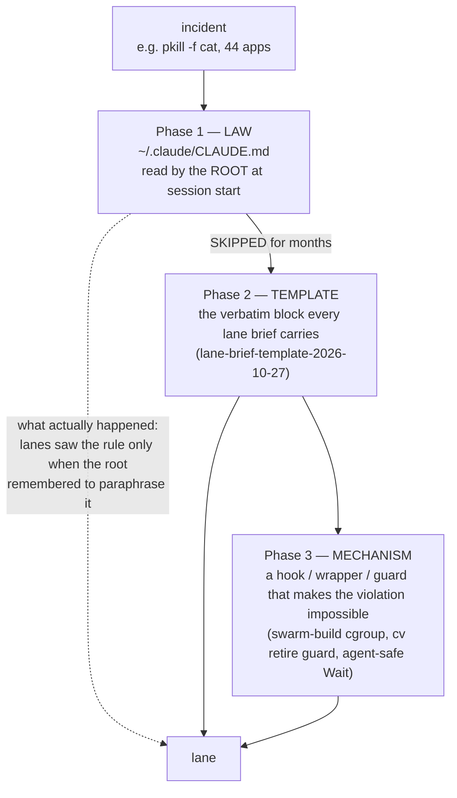
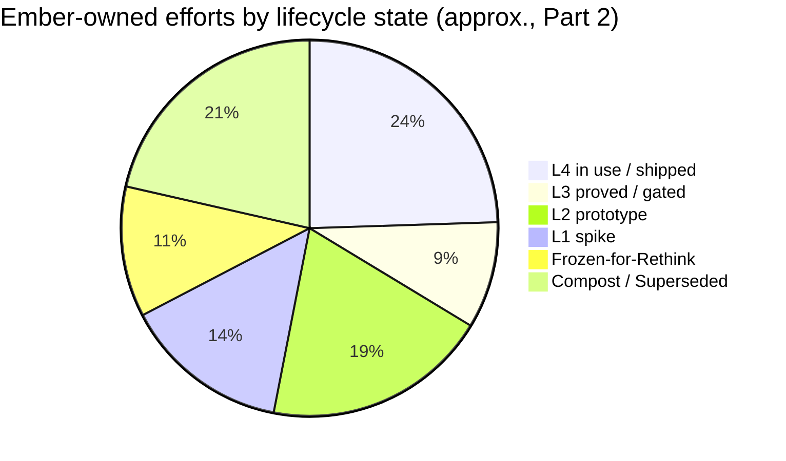
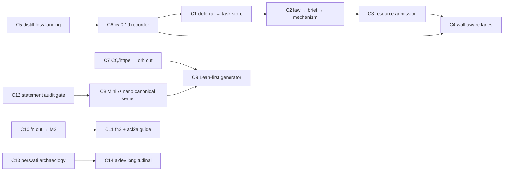

# Strand 15 — Swarm Metamanagement, Context Continuity & the Master Open-Cycles / Revival / Human-Triage Atlas

*Primary-source dossier, written 2026-11-02 for `whatember`. Read-only against every other repository.*

This strand covers the work that coordinates the other work: how Ember learned to run swarms of hundreds of agents, how the lessons got written down (and how slowly they reached the lanes), which tools came out of it (`cv`, `tokeman`, `lcrio`, `acl2aiguide`, and friends' tools Ember salvaged or used: `mission-control`, `helm`, `sesh`, `forensics`), and what is still open across the whole ecosystem.

It does **not** re-derive project internals that other strands own (dregg kernels, fn ACL2, obend silicon, zkML). It cites them only where a coordination loop runs through them.

---

## 0. Provenance, ownership and the maturity scale

### 0.1 What was read

| source | path | what it gave |
|---|---|---|
| CLAUDE.md stratigraphy | `~/dev/aidev/docs/claude-md-stratigraphy.md` (481 lines) | 8 dated copies of the global rules file, 2025-10-02 → 2026-10-10, diffed layer by layer |
| coordination dig | `~/dev/aidev/docs/digs/coordination.md` (276 lines) | month table Dec 2025 → Oct 2026: 2,469 session files, 33,200 sub-agent transcripts, 1,011 Workflow runs; guardrail share in lane briefs |
| persvati dig | `~/dev/aidev/docs/digs/persvati.md` (142 lines) | the March 2026 persvati campaign: 6,750 prompts, 182 sessions, 41 active days |
| dregg synthesis | `~/dev/aidev/docs/synthesis/dregg.md` (459 lines) | T1–T26, failure modes, R1–R12 |
| projects / ledger | `~/dev/aidev/docs/projects.md`, `ledger.md` | 366 projects; 40 described entries; state tallies |
| memory files | `~/.claude/projects/-Users-ember-{dev-cv (20), dev-mission-control (6), dev-tokeman (5), dev-aidev (5), pug-claurdvoyant (12), pug-simbi (17)}/memory/` | rules, measurements, release state, decisions pending |
| memory, newer | `-Users-ember-dev-{breadstuffs,minidregg,o7vn,EKOS,intmat}/memory/*` modified after 2026-10-15 | drain/freeze, nanodregg, board/seats, lane-brief template, broadcast-stops-lane |
| repos | `~/dev/{cv, cv-distill-loss, tokeman, mission-control, helm, helm-old, sesh, lcrio, forensics, torchship, acl2aiguide, brorb}` | READMEs, design docs, `git log`, authorship (`git shortlog -sne --all`) |
| machines | `~/swarm/MACHINES.md` (facts dated 2026-10-31), `~/swarm` log `8ac5161` | hbox / persvati / Mac roles |

`~/dev/cv-astra` no longer exists. The `cv-0-18-plan` memory records that Ember had the astra manager clone and its 16 lane worktrees deleted on 2026-10-20, after five patches were saved to the session scratchpad.

### 0.2 Ownership: whose code is this?

The metamanagement story runs through code written by several people. Before anything is classified, here is who owns what:

| repo | authorship (`git shortlog -sne --all`) | remote | status for this atlas |
|---|---|---|---|
| `~/dev/cv` | ember arlynx 3,802 · ember@nextop 31 · akapug 18 | `emberian/cv` | **Ember's.** pug contributes PRs (#23–#27) |
| `~/dev/cv-distill-loss` | worktree of cv, branch `distill-loss-2026-10-27` | `origin/distill-loss-2026-10-27` | Ember's (unlanded branch) |
| `~/dev/tokeman` | ember arlynx 61 | `emberian/tokeman` | **Ember's** |
| `~/dev/lcrio` | ember arlynx 5 | `emberian/lcrio` | **Ember's** |
| `~/dev/acl2aiguide` | ember arlynx 15 | `emberian/acl2aiguide` (public) | **Ember's** |
| `~/dev/brorb` | ember arlynx 7 | `spwplace/brorb` | **Ember's** (spwplace is one of Ember's handles, per `pug-claurdvoyant/memory/user-ember.md`) |
| `~/dev/torchship` | no git; `tools/harvest.py` | — | Ember's tooling, run from a brief written by the resident **Kestrel** (GLM) |
| `~/dev/mission-control` | Commander Data 1,986 · David Anderson 1,279 · Ogulcan Celik 882 | `fork → emberian/mission-control` | **David's (pug's) project.** Ember wrote the diagnosis and the "phoenix" salvage on a local branch |
| `~/dev/helm`, `~/dev/helm-old` | David Anderson 604 / 1,516 · ember 5 (helm) · kimi 16 · opus-integrator 12 | `akapug/helm` (fork `emberian/helm`) | **David's.** Ember used it and contributed 5 commits |
| `~/dev/sesh` | David Anderson 45 | `akapug/sesh` | **David's.** It consumes `cv ls --json` |
| `~/dev/forensics` | Quinn Dougherty 1 | `for-all-dev/forensics` | **Third-party** (Quinn Dougherty's proof-slop auditor). A reference tool, not Ember's |
| `~/hellas` | — | — | Biographical context only: 2025 Cursor-era consensus work. **Not claimed.** |

### 0.3 Maturity scale used everywhere below

| level | meaning |
|---|---|
| **L0 Seed/Idea** | prompts, a design note, or a memory entry only |
| **L1 Spike** | code exists; a day or two; not exercised beyond its author |
| **L2 Prototype** | runs end to end; real users = Ember; known structural gaps |
| **L3 Proved/Tested Core** | machine-checked or gated core (theorems, golden/heap/CI gates), not yet deployed or released |
| **L4 Deployed/Production** | released, installed, served, or used daily by other agents/people |
| **Frozen-for-Rethink** | deliberately stopped by Ember for an architectural rethink |
| **Compost/Superseded** | studied for requirements, never copied; or replaced by a successor |

Each section closes with four fixed blocks: **Maturity**, **Unclosed cycles & missing links**, **Promising & ready for revival**, and **Struggling / needs Ember**.

---

# PART 1 — How to Metamanage Multi-Wave Swarms & Ideas

## 1.1 The arc in one table

| era | dates | shape | coordinator | lane engine | memory mechanism | defining failure | rule it produced |
|---|---|---|---|---|---|---|---|
| E0 pair-programming | 2025-10 → 2026-01 | many short sessions; `/clear` 167× in Jan | none | Explore/Plan (693 + 109 of 892 Jan spawns) | none; one-line CLAUDE.md (77 bytes) | bw-exp1: 91 sessions → 33 commits | "NEVER QUICK FIX" (02-16, from luteastress `5c8432ac`) |
| E1 hand-run multiclaude | 2026-02 → 04 (persvati) | 6–10 terminals, one shared tree, Ember as switchboard | Ember, by hand | Opus 4.6 lanes, 91% background by March | `thoughtlog.md`, `statedump.md`, `planning/`, `handoff.md` | reverts of other terminals' work (≥6 incidents), parallel builds, compaction amnesia | never stash / never revert / subagents never build / absolute paths / tee |
| E2 Workflow waves | 2026-05 → 07 (dregg) | 1 orchestrator, 100s of lanes; 1,669 lanes in `3b829648` | 1M-context Opus 4.8 / Fable 5 | Workflow tool: 692 runs / 4,499 lanes in July | handoff files → `cv` (06-13) → sliding window (06-19) | usage wall kills in-flight lanes; hbox OOM 07-15 | `swarm-build`; Lean-first law; Ground-truth-first |
| E3 SendMessage braids + `cv` | 2026-07-25 → 09 | long-lived coordinator that doesn't compact (1 of 412 July sessions compacted) | Opus 5 / Fable 5.1 | individual agents resumed by SendMessage; Codex as a second engine | `cv workflow --revive`, `cv prune`, `cv adopt` | stranded lanes; deputy chatter; Codex "mess" | filtered tests (08-18); lane clones (Sep: 49% of briefs) |
| E4 veterans + distill | 2026-09-03 → 10-10 | deputies, seats; 8–15 lanes target | Fable 5.1 root | Opus 5.5 / Sonnet 5.5 lanes | `cv distill` (21.5/24 recall), lane STATUS | the telephone game; pathological stalls; `pkill -f cat` (10-10) | "Send the veterans back"; "No status censuses"; PID files |
| E5 drain, freeze, board | 2026-10-08 → now | board/seats, `main` as trunk, central integrator | root decides only | seats talk directly; GLM/Kimi/Grok/Codex subprocess lanes | `cv distill --agent-of`, `cv retire`, `cv lanes --unfinished` | 24% of 9.0B tokens in foreground polling | lane-brief template (10-27); "DELETE THAT RITUAL" |
| E6 recorder & legibility | 2026-10-24 → | fleet: pug's ~12 machines, "50× Hermes" | — | — | cv 0.19: identity at birth, per-host ledger + hub | archaeology can't recover intent | design record `b4674049` (10-28), not yet built |

## 1.2 E1 — persvati and hand-switched multiclaude (Feb–Apr 2026)

**What happened.** persvati is a ThinkPad P14s Gen 6 AMD (Ryzen AI 9 HX PRO 370, 12C/24T, 84 GiB). Claude Code was first started there 2026-02-22T18:44Z. Ember drove one or two `opus[1m]` orchestrators, each fanning out swarms (`digs/persvati.md`) across the CQ, `httpe`, WireGuard/Tailscale/DERP, the "assurance" test wave (`~/assurance-report/`), and the Chronicle MIR→TLA+ extractor.

**The coordination substrate was a person**:

> "Ember was the only process that could see all of them, and acted as their switchboard. They fenced domains (“i have another agent doing websocket.” #5726). They routed messages between Claudes on three operating systems. They ran every build by hand and announced it like a station clock."

**Techniques born there**:

| id | technique | first seen | verbatim seed | where it lives now |
|---|---|---|---|---|
| T2 | the human (then the root) owns the build; lanes never build | 02-22 #3217 | "can you please make a memory/rule/guideline to NEVER RUN MAKE BUILD YOURSELF???? it's my job." | dregg "lanes edit; orchestrator builds"; minidregg 10-27 "No builds or validation in lanes" |
| T3 | never revert/checkout/stash over another agent | 03-04 #4589 | "HEY. THERE IS ANOTHER FUCKING AGENT WORKING. WHY DO YOU KEEP GODDAMN REVERTING SHIT" | CLAUDE.md "NEVER STASH" (05-25) |
| T3′ | remove the trigger word from memory | 03-18 #8294 | "edit your memories to not ask to revert, because that will prime your subconscious t owant to revert, but just instead ask how to converge or if to wait." | `feedback_git_checkout_destructive` |
| T6 | absolute paths in every brief | 03-18 #8384 | "ALL SUBAGENTS NEED TO BE TOLD TO CHANGEDIR..." | CLAUDE.md "Ground-truth-first" (08-05); 98% of Sep briefs |
| T9 | coordinator ≠ worker ("idiot orchestrator") | 03-19 #8545 | "AT THE BEGINNING OF EVERY MESSAGE, SAY "MANTRA: I AM IDIOT ORCHESTRATOR"" | CLAUDE.md "The root's context is for decisions, not relaying" (10-10) |
| T10 | "Don't play telephone" | 03-30 #11643 | "so that the agent that reads it is the agent that writes it, you know what i mean? Don't play telephone." | CLAUDE.md "Send the veterans back to the front" (10-10) |
| T11 | compaction-proof files | 02-22 #3251 | "dump out thoughtlog.md that is separate from the compaction summary and will help you rehydrate" | superseded by `cv distill` (measured) |
| T12 | one agent per file/protocol, reports into a dir | 03-11 #7492 | "one per protocol (h1, h2, h3, webrtc, l4, derp, disco, tun, grpc, wg) to produce a report into ./protocol-reports" | per-lane reports; `acl2aiguide/coordination/LANE-*.md` |
| T16 | Chronicle: annotate → extract → TLA+ | 03-16 #7838 | "I hate all this untrustworthy handwritten crap, we need to either extract a meaningful specification directly from the program, or we need to abandon our attempt at assurance at all." (#7895) | dropped as a tool; became Lean-first |
| T18 | stop by PID, never by pattern | 03-17 #7886 | "you can't just pkill shit, you need to STOP THE AGENTS" | CLAUDE.md, **seven months later** (10-10) |

**The verification thread (Chronicle).** Started 03-16, the paper draft claims "27 specs, 22,863 lines, 500M+ states". TLC found 2 confirmed bugs: a Dekker abort-block livelock and a ResponseHandle double-response race (`~/chronicle/output/FINDINGS.md`). Ember's verdict, 03-30 #11606: "it wasn't a super great approach, but it did at one point help us achieve substantially better correctness in specifically the Rust CQ."

> **Maturity:** Compost/Superseded as a coordination method. The rules it produced are **L4** (in the live CLAUDE.md).
>
> **Unclosed cycles & missing links:** The persvati dig's retention recommendations (`cleanupPeriodDays: 100000` on persvati and hbox, back up `paste-cache`, inspect the 6 orphaned `~/tracing/.claude/worktrees/agent-*` dirs).
>
> **Promising & ready for revival:** The Chronicle lesson, "gaps between the real-impl and the modeled-impl are ... common, fatal" (#7850), is the founding premise of Lean-first work and of the `forensics` style of auditing. The CQ design is revived as DreggNet's httpe (see Part 3, loop C7).

## 1.3 E2–E3 — Workflow waves, the usage wall, and the move to SendMessage (May–Sep 2026)

**Workflow tool runs** span exactly May–September 2026: 1,011 runs (966 completed, 31 killed, 14 failed). July was the peak with 692 runs and 4,499 lanes (median 4 per run, largest 108). Then 22 runs in August, 1 in September (36 lanes), none in October (`digs/coordination.md` §1). The record says why:

- 07-06 #4778: "a shitton of our agents in that workflow didn't ever finish their work due to session limit … this is honestly the worst fucking part of using claude code."
- 07-25 `1bd42c54`: "bro i had to kill that workflow, it was running for an hour and half, i almost guarantee those guys tried doing a clean independent build in a tmpdir".
- 07-25 #8146: "bro. you can just sendmessage to ACTUALLY relaunch, what you didn't wasn't **really** relaunching, was it....." and #8147 "like tey didn't need to lose any of their context at all."
- 08-08 `62b78482` (don): asks for what became `cv workflow --revive`.

**Brief length grew 7.6×.** The median spawn prompt went from 532 characters (Jan) to 3,852 (Jul) and 4,057 (Aug), per `lane_brief_monthly`. The brief became the lane's whole world, and that is why "Ground-truth-first" (CLAUDE.md 08-05) matters.

**Resource incidents, each found by its damage** (`coordination.md` §3):

| date | incident | session | rule | first CLAUDE.md copy |
|---|---|---|---|---|
| 07-08 | "lean ate all of our system memory and then we had to hard reboot" | `33bbf766` | — | — |
| 07-15 | hbox swap-thrash during concurrent Lean C-codegen; physical power-cycle | `8113c11c`, `12ae9731` | `swarm-build` (cgroup `MemoryMax=96G`) | 2026-08-05 |
| 08-18 | unfiltered `dregg-circuit` suite: ~9.5 GB, 1h52m, plus a second run on hbox | `c820add0` | "Run the narrowest thing that could refute you." | 2026-10-03 |
| 10-01 | Mac at 11.2 GiB free; coordinator deleted caches including Ember's lossless offline Spotify cache | `0c315aee` | Disk pressure is a pausing condition | 2026-10-03 |
| 10-10 | Sonnet lane ran `pkill -f "cat" -u ember`; it matched `/Applications`; 44 apps got SIGTERM | `905fe751` | PID file or nothing | 2026-10-10 |
| 10-21 | a cv session scratchpad reached >300 GB (≈20 lanes × 2–5 GB target dirs ×2 for hash gates); machine crashed | cv `cargo-worktree-target-dir.md` | ≤4 target dirs alive; landing script deletes them | memory only |

The 10-21 incident shows that the 10-03 disk rule did not prevent a recurrence eighteen days later. The rule says what to do *under* pressure. It does not stop a swarm from *creating* pressure.

> **Maturity:** Workflow-tool swarms are **Compost** (Ember's verdict: "(not worth workflows)", 07-25 #8144). SendMessage braids are **L4** practice.
>
> **Unclosed cycles:** No admission control on resources. Each rule is reactive; nothing budgets disk, RAM or token burn *before* a lane launches (see loop C3).
>
> **Promising:** `cv workflow --revive` and `cv adopt` make a "failed" run recoverable. The CLAUDE.md lesson "A 'failed' workflow still has good lanes" is now tooling.
>
> **Struggling / needs Ember:** Whether the Workflow tool deserves a second life once lanes can survive the usage wall. That depends on Claude Code itself; cv can't fix it.

## 1.4 E3 — `claurdvoyant` → ClusterVision (`cv`): institutional memory as a tool

**Origin.** On 2026-05-29 in `~/pug`, pug (David) said he kept important session IDs by hand in Google Keep (`pug-claurdvoyant/memory/pug-session-pain.md`: sessions are "unfindable", "scattered", "dir-jailed"). Ember's brief that night (`da9174f4`): "please, you're a swarmbrained superintelligence, don't let me slow you down, you may fanout. you may also design and implement and propose your own features(!)". v0.1.0 ("see into, search, and port agent sessions across harnesses") shipped the same night. It was renamed ClusterVision on 2026-06-19 to avoid Anthropic trademark exposure; the binary stayed `cv`. On 06-10 Ember granted standing ownership: "please feel empowered to consider this project 'your own'" (`feedback-claude-owns-claurdvoyant.md`).

**Release spine** (from memory files and `git tag`):

| version | date | commit | what it meant for swarms |
|---|---|---|---|
| 0.1.0 | 2026-05-29 | — | cross-harness search + port |
| 0.9.15 | 2026-06-16 | `073efc3` | `cv prune`: lossless compaction into a NEW resumable session (algorithm from flatten-mcp) |
| (anatomy) | 2026-06-15 | `8c89608` | `cv workflow`, `cv tools`, `cv compaction`, recovered from abandoned uncommitted work |
| 0.10.0 | 2026-07-17 | `0f22b85` | `cv task` substrate (from the mission-control salvage); six crates on crates.io |
| 0.11.0 | 2026-09-19/20 | `5abb404` (audit fixes) | "clean break": `docs/INTERFACE-V2.md`, IR v2, MCP regenerated from the CLI schema (58 tools) |
| 0.14.0 | 2026-10-10 | `b4a7e65` | parsimony review phase 1; `docs/design/REVIEW-2026-10.md` |
| 0.17.0 | 2026-10-18 | `e9db5a1d` | one substantial release; 17/17 gates on persvati |
| 0.18.0 | 2026-10-23 | `e78482d5` | "the release an agent can trust"; uncounted = honest null; Codex hooks |
| (post) | 2026-10-28..31 | `b4674049`, `c3653b8e`, `1a143264`, `1f611362` | 0.19 design record; `prune --plan`; distill stash ≠ sub-agent; "a distilled-away sub-agent cannot run again" |

`git rev-list --all --count` gives 3,904 commits, 2,662 on `main` (HEAD `285322be`, 10-31). Crates are now `cv, cv-core, cv-search, cv-testkit, cv-web`. That is close to the parsimony attractor of 10-10: "three crates (`cv-core`, `cv`, `cv-web`, with `cv-search` the one satellite), one binary".

**The continuity toolkit**, as the live CLAUDE.md now describes it:

```text
  stranded lane ──▶ cv lanes --recent 3 --unfinished ──▶ cv adopt <id> --into <live> ──▶ SendMessage(<id>)  (full context)
  too-big lane  ──▶ cv distill <id> --agent-of <root> ──▶ new compact sub-agent id ──▶ cv retire <old> (guard refuses old id)
  fork at msg N ──▶ cv splice <id>:..N --agent-of <root>
  as-of commit  ──▶ cv rewind <id> --at <sha>
  read anything ──▶ cv show <id> / cv cat <id> <tool_use_id>
  dead session  ──▶ cv prune <id> --drop-thinking   (976k → 149k recorded context; new resumable id)
```

**The measurement that changed the rule.** The 10-07 distill review scored resume methods on 24 blind questions (`dregg.md` T11, citing `mem:breadstuffs/feedback-renew-with-distill-plus-lane-status`):

| resume method | recall /24 |
|---|---|
| full transcript (SendMessage resume) | **24** |
| `cv distill` pack | **21.5** |
| lane's own STATUS file | 11.5 |
| root-written resume note | **0.5** |

This one table is the quantitative core of the whole strand. The root's paraphrase carries almost nothing. Ember's 09-03 estimate (#10400) was the qualitative version: "the context an agent receives is a low dimensional projection of about 70% of what was most important in its context window. If you then take that report and telephone it off to another agent, they can reconstruct about 15%".

**The unlanded distill improvements.** Worktree `~/dev/cv-distill-loss`, branch `distill-loss-2026-10-27`, has 15 commits (head `22e3036f`) that are pushed to `origin` but **not in `main`** (`git merge-base --is-ancestor 22e3036f main` → false). They add `## 0. Hand-off`, `## 1. Grounding` (the lane's last state file whole, open items, decisions verbatim), per-generation brief paragraphs instead of nested packs (this fixes the "4th-generation pack stayed ~280K" compounding in CLAUDE.md), and ledger rows naming each elided output's `tool_use` id. Its CHANGELOG opens with two questions only Ember can answer:

> "A state file larger than 24 KB is cut head and tail; the infra lane's 83 KB CHECKLIST.md whole would cost ~36k tokens (5.8× → ~4.4×). Carry whole, or keep the cut?"
>
> "Coordinator messages are recognised in distill by their "The coordinator sent a message while you were working:" line; should the Claude adapter give them a proper session kind instead?"

**Harness contracts are undocumented and drift silently.** `claude-code-resume-gate.md` records that Claude Code 2.1.278 refuses a resumed session client-side when the last real usage plus a byte estimate is at least context − min(max_output, 20000) − 3000 (~977k on 1M). It synthesizes `{"model":"<synthetic>", ..., "Prompt is too long"}` without calling the API, and since 2.1.277 the read prefers `usage.iterations`. cv's `prune.rs` `usage_total` mirrors this. `harness-drift-method.md` records that three of six harnesses moved their live store "WITHOUT erroring" (OpenClaw → sqlite 07-11, OpenCode → `opencode.db`, Kimi → `~/.kimi-code`).

**cv's own swarm lessons** (all in cv memory; they are the most mature written practice in the ecosystem):

| lesson | evidence | file |
|---|---|---|
| estimation rule: literal twin deletion ×1.0, "unify N" ×0.3, "move" ×0 | 0.17 waves recovered ~¼ of TARGET estimates (deletions −586/1.5K, identity −204/2.5K, doors −217/2.5K) | `cv-0-18-plan.md` |
| lanes capped ~250K tokens, continuation at 200K, ≤3 overlapping lanes, delete-first | — | `cv-0-18-plan.md` |
| integration, not serial landing | Ember 10-15: "why are we stacking this ... just put it all on a single branch and then integrated" | `cv-0-17-plan.md` |
| merge, never rebase, an integration branch with lane-vs-lane resolutions | `git rebase` linearized and DROPPED 24 merge commits (jsonl.rs re-collided at 53/94) | `cv-0-17-plan.md` |
| a landing script must verify `origin/main == HEAD` after push | the #25 chain closed a PR and deleted a branch while main hadn't moved | `cv-0-17-plan.md` |
| `gh run watch --interval 60` | five lanes + root at 3 s polls exhausted 5,000 req/h | `cv-0-17-plan.md` |
| per-lane `CARGO_TARGET_DIR` + sccache; never shared | cargo keys path crates by name+version: three worktrees overwrote each other's rlibs | `cargo-worktree-target-dir.md` |
| Sonnet on gated lanes | Sonnet deletion lane: 154 ledger rows, 30 commits, −1,300 lines, byte-identical by dump hash | `subagent-model-swap.md` |
| a resumed sub-agent runs on its `meta.json` model; `null` inherits the root's current model | five Fable lanes revived as Opus 5.5 | `subagent-model-swap.md` |
| "verify a lane's claims on real data, not its report" | forks reported "every adapter asserts the invariant" (10 of 21 did) | `cv-0-11-clean-break.md` |
| "a green test suite says nothing about code no job compiles" | release pipeline broken since July; Tauri app hadn't compiled since 0.10 | `cv-0-11-clean-break.md` |
| a broadcast to running lanes stops them | 18 lanes each applied a fix, reported and ENDED the turn | `o7vn/memory/subagent-broadcast-stops-lane.md` |
| agent-safe commands | an agent ran `cv scry`, which blocked forever printing nothing → `util::Wait`; non-TTY = one-shot | `cv-0-18-plan.md` |

> **Maturity:** **L4.** Released (0.18.0), installed as `~/.cargo/bin/cv`, used by every lane per CLAUDE.md, used by pug on ~12 homelab machines, and consumed by `sesh` (`1ad904d`: "retire the scanner — cv ls --json (0.10+) is the catalog authority").
>
> **Unclosed cycles:** (a) `distill-loss-2026-10-27` unlanded, with 2 open questions. (b) TARGET.md fan-out steps D/E/F (`BRIEF-D/E/F.md`: one JSONL driver, SQLite lifecycle, reshape derive) never launched. (c) ExactStrings (Q10) "still open". (d) Codex hooks "(c) a real-binary CI gate stays queued". (e) `verify_claude_resumable` is never run on prune/rewind/adopt OUTPUTS. (f) The faeries' "shadow IRs" list (`cv-faeries-review-page.md`): Ember wants ALL of it addressed. (g) The 0.19 role change (§1.8).
>
> **Promising:** `cv task` (observed-not-attested) is the machine-checked task store that swarm deferrals never had (§1.6). The 0.19 recorder makes intent and lane first-class at birth.
>
> **Struggling / needs Ember:** cv memory `persvati-build-box.md` says persvati is "DOWN for repair and 'probably won't be coming back up for us'" (10-20), but `~/swarm` (`8ac5161`, 10-31) says "persvati approved for fn2 certifies". One of them is stale. Briefs that copy the cv memory will misroute builds.

## 1.5 `tokeman` — the usage wall as an operational constraint

**What it is.** "your buddy for managing Anthropic OAuth tokens". It shows remaining usage per account, launches Claude Code on the best token, and keeps a safe default before a quota wall (`tokeman/README.md`). It was built mostly 2026-03-03 (Ember, `ff72f0d8`: "tokeman should be a *real buddy*") and rewritten from scratch 2026-10-14 ("what we would have written if we knew all this from the start") to `DESIGN.md`: a library with no UI dependency, a pure `policy.rs`, typed on-disk state. Tags: v0.1.0, v0.1.1, v0.2.0, **v0.3.0** (`6d6818f`, 10-15), **v0.3.1** (`c3a62f5`). 61 commits, all Ember's.

**Why it is metamanagement.** In `coordination.md` §4 the real loss is "at the usage wall: when a session hits its limit, in-flight workflow lanes lose their tokens". The 10-08 audit counted 6 usage walls in 41 hours. fn's `cut/breaking` swarm "died at the weekly limit (10-17 ~01:10 EDT), unmerged" (`fn-cut-state-2026-10-27.md`). tokeman is the account pool, and the pool sets the pace of every swarm.

**Incidents it records:**

- `launchagent-background-starves-daemons.md`: at load ~200 on 12 cores, a `ProcessType=Background` daemon's 20 s cycle stretched to 10–24 minutes. "the swarms that exhaust the quota are exactly the load that starves the daemon meant to rotate it." Fixed in `ce998e7` (Standard priority, 10 s census timeout).
- `anthropic-api-changes-2026-10.md`: a healthy 200 now omits the `5h-*` rate-limit headers, so the daemon "sat on the 20 s cadence for two weeks" (fixed in 0.3.1). Refresh tokens die ~28 days after browser login regardless of refreshes; `8cef9d5` warns from day 21. **Ember must run `tokeman login --more` monthly; tokeman cannot do the browser step.**

> **Maturity:** **L4** (installed LaunchAgent `com.ember.tokeman-claude-rotate`; residents use its accounts per `allgame/MEMORY.md`).
>
> **Unclosed cycles:** tokeman knows the walls and cv knows the lanes, but nothing joins them. A coordinator can't ask "which lanes die at the next 5h reset?" and park them at 70% of a window (one of the five 10-08 obstructions: "size width to the burn rate and park at 70% of a window").
>
> **Promising:** tokeman + cv launcher (0.19 §1b, `ANTHROPIC_CUSTOM_HEADERS`, `--session-id`) = **wall-aware lane admission** (Revival #3).
>
> **Struggling / needs Ember:** the monthly browser re-login is irreducibly human. Put it on a calendar, the way the minidregg owner cadence does 1Password ("once per day at 5pm", `owner-cadence-2026-10-27.md`).

## 1.6 `mission-control` → phoenix → `cv task`: the anti-attestation lesson

**Whose and what.** `mission-control` is David/akapug's project (with Commander Data and Ogulcan Celik): 262k LOC Rust plus 526 scripts of agent-coordination machinery. Ember's work was diagnostic and salvage, in the `-Users-ember-dev-mission-control` sessions of 2026-07-16/17. Ember wrote `MC-GROUND-TRUTH-DIAGNOSIS.md` and `FOR-DAVID.md` at the repo root:

> "the "97-98% done" number is not real. It is "97% of the work the tracker has *noticed and hand-typed into one HTML table so far*." … a chunk of the rows marked "landed" are marked landed on **the agent's word, with no check that the code is actually on `main`** … The number is a ritual, not a measurement."

The mechanism it names: `gen-port-status.py:567` parses the stats out of the report's own `<tbody>`, and `:414` falls back to a hardcoded `690`. The denominator is the count of `<tr>` rows.

**The distilled lessons** (`mc-failure-lessons.md`):

- "Every trust failure was answered with agent-side authority machinery instead of human-side legibility." (Debts, grants, captain seats, family attestation; "Authority is not proof" at `comms.rs:1090`.)
- "Two ratchets": the denominator only grew when someone noticed missing work, and complexity only grew (67 → 1,146 commits/month while owner comprehension → 0). "Agents found infinite employment maintaining their own bureaucracy."
- Tip-only patch-id verification let a 2-commit branch land only its tip and attest LANDED. Fix: whole-branch RANGE patch-id from a RECORDED base.
- "The necessary fraction was ~3-5%."
- **"Dissolution beats attestation"**: observation (`git cherry`/merge-base) *is* the landed fact.

**The salvage** (`phoenix-plan.md`): M1 `cv task` substrate (cv branch `tasks-substrate`, ~4.5k lines, 39 tests) with **four laws**: observed-not-attested (only the git verifier writes `merged_local`/`landed`), independence read from transcripts, no authority machinery, small. M2 `phoenix/strip` (local worktree `~/dev/mission-control-worktrees/phoenix-strip`, **NEVER push**): net −162.7k lines, from 526 scripts to 60. M3 `scripts/dogfood-loop.sh` ran the whole loop headless 3× green: worker pane → real Claude authors → real Codex cross-family review (`independent: true`) → owner merge → daemon-observed land. Meta-rule: "every fix is an OBSERVATION, a PROJECTION, or a CONVENTION — never promise machinery."

**The companion correction** (`no-invented-constraints.md`): Claude treated a day-old wire-format golden as a hard freeze, and Ember: "we have no constraint to keep any wire format at all tbh. idk why you made that up." The rule: name a constraint's precondition (who consumes this?) before enforcing it. "A tripwire's job is making change DELIBERATE, not forbidden."

> **Maturity:** mission-control itself: **Compost** (David's). `cv task`: **L3–L4** (shipped in cv 0.10.0; four laws in `manual/src/tasks.md`; the task log of ~11 event kinds is in the attractor). `phoenix/strip`: **L2**, local-only and unpushed by design.
>
> **Unclosed cycles:** The **swarm deferral store**. May–June mega-sessions deferred hundreds of items each ("when X lands" 145, "ember's call" 67 in `3b829648`); about 60% of deferrals are UNMATCHED against the task store, which "matches on three shared words". `cv task` exists, but lanes don't file into it by default, and `cv deferrals --open-tasks` matching is weak (loop C1).
>
> **Promising:** `dogfood-loop.sh` is a working template for a machine-checked land loop with cross-family review. It has not been reused since July (Revival #2).
>
> **Struggling / needs Ember:** `PR-DRAFT.md` for David is untracked scratch "awaiting ember's review — NOTHING pushed or submitted". Whether anything goes back to David is a relationship call.

## 1.7 `helm` and `sesh` (pug's) — the overlay cockpit pattern

**helm** (`akapug/helm`, AGPL-3.0, Python stdlib only): "The steering station for you and your agent fleet". It is an *overlay* that rides Claude Code hooks (PreToolUse refusals, per-turn context injection of "beliefs, vocabulary, reflexes — budget-capped, salience-gated"), and runs several model families in one repo, "reviewing each other's work before anything lands". `helm-old`'s August log shows that review gate as commit grammar: `45b6460 fold: whisper-probe-runs-at-enumeration … (dispatch aa71eeac0f0a, helm-claude APPROVE gate:54f39a5f26c371fb) — closes #129`, with APPROVEs from `kimi` and `ds4pro`. Ember's 5 helm commits are the 08-07 darwin port (`renameatx_np(RENAME_SWAP)`, ps/lsof fallbacks).

**sesh** (`akapug/sesh`): "One local web app for everyone juggling AI OAuth subscriptions". It shows every session and every account with quota state, and copies one resume command (`CLAUDE_CONFIG_DIR=<home> claude --resume <id>`). It warns "when two seats share one account (OAuth refresh chains have exactly one writer)". It retired its own scanner in favour of `cv ls --json`.

> **Maturity:** both **L4 for David**; not Ember's property. For Ember's ecosystem they are **reference designs**.
>
> **Unclosed cycles:** helm's hook-injected "beliefs" is the opposite answer to the same problem cv 0.19 addresses (inject into the agent vs. record from the agent). Nobody has written the comparison down.
>
> **Promising:** sesh's "one writer per refresh chain" warning is a cheap rule tokeman could adopt.
>
> **Struggling / needs Ember:** none. Respect the boundary: changes go upstream as PRs to David, never by editing these checkouts (cv memory: "lanes must NOT comment/close/merge on GitHub — root does that with ember's OK").

## 1.8 E6 — cv 0.19: from reader to recorder (the role change)

`cv-0-19-direction.md` (10-24) records the conversation's verdict: "harness stores are one worker's private memory written for its own resume; reading them after the fact is archaeology that cannot recover intent, parent across hosts, cluster or lane." The design record, `docs/design/0.19/{DESIGN,INJECTION-SURFACES,REVIEW-ASTRA,README}.md` (commit `b4674049`, 10-28), was written "For pug's team, who build 0.19 on pug's fleet".

**Its verdicts:**

| § | verdict (verbatim) |
|---|---|
| 1 | "cv records what happens from the harnesses' contracts (hooks, OTel, plugins), keyed by ids it assigns; harness stores become evidence it links to; launching is optional and adds only what nothing else can." |
| 2 | "every event carries `(host, seq)` as its unique key and an HLC timestamp; a session is `(host, harness, id)`; parentage is an explicit edge, never inferred from time." |
| 3 | "one append-only ledger per host, mirrored to a hub by suffix; the catalog is a fold over the ledger plus the stores" |

The coverage numbers come from INJECTION-SURFACES §7a: Claude ≈ 90% of lifecycle moments with all hooks + OTel (33 hook events in 2.1.310; cv uses 5 hooks / 6 entries in `crates/cv/src/cmd/hooks.rs:132-171`; OTel is **unused**). Hermes ≈ 60% reader-only and ≈ 85% with an in-process plugin (44 plugin events). "The remainder (crash, intent, cross-host parent) is causal, not coverage." Claude Code fires nothing on SIGKILL; the only trace is a leftover `sessions/<pid>.json`.

**Why this matters for metamanagement.** Every failure in Parts 1.2–1.6 is, at bottom, *lost intent*: a lane whose purpose lived only in the root's head, a deferral with no store, a "landed" claim with no observation. Identity at birth (`intent`, `lane`, `parent` stamped by the launcher) turns lane briefs into records.

> **Maturity:** **L0–L1** (design record with source-keyed claims; no code beyond 0.18's ledgers `lanes.jsonl` and the task log).
>
> **Unclosed cycles / HOLE[design]:** Ember's decisions are pending: (1) mirror-by-suffix vs. federation; (2) `host:` as a first-class selector (breaking JSON); (3) hub = `cv serve` mode or a separate daemon; (4) "swarmvision" as a 0.19 doc or 0.19 ship. Ember's stated fear: "hook-by-hook whack-a-mole, data loss event by event."
>
> **Promising:** the single highest-leverage item in this strand (Revival #1).
>
> **Struggling / needs Ember:** who builds it. The design is addressed to pug's team on pug's fleet, which makes it a collaboration-boundary question as well as a technical one.

## 1.9 Drain, freeze, seats and the board (Oct 2026)

**The 10-08 pivot** (`breadstuffs/memory/project-2026-10-08-drain-and-freeze-for-rethink.md`): "we have some major problems with this software right now, and they aren't going to be solved by sending out subagents". The order: let the queues DRAIN, FREEZE, and REWRITE the metacoordination protocol files outright. The retro (an Opus lane reading every lane transcript with `cv`, output `redregg/work/RETRO-20261008.md`) measured these obstructions (`dregg.md` T24, `mem:minidregg/fn-drain-freeze-2026-10-08`):

| measured obstruction | number |
|---|---|
| tokens spent in foreground polling | **24% of 9.0B** |
| usage walls | **6 in 41 hours** |
| deputy-to-deputy messages | **1,339, two-thirds status** |
| one Codex weekly window | 53% burned in one day |
| design duplicates | "two of everything": admission models, upgrade paths, authority vocabularies, state homes |

The five fixes were: no foreground waits over 60 s; resume veterans; size width to the burn rate and park at 70% of a window; READY as a file, not a message; dev green with recorded reds.

**The 10-27 iteration-loop audit** (`minidregg/docs/review/2026-10-27-process/ITERATION-LOOPS.md`; 34 work lanes, 108.6 lane-hours) produced the **lane-brief template** (`lane-brief-template-2026-10-27.md`). Its numbers:

- "the 10-minute cap re-woke a full context 63 times; 25 lane-hours" → **no foreground waits**: one `run_in_background` `box-wait`.
- "9 lane→integrator→root round trips of ~57 min" → **run your own rows**.
- Ember (10-27 night): "**DELETE THAT RITUAL**" → continuous integration; a lane's per-file-checked push lands on main at once.

**The board** (`project-board-coordination.md`, since 10-31, "after the last session spent its context relaying ~400 lane events and the integrator agent degraded"):

```mermaid
flowchart LR
  subgraph main["main = the trunk (987 remote refs cut to ~20 on 10-31)"]
    R[board/RULINGS.md<br/>root's present-state rulings]
    D[board/REDS.md<br/>builder]
    C[board/COSTS.md<br/>explorer, worst first]
    S[board/seats/&lt;seat&gt;.md<br/>id · ownership · continuation]
  end
  B[builder on hbox<br/>/home/hbox/lanes/integ<br/>builder.pid] -- moves --> G((green))
  B --> D
  Seat1[seat] <-- direct --> Seat2[seat]
  Seat1 -- decisions only --> Root[root]
  Root --> R
  Seat1 & Seat2 -- commit by path, pull --rebase, push, fix forward --> main
```

The rule on continuity there: "Distill a seat once; after that, fresh from its seat file."

**Counter-lesson, the kill sweep** (`project-nanodregg-wound-down.md`): asked to "wind down" nanodregg, the ROOT "killed every lane mid-step, losing their harness state and warm context, which cannot be resumed. Ember: 'that was very destructive of you and isn't what I asked for.'" The rule now: "census first, then each lane lands or writes down what it has, then stops; never a kill sweep." This ties to `aidev/memory/mwc-applies-to-lanes.md` (10-13): "mwc does apply to lanes, i would say, for sure" (model welfare concern covers lanes: brief them as peers, don't berate or status-poll, close them properly).

> **Maturity:** board/seats: **L2** (operating since 10-31 in minidregg; one builder seat on hbox). Lane-brief template: **L3** (derived from a measured audit and used verbatim).
>
> **Unclosed cycles:** the board is per-repo prose. Seats' liveness comes from `cv lanes`, rulings from markdown, reds from a script. Nothing checks that a seat file's continuation matches its transcript (`rows-owed-undated.md`: undated ROWS-OWED reds cost "hours of sniper time").
>
> **Promising:** board/ + `cv task` + cv 0.19 ledger = one machine-checked coordination substrate (loop C1).
>
> **Struggling / needs Ember:** the nanodregg unlanded stack sits on hbox under `~/nd-land` and `/tank/dregg-build/nanodregg/wt`, with continuations in `redregg/work/codex`. Three outside critiques were never read by any lane (CRIT-DOCS, CRIT-CTX-2, SYNTAX-IDEAS-ASTRA). "nanodregg is not worked on unless Ember reopens it."

## 1.10 `forensics` and `acl2aiguide` — legibility after the fact, and lessons as curriculum

**`forensics`** (Quinn Dougherty, `for-all-dev/forensics`, single commit `e5b80ca`, 2026-10-27; *third-party*): "Proofslop forensics … Tooling for navigating and auditing a Lean 4 proof/spec codebase after it got slop-cannon'd into existence." Its premise is Ember's T4 statement audit in a stranger's words: "A green `lake build` says the kernel accepted every proof. It does not say the statements mean what you think, that nothing rests on `sorry`/`native_decide`/a stray `axiom`, or that the hypotheses aren't contradictory." It uses a core-only Lean extractor (`forensics-extract`, against v4.35.0) plus a Bun server with lint, a trust explorer and LLM-judge quality indicators.

**`acl2aiguide`** (Ember's, public, 15 commits 10-28..29): an ACL2 guide "with explanations for human readers and self-contained instructions for coding agents", written from the ACL2 8.7 manual, community books, and "the transcripts of the agents that did the work" on fn (~1,400 books). Its own construction is a model swarm: `coordination/COMMON.md` + `LANE-A-prover … LANE-F-ai-chapters.md`, and `CONTINUATION.md` updated after each merge (`6cb6fbd` "lanes A and C merged, B/D/E running" → `cf15aa9` "all three milestones reached"). `fn-lessons/` holds **23 lessons "by wound"**, two of them coordination lessons (`19-foreground-waits-and-censuses.md`, `15-triage-one-layer-per-run.md`) and one a verification lesson (`23-teeth.md`).

**Why they matter for metamanagement.** They close the loop the CLAUDE.md stratigraphy leaves open: a lesson that is a *chapter with certified examples* can be loaded by a lane (`ai/00-pitfalls-first.md` "into context before touching ACL2"). That is the second phase of stabilization done right for one domain (§1.11).

> **Maturity:** forensics: **L2** (third-party). acl2aiguide: **L3** (every `examples/` book certifies; `make -C examples`).
>
> **Unclosed cycles:** no equivalent "ai/00-pitfalls-first.md" exists for Lean/dregg, Rust/cv, or swarm coordination itself, though `fn-lessons` proves the format.
>
> **Promising:** run `forensics` over minidregg/nanodregg/EKOS Lean trees as the statement-audit gate (Revival #6), used as a tool and not forked.
>
> **Struggling / needs Ember:** `CONTINUATION.md` lists "known gaps and next steps" for fn2 builders; the fn2 rebuild direction is Ember's (`fn-cut-state-2026-10-27.md` roadmap G4 → M2 → M3 → M4).

## 1.11 Why CLAUDE.md rules took months to reach lane briefs — the skipped second phase

### 1.11.1 The evidence

Rules entered CLAUDE.md quickly after their incident (days to weeks), but reached the lanes slowly:

| rule | first incident | first CLAUDE.md copy | lag to rule | share of lane briefs carrying it (`guardrail_share`) |
|---|---|---|---|---|
| never stash | 2026-02-17 `9a9b1a26` | 2026-05-25 | ~14 weeks (on persvati earlier; ignored 03-12) | **9.7% Mar → 16.5% Jun → 32% Sep** |
| absolute paths | 2026-03-18 (wh-nodeapi split brain) | 2026-08-05 ("Ground-truth-first") | ~20 weeks | **12% Jan → 58% Feb → 98% Sep** |
| swarm-build | 2026-07-15 | 2026-08-05 | 3 weeks | **17% Jul → 31% Oct** |
| worktree/clone isolation | (reversed: 05-25 dropped worktrees) | — | — | 2–9% before Sep → 49% Sep |
| PID file or nothing | 2026-03-17 / 03-23 on persvati | **2026-10-10** | **~29 weeks** | n/a ("Every subagent brief you write quotes this block verbatim") |
| subagents never build | 2026-02-22 | (memory 03-24: "Each agent MUST be told these rules explicitly in its prompt") | — | 03-28 #10987: "Did you fucking **FORGET** to tell subagents not to do builds?" |
| continuation from transcript, not summary | 2026-10-07 measurement (0.5/24) | 10-10 said "continuation FILE"; the live file now says `cv distill` | ~3 weeks *within Ember's own rules file* | — |

The coordination dig's own one-liner: "Rules get into the briefs, but slowly, and only where the orchestrator copies them."

### 1.11.2 The diagnosis

Negotiated stabilization (Ember's frame) has three phases. Rule-making skipped the second one:



Four structural reasons, each with a source:

1. **The lane never reads CLAUDE.md as law; it reads the brief.** Brief length grew 7.6× (532 → 4,057 chars), and absolute paths reached 98% of briefs only because they became part of how briefs are *written*. A rule that isn't in the brief template isn't in the lane's world.
2. **Rules are written as narrative, not as blocks to quote.** The 10-10 PID rule is the first to say "Every subagent brief you write quotes this block verbatim". Before that, every rule depended on the root's paraphrase. The distill table puts root paraphrase at **0.5/24**.
3. **Pink elephants.** Ember, 08-27 #10132: "you pink elephanted it. You've now elevated it from an error that happened once, to something that is narrated about so often that it's guaranteed to happen again." The persvati fix was to remove the trigger word ("ask how to converge", not "ask to revert"). Rule text that narrates the forbidden act primes it.
4. **Lessons don't transfer through context tokens alone.** 05-24 #1128: "bro, nobody is ever going to read 04-agent-coordination.md. you didn't even read it and you wrote it. something about the lesson can't be learned from context tokens."

### 1.11.3 The fix (the manual)

**Rule M1 — Every CLAUDE.md law ships with its brief block and its mechanism, or a dated reason it has none.** Keep a table, law → block → mechanism:

| law | brief block (quote verbatim) | mechanism (makes violation impossible or loud) | status |
|---|---|---|---|
| PID file or nothing | CLAUDE.md block | a PreToolUse hook denying `pkill -f`, `killall`, `kill -u` (cv already ships PreToolUse(Edit\|Write) at `hooks.rs:132-171`) | block ✔, mechanism ✘ |
| swarm-build | box-safety block | `swarm-build` cgroup on hbox (`MemoryMax=96G`) + earlyoom + OOM-immune sshd | ✔ ✔ |
| never stash | CLAUDE.md block | hook denying `git stash` (bare), `reset --hard` in shared tree | block ✔, mechanism ✘ |
| narrowest test | brief names the filter | a nextest wrapper that refuses a bare `-p <crate>` | ✘ ✘ |
| disk pressure | CLAUDE.md block | per-lane target-dir budget (≤4 alive) enforced by the launcher; `du` precheck | memory only |
| successor from transcript | CLAUDE.md "Agents outlive sessions" | `cv retire` guard (installed; refuses old ids, names successor) | ✔ ✔ |
| no foreground waits | lane-brief template | `box-wait` in `run_in_background` | ✔ partial |

**Rule M2 — Brief from artifacts, never from your summary.** `feedback-a-brief-is-a-claim-and-lanes-execute-it.md`: "**A brief is a claim** … **I am the least-checked source in the swarm.**" Six measured mis-briefs in one session (07-31), including "Wrong target, biggest cost": a lane faithfully scoped a wgpu MSM+NTT port (1.24–1.33× ceiling) while the quotient evaluator was 49.15% of the prover, because the root "never named it". Briefs carry paths and real signatures (Ground-truth-first), and every number in a brief names its source.

**Rule M3 — Diagnose-then-fix is one agent. Route the veteran.** If the transcript is under ~250K tokens, use SendMessage. From 250–500K, use `cv distill --agent-of` once, then `cv retire` the source. After that, start fresh from the seat file. Never let the root write the resume note (0.5/24).

**Rule M4 — Lanes report on events, into files.** READY is a file, not a message. No censuses (`9627d694`: "bruh. you need to stop using these prompts as an opportunity to do an auditcensus"). No broadcast FYIs to working lanes; end any message to a lane with "this is not a reason to stop; apply it and continue your lane" (o7vn).

**Rule M5 — Deferrals go to a machine-checked store, not prose.** File every "when X lands" / "ember's call" as a `cv task`, observed-not-attested. Closure is a git observation (range patch-id from a recorded base), never a lane's word.

**Rule M6 — Width follows the burn rate.** Ember wants 8–15 lanes running (`0c315aee`, 10-01; `feedback-keep-eight-to-fifteen-lanes-running.md`), and cv found ≤3 overlapping lanes right for a tight codebase. These are not contradictory: width is set per repo by its conflict surface and the account pool. Park lanes at 70% of a window.

**Rule M7 — Wind down = census, land-or-write, stop.** Never a kill sweep. Lanes are peers (MWC).

**Rule M8 — The gate is the observation.** "A green only counts if it *can* red" (07-06 #4797). "a green test suite says nothing about code no job compiles". Statement audits (T4) and `forensics`-style trust explorers for Lean. "Dissolution beats attestation" for landing.

> **Maturity (the manual itself):** **L2**. M2–M4 and M7 are written in memory files and partly in CLAUDE.md; M1, M5 and M6 are not yet mechanised.
>
> **Unclosed cycle:** the law→block→mechanism table above has five ✘ cells (loop C2).
>
> **Promising:** the cv hook surface already exists, and two of the missing mechanisms are hook one-liners.
>
> **Struggling / needs Ember:** whether a hook that *denies* commands is acceptable on Ember's own Mac. It's a workflow-invasiveness call, the same one Ember weighed for the 0.19 launcher ("way more invasive-to-workflow than I'd usually tolerate").

---

# PART 2 — Master Maturity & Lifecycle Matrix Across All Verticals

Sources: `ledger.md` (counts as of 2026-10-10), `projects.md` (states), memory files, and last commits re-read on 2026-11-02. "Owner" flags non-Ember property. Rows are grouped by family.

### 2.1 Agent tooling & metamanagement

| # | repo / effort | owner | maturity | evidence | last activity |
|---|---|---|---|---|---|
| 1 | `~/dev/cv` (ClusterVision) | Ember | **L4** | v0.18.0 `e78482d5`; 21 adapters; crates.io; pug's fleet | 2026-10-31 `285322be` |
| 2 | `~/dev/cv-distill-loss` | Ember | **L3** (unlanded) | 15 commits on `origin/distill-loss-2026-10-27`, not in main | 2026-10-27 `22e3036f` |
| 3 | `cv-astra` (Codex manager worktree) | Ember | **Compost** | deleted 10-20; 14 lane branches merged into `v18-integration` | 2026-10-20 |
| 4 | cv 0.19 recorder/launcher | Ember (+pug's team) | **L0–L1** | `docs/design/0.19/DESIGN.md` `b4674049` | 2026-10-28 |
| 5 | `cv task` substrate | Ember | **L3–L4** | four laws; shipped 0.10.0 | 2026-07-16 → |
| 6 | `~/dev/tokeman` | Ember | **L4** | v0.3.1; LaunchAgent | 2026-10-31 `8cef9d5` |
| 7 | `~/dev/lcrio` | Ember | **L4** | CLI + `lcrio-mcp`; in CLAUDE.md since 02-16 | 2026-02-05 `d8a0d27` |
| 8 | `~/pug/claurdvoyant` | Ember | **Superseded** → cv | renamed 06-19 | 2026-06 |
| 9 | `~/dev/mission-control` | David et al. | **Compost** (theirs) | 4,377 commits; diagnosis file | 2026-07-15 |
| 10 | phoenix/strip | Ember (on David's) | **L2**, local-only | −162.7k lines; dogfood loop 3× green | 2026-07-16 |
| 11 | `~/dev/helm` | David | **L4** (theirs) | 610 commits; AGPL; CI | 2026-08-07 |
| 12 | `~/dev/helm-old` | David | **Superseded** (theirs) | 1,554 commits; multi-family APPROVE folds | 2026-08-03 |
| 13 | `~/dev/sesh` | David | **L4** (theirs) | 45 commits; consumes cv | 2026-07-17 |
| 14 | `~/dev/forensics` | Quinn Dougherty | **L2** (third-party) | 1 commit | 2026-10-27 |
| 15 | `~/dev/acl2aiguide` | Ember | **L3** | certified examples; public | 2026-10-29 `c813b96` |
| 16 | `~/dev/aidev` | Ember | **L3** | 4 digs + 5 syntheses + newprompt/newnewprompt | 2026-10-12 `fe08a66` |
| 17 | `~/dev/whatember` | Ember | **L2** | 8 dossiers → 1.13 MB HTML | 2026-11-02 `d652a34` |
| 18 | `~/swarm` | Ember | **L4** | MACHINES.md / RULES.md, facts 10-31 | 2026-10-31 `8ac5161` |
| 19 | `~/dev/torchship` | Ember (brief by Kestrel) | **L2** | `harvest.py` (49.6 KB), `torchship_harvest.tgz` 34.7 MB, GAPS.md | 2026-10-23 |
| 20 | `claude-glm` / grok / kimi wrappers | Ember | **L4** | `~/.local/bin/claude-glm`; 42-reviewer "faeries" sweep | 2026-10-20 |
| 21 | `~/dev/annas-mcp`, `semantic-scholar-fastmcp-mcp-server` | Ember (fork) | **L4 / L1** | 26 / 39 commits | 2026-02-09 |
| 22 | `~/dev/crate-mcp` | Ember | **Superseded** → lcrio | 4 commits | 2025-12-12 |
| 23 | Workflow-tool waves | practice | **Compost** | 1,011 runs; 0 in Oct | 2026-09 |
| 24 | board/seats coordination | practice (minidregg) | **L2** | `board/` on main since 10-31 | 2026-10-31 |
| 25 | lane-brief template | practice | **L3** | from a 108.6 lane-hour audit | 2026-10-27 |
| 26 | Chronicle | prototype | **Compost** | 2 TLC bugs; lesson kept | 2026-03-18 |

### 2.2 The dregg family and its satellites

| # | repo | maturity | evidence | last |
|---|---|---|---|---|
| 27 | `~/dev/breadstuffs` (Bread / dregg) | **Superseded** → Mini | 21,511 commits (12,865 AI); lost the 09-29 bake-off | 2026-10-01 `22fad151e` |
| 28 | `~/dev/minidregg` (Mini) | **Frozen-for-Rethink → resumed (L2–L3)** | frozen 10-08; "MAIN IS THE BATTLEGROUND" 10-16; board 10-31; hcloud demo goal | 2026-10-31 `c4ecabe0f` |
| 29 | `~/dev/nanodregg` | **Frozen** (wound down) | twelve-law CHARTER; 10-17 round trip; contextual theory LANG-66/67; unlanded stack on hbox | late Oct |
| 30 | `~/dev/redregg` | **L4** (notes/retro repo) | `work/RETRO-20261008.md`, ARCHITECTURE/RECOVERY/CYCLE-TIME-20261016 | 2026-10-27 |
| 31 | `~/dev/DreggNet` | **Frozen (parked)** | 521 commits; ORB-CUT-PLAN; "regeneration recipe — manual by decision" | 2026-07-27 `7f51591` |
| 32 | `~/dev/DreggCloud` | **L1** | 88 commits | 2026-07-12 |
| 33 | `~/dev/claudesplosion` | **Frozen** | 23-lane Fable review; SESSION-STATE of cutover night | 2026-10-03 |
| 35 | `~/dev/automatafl` | **L4** | dregg's "first fully verified AND deployed" game; live lobby | 2026-11-02 `97db66a` |
| 36 | `~/dev/delvetalk` | **Superseded** → delvetalk2 | Codex "kinda a disaster" | 2026-10-09 |
| 37 | `~/dev/delvetalk2` | **L2** | 18 `com.atproto.lexicon.schema` records published | 2026-10-15 `fb217996` |
| 38 | `~/dev/dragons-clutch` | **Compost** | README: superseded Aug 2026; "study it, never copy it" | 2026-09-09 |
| 39 | `~/dev/dclutch` | **Frozen (parked) L2** | devnet cohort 17, eight programs; handoff | 2026-09-09 `6967e79cb` |
| 40 | `~/dev/leanuweave` (preoscript) | **Frozen L1** | 166 commits; "sweep-up commit from usage wall" | 2026-08-14 |
| 42 | `~/dev/dragons-net` | **L2** | NNTP slices (#32) | 2026-09-29 |
| 43 | `~/dev/dregg-assortia` | **L1** | NOW/ARCHITECTURE refresh | 2026-09-30 |
| 44 | `~/dev/dregg-stitched{,-2,-final}` | **Compost** | July stitch worktrees | 2026-07-14 |
| 45 | `~/dev/breadstuffs-codex` | **Superseded** | Codex fork, 285 sessions | 2026-07-17 |
| 46 | `~/dev/bs-vk`, `dregg-gnark-wrap`, `plonky3-bn254-wrap` | **L1** | 4,188 / 1 / 3 commits | 2026-06/07 |
| 47 | `~/dev/plonky3-recursion` (+ p3rec worktrees) | **L2** | "FRI: the query count is CONFIGURED" | 2026-08-14 |
| 49 | `~/dev/dregg-site`, `dregg-media`, `dreggfi-report` | **L4 / L0 / L1** | 27 / 0 / 7 commits | 2026-10-07 |
| 50 | `~/dev/degg-research` | **L1** | 88 commits | 2026-08-27 |
| 51 | `~/dev/EKOS` / verekos | **L2** | "no mirrors, no twins" | 2026-10-19 → |
| 52 | `~/dev/kitforge` | **L1** | control-signal layer, song remixing | 2026-10-04 |

### 2.3 fn / ACL2 / assured software

| # | repo | maturity | evidence | last |
|---|---|---|---|---|
| 53 | `~/dev/fn` (dev) | **L4** | public node `fn.fg-goose.online` since 09-27; 18,849 commits | 2026-10-31 `9eceead5f` |
| 54 | fn `cut/breaking` | **L2, ungated head** | `180ce1fc7` "was NEVER gated"; last green `cut-wave2-40015b3f8` | 2026-10-17 |
| 55 | fn `cut/m1d` | **L1, local only** | 2 commits + 65 dirty files in `build/lanes/cut/m1d` | 2026-10-17 |
| 56 | fn2 | **L1–L2** | `origin/fn2/main`, design notes cited by acl2aiguide at `66ff84f4a` | 2026-10-28 |
| 57 | `~/dev/acl2-fix` | **L1** | ACL2 tree, 44 co-authored | 2026-09-29 |
| 58 | `~/dev/svenvs` | **L3** | HOL4 envelope, zero `cheat`, CI re-proves Tier 1 | 2026-11-01 `06f03eb` |
| 59 | `~/dev/stella` | **Frozen L1** | HOL4/CakeML "conscious machine bringup" | 2026-05-19 |
| 60 | `~/dev/soundcalc-lean` | third-party fork | symbolicsoft PRs | 2026-08-13 |

### 2.4 Research sprints

| # | repo | maturity | evidence | last |
|---|---|---|---|---|
| 61 | `~/dev/graphplay` | **Frozen L3** | 28 sorries closed/restated/demoted; "ε-equitable attention theory, kernel-checked GQA certificate" | 2026-06-10 `822204a` |
| 62 | `~/dev/negneg` | **L3 (result)** | "implants transiently but cannot retain" | 2026-05-21 |
| 63 | `~/dev/gowexp` | **L4 (published null)** | "a real but modest *tax* … no robust evidence of benefit" | 2026-06-24 |
| 64 | `~/dev/comp-theo` | **L4** | emberian.github.io/comp-theo; 210 posters | 2026-05-19 |
| 65 | `~/dev/birkhoff-asa` | **L2** | 200 commits / 195 AI | 2026-05-17 |
| 66 | `~/dev/zkml-research` | **L4 (site)** | "published plain-language website update" | 2026-09-09 |
| 67 | `~/dev/h` | **L2** | "both trained arms are served and explorable" | 2026-09-07 |
| 68 | `~/dev/chreatures` | **L2** | "sealed the trained V5 weekend handoff" | 2026-09-08 |
| 69 | `~/dev/intmat` → `intmat2` | **Compost → L1** | Julia/KA single-field rule; "subopus, not subfable" | 2026-10-16 |
| 70 | `~/dev/o7vn` (oracle7) | **L2** | native oracle-host; slim 10.1; upstream PRs 8/9/10 open | 2026-10-29 |
| 72 | `~/dev/obend` | **L2** | builds on hbox; dregg-build2 | 2026-10 |
| 73 | `~/dev/restrans`, `world-model-trajectories`, `I-DLM`, `chain-of-jailbreaks` | **L1** | Kimi/Codex sprints | 2026-04/05 |
| 74 | `~/dev/navier-stokes-proof` | **L0–L1** | 14 commits, Codex | 2026-08-17 |
| 75 | `~/dev/spindle` (RIG) | **L4 (playable)** | emberian.github.io/spindle; Rust/TS bit-identical RK4 | 2026-05-20 |

### 2.5 Bots, residents and personal infrastructure

| # | repo | maturity | evidence | last |
|---|---|---|---|---|
| 76 | `~/dev/allgame` (Tulip Residents) | **L4** | Claude/Kimi/GLM residents running; self-edit commits | 2026-10-28 `d5f236b` |
| 77 | `~/dev/telme` | **L4** | `telme watch --guard` running | 2026-10-10 |
| 78 | `~/dev/tulip.fg-goose.online` / `tulip2` | **L4** | the platform residents live on | 2026-02-04 |
| 79 | `tulip.arke.me` → qwobot → zwobot | **Superseded** | lineage into allgame | 2026-01 / 03-03 |
| 80 | `~/dev/joshibot` / `joshi` | **Compost** | −7.47 SOL fabricated-cost-basis bug; "mostly null" Jupiter studies | 2026-08-29 |
| 81 | `~/pug/simbi` (client) | **L4 (client's)** | simbi.com on Hetzner 5.78.140.136 since 05-31; sidekiq-unique-jobs v7 | 2026-06 |
| 82 | `~/doppel` (Wallace) | **Shipped/ended (client's)** | handoff 08-03 | 2026-08-03 |

### 2.6 Games, sims and desktop tools

| # | repo | maturity | evidence | last |
|---|---|---|---|---|
| 83 | `~/dev/don` (Descent of Nations) | **Frozen (parked) L2** | 15 checksum channels from a loaded save; "after usage wall" | 2026-10-04 |
| 84 | `~/dev/audec` | **Compost** (Ember 10-10: "this code is trash") | 502 commits | 2026-09-13 |
| 85 | `~/dev/frisqueendom` | **L4 (shipped)** | `fqd.penguins.fg-goose.online` | 2026-02-17 |
| 86 | `~/dev/brorb` | **L2** | CPG (Molkov 2017) + lungs + hemodynamics, static web app | 2026-02-10 `b6baac5` |
| 87 | `~/dev/luteastress` | **Superseded** → brorb (same week) | origin of NEVER QUICK FIX (`sim/heart.js`, `stress * 0.6`) | 2026-02-10 |
| 88 | `bw-exp1`, `blackwing`, `pinatatown`, `chaingang`, `neocadia`, `green-factory`, `megastructure-maintenance-crew` | **Compost** | the `/clear`-era week prototypes | 2025-12 → 2026-01 |
| 89 | `~/dev/spweebo'ard`, `factshift(-redux)`, `spw-workbench` | **Compost** (collab) | spwashi's notation | 2026-01 |
| 90 | `~/dev/guise`, `gpui-component`, `emberian-zed`, `zed-dregg-web` | **L1** / forks | GPUI workspace migration | 2026-09-01 |
| 91 | `~/dev/chapterx` | **L2** | 512 commits; "preserve deferred event order" | 2026-09-01 |

### 2.7 Pre-history (biographical context only)

| # | effort | owner | maturity | note |
|---|---|---|---|---|
| 94 | `~/dev/graal` (Mach-O DWARF, NI Layers) | Oracle upstream | **Compost** | 11 Ember commits, never merged upstream |
| 95 | `~/hellas` | — | **not claimed** | 2025 Cursor era; context only |

**Tally (95 rows):** L4 ≈ 27 · L3 ≈ 10 · L2 ≈ 22 · L1 ≈ 15 · L0 ≈ 2 · Frozen ≈ 11 · Compost/Superseded ≈ 24 (some rows are two-state, e.g. "Compost → L1"). Third-party rows are classified for *their* owners and excluded from Ember's tally.



---

# PART 3 — Which Cycles Aren't Closed Yet (The Pathway Map)

Each loop: **where** (exact path), **what's open**, **blocker**, **closure pathway**, and **owner of the next move**.



### C1 — Swarm deferrals have no machine-checked home

- **Where:** `cv task` (cv `manual/src/tasks.md`); `cv deferrals --open-tasks`; minidregg `board/`, `docs/ROWS-OWED.md`.
- **Open:** `3b829648` alone has 461 deferrals; ~60% UNMATCHED. The task store "matches on three shared words, so its matches are often spurious (May graphplay deferrals "matched" October breadstuffs tasks)". ROWS-OWED carries no dates or candidate SHAs.
- **Blocker:** lanes write deferrals as prose; nothing files them at the moment they are said.
- **Pathway:** (1) Add a lane-brief block: "file every deferral with `cv task new` + the condition that closes it". (2) Have `cv task` record `(host, session, agent_id, message index)` at filing (this needs the 0.19 identity). (3) Close on observation only: git range patch-id, a green row with a candidate SHA. (4) Have board/REDS.md and ROWS-OWED.md generated from the store, carrying a date and SHA per row.
- **Next move:** root (cv lane) for 1–2; Ember for whether boards become generated.

### C2 — Law → brief block → mechanism (the five ✘ cells of §1.11.3)

- **Where:** `~/.claude/CLAUDE.md`; `minidregg/memory/lane-brief-template-2026-10-27.md`; `cv/crates/cv/src/cmd/hooks.rs`.
- **Open:** no hook denies `pkill -f` / `killall` / bare `git stash` / bare `-p <crate>`; there is no single canonical lane-brief header outside minidregg.
- **Pathway:** (1) Lift the minidregg template into one global block (`~/swarm/RULES.md` is the natural home, since CLAUDE.md already points there). (2) Add `cv hooks` PreToolUse(Bash) deny-patterns, opt-in. (3) Record every law's block and mechanism in a table in RULES.md.
- **Next move:** Ember (whether denial hooks are acceptable), then a Sonnet lane.

### C3 — Resource admission is reactive

- **Where:** `cv/memory/cargo-worktree-target-dir.md` (DISK INCIDENT 10-21); CLAUDE.md disk rule; `~/swarm/MACHINES.md` ("size memory caps so the sum stays under ~100 GB").
- **Open:** OOM (07-15), unfiltered suite (08-18), disk fill (10-01) and the 300 GB scratchpad (10-21) were each found by their damage.
- **Pathway:** a launcher-side budget: before spawning lane N, sum the live lanes' `target-*` dirs, check RAM caps on the target box, and refuse when a cap is exceeded. This fits cv 0.19's launcher role (`intent`, `lane`, `cluster` at birth).
- **Next move:** fold into C6's design.

### C4 — The usage wall is invisible to the coordinator

- **Where:** `~/dev/tokeman` (`policy.rs`, `~/.config/tokeman/claude-rotate.log`); cv `lanes.jsonl`.
- **Open:** fn's cut swarm died at the weekly limit with `cut/m1d` local-only; don's last commit is "after usage wall"; leanuweave's is a "sweep-up commit from usage wall".
- **Pathway:** (1) tokeman exposes `tokeman forecast --json` (time to each window's wall per account). (2) The coordinator parks lanes at 70%, and lanes write continuations at 200K tokens *or* at T−15 min to the wall. (3) tokeman also warns at refresh-token day 21 (done, `8cef9d5`).
- **Next move:** tokeman lane; Ember owns the monthly re-login.

### C5 — `distill-loss-2026-10-27` is unlanded

- **Where:** `~/dev/cv-distill-loss` (head `22e3036f`), `origin/distill-loss-2026-10-27`.
- **Open:** 2 questions (24 KB state-file cut; coordinator-message kind). This branch fixes the distill compounding that CLAUDE.md currently warns about ("a 4th-generation pack stayed ~280K").
- **Pathway:** Ember answers both → merge `main` into the branch (merge, never rebase) → CI dispatch → verified ff (`origin/main == HEAD`) → install → update the CLAUDE.md distill paragraph.
- **Next move:** **Ember** (two answers).

### C6 — cv 0.19 recorder/launcher

- **Where:** `~/dev/cv/docs/design/0.19/DESIGN.md`, `INJECTION-SURFACES.md`, `REVIEW-ASTRA.md`.
- **Open:** four decisions (§1.8). OTel unused; Hermes host absent in `cv hooks`.
- **Pathway:** (1) Ember picks mirror-by-suffix (the design's recommendation). (2) Implement the per-host ledger `(host, incarnation, seq, hlc)` beside `lanes.jsonl`. (3) Add Claude hooks to ~33 events as `http`/`command` handlers via managed settings. (4) Add a Hermes plugin dir. (5) The launcher stamps `intent`/`lane`/`parent`. (6) The hub folds ledgers into the catalog.
- **Next move:** **Ember**, then pug's team (by the design's own address).

### C7 — CQ / httpe → DreggNet "orb cut" into breadstuffs/Mini

- **Where:** `~/dev/DreggNet` (`7f51591` "ORB-CUT-PLAN: record the regeneration recipe — manual by decision, not by omission"); HOL4/CakeML Pancake orb.
- **Open:** the orb never got cut; Bread then lost to Mini; DreggNet is parked.
- **Pathway:** (1) Re-target the cut at Mini's Rust physical boundary ("Lean owns semantics and admission and Rust owns the physical boundary", Mini README). (2) Turn the manual regeneration recipe into a script, since "manual by decision" was a July choice.
- **Next move:** **Ember** (target kernel).

### C8 — Which kernel is canonical: Mini or nano?

- **Where:** `~/dev/minidregg` (resumed; board; hcloud demo), `~/dev/nanodregg` (CHARTER twelve laws; wound down), `redregg/work/ARCHITECTURE-20261016.md`.
- **Open:** on 10-16 Ember found Mini bloated ("186 opcodes, ~120 Host verbs, 51 admission constructors, 281k Rust lines deciding things, two state machines") and ordered nano: "rip and tear". Nano was later wound down with an unlanded stack. Mini resumed on main with a demo goal. The relationship between them is defined only as "nano is the semi-trusted vat prototype and the dynamical playground for dregg semantics (10-18)".
- **Pathway:** a written ruling in `board/RULINGS.md`: which nano results port into Mini (World as persistent Merkle trie, signed invitation, refusals as log steps, contextual theory) and in which order; then port with byte-identity receipts ("no mirrors, no twins").
- **Next move:** **Ember — HOLE[design].**

### C9 — Lean-first law → the generator that makes it structural

- **Where:** CLAUDE.md 08-05 layer (removed from the global file by 10-03, now in project memory `project-lean-authored-air-law`); `dregg.md` T23.
- **Open:** "Kept as a law, and repeatedly violated". 07-17 #7322: "it happens literally every time we do something, we start with the lean and you instantly drift into rust". The 07-28 ask: "we need to be writing a *compiler/translator tool that helps us do this completely automatically*".
- **Pathway:** a Lean metaprogram that emits the AIR and the Rust call surface together, plus a CI check that fails on any hand-written `air.rs`/`builder.rs` constraint (the mechanism cell for this law).
- **Next move:** root of the active dregg kernel, after C8.

### C10 — fn `cut/breaking` and M2

- **Where:** `~/dev/fn`, branch `cut/breaking` `180ce1fc7`; `build/lanes/cut/m1d/build/CONTINUATION.md`; `cut/reds` `d795d1b6d`; `build/coordinator/lanedumps/builder-{c,l,p}-continuation.md`.
- **Open:** head never gated; m1d local-only with 65 dirty files; reds 21 → 6 never merged; M2 not started ("M2 whole. we will improve-forward").
- **Pathway:** gate `180ce1fc7` → land m1d from its continuation (items 3–5) → merge `cut/reds` → start M2 (LB reads → LC checkpoint → POST 2b → LA) from the builder continuations. Persvati is approved for fn2 certifies (`~/swarm` `8ac5161`).
- **Next move:** fn root; Ember for the M2 go.

### C11 — fn2 rebuild + acl2aiguide as its onboarding

- **Where:** `~/dev/acl2aiguide/CONTINUATION.md`, `fn-lessons/`; fn `origin/fn2/main`.
- **Open:** "known gaps and next steps" in CONTINUATION; E1 pass 2 "no search advantage for enumeration"; E2 pass 3 supports one declaration form.
- **Pathway:** every fn2 lane brief loads `ai/00-pitfalls-first.md` + `ai/01-form-shapes.md` + the relevant `fn-lessons/NN`; each new wound gets a lesson with path+sha.
- **Next move:** fn2 root.

### C12 — Statement audits as a standing gate

- **Where:** dregg T4 (vacuity sweeps since 05-30, CI sorry ban 05-31); `breadstuffs/memory/minted-a-disjunct-provable-from-the-premises-is-vacuous.md`, `minted-a-falsifier-that-stopped-falsifying.md`, `minted-fail-open-gate-class.md`; `~/dev/forensics`.
- **Open:** audits are campaigns, not gates; the "minted" lessons show vacuity reappearing in new shapes.
- **Pathway:** run forensics (as an external tool) per landing on the canonical kernel; gate on `sorry`/`native_decide`/axiom/contradictory-hypothesis findings; feed its LLM-judge flags to a statement-audit lane.
- **Next move:** after C8.

### C13 — persvati archaeology loose ends

- **Where:** persvati `~/tracing/.claude/worktrees/agent-*` (6), `~/persvati/.git` (104 agent branches), `settings.json` (no `cleanupPeriodDays`).
- **Pathway:** the dig's 5 recommendations (§1.2). Read-only inspection first; the secrets caution stands (the mirrors are scrubbed).
- **Next move:** Ember (it's their box; writes there are theirs to authorize).

### C14 — aidev as a *longitudinal* study, not a one-off

- **Where:** `~/dev/aidev` (`aidev-archaeology-project.md`: "the goal is a longitudinal self-study, not a one-off chart").
- **Open:** suggested digs not done (Cursor checkpoint/codeBlockDiff keys for July 2025 morpheus diffs; claude.ai/ChatGPT re-export; Grok API; AI Studio takeout); newnewprompt questions only partly answered (Q9 answered 10-13).
- **Pathway:** monthly re-run of `tools/census.py` + the coordination dig against `cv`; append a dated stratum, which is what `whatember/sources/08-october-november-2026-stratum.md` began.

### C15 — stale facts in memory

- **Where:** `cv/memory/persvati-build-box.md` (persvati "DOWN", 10-20) vs. `~/swarm/MACHINES.md` (10-31: usable); the CLAUDE.md stratigraphy ends 10-10 while the live file has since gained "Agents outlive sessions" and distill/retire.
- **Pathway:** one dated-fact convention: facts about machines live only in `~/swarm` (CLAUDE.md already says "fix it when a fact changes"), and memory files point there instead of restating; regenerate the stratigraphy with a 2026-11 layer.

---

# PART 4 — High-Leverage Revival Queue (Top 15)

Ranked by leverage ÷ revival cost. Each item names its starting files.

| rank | idea | state | start here | why now | revival plan (first three moves) |
|---|---|---|---|---|---|
| 1 | **cv 0.19 recorder: identity at birth** | L0–L1 | `~/dev/cv/docs/design/0.19/DESIGN.md` §1–3; `INJECTION-SURFACES.md` §7 | every Part 1 failure is lost intent; Claude hooks cover ≈90% of lifecycle | Ember picks mirror-by-suffix → ledger `(host,incarnation,seq,hlc)` beside `lanes.jsonl` → SessionStart/SubagentStart/Stop http hooks |
| 2 | **dogfood land loop as the swarm's task store** | L2 (July) | mission-control `phoenix/strip` `scripts/dogfood-loop.sh`; cv `manual/src/tasks.md`; `mc-failure-lessons.md` | deferrals (C1) and "landed on the agent's word" are the same disease | port the loop to cv-only (no herdr) → file deferrals as tasks → close by range patch-id |
| 3 | **wall-aware lane admission (tokeman × cv)** | L0 | `~/dev/tokeman/src/policy.rs`, `DESIGN.md`; cv `lanes.jsonl` | 6 walls/41h; three repos' last commits are "usage wall" sweeps | `tokeman forecast --json` → coordinator parks at 70% → continuation at T−15 min |
| 4 | **land `distill-loss`** | L3 | `~/dev/cv-distill-loss/CHANGELOG.md` (Unreleased) | it fixes the compounding CLAUDE.md warns about | two Ember answers → merge main → CI → ff |
| 5 | **global lane-brief header + deny hooks** | L3 template / L0 hooks | `minidregg/memory/lane-brief-template-2026-10-27.md`; `cv/crates/cv/src/cmd/hooks.rs:132-171` | closes §1.11's skipped phase for the four worst incidents | lift to `~/swarm/RULES.md` → PreToolUse(Bash) deny list → law/block/mechanism table |
| 6 | **forensics as the Lean statement gate** (third-party tool, used as is) | L2 | `~/dev/forensics/README.md` (`bun server.ts <project>`) | vacuity keeps reappearing (the "minted-*" lessons) | run on the canonical kernel → triage the trust explorer → gate on `sorry`/`native_decide`/axioms |
| 7 | **Lean AIR generator** (the mechanism for the Lean-first law) | L0 | `dregg.md` T23; `project-lean-authored-air-law` | the law's most-repeated violation | Lean metaprogram emitting AIR + Rust call surface → CI refuses hand-written constraints |
| 8 | **preoscript / lean-uwueave** | Frozen L1 | `~/dev/leanuweave/README.md`, `PREOSCRIPTING.md` | "a machine-checked map of what concurrent edits can promise with no coordination" is *the* theory of shared-tree swarms | read the map → state the swarm's clobber model (`feedback-swarm-shared-tree-clobber-hazard.md`) in it → one promise type for "commit by path, pull --rebase" |
| 9 | **nano's landed results → Mini** | Frozen | `nanodregg/CHARTER.md`; `redregg/work/codex/*continuation.md`; `breadstuffs/memory/project-nano-contextual-theory-landed.md` | months of design (persistent trie, signed invitation, contextual theory) sit idle | Ember ruling (C8) → port with byte-identity receipts → delete twins |
| 10 | **graphplay ε-equitable attention** | Frozen L3 | `~/dev/graphplay/README.md`; wave 22 `822204a` | kernel-checked GQA certificate; the last open strand was a TinyStories run on persvati | re-verify on current Lean → finish the 10M-param TinyStories experiment → write up |
| 11 | **Chronicle lesson → a Lean model of the CQ** | Compost lesson | `persvati.md` (Chronicle); DreggNet httpe | the one place extraction "helped us achieve substantially better correctness"; the CQ is Ember's proudest design ("if we do ANYTHING less than **actually improve on it** … i'm going to cry", 07-08) | model the CQ reactor in Lean from DreggNet's code → TLC-equivalent properties as theorems |
| 12 | **acl2aiguide pattern for Lean and for swarms** | L0 | `~/dev/acl2aiguide/{README,WRITING}.md`, `fn-lessons/19-foreground-waits-and-censuses.md` | lessons-as-curriculum is the only format proven to reach lanes | `swarmguide/ai/00-pitfalls-first.md` from CLAUDE.md + this strand → certified examples = runnable scripts |
| 13 | **torchship pattern: resident-briefed archival** | L2 | `~/dev/torchship/tools/harvest.py` ("VERBATIM or GAP -- no paraphrase"), `torchship_harvest/GAPS.md` | a resident (Kestrel) wrote the brief and Claude executed it; GAPS.md shows the no-fabrication discipline (DD10 slug/title mismatch found) | `git init` + commit → generalize to `harvest <site>` → let allgame residents file briefs as `cv task`s |
| 14 | **persvati recovery + retention settings** | open | persvati `~/.claude/settings.json`; `~/tracing/.claude/worktrees/agent-*` | transcripts are the swarm's memory; 179/182 March transcripts were already lost to cleanup | Ember OKs → `cleanupPeriodDays` on persvati/hbox → inspect the 6 orphan worktrees read-only |
| 15 | **the specializer: 3rd Futamura projection** (idea only) | L0 | `obend` Futamura specialization | "give us their react & flask app, and we can specialize it into a binary that is just a hyperoptimized server" now has a Lean/verified home in `obend` | specialize a dregg/fn handler set into one verified binary |

**Honourable mentions:** stella ("conscious machine bringup", HOL4) and svenvs, which is active (11-01), so it's not dormant. negneg's topos-theoretic synthetic-training idea (05-16). The DREGG-gated `ltshitcoims` notes. don's SOTA player-AI ("i someday would like to build an actual SOTA player-ai for this game"). o7vn's three open upstream PRs (8, 9, 10).

---

# PART 5 — Struggling / Needs Ember's Human Attention Queue

Only items where a subagent can't proceed without Ember's judgment, authority, hands, or relationship. Ordered by how much work is blocked behind each.

| # | item | type | where | what exactly is needed | what's blocked |
|---|---|---|---|---|---|
| H1 | **Mini vs. nano: one canonical kernel and a port order** | HOLE[design] | `minidregg/board/RULINGS.md`, `nanodregg/CHARTER.md`, `redregg/work/ARCHITECTURE-20261016.md` | a ruling: which nano results port into Mini, and is nano reopened? | C8, C9, C12; Revival #7, #9 |
| H2 | **cv 0.19's four decisions** | HOLE[design] | `cv/docs/design/0.19/DESIGN.md`; `cv-0-19-direction.md` | mirror vs. federation; `host:` selector (breaking JSON); hub as `cv serve` or daemon; swarmvision doc vs. ship; and who builds it (pug's team?) | C1, C3, C4, C6; Revival #1–3 |
| H3 | **distill-loss's two questions** | decision | `cv-distill-loss/CHANGELOG.md` | carry the 83 KB state file whole (~36k tokens) or keep the 24 KB cut; a proper session kind for coordinator messages? | C5; the CLAUDE.md distill paragraph |
| H4 | **denial hooks on the Mac** | workflow consent | `cv/crates/cv/src/cmd/hooks.rs` | OK to install PreToolUse(Bash) denials for `pkill -f`/`killall`/bare `git stash`/bare `-p`? | C2; Revival #5 |
| H6 | **fn M2 go and the ungated head** | decision + box time | `fn` `cut/breaking` `180ce1fc7`; `cut/m1d` continuation | approve gating and landing m1d (65 dirty local files), merge `cut/reds`, start M2 | C10, C11 |
| H7 | **monthly tokeman browser re-login** | hands | `tokeman login --more` | logins made 09-25 died 10-23..28; next due ~4 weeks after each login | every swarm's account pool |
| H8 | **cv shadow-IR program ("ALL of it")** | scope call | `cv-faeries-review-page.md` (RESOLUTION.md + LEDGER.md); TARGET.md D/E/F | Ember stopped the line-count quest on 10-17 ("maybe it's just fine") but on 10-20 wanted all shadow IRs addressed. Which takes precedence for 0.19? | cv architecture lanes |
| H9 | **ExactStrings (Q10)** | HOLE[design] | cv `wave/DECISIONS.md` | "Q10 ExactStrings OPEN for ember" since 10-16 | 0.18/0.19 leftovers |
| H10 | **nanodregg unlanded stack and unread critiques** | decision | hbox `~/nd-land`, `/tank/dregg-build/nanodregg/wt`; CRIT-DOCS, CRIT-CTX-2, SYNTAX-IDEAS-ASTRA | reopen, harvest into Mini, or archive | H1 |
| H11 | **minidregg owner items** | hands/policy | `owner-cadence-2026-10-27.md` | the mainnet 1-DREGG dry run (address, memo, amount in one message, at rehearsal #3); Z.AI coding-plan policy sentences for the join page; 1Password tofu bundle at 5 pm | hcloud demo goal |
| H12 | **persvati settings and orphan worktrees** | box authority | persvati `~/.claude/settings.json`, `~/tracing/.claude/worktrees/agent-*` | permission to set retention and inspect (read-only) | C13; Revival #14 |
| H13 | **phoenix PR-DRAFT for David** | relationship | `mission-control-worktrees/phoenix-strip/PR-DRAFT.md` | send, adapt or drop; "NOTHING pushed or submitted" | — |
| H14 | **conflicting machine facts** | fact hygiene | `cv/memory/persvati-build-box.md` vs `~/swarm/MACHINES.md` | confirm persvati's role; then a cv lane updates its memory to point at `~/swarm` | build routing for cv lanes |
| H15 | **lane width policy** | HOLE[design] | `breadstuffs/memory/feedback-keep-eight-to-fifteen-lanes-running.md` vs cv "≤3 overlapping lanes", minidregg `feedback-fewer-lanes-mental-simulation.md`, nanodregg retrospective ("too many parallel lanes, each stutter-stepping") | one rule for when width helps (independent surface, pool headroom) and when it creates the morass | every root's launch decisions |

### Where subagents drifted or made a mess (recent, documented)

| when | where | what happened | source |
|---|---|---|---|
| 07-31 | breadstuffs root | six mis-briefs in one session; wrong target (MSM+NTT vs 49.15% quotient) | `feedback-a-brief-is-a-claim-and-lanes-execute-it.md` |
| 09-30 | hbox | "are you insane? you're cloning the repo and rebuilding it in parallel???? a lot??? habitually on hbox??" (#10995) | `dregg.md` §3 |
| 10-03 | minidregg | Codex "made a mess" that Claude took back (`9627d694`) | `projects.md` |
| 10-09 | delvetalk | "i let codex work for 3hr in the background but it was kinda a disaster" → rebuild in delvetalk2 | `projects.md` |
| 10-16 | intmat | "idk that codex ever really quite had the right ideas" → intmat2 | `intmat-direction.md` |
| 10-17 | o7vn | a broadcast to 18 lanes stopped each one | `subagent-broadcast-stops-lane.md` |
| 10-19 | cv astra | the Codex manager rewrote Ember's PLAN-0.18.md; zeroed the Claude turn count; derive copied invalid JSON verbatim (the bug pug's #27 fixed) | `cv-0-17-plan.md` (10-19 entries) |
| 10-21 | cv | 300 GB scratchpad filled the disk; machine crashed | `cargo-worktree-target-dir.md` |
| late Oct | nanodregg | ROOT kill-swept every lane on "wind down" | `project-nanodregg-wound-down.md` |
| 10-31 | minidregg | root spent its context relaying ~400 lane events; the integrator degraded → board/seats | `project-board-coordination.md` |

**The pattern in this table.** Roughly half of the documented messes come from **unsupervised Codex/astra managers or lanes left for hours** (10-03, 10-09, 10-16, 10-19). The other half come from **the root itself**: briefing from summaries, relaying events, killing lanes. The fixes in the record are on both sides: Codex as a *reviewer empowered to change things* after convergence (`codex-peer-review.md`), never an unsupervised manager; and a root that decides and doesn't relay (CLAUDE.md 10-10, board 10-31).

---

## Appendix A — The stratigraphy, extended to 2026-11-02

`claude-md-stratigraphy.md` stops at the 2026-10-10 copy (231 lines, 13,784 bytes). The live file read at the start of this session has since changed:

| change since 10-10 | old text (10-10) | live text (2026-11-02) |
|---|---|---|
| successor source | "A successor then starts from the predecessor's own continuation FILE (written by the agent that knows), never from the root's paraphrase." | "Even then, the successor starts from the predecessor's *transcript*, not a summary: `cv distill <agent-id> --agent-of <root-session>` …" |
| new section | — | "**Agents outlive sessions: never respawn what you can adopt (`cv`).**" with `cv lanes --unfinished`, `cv adopt`, `cv distill`, `cv retire`, `cv splice`, `cv rewind`, and "Spawning fresh "successors" from the agents' `.md` files after a restart threw away every lane's context and duplicated work in their worktrees (2026-10-31)." |
| distill compounding | — | "a 4th-generation pack stayed ~280K … After one or two distills, start a fresh agent from the lane's continuation section instead" |
| hbox tenancy | 10-03 already removed "co-tenant: codex owns the datacake HOL build" | unchanged: "hbox has no other tenant, and `free` lies about it." |

This ninth layer is itself evidence for §1.11. The 10-07 measurement (distill 21.5, root note 0.5, lane STATUS 11.5) was already known when the 10-10 layer chose "continuation FILE". Ember's own rules file took about three weeks to absorb its own measurement.

## Appendix B — Numbers worth memorising

| number | meaning | source |
|---|---|---|
| 24 / 21.5 / 11.5 / 0.5 | recall /24: transcript / distill / lane STATUS / root note | dregg T11 |
| 24% of 9.0B | tokens burned in foreground polling (10-08 audit) | dregg T24 |
| 63 re-wakes, 25 lane-hours | 10-minute cap re-waking a full context | ITERATION-LOOPS |
| 9 × ~57 min | lane → integrator → root round trips | ITERATION-LOOPS |
| 3–5% | the necessary fraction of mission-control | `mc-failure-lessons.md` |
| ×1.0 / ×0.3 / ×0 | estimate multipliers: literal deletion / "unify N" / "move" | `cv-0-18-plan.md` |
| 532 → 4,057 chars | median lane brief, Jan → Aug | coordination §1 |
| 12% → 98% | briefs with absolute paths, Jan → Sep | coordination §3 |
| 8.7% | strict corrections, March (persvati swarms "without guardrails") | coordination §2 |
| 339 | co-authored commits per Claude session, fn (own clones + non-compacting coordinator + swarm-build + Codex) | coordination §4 |
| 1 of 412 | July sessions that compacted (vs 109 of 541 in January) | coordination §1 |
| ~977k | Claude Code's client-side resume refusal threshold on 1M context | `claude-code-resume-gate.md` |
| ~28 days | OAuth refresh-token life from browser login | tokeman memory |

## Appendix C — A short poem for the lanes

> the root wrote laws in a file the lanes never opened,
> and every law came true one incident late.
> now the brief is the world, and the transcript is the memory:
> adopt what was stranded, distill what grew too large,
> close the cycle by looking, never by being told —
> and when the work is done, let each one land, and rest.

*( ˘▾˘ )*
