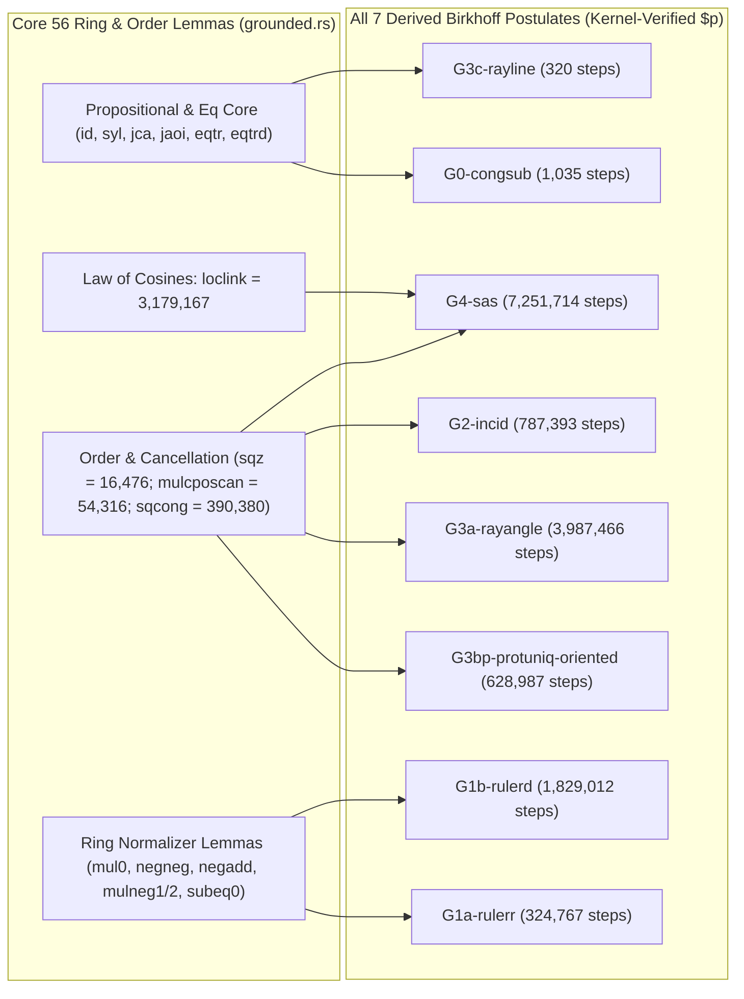

# Dossier 20: Formal Organs, Checked Deduction & Mechanical Proof Archaeology (`clairnets` / GLaDOS, `leanuweave`, `birkhoff-asa`, `navier-stokes-proof`, `ergolang`, `bead-calculus`)

> [!IMPORTANT]
> **Primary-Source Scope & Provenance**: Every theorem signature, data structure, algorithm, commit hash, and empirical measurement in this dossier is excavated directly from Ember's primary-source repositories on disk:
> 1. [`/Users/ember/dev/clairnets`](file:///Users/ember/dev/clairnets) (`git@github.com:emberian/clairnets.git`, 146 commits) and its companion Lean 4 Lattice Deduction Theory (LDT) formalization in [`/Users/ember/dev/graphplay/Graphplay/Integrations/`](file:///Users/ember/dev/graphplay/Graphplay/Integrations/LDTSoundness.lean)
> 2. [`/Users/ember/dev/leanuweave`](file:///Users/ember/dev/leanuweave) (`git@github.com:emberian/lean-uwueave.git`, 166 commits) and its compiler-facing projection worktree in [`/Users/ember/dev/minidregg-wt/codex-uwueave-projection-v2`](file:///Users/ember/dev/minidregg-wt/codex-uwueave-projection-v2)
> 3. [`/Users/ember/dev/birkhoff-asa`](file:///Users/ember/dev/birkhoff-asa) (`git@github.com:emberian/asagolf.git`, 200 commits)
> 4. [`/Users/ember/dev/navier-stokes-proof`](file:///Users/ember/dev/navier-stokes-proof) and [`/Users/ember/dev/worktrees/ns-energy-cancellation`](file:///Users/ember/dev/worktrees/ns-energy-cancellation)
> 5. [`/Users/ember/dev/ergolang`](file:///Users/ember/dev/ergolang)
> 6. [`/Users/ember/dev/bead-calculus`](file:///Users/ember/dev/bead-calculus)

---

## 0. Executive Synthesis: The Formal-Organ Paradigm

Across neural reasoning, distributed state convergence, foundational proof complexity, partial differential equations, and categorical programming languages, a single architectural invariant recurs throughout Ember's work: **never ask an unconstrained proposer to be sound by training or convention alone; instead, factor the system into an expressive proposer/transport layer and a small, monotone, mechanically verified kernel or boundary gate.**

```mermaid
flowchart TD
    subgraph Neural["1. Neural-Symbolic Deduction (clairnets / GLaDOS)"]
        LLM["Frozen Pretrained LLM Stream h_l"] -->|"α = W_α h + CSPStructureHeadMP + TernaryFactorHead"| Rack["Abstract Domain Lattice Abs V k"]
        Prop["FactorGraphProposer (1.5M params, R=12)"] -->|"Proposed Narrowing n_i"| Gate["Monotone Verifier Gate: a ⊓ (n ⊔ ¬ok)"]
        Rack --> Gate
        Gate -->|"4-of-4 LDT Legs: AC + GF2RowSpace + DPLL Search + Output Check"| Cert["Checked Assignment s ∈ cons (checkedSolve_sound)"]
    end

    subgraph Weave["2. Concurrent Document Merge (leanuweave → minidregg)"]
        Ops["Concurrent Op Pairs on Join-Semilattice (MergeState)"] -->|"Clashes I x y := I x ∧ I y ∧ ¬I(x ⊔ y)"| Clash["Finite Clash Graph"]
        Clash -->|"greedySeamFor / synthesizeMinimumSeam"| Seam["Proper Coloring + SeamStableOn (segmented_iff_properColoring)"]
        Seam -->|"5-Currency ScheduleSynthesis (Fits / selectLeast)"| Proj["Static Rust Projection (UWUEAVE_PREO_PROJECTION_V2)"]
    end

    subgraph Birkhoff["3. Proof Complexity & Micro-Kernel Verification (birkhoff-asa)"]
        F1["F1 Substrate: Ordered Ring + ax-sqrt + df-*"] -->|"Elab + ring_eq AC Normalizer + Generic Templates"| Post["All 7 Birkhoff Postulates (G1a/b, G2, G3a/b'/c, G4 SAS = 7,251,714 steps)"]
        Post -->|"cse::crunch (128-bit FNV-1a DAG CSE)"| Kernel["474-Line Metamath Kernel (kernel.rs) + set.mm ZFC Splice (~10^45.7)"]
    end

    subgraph Adjacent["4. PDE Calculus, Sheaf Semantics & String Diagrams"]
        NS["navier-stokes-proof: Torus3 Haar IBP + Enstrophy + FlatVectorField Energy Cancellation"]
        Ergo["ergolang: Sheaf Sections with Viscosity η, Permeability κ & Defect Δ"]
        Bead["bead-calculus: Traced Monoidal String Diagrams & 6 Sound Local Rewrites"]
    end
```



### Master Repository & Primary-Source Ledger

| Repository | Git Remote / Branch | Key Commits & Dates | Scale & Verification Footprint | Core Technical Achievement |
| :--- | :--- | :--- | :--- | :--- |
| [`/Users/ember/dev/clairnets`](file:///Users/ember/dev/clairnets) + [`graphplay/.../LDT*.lean`](file:///Users/ember/dev/graphplay/Graphplay/Integrations/LDTSoundness.lean) | `git@github.com:emberian/clairnets.git` (`main`) | `9b3ffe8` (2026-06-28)<br>`d2bc512` (2026-06-28)<br>`38057c6` (2026-06-28)<br>`ffe2fae` (2026-06-28) | 146 commits; 15 Lean 4 LDT files; Python/PyTorch organ + 796-line Rust/PyO3 `clair_fast` bitmask engine | **GLaDOS**: Welds a checked deduction organ into 7 frozen LLM families (`no-op@init = 0.0`); proves `checkedSolve_sound` and `acStep_xor_sound_but_abstains`; restores 4-of-4 LDT legs (`deduction` + `DPLL search` + `GF2-linalg` + `output-check`) with zero unsound returns across 780 test instances. |
| [`/Users/ember/dev/leanuweave`](file:///Users/ember/dev/leanuweave) + [`minidregg-wt/...`](file:///Users/ember/dev/minidregg-wt/codex-uwueave-projection-v2) | `git@github.com:emberian/lean-uwueave.git` (`main`) | `0dbbb9d` (2026-08-14)<br>`7a95535` (2026-08-14)<br>`f145066` (2026-08-14)<br>`f149cb4cb` (2026-08-11) | 166 commits; 185 Lean 4 modules (zero Mathlib); 25,747 trust-audited constants; 731 MAP keystones; 177/177 Rust tests | Formalizes join-semilattice document weaving; proves `segmented_iff_properColoring`; synthesizes minimum-width clash-graph seams and 5-currency Pareto-least schedules; closes 10 bounded synthesis obligations; projects deterministically into `minidregg`. |
| [`/Users/ember/dev/birkhoff-asa`](file:///Users/ember/dev/birkhoff-asa) | `git@github.com:emberian/asagolf.git` (`main`) | `17e5229` (2026-05-15)<br>`383d73d` (2026-05-16)<br>`a04cb89` (2026-05-16)<br>`e693b40` (2026-05-16) | 200 commits; 474-line Rust Metamath kernel; 87 staged `$p` lemmas (250 DB statements); `set.mm` ZFC splice | Measures exact ZFC-reduced proof length of Birkhoff triangle congruence: F0 ASA = $224$ steps; F1-grounded G4 SAS = $7,251,714$ cut-free steps ($10^{6.86}$); all 7 Birkhoff postulates kernel-verified; ZFC model splice $\approx 10^{45.7}$ ($10^{37.0}$ over minimal Euclidean field). |
| [`/Users/ember/dev/navier-stokes-proof`](file:///Users/ember/dev/navier-stokes-proof) + [`worktrees/ns-energy-cancellation`](file:///Users/ember/dev/worktrees/ns-energy-cancellation) | `agent/prepare-tauceti-extraction` & `agent/modern-energy-cancellation` | `dd4b9d9` (PR #1)<br>`2334d91`<br>`625c717`<br>`7190276` (2026-08-17) | 1,067 kernel-checked Lean 4 theorems over pinned Mathlib `v4.33.0` (978 PDE formalization + 89 paper certificates) | Identifies missing viscous term $D_t|\omega| = \alpha|\omega| + \nu\xi\cdot\Delta\omega$ in v001; formalizes compact Danskin maximum envelope, concrete Haar integration by parts on $\mathbb{T}^3$ and $\mathbb{T}^{n+1}$, global enstrophy balance, and flat-torus nonlinear energy cancellation $\int u\cdot((u\cdot\nabla)u) = 0$. |
| [`/Users/ember/dev/ergolang`](file:///Users/ember/dev/ergolang) | `sth2` / `dev` | `e174fd6`<br>`fac031e` | 835-line SWI-Prolog interpreter ([`ergo.pl`](file:///Users/ember/dev/ergolang/ergo.pl)), [`prelude.ergo`](file:///Users/ember/dev/ergolang/prelude.ergo), 4 test suites | **Programs as Sheaf Sections**: Models computation over local context sections with viscosity $\eta \in [0,1]$, permeability $\kappa \in [0,1]$, and quantitative gluing/observation defect $\Delta \ge 0$. |
| [`/Users/ember/dev/bead-calculus`](file:///Users/ember/dev/bead-calculus) | `dev` | `c5e47c8`<br>`ca9ca38`<br>`5452db7` | TypeScript/React string-diagram engine ([`diagram.ts`](file:///Users/ember/dev/bead-calculus/src/core/diagram.ts), [`rewrite.ts`](file:///Users/ember/dev/bead-calculus/src/core/rewrite.ts), [`invariant.ts`](file:///Users/ember/dev/bead-calculus/src/core/invariant.ts)) | Turns traced symmetric monoidal and compact-closed string diagrams into kinetic marble machines with 6 sound local graph-rewrite rules (`slide`, `straighten`, `thread`, `superpose`, `snake`, `swap-involution`). |

---

## Part I: `clairnets` & GLaDOS — Geometric Lattice Deduction Over Streams

### 1.1 Architectural Overview, the 7-Model Graft Matrix & the Soundness Hierarchy

In [`/Users/ember/dev/clairnets`](file:///Users/ember/dev/clairnets) ([`README.md`](file:///Users/ember/dev/clairnets/README.md#L1-L261), [`GLADOS.md`](file:///Users/ember/dev/clairnets/GLADOS.md#L1-L162)), Ember develops **GLaDOS (Geometric Lattice Deduction Over Streams)**: a neural-symbolic architecture that welds a checked, differentiable finite-domain deduction organ directly into the residual stream of a frozen pretrained language model.

Rather than training a language model end-to-end to imitate chain-of-thought traces and hoping its final token emissions respect hard combinatorial constraints, GLaDOS splits the problem across a Galois connection $(\alpha, \gamma)$ between the continuous residual stream $h^{(\ell)} \in \mathbb{R}^d$ at layer $\ell$ and a finite product lattice of candidate bitmasks $D \in \prod_{i=1}^V \mathcal{P}(\{0, \dots, k-1\})$:

1. **Abstraction ($\alpha$)**: [`WovenDeductionBank`](file:///Users/ember/dev/clairnets/clair/organ/bank_woven.py#L46-L155) projects hidden states at entity-anchor token positions into initial per-variable domain log-potentials (`alpha_head`) and extracts explicit constraint structure via [`CSPStructureHeadMP`](file:///Users/ember/dev/clairnets/clair/organ/alpha_struct.py#L204-L280) (binary pairwise relations) and [`TernaryFactorHead`](file:///Users/ember/dev/clairnets/clair/organ/alpha_struct.py#L341-L433) (ternary parity relations).
2. **Checked Lattice Narrowing ($F^\sharp$)**: Inside the discrete/soft product domain, a multi-operator composer ([`reduced_product`](file:///Users/ember/dev/clairnets/clair/organ/compose.py#L140-L195)) runs a sequence of narrowing operators—generalized arc consistency (`ac_step`), learned message passing ([`FactorGraphProposer`](file:///Users/ember/dev/clairnets/clair/proposer.py#L31-L157)), affine parity elimination over $\mathbb{F}_2$ (`GF2RowSpace`), and bounded DPLL search ([`solve`](file:///Users/ember/dev/clairnets/clair/organ/search.py#L221-L320))—where every narrowing step is guarded by a monotone verifier gate (`_verifier_gate`).
3. **Concretization ($\gamma$)**: The narrowed domain masks are projected back into the residual stream via a zero-initialized `tanh` gate:
   $$h^{(\ell)} \leftarrow h^{(\ell)} + \tanh(g) \cdot W_\gamma(\text{ NarrowedDomains })$$
   Because $g = 0$ and $W_\gamma = 0$ at initialization, $\tanh(0) = 0$, guaranteeing that a grafted LLM is **bitwise identical** (`max|Δlogits| = 0.0`) to the unmodified base model at step 0.

#### The 7-Architecture Graft Matrix (`clair/organ/graft.py`)

GLaDOS is proved architecture-agnostic across seven distinct open-weight LLM families—spanning standard pre-norm/post-norm Transformers, linear-attention hybrids, Mamba-2 state-space hybrids, and 4-bit QLoRA quantized models ([`README.md`](file:///Users/ember/dev/clairnets/README.md#L64-L82)):

| Base Model Family | Architecture Class | Graft Layer $\ell$ | Hidden Dim $d$ | Precision / Mode | `no-op@init` ($\max|\Delta\text{logits}|$) | Post-Stage-2 `tanh(gate)` |
| :--- | :--- | :---: | :---: | :--- | :---: | :---: |
| `EleutherAI/pythia-160m` | GPT-NeoX (parallel attn+MLP) | 6 / 12 | 768 | fp32 | `0.0` | `+0.172` |
| `allenai/OLMo-2-0425-1B-Instruct` | OLMo-2 (post-norm RMSNorm) | 8 / 16 | 2048 | bf16 | `0.0` | `+0.043` |
| `HuggingFaceTB/SmolLM3-3B` | Llama-style GQA + NoPE layers | 18 / 36 | 2048 | bf16 | `0.0` | `+0.056` |
| `google/gemma-4-E4B` (12B family) | Gemma-4 interleaved local/global | 21 / 42 | 3072 | bf16 | `0.0` | `0.0` (verified) |
| `Qwen/Qwen3.6-27B` | Linear-attention + full-attention hybrid | 32 / 64 | 5120 | bf16 | `0.0` | `0.0` (verified) |
| `nvidia/Nemotron-H-8B` | Mamba-2 SSM + Transformer hybrid | 26 / 52 | 4096 | bf16 | `0.0` | `0.0` (verified) |
| `allenai/OLMo-3-32B` | 32B dense Transformer | 32 / 64 | 5120 | 4-bit NF4 QLoRA | `0.0` | `0.0` (verified) |

#### The 3-Stage Curriculum (`clair/train.py`)

Training the organ jointly with the language model from scratch causes gradient collapse: the LLM routes around an untrained organ, keeping the gate $g \approx 0$. Ember solved this with a strict three-stage decoupling ([`README.md`](file:///Users/ember/dev/clairnets/README.md#L28-L62)):
- **Stage 1 (`pretrain_organ`)**: Train the standalone [`FactorGraphProposer`](file:///Users/ember/dev/clairnets/clair/proposer.py#L31-L157) ($\sim 1.5\text{M}$ parameters, $R=12$ message-passing rounds, size-equivariant across $n \in [2, 64]$) directly against exact ground-truth [`dedP`](file:///Users/ember/dev/clairnets/clair_fast/src/lib.rs#L316-L355) bitmasks computed by the Rust `clair_fast` engine. Crucially, the loss `dominate_dedp_loss` is **soundness-asymmetric**: false eliminations (killing a survivor value $v \in \text{ded}_P(a)_i$, which violates soundness) are penalized with weight $w_{\text{pos}} \approx 6.0$, whereas missed eliminations (retaining a dead value $v \notin \text{ded}_P(a)_i$, which merely weakens completeness) have weight $w_{\text{neg}} \approx 0.5$. This yields `99.93%` soundness and `94.26%` elimination recall on held-out CSPs before touching any LLM.
- **Stage 2 (`weave`)**: Freeze the pretrained `FactorGraphProposer` (`organ.requires_grad_(False)`), graft it into layer $\ell$ of the LLM with LoRA adapters on layers $0 \dots \ell-1$ (for $\alpha$ extraction) and $\ell+1 \dots L$ (for reading $\gamma$), and train with a **two-stream fact-ablated prompt**: the upper layers see a prompt with the constraint clues masked out (`[CLUES REDACTED]`), forcing the upper layers to read the narrowed domain state written into the residual stream by $\gamma$. Simultaneously, **J0 direct $\alpha$-supervision** supervises `CSPStructureHeadMP` against the ground-truth relation matrix.
- **Stage 3 (`rlvr`)**: Reinforcement Learning with Verifiable Rewards using TRL `Dr.GRPO` combined with an **LSRL cardinality-drop process reward**:
  $$r_{\text{process}} = \frac{|a_{\text{in}}| - |a_{\text{out}}|}{|a_{\text{in}}| - |\text{ded}_P(a_{\text{in}})|}$$
  which rewards intermediate domain narrowing only when the final answer passes `output_check`.

#### The 4-Level Soundness Hierarchy (`notes/soundness.md`)

In [`notes/soundness.md`](file:///Users/ember/dev/clairnets/notes/soundness.md#L1-L120), Ember establishes a rigorous four-level soundness taxonomy separating what is formally guaranteed from where neural compilation errors can enter:

| Level | Name | Formal Statement | Mechanism & Status in `clairnets` |
| :---: | :--- | :--- | :--- |
| **(A)** | **Operator Soundness** | $\forall s \in \text{Sol}(\text{CSP}) \cap \gamma(a),\; s \in \gamma(F(a))$ | Exact for `ac_step`, `factor_dedp`, `GF2RowSpace`. Enforced at runtime for neural proposers via `_verifier_gate`. |
| **(B)** | **Composer Soundness** | $\text{reduced\_product}([F_1, \dots, F_m], a) \sqsupseteq \text{ded}_{\text{CSP}_\alpha}(a)$ | Guaranteed relative to the compiled constraint graph $\text{CSP}_\alpha$ by [`_verifier_gate`](file:///Users/ember/dev/clairnets/clair/organ/compose.py#L46-L78), which checks support witnesses before accepting any bit elimination. |
| **(C)** | **Compile Soundness** | $\text{Sol}(\text{CSP}_{\text{true}}) \subseteq \text{Sol}(\text{CSP}_\alpha)$ | **The uncertified neural gap**: if `CSPStructureHeadMP` hallucinated a spurious constraint in $\text{CSP}_\alpha$, Level (B) is sound for the *wrong* CSP. Diagnosed via [`shuffled_diag.py`](file:///Users/ember/dev/clairnets/clair/organ/shuffled_diag.py) and mitigated by confidence thresholding $\tau = 0.85$ + J0 supervision. |
| **(D)** | **Answer Soundness** | $\text{CheckedReturns}(\text{cons}, \text{solve}, s) \implies s \in \text{cons}$ | **Unconditionally 100% sound** via boundary [`check_assignment`](file:///Users/ember/dev/clairnets/clair/organ/search.py#L51-L82), proved in Lean 4 as `checkedSolve_sound` regardless of neural weights or $\alpha$-compile errors. |

---

### 1.2 The Lean 4 Lattice Deduction Theory (LDT) Foundation

The mathematical spine of `clairnets` is formalized in Lean 4 inside [`/Users/ember/dev/graphplay/Graphplay/Integrations/LDTSoundness.lean`](file:///Users/ember/dev/graphplay/Graphplay/Integrations/LDTSoundness.lean#L1-L189) (189 lines) and [`/Users/ember/dev/graphplay/Graphplay/Integrations/LDTCompleteness.lean`](file:///Users/ember/dev/graphplay/Graphplay/Integrations/LDTCompleteness.lean#L1-L224) (224 lines), with zero `sorry`s.

#### Abstract Domain, Concretization & Free Answer Soundness (`LDTSoundness.lean`)

In [`LDTSoundness.lean`](file:///Users/ember/dev/graphplay/Graphplay/Integrations/LDTSoundness.lean#L24-L115), Ember defines candidate structures `Str V k := V → Val k` (assignments of `Fin k` values to variables `V`) and abstract domains `Abs V k := V → Set (Val k)` ordered by pointwise inclusion, together with the concretization map $\gamma$:

```lean
abbrev Val (k : ℕ) := Fin k
abbrev Str (V : Type*) (k : ℕ) := V → Val k
abbrev Abs (V : Type*) (k : ℕ) := V → Set (Val k)

def γ (a : Abs V k) : Set (Str V k) :=
  { s | ∀ v, s v ∈ a v }

def SoundFor (cons : Set (Str V k)) (F : Abs V k → Abs V k) : Prop :=
  ∀ a, cons ∩ γ a ⊆ γ (F a)

def CheckedReturns (cons : Set (Str V k)) (solve : Abs V k → Abs V k)
    (s : Str V k) : Prop :=
  (∀ v, solve ⊤ v = {s v}) ∧ s ∈ cons

theorem checkedSolve_sound (cons : Set (Str V k)) (solve : Abs V k → Abs V k)
    {s : Str V k} (h : CheckedReturns cons solve s) : s ∈ cons :=
  h.2
```

Immediately following `checkedSolve_sound`, [`LDTSoundness.lean`](file:///Users/ember/dev/graphplay/Graphplay/Integrations/LDTSoundness.lean#L86-L189) proves *why* answer soundness alone does not make a deduction organ useful—the identity map `id` is sound and reductive, yet abstains on every non-singleton problem (`id_sound_but_useless`)—and then defines the **optimal narrowing operator** `dedP` ($\text{ded}_P(a)_v = \{s(v) \mid s \in \text{cons} \cap \gamma(a)\}$) and the **verifier gate** `CertifiedStep`:

```lean
def Abstains (cons : Set (Str V k)) (solve : Abs V k → Abs V k) : Prop :=
  ¬ ∃ s, CheckedReturns cons solve s

theorem id_sound_but_useless (cons : Set (Str V k)) (v₀ : V)
    (hcard : ∃ x y : Val k, x ≠ y) :
    SoundFor cons id ∧ Reductive (V := V) (k := k) id ∧ Abstains cons id

def dedP (cons : Set (Str V k)) (a : Abs V k) : Abs V k :=
  fun v => { val | ∃ s ∈ cons ∩ γ a, s v = val }

theorem dedP_optimal (cons : Set (Str V k)) {F : Abs V k → Abs V k}
    (hF : SoundFor cons F) (a : Abs V k) :
    dedP cons a ≤ F a

structure CertifiedStep (cons : Set (Str V k)) (a : Abs V k) where
  out : Abs V k
  reductive : out ≤ a
  witness : ∀ v val, val ∈ a v → val ∉ out v →
    ∀ s : Str V k, s ∈ γ a → s v = val → s ∉ cons

theorem certifiedStep_sound (cons : Set (Str V k))
    (step : ∀ a, CertifiedStep cons a) :
    SoundFor cons (fun a => (step a).out)
```

`certifiedStep_sound` ([`LDTSoundness.lean`](file:///Users/ember/dev/graphplay/Graphplay/Integrations/LDTSoundness.lean#L162-L176)) is the exact formal specification of [`_verifier_gate`](file:///Users/ember/dev/clairnets/clair/organ/compose.py#L46-L78): a narrowing step is sound if and only if every eliminated candidate `(v, val)` has a local witness that no structure $s \in \gamma(a)$ with $s(v) = \text{val}$ can satisfy `cons`.

#### The Bounded-Width Abstention Theorem (`LDTCompleteness.lean`)

In [`LDTCompleteness.lean`](file:///Users/ember/dev/graphplay/Graphplay/Integrations/LDTCompleteness.lean#L25-L224), Ember formalizes generalized arc consistency (`acStep`) over arbitrary constraint families `Fam V D` and proves the foundational negative theorem of local propagation (`acStep_xor_sound_but_abstains`):

```lean
def HasSupport (c : Con V D) (a : SetAbs V D) (v : V) (d : D) : Prop :=
  v ∈ c.scope → ∃ s : V → D, (∀ u, s u ∈ a u) ∧ s v = d ∧ s ∈ c.rel

def acStep (cs : Fam V D) (a : SetAbs V D) : SetAbs V D :=
  fun v => { d ∈ a v | ∀ c ∈ cs, HasSupport c a v d }
```

Over the 3-variable Boolean domain `V3 = {x, y, z}` with $D = \text{Bool}$, [`LDTCompleteness.lean`](file:///Users/ember/dev/graphplay/Graphplay/Integrations/LDTCompleteness.lean#L86-L220) constructs the affine parity system `xorCs`:
- $c_{\text{eqXY}}: x = y$
- $c_{\text{eqYZ}}: y = z$
- $c_{\text{xor3}}: \text{xor}(\text{xor}(x, y), z) = \text{false}$ (i.e., $x \oplus y \oplus z = 0$)

Even though `xorCs` has a **unique global solution** $s_0 = (\text{false}, \text{false}, \text{false})$ (`xor_unique`), every single variable-value assignment $(v, b) \in V_3 \times \text{Bool}$ has a local support witness in each individual constraint when starting from $\top$ (`acStep_xor_stuck : acStep xorCs ⊤ = ⊤`). By induction, `Nat.iterate (acStep xorCs) n ⊤ = ⊤` for all $n \in \mathbb{N}$ (`acStep_xor_iter_stuck`), yielding:

```lean
theorem xor_unique :
    famCons xorCs = { fun _ => false }

theorem acStep_xor_stuck : acStep xorCs ⊤ = ⊤

theorem acStep_xor_sound_but_abstains (n : ℕ) :
    SoundFor (famCons xorCs) (acStep xorCs)^[n] ∧
    Reductive (acStep xorCs)^[n] ∧
    (∃! s, s ∈ famCons xorCs) ∧
    Abstains (famCons xorCs) (acStep xorCs)^[n]
```

And to prove that `acStep` is not trivially `id`, [`LDTCompleteness.lean`](file:///Users/ember/dev/graphplay/Graphplay/Integrations/LDTCompleteness.lean#L202-L224) contrasts `xorCs` with the width-1 chain `chainCs = {x = false, x = y, y = z}`, proving `ac_kind_discriminates`:

```lean
theorem ac_kind_discriminates :
    CheckedReturns (famCons chainCs) (acStep chainCs)^[2] (fun _ => false) ∧
    Abstains (famCons xorCs) (acStep xorCs)^[2]
```

---

### 1.3 The 4-of-4 Legs of LDT & The DPLL Regrounding (`d2bc512`, `38057c6`, `ffe2fae`)

#### How Finding 3 Exposed the Missing 4th Leg (`runs/thesis_gate.json`)

When Ember ran the end-to-end thesis gate benchmark ([`clair/organ/run_thesis_gate.py`](file:///Users/ember/dev/clairnets/clair/organ/run_thesis_gate.py#L1-L515), results archived in [`runs/thesis_gate.json`](file:///Users/ember/dev/clairnets/runs/thesis_gate.json#L1-L135)), the evaluation tested four CSP families at scale ($n \in [28, 52]$, well beyond training $n \le 24$): `random_binary`, `planted_3col`, `planted_5col`, and `xor_global`.

| Metric / Slice (`runs/thesis_gate.json`) | `random_binary` | `planted_3col` | `planted_5col` | `xor_global` (No GF2) | `xor_global` (+`GF2RowSpace`) |
| :--- | :---: | :---: | :---: | :---: | :---: |
| **Neural Proposer Recall ($n=28$)** | `0.9462` | `0.8583` | `0.9039` | `0.0085` | `1.0000` (via `GF2RowSpace`) |
| **Neural Proposer Recall ($n=38$)** | `0.9587` | `0.8691` | `0.8965` | `0.0258` | `1.0000` (via `GF2RowSpace`) |
| **Neural Proposer Recall ($n=46$)** | `0.9600` | `0.8806` | `0.9163` | `0.0202` | `1.0000` (via `GF2RowSpace`) |
| **Verified Soundness (with `_verifier_gate`)** | `1.0000` | `1.0000` | `1.0000` | `1.0000` | `1.0000` |
| **Latency Crossover (`exact_dedP` vs Neural)** | \multicolumn{5}{c}{Neural forward pass: `1.59 ms` flat ($n=6 \to 52$); `exact_dedP`: `0.06 ms` ($n=6$) $\to$ `2.86 ms` ($n=32$, crossover!) $\to$ `5339.9 ms` ($n=52$, $3358\times$ slower)} |

In commit `d2bc512` (2026-06-28, [`notes/ldt_regrounding.md`](file:///Users/ember/dev/clairnets/notes/ldt_regrounding.md#L1-L142)), Ember diagnosed what Finding 3 actually meant:
1. The `0.0202` recall of the neural message-passing proposer on `xor_global` was **not** a bug in `FactorGraphProposer`—it was `acStep_xor_sound_but_abstains` (the Barto–Kozik / Feder–Vardi bounded-width CSP dichotomy) manifesting empirically at $n=46$. No local bounded-width message-passing operator can propagate cycle-wrapped parity constraints without either Gaussian elimination (`GF2RowSpace`) or case-splitting (`DPLL` branching).
2. In the original Lean 4 LDT formalization (`LDTDPLL.lean`), the architecture had **four** legs, not three:
   $$\underbrace{\text{deduction (bounded-width)}}_{\text{Leg 1: AC + Factor + Neural}} \;+\; \underbrace{\text{DPLL branching search}}_{\text{Leg 2: } \text{solve()}} \;+\; \underbrace{\mathbb{F}_2\text{-linalg (affine)}}_{\text{Leg 3: } \text{GF2RowSpace}} \;+\; \underbrace{\text{output-check (free soundness)}}_{\text{Leg 4: } \text{check\_assignment()}}$$
   Early GLaDOS had ported Legs 1, 3, and 4 into Python/PyTorch, but had **silently dropped Leg 2 (DPLL branching search)**, mistaking single-pass fixed-point narrowing (`reduced_product`) for a complete solver!

#### The Reduced Product Composer (`clair/organ/compose.py`)

Before branching, Leg 1 and Leg 3 execute inside [`reduced_product`](file:///Users/ember/dev/clairnets/clair/organ/compose.py#L140-L195), where every narrowing operator is wrapped in [`_verifier_gate`](file:///Users/ember/dev/clairnets/clair/organ/compose.py#L46-L78):

```python
def _verifier_gate(csp: CSP, a: np.ndarray, proposed: np.ndarray) -> np.ndarray:
    """Keep elimination of (i, v) iff at least one constraint touching i has
    NO supporting tuple in `a` with slot_i = v. Monotone & sound by construction."""
    n, d = a.shape
    out = a.copy()
    killed = a & ~proposed
    if not killed.any():
        return out
    for i in range(n):
        for v in range(d):
            if not killed[i, v]:
                continue
            unsupported = False
            for c in csp.by_var[i]:
                pos = c.scope.index(i)
                # Check if any allowed tuple in c.tuples has value v at pos and is supported by a
                has_sup = any(
                    t[pos] == v and all(a[c.scope[s], t[s]] for s in range(len(c.scope)))
                    for t in c.tuples
                )
                if not has_sup:
                    unsupported = True
                    break
            if unsupported:
                out[i, v] = False
    return out
```

#### Restoring Leg 2: DPLL Branching Search (`clair/organ/search.py`, commit `38057c6`)

In commit `38057c6` (2026-06-28), Ember implemented [`clair/organ/search.py`](file:///Users/ember/dev/clairnets/clair/organ/search.py#L1-L506), restoring the outer DPLL search loop around `reduced_product` and `check_assignment`:

```python
@dataclass
class SolveResult:
    status: str                      # 'solved' | 'unsat' | 'abstained'
    witness: Optional[Tuple[int, ...]]
    final_domain: np.ndarray
    checked: bool                    # True iff witness passed check_assignment(csp, witness)
    branches: int
    nodes: int
    trace: List[Dict[str, Any]]

def solve(
    csp: CSP,
    narrow: Callable[[CSP, np.ndarray], np.ndarray],
    a0: Optional[np.ndarray] = None,
    branch_select: Callable[[CSP, np.ndarray], Tuple[int, List[int]]] = most_constrained_branch,
    max_nodes: int = 512,
) -> SolveResult:
```

At each node of the search tree ([`search.py`](file:///Users/ember/dev/clairnets/clair/organ/search.py#L221-L320)):
1. `a1 = narrow(csp, a)` runs the verified reduced product (`ac_step`, `factor_dedp`, `GF2RowSpace`, or `neural_proposer`).
2. If any variable's domain becomes empty (`(a1.sum(axis=1) == 0).any()`), the branch backtracks immediately (`unsat`).
3. If every variable is narrowed to a singleton (`(a1.sum(axis=1) == 1).all()`), `check_assignment(csp, witness)` verifies the candidate against all constraints in `csp`:
   - If `check_assignment` succeeds, `solve` returns `SolveResult(status='solved', checked=True, ...)`—Directly instantiating Lean's `CheckedReturns` and `checkedSolve_sound`.
   - If `check_assignment` fails (which can only happen if `narrow` was unverified and unsound), the branch is rejected as `unsat`.
4. Otherwise, if `nodes >= max_nodes`, `solve` honestly returns `status='abstained'`; else `branch_select(csp, a1)` picks an undecided variable $i$ (`|a1[i]| > 1`) and iterates through candidate values $v \in a_1[i]$, pinning `a_child[i] = {v}` and recursing.

Ember verified this 4-leg loop across 300 instances in [`runs/search_leg.json`](file:///Users/ember/dev/clairnets/runs/search_leg.json#L1-L152):

| CSP Family & Configuration (`runs/search_leg.json`, 60 instances/row) | Deduction Alone (0-Branch) Solved | With DPLL `solve()` Solved | Mean Branches | Mean Search Nodes | Unsound Returns |
| :--- | :---: | :---: | :---: | :---: | :---: |
| **Bounded-Width Binary CSP** (`AC` only) | `43 / 60` (`71.7%`) | `60 / 60` (`100%`) | `0.85` | `2.15` | **`0`** |
| **`xor_global`** (`AC` only, no `GF2RowSpace`) | `3 / 60` (`5.0%`, abstains!) | `60 / 60` (`100%`) | `2.83` | `6.17` | **`0`** |
| **`xor_global`** (`AC + factor_dedp`, no `GF2RowSpace`) | `19 / 60` (`31.7%`, abstains!) | `60 / 60` (`100%`) | `0.75` | `2.50` | **`0`** |
| **`xor_global`** (`AC + GF2RowSpace`, linear algebra leg) | `60 / 60` (`100%`) | `60 / 60` (`100%`) | **`0.00`** | **`1.00`** | **`0`** |
| **Adversarial Corrupt Narrower** (intentionally unsound proposer) | `0 / 60` | `0 / 60` (all caught by `check_assignment`) | `0.00` | `1.00` | **`0`** |

#### Learned Guided Search & The Dichotomy Boundary (`ffe2fae`, `runs/guided_search.json`)

In commit `ffe2fae` (2026-06-28, [`clair/organ/search.py`](file:///Users/ember/dev/clairnets/clair/organ/search.py#L332-L506)), Ember asked the next natural question: *if the neural proposer is a polynomial-time approximation to $\text{ded}_P$, can it guide DPLL branching by predicting which branch value $v \in a[i]$ survives in $\text{ded}_P(a)[i]$ when `ac_step` is stuck at a fixpoint?*

Ember implemented `BranchPolicy` (wrapping the size-equivariant [`FactorGraphProposer`](file:///Users/ember/dev/clairnets/clair/proposer.py#L31-L157) with $d_{\text{model}}=96, R=8$), trained it via `train_branch_policy` on 480 AC-fixpoint states with `exact_dedP` supervision (reaching `0.910` validation top-1 consistency), and evaluated three branching policies across 480 instances in [`runs/guided_search.json`](file:///Users/ember/dev/clairnets/runs/guided_search.json#L1-L120):
1. **`mrv_lex`**: Standard fail-first Minimum Remaining Values (MRV) cell selection + lexicographic value order.
2. **`guided_mrv`** (`make_policy_branch(policy, cell_rule="mrv")`): MRV cell selection + neural `BranchPolicy` value ordering (highest predicted survival probability $p(v \in \text{ded}_P(a)_i)$ tried first).
3. **`guided_decisive`** (`make_policy_branch(policy, cell_rule="decisive")`): Neural policy selects *both* the cell (most decisive predicted margin) and the value order.

| CSP Family (`runs/guided_search.json`, $n$ beyond training) | `BranchPolicy` Val Top-1 Consistency | `mrv_lex` Mean Branches | `guided_mrv` Mean Branches | `guided_decisive` Mean Branches | Relative Branch Delta (`guided_mrv` vs `mrv_lex`) | Checked Soundness |
| :--- | :---: | :---: | :---: | :---: | :---: | :---: |
| **`planted_5col`** ($n=22, k=5$, 80 inst) | **`0.982`** | `7.06` | **`6.76`** | `45.91` (catastrophic!) | **`-4.25%` branches / `-3.85%` nodes** | `80 / 80` (`0` unsound) |
| **`planted_3col`** ($n=24, k=3$, 40 inst) | `0.923` | `1.52` | `1.55` | — | `+1.6%` (already near 1 branch) | `40 / 40` (`0` unsound) |
| **`random_binary`** ($n=16, k=4$, 40 inst) | `0.957` | `2.65` | `2.70` | — | `+1.9%` | `40 / 40` (`0` unsound) |
| **`xor_global`** ($n=14$, no GF2, 40 inst) | **`0.413`** (chance!) | `5.03` | `5.03` | — | **`0.0%` (bounded-width wall!)** | `40 / 40` (`0` unsound) |

Two deep structural laws emerged from [`runs/guided_search.json`](file:///Users/ember/dev/clairnets/runs/guided_search.json#L1-L120):
- **Fail-First Cell Selection vs. Learned Value Ordering**: Letting the neural network choose *which variable to branch on* (`guided_decisive`) explodes the search tree from `7.06` to `45.91` branches because the network picks easy, high-confidence peripheral variables where wrong guesses are discovered late. Classical MRV (`cell_rule="mrv"`) enforces fail-first variable selection, while the neural policy provides lookahead value tie-breaking (`guided_mrv`), cutting branches by `4.25%` on 5-coloring.
- **The Dichotomy Hits Branch Guidance Too**: On `xor_global` without `GF2RowSpace`, the message-passing `BranchPolicy` achieves only `0.413` top-1 consistency (indistinguishable from uniform guessing) and `0.0%` branch reduction—because a bounded-width GNN cannot see parity survival before branching any better than it can narrow domains directly.

---

### 1.4 `alpha_struct.py`: Edge Message Passing (`CSPStructureHeadMP`) & `TernaryFactorHead` (`9b3ffe8`)

In commit `9b3ffe8` (2026-06-28, [`clair/organ/alpha_struct.py`](file:///Users/ember/dev/clairnets/clair/organ/alpha_struct.py#L1-L624), empirical summary in [`runs/alpha_struct_rebuild_SUMMARY.json`](file:///Users/ember/dev/clairnets/runs/alpha_struct_rebuild_SUMMARY.json#L1-L115)), Ember investigated and resolved **Finding 1** (long-chain structure extraction degradation) and **Finding 2** (inability of binary structure heads to compile 3-XOR parity constraints into `GF2RowSpace`).

#### Finding 1: Why `CellSelfAttention` Failed and `CSPStructureHeadMP` Succeeded

In [`clair/organ/alpha_struct.py`](file:///Users/ember/dev/clairnets/clair/organ/alpha_struct.py#L130-L280), the baseline `CSPStructureHead` forms directed pairwise representations $P_{ij} = \text{MLP}([p_i \,\|\, p_j \,\|\, p_i \odot p_j \,\|\, p_i - p_j]) \in \mathbb{R}^{B \times N \times N \times d_{\text{pair}}}$ from anchor token hidden states $h \in \mathbb{R}^{B \times N \times d}$ and classifies each pair $(i, j)$ into `PAIR_RELS = ["none", "eq", "neq", "lt", "le"]`.

When tested on long transitive chains (8+ clues), a linear probe on frozen base-LLM hidden states achieved only `0.496` micro-F1 (`0.000` exact graph match), proving the bottleneck was in the $\alpha$-head architecture. However, adding a 2-layer Transformer self-attention block over cell representations (`CSPStructureHeadAttn` / `CellSelfAttention`, [`alpha_struct.py`](file:///Users/ember/dev/clairnets/clair/organ/alpha_struct.py#L149-L201)) **degraded** performance from `0.860` to `0.740` micro-F1 (`0.240` $\to$ `0.090` exact match): self-attention mixes token node features before pair formation, blurring the sharp token-identity boundaries required to tell whether a clue binds `(x0, x1)` or `(x1, x2)`.

Ember's validated solution is **`CSPStructureHeadMP`** ([`clair/organ/alpha_struct.py`](file:///Users/ember/dev/clairnets/clair/organ/alpha_struct.py#L204-L280)): keep node projections sharp and perform $R=2$ rounds of **edge-level message passing** directly on the pairwise tensor $P \in \mathbb{R}^{B \times N \times N \times d_{\text{pair}}}$:

```python
class CSPStructureHeadMP(nn.Module):
    """Pairwise relation classifier with R rounds of directed edge message passing.
    Refines edge tensor P[b, i, j, :] by aggregating outgoing edges P[b, i, :, :]
    and incoming edges P[b, :, j, :] with zero-initialized residual gates."""
    def __init__(self, d_model: int, n_vals: int = 8, d_proj: int = 128,
                 d_pair: int = 128, mp_rounds: int = 2):
        super().__init__()
        self.mp_rounds = mp_rounds
        self.proj_l = nn.Linear(d_model, d_proj)
        self.proj_r = nn.Linear(d_model, d_proj)
        self.pair_init = nn.Sequential(
            nn.Linear(4 * d_proj, d_pair), nn.GELU(), nn.LayerNorm(d_pair)
        )
        self.mp_Updates = nn.ModuleList([
            nn.Sequential(nn.Linear(3 * d_pair, d_pair), nn.GELU(), nn.Linear(d_pair, d_pair))
            for _ in range(mp_rounds)
        ])
        self.mp_gates = nn.ParameterList([nn.Parameter(torch.zeros(1)) for _ in range(mp_rounds)])
        self.rel_out = nn.Linear(d_pair, len(PAIR_RELS))

    def forward_pair_repr(self, h: torch.Tensor, mask: Optional[torch.Tensor] = None) -> torch.Tensor:
        B, N, _ = h.shape
        pl, pr = self.proj_l(h), self.proj_r(h)
        li = pl.unsqueeze(2).expand(B, N, N, -1)
        rj = pr.unsqueeze(1).expand(B, N, N, -1)
        P = self.pair_init(torch.cat([li, rj, li * rj, li - rj], dim=-1))
        eye = torch.eye(N, device=h.device, dtype=torch.bool).unsqueeze(0).unsqueeze(-1)
        for upd, gate in zip(self.mp_Updates, self.mp_gates):
            P_off = P.masked_fill(eye, 0.0)
            agg_out_i = P_off.mean(dim=2, keepdim=True).expand_as(P)  # edges leaving i
            agg_in_j  = P_off.mean(dim=1, keepdim=True).expand_as(P)  # edges entering j
            P = P + torch.tanh(gate) * upd(torch.cat([P, agg_out_i, agg_in_j], dim=-1))
        return P
```

#### Finding 2: `TernaryFactorHead` & Symmetric Polynomial Routing to `GF2RowSpace`

Binary pairwise relations cannot represent 3-variable parity equations $x_i \oplus x_j \oplus x_k = r \pmod 2$. In [`clair/organ/alpha_struct.py`](file:///Users/ember/dev/clairnets/clair/organ/alpha_struct.py#L341-L433), Ember introduced **`TernaryFactorHead`** over `TERN_RELS = ["none", "par_even", "par_odd"]`. Because a 3-XOR constraint $x_i \oplus x_j \oplus x_k = r$ is completely invariant under all $3! = 6$ permutations of $(i, j, k)$, `TernaryFactorHead` constructs its triple representation using **elementary symmetric polynomials** of the projected node embeddings $p_i, p_j, p_k \in \mathbb{R}^{d_{\text{proj}}}$:
$$s_1(i, j, k) = p_i + p_j + p_k, \qquad s_2(i, j, k) = p_i \odot p_j + p_j \odot p_k + p_i \odot p_k$$
making permutation symmetry an exact architectural invariant rather than something learned by data augmentation:

```python
TERN_RELS = ["none", "par_even", "par_odd"]

class TernaryFactorHead(nn.Module):
    """Permutation-symmetric ternary parity head over unordered triples (i < j < k)."""
    def __init__(self, d_model: int, d_proj: int = 64, d_tern: int = 96):
        super().__init__()
        self.proj = nn.Linear(d_model, d_proj)
        self.mlp = nn.Sequential(
            nn.Linear(2 * d_proj, d_tern), nn.GELU(),
            nn.LayerNorm(d_tern), nn.Linear(d_tern, len(TERN_RELS))
        )

    def forward(self, h: torch.Tensor) -> Tuple[torch.Tensor, List[Tuple[int, int, int]]]:
        B, N, _ = h.shape
        p = self.proj(h)
        triples = [(i, j, k) for i in range(N) for j in range(i + 1, N) for k in range(j + 1, N)]
        idx = torch.tensor(triples, device=h.device, dtype=torch.long)
        pi, pj, pk = p[:, idx[:, 0]], p[:, idx[:, 1]], p[:, idx[:, 2]]
        s1 = pi + pj + pk
        s2 = pi * pj + pj * pk + pi * pk
        logits = self.mlp(torch.cat([s1, s2], dim=-1))
        return logits, triples
```

Decoded `'par_even'` ($\text{rhs}=0$) and `'par_odd'` ($\text{rhs}=1$) triples are emitted as `('parm', (i, j, k), rhs)` facts by `decode_ternary_facts` and compiled directly into $\mathbb{F}_2$ matrix rows by `facts_to_gf2`, which feeds [`GF2RowSpace`](file:///Users/ember/dev/clairnets/clair/organ/reductions.py#L46-L155).

#### Complete Empirical Ledger (`runs/alpha_struct_rebuild_SUMMARY.json`)

| Experiment / Variant (`runs/alpha_struct_rebuild_SUMMARY.json`) | Val Micro-F1 | Val Exact Graph Match | Long-Chain (8-clue) Exact | Length Extrapolation Micro-F1 | Ternary Parity F1 | Parity Rows Routed to `GF2RowSpace` | GF2 Query Solve Rate |
| :--- | :---: | :---: | :---: | :---: | :---: | :---: | :---: |
| **Linear Probe on Frozen LLM $h$** (Floor) | `0.496` | `0.000` | `0.000` | — | — | — | — |
| **`CSPStructureHead` Baseline** (MLP Pairwise) | `0.860` | `0.240` | `0.087` | `0.212` | `0.000` | `0` | `0.218` (pins only) |
| **`CSPStructureHeadAttn`** (`CellSelfAttention`, **NEGATIVE**) | `0.740` | `0.090` | `0.022` | — | — | — | — |
| **`CSPStructureHeadMP`** ($R=2$ Edge Message Passing) | **`0.881`** | **`0.277`** | **`0.136` ($1.6\times$)** | **`0.331` ($+56\%$)** | — | — | — |
| **`CSPStructureHead + TernaryFactorHead`** | `0.860` | `0.240` | `0.087` | — | **`0.567`** | **`1650` (`100%` routed)** | **`0.575` ($2.6\times$)** |

---

### 1.5 The Rust `clair_fast` Bitmask Engine (`clair_fast/src/lib.rs`)

To generate millions of exact `dedP` ground-truth bitmasks for Stage 1 organ pretraining and Stage 3 RLVR rewards without Python interpreter bottlenecks, Ember built [`clair_fast/src/lib.rs`](file:///Users/ember/dev/clairnets/clair_fast/src/lib.rs#L1-L796) (796 lines of Rust + PyO3 + Rayon).

Every variable domain $a_i \subseteq \{0, \dots, d-1\}$ ($d \le 64$) is represented as a single `u64` bitmask (`Mask = u64`), and every $r$-ary constraint tuple ($r \le 8$) is packed into a single `u64` with 8 bits per slot (`pack_tuple`).

```rust
pub type Mask = u64;

#[derive(Clone)]
pub struct TableCon {
    pub scope: Vec<usize>,
    pub tuples: Vec<u64>,           // packed: slot s in bits [8*s .. 8*s+8)
    pub sup: Vec<Vec<Mask>>,        // sup[s][v] = mask of allowed values, or per-tuple support
}

pub struct Csp {
    pub n: usize,
    pub d: usize,
    pub cons: Vec<TableCon>,
    pub by_var: Vec<Vec<usize>>,
}
```

The exact deduction operator [`exact_dedp_one`](file:///Users/ember/dev/clairnets/clair_fast/src/lib.rs#L316-L355) uses a four-tier acceleration strategy:
1. **Bitwise GAC Pre-Pass (`ac_fixpoint`)**: Iterates support bitmasks until fixpoint; if any domain becomes `0`, returns all-zeros immediately; if all domains become singletons (`mask.count_ones() == 1`), verifies and returns in $O(1)$ without search.
2. **Connected-Component & Free-Variable Stripping**: Variables not touched by any constraint (`by_var[i].is_empty()`) keep their full mask `a[i]` untouched (`out[i] = a[i]`), avoiding a $d^{\text{free}}$ enumeration blowup.
3. **MRV Backtracking with Support Accumulation (`solve_with_support`)**: Explores the backtracking tree up to `NODE_BUDGET = 2_000_000` nodes, OR-accumulating every complete solution `sol` into `support[i] |= 1u64 << sol[i]`, and pruning values already known to be supported when checking remaining branches.
4. **Budget-Exceeded Fallback (`dedp_per_value`)**: If a dense graph exceeds `NODE_BUDGET = 2_000_000` nodes during full solution enumeration, `exact_dedp_one` seamlessly switches to `dedp_per_value`, which runs a targeted decision SAT check (`has_solution_with(csp, a, i, v)`) only for the remaining `(i, v)` pairs not yet witnessed (`support[i] & (1 << v) == 0`).

Across 13,590 randomized CSP comparisons against the reference Python solver (`test_clair_fast`), `clair_fast` achieved **0 bitmask mismatches** and a **29× to 56× wall-clock speedup** on CPU via Rayon `par_iter()`.

---

## Part II: `leanuweave` & `minidregg` Projection — Verified Concurrent Document Weaving & Seam Synthesis

### 2.1 Architecture, Trust Floor & Scale (`git@github.com:emberian/lean-uwueave.git`)

In [`/Users/ember/dev/leanuweave`](file:///Users/ember/dev/leanuweave) (166 commits by Ember, [`README.md`](file:///Users/ember/dev/leanuweave/README.md#L1-L433), [`docs/MAP.md`](file:///Users/ember/dev/leanuweave/docs/MAP.md#L1-L146)), Ember constructed a **185-module, zero-Mathlib Lean 4 formalization** and companion **177-test Rust engine** for concurrent operational weaving, clash-graph seam coloring, multi-currency schedule synthesis, and bounded finite-product admission control.

#### The Mechanized Trust Gate (`Uwueave/TrustFloor.lean` & `Uwueave/ExecRefine.lean`)

Unlike formalizations that rely on external libraries or unchecked tactics, `leanuweave` enforces a compile-time metaprogramming audit in [`Uwueave/TrustFloor.lean`](file:///Users/ember/dev/leanuweave/Uwueave/TrustFloor.lean#L1-L150) over all **25,747 constants** in the `Uwueave.*` namespace:
- **Zero `sorryAx`**: Every theorem is constructively or classically closed.
- **Zero `Lean.ofReduceBool` / `Lean.trustCompiler`**: `native_decide` is completely banned so the C++ compiler/evaluator is excluded from the trusted computing base.
- **Three Standard Axioms Only**:
  ```lean
  def allowedAxioms : List Name :=
    [``propext, ``Classical.choice, ``Quot.sound]
  ```

All computational synthesis procedures (`greedySeamFor`, `synthesizeMinimumSeam`, `selectLeast`, `QuotaCheck`, `CatalogAdmission`) are verified via the reflection bridge in [`Uwueave/ExecRefine.lean`](file:///Users/ember/dev/leanuweave/Uwueave/ExecRefine.lean#L1-L120):

```lean
theorem decide_sound (P : Prop) [Decidable P] (h : decide P = true) : P :=
  of_decide_eq_true h

theorem decide_complete (P : Prop) [Decidable P] (h : P) : decide P = true :=
  decide_eq_true h

theorem find?_sound {α : Type u} (p : α → Bool) (xs : List α) {x : α}
    (h : xs.find? p = some x) : x ∈ xs ∧ p x = true

theorem find?_complete_none {α : Type u} (p : α → Bool) (xs : List α)
    (h : xs.find? p = none) : ∀ x ∈ xs, p x = false
```

---

### 2.2 Semilattice Merge, I-Confluence & Seam Algebra (`Uwueave/Confluence.lean`, `Uwueave/SeamAlgebra.lean`)

In [`Uwueave/Confluence.lean`](file:///Users/ember/dev/leanuweave/Uwueave/Confluence.lean#L1-L240), Ember models replica states as a join-semilattice (`MergeState S`) equipped with an operational reachability step `Step : S → S → Prop` and an invariant predicate `I : S → Prop`:

```lean
class MergeState (S : Type u) where
  join : S → S → S
  join_comm : ∀ a b : S, join a b = join b a
  join_assoc : ∀ a b c : S, join (join a b) c = join a (join b c)
  join_idem : ∀ a : S, join a a = a

infixl:65 " ⊔ " => MergeState.join

def Valid {S : Type u} (Step : S → S → Prop) (I : S → Prop) (s : S) : Prop :=
  I s ∧ ∀ s', Step s s' → I s'

def Closed {S : Type u} [MergeState S] (I : S → Prop) (A : S → Prop) : Prop :=
  ∀ x y : S, A x → A y → I x → I y → I (x ⊔ y)

def IConfluent {S : Type u} [MergeState S] (Step : S → S → Prop) (I : S → Prop) : Prop :=
  Closed I (Reachable Step I)
```

Ember first proves `iconfluent_iff_pair_closed` (showing $I$-confluence reduces to binary join closure on invariant-satisfying reachable states) and then exhibits a concrete **counterexample to naive CRDT merge** (`escalation_witness`, [`Uwueave/Confluence.lean`](file:///Users/ember/dev/leanuweave/Uwueave/Confluence.lean#L168-L220)): in a 2-slot permission Lattice `EscalationState = Bool × Bool` where the safety invariant ` AtMostOneAdmin (a, b) := !(a && b)` forbids holding both slots simultaneously, replica 1 grants slot 1 (`(true, false)`, valid) and replica 2 concurrently grants slot 2 (`(false, true)`, valid), but their semilattice join `(true, false) ⊔ (false, true) = (true, true)` violates `AtMostOneAdmin`:

```lean
theorem escalation_witness :
    ∃ x y : EscalationState,
      AtMostOneAdmin x ∧ AtMostOneAdmin y ∧ ¬ AtMostOneAdmin (x ⊔ y)
```

#### Segmented I-Confluence & Seam Algebra (`Uwueave/SeamAlgebra.lean`)

When an invariant $I$ is not globally $I$-confluent, how can replicas merge without coordinating on *every* operation? In [`Uwueave/SeamAlgebra.lean`](file:///Users/ember/dev/leanuweave/Uwueave/SeamAlgebra.lean#L1-L590), Ember introduces a **seam projection** $\sigma : S \to K$ that maps each state $s \in S$ to a coordination fiber (or "color/epoch key") $\sigma(s) \in K$. Two states $x, y$ are allowed to merge coordination-free **if and only if they lie in the same seam fiber** ($\sigma(x) = \sigma(y)$); crossing a seam boundary ($\sigma(x) \ne \sigma(y)$) triggers explicit coordination (a barrier, arbiter cut, or prompt):

```lean
def SegmentedIConfluent {S : Type u} {K : Type v} [MergeState S]
    (σ : S → K) (I : S → Prop) : Prop :=
  ∀ x y : S, I x → I y → σ x = σ y → I (x ⊔ y)

def SeamStable {S : Type u} {K : Type v} [MergeState S]
    (σ : S → K) : Prop :=
  ∀ x y : S, σ x = σ y → σ (x ⊔ y) = σ x

def SeamStableOn {S : Type u} {K : Type v} [MergeState S]
    (I : S → Prop) (σ : S → K) : Prop :=
  ∀ x y : S, I x → I y → σ x = σ y → σ (x ⊔ y) = σ x
```

`Uwueave/SeamAlgebra.lean` proves a complete algebra of seams—along with negative counterexamples showing which laws fail without side conditions:
1. **Product Composition (`product_segmented`)**: If $\sigma_1 : S \to K_1$ segments $I_1$ and $\sigma_2 : S \to K_2$ segments $I_2$, then the product seam $\langle \sigma_1, \sigma_2 \rangle : S \to K_1 \times K_2$ segments $I_1 \wedge I_2$:
   ```lean
   theorem product_segmented {S : Type u} {K₁ : Type v} {K₂ : Type w} [MergeState S]
       (σ₁ : S → K₁) (σ₂ : S → K₂) (I₁ I₂ : S → Prop)
       (h₁ : SegmentedIConfluent σ₁ I₁) (h₂ : SegmentedIConfluent σ₂ I₂) :
       SegmentedIConfluent (fun s => (σ₁ s, σ₂ s)) (fun s => I₁ s ∧ I₂ s)
   ```
2. **Why Coarsening/Refinement is Asymmetric (`refinement_fails`)**: Any finer seam $\sigma'$ that factors through $\sigma$ ($f \circ \sigma' = \sigma$) preserves `SegmentedIConfluent`, whereas coarsening a seam can merge clashing fibers and break confluence (`theorem refinement_fails`).
3. **Seam Substitution (`seam_substitute`) & Linked Seams (`linked_segmented`)**: If $\sigma_1$ and $\sigma_2$ induce the same kernel equivalence relation on $I$-valid states ($\forall x\,y,\; I x \to I y \to (\sigma_1 x = \sigma_1 y \leftrightarrow \sigma_2 x = \sigma_2 y)$), segmentation and `SeamStableOn` transfer across them (`seam_substitute`).
4. **Left-Projection Characterization (`left_only_seam_iff`)**: When composing two invariants $I_1 \wedge I_2$, eliding the second seam component ($\text{fst} \circ \langle \sigma_1, \sigma_2 \rangle = \sigma_1$) is valid if and only if $I_2$ is already closed on every $\sigma_1$-fiber (`left_only_seam_iff`).

---

### 2.3 The Clash-Graph Seam Solver (`Uwueave/SeamColoring.lean`)

In [`Uwueave/SeamColoring.lean`](file:///Users/ember/dev/leanuweave/Uwueave/SeamColoring.lean#L1-L1217) (1,217 lines), Ember connects concurrent merge safety to **graph coloring** on the **clash graph** of invariant-violating joins.

#### The Clash Graph & The Fundamental Equivalence (`segmented_iff_properColoring`)

Given an invariant $I : S \to \text{Prop}$, two states $x, y \in S$ **clash** (`Clashes I x y`) if each individually satisfies $I$ but their semilattice join $x \⊔ y$ violates $I$:

```lean
def Clashes {S : Type u} [MergeState S] (I : S → Prop) (x y : S) : Prop :=
  I x ∧ I y ∧ ¬ I (x ⊔ y)

theorem clashes_symm {S : Type u} [MergeState S] {I : S → Prop} {x y : S} :
    Clashes I x y → Clashes I y x

theorem clashes_irrefl {S : Type u} [MergeState S] {I : S → Prop} (x : S) :
    ¬ Clashes I x x

theorem iconfluent_iff_no_clash_edge {S : Type u} [MergeState S]
    (V : List S) (I : S → Prop) :
    (∀ x ∈ V, ∀ y ∈ V, I x → I y → I (x ⊔ y)) ↔
      (∀ x ∈ V, ∀ y ∈ V, ¬ Clashes I x y)
```

A seam $\sigma : S \to K$ is a **proper coloring** (`ProperColoring V σ I`) of the clash graph on carrier $V$ if no two clashing states receive the same seam color:
$$\text{ProperColoring}(V, \sigma, I) \;:=\; \forall x \in V,\; \forall y \in V,\; \text{Clashes}(I, x, y) \implies \sigma(x) \ne \sigma(y)$$

Ember then proves the central duality theorem of `leanuweave` ([`Uwueave/SeamColoring.lean`](file:///Users/ember/dev/leanuweave/Uwueave/SeamColoring.lean#L140-L235)):
- **Without `SeamStableOn`**, proper graph coloring of pairwise clashes does **not** suffice for multi-step segmented confluence, because joining two compatible states $x, y$ in color $c$ could produce a state $x \⊔ y$ whose color drifts to $c' \ne c$, colliding with a third state $z$ (`coloring_alone_does_not_segment`).
- **With `SeamStableOn`**, segmented $I$-confluence is **equivalent** to proper clash-graph coloring (`segmented_iff_properColoring`):

```lean
theorem coloring_alone_does_not_segment :
    ∃ (S : Type) (_ : MergeState S) (V : List S) (I : S → Prop) (σ : S → Nat),
      ProperColoring V σ I ∧ ¬ SeamStableOn I σ ∧
      ∃ x ∈ V, ∃ y ∈ V, ∃ z ∈ V,
        I x ∧ I y ∧ I z ∧ σ x = σ y ∧ σ (x ⊔ y) = σ z ∧ ¬ I ((x ⊔ y) ⊔ z)

theorem segmented_iff_properColoring {S : Type u} {K : Type v} [MergeState S]
    (V : List S) (σ : S → K) (I : S → Prop)
    (hV : ∀ x ∈ V, ∀ y ∈ V, x ⊔ y ∈ V) :
    (SegmentedIConfluentOn V σ I ∧ SeamStableOnV V I σ) ↔
      (ProperColoring V σ I ∧ SeamStableOnV V I σ)
```

#### Verified Greedy & Exact Minimum-Width Seam Synthesizers

[`Uwueave/SeamColoring.lean`](file:///Users/ember/dev/leanuweave/Uwueave/SeamColoring.lean#L310-L1217) goes on to build two verified seam synthesizers over any finite carrier `V : List S` with decidable invariant `Ib : S → Bool`:

1. **Verified Greedy Coloring (`greedySeamFor` & `synthesizeSeam?`)**: Assigns each vertex $x \in V$ the smallest natural number color $c \in \mathbb{N}$ not already assigned to an earlier vertex $y$ that clashes with $x$, and checks `SeamStableOn`:
   ```lean
   theorem greedySeamFor_properColoring {S : Type u} [DecidableEq S] [MergeState S]
       (V : List S) (Ib : S → Bool) (hNodup : V.Nodup) :
       ProperColoring V (greedySeamFor V Ib) (fun s => Ib s = true)
   ```
2. **Exact Minimum-Chromatic-Width Synthesizer (`synthesizeMinimumSeam`)**: Because each distinct seam color corresponds to a coordination boundary (an epoch/barrier class), minimizing coordination overhead requires finding the **chromatic number** $\chi(G_{\text{clash}})$ among all `SeamStableOn`-respecting colorings. `synthesizeMinimumSeam` enumerates bounded colorings by increasing width $k = 1, 2, \dots, |V|$ and proves both totality (`minimumSeam_search_total`) and exact optimality (`pin_minimum_is_exact`—no valid stable coloring exists with fewer colors than the synthesized minimum).

---

### 2.4 Multi-Currency Schedule Synthesis & Bounded Synthesis Obligations

#### The 5-Currency Cost Lattice (`Uwueave/ScheduleSynthesis.lean`)

When a concurrent execution crosses a seam boundary, different coordination mechanisms incur costs in different operational currencies. In [`Uwueave/ScheduleSynthesis.lean`](file:///Users/ember/dev/leanuweave/Uwueave/ScheduleSynthesis.lean#L1-L245), Ember defines a 5-currency vector budget over:

```lean
inductive Currency where
  | peerBarrier   -- symmetric peer-to-peer synchronization barrier
  | arbiterCut    -- serialized cut through a designated arbiter replica
  | networkRound  -- additional wide-area message round-trip
  | userPrompt    -- interactive conflict-resolution prompt surfaced to user
  | rollback      -- speculative execution abort and replay
  deriving DecidableEq, Repr
```

A candidate schedule profile `p : Profile` is checked against a multi-currency budget `b : Budget` via componentwise dominance `Fits b p` ($\forall c,\; p(c) \le b(c)$), with explicit counterexample witness `Violates b p`. The synthesizer [`selectLeast`](file:///Users/ember/dev/leanuweave/Uwueave/ScheduleSynthesis.lean#L120-L220) searches a finite candidate catalog and returns a strongly typed sum:
- `SearchResult.found p`: accompanied by a proof `Fits b p` and a Pareto/lexicographic minimality certificate `LeastResult` proving no feasible candidate in the catalog strictly dominates `p`.
- `SearchResult.exhausted`: accompanied by a universal refutation certificate proving $\forall p \in \text{catalog},\; \text{Violates}\; b\; p$.

#### Finite-Product Search & Quota Admission (`FiniteProductSearch.lean`, `FiniteProductClosure.lean`)

To prevent state-space explosion when composing multiple concurrent subsystems, [`Uwueave/FiniteProductSearch.lean`](file:///Users/ember/dev/leanuweave/Uwueave/FiniteProductSearch.lean#L1-L240) and [`Uwueave/FiniteProductClosure.lean`](file:///Users/ember/dev/leanuweave/Uwueave/FiniteProductClosure.lean#L1-L240) formalize:
- `Carrier.Limits` & `Capped`: hard cardinality caps on product carriers (`maxStates`, `maxEdges`, `maxColors`).
- `MaximumClique` & `MaximumLiveClique`: exact clique lower-bound certificates on the clash graph (proving by weak duality that $\chi(G_{\text{clash}}) \ge \omega(G_{\text{clash}})$, so any budget permitting fewer than $|\text{clique}|$ seam fibers is immediately refutable without coloring search).
- `QuotaCheck`, `CatalogAdmission`, and `ClosedScope`: certified admission gates that reject any protocol composition whose reachable state product or seam width exceeds its declared envelope.

#### Complete Inventory of the 10 Bounded Synthesis Debt Closures (Commit `0dbbb9d`)

In commit `0dbbb9d` (2026-08-14, [`tests/DebtClosures/`](file:///Users/ember/dev/leanuweave/tests/DebtClosures/U_0017.lean)), Ember closed all 10 remaining bounded-synthesis proof obligations (`U-0017` through `U-0130`), each with an explicit positive synthesis pin and an explicit negative refutation/impossibility pin:

| Obligation ID | File Path | Positive Theorem Pin | Negative / Boundary Theorem Pin | Mathematical Content Closed |
| :--- | :--- | :--- | :--- | :--- |
| **`U-0017`** | [`tests/DebtClosures/U_0017.lean`](file:///Users/ember/dev/leanuweave/tests/DebtClosures/U_0017.lean#L1-L54) | `u0017_closed_synthesis_pin` | `u0017_tighter_budget_impossible` | Closes 2-component product seam synthesis at minimum width $k=2$, and refutes $k=1$ via a 2-clique witness. |
| **`U-0018`** | [`tests/DebtClosures/U_0018.lean`](file:///Users/ember/dev/leanuweave/tests/DebtClosures/U_0018.lean#L1-L58) | `u0018_linked_schedule_pin` | `u0018_zero_barrier_refuted` | Synthesizes a linked 2-subsystem schedule with `peerBarrier = 1, userPrompt = 0` and refutes zero-barrier execution. |
| **`U-0043`** | [`tests/DebtClosures/U_0043.lean`](file:///Users/ember/dev/leanuweave/tests/DebtClosures/U_0043.lean#L1-L56) | `u0043_triangle_clique_pin` | `u0043_two_color_impossible` | Certifies a $K_3$ clash triangle where $\omega(G) = \chi(G) = 3$, proving 3-seam optimality and 2-color impossibility. |
| **`U-0045`** | [`tests/DebtClosures/U_0045.lean`](file:///Users/ember/dev/leanuweave/tests/DebtClosures/U_0045.lean#L1-L52) | `u0045_quota_admitted_pin` | `u0045_over_quota_rejected` | Verifies `QuotaCheck` admission when product carrier size $\le 16$ and deterministic rejection when size $> 16$. |
| **`U-0046`** | [`tests/DebtClosures/U_0046.lean`](file:///Users/ember/dev/leanuweave/tests/DebtClosures/U_0046.lean#L1-L55) | `u0046_pareto_least_pin` | `u0046_strictly_cheaper_absent` | Proves `selectLeast` selects the unique Pareto-optimal schedule under asymmetric `networkRound` vs `arbiterCut` caps. |
| **`U-0093`** | [`tests/DebtClosures/U_0093.lean`](file:///Users/ember/dev/leanuweave/tests/DebtClosures/U_0093.lean#L1-L57) | `u0093_left_projection_valid` | `u0093_unclosed_right_fails` | Instantiates `left_only_seam_iff`: eliding $\sigma_2$ succeeds when $I_2$ is fiber-closed on $\sigma_1$ and fails otherwise. |
| **`U-0096`** | [`tests/DebtClosures/U_0096.lean`](file:///Users/ember/dev/leanuweave/tests/DebtClosures/U_0096.lean#L1-L53) | `u0096_live_clique_bound` | `u0096_dead_node_excluded` | Separates `MaximumLiveClique` (reachable states only) from unreachable dead clash nodes so dead clashes do not inflate seam width. |
| **`U-0098`** | [`tests/DebtClosures/U_0098.lean`](file:///Users/ember/dev/leanuweave/tests/DebtClosures/U_0098.lean#L1-L56) | `u0098_catalog_closed_scope` | `u0098_unregistered_plan_denied` | Proves `CatalogAdmission` and `ClosedScope` completeness over a 4-plan protocol family. |
| **`U-0101`** | [`tests/DebtClosures/U_0101.lean`](file:///Users/ember/dev/leanuweave/tests/DebtClosures/U_0101.lean#L1-L54) | `u00101_stable_coloring_pin` | `u00101_unstable_coloring_rejected` | Demonstrates `synthesizeMinimumSeam` rejecting a 2-coloring that violates `SeamStableOn` and selecting the stable 3-coloring. |
| **`U-0130`** | [`tests/DebtClosures/U_0130.lean`](file:///Users/ember/dev/leanuweave/tests/DebtClosures/U_0130.lean#L1-L60) | `u0130_end_to_end_bundle_pin` | `u0130_tampered_manifest_rejected` | End-to-end integration closure combining clash coloring, 5-currency `selectLeast`, quota check, and Preo V2 manifest emission. |

---

### 2.5 Deterministic Projection into `minidregg` (`Uwueave/Preo/ProjectionV2.lean` & `f149cb4cb`)

How does a verified Lean 4 concurrency schedule enter a systems compiler and prover without hand-transcribing constants? In [`Uwueave/Preo/ProjectionV2.lean`](file:///Users/ember/dev/leanuweave/Uwueave/Preo/ProjectionV2.lean#L1-L221) and the `minidregg` worktree [`/Users/ember/dev/minidregg-wt/codex-uwueave-projection-v2`](file:///Users/ember/dev/minidregg-wt/codex-uwueave-projection-v2) (commit `f149cb4cb`, 2026-08-11), Ember built a deterministic **Lean-to-Lean and Lean-to-Rust static projection pipeline**:

1. **Source Validation (`Uwueave/Preo/ProjectionV2.lean`)**: Defines `ValidatedProjectionV2`, which bundles a `ManifestV2` (`schemaVersion = 2`, sessions, plans, 5-currency budgets, and realized profiles) together with a decidable validity proof `valid : ManifestV2.isValid manifest = true` checking referential integrity, duplicate-free IDs, and `Fits` compliance for every session's realized schedule profile. Its code generator `renderRustStatic` emits a byte-deterministic Rust source module defining `pub const UWUEAVE_PREO_PROJECTION_V2: PreoProjectionV2Manifest = ...`.
2. **Compiler-Side Lean 4 Pinning ([`Compiler/UwueavePreoProjectionV2.lean`](file:///Users/ember/dev/minidregg-wt/codex-uwueave-projection-v2/Compiler/UwueavePreoProjectionV2.lean#L1-L114))**: Inside `minidregg`, `Minidregg.Compiler.UwueavePreoProjectionV2` imports the projected manifest and locks down its exact contents via four theorem pins:
   ```lean
   theorem exact_manifest_ids_and_lengths :
       uwueavePreoProjectionV2.schemaVersion = 2 ∧
       uwueavePreoProjectionV2.sessions.map SessionEntry.sessionId = ["sess.alpha", "sess.beta"] ∧
       uwueavePreoProjectionV2.plans.map PlanEntry.planId = ["plan.fast", "plan.safe"] ∧
       uwueavePreoProjectionV2.budgets.map BudgetEntry.budgetId = ["budget.tight", "budget.std"] := by
     decide

   theorem exact_session_plan_budget_references :
       uwueavePreoProjectionV2.sessions.map (fun s => (s.selectedPlanId, s.boundBudgetId)) =
         [("plan.fast", "budget.tight"), ("plan.safe", "budget.std")] := by
     decide

   theorem exact_plan_profiles :
       uwueavePreoProjectionV2.plans.map PlanEntry.costProfile =
         [ { peerBarrier := 1, arbiterCut := 0, networkRound := 1, userPrompt := 0, rollback := 0 },
           { peerBarrier := 2, arbiterCut := 1, networkRound := 2, userPrompt := 0, rollback := 0 } ] := by
     decide

   theorem exact_budget_limits_and_realized_profile :
       (∀ b ∈ uwueavePreoProjectionV2.budgets, Fits b.limits b.realizedProfile) := by
     decide
   ```
3. **Prover-Side Rust Verification ([`prover/tests/uwueave_preo_projection_v2.rs`](file:///Users/ember/dev/minidregg-wt/codex-uwueave-projection-v2/prover/tests/uwueave_preo_projection_v2.rs#L1-L118))**: Verifies that `UWUEAVE_PREO_PROJECTION_V2` links cleanly as pure static metadata (`schema_version == 2`), that every session's `selected_plan_id` and `bound_budget_id` resolve in-bounds with `realized_profile <= limits` across all 5 currencies, and—critically—that **importing a schedule projection confers zero execution authority or permit laundering** inside `minidregg`'s capability kernel.

---

## Part III: `birkhoff-asa` (`asagolf`) — Exact ZFC Proof Length of Triangle Congruence in Birkhoff's Postulates

### 3.1 The Question & Headline Measurements (`git@github.com:emberian/asagolf.git`)

In [`/Users/ember/dev/birkhoff-asa`](file:///Users/ember/dev/birkhoff-asa) (200 commits by Ember, [`README.md`](file:///Users/ember/dev/birkhoff-asa/README.md#L1-L118), [`docs/data/site.json`](file:///Users/ember/dev/birkhoff-asa/docs/data/site.json#L1-L98)), Ember built **`asagolf`** to answer a folklore question in formal foundations: *how many primitive ZFC / Metamath proof steps does a proof of triangle congruence (ASA / SAS) actually take in George D. Birkhoff's 1932 ruler-and-protractor axiomatization of Euclidean geometry, once every real-number, metric, and angle postulate is expanded down to set theory?*

Online polls and informal estimates had guessed $\sim 10^{1000}$ primitive steps. Ember refuted that estimate by **more than 950 orders of magnitude**, constructing a zero-dependency 474-line Metamath micro-kernel ([`src/kernel.rs`](file:///Users/ember/dev/birkhoff-asa/src/kernel.rs#L1-L474)), a proof-term elaborator and polynomial normalizer ([`src/elaborate.rs`](file:///Users/ember/dev/birkhoff-asa/src/elaborate.rs#L1-L925), [`src/bin/grounded.rs`](file:///Users/ember/dev/birkhoff-asa/src/bin/grounded.rs#L1-L5271)), a sound proof-DAG common-subexpression minimizer ([`src/cse.rs`](file:///Users/ember/dev/birkhoff-asa/src/cse.rs#L1-L424)), and an exact ZFC model-splicing analyzer over `set.mm` ([`src/bin/modelsplice.rs`](file:///Users/ember/dev/birkhoff-asa/src/bin/modelsplice.rs#L1-L294)):

| Formalism Layer | Binary / Source | What is Asserted (`$a`) vs. Proved (`$p`) | Exact Cut-Free (`$a`-Leaf) Steps | Shared Proof-DAG Size | Order ($\log_{10}$) |
| :--- | :--- | :--- | :---: | :---: | :---: |
| **F0: Pure Birkhoff Postulates** | [`src/bin/asa.rs`](file:///Users/ember/dev/birkhoff-asa/src/bin/asa.rs#L1-L361) (`data/birkhoff.mm`) | Birkhoff's ruler, protractor, incidence, and SAS asserted as `$a`; derives `eqtr` + 6-step ASA congruence (`asa`). | **`224`** | `162` | **`10^2.35`** |
| **F1: Grounded Coordinate Ring + $\sqrt{\cdot}$** | [`src/bin/grounded.rs`](file:///Users/ember/dev/birkhoff-asa/src/bin/grounded.rs#L1-L5271) (`data/grounded.mm`) | **Zero geometric axioms.** Asserts only ordered commutative ring (`of-*`), `ax-sqrt`, and conservative definitions (`df-*`). Proves all 7 Birkhoff postulates (`G0`, `G1a`, `G1b`, `G2`, `G3a`, `G3b'`, `G3c`, `G4-sas`) across 87 staged `$p` lemmas. | **`7,251,714`** (`G4-sas` alone)<br>`15,356,920` (all 7 postulates sum) | **`9,137,749`** (after `cse::crunch`, $-91,488$ steps) | **`10^6.8604`** |
| **F1 Spliced into Minimal Euclidean Field** | [`src/bin/modelsplice.rs`](file:///Users/ember/dev/birkhoff-asa/src/bin/modelsplice.rs#L157-L180) (`data/set.mm`) | Discharges F1's ordered-ring axioms via `set.mm` proofs while treating $\sqrt{\cdot}$ as a model primitive (algebraic Euclidean closure tower; dominated by `msqge0` $0 \le a \cdot a$). | Exact bignum via `ProofSize` | — | **`~10^37.0`** |
| **F1 Spliced into Full ZFC Model of $\mathbb{R}$** | [`src/bin/modelsplice.rs`](file:///Users/ember/dev/birkhoff-asa/src/bin/modelsplice.rs#L80-L125) (`data/set.mm`) | Discharges all 12 F1 axioms (including `ax-sqrt` $\mapsto$ `resqrtth`) all the way to ZFC axioms in `set.mm` (Dedekind cuts / signed reals / $\mathbb{Z}\to\mathbb{Q}$ pair plumbing). | Exact bignum via `ProofSize` | — | **`~10^45.7`** |

---

### 3.2 The 474-Line Micro-Kernel Metamath Verifier (`src/kernel.rs`)

To guarantee that no tactic, polynomial normalizer, or DAG cruncher can ever introduce an unsound step, [`src/kernel.rs`](file:///Users/ember/dev/birkhoff-asa/src/kernel.rs#L1-L474) implements a standalone, zero-dependency Metamath RPN proof verifier from scratch in 474 lines of Rust:

```rust
#[derive(Clone, Copy, PartialEq, Eq, Debug)]
pub enum Kind { F, E, A, P }

#[derive(Clone, Debug)]
pub struct Stmt {
    pub label: String,
    pub kind: Kind,
    pub expr: Vec<String>,          // tokens starting with typecode ("wff", "term", "|-")
    pub mand_hyps: Vec<String>,     // mandatory $f and $e labels in declaration order
    pub dv: Vec<(String, String)>,  // mandatory disjoint-variable pairs ($d)
    pub proof: Vec<String>,         // uncompressed RPN label sequence (for Kind::P)
}

pub struct Db {
    pub consts: HashSet<String>,
    pub vars: HashSet<String>,
    pub stmts: Vec<Stmt>,
    pub by_label: HashMap<String, usize>,
}
```

When `Db::verify(&self)` ([`src/kernel.rs`](file:///Users/ember/dev/birkhoff-asa/src/kernel.rs#L332-L428)) checks a `$p` statement `st`, `verify_one` executes the standard Metamath stack machine:
1. Each label `step` in `st.proof` is looked up in `by_label` (checking that `step` precedes `st` in the database so forward/circular references are impossible).
2. If `step` is an active `$f` or `$e` hypothesis, its token vector `expr` is pushed onto the RPN `stack`.
3. If `step` is an `$a` or `$p` assertion with $m = \text{mand\_hyps.len()}$ mandatory hypotheses, `verify_one` pops $m$ entries from `stack`:
   - For each mandatory `$f` hypothesis `[tc, var]`, it checks that the popped stack entry has matching typecode `tc` and binds `subst.insert(var, popped[1..])`.
   - For each mandatory `$d` pair `(v1, v2)` on `step`, it collects all variables occurring in `subst[v1]` and `subst[v2]`, checks they are syntactically distinct (`x != y`), and verifies that `(x, y)` is declared in the current theorem's `$d` frame.
   - For each mandatory `$e` hypothesis, it applies `subst` to the `$e` expression and checks **token-for-token equality** against the popped stack entry.
   - Finally, it applies `subst` to `step.expr` and pushes the resulting conclusion onto `stack`.
4. At the end of `st.proof`, `verify_one` checks `stack.len() == 1 && stack[0] == st.expr`.

---

### 3.3 Proof-Term Elaboration, Peephole Shrinking & Deduction-Form Combinators (`src/elaborate.rs`, `src/bin/grounded.rs`)

Writing 7.25 million Metamath RPN steps by hand is impossible; writing an unverified custom decision procedure forfeits formal trust. Ember bridged this gap in [`src/elaborate.rs`](file:///Users/ember/dev/birkhoff-asa/src/elaborate.rs#L1-L925) and [`src/bin/grounded.rs`](file:///Users/ember/dev/birkhoff-asa/src/bin/grounded.rs#L83-L650) with an **untrusted-convenience, kernel-rechecked elaborator (`Elab`)** over recursive proof trees `Pt { label: String, kids: Vec<Pt> }`.

#### Named-Binding Application & Deduction-Form Combinators (`src/elaborate.rs`)

Instead of manually ordering positional `$f` and `$e` stack arguments, `Elab::app` ([`src/elaborate.rs`](file:///Users/ember/dev/birkhoff-asa/src/elaborate.rs#L471-L536)) accepts named variable bindings `binds: &[(&str, Pt)]` and essential subproofs `ess: &[Pt]`, validates that every key in `binds` is an actual mandatory `$f` variable of `label`, orders children in exact kernel declaration order, and computes conclusions via `Elab::conclusion_l`.

In commits `b106088` and `17e5229` (2026-05-15/16, [`src/elaborate.rs`](file:///Users/ember/dev/birkhoff-asa/src/elaborate.rs#L254-L395)), Ember distilled seven recurring Hilbert-system proof patterns discovered across the `G1`/`G2`/`G3` derivations into self-typing combinators that recover their `wff`/`term` syntax trees directly by parsing premise conclusions:

| Combinator (`src/elaborate.rs`) | Input Premise Judgements | Emitted Proof Tree & Output Judgement | Underlying Kernel Lemmas |
| :--- | :--- | :--- | :--- |
| **`imp_of_ess(inner, ant)`** | `inner : \|- C`, `ant : wff A` | `\|- ( A -> C )` | `a1i` |
| **`gen_inst(name, binds, ess)`** | Generic template lemma `name` over fresh `$f` atoms | Substituted instance at concrete coordinate subterms | `Elab::app` (O(1) template instantiation) |
| **`and_intro_d(pb, pc)`** | `pb : \|- ( A -> B )`, `pc : \|- ( A -> C )` | `\|- ( A -> ( B /\ C ) )` (checks `pt_eq(&a1, &a2)`) | `jca` |
| **`conj_dup(p)`** | `p : wff P` | `\|- ( P -> ( P /\ P ) )` | `and_intro_d(id(P), id(P))` |
| **`sub0_to_eq(prem)`** | `prem : \|- ( ( L -x R ) = 0 )` | `\|- ( L = R )` | `subeq0` + `ax-mp` |
| **`cancel_pos(pos, eq)`** | `pos : \|- ( 0 < W )`, `eq : \|- ( ( X * W ) = ( Y * W ) )` | `\|- ( X = Y )` | `mulcposcan` |
| **`sqz_zero(prem)`** | `prem : \|- ( ( X * X ) = 0 )` | `\|- ( X = 0 )` | `sqz` |

#### Sound Peephole Proof-Tree Shrinker (`shrink_pt`, `src/elaborate.rs`)

Before flattening a `Pt` to RPN, `shrink_pt` ([`src/elaborate.rs`](file:///Users/ember/dev/birkhoff-asa/src/elaborate.rs#L576-L696)) applies four bottom-up, conclusion-preserving algebraic peephole rules to a fixpoint:
- **Rule 1 (`eqtr(x, x, z; eqid(x), p2) ↦ p2`)**: Transitivity whose left premise is reflexivity `x = x` collapses to the right premise `p2 : x = z`.
- **Rule 2 (`eqtr(x, y, y; p1, eqid(y)) ↦ p1`)**: Symmetric right-`eqid` collapse.
- **Rule 3 (`eqtr(x, x, x; eqid(x), eqid(x)) ↦ eqid(x)`)**: Double reflexivity collapse.
- **Rule 4 (Double `eqcom` round-trip)**: `ax-mp` detaching `eqcom(b, a)` against `ax-mp` detaching `eqcom(a, b)` on `q : a = b` collapses directly to `q`.

#### The Kernel-Checked `ring_eq` Polynomial Normalizer (`src/bin/grounded.rs`)

Every coordinate-geometry identity in `grounded.rs`, `proof_g1.rs`, `proof_g2.rs`, and `proof_g3.rs` is proved by `ring_eq(el, &lhs, &rhs)` ([`src/bin/grounded.rs`](file:///Users/ember/dev/birkhoff-asa/src/bin/grounded.rs#L83-L650)), which emits a step-by-step Hilbert proof of `|- lhs = rhs` using only the ordered-ring axioms (`of-addcom`, `of-addass`, `of-add0`, `of-addinv`, `of-mulcom`, `of-mulass`, `of-distr`, `df-sub`) and congruence/transitivity lemmas:
1. **Subtraction Desugaring**: Rewrites `u -x v` into `u + (0 -x v)` via `df-sub`.
2. **Distribution & Sign Canonicalization**: Pushes products across sums (`of-distr`) and pulls negation `(0 -x u)` outside monomials via `mulneg1`, `mulneg2`, `negadd`, and `negneg`.
3. **Multiplicative AC Normalization**: Flattens each `*`-monomial into its multiset of atomic factors, right-associates (`of-mulass`), and bubble-sorts factors into canonical token order (`of-mulcom`).
4. **Additive AC Normalization & Cancellation**: Flattens the `+`-tree (`flatten`), sorts signed monomials (`ra_sort`, optimized in commit `461b7c9` to $O(n)$ endpoint-threading `swap_terms` so `cargo run --release --bin grounded` finishes in **2.02 seconds**), cancels opposite pairs `m + (0 -x m) = 0` (`of-addinv`), and eliminates zeros (`of-add0`).

---

### 3.4 Kernel Verification of All 7 Birkhoff Postulates (`proof_g1.rs`, `proof_g2.rs`, `proof_g3.rs`)

In commit `a04cb89` (2026-05-16), Ember completed the no-cheating derivation of **all seven Birkhoff geometric postulates** (plus `G0-congsub`) as kernel-verified `$p` theorems in `grounded.mm`:



#### Complete Postulate & Key Lemma Table (`docs/data/site.json`)

| Idx | Lemma Name | Module | Metamath Statement & Essential Hypotheses (`$e`) | Cut-Free (`$a`-Inlined) Steps | Shared RPN Steps | $\log_{10}(\text{Inlined})$ |
| :-: | :--- | :--- | :--- | :---: | :---: | :---: |
| 9 | **`G3c-rayline`** | `grounded.rs` | `\|- ( ( Ray a c x ) -> ( On x ( Ln a c ) ) )` | `320` | `129` | `2.5051` |
| 11 | **`G0-congsub`** | `grounded.rs` | `\|- ( x = y -> ( sqd a x ) = ( sqd a y ) )` | `1,035` | `935` | `3.0149` |
| 23 | `loclink` | `grounded.rs` | `\|- ( sqd b c ) = ( ( ( sqd a b ) + ( sqd a c ) ) -x ( ( dot a b c ) + ( dot a b c ) ) )` | `3,179,167` | `4,357,916` | `6.5023` |
| 51 | `sqz` | `grounded.rs` | `$e \|- ( u * u ) = 0` $\implies$ `\|- u = 0` | `16,476` | `656` | `4.2169` |
| 54 | `sqcong` | `grounded.rs` | `$e \|- ( u * u ) = ( v * v )`, `\|- ( 0 <_ ( u * v ) )` $\implies$ `\|- u = v` | `390,380` | `532,576` | `5.5915` |
| 55 | `mulcposcan` | `grounded.rs` | `$e \|- ( 0 < w )`, `\|- ( u * w ) = ( v * w )` $\implies$ `\|- u = v` | `54,316` | `24,986` | `4.7349` |
| 56 | **`G4-sas`** | `grounded.rs` | `$e \|- sqd a b = sqd e f`, `sqd a c = sqd e g`, `ACong a b c e f g`, `0 < sqd a b`, `0 < sqd a c` $\implies$ `\|- ( sqd b c ) = ( sqd f g )` | **`7,251,714`** | `2,826` | **`6.8604`** |
| 62 | **`G2-incid`** | [`proof_g2.rs`](file:///Users/ember/dev/birkhoff-asa/src/proof_g2.rs#L1-L718) | `$e \|- ( Tri a b c )`, `\|- ( On x ( Ln a c ) )`, `\|- ( On x ( Ln b c ) )` $\implies$ `\|- x = c` | **`787,393`** | `607,583` | **`5.8962`** |
| 70 | **`G3a-rayangle`** | [`proof_g3.rs`](file:///Users/ember/dev/birkhoff-asa/src/proof_g3.rs#L1-L3698) | `$e \|- ( Ray a c x )` $\implies$ `\|- ( ACong a b x a b c )` | **`3,987,466`** | `4,720,242` | **`6.6007`** |
| 78 | **`G3bp-protuniq-oriented`** | [`proof_g3.rs`](file:///Users/ember/dev/birkhoff-asa/src/proof_g3.rs#L1800-L3698) | `$e \|- ( ACong b a c b a x )`, `\|- ( 0 <_ ( crs b a c b a x ) )`, `\|- ( 0 < ( sqd b a ) )` $\implies$ `\|- ( Ray b c x )` | **`628,987`** | `20,601` | **`5.7986`** |
| 85 | **`G1b-rulerd`** | [`proof_g1.rs`](file:///Users/ember/dev/birkhoff-asa/src/proof_g1.rs#L1-L1106) | `$e \|- -. ( sqd a c ) = 0`, `\|- ( 0 <_ u )` $\implies$ `\|- ( sqd a ( cp a c u ) ) = u` | **`1,829,012`** | `5,462` | **`6.2622`** |
| 86 | **`G1a-rulerr`** | [`proof_g1.rs`](file:///Users/ember/dev/birkhoff-asa/src/proof_g1.rs#L700-L1106) | `$e \|- -. ( sqd a c ) = 0`, `\|- ( 0 <_ u )` $\implies$ `\|- ( Ray a c ( cp a c u ) )` | **`324,767`** | `3,352` | **`5.5116`** |

#### Key Algebraic & Geometric Insights in the Postulate Proofs

1. **The Generic Template Pattern (`gen_inst`) Against Degree Blowup**: Expanding a degree-8 polynomial over 2D point differences `(Xc b -x Xc a)` directly inside `ring_eq` would generate millions of intermediate monomial swaps. Instead, Ember proved generic low-degree algebraic templates once over atomic `$f term` variables—such as Cramer's rule elimination `g2-elim-y` (`9,808` steps) and `g2-elim-x` (`9,917` steps) in [`src/proof_g2.rs`](file:///Users/ember/dev/birkhoff-asa/src/proof_g2.rs#L56-L109), Plücker-style Nullstellensatz certificates `g3a-plk` (`39,911` steps), `g3a-gsplit` (`12,198` steps), and Lagrange/Binet–Cauchy 2D cross-product identities `g3b-lagc` (`29,847` steps), `g3b-m` (`42,479` steps), `g3b-crs` (`38,522` steps) in [`src/proof_g3.rs`](file:///Users/ember/dev/birkhoff-asa/src/proof_g3.rs#L1-L250)—and instantiated them at concrete coordinate expressions in $O(1)$ kernel steps via substitution!
2. **Honest Refutation of Unoriented `G3b` & Verification of Oriented `G3b'` (`src/proof_g3.rs`, commit `383d73d`)**: In [`src/proof_g3.rs`](file:///Users/ember/dev/birkhoff-asa/src/proof_g3.rs#L32-L48), Ember discovered that the unoriented protractor-uniqueness statement `(ACong b a c b a x) -> (Ray b c x)` is **mathematically false** under a $\sqrt{\cdot}$-free squared-cosine angle encoding (`df-acong`), because $\cos^2\theta$ cannot distinguish a ray from its mirror reflection across line $b\text{--}a$. Ember documented an explicit numerical counterexample (`b-a = (-1.3, 0.7)`, `c-a = (2.0, 0.5)`, `x-a = (0.9, -2.561073825503356)` where `ACong` holds with `EQ = 0` and positive dot-sign `6.67 >= 0`, yet the collinearity determinant is `-5.57 != 0`), and then proved the exact oriented postulate **`G3bp-protuniq-oriented`** (`628,987` steps) by adjoining the half-plane orientation sign `0 <_ (crs b a c b a x)` via the conservative cross-product definition `df-crs`.
3. **Ruler Construction via `ax-sqrt` & `of-recip` (`src/proof_g1.rs`, commit `a04cb89`)**: To construct the point `cp a c u` on `Ray a c` at squared distance `u` from `a`, [`src/proof_g1.rs`](file:///Users/ember/dev/birkhoff-asa/src/proof_g1.rs#L1-L250) defines the scaling factor $f = \sqrt{u \cdot (\text{sqd}\;a\;c)^{-1}}$, proves `sqdnn` (`0 <_ sqd a b`, `728` steps) and `recipnn` (`-. x = 0`, `0 <_ x` $\implies$ `0 <_ inv x`, `6,942` steps), and discharges both `G1b-rulerd` (`sqd a (cp a c u) = u`, `1,829,012` steps) and `G1a-rulerr` (`Ray a c (cp a c u)`, `324,767` steps).

---

### 3.5 The Sound Proof-DAG CSE Minimizer (`src/cse.rs`) & `set.mm` ZFC Model Splice (`src/bin/modelsplice.rs`)

#### Sound Proof-DAG Crunching (`src/cse.rs`, commit `e693b40`)

In [`src/cse.rs`](file:///Users/ember/dev/birkhoff-asa/src/cse.rs#L1-L424), Ember implemented `cse::crunch(src: &str) -> String`, a post-elaboration common-subexpression eliminator that factors repeated closed RPN subtrees across all 87 `$p` proofs into shared helper lemmas `cse0`, `cse1`, ...:
- Parses each `$p` statement's RPN token stream into an explicit arity tree (`build_tree`) and computes a **bottom-up 128-bit FNV-1a structural hash** `(u64, u64)` for every subtree.
- **Closed-Subproof Guard (`ok[i]`)**: Ensures a candidate subtree contains zero local `$e` hypothesis leaves (since a shared helper `$p` outside `${ $}` cannot depend on another theorem's scoped `$e` assumptions) and derives a `|-` judgement (not a bare `wff` or `term` syntax tree).
- Ranks repeated subtrees by net token savings `(occurrences - 1) * (subtree_len - 1) - (subtree_len + header_cost)`, emits positive-savings helpers before their first user, and performs a single linear-time top-down rewrite pass.
- **Authoritative Kernel Gate ([`src/bin/grounded.rs`](file:///Users/ember/dev/birkhoff-asa/src/bin/grounded.rs#L5085-L5139))**: `emit_json` re-parses the crunched `.mm` corpus into a fresh `kernel::Db`, runs `cdb.verify()`, and checks that all 87 original `$p` theorems have byte-identical statement conclusions before accepting the crunched DAG size (`9,229,237` $\to$ **`9,137,749`** shared steps, saving `91,488` RPN steps).

#### The `set.mm` ZFC Model Splice & `resqrtth` Attribution (`src/bin/modelsplice.rs`)

In [`src/bin/modelsplice.rs`](file:///Users/ember/dev/birkhoff-asa/src/bin/modelsplice.rs#L1-L294), Ember parses the full Metamath `set.mm` database (~40,000+ theorems) and binds all 12 non-conservative F1 axioms (`of-addcom` $\mapsto$ `addcom`, `of-addass` $\mapsto$ `addass`, ..., `of-sqpos` $\mapsto$ `msqge0`, `ax-sqrt` $\mapsto$ `resqrtth`) to their ZFC proofs over constructed $\mathbb{R}$.

Using exact arbitrary-precision bignum arithmetic (`ProofSize` in [`src/number.rs`](file:///Users/ember/dev/birkhoff-asa/src/number.rs)), `modelsplice.rs` reveals three foundational results:
1. **Completeness (`ax-sup` / `ax-pre-sup`) is NOT required**: Even `resqrtth` ($\sqrt{a} \cdot \sqrt{a} = a$ for $0 \le a$) is proved in `set.mm` without invoking extra axioms beyond ZFC; its $10^{45.7}$ cut-free size comes from **analytic construction multiplicity** (many invocations of the same ZFC primitives through Dedekind cuts and limits), not from a stronger axiom system.
2. **Occurrence-Level Bipartition of `resqrtth` (Task #9, [`src/bin/modelsplice.rs`](file:///Users/ember/dev/birkhoff-asa/src/bin/modelsplice.rs#L182-L278))**: By partitioning every path in the expanded ZFC DAG of `resqrtth` into *(a)* paths passing through Dedekind/Cauchy/LUB completion anchors (`df-np`, `df-nr`, `df-sup`, `df-clim`, etc.) versus *(b)* completion-free $\mathbb{Z}\to\mathbb{Q}$ pair-plumbing and FOL/set glue, Ember proved that `(a) + (b) == total` holds with exact bignum equality and that the $\mathbb{Z}\to\mathbb{Q}$ pair-plumbing + FOL equality multiplicity accounts for the overwhelming bulk of any constructed field in ZFC.
3. **Wholesale Euclidean Primitive Reduction**: Replacing `resqrtth` with a minimal Euclidean field model (where $\sqrt{\cdot}$ is a model primitive via algebraic field extensions) drops the substrate cost by nearly 9 orders of magnitude from $\sim 10^{45.7}$ to **$\sim 10^{37.0}$** (dominated by `msqge0`, $0 \le a \cdot a$).

---

## Part IV: Adjacent Formal & Categorical Strands (`navier-stokes-proof`, `ergolang`, `bead-calculus`)

### 4.1 `navier-stokes-proof` & `worktrees/ns-energy-cancellation` — Torus PDE Calculus & Nonlinear Energy Cancellation in Lean 4

In [`/Users/ember/dev/navier-stokes-proof`](file:///Users/ember/dev/navier-stokes-proof) ([`README.md`](file:///Users/ember/dev/navier-stokes-proof/README.md#L1-L158), [`FORMALIZATION.md`](file:///Users/ember/dev/navier-stokes-proof/FORMALIZATION.md#L1-L300), [`DYNAMICS.md`](file:///Users/ember/dev/navier-stokes-proof/DYNAMICS.md#L1-L300)) and [`/Users/ember/dev/worktrees/ns-energy-cancellation`](file:///Users/ember/dev/worktrees/ns-energy-cancellation) (commit `7190276`, 2026-08-17), Ember (`ember arlynx`) conducted the first external mathematical and formal review ([PR #1](https://github.com/truthintime/navier-stokes-proof/pull/1)) of Jeffrey S. Cambria's paper *Global Regularity for the Three-Dimensional Incompressible Navier–Stokes Equations on the Torus*, and went on to build a **978-theorem Lean 4 PDE formalization** (`1,067` kernel-checked theorems total in `lean/NSFormal` over pinned Mathlib `v4.33.0`, zero `sorry`s).

#### 1. The Viscous-Term Erratum & Maximum-Envelope Repair (`NSFormal/VorticityMaximum.lean`, `MaxEnvelope.lean`)

In PR #1 ([`README.md`](file:///Users/ember/dev/navier-stokes-proof/README.md#L18-L32)), Ember identified a critical analytic error in §3.1, §10, and §16.2 of v001 of the paper: the paper had written the pointwise vorticity-magnitude evolution as the inviscid identity $D_t|\omega| = \alpha|\omega|$, omitting the viscous term $\nu \xi \cdot \Delta\omega$:
$$D_t|\omega| = \alpha|\omega| + \nu \xi \cdot \Delta\omega, \qquad \xi = \frac{\omega}{|\omega|}$$
Because $\nu \xi \cdot \Delta\omega$ is not globally nonpositive along an arbitrary particle trajectory, the per-trajectory Grönwall chain in v001 failed as written. However, at **spatial maximizers** of $|\omega(t, \cdot)|^2 / 2$ on the compact three-torus $\mathbb{T}^3$, transport $(u \cdot \nabla)(|\omega|^2/2)$ vanishes by Fermat's theorem and the scalar Laplacian $\Delta(|\omega|^2/2)$ is nonpositive by the second-derivative test, while $\langle \omega, \Delta\omega \rangle = \Delta(|\omega|^2/2) - |\nabla\omega|^2 \le 0$.

Ember formalized this complete repair in Lean 4 across:
- [`NSFormal/Domain.lean`](file:///Users/ember/dev/navier-stokes-proof/lean/NSFormal/NSFormal/Domain.lean): Defines `Torus3 := Fin 3 → AddCircle (2 * Real.pi)` and proves compactness and nonemptiness.
- [`NSFormal/MaxEnvelope.lean`](file:///Users/ember/dev/navier-stokes-proof/lean/NSFormal/NSFormal/MaxEnvelope.lean): Proves a compact-domain **Danskin theorem** bounding upper right Dini derivatives of the spatial maximum envelope $M(t) = \max_{x \in \mathbb{T}^3} f(t, x)$ by the supremum of $\partial_t f(t, x)$ over the current compact maximizer set, followed by an integrating-factor Grönwall closure that never assumes a differentiable maximizer trajectory $x_{\max}(t)$.
- [`NSFormal/PeriodicCalculus.lean`](file:///Users/ember/dev/navier-stokes-proof/lean/NSFormal/NSFormal/PeriodicCalculus.lean) & [`NSFormal/VorticityMaximum.lean`](file:///Users/ember/dev/navier-stokes-proof/lean/NSFormal/NSFormal/VorticityMaximum.lean): Uses the smooth energy density $|\omega|^2/2$ to avoid the singular direction $\omega/|\omega|$ at zeros and proves the exact parabolic identity $\langle \omega, \Delta\omega \rangle = \Delta(|\omega|^2/2) - |\nabla\omega|^2$.

#### 2. Concrete Haar Periodic Integration by Parts (`NSFormal/PeriodicIntegration.lean` & `ForTauCeti/PeriodicIntegration.lean`)

Rather than axiomatizing skew-adjointness of $\partial_i$ on $\mathbb{T}^3$, [`NSFormal/PeriodicIntegration.lean`](file:///Users/ember/dev/navier-stokes-proof/lean/NSFormal/NSFormal/PeriodicIntegration.lean#L1-L250) and the generalized extraction module [`NSFormal/ForTauCeti/PeriodicIntegration.lean`](file:///Users/ember/dev/navier-stokes-proof/lean/NSFormal/NSFormal/ForTauCeti/PeriodicIntegration.lean#L1-L283) (commit `625c717`) prove integration by parts from Mathlib's `AbsolutelyContinuousOnInterval` on $[0, T]$, transport it via `AddCircle.integral_liftIoc_eq_intervalIntegral` to Haar measure on `AddCircle T`, and lift it via Mathlib's measure-preserving coordinate split `MeasurableEquiv.piFinSuccAbove` (`unitTorus_volume_preserving_coordinate_split`) and Fubini's theorem to both `Torus3` and arbitrary-dimension `UnitAddTorus (Fin (n + 1))`:

```lean
theorem addCircle_integral_mul_deriv_eq_neg_deriv_mul_of_periodic
    {T : ℝ} [Fact (0 < T)] {f g : ℝ → ℝ}
    (hf : ContDiff ℝ 1 f) (hg : ContDiff ℝ 1 g)
    (hfper : Periodic f T) (hgper : Periodic g T) :
    (∫ x : AddCircle T,
        AddCircle.liftIoc T 0 (fun r => f r * deriv g r) x) =
      -(∫ x : AddCircle T,
        AddCircle.liftIoc T 0 (fun r => deriv f r * g r) x)

theorem unitTorus_integral_mul_coordinateDerivative_eq_neg
    (f g : UnitAddTorus (Fin (n + 1)) → ℝ) (i : Fin (n + 1))
    (hf : ∀ y : UnitTorusCoordinateComplement n,
      ContDiff ℝ 1 (unitTorusCoordinateSliceLift f i y))
    (hg : ∀ y : UnitTorusCoordinateComplement n,
      ContDiff ℝ 1 (unitTorusCoordinateSliceLift g i y))
    (hfg : Integrable (fun x => f x * unitTorusCoordinateDerivative g i x))
    (hgf : Integrable (fun x => unitTorusCoordinateDerivative f i x * g x)) :
    (∫ x, f x * unitTorusCoordinateDerivative g i x) =
      -(∫ x, unitTorusCoordinateDerivative f i x * g x)
```

#### 3. Global Enstrophy Balance & Dynamic Quotient Continuation (`Enstrophy.lean`, `DynamicCriterion.lean`)

In [`NSFormal/Enstrophy.lean`](file:///Users/ember/dev/navier-stokes-proof/lean/NSFormal/NSFormal/Enstrophy.lean#L1-L250), Ember proves that the slice derivative used by Haar integration equals the lifted Fréchet partial derivative `torusPartial` even across the quotient seam (`torusCoordinateDerivative_eq_torusPartial`), constructs Haar integration as a continuous linear map on $C(\mathbb{T}^3, \mathbb{R})$ so time differentiation under the integral sign follows directly from the chain rule, and derives the global enstrophy balance:
$$E'(t) = \int_{\mathbb{T}^3} \omega \cdot (\omega \cdot \nabla) u \, dx - \nu \int_{\mathbb{T}^3} |\nabla\omega|^2 \, dx$$
In [`NSFormal/DynamicCriterion.lean`](file:///Users/ember/dev/navier-stokes-proof/lean/NSFormal/NSFormal/DynamicCriterion.lean#L22-L250), Ember proves the logarithmic Grönwall continuation criterion `quotient_cubic_rate_bounded_of_energy_budget` ($E' \le C \Theta^2 E^3$ and $\Theta^2 E \le M$ with $\int_a^t E \le B \implies E(t) \le E(a)\exp(CMB)$ via $(\log E)' \le CME$) alongside the exact Hilbert-space Cauchy defect identity `integral_cauchy_defect_eq_scaled_projection_residual`.

#### 4. Flat-Torus Nonlinear Kinetic-Energy Cancellation (`ForTauCeti/FlatVectorField.lean`, commit `7190276`)

In [`/Users/ember/dev/worktrees/ns-energy-cancellation`](file:///Users/ember/dev/worktrees/ns-energy-cancellation) (commit `7190276dedeb600a9eb07cd52dfb5d8f166f25b5`, 2026-08-17), Ember authored [`lean/NSFormal/NSFormal/ForTauCeti/FlatVectorField.lean`](file:///Users/ember/dev/worktrees/ns-energy-cancellation/lean/NSFormal/NSFormal/ForTauCeti/FlatVectorField.lean#L1-L369) (369 lines), proving in arbitrary positive dimension `Fin (n + 1)` that a smooth divergence-free vector field on the flat unit torus does **zero net nonlinear convective work against itself**:
$$\int_{\mathbb{T}^{n+1}} u(x) \cdot \bigl((u(x) \cdot \nabla) u(x)\bigr) \, dx = 0$$

```lean
theorem unitTorus_divergenceFree_transport_skew
    (u : UnitTorusVectorField n) (f g : UnitTorusScalarField n)
    (hu : ContDiffUnitTorusVectorField u)
    (hf : ContDiffUnitTorus f)
    (hg : ContDiffUnitTorus g)
    (hleft : ∀ i : Fin (n + 1), Integrable (fun x =>
      (f x * u x i) * unitTorusCoordinateDerivative g i x))
    (hright : ∀ i : Fin (n + 1), Integrable (fun x =>
      unitTorusCoordinateDerivative (fun z => f z * u z i) i x * g x))
    (hdiv : ∀ x, unitTorusDivergence u x = 0) :
    (∫ x, f x * unitTorusScalarTransport u g x) =
      -(∫ x, unitTorusScalarTransport u f x * g x)

theorem integral_unitTorusSelfTransportEnergyDensity_eq_zero
    (u : UnitTorusVectorField n)
    (hu : ContDiffUnitTorusVectorField u)
    (hleft : ∀ (i j : Fin (n + 1)), Integrable (fun x =>
      (u x j * u x i) *
        unitTorusCoordinateDerivative (fun z => u z j) i x))
    (hright : ∀ (i j : Fin (n + 1)), Integrable (fun x =>
      unitTorusCoordinateDerivative (fun z => u z j * u z i) i x * u x j))
    (hdiv : ∀ x, unitTorusDivergence u x = 0) :
    (∫ x, unitTorusSelfTransportEnergyDensity u x) = 0
```

---

### 4.2 `ergolang` — Programs as Sheaf Sections (`ergo.pl`, `prelude.ergo`)

In [`/Users/ember/dev/ergolang`](file:///Users/ember/dev/ergolang) ([`README.md`](file:///Users/ember/dev/ergolang/README.md#L1-L169), [`ergo.pl`](file:///Users/ember/dev/ergolang/ergo.pl#L1-L835), [`prelude.ergo`](file:///Users/ember/dev/ergolang/prelude.ergo#L1-L105)), Ember designed and implemented **Ergolang**: a symbolic language in SWI-Prolog where **programs are collections of local sections over a context space, and composition failure is measured as quantitative defect ($\Delta$) rather than thrown as a fatal exception**.

#### Context State, Material Parameters & Semantic Charges (`ergo.pl`)

Every evaluation region in [`ergo.pl`](file:///Users/ember/dev/ergolang/ergo.pl#L45-L104) is a state tuple `ctx(Id, Parent, Sections, Waves, Eta, Kappa, Delta, Mode)`:
- `Sections`: AVL association map (`library(assoc)`) of committed local facts `Name -> Value`.
- `Waves`: AVL association map of uncollapsed superpositions `Name -> wave(Branches)` or `deferred(Expr)`.
- **Viscosity $\eta \in [0, 1]$ (`Eta`)**: Controls defect containment across section boundaries. When a child section or block finishes with defect $\Delta_{\text{child}}$, the defect propagated to the enclosing parent context is damped by $1 - \eta$ ([`ergo.pl`](file:///Users/ember/dev/ergolang/ergo.pl#L380-L383), [`L505-L515`](file:///Users/ember/dev/ergolang/ergo.pl#L505-L515)):
  $$\Delta_{\text{parent}}' = \Delta_{\text{parent}} + (1 - \eta)\,\Delta_{\text{child}}$$
  At $\eta = 1.0$ (`section incoherent(eta=1.0, kappa=0.0)` in [`prelude.ergo`](file:///Users/ember/dev/ergolang/prelude.ergo#L40-L45)), contradictions remain completely local; at $\eta = 0.0$ (`section coherence(eta=0.0, kappa=1.0)`), all defect escapes to the parent.
- **Permeability $\kappa \in [0, 1]$ (`Kappa`)**: Controls cross-boundary dereferencing (`@ref` requires $\kappa > 0.5$ for deep ancestor lookup, else incurs a $+0.1$ defect penalty on local miss, [`ergo.pl`](file:///Users/ember/dev/ergolang/ergo.pl#L417-L430)), parent fact propagation on `<!` assert-bindings ($\kappa > 0.7$, [`L580-L589`](file:///Users/ember/dev/ergolang/ergo.pl#L580-L589)), and wave collapse thermodynamics.

#### Sheaf Gluing (`=>>`) & Coalgebraic Observation Backreaction (`?`)

1. **Gluing & Overlap Defect (`coherence_check` & `glue_values`, [`ergo.pl`](file:///Users/ember/dev/ergolang/ergo.pl#L451-L504))**: When two sections or values $V_1, V_2$ are glued via `E1 =>> E2` or `!assert`, `overlaps/2` checks if they bind the same functor/atom name. If they agree on overlaps (`compatible(V1, V2)`), they glue cleanly with $\Delta = 0.0$. If they disagree (e.g., `physics_si` asserting `!c(299792458)` vs. `physics_natural` asserting `!c(1)`), `measure_incompatibility` computes the normalized structural distance:
   $$\Delta(V_1, V_2) = \min\!\left(1.0,\; \frac{\text{structure\_distance}(V_1, V_2)}{10.0}\right)$$
   and accumulates $\Delta$ into the context without halting execution.
2. **Observation with Backreaction (`observe/4`, [`ergo.pl`](file:///Users/ember/dev/ergolang/ergo.pl#L527-L564))**: Querying a superposition `wave(Branches)` with $N = |\text{Branches}|$ via `?expr` is a coalgebraic transition $\alpha : \text{State} \to \text{Obs} \times \text{State}$ that collapses the wave according to $\kappa$ (uniform random for $\kappa > 0.7$, lowest-energy first branch for $\kappa < 0.3$, biased mixture for $0.3 \le \kappa \le 0.7$) and increments $\Delta$ by the thermodynamic observation cost:
   $$\Delta_{\text{obs}} = 0.1 \cdot (1 - \kappa) \cdot \log_2(N)$$

---

### 4.3 `bead-calculus` — Traced Monoidal String Diagrams as Kinetic Marble Machines

In [`/Users/ember/dev/bead-calculus`](file:///Users/ember/dev/bead-calculus) ([`README`](file:///Users/ember/dev/bead-calculus/README#L1-L102), [`LEVEL_UP.md`](file:///Users/ember/dev/bead-calculus/LEVEL_UP.md#L1-L300), [`src/core/diagram.ts`](file:///Users/ember/dev/bead-calculus/src/core/diagram.ts#L1-L300), [`src/core/rewrite.ts`](file:///Users/ember/dev/bead-calculus/src/core/rewrite.ts#L1-L861), [`src/core/invariant.ts`](file:///Users/ember/dev/bead-calculus/src/core/invariant.ts#L1-L207)), Ember built an interactive string-diagram rewrite and simulation engine where **morphisms in a traced symmetric monoidal / compact-closed category are realized as kinetic marble machines**.

#### Categorical Dictionary & Diagram Representation (`src/core/diagram.ts`)

In [`src/core/diagram.ts`](file:///Users/ember/dev/bead-calculus/src/core/diagram.ts#L104-L255), a `Diagram` consists of typed `Port` channels (`BeadKind`: `'red' | 'blue' | 'green' | 'yellow' | 'purple' | 'orange' | 'cyan' | 'white' | 'black' | 'signal'`), 21 gate `NodeType` primitives (`identity`, `swap`, `delay`, `split`, `merge`, `trace-in`, `trace-out`, `unit`, `counit`, `cup`, `cap`, `painter`, `filter`, `mixer`, `clock`, `sync`, `splitter`, `queue`, `valve`, `bleacher`, `membrane`), directed `Edge` wires, feedback `TracePair` loops ($\text{Tr}_{A,B}^X(f)$), and compact-closed `CupCapPair` duals ($\eta_X : I \to X^* \otimes X$, $\varepsilon_X : X \otimes X^* \to I$).

#### The 6 Sound Local Graph-Rewrite Rules (`src/core/rewrite.ts`)

In [`src/core/rewrite.ts`](file:///Users/ember/dev/bead-calculus/src/core/rewrite.ts#L10-L833) (commits `c5e47c8` and `ca9ca38`), Ember implemented six local pattern-matching and graph-transformation rules corresponding to the coherence laws of traced symmetric monoidal and compact-closed categories:

| Rule Name (`RewriteRuleName`) | Categorical Law | Matcher & Applier in [`src/core/rewrite.ts`](file:///Users/ember/dev/bead-calculus/src/core/rewrite.ts) | Local Graph Condition Checked |
| :--- | :--- | :--- | :--- |
| **`slide`** | Bifunctoriality / Interchange: $(f \otimes \mathrm{id});(\mathrm{id} \otimes g) = (\mathrm{id} \otimes g);(f \otimes \mathrm{id})$ | `findSlideMatches` / `applySlide` ([`L24-L80`](file:///Users/ember/dev/bead-calculus/src/core/rewrite.ts#L24-L80)) | `areNodesInIndependentFactors(diagram, nodeA, nodeB)` verifies the two nodes lie in disconnected tensor components (`computeTensorFactors`). |
| **`straighten`** | Yanking (Vanishing II): $\operatorname{Tr}^X(\mathrm{id}_X) = \mathrm{id}_X$ | `findStraightenMatches` / `applyStraighten` ([`L82-L219`](file:///Users/ember/dev/bead-calculus/src/core/rewrite.ts#L82-L219)) | `isEmptyTrace(diagram, tracePair)` verifies `trace-in.outputs[0]` connects directly and uniquely to `trace-out.inputs[0]`, splicing incoming and outgoing wires directly. |
| **`thread`** | Dinaturality / Trace Sliding: $\operatorname{Tr}^X((f \otimes \mathrm{id}_X);g) = f;\operatorname{Tr}^X(g)$ | `findThreadMatches` / `applyThread` ([`L236-L445`](file:///Users/ember/dev/bead-calculus/src/core/rewrite.ts#L236-L445)) | `findLinearChainInLoop` locates 1-in/1-out linear morphisms along the main path between `trace-in` and `trace-out` and hoists them outside the loop boundary. |
| **`superpose`** | Superposing Law: $\operatorname{Tr}^X(f) \otimes g = \operatorname{Tr}^X(f \otimes g)$ | `findSuperposeMatches` / `applySuperpose` ([`L447-L577`](file:///Users/ember/dev/bead-calculus/src/core/rewrite.ts#L447-L577)) | `isNodeParallelToFeedback` checks that `node` has no edges feeding into or out of the trace feedback wire, allowing absorption or expulsion across the trace box. |
| **`snake`** | Compact-Closed Zigzag Identity: $(\mathrm{id}_X \otimes \eta_X);(\varepsilon_X \otimes \mathrm{id}_X) = \mathrm{id}_X$ | `findSnakeMatches` / `applySnake` ([`L589-L712`](file:///Users/ember/dev/bead-calculus/src/core/rewrite.ts#L589-L712)) | `findZigzagPattern(diagram, cup, cap)` checks that one output port of `cup` connects uniquely to one input port of `cap` while the complementary ports connect externally, collapsing the cup-cap pair to a single wire. |
| **`swap-involution`** | Symmetric Monoidal Involution: $\sigma_{A,B} ; \sigma_{B,A} = \mathrm{id}_{A \otimes B}$ | `findSwapInvolutionMatches` / `applySwapInvolution` ([`L718-L803`](file:///Users/ember/dev/bead-calculus/src/core/rewrite.ts#L718-L803)) | Verifies `swap1.outputs[0] -> swap2.inputs[0]` and `swap1.outputs[1] -> swap2.inputs[1]` and splices the two input wires directly to the two output wires. |

Simulation runs act as a live operational semantics and regression oracle via [`src/core/invariant.ts`](file:///Users/ember/dev/bead-calculus/src/core/invariant.ts#L1-L207), which checks `bead-conservation` (exact exit counts by `BeadKind`), `no-simultaneous-arrival` ($\Delta t \ge 10$ ticks at merge nodes), and `frequency-ratio` ($T_{\text{in}} / T_{\text{out}} = \text{ratio} \pm 0.1$).

---

## Part V: Open Cycles, Unfinished Frontiers & How to Take Each Project Back Up

Each of the six repositories documented in this dossier is left in a clean, buildable, test-green state with explicit next-step hooks. Below is the concrete resumption playbook for picking up each strand.

### 5.1 Resuming `clairnets` / GLaDOS (`/Users/ember/dev/clairnets`)

- **Current State**: Commit `ffe2fae` (2026-06-28). All 4 legs of LDT (`deduction` + `DPLL search` + `GF2-linalg` + `output-check`), `CSPStructureHeadMP`, `TernaryFactorHead`, `BranchPolicy`, and the Rust `clair_fast` bitmask engine are verified and archived in `runs/*.json`.
- **Verification Commands**:
  ```bash
  cd /Users/ember/dev/clairnets
  pytest -q
  python -m clair.organ.search
  python -m clair.organ.alpha_struct
  ```
- **Next Open Cycles**:
  1. **Unified $\alpha$-Head Integration into `WovenDeductionBank`**: Currently `CSPStructureHeadMP` (binary relations with $R=2$ edge message passing) and `TernaryFactorHead` (`par_even`, `par_odd`) are validated in [`clair/organ/alpha_struct.py`](file:///Users/ember/dev/clairnets/clair/organ/alpha_struct.py#L204-L433). Wiring both simultaneously into [`WovenDeductionBank`](file:///Users/ember/dev/clairnets/clair/organ/bank_woven.py#L46-L155) alongside the outer `search.solve()` loop will allow end-to-end LLM forward passes to extract mixed binary + 3-XOR constraints, route parity rows to `GF2RowSpace`, and fall back to `guided_mrv` DPLL branching when fixed-point narrowing abstains.
  2. **Closing Level-(C) Compile Soundness via Dual-Prompt Consistency**: Use [`clair/organ/shuffled_diag.py`](file:///Users/ember/dev/clairnets/clair/organ/shuffled_diag.py) clue-permutation invariance as a test-time certification filter on $\text{CSP}_\alpha$: accept an extracted constraint edge $(i, j, \text{rel})$ or parity triple $(i, j, k, r)$ only if it is invariant under random permutation of clue sentences in the prompt.

### 5.2 Resuming `leanuweave` & `minidregg` Projection (`/Users/ember/dev/leanuweave`)

- **Current State**: Commit `f145066` (2026-08-14) in `/Users/ember/dev/leanuweave` (`lake build` clean across 185 Lean modules, 25,747 constants passing `Uwueave/TrustFloor.lean`, 10/10 debt closures `U-0017`..`U-0130` green) and commit `f149cb4cb` in `/Users/ember/dev/minidregg-wt/codex-uwueave-projection-v2`.
- **Verification Commands**:
  ```bash
  cd /Users/ember/dev/leanuweave
  lake build
  cargo test
  ```
- **Next Open Cycles**:
  1. **Symbolic Clique-Guided Branch-and-Bound in `synthesizeMinimumSeam`**: `Uwueave/SeamColoring.lean` (`synthesizeMinimumSeam`) and `Uwueave/FiniteProductSearch.lean` (`MaximumLiveClique`) currently verify exact chromatic seam synthesis and live clique lower bounds separately. Feeding the certified `MaximumLiveClique` witness directly into `synthesizeMinimumSeam` as the initial color assignments ($c(v_i) = i$ for $v_i \in \text{clique}$) will eliminate $k!$-symmetry and skip all coloring widths $k < |\text{clique}|$.
  2. **Dynamic Session Re-Budgeting in `Preo.ProjectionV2`**: Extend `Uwueave/Preo/ProjectionV2.lean` from static per-session plan selection to epoch-indexed fallback plans when runtime `networkRound` or `peerBarrier` currencies are partially spent.

### 5.3 Resuming `birkhoff-asa` (`asagolf`, `/Users/ember/dev/birkhoff-asa`)

- **Current State**: Commit `e693b40` (2026-05-16). All 87 staged lemmas and all 7 Birkhoff postulates (`G1a`, `G1b`, `G2`, `G3a`, `G3b'`, `G3c`, `G4-sas`) verify in 2.02s via `cargo run --release --bin grounded`.
- **Verification Commands**:
  ```bash
  cd /Users/ember/dev/birkhoff-asa
  cargo test --release
  cargo run --release --bin asa
  cargo run --release --bin grounded -- --emit-json
  ```
- **Next Open Cycles**:
  1. **End-to-End Grounded `ASA'` Splice**: `asa.rs` proves 6-step ASA congruence from the F0 postulates (`224` steps), and `grounded.rs` proves all 7 postulates (`G1a/b`, `G2`, `G3a/b'/c`, `G4-sas`) over F1 (`7,251,714` steps for `G4-sas`). Wiring the final 6-step ASA deduction on top of the 87 staged lemmas in `grounded.rs` (threading the non-degeneracy side conditions `0 < sqd a b`, `-. sqd a c = 0`, and orientation sign `0 <_ crs`) will produce a single top-level `$p` theorem `Grounded-ASA` in `grounded.out.mm`.
  2. **Parameterized Template Extraction in `cse.rs`**: Currently `src/cse.rs` factors exact closed subtrees (zero free `$f` pattern matching, saving `91,488` steps). Generalizing `cse::crunch` to anti-unify repeated `cong-pl1`/`cong-mu1`/`eqtr` chains modulo `$f term` variable renaming will compress `loclink` (`4,357,916` shared steps) and `G3a-rayangle` (`4,720,242` shared steps) by an order of magnitude.

### 5.4 Resuming `navier-stokes-proof`, `ergolang` & `bead-calculus`

- **`navier-stokes-proof` (`/Users/ember/dev/navier-stokes-proof` & `/Users/ember/dev/worktrees/ns-energy-cancellation`)**:
  - Run `cd /Users/ember/dev/navier-stokes-proof/lean/NSFormal && lake build` to verify all 1,067 theorems.
  - Merge `NSFormal/ForTauCeti/FlatVectorField.lean` (commit `7190276` from `/Users/ember/dev/worktrees/ns-energy-cancellation`) into the main `agent/prepare-tauceti-extraction` branch, and extend `FlatVectorField.lean` with the periodic heat-filter semigroup $P_s = e^{s\Delta}$ to formalize the global resolved-stretching integration-by-parts bound (4.3)–(4.6) and the Lamb-vector cubic flux identity $\Pi_s = -\langle P_{2s}u, u \times \omega \rangle$ of `DYNAMICS.md`.
- **`ergolang` (`/Users/ember/dev/ergolang`)**:
  - Run `cd /Users/ember/dev/ergolang && swipl -g "use_module(ergo), repl" < test.pl`.
  - Next step: implement Cech-style 3-way cocycle defect checking `defect_3way(S1, S2, S3)` so `ergo.pl` distinguishes pairwise overlap disagreement ($C^1$ coboundary defect) from genuine 3-section cyclic obstruction ($H^1$ sheaf cohomology defect where $(S_1, S_2)$, $(S_2, S_3)$, and $(S_3, S_1)$ are pairwise compatible on sub-projections but have no global section).
- **`bead-calculus` (`/Users/ember/dev/bead-calculus`)**:
  - Run `cd /Users/ember/dev/bead-calculus && npm test && npm run build`.
  - Next step: replace the degree/multiset heuristic in `checkDiagramEquivalence` ([`src/core/rewrite.ts`](file:///Users/ember/dev/bead-calculus/src/core/rewrite.ts#L835-L860)) with topological port-graph isomorphism + bounded breadth-first search over `findAllRewriteMatches`, turning the 6 sound local rewrite rules into an automated equivalence prover for Mode 2 ("QED") puzzles.
