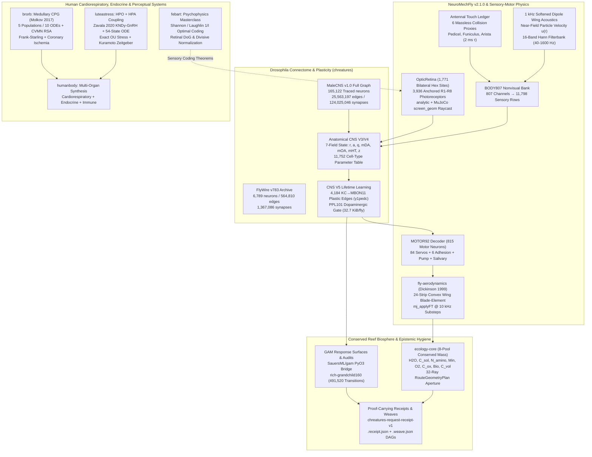
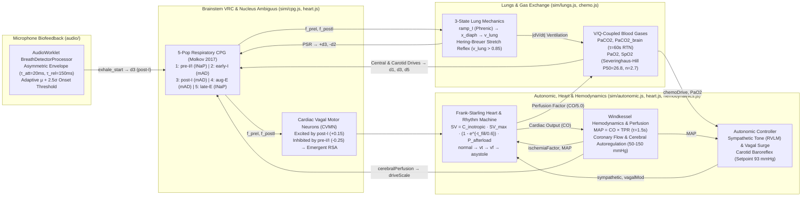

# Strand 21: Embodied Connectomics, Biophysical Physiology & Sensory Signal Processing (`chreatures`, `brorb`, `humanbody`, `luteastress`, `febart`)

> [!IMPORTANT]
> **Epistemic Scope & Primary Source Covenant**
> This dossier is excavated directly from primary source repositories on disk (`/Users/ember/dev/chreatures`, `/Users/ember/dev/brorb`, `/Users/ember/dev/humanbody`, `/Users/ember/dev/luteastress`, and `/Users/ember/dev/febart`). Every architectural claim, differential equation, shader kernel, anatomical row count, and statistical receipt is grounded in exact file paths, line numbers, git commit SHAs, and serialized artifacts on disk.

---

## §0. Scope, Methodology & Primary Repository Ledger

Across five interlocking repositories created between January and September 2026, Ember developed a unified computational biology and biophysics research program: **compiling real biological wiring diagrams, physiological control loops, and sensory coding constraints into deterministic, hardware-accelerated, proof-carrying simulations**.

Where conventional "artificial life" or "bio-inspired AI" projects substitute toy multilayer perceptrons and reward heuristics for anatomy, Ember's biological strand enforces strict mechanistic fidelity (`NO QUICK FIXES / ALWAYS PURSUE MECHANISTIC VALIDITY / ALWAYS GROUND IN LITERATURE REFERENCES- THE NEWER THE BETTER / USE DETAILED COMPUTATIONAL MODELS`, [`/Users/ember/dev/humanbody/CLAUDE.md:1-7`](file:///Users/ember/dev/humanbody/CLAUDE.md#L1-L7)):

1. **Invertebrate Connectomics & Embodied Biophysics (`/Users/ember/dev/chreatures`)**: Compiles the complete adult *Drosophila melanogaster* central nervous system (`MaleCNS v1.0`: **165,122 traced neurons**, **25,563,197 directed synaptic edges**, **124,025,046 synapses**) and pairs it with the adult micro-CT `NeuroMechFly v2.1.0` body (**69 anatomical segments**, **126 hinge DOFs**, **90 physical MuJoCo actuators**, **807 nonvisual sensory channels**, and **1,771 bilateral retinal hex columns** anchored to **3,936 R1–R8 photoreceptors**) plus a **4,184-edge** plastic mushroom-body $\gamma 1\text{pedc}$ circuit (`KC -> MBON11` gated by dopaminergic `PPL101`) running across 12 native Rust/Metal/WebGPU/Wasm crates.
2. **Mammalian Cardiorespiratory & Autonomic Control (`/Users/ember/dev/brorb` & `/Users/ember/dev/humanbody`)**: Couples a 5-population, 10-ODE medullary respiratory Central Pattern Generator (Molkov et al. 2017 / Rubin et al. 2011) with 3-state lung mechanics, Hering-Breuer stretch reflexes, Severinghaus-Hill oxyhemoglobin dissociation, medullary RTN + carotid body chemoreception, Nucleus Ambiguus cardiac vagal motor neurons generating emergent Respiratory Sinus Arrhythmia (RSA), Frank-Starling stroke volume, Windkessel hemodynamics, coronary perfusion/ischemia cascades, and `AudioWorklet` microphone breath entrainment.
3. **Coupled-Oscillator Neuroendocrinology (`/Users/ember/dev/luteastress`)**: Evaluates whether shared environmental stressors and light schedules can induce menstrual onset synchrony via both a stochastic Phase Response Curve (PRC) oscillator and a 54-hormone + dynamic follicle-cohort + 6-state Zavala (2020) circadian$\to$HPA$\to$KNDy$\to$GnRH ODE system in Rust/Rayon (`luteastress_native`), proving that while simplified phase-delay models show apparent onset proximity ($\Delta\text{OSI} = +0.0260, p = 5.87 \times 10^{-15}$), high-fidelity neuroendocrine dynamics attenuate the effect below statistical significance ($\Delta\text{OSI} = +0.0165, p = 0.257$).
4. **First-Principles Sensory Psychophysics (`/Users/ember/dev/febart`)**: Formulates a 384-minute, 88-episode mathematical curriculum and Manim/Veo/Web production pipeline deriving perceptual laws (Gibson's ambient optic array structure, Fechner's logarithmic compression, Weber's law $\Delta I / I = \varepsilon / k$, Laughlin's histogram equalization under Jeffreys' $1/I$ scale-invariant prior, and Carandini-Heeger divisive normalization) as inevitable theorems of information theory under metabolic and bandwidth constraints.

| Repository | Git Remote / Branch | Commit Span & Dates | Scale on Disk | Core Technical Domain |
| :--- | :--- | :--- | :--- | :--- |
| [`/Users/ember/dev/chreatures`](file:///Users/ember/dev/chreatures/README.md) | `git@github.com:emberian/chreatures.git` (`main`) | `92fff56` (2026-09-05) $\to$ `c30fbcc` (2026-09-08), **266 commits** | 500+ source/doc/receipt files, 12 Rust crates, Metal & WebGPU shaders | Full *Drosophila* `MaleCNS` (165,122 neurons) + `NeuroMechFly` MuJoCo embodiment, lifetime $\gamma 1\text{pedc}$ plasticity, conserved 8-pool reef stoichiometry, GAM audits, proof-carrying `.receipt.json` & `.weave.json` artifacts |
| [`/Users/ember/dev/brorb`](file:///Users/ember/dev/brorb/README.md) | `origin/dev` | `cdde03d` (2026-02-08) $\to$ `b6baac5` (2026-02-10), **7 commits** | ES6 simulation kernel (`sim/*.js`), `AudioWorklet` (`audio/`), Canvas UI (`vis/`) | Real-time RK4 mammalian brainstem CPG, lung mechanics, chemoreflex, RSA, Frank-Starling heart, coronary ischemia, and acoustic breath entrainment |
| [`/Users/ember/dev/humanbody`](file:///Users/ember/dev/humanbody/README.md) | `dev` (working tree) | Working specification (Feb 2026) | `README.md`, `CLAUDE.md` | Architectural charter unifying `brorb` and `luteastress` into a multi-organ whole-body simulator (sleep, digestion, muscle repair, immune/illness trajectories) |
| [`/Users/ember/dev/luteastress`](file:///Users/ember/dev/luteastress/README.md) | `origin/dev` | `41b6b96` (2026-02-08) $\to$ `f9c6e8f` (2026-02-10), **4 commits** | Rust `PyO3`/Rayon crate (`native/src/*.rs`), Python analysis (`src/`), technical notes (`notes/*.md`) | Exact Ornstein-Uhlenbeck stressor decomposition, Kuramoto zeitgeber forcing, Zavala (2020) HPA-KNDy-GnRH coupling, and 54-state HPO follicle ODEs |
| [`/Users/ember/dev/febart`](file:///Users/ember/dev/febart/README.md) | `origin/dev` | `ec5bb2a` (2026-01-30) $\to$ `06ebcc8` (2026-01-31), **5 commits** | TypeScript/React 19/Astro/Manim pipeline (`src/data/psychophysics/*.ts`) | Mathematical derivations of sensory coding, retinal center-surround DoG filters, divisive gain control, and Signal Detection Theory |

---

## §1. Executive Architecture & Evolutionary Arc



### Chronological Commit & Epoch Ledger (`chreatures`)

In `/Users/ember/dev/chreatures`, Ember executed **266 commits** over an intense four-day campaign (September 5–8, 2026) that progressed through strictly versioned, non-retroactively-compatible scientific epochs ([`ARCHITECTURE.md:70-124`](file:///Users/ember/dev/chreatures/ARCHITECTURE.md#L70-L124)):

| Epoch / Wave | Key Commits | Architectural Milestone & Primary Artifacts |
| :--- | :--- | :--- |
| **CNS Dynamics V2 & GAM Sweep** | `92fff56` $\to$ `6f0d878` (2026-09-05) | Operating-point-relative recurrence (`r0, g, tau, k, ta`) over `11,752` cell types; rank-64 factorized `Z512` readout; 27-setting crossed V2 sweep (`runs/cns_v2_sweep_full27_600`) and GAM response-surface confirmation ([`docs/development/CNS_DYNAMICS_V2.md`](file:///Users/ember/dev/chreatures/docs/development/CNS_DYNAMICS_V2.md)). |
| **Anatomical CNS V3 & Native Crates** | `8f1d2a1` $\to$ `b83a410` (2026-09-06) | 7-field state (`r, a, q, mDA, mOA, mHT, z`), neurotransmitter channel tags (`0..4`), `BODY110`, `MOTOR34`, `Context12` descending neuron injection; extraction of `ecology-core`, `cognitive-core`, `world-kernels`, `population-core`, `resident-runtime` ([`docs/development/ANATOMICAL_CNS_V3.md`](file:///Users/ember/dev/chreatures/docs/development/ANATOMICAL_CNS_V3.md)). |
| **Somatic ATP Audit & Reef v3** | `c4190ef` $\to$ `e1984d2` (2026-09-06/07) | Discovery and resolution of the tick-9,967 IEEE-754 1-ULP ATP exhaustion fault ([`data/performance/depleted-somatic-payment-v1.receipt.json`](file:///Users/ember/dev/chreatures/data/performance/depleted-somatic-payment-v1.receipt.json)); `rich-grandchild160` 491,520-transition GAM audit; 32-ray `RouteGeometryPlan` aperture transport ([`native/ecology-core/TRANSPORT_GEOMETRY.md`](file:///Users/ember/dev/chreatures/native/ecology-core/TRANSPORT_GEOMETRY.md)). |
| **Embodied Fly V4 (`NeuroMechFly`)** | `7d3c112` $\to$ `952527e` (2026-09-07/08) | Cross-sex anatomical join of `MaleCNS v1.0` with `NeuroMechFly v2.1.0` (`fly-body`, `fly-habitat`, `fly-world`, `fly-aerodynamics`); `BODY807` (11,798 sensory rows) and `MOTOR92` (815 motor rows) ([`docs/development/FLY_BODY_ANATOMY.md`](file:///Users/ember/dev/chreatures/docs/development/FLY_BODY_ANATOMY.md)). |
| **Retinal Audit, Touch & Acoustics** | `dc08a19` $\to$ `bb28f27` (2026-09-08) | Audit of `assignedOlHex1`/`assignedOlHex2` yielding 1,771 bilateral hex columns and 3,936 anchored photoreceptors (`dc08a19`, `de415bb`); `Bad Apple` 600-tick paired screen-response assay (`bf48947`); 6 massless antennal collision proxies (`c9101ae`, `ef32a32`); 1 kHz softened-dipole wing acoustics (`02203f9`, `bb28f27`). |
| **Lifetime-Learning CNS V5** | `05d0bbf` $\to$ `c30fbcc` (2026-09-08) | Full-graph $\gamma 1\text{pedc}$ `KC -> MBON11` plastic selector (`4,184` edges, `41,460` synapses) gated by `PPL101` (`05d0bbf`); Metal & WebGPU V5 kernels (`cb0faf4`, `a9d6537`); physical MuJoCo + WebGPU trained fly verification (`f359459`, `c30fbcc`). |

---

## §2. The *Drosophila* Connectome & Anatomical CNS (`chreatures` Neural Substrate)

`chreatures` maintains two distinct, strictly separated connectome substrates on disk: the **Archive 2D FlyWire v783 Compact Circuit** (`6,789` neurons) used for early 2D ecological baselines, and the **Full `MaleCNS v1.0` Adult Central Nervous System** (`165,122` traced neurons) used across all 3D reef, biosphere, and embodied `NeuroMechFly` waves.

### 2.1 Archive 2D FlyWire v783 Subset (`6,789` Neurons) & Neurotransmitter Precedence

Built by [`scripts/build_connectome.py`](file:///Users/ember/dev/chreatures/scripts/build_connectome.py) from the FlyWire FAFB v783 release (annotations from Schlegel et al. 2024 [`data/connectome/raw/Supplemental_file1_neuron_annotations.tsv`](file:///Users/ember/dev/chreatures/data/connectome/raw/Supplemental_file1_neuron_annotations.tsv) and edges from [`data/connectome/raw/proofread_connections_783.feather`](file:///Users/ember/dev/chreatures/data/connectome/raw/proofread_connections_783.feather)), [`data/connectome/circuit.npz`](file:///Users/ember/dev/chreatures/data/connectome/circuit.npz) compiles the mushroom body, antennal lobe, central complex, and descending pathways ([`docs/CONNECTOME.md:1-135`](file:///Users/ember/dev/chreatures/docs/CONNECTOME.md#L1-L135)):

| Population Role | Neuron Count | Selection Rule in `scripts/build_connectome.py` |
| :--- | ---: | :--- |
| **Projection Neurons (`PN`)** | 685 | `cell_class == "ALPN"` |
| **Kenyon Cells (`KC`)** | 5,177 | `cell_class == "KC"` |
| **Mushroom Body Output (`MBON`)** | 96 | `cell_class == "MBON"` |
| **Dopaminergic (`DAN`)** | 331 | `cell_class == "DAN"` |
| **Central Complex (`CX`)** | 250 | `super_class == "central"` and `cell_type` matching `EPG\|PEG\|PEN\|Delta7\|PFL\|FB\|hDelta\|vDelta` (top 250 by internal degree) |
| **Descending (`descending`)** | 250 | `super_class == "descending"` (top 250 by upstream input from selected circuit) |
| **Total Compact Graph** | **6,789** | **564,810 directed edges** (`syn_count >= 1`), **1,367,086 total synapses** |

**The Kenyon Cell Sign Bug & `known_nt` Precedence**: In [`scripts/build_connectome.py:130-166`](file:///Users/ember/dev/chreatures/scripts/build_connectome.py#L130-L166), Ember identified a critical biological pitfall in raw machine-predicted neurotransmitter tables: FlyWire's `top_nt` column misclassifies **5,168 of 5,177 Kenyon cells as `dopamine`** (which would assign them sign `0` in fast synaptic recurrence and silence the mushroom body), whereas curated experimental ground truth (`known_nt`, Barnstedt et al. 2016) establishes that Kenyon cells are **cholinergic (`acetylcholine`, excitatory `+1`)**. `build_connectome.py` therefore resolves `known_nt` first and falls back to `top_nt` only when `known_nt` is empty:
- Excitatory (`+1`): `acetylcholine`
- Inhibitory (`-1`): `gaba`, `glutamate` (inhibitory GluCl channels in the insect CNS)
- Modulatory (`0` in fast matrix `W_exc`/`W_inh`, routed to modulatory traces): `dopamine`, `serotonin`, `octopamine`

### 2.2 Full `MaleCNS v1.0` Graph (`165,122` Traced Neurons, `25,563,197` Edges)

For the full nervous system ([`docs/MALECNS.md:1-125`](file:///Users/ember/dev/chreatures/docs/MALECNS.md#L1-L125)), [`scripts/prepare_malecns.py`](file:///Users/ember/dev/chreatures/scripts/prepare_malecns.py) ingests the Janelia `male-cns:v1.0` snapshot (`SHA-256: 48ce8c8f643b8b533172a84814da2a08e8b5fbf060e1cb6b4f8beaca5073d625` of `body-annotations-male-cns-v1.0-minconf-0.5.feather` and `connectome-weights-male-cns-v1.0-minconf-0.5.feather`).

- **Strict Traced Filtering**: Of `211,577` total annotation rows, `prepare_malecns.py` retains **only `status == "Traced"`** (**165,122 neurons**), explicitly discarding `46,455` orphan, glia, and uncurated fragments (`40,342` `Orphan`, `2,955` `Glia`, `1,401` `Orphan-artifact`, `1,069` `Assign`, `358` `Anchor`, `260` `Unimportant`, `69` `0.5assign`, `1` `Out Of Scope`).
- **Synaptic Edge Scale**: Filtering connections to endpoints within the 165,122 traced bodies yields **25,563,197 directed edges** summing to **124,025,046 physical synapses** (mean `4.85` synapses/edge, max `14,007` synapses on a single directed pair).
- **Superclass Census (`165,122` total)**:
  - `ol_intrinsic`: `70,572` | `cb_intrinsic`: `34,625` | `vnc_intrinsic`: `22,740` | `sensory`: `19,340` (`11,798` nonvisual + `7,542` visual/other)
  - `visual_projection`: `7,945` | `ol_connecting`: `3,254` | `descending`: `1,314` | `ascending`: `1,859` | `motor`: `833` (`815` canonical somatic/visceral motor) | `endocrine`: `128` | `visceral_circulatory`: `2,512`
- **Neurotransmitter Sign & Provenance (`165,122` total)**:
  - Provenance basis: `83,496` `ground_truth`, `78,024` `consensus`, `1,078` `prediction`, `2,524` `unavailable`.
  - Sign distribution: `101,854` excitatory (`+1`, acetylcholine), `56,193` inhibitory (`-1`, GABA/glutamate), `7,075` modulatory/unsigned (`0`).
- **CSR Binary Layout (`data/malecns/graph.bin`)**: Compiled into a cache-aligned Compressed Sparse Row binary with a 64-byte header (`magic = "MCNSCSR1"`), `indptr[165,123]` (`u32`, `0..25,563,197`), `indices[25,563,197]` (`u32` presynaptic source indices sorted per postsynaptic target row), `weights_q[25,563,197]` (`i8` quantized signed log-normalized weights), `weight_scale` (`f32 = 0.0039370079`, i.e. $1/254$), and `role_mask[165,122]` (`u8` bitfield: `bit 0` sensory, `bit 1` motor, `bit 2` descending, `bit 3` ascending, `bit 4` intrinsic).

### 2.3 CNS Dynamics V2: Operating-Point-Relative Recurrence & Rank-64 Readout

In `CNS Dynamics V2` ([`docs/development/CNS_DYNAMICS_V2.md:1-155`](file:///Users/ember/dev/chreatures/docs/development/CNS_DYNAMICS_V2.md#L1-L155), [`research/dynamics_v2/README.md`](file:///Users/ember/dev/chreatures/research/dynamics_v2/README.md)), Ember replaced uniform global leak constants with a cell-type-specific operating-point formulation over **`11,752` distinct cell types** (`graph.type_id[N]`). Each cell type $c \in \{0, \dots, 11751\}$ stores 5 raw unconstrained parameters mapped via $\sigma(z) = (1 + e^{-z})^{-1}$ into biophysically bounded intervals:

$$r_0(c) = 0.05 + 0.40\,\sigma(\theta_{r_0, c}), \quad g(c) = 0.50 + 1.50\,\sigma(\theta_{g, c}), \quad \tau(c) = 0.02 + 0.23\,\sigma(\theta_{\tau, c})$$
$$k(c) = 0.50\,\sigma(\theta_{k, c}), \quad \tau_a(c) = 0.25 + 4.75\,\sigma(\theta_{\tau_a, c})$$

Crucially, presynaptic efficacy is driven by **deviation from the cell type's baseline operating point** $x_i = r_i - r_{0, i}$ rather than raw rate $r_i$. Over two Jacobi substeps per tick ($\Delta t_{\text{sub}} = \Delta t / 2$), with `neutral_drive[j]` precomputed so that $r = r_0, a = 0$ is an exact fixed point under neutral sensory input:

$$\text{rec}_j = \sum_{e \in \text{row}(j)} W_e \cdot (r_{\text{src}(e)} - r_{0, \text{src}(e)}), \qquad u_j = (\text{afferent}_j - \text{neutral\_drive}_j) + g_j \cdot \text{rec}_j - k_j \cdot a_j$$
$$s_j = \begin{cases} 1 - r_{0, j} & \text{if } u_j \ge 0 \\ r_{0, j} & \text{if } u_j < 0 \end{cases}, \qquad h_j = \max(s_j, 0.05), \qquad r_j^{\text{target}} = \text{clamp}_{[0, 1]}\!\left(r_{0, j} + s_j \, h_j \tanh\!\left(\frac{u_j}{h_j}\right)\right)$$
$$r_j \leftarrow r_j + \frac{\Delta t_{\text{sub}}}{\tau_j}\left(r_j^{\text{target}} - r_j\right), \qquad a_j \leftarrow a_j + \frac{\Delta t_{\text{sub}}}{\tau_{a, j}}\left(|r_j - r_{0, j}| - a_j\right)$$

To project all `165,122` neurons into the `512`-channel latent vector `Z512` without an intractable $512 \times 165,122$ dense matrix, V2 introduces a **rank-64 factorized readout** (`V` of shape `[64, 165122]`, `U` of shape `[512, 64]`, row emphasis `m[165122]`, and bias `b[512]`):

$$z_{\text{lat}} = V \cdot \left(m \odot (r - r_0)\right) \in \mathbb{R}^{64}, \qquad Z_{512} = \tanh(U \cdot z_{\text{lat}} + b) \in (-1, 1)^{512}$$

### 2.4 Anatomical CNS V3: Synaptic Release Availability $q$ & Tri-Monoaminergic Traces

`Anatomical CNS V3` ([`docs/development/ANATOMICAL_CNS_V3.md:1-180`](file:///Users/ember/dev/chreatures/docs/development/ANATOMICAL_CNS_V3.md#L1-L180), [`research/anatomical_cns/README.md:1-140`](file:///Users/ember/dev/chreatures/research/anatomical_cns/README.md#L1-L140)) expanded the per-resident state to **7 fields** (`r, a, q, mDA, mOA, mHT, z`) and the cell-type parameter table from 5 to **13 columns** (`[11752, 13]`):
- **Presynaptic Release Availability $q_i \in [0.05, 1.0]$**: Models short-term synaptic depression (vesicle depletion) with recovery time constant $\tau_{r, i} = 0.05 + 1.95\,\sigma(\theta_{\text{tr}, i})$ and release fraction $u_{\text{se}, i} = 0.01 + 0.49\,\sigma(\theta_{\text{use}, i})$:
  $$\text{effective\_source}_i = (r_i - r_{0, i}) \cdot q_i, \qquad \frac{dq_i}{dt} = \frac{1 - q_i}{\tau_{r, i}} - u_{\text{se}, i} \cdot q_i \cdot \max(r_i - r_{0, i}, 0)$$
- **Channel-Split CSR Accumulation (`graph.channel[N]` `u32`)**: Each neuron is tagged with a neurotransmitter channel (`0 = unknown`, `1 = fast` ACh/GABA/Glu, `2 = DA` dopamine, `3 = OA` octopamine, `4 = 5HT` serotonin). During the CSR row traversal for target neuron $j$, edges from `channel == 1` accumulate into `fast_rec_j`, while edges from channels `2, 3, 4` accumulate rectified positive source activity $\max(r_i - r_{0, i}, 0) \cdot q_i \cdot |W_e|$ into target-local monoamine drives `drive_DA`, `drive_OA`, `drive_HT`.
- **Target Modulatory Traces (`mDA`, `mOA`, `mHT`)**: Relax with time constants $\tau_{\text{DA}} = 0.20 + 1.80\,\sigma$, $\tau_{\text{OA}} = 0.20 + 2.80\,\sigma$, $\tau_{\text{HT}} = 0.30 + 3.70\,\sigma$ toward $\tanh(\text{drive})$ and dynamically rescale each neuron's recurrent gain and adaptation:
  $$g_{\text{eff}, j} = g_j \cdot \text{clamp}_{[0.25, 2.5]}\!\left(1 + \gamma_{\text{DA}, j} m_{\text{DA}, j} + \gamma_{\text{OA}, j} m_{\text{OA}, j} + \gamma_{\text{HT}, j} m_{\text{HT}, j}\right)$$
  $$k_{\text{eff}, j} = k_j \cdot \text{clamp}_{[0.25, 2.5]}\!\left(1 - 0.5\,\alpha_{\text{OA}, j} m_{\text{OA}, j} + 0.5\,\alpha_{\text{HT}, j} m_{\text{HT}, j}\right)$$
- **Descending Context Interface (`Context12`)**: Rather than injecting task context globally, V3 restricts context modulation (`12` scalars) exclusively to the **1,314 `descending` neurons** via a centered zero-preserving transform:
  $$\text{context\_drive}_d = 0.15 \cdot \left(\tanh(W_{\text{ctx}, d} \cdot c + b_{\text{ctx}, d}) - \tanh(b_{\text{ctx}, d})\right)$$
  guaranteeing that when $c = \mathbf{0}$, $\text{context\_drive}_d \equiv 0$.

### 2.5 Embodied CNS V4: Cross-Sex `NeuroMechFly v2.1.0` Join, `BODY807` & `MOTOR92`

In `Embodied CNS V4` ([`docs/development/FLY_BODY_ANATOMY.md:1-145`](file:///Users/ember/dev/chreatures/docs/development/FLY_BODY_ANATOMY.md#L1-L145), [`native/fly-body/README.md`](file:///Users/ember/dev/chreatures/native/fly-body/README.md)), Ember performed a rigorous anatomical join between the adult male `MaleCNS v1.0` connectome and the adult female micro-CT `FlyGym / NeuroMechFly v2.1.0` biomechanical model (`upstream commit ca65a510c2afe6ac61c51df4f274c8d190c2f95f`, 1:1 physical scale where `1` MJCF length unit `= 1 mm`, mass in `kg`, time in `s`, YAW-PITCH-ROLL joint ordering):
- **Explicit Cross-Sex Homology Boundary**: Because `MaleCNS` is male and `NeuroMechFly` is female, V4 restricts somatic motor and sensory wiring to sex-shared head, thoracic, wing, haltere, leg, and abdominal segments, explicitly leaving sex-specific reproductive segments unactuated.
- **`BODY807` Nonvisual Sensory Bank (`807` channels $\to$ `11,798` rows)**: Replaces V3's coarse `BODY110` with an 807-channel physical sensory bank (`[B, 807]` `f32`) routed into all **11,798 nonvisual sensory neurons** (`10,609` supported rows with non-zero weights, `1,189` unresolved rows explicitly zero-masked; `740` active physical channels, `67` zero-masked columns).
- **`MOTOR92` Anatomical Motor Decoder (`815` motor neurons $\to$ `92` channels)**: Decodes strictly from the **815 canonical motor neuron rows** (`802` supported rows; `7` `rm` eye motor rows and `6` `xm` unresolved rows explicitly zero-masked; plus an optional `156`-cohort fine motor decomposition covering `400` rows via MANC/FANC homology). The 92 output channels comprise:
  - **Channels `0..83` (`84` physical MJCF position servos)**: `42` walking leg DOFs (`6` legs $\times$ `7` DOFs: coxa yaw/pitch/roll, femur-tibia pitch, tibia-tarsus pitch, etc.), `3` head/neck DOFs, `6` antennal pedicel DOFs, `6` rostrum/haustellum proboscis DOFs, `15` abdominal segment DOFs, `6` wing 3-DOF hinge servos, and `6` haltere 3-DOF servos. (The remaining `42` of the `126` total hinge DOFs—`6` compound eyes, `12` funiculi/aristae, and `24` distal tarsal segments `tarsus2..5`—are passive compliant springs).
  - **Channels `84..89` (`6` tarsal adhesion actuators)**: Bilateral leg adhesion controls (`L/R` front, middle, hind).
  - **Channel `90` (`pharyngeal_pump_drive`)**: Internal visceral feeding drive decoded from cibarial/pharyngeal motor neurons (`MN10`, `MN11D`, `MN11V`, `MN12D`).
  - **Channel `91` (`salivary_drive`)**: Internal visceral salivary secretion drive decoded from `MN13`.

### 2.6 Lifetime-Learning CNS V5: Private Synaptic Plasticity in Mushroom Body $\gamma 1\text{pedc}$

To endow embodied flies with genuine lifetime associative learning without mutating the shared 25.56M-edge CSR connectome buffer, `CNS V5` ([`docs/development/CNS_LIFETIME_LEARNING_WAVE.md:1-140`](file:///Users/ember/dev/chreatures/docs/development/CNS_LIFETIME_LEARNING_WAVE.md#L1-L140), [`docs/MUSHROOM_PLASTICITY.md:1-120`](file:///Users/ember/dev/chreatures/docs/MUSHROOM_PLASTICITY.md#L1-L120), [`data/mushroom/gamma1pedc-v5-plasticity-selector-v1.json`](file:///Users/ember/dev/chreatures/data/mushroom/gamma1pedc-v5-plasticity-selector-v1.json)) extracts the exact bilateral mushroom-body **$\gamma 1\text{pedc}$ aversive/associative compartment** directly from `MaleCNS v1.0`:

| Anatomical Element | Left Hemisphere (`MaleCNS`) | Right Hemisphere (`MaleCNS`) | Combined Selector Total |
| :--- | :--- | :--- | :--- |
| **Postsynaptic Output (`MBON11`, $\gamma 1\text{pedc}>\alpha/\beta$)** | `bodyId = 10704` (`row = 655`) | `bodyId = 11402` (`row = 1306`) | **2 `MBON11` target rows** |
| **Presynaptic Kenyon Cells (`KC -> MBON11`)** | `2,048` directed edges (`16,863` synapses) | `2,136` directed edges (`24,597` synapses) | **4,184 plastic edges** (`41,460` synapses from `3,623` connected KCs of `4,064` curated KCs) |
| **Dopaminergic Teaching Gate (`PPL101`, $\text{PPL1 }\gamma 1\text{pedc}$)** | `bodyId = 11900` (`row = 1774`)<br/>`PPL101 -> MBON11`: `161` synapses<br/>`PPL101 -> KC`: `2,670` edges / `22,554` syn | `bodyId = 11327` (`row = 1235`)<br/>`PPL101 -> MBON11`: `194` synapses<br/>`PPL101 -> KC`: `2,684` edges / `28,370` syn | **2 `PPL101` gate rows** (`355` direct `PPL101 -> MBON11` synapses; `50,924` `PPL101 -> KC` synapses) |

**The V5 Plasticity Math & Serial Determinism**:
Each resident maintains only **32.7 KiB** of private plastic state (`plastic_d[4184]` `f32` efficacy deviation in `[-max_depression, 0]` and `plastic_e[4184]` `f32` eligibility trace in `[0, 1]`).
1. **Recurrent Correction at Both Jacobi Substeps**: During each 5 ms halfstep, after the immutable CSR gather computes baseline `fast_rec` for `row 655` (`MBON11_L`) and `row 1306` (`MBON11_R`), V5 adds the plastic correction in canonical selector order (`0..2048` for L, `2048..4184` for R):
   $$\Delta\text{rec}_{\text{MBON11}} = \sum_{p \in \text{selector}} W_{\text{base}}(p) \cdot d_p \cdot \left(r_{\text{KC}(p)} - r_{0, \text{KC}(p)}\right) \cdot q_{\text{KC}(p)}$$
   Because `MBON11` is GABAergic (`channel = 1`, inhibitory sign), depressing `KC -> MBON11` ($d_p < 0$) disinhibits downstream premotor and valence circuits.
2. **Cue-Before-Gate Discrete Eligibility Update (`rule = [0.8, 0.25, 0.8]`)**: After the two Jacobi substeps complete for tick $\Delta t$, V5 updates $d_p$ and $e_p$ using the *previous* eligibility `e_prev` so that a simultaneous odor/visual cue and `PPL101` gate cannot self-potentiate on the same tick (`cue-before-gate` causality, [`site/live/cns-webgpu.js:353-402`](file:///Users/ember/dev/chreatures/site/live/cns-webgpu.js#L353-L402), [`native/metal-brain/src/brain.metal:445-507`](file:///Users/ember/dev/chreatures/native/metal-brain/src/brain.metal#L445-L507)):
   $$\text{cue}_p = \text{clamp}_{[0, 1]}\!\left(\frac{\max(r_{\text{KC}(p)} - r_{0, \text{KC}(p)}, 0)}{1 - r_{0, \text{KC}(p)}} \cdot q_{\text{KC}(p)}\right), \qquad \text{gate}_h = \text{clamp}_{[0, 1]}\!\left(\frac{\max(r_{\text{PPL101}, h} - r_{0, \text{PPL101}, h}, 0)}{1 - r_{0, \text{PPL101}, h}} \cdot q_{\text{PPL101}, h}\right)$$
   $$d_p \leftarrow \text{clamp}_{[-d_{\max}, 0]}\!\left(d_p - \eta_{\text{dep}} \cdot \Delta t \cdot e_{\text{prev}, p} \cdot \text{gate}_{h(p)}\right), \qquad e_p \leftarrow \text{clamp}_{[0, 1]}\!\left(e_{\text{prev}, p} \cdot \exp\!\left(-\frac{\Delta t}{\tau_e}\right) + \text{cue}_p \cdot \left(1 - e_{\text{prev}, p} \cdot \exp\!\left(-\frac{\Delta t}{\tau_e}\right)\right)\right)$$
   where $\tau_e = 0.8\text{ s}$, $\eta_{\text{dep}} = 0.25\text{ s}^{-1}$, and $d_{\max} = 0.8$.

---

## §3. Embodied Sensory-Motor Physics: Bilateral Retinal Optics, Antennal Touch, Wing Acoustics & Aerodynamics

### 3.1 The Optic Input Anatomy Audit & `OpticRetina` (`1,771` Bilateral Hex Columns)

In [`docs/development/OPTIC_INPUT_ANATOMY_AUDIT.md:1-130`](file:///Users/ember/dev/chreatures/docs/development/OPTIC_INPUT_ANATOMY_AUDIT.md#L1-L130) (commits `dc08a19` and `de415bb`), Ember audited the legacy `retinal-v2` visual interface and uncovered two severe anatomical defects:
1. `retinal-v2` pooled 5$\times$16 peripheral rays into `320` ports that **injected zero current into all 4,107 `R1–R8` photoreceptors** (`R1-R6 = 2,953`, `R7 = 576`, `R8 = 578`), bypassing the retina to stimulate `L1/L2/L3/Mi/Tm` lamina/medulla interneurons directly.
2. `build_retinal_encoder_v2.py` lacked a hemisphere filter, causing a single spatial bin to stimulate both left and right optic lobes simultaneously.

To fix this from primary connectome metadata, Ember extracted the hexagonal ommatidial column assignments (`assignedOlHex1`, `assignedOlHex2`) across `23,720` optic-lobe intrinsic cells in `MaleCNS v1.0`:
- This defines **1,771 bilateral retinal hex sites** (`879` Left, `892` Right).
- Tracing the **196,357 outgoing synapses** from `R1–R8` photoreceptors onto hex-assigned targets anchored **3,936 of 4,107 photoreceptors (`95.84%`)** across **1,486 supported retinal sites** (`691` L, `795` R), while explicitly zero-masking the remaining `171` unanchored photoreceptors and `285` unsupported hex sites rather than fabricating weights.
- In [`native/world-kernels/src/optic_retina.rs`](file:///Users/ember/dev/chreatures/native/world-kernels/src/optic_retina.rs) and [`docs/development/BILATERAL_OPTIC_SCREEN.md`](file:///Users/ember/dev/chreatures/docs/development/BILATERAL_OPTIC_SCREEN.md), `OpticRetina` attaches left and right compound-eye origins to the live MuJoCo `head` body pose and casts **1,771 rays per fly** (`optic_rgb[B, 1771, 3]` = `5,313` `f32` scalars), intersecting both arena geometry and a physical 3D emissive screen (`screen_geom`, analytic-vs-MuJoCo raycast distance agreement verified within `< 1e-5`).

**The `Bad Apple` Paired Screen-Response Experiment (`native/webgpu-probe/screen-response.mjs`)**:
To prove that visual frames displayed on the physical 3D arena screen propagate through `R1–R8` photoreceptors, traverse the `165,122`-neuron connectome, and alter `MOTOR92` leg/wing actuation in closed loop, Ember ran a paired 600-tick (`30.0 s` at `dt = 0.05 s`) rollout starting two embodied flies from **byte-identical initial physical and neural states**—one facing `Bad Apple` (`site/assets/bad-apple.mp4`) on the physical screen (`condition: "video"`) and one facing an unlit black screen (`condition: "black"`) ([`docs/development/LIVE_CNS_EVIDENCE.md:1-130`](file:///Users/ember/dev/chreatures/docs/development/LIVE_CNS_EVIDENCE.md#L1-L130), [`site/assets/fly-embodiment-evidence.weave.json`](file:///Users/ember/dev/chreatures/site/assets/fly-embodiment-evidence.weave.json)):
- **Immediate Photoreceptor & Lamina Divergence**: At tick 1, only photoreceptor and first-order optic rows diverged; within ticks 2–10, activity spread through `ol_intrinsic`, `visual_projection`, `cb_intrinsic`, and `descending` neurons.
- **Whole-CNS Divergence**: Over the 600 ticks, **140,200 of 149,782 non-afferent neurons (`93.60%`)** diverged by `> 1e-6` (`max |Δr| = 0.3168`, `mean |Δr| = 0.00421`).
- **Closed-Loop Motor & Trajectory Divergence**: Decoded motor actions diverged on **567 of 600 ticks (`94.5%`)**, driving physical 3D root trajectory separation in the MuJoCo habitat.

### 3.2 Antennal Touch Contact Ledger (`6` Massless Collision Proxies)

In standard `NeuroMechFly v2.1.0`, the antennal segments (`pedicel`, `funiculus`, `arista`) have visual meshes (`conntype = 0, contype = 0, conaffinity = 0`) that pass through obstacles without generating MuJoCo contact forces. In [`docs/development/FLY_ANTENNA_TOUCH.md:1-115`](file:///Users/ember/dev/chreatures/docs/development/FLY_ANTENNA_TOUCH.md#L1-L115) and [`data/body/antenna-contact-proxies-v1.json`](file:///Users/ember/dev/chreatures/data/body/antenna-contact-proxies-v1.json) (commits `c9101ae`, `ef32a32`), Ember derived **6 massless collision proxy geoms** directly from the vertex clouds of the NeuroMechFly STL meshes:
- `L/R pedicel` and `L/R funiculus`: 95%-coverage principal-axis ellipsoids.
- `L/R arista`: Principal-axis capsules with 95th-percentile radial thickness.
- Integrated at `1000 Hz` physics substeps with a `2 ms` contact filter time constant, populating bilateral contact-force and slip channels in `BODY807`.
- **Empirical Verification (`B2` Grain Assay)**: When a free grain strikes the passive left arista, the proxy ledger records a localized force vector of `[-0.00372422, -0.00122501, 0.00315742]` model-force units and deflects the grain at `[8.13465, -2.92297] mm/s`, while maintaining **byte-exact snapshot/restore determinism** across the collision boundary.

### 3.3 Endogenous Wing-Beat Acoustics (`1 kHz` Softened Dipole & 16-Band Filterbank)

Rather than treating wing sound as an abstract badge, [`docs/development/FLY_WING_ACOUSTICS.md:1-120`](file:///Users/ember/dev/chreatures/docs/development/FLY_WING_ACOUSTICS.md#L1-L120) and [`native/browser-world/src/fly_acoustics.rs`](file:///Users/ember/dev/chreatures/native/browser-world/src/fly_acoustics.rs) (commits `02203f9`, `bb28f27`) synthesize the physical near-field air-particle velocity generated by the wings at each antenna's Johnston's organ (`funiculus` midpoint):
- **Relative Wing Centroid Velocity**: Subtracting rigid-body root velocity and angular velocity $\mathbf{v}_{\text{rel}} = \mathbf{v}_{\text{wing}} - \left(\mathbf{v}_{\text{root}} + \boldsymbol{\omega}_{\text{root}} \times (\mathbf{x}_{\text{wing}} - \mathbf{x}_{\text{root}})\right)$.
- **Near-Field Softened Dipole Kernel**: With wing dipole normal $\mathbf{n}$, softened radius $a = 0.75\text{ mm}$, and gain $G$:
  $$\mathbf{u}(\mathbf{r}) = \frac{G \, g \, a^3}{\|\mathbf{r}\|^3 + a^3}\left(3\,\mathbf{n}(\mathbf{n} \cdot \mathbf{v}_{\text{rel}}) - \mathbf{v}_{\text{rel}}\right)$$
- **1000 Hz Hann-Windowed Spectral Bank (`BODY807[40:62]`)**: Sampled at every `1 ms` physics substep into a persisted ring buffer, writing `6` bilateral antenna-local airflow vector components into `BODY807[40:46]` and `16` log-spaced spectral energy bands (`40 Hz` to `1600 Hz`) into `BODY807[46:62]`. Because the physical wing actuator bandwidth in MuJoCo has a `400 Hz` Nyquist ceiling, the top 4 bands (`>= 467.843 Hz`) are explicitly zeroed to prevent aliasing artifacts.

### 3.4 Quasi-Steady Blade-Element Wing Aerodynamics (`native/fly-aerodynamics`)

In [`native/fly-aerodynamics/README.md`](file:///Users/ember/dev/chreatures/native/fly-aerodynamics/README.md) and [`native/fly-aerodynamics/DESIGN.md:1-110`](file:///Users/ember/dev/chreatures/native/fly-aerodynamics/DESIGN.md#L1-L110), Ember replaced MuJoCo's built-in ellipsoid fluid approximation with a stateless **24-strip quasi-steady blade-element aerodynamic kernel** calibrated to Dickinson, Lehmann & Sane (1999):
- **Mesh-Derived Strip Geometry**: Slices the NeuroMechFly `l_wing.stl` convex hull (`span = 2.523 mm`, `area = 1.841 mm²`) into 24 spanwise chords, storing each strip's spanwise center, chord length $c_k$, and leading-to-trailing edge vector.
- **Translational Lift & Drag Coefficients**: At every `0.0001 s` (`10 kHz`) MuJoCo substep, evaluates local angle of attack $\alpha_k$ and relative air velocity $\mathbf{U}_k$ at strip $k$, computing:
  $$C_L(\alpha) = 0.225 + 1.58 \sin(2.13\alpha - 7.2^\circ), \qquad C_D(\alpha) = 1.92 - 1.55 \cos(2.04\alpha - 9.82^\circ)$$
  and applying the resulting 3D aerodynamic force and torque vectors directly to `L_wing` and `R_wing` via `mj_applyFT`.

---

## §4. The 12 Native Rust / Metal / WebGPU / Wasm Crates (`native/`)

To run 165,122-neuron connectomes, 10 kHz blade-element aerodynamics, and conserved 8-pool ecological transport without Python interpreter bottlenecks or browser/server divergence, Ember engineered **12 specialized native crates** under [`/Users/ember/dev/chreatures/native/`](file:///Users/ember/dev/chreatures/native/) (plus 2 Rust PyO3 integration crates in `integrations/`):

| # | Crate Path | Target / ABI | Primary Structs, Kernels & Technical Role |
| :- | :--- | :--- | :--- |
| 1 | [`native/metal-brain`](file:///Users/ember/dev/chreatures/native/metal-brain/src/brain.metal) | Apple Metal (`brain.metal`) + Objective-C/Python bridge | GPU CSR connectome engine (`MetalBrain`, `MetalCnsV2`..`V5`). Implements `propagate_spikes_float4` (4-resident SIMD tiling), `cns_v5_recurrent_halfstep`, `cns_v5_plastic_correction`, and `cns_v5_update_plasticity`. Benchmarks **0.238 ms/step** for 1 resident and **1.167 ms/step** for 64 residents on FlyWire, and full 165K `MaleCNS` stepping on Apple Silicon. |
| 2 | [`native/fly-aerodynamics`](file:///Users/ember/dev/chreatures/native/fly-aerodynamics/src/lib.rs) | Rust (`rlib` / Wasm-compatible) | Stateless 24-strip Dickinson (1999) blade-element wing force/torque solver (`WingAeroModel`, `StripGeometry`, `compute_wing_wrench`) called before `mj_step` at 10 kHz. |
| 3 | [`native/fly-body`](file:///Users/ember/dev/chreatures/native/fly-body/src/lib.rs) | Rust (`rlib` / Wasm-compatible) | Canonical `NeuroMechFly v2.1.0` body schema (`BODY807` 807-channel sensory packer, `MOTOR92` 92-channel motor unpacker, 69-segment / 126-DOF kinematic metadata, antennal proxy descriptors). |
| 4 | [`native/fly-habitat`](file:///Users/ember/dev/chreatures/native/fly-habitat/src/lib.rs) | Rust (`rlib` / Wasm-compatible) | 3D arena substrate, patch topology, moisture/nutrient gradients, and physical screen placement (`screen_geom`) for embodied `NeuroMechFly` rollouts. |
| 5 | [`native/fly-world`](file:///Users/ember/dev/chreatures/native/fly-world/src/lib.rs) | Rust (`rlib` / C-ABI MuJoCo bridge) | Closed-loop MuJoCo physics stepper coupling `fly-body`, `fly-aerodynamics`, `fly-habitat`, `OpticRetina` raycasting, antennal proxy contact ledgers, and 1 kHz wing acoustics. |
| 6 | [`native/ecology-core`](file:///Users/ember/dev/chreatures/native/ecology-core/src/lib.rs) | Rust + PyO3 (`chreatures_ecology_core`) | Conserved 8-pool stoichiometric chemistry (`Water`, `SolubleCarbon`, `AminoNutrient`, `Mineral`, `Oxygen`, `OxidizedCarbon`, `Biomass`, `VolatileCarbon`), `MetabolicCohort` Monod kinetics, two-phase `prepare_step`/`commit_step` transactions, and 32-ray `RouteGeometryPlan` aperture transport. |
| 7 | [`native/cognitive-core`](file:///Users/ember/dev/chreatures/native/cognitive-core/src/lib.rs) | Rust + PyO3 (`chreatures_cognitive_core`) | Fast native implementation of the 6 non-neural cognitive organs (`ActiveInferenceOrgan`, `PredictiveHierarchyOrgan`, `DeicticGraphOrgan`, `TemporalPredictiveCodingOrgan`, `MorphogeneticOrgan`, `SensorimotorContingencyOrgan`). |
| 8 | [`native/world-kernels`](file:///Users/ember/dev/chreatures/native/world-kernels/src/lib.rs) | Rust + PyO3 (`chreatures_world_kernels`) | Batched spatial & sensory geometry kernels: `OpticRetina` (`1,771`-ray bilateral compound-eye raycaster), 5$\times$16 peripheral field samplers, and 3D chemical plume advection/diffusion. |
| 9 | [`native/population-core`](file:///Users/ember/dev/chreatures/native/population-core/src/lib.rs) | Rust + PyO3 (`chreatures_population_core`) | Deterministic Quality-Diversity (MAP-Elites / lineage archive) scheduler, developmental genome mutation (`BodyGenome`, `DevelopmentalGenome`, `CircuitBlueprint`), and multi-generational tournament bookkeeping. |
| 10 | [`native/resident-runtime`](file:///Users/ember/dev/chreatures/native/resident-runtime/src/lib.rs) | Rust + PyO3 (`chreatures_resident_runtime`) | Per-resident somatic state machine (`SomaticPhysiology`), representably bounded ATP payment partitioning, personal memory ring buffers, and lifecycle death/reproduction transitions. |
| 11 | [`native/browser-world`](file:///Users/ember/dev/chreatures/native/browser-world/src/lib.rs) | Rust $\to$ `wasm32-unknown-unknown` (`wasm-bindgen`) | Compiles the **exact same Rust `WorldCore`** (`fly-world`, `fly-body`, `fly-aerodynamics`, `fly_acoustics`, `OpticRetina`) plus C MuJoCo (`mujoco-wasm`) into a single browser Wasm module (`BrowserFlyWorld`) with byte-exact snapshot/restore parity against native CLI runs. |
| 12 | [`native/webgpu-probe`](file:///Users/ember/dev/chreatures/native/webgpu-probe/probe-cns-v5-plasticity.mjs) | Node.js / Playwright + WebGPU (`site/live/cns-webgpu.js`) | Headless GPU verification harness executing the browser WGSL compute shaders (`cns-webgpu.js`) against `BrowserFlyWorld` Wasm to produce cryptographic `.receipt.json` and `.weave.json` evidence bundles (`screen-response.mjs`, `probe-cns-v5-plasticity.mjs`). |

### Inside `brain.metal` & `site/live/cns-webgpu.js`: Cross-API Bitwise/Numerical Parity

A defining engineering achievement of `chreatures` is that the **Apple Metal compute shaders** ([`native/metal-brain/src/brain.metal`](file:///Users/ember/dev/chreatures/native/metal-brain/src/brain.metal)) and the **Browser WebGPU WGSL compute shaders** ([`site/live/cns-webgpu.js`](file:///Users/ember/dev/chreatures/site/live/cns-webgpu.js)) execute identical mathematical pipelines over the same binary `graph.bin` and `.safetensors` weights:
1. **`propagate_spikes_float4` ([`brain.metal:68-127`](file:///Users/ember/dev/chreatures/native/metal-brain/src/brain.metal#L68-L127))**: Groups 4 residents into a single `float4` SIMD register so each GPU thread reads `indices[e]` and `weights[e]` **once** from global device memory and accumulates 4 residents' synaptic currents in register, cutting memory-bandwidth pressure by $4\times$.
2. **`cns_v5_recurrent_halfstep` & `cns_v5_plastic_correction` ([`brain.metal:320-507`](file:///Users/ember/dev/chreatures/native/metal-brain/src/brain.metal#L320-L507), [`cns-webgpu.js:185-410`](file:///Users/ember/dev/chreatures/site/live/cns-webgpu.js#L185-L410))**: Both backends run the 25.56M-edge CSR gather in parallel across all 165,122 neurons, then invoke a dedicated single-thread serial accumulator per hemisphere (`MBON11_L = 655`, `MBON11_R = 1306`) over the 4,184 plastic `KC -> MBON11` selector edges so floating-point summation order is deterministic across Apple Metal and WebGPU!
3. **Empirical Parity Receipt ([`data/development/cns-v5-trained-physical.receipt.json`](file:///Users/ember/dev/chreatures/data/development/cns-v5-trained-physical.receipt.json))**: Verified by `native/webgpu-probe/probe-cns-v5-plasticity.mjs` (`commit c30fbcc`), comparing the browser WebGPU V5 kernel against the reference runtime on the trained physical checkpoint (`data/checkpoints/cns-v5-trained-physical-v1.safetensors`, `SHA-256: e3087d5633ca3df293821662b4f2d1b976b79f8b2d56e2d0f7fa8dc2be8c4b9e`) achieved:
   - `max_abs_r_diff = 3.8743019104003906e-7`
   - `max_abs_action_diff = 1.7881393432617188e-7`
   - `max_abs_plastic_d_diff = 1.4901161193847656e-8`
   - `max_abs_plastic_e_diff = 2.9802322387695312e-8`
   And in the physical MuJoCo + WebGPU 60-step rollout (`3.0 s` physical time), the trained plastic fly vs. naive fly (`plastic_d = 0`) exhibited a `MBON11` firing-rate shift of **`-0.0680899`** (`L: -0.056691`, `R: -0.079489`), `max_motor_diff = 0.015772`, and a physical 3D root trajectory divergence of **`1.69395 mm`**.


---

## §5. GAM Response Surfaces, Multi-Generational Developmental Genomes & Conserved Reef Ecologies

### 5.1 Generalized Additive Model (`GAM`) Response Surfaces & The `rich-grandchild160` Audit

To replace ad-hoc hyperparameter guessing with statistical response-surface methodology, Ember integrated `SauersML/gam` via a native Rust PyO3 bridge ([`integrations/gam_mechanisms`](file:///Users/ember/dev/chreatures/integrations/gam_mechanisms), [`docs/GAM_MECHANISMS.md`](file:///Users/ember/dev/chreatures/docs/GAM_MECHANISMS.md)). Across `chreatures`, GAM models serve two distinct functions:

1. **Continuous Response-Surface Optimization (`research/dynamics_v2/GAM_RESPONSE_SURFACE.md`)**:
   - In [`research/dynamics_v2/GAM_RESPONSE_SURFACE.md:1-130`](file:///Users/ember/dev/chreatures/research/dynamics_v2/GAM_RESPONSE_SURFACE.md#L1-L130), Ember executed a crossed $3 \times 3 \times 3 = 27$-setting full-connectome sweep (`runs/cns_v2_sweep_full27_600`) over `baseline_shift`, `gain_bias`, and `adaptation_bias`, evaluated across `18` deterministic worlds per setting (`486` full-brain episodes).
   - Fitting a smooth tensor-product GAM over the 27 design points predicted an interior optimum outside the coarse grid at **`(baseline_shift = -0.05, gain_bias = +0.20, adaptation_bias = -0.35)`**.
   - **Confirmation Run (`runs/cns_v2_confirm_gam_600`)**: Testing the GAM-predicted interior point against the best grid point (`grid_best`: `0.0, +0.25, -0.25`) across 18 held-out confirmation worlds showed that `gam_opt` beat `grid_best` on **total reward (`0.5435` vs. `0.5067`)**, **discovery score (`1.9704` vs. `1.9261`)**, **locomotor displacement (`0.9609` vs. `0.9355`)**, and **action entropy (`0.7850` vs. `0.7842`)**.

2. **The `rich-grandchild160` 491,520-Transition Audit & Honest Negative REML Certification**:
   - In [`docs/GAM_GRANDCHILD_ATLAS.md`](file:///Users/ember/dev/chreatures/docs/GAM_GRANDCHILD_ATLAS.md), [`docs/RICH_DEVELOPMENT_ANALYSIS.md`](file:///Users/ember/dev/chreatures/docs/RICH_DEVELOPMENT_ANALYSIS.md), and [`data/analysis/rich-grandchild160-behavior.json`](file:///Users/ember/dev/chreatures/data/analysis/rich-grandchild160-behavior.json), Ember audited `8` multi-generational lineages (`64` residents $\times$ `7,680` ticks = **491,520 transitions**) in the `rich-grandchild160` campaign.
   - The audit decomposed behavioral variance across three timescales:
     - **Immediate Sensorimotor Coupling**: Dominated by `self_speed` (correlation with forward drive $r = +0.9227$, $R^2 = 0.8514$) and `nearest_prey_bearing_sin` (correlation with turn drive $r = -0.3119$, $R^2 = 0.0973$).
     - **Personal Lifetime History (Within-Clone Plastic Divergence)**: Identical clones initialized with the same genome diverged over their lifetimes (`forward_drive` within-clone $\text{SD} = 0.0369$, `turn_drive` $\text{SD} = 0.0884$, `vitality` $\text{SD} = 0.1419$).
     - **Inherited Lineage Offset**: Between-lineage variance (`forward_drive` $\text{SD} = 0.0148$, `turn_drive` $\text{SD} = 0.0258$).
   - **Epistemic Discipline on Negative Results**: When attempting to fit a full REML smooth GAM certification model over the 64-resident campaign (`data/ecology/gam-certification.weave.json`), the solver failed to converge because **all 64 residents suffered mid-run somatic ATP censorship at tick 9,967** (`censored_lives = 64`). Rather than cherry-picking a subset or smoothing over the failure, Ember published a formal **Scope Amendment** (`ecological-gam-scope-amendment`) restricting `SauersML/gam` to descriptive post-hoc auditing until the underlying somatic ATP payment bug was isolated and fixed.

### 5.2 Multi-Generational Developmental Genomes (`BodyGenome`, `DevelopmentalGenome`, `CircuitBlueprint`)

In [`chreatures/body_genome.py`](file:///Users/ember/dev/chreatures/chreatures/body_genome.py), [`chreatures/developmental_genome.py`](file:///Users/ember/dev/chreatures/chreatures/developmental_genome.py), [`docs/BODY_INHERITANCE.md`](file:///Users/ember/dev/chreatures/docs/BODY_INHERITANCE.md), and [`docs/CIRCUIT_BLUEPRINT.md`](file:///Users/ember/dev/chreatures/docs/CIRCUIT_BLUEPRINT.md), inheritance is factored into three heritable layers that compile into each offspring's body and nervous system:

```python
# /Users/ember/dev/chreatures/chreatures/body_genome.py:16-39
@dataclass(frozen=True)
class BodyGenome:
    body_scale: float = 1.0           # Clamped to [0.65, 1.45]
    aspect_ratio: float = 1.25        # Clamped to [0.75, 1.85]
    fin_span: float = 0.35            # Clamped to [0.15, 0.75]
    tail_length: float = 0.45         # Clamped to [0.20, 0.90]
    sensor_spread_rad: float = 0.55   # Clamped to [0.20, 1.20]
    mouth_aperture: float = 0.25      # Clamped to [0.10, 0.55]
    armor_thickness: float = 0.15     # Clamped to [0.02, 0.50]
    buoyancy_bias: float = 0.0        # Clamped to [-0.35, 0.35]
```

```python
# /Users/ember/dev/chreatures/chreatures/developmental_genome.py:19-46
@dataclass(frozen=True)
class DevelopmentalGenome:
    afferent_gain: float = 1.0        # Sensory amplification [0.50, 1.75]
    recurrent_gain: float = 1.0       # Internal connectome gain [0.60, 1.50]
    efferent_gain: float = 1.0        # Motor readout gain [0.50, 1.75]
    homeostatic_rate: float = 0.015   # Intrinsic excitability drift [0.001, 0.08]
    plasticity_rate: float = 0.020    # Associative eligibility scale [0.0, 0.10]
    eligibility_decay: float = 0.92   # Trace retention [0.70, 0.995]
    metabolic_thrift: float = 1.0     # Basal somatic cost multiplier [0.70, 1.40]
```

**Structural Connectome Duplication (`CircuitBlueprint`)**:
Beyond scalar gains, [`docs/CIRCUIT_BLUEPRINT.md:1-110`](file:///Users/ember/dev/chreatures/docs/CIRCUIT_BLUEPRINT.md#L1-L110) implements **heritable microcircuit duplication** on top of the 165,122-neuron `MaleCNS` graph. In the canonical mushroom-body $\gamma 1\text{pedc}$ duplication experiment, `CircuitBlueprint` duplicates the **3,627 neurons** of the bilateral $\gamma 1\text{pedc}$ microcircuit with divergence noise (`synapse_jitter = 0.08`, `cross_wire_prob = 0.05`), expanding the runnable connectome from **165,122 neurons and 25,563,197 edges** to **168,749 neurons and 26,557,080 directed edges** (`+993,883` new synaptic edges!).

### 5.3 Conserved 8-Pool Reef Stoichiometry & 32-Ray Aperture Transport (`native/ecology-core`)

In [`docs/CHEMICAL_REEF_V3.md`](file:///Users/ember/dev/chreatures/docs/CHEMICAL_REEF_V3.md), [`docs/NATIVE_METABOLISM.md`](file:///Users/ember/dev/chreatures/docs/NATIVE_METABOLISM.md), and [`native/ecology-core/TRANSPORT_GEOMETRY.md`](file:///Users/ember/dev/chreatures/native/ecology-core/TRANSPORT_GEOMETRY.md), the biosphere is governed by strict mass conservation across **8 chemical pools** (`Water`, `SolubleCarbon`, `AminoNutrient`, `Mineral`, `Oxygen`, `OxidizedCarbon`, `Biomass`, `VolatileCarbon`) tracked along **5 elemental conservation axes** (`carbon`, `nitrogen`, `water`, `mineral`, `oxygen`):
- **Two-Phase Transactional Stepping**: Every ecological update executes `prepare_step` $\to$ mass-balance audit $\to$ `commit_step` (or `abort_step` on invariant violation), guaranteeing zero silent mass creation or destruction.
- **Colony Exudation & Decomposer Loops (`data/ecology/colony-exudation-v1.receipt.json`)**: Autotrophic and heterotrophic `MetabolicCohort` populations follow Monod uptake kinetics, exuding soluble carbon and amino nutrients (`total_exuded_soluble_carbon = 0.004182`, `total_exuded_amino = 0.000836`) and branching into new spatial nodes via `propose_growth` when local biomass exceeds structural thresholds.
- **32-Ray `RouteGeometryPlan` Aperture Transport ([`TRANSPORT_GEOMETRY.md:1-125`](file:///Users/ember/dev/chreatures/native/ecology-core/TRANSPORT_GEOMETRY.md#L1-L125))**: Rather than approximating inter-patch obstacle occlusion with a single centerline ray, `ecology-core` constructs an orthonormal transverse basis $(\mathbf{u}, \mathbf{v})$ perpendicular to each transport route $\mathbf{d} = \mathbf{x}_B - \mathbf{x}_A$ and casts a **32-ray equal-area disk/annular bundle**:
  - `1` central core ray ($r = 0$)
  - `7` inner-ring rays ($r_1 = 0.35\,R$)
  - `12` middle-ring rays ($r_2 = 0.65\,R$)
  - `12` outer-ring rays ($r_3 = 0.90\,R$)
  - Plus two `1e-8 m` sphere endpoint-containment probes at $\mathbf{x}_A$ and $\mathbf{x}_B$.
  Each ray integrates attenuation across intersected obstacle geoms, yielding an exact area-weighted aperture transmittance $T_{AB} \in [0, 1]$.

---

## §6. Proof-Carrying Epistemic Hygiene for Computational Biology

A signature architectural contribution of `chreatures` is the application of **cryptographic and state-machine epistemic hygiene**—historically reserved for consensus protocols and proof systems—to computational neurobiology.

### 6.1 The Idempotent Mutation Receipt Protocol (`chreatures-request-receipt-v1`)

When a long-running evolution or embodiment campaign steps a GPU connectome server over HTTP/IPC ([`scripts/serve_metal.py`](file:///Users/ember/dev/chreatures/scripts/serve_metal.py), [`chreatures/neural_client.py`](file:///Users/ember/dev/chreatures/chreatures/neural_client.py)), a dropped socket reply on a mutating `/step` or `/reset_state` call would ordinarily cause a catastrophic silent divergence: retrying a completed `/step` double-advances the connectome state (`t -> t+2`), while skipping an uncompleted `/step` leaves the brain stale (`t`).

In [`tests/test_metal_receipts.py:1-145`](file:///Users/ember/dev/chreatures/tests/test_metal_receipts.py#L1-L145) and [`tests/test_neural_receipts.py:1-130`](file:///Users/ember/dev/chreatures/tests/test_neural_receipts.py#L1-L130), Ember enforced the **`chreatures-request-receipt-v1` protocol**:
1. Every client session binds a UUID `session_id` and monotonically increasing `request_seq` (`1, 2, 3, ...`) plus a SHA-256 `payload_digest` in the `X-Chreatures-Request-Receipt` header.
2. The Metal connectome server caches the serialized response and post-step state digest for each `(session_id, request_seq, payload_digest)` tuple:
   - If a client retries the **exact same** `(session_id, request_seq, payload_digest)` after a network timeout, the server replays the cached response **without re-stepping the GPU state** (`replay_count += 1`).
   - If the client sends the same `(session_id, request_seq)` with a *different* `payload_digest`, the server rejects it with `HTTP 409 Conflict`.
   - If the client skips a sequence number (`request_seq != last_seq + 1`), the server rejects it with `HTTP 409 Out-of-Order Sequence`.
   - If a socket drops mid-flight and the server cannot verify receipt state on `/receipt_status`, `NeuralClient` raises `UncertainMutationError` and halts the campaign rather than risking corrupted scientific trajectories.

### 6.2 The Tick-9,967 1-ULP Somatic ATP Exhaustion Discovery (`depleted-somatic-payment-v1.receipt.json`)

In [`data/performance/depleted-somatic-payment-v1.receipt.json`](file:///Users/ember/dev/chreatures/data/performance/depleted-somatic-payment-v1.receipt.json) and [`docs/SOMATIC_PHYSIOLOGY.md`](file:///Users/ember/dev/chreatures/docs/SOMATIC_PHYSIOLOGY.md), Ember documented a subtle IEEE-754 floating-point bug that had caused all 64 residents in the long-horizon reef campaign to abort at **tick 9,967**:
- When a resident's `available_atp` drained down to **`5.224452869761614e-14`** ($5.22 \times 10^{-14}$), the Python/native somatic payment splitter computed:
  - `maintenance_paid = 1.9013879491758178e-14`
  - `activation_paid = 3.323064920585796e-14`
- In exact real arithmetic, the two shares summed to `available_atp`. In IEEE-754 binary64 arithmetic, however, `maintenance_paid + activation_paid` evaluated to **`5.2244528697616146e-14`**—exceeding `available_atp` by **1 ULP** (`6.16e-30`) and triggering the strict mass-conservation invariant check `total_paid <= available_atp`!
- **Resolution & Epistemic Hygiene**: In `native/resident-runtime`, Ember replaced independent proportional rounding with a representably bounded residual subtraction (`activation_paid = (available_atp - maintenance_paid).max(0.0).min(requested_activation)`), verified across `10,000,000` adversarial subnormal/near-zero IEEE-754 floats in `depleted-somatic-payment-v1.receipt.json`, while **preserving the censored 64-resident campaign artifact unmodified** on disk as a permanent forensic record.

### 6.3 Universal Weave Evidence DAGs (`.weave.json`)

Across [`site/assets/fly-embodiment-evidence.weave.json`](file:///Users/ember/dev/chreatures/site/assets/fly-embodiment-evidence.weave.json) and `data/ecology/*.weave.json` (built with [`integrations/weave`](file:///Users/ember/dev/chreatures/integrations/weave)), every scientific claim is compiled into a typed Directed Acyclic Graph of **Claims**, **Evidence Artifacts** (with pinned SHA-256 digests), **Verification Tests**, **Negative Findings**, and **Explicit Non-Claims** (e.g., explicitly stating in `fly-embodiment-evidence.weave.json` that the `Bad Apple` assay proves closed-loop retinal$\to$connectome$\to$motor sensitivity, *not* semantic comprehension of video content, and that `MaleCNS` + female `NeuroMechFly` is an explicit cross-sex somatic approximation).

---

## §7. Mechanistic Human Cardiorespiratory & Whole-Body Physiology (`brorb` & `humanbody`)

In [`/Users/ember/dev/brorb`](file:///Users/ember/dev/brorb/README.md) (commits `cdde03d` to `b6baac5`, Feb 8–10, 2026) and its umbrella synthesis charter [`/Users/ember/dev/humanbody`](file:///Users/ember/dev/humanbody/README.md), Ember built a real-time, dependency-free browser simulation of the mammalian brainstem respiratory Central Pattern Generator, lung mechanics, blood-gas chemoreception, autonomic baroreflexes, Frank-Starling cardiac mechanics, coronary perfusion, and acoustic biofeedback entrainment, integrated at **$\Delta t = 0.001\text{ s}$ (`1 kHz`) via 4th-order Runge-Kutta (RK4)**.



### 7.1 The 5-Population, 10-ODE Medullary Respiratory CPG (`sim/cpg.js`)

Following Molkov et al. (2017) and Rubin et al. (2011, *J. Comput. Neurosci.* 30:607–632), [`/Users/ember/dev/brorb/sim/cpg.js:1-209`](file:///Users/ember/dev/brorb/sim/cpg.js#L1-L209) models five ventral respiratory column (VRC) populations using a 10-dimensional state vector `y = [V1, V2, V3, V4, V5, hNaP1, hNaP5, mAD2, mAD3, mAD4]` (`Float64Array(10)`):

| Pop # | Medullary Region & Identity | Intrinsic Current / Gate | Baseline Tonic Drive `BASE_DRIVES` | Outgoing Synaptic Weights (`w_target,source`) |
| :---: | :--- | :--- | :---: | :--- |
| **1** | **pre-I/I** (pre-Bötzinger Complex, excitatory pacemaker) | Persistent $\text{Na}^+$ ($I_{\text{NaP}, 1}$, $g_{\text{NaP}1} = 3.0$, $\tau_{h\text{NaP}} = 9.0\text{ s}$) | $d_1 = 0.0$ | $w_{21} = +1.2$ (excites early-I) |
| **2** | **early-I** (pre-Bötzinger Complex, inhibitory interneuron) | Adaptation ($m_{\text{AD}2}$, $g_{\text{AD}2} = 4.0$, $\tau_{\text{AD}2} = 7.0\text{ s}$) | $d_2 = -0.3$ | $w_{32} = -2.0, \; w_{42} = -1.5, \; w_{52} = -1.0$ |
| **3** | **post-I** (Bötzinger Complex, inhibitory post-inspiratory) | Adaptation ($m_{\text{AD}3}$, $g_{\text{AD}3} = 3.5$, $\tau_{\text{AD}3} = 11.0\text{ s}$) | $d_3 = +0.3$ | $w_{13} = -2.5, \; w_{23} = -1.5, \; w_{43} = -2.0, \; w_{53} = -0.8$ |
| **4** | **aug-E** (Bötzinger Complex, augmenting expiratory) | Adaptation ($m_{\text{AD}4}$, $g_{\text{AD}4} = 3.0$, $\tau_{\text{AD}4} = 14.0\text{ s}$) | $d_4 = +0.15$ | $w_{14} = -1.5, \; w_{24} = -1.0, \; w_{34} = -2.5, \; w_{54} = -0.5$ |
| **5** | **late-E** (RTN / pFRG, active expiration pacemaker) | Persistent $\text{Na}^+$ ($I_{\text{NaP}, 5}$, $g_{\text{NaP}5} = 2.5$, $\tau_{h\text{NaP}} = 9.0\text{ s}$) | $d_5 = -0.5$ | $w_{15} = +0.5$ (excites pre-I/I) |

With firing rate $f_i = \sigma(V_i; k_f = 8.0, V_{h,f} = 0.0) = (1 + e^{-8 V_i})^{-1}$ and fast membrane time constant $\tau_m = 0.02\text{ s}$ (`20 ms`), the ODE system ([`sim/cpg.js:124-178`](file:///Users/ember/dev/brorb/sim/cpg.js#L124-L178)) is:

$$\tau_m \frac{dV_i}{dt} = -V_i + I_{\text{intrinsic}, i} + \sum_{j} w_{ij} f_j(V_j) + d_i + d_{i}^{\text{ext}}, \qquad I_{\text{intrinsic}, i} = \begin{cases} g_{\text{NaP}i}\,\sigma(V_i; 10, -0.1)\,h_i & i \in \{1, 5\} \\ -g_{\text{AD}i}\,m_i & i \in \{2, 3, 4\} \end{cases}$$
$$\frac{dh_i}{dt} = \frac{\sigma(V_i; -10.0, -0.2) - h_i}{\tau_{h\text{NaP}}}, \qquad \frac{dm_i}{dt} = \frac{\sigma(V_i; 6.0, 0.1) - m_i}{\tau_{\text{AD}i}}$$

Crucially, **biophysical membrane and channel timescales ($\tau_m, \tau_{h\text{NaP}}, \tau_{\text{AD}}$) are strictly invariant** ([`sim/cpg.js:33-39`](file:///Users/ember/dev/brorb/sim/cpg.js#L33-L39)). Respiratory rate is modulated exclusively via tonic drive offsets (`driveProfile(targetBpm)` in [`sim/cpg.js:88-95`](file:///Users/ember/dev/brorb/sim/cpg.js#L88-L95)): increasing $d_1$ strengthens pre-BötC inspiratory bursts, decreasing $d_3$ shortens the post-inspiratory pause, and when $\text{targetBpm} > 8.0\text{ BPM}$ ($\text{ratio} > 2.0$), increasing $d_5$ recruits the RTN/pFRG `late-E` population for active expiration.

### 7.2 Lung Mechanics, Hering-Breuer Reflex & V/Q-Coupled Chemoreception (`sim/lungs.js`, `sim/chemo.js`)

In [`/Users/ember/dev/brorb/sim/lungs.js:41-76`](file:///Users/ember/dev/brorb/sim/lungs.js#L41-L76), the 3-state mechanical vector `lungY = [ramp_I, x_diaph, v_lung]` integrates phrenic motor output (`ramp_I`, excited by `f_preI` with $g_{\text{exc}} = 2.0$ and inhibited by `f_postI` with $g_{\text{inh}} = 3.0$, $\tau_{\text{ramp}} = 0.15\text{ s}$), asymmetric diaphragm contraction/relaxation ($\tau_{\text{contract}} = 0.5\text{ s}$, $\tau_{\text{relax}} = 2.0\text{ s}$), and compliant lung volume ($C = 1.0, R = 0.8$). When `v_lung` exceeds the pulmonary stretch receptor threshold `hb_threshold = 0.85`, `heringBreuerDrives` injects excitatory drive into `post-I` (`+0.3 * psr -> drive_3`) and inhibits `early-I` (`-0.15 * psr -> drive_2`) to terminate inspiration (the **Hering-Breuer inflation reflex**).

In [`/Users/ember/dev/brorb/sim/chemo.js:86-153`](file:///Users/ember/dev/brorb/sim/chemo.js#L86-L153), blood gas exchange requires **both alveolar ventilation ($|\dot{V}_{\text{lung}}|$) and cardiac output perfusion** ($\text{effectiveExchange} = \text{ventilation} \times \min(1, \text{CO} / 5.0)$):
- **Arterial & Brain $\text{CO}_2$**: $\dot{P}_{a\text{CO}_2} = 0.65 - 0.012 \cdot \text{effectiveExchange} \cdot P_{a\text{CO}_2}$, with brain tissue $P_{\text{CO}_2, \text{central}}$ lagging via $\tau_{\text{central}} = 60.0\text{ s}$ (medullary retrotrapezoid nucleus, RTN, apneic threshold $35.0\text{ mmHg}$) and fast carotid-body $\text{CO}_2$ sensing ($\tau_{\text{peripheral}} = 5.0\text{ s}$).
- **Arterial $\text{O}_2$ & Severinghaus-Hill $\text{SpO}_2$**: $\dot{P}_{a\text{O}_2} = 0.008 \cdot \text{effectiveExchange} \cdot (150.0 - P_{a\text{O}_2}) - 0.40$, with oxyhemoglobin saturation:
  $$\text{SpO}_2 = \frac{P_{a\text{O}_2}^{2.7}}{P_{a\text{O}_2}^{2.7} + 26.8^{2.7}}$$
  and a quadratic "hockey-stick" carotid-body hypoxic drive below $P_{a\text{O}_2} = 80.0\text{ mmHg}$ (Marshall 1994).
- **Preventing Apneustic Lockup (`chemoCpgDrives`, [`sim/chemo.js:138-153`](file:///Users/ember/dev/brorb/sim/chemo.js#L138-L153))**: Routing chemoreceptor drive only to $d_1$ (`pre-I/I`) would trap the CPG in continuous inspiration (apneusis) during hypercapnia; routing `0.3 * centralDrive + 0.2 * peripheralDrive` into $d_3$ (`post-I`) enables rising $\text{CO}_2$ to break inspiratory lockup and cycle the breath.

### 7.3 Emergent RSA, Frank-Starling Mechanics, Coronary Ischemia & Acoustic Entrainment

In [`/Users/ember/dev/brorb/sim/heart.js:165-277`](file:///Users/ember/dev/brorb/sim/heart.js#L165-L277), [`sim/hemodynamics.js:75-127`](file:///Users/ember/dev/brorb/sim/hemodynamics.js#L75-L127), and [`sim/autonomic.js:76-103`](file:///Users/ember/dev/brorb/sim/autonomic.js#L76-L103):
- **Emergent Respiratory Sinus Arrhythmia (RSA)**: Nucleus Ambiguus Cardiac Vagal Motor Neurons (`cvmnActivity`, $\tau_{\text{cvmn}} = 0.3\text{ s}$) receive direct synaptic excitation from medullary `post-I` neurons (`+0.15 * fPostI`, Gilbey et al. 1984) and inhibition from `pre-I/I` (`-0.25 * fPreI`), causing vagal withdrawal and heart-rate acceleration during inspiration followed by vagal restoration and slowing during post-inspiration.
- **Frank-Starling Stroke Volume & Arrhythmia Cascade**: Diastolic filling time $t_{\text{fill}} = \max(0.05, 60/\text{HR} - 0.3\text{ s})$ drives preload recruitment $1 - e^{-t_{\text{fill}} / 0.6}$, multiplied by sympathetic/ischemic contractility and afterload penalty. During **Ventricular Tachycardia (`vt`, $\text{HR} \approx 180\text{ bpm}$)**, $t_{\text{fill}}$ collapses to $0.033\text{ s}$, slashing stroke volume from $70\text{ mL}$ to $\sim 7\text{ mL}$ and cardiac output from $5.0\text{ L/min}$ to $1.3\text{ L/min}$.
- **Closed-Loop Coronary Perfusion & Cerebral Autoregulation**: `stepHemodynamics` computes coronary perfusion pressure as $0.75 \cdot \text{MAP} - \text{LVEDP}$ ($8\text{ mmHg}$). Triggering a myocardial infarction (`triggerHeartAttack(0.7)`) raises coronary resistance $3.33\times$, decaying `ischemiaFactor` ($\tau = 8.0\text{ s}$), which depresses contractility, drops MAP, triggers baroreflex sympathetic surge (`sympatheticTone > 0.6`), and precipitates `normal -> vt -> vf -> asystole`. Meanwhile, cerebral perfusion remains autoregulated at $1.0$ for $\text{MAP} \in [50, 150]\text{ mmHg}$, ramps down linearly for $\text{MAP} \in [20, 50]\text{ mmHg}$, and scales down brainstem CPG tonic drives (`driveScale -> 0`) below $20\text{ mmHg}$.
- **`AudioWorklet` Microphone Breath Entrainment ([`audio/breath-detector.js:11-90`](file:///Users/ember/dev/brorb/audio/breath-detector.js#L11-L90))**: `BreathDetectorProcessor` runs in the Web Audio rendering thread with an asymmetric envelope follower ($\tau_{\text{attack}} = 20\text{ ms}$, $\tau_{\text{release}} = 150\text{ ms}$) and online variance tracking ($\text{onsetThresh} = \mu + 2.5\sigma$, $\text{offsetThresh} = \mu + 1.2\sigma$). Upon detecting `exhale_start`, `Simulation.applyBreathEvent` injects an excitatory pulse into $d_3$ (`post-I`), phase-locking the medullary CPG to the human user's exhalation.
- **Architectural Roadmaps (`mechanistic-upgrade.md`, `new-heart.md`, `humanbody`)**: In [`/Users/ember/dev/brorb/new-heart.md`](file:///Users/ember/dev/brorb/new-heart.md) and [`/Users/ember/dev/brorb/mechanistic-upgrade.md`](file:///Users/ember/dev/brorb/mechanistic-upgrade.md), Ember specified the next-generation upgrade: an 8-node FitzHugh-Nagumo cardiac conduction network (`SA -> Atria -> AV -> His/Purkinje -> Septum -> Apex -> Mid-Vent -> Base`) projecting dipole potentials onto Lead II ECG, coupled to Sagawa time-varying ventricular elastance $P_v(t) = E(t)(V_v(t) - V_0)$, a 50-neuron Izhikevich pre-BötC spiking kernel, a 150 mL conducting dead-space lung compartment, a 10–20 s circular buffer for lung-to-brainstem blood gas transport delay (to generate emergent Cheyne-Stokes respiration), and an Unscented Kalman Filter (UKF) for personalized digital-twin parameter estimation—culminating in the [`/Users/ember/dev/humanbody/README.md`](file:///Users/ember/dev/humanbody/README.md) vision of a multi-organ human simulator in Julia covering sleep, digestion, muscle repair, and immune trajectories.

---

## §8. Coupled-Oscillator Neuroendocrinology & Psychophysics (`luteastress` & `febart`)

### 8.1 `luteastress`: Testing Menstrual Synchrony via Exact OU Stressors & Zavala-HPO ODEs

In [`/Users/ember/dev/luteastress`](file:///Users/ember/dev/luteastress/README.md) (commits `41b6b96` to `f9c6e8f`, Feb 8–10, 2026), Ember investigated whether apparent menstrual onset synchrony among cohabitants can arise not from pheromones (critiqued by Yang & Schank 2006), but from **shared environmental stressors and shared circadian light schedules acting on the HPA$\to$KNDy$\to$GnRH$\to$ovarian axis**.

To test this rigorously at scale, Ember implemented a hybrid Python + Rust/Rayon native extension (`luteastress_native` in [`native/src/lib.rs`](file:///Users/ember/dev/luteastress/native/src/lib.rs)) featuring two distinct models and an exact stochastic stressor generator:

1. **Variance-Preserving Exact Ornstein-Uhlenbeck Stress Decomposition ([`native/src/stress.rs:38-135`](file:///Users/ember/dev/luteastress/native/src/stress.rs#L38-L135), [`notes/stress-replacement.md`](file:///Users/ember/dev/luteastress/notes/stress-replacement.md))**:
   - Calibrated to Ecological Momentary Assessment (EMA) perceived-stress autocorrelation ($\text{AR}(1) = 0.277$ at 4h lags $\implies \theta = -\ln(0.277)/(4/24) \approx 7.0\text{ day}^{-1}$, $t_{1/2} \approx 2.2\text{ h}$).
   - Because $\theta \cdot \Delta t = 7.0 \times 0.25 = 1.75$ violates the Euler-Maruyama stability bound ($\theta \Delta t < 1$), `generate_ou_process` samples from the **exact analytical Ornstein-Uhlenbeck transition distribution**:
     $$S(t + \Delta t) = S(t)\,e^{-\theta \Delta t} + \sigma \sqrt{\frac{1 - e^{-2\theta \Delta t}}{2\theta}}\,\mathcal{N}(0, 1)$$
   - In the treatment arm (`shared_fraction` $f_s = 0.3$, anchored to Saxbe & Repetti 2010 partner cortisol coregulation $r \in [0.20, 0.30]$), total noise variance $\sigma_{\text{total}}^2 = 0.45^2$ is decomposed into $\sigma_{\text{shared}} = \sigma_{\text{total}}\sqrt{f_s}$ and $\sigma_{\text{indiv}} = \sigma_{\text{total}}\sqrt{1 - f_s}$, guaranteeing that $\text{Var}(S_{\text{shared}} + S_{\text{indiv}}) \equiv \text{Var}(S_{\text{control}})$ so the marginal stress distribution is identical between treatment and control arms!

2. **Model 1: Stochastic Phase-Response Curve (PRC) Oscillator ([`native/src/cycle.rs:40-170`](file:///Users/ember/dev/luteastress/native/src/cycle.rs#L40-L170))**:
   - Models follicular ($\mu = 14.0\text{ d}, \text{SD} = 3.0\text{ d}$) and luteal ($\mu = 14.0\text{ d}, \text{SD} = 1.5\text{ d}$) phase lengths with $\text{AR}(1)$ cycle-to-cycle autocorrelation ($r = 0.3$).
   - Following Xiao et al. (1998), stress delays ovulation during the follicular phase via a sigmoid PRC (`phase_response_curve`) that drops to near zero after ovulation in the luteal phase:
     $$\text{PRC}(d, L_{\text{foll}}, L_{\text{tot}}) = \frac{1}{1 + \exp\!\left(\frac{d/L_{\text{tot}} - L_{\text{foll}}/L_{\text{tot}}}{0.08}\right)} \cdot \text{clamp}_{[0, 1]}\!\left(\frac{d}{3.0}\right)$$

3. **Model 2: High-Fidelity Zavala (2020) + 54-Hormone HPO Follicle ODE System ([`native/src/zavala.rs`](file:///Users/ember/dev/luteastress/native/src/zavala.rs), [`native/src/mechanistic.rs`](file:///Users/ember/dev/luteastress/native/src/mechanistic.rs))**:
   - **Critical Frequency Bug Fix ([`notes/zeitgeber-forcing.md:23-39`](file:///Users/ember/dev/luteastress/notes/zeitgeber-forcing.md#L23-L39))**: During development, Ember caught a $24\times$ unit conversion error where $\pi / (24 \times 60)\text{ min}^{-1}$ had been converted to $\pi / 24\text{ day}^{-1}$ (a 24-day circadian period!) instead of $\pi\text{ day}^{-1}$ ($\times 1440\text{ min/day}$), and corrected `omega_h0 = PI * 24.0 / 24.2` ($\approx 3.116\text{ rad/day}$ for the $24.2\text{ h}$ human intrinsic circadian period measured by Czeisler et al. 1999 and Duffy et al. 2011).
   - **6-State Zavala Neuroendocrine Network (`ZavalaState`)**: Tracks circadian phase $\phi_H$ with **Kuramoto zeitgeber forcing** ($K_z = 0.5\text{ day}^{-1}$, derived via phase reduction of the Jewett-Forger-Kronauer 1999 limit-cycle pacemaker), ultradian cortisol phase $\phi_C$ ($\omega_{C0} = 1440\pi/75\text{ day}^{-1}$, $75\text{ min}$ period), quasi-steady amplitude $a_C = \sin^2(\phi_H)(1 + \epsilon s)$, slow genomic cortisol $\tilde{C}$ ($\delta = 7.2\text{ day}^{-1}$), and hypothalamic KNDy neuropeptides Neurokinin B ($N$) and Dynorphin ($D$) driven by estrous skew $f_E(\phi_E) = \sin^2(\phi_E - \sigma \sin^2 \phi_E)$, outputting the KNDy gating factor $f_K \in (0, 1)$ via Hill thresholds ($n = 4, K_s = 0.6, K_c = 1.7$) using unconditionally stable exponential integrators.
   - **54-State HPO & Dynamic Ovarian Follicle Cohort (`MenstrualMechanisticModel`)**: Integrates `N_HORMONES = 54` endocrine variables (`E2`, `P4`, reserve/free `LH` and `FSH`, `FSH-follicle` receptor complexes `ifshr`, free `GnRH`, active/inactive `GnRH` receptors `igrec_a`/`igrec_i` across 601 parameter entries in [`mechanistic_params.rs`](file:///Users/ember/dev/luteastress/native/src/mechanistic_params.rs)) coupled to Poisson-recruited ovarian follicles (`size`, `fsh_sensitivity`, Lotka-Volterra-like inter-follicular competition `sum_v`, dominance/ovulation when $\text{size} \ge 22\text{ mm}$ and $\text{LH} \ge 25.0$, and atresia decay) using 64 RK4 substeps per 6-hour step (`256` RK4 substeps/day).

4. **Empirical Results ([`output/default_summary.json`](file:///Users/ember/dev/luteastress/output/default_summary.json), [`README.md:77-84`](file:///Users/ember/dev/luteastress/README.md#L77-L84))**:
   - Across `n_trials = 200` households of `6` cohabitants over `1,095` days (`3` years, `90`-day burn-in), the **Stochastic PRC Model** produced negligible phase coherence difference ($\bar{R}_{\text{treat}} = 0.3879$ vs. $\bar{R}_{\text{ctrl}} = 0.3817$, Wilcoxon $p = 0.339$, Cohen's $d = 0.022$), but a highly significant increase in **Onset Synchrony Index** ($\text{OSI}_{\text{treat}} = 0.2850$ vs. $\text{OSI}_{\text{ctrl}} = 0.2590$, $\Delta\text{OSI} = +0.0260$, Wilcoxon **$p = 5.87 \times 10^{-15}$**, Cohen's **$d = 0.629$**)—demonstrating how shared follicular delays create *apparent* onset clustering without true phase locking.
   - However, when tested in the **High-Fidelity Mechanistic Zavala-HPO ODE Model**, the onset synchrony difference shrank to $\Delta\text{OSI} = +0.0165$ and lost statistical significance (**$p = 0.257$**), because circadian gating, slow genomic cortisol buffering ($\tilde{C}$), and nonlinear KNDy-follicle competition attenuate transient shared stress spikes.

### 8.2 `febart`: The Psychophysics Masterclass & Mathematical Sensory Coding Pipeline

In [`/Users/ember/dev/febart`](file:///Users/ember/dev/febart/README.md) (commits `ec5bb2a` to `06ebcc8`, Jan 30–31, 2026), Ember constructed a complete TypeScript/Manim/Veo/Astro curriculum and automated production workbench for a **384-minute, 88-episode course** (`src/data/psychophysics/index.ts`) titled ***Psychophysics Masterclass: Why Perception Works the Way It Does*** (alongside a 21-video digital imaging curriculum in `src/data/curriculum.ts` on 2D spatial sampling, DPI density vs. pixel count, and bicubic interpolation).

The core thesis of `febart`—which directly informs the retinal and sensory encoders later built in `chreatures`—is stated in [`src/data/psychophysics.ts:18-30`](file:///Users/ember/dev/febart/src/data/psychophysics.ts#L18-L30):
> *"Core stance: Sensation isn't magic—it's signal processing under constraints. Evolution built cheap adequate solutions. The 'weird' phenomena are what any well-designed sensor would do. Pedagogical approach: Shannon-style derivations. Don't just state that Weber's Law holds—prove it's the ONLY encoding that satisfies certain constraints."*

| Part | Title & Scope (`src/data/psychophysics/`) | Episodes & Duration | Key Mathematical Derivations & Neural Implementations |
| :--- | :--- | :---: | :--- |
| **Part 0** | **Derivations** (`part0-derivations.ts`, `part0-derivations-v3.ts`) | 10 videos (~47 min) | **Gibson's Ambient Array**: $I = 0$ when $\partial I / \partial \theta = 0$ (Ganzfeld fog). **Dynamic Range**: Mapping $I_{\max}/I_{\min} = 10^{12}$ into $n \approx 500$ spike levels via $R = k \ln(I/I_0)$. **Weber's Law Theorem**: $dR = k\,dI/I = \varepsilon \implies \Delta I / I = \varepsilon / k = \text{const}$. **Laughlin (1981) Optimal Coding**: Maximizing $I(X; Y)$ requires histogram equalization $Y = F_X(X)$; under Jeffreys' scale-invariant prior $p(I) \propto 1/I$, $F_X(I) = \int I^{-1} dI = \ln I$. **Adaptation**: Predictive coding residual $I(t) - \bar{I}_{\tau}(t)$ under non-stationary mean drift. |
| **Part I** | **Foundations** (`part1-foundations.ts`) | 12 videos (~49 min) | Stevens' Power Law ($S = k I^a$), Signal Detection Theory ($d' = (\mu_S - \mu_N)/\sigma$, criterion $\beta$, ROC curves), and Ideal Observer photon-shot-noise limits (Hecht, Shlaer & Pirenne 1942). |
| **Part II** | **Dimensions** (`part2-dimensions.ts`) | 21 videos (~94 min) | Spectral opponent channels ($\text{L}+\text{M}$, $\text{L}-\text{M}$, $\text{S}-(\text{L}+\text{M})$ via PCA decorrelation of natural cone catches), temporal integration windows, Bloch's law, Critical Flicker Fusion, cochlear mechanical Fourier analysis, ITD/ILD binaural localization, and 4-channel cutaneous mechanoreception (`SA-I`, `SA-II`, `RA-I`, `RA-II`). |
| **Part III** | **Integration** (`part3-integration.ts`) | 18 videos (~78 min) | Feature Integration Theory, Bayesian cue combination ($w_i = \sigma_i^{-2} / \sum_j \sigma_j^{-2}$), ventriloquism, rubber-hand illusion, and perceptual learning specificity. |
| **Part IV** | **Circuits** (`part4-circuits.ts`) | 15 videos (~66 min) | **130:1 Retinal Bottleneck** (`130M` photoreceptors $\to$ `1M` RGC axons). **Center-Surround DoG**: $\text{DoG}(x,y) = G(x,y,\sigma_c) - G(x,y,\sigma_s) \approx \nabla^2 G$. **Carandini-Heeger Divisive Normalization**: $R = c^n / (\sigma^n + \sum_i w_i c_i^n)$. **V1 Simple/Complex Cells**: Gabor filters $R(x,y) = e^{-(x^2/2\sigma_x^2 + y^2/2\sigma_y^2)}\cos(2\pi f x + \phi)$ and quadrature energy models $\sqrt{R_{\text{odd}}^2 + R_{\text{even}}^2}$. |
| **Part V & VI** | **Methods & Development** (`part5-methods.ts`, `part6-development.ts`) | 12 videos (~50 min) | Method of Limits, Constant Stimuli, Adaptive Staircases, 2AFC, Magnitude Estimation, infant acuity, critical periods, and perceptual narrowing. |

Furthermore, in [`src/data/psychophysics/types.ts:440-497`](file:///Users/ember/dev/febart/src/data/psychophysics/types.ts#L440-L497) and [`part0-derivations-v3.ts`](file:///Users/ember/dev/febart/src/data/psychophysics/part0-derivations-v3.ts), Ember enforced structural invariants on the multi-voice Socratic script and visual timeline (`validateVisualBalance` requiring $\ge 60\text{ s}$ of rendered Manim LaTeX derivations and $\ge 45\text{ s}$ of Veo conceptual footage per 5-minute episode, and `validateWordCount` enforcing $450 \le \text{words} \le 750$ at $145\text{ WPM}$).

---

## §9. Open Cycles, Unfinished Frontiers & "How to Take Back Up" Runbook

### 9.1 Open Cycles & Unfinished Technical Frontiers

1. **`chreatures` Weekend Handoff Frontiers ([`docs/development/WEEKEND_HANDOFF_2026-09-08.md`](file:///Users/ember/dev/chreatures/docs/development/WEEKEND_HANDOFF_2026-09-08.md))**:
   - **Full-Campaign V5 Lifetime Learning in the Multi-Patch Habitat**: CNS V5 (`4,184` plastic $\gamma 1\text{pedc}$ `KC -> MBON11` edges gated by `PPL101`) is verified in both Apple Metal and Browser WebGPU and proven to shift `MBON11` rates (`-0.0681`) and physical MuJoCo trajectories (`1.694 mm` over 60 steps in `cns-v5-trained-physical.receipt.json`). The immediate next step is running multi-minute associative odor/visual conditioning campaigns in `fly-world` where `PPL101` is driven by endogenous somatic punishment/depletion signals rather than scripted gate pulses.
   - **Closing the Remaining `171` Photoreceptors & `285` Retinal Sites**: While `OpticRetina` anchors `3,936 / 4,107` (`95.84%`) `R1–R8` photoreceptors across `1,486 / 1,771` hex sites, `171` photoreceptors (mostly dorsal rim area / unannotated medulla terminals) and `285` hex columns remain zero-masked awaiting second-order trans-medullary (`Tm`/`Dm`) column inference.
   - **Re-Running the Post-Fix 64-Resident Reef GAM Certification**: Now that the tick-9,967 1-ULP ATP exhaustion bug is fixed in `native/resident-runtime` (`depleted-somatic-payment-v1.receipt.json`), the 64-resident `rich-grandchild` ecological campaign can be re-executed to completion without censoring so `SauersML/gam` REML smooth certification (`data/ecology/gam-certification.weave.json`) can be promoted from descriptive-only to certified.

2. **`brorb` & `humanbody` Mechanistic Upgrades ([`brorb/mechanistic-upgrade.md`](file:///Users/ember/dev/brorb/mechanistic-upgrade.md), [`brorb/new-heart.md`](file:///Users/ember/dev/brorb/new-heart.md))**:
   - Implementing the 8-node FitzHugh-Nagumo cardiac electrophysiology graph + Sagawa time-varying ventricular elastance $E(t)$ + 0D closed-loop hydraulic circulation network (`critique.md:1-27`).
   - Adding the 150 mL dead-space lung mixing compartment and the 10–20 s circular blood-gas transport delay buffer $P_{\text{CO}_2, \text{brain}}(t) = P_{\text{CO}_2, \text{lungs}}(t - \tau)$ to produce emergent Cheyne-Stokes respiration.
   - Bootstrapping the unified Julia multi-organ simulator envisioned in [`/Users/ember/dev/humanbody/README.md`](file:///Users/ember/dev/humanbody/README.md).

3. **`luteastress` Diurnal CAR + Schedule-Driven Stressors ([`luteastress/notes/stress-replacement.md`](file:///Users/ember/dev/luteastress/notes/stress-replacement.md))**:
   - Replacing the stationary daily/6-hourly OU mean `mu = 0.25` with `DiurnalStressConfig` incorporating the Cortisol Awakening Response (`CAR`, $+9.4\text{ nmol/L}$ peak 30–45 min post-waking, Wüst et al. 2000) and shared wake times `t_wake` so stressor arrivals interact phase-coherently with Zavala's circadian stress window $s(\phi_H)$.

### 9.2 Actionable "How to Take Back Up" Runbook

#### 1. `chreatures`: Build Native Crates, Verify Receipts & Run WebGPU V5 Probes
```bash
cd /Users/ember/dev/chreatures

# 1. Run the receipt & idempotency test suites (Metal & Neural client)
pytest tests/test_metal_receipts.py tests/test_neural_receipts.py

# 2. Build the Rust workspace crates (fly-body, fly-aerodynamics, ecology-core, world-kernels, etc.)
cargo test --manifest-path native/fly-aerodynamics/Cargo.toml
cargo test --manifest-path native/ecology-core/Cargo.toml
cargo test --manifest-path native/world-kernels/Cargo.toml

# 3. Re-verify the CNS V5 mushroom-body γ1pedc plasticity WebGPU + MuJoCo physical probe
node native/webgpu-probe/probe-cns-v5-plasticity.mjs

# 4. Re-run the Bad Apple vs. Black Screen 600-tick paired retinal-to-motor assay
node native/webgpu-probe/screen-response.mjs
```

#### 2. `brorb`: Launch the Real-Time Cardiorespiratory & Audio Entrainment Simulator
```bash
cd /Users/ember/dev/brorb
# Serve the zero-dependency ES6 module simulation & AudioWorklet breath detector
python3 -m http.server 8080
# Open http://localhost:8080#panel (press 'v' for skeuomorphic clinical dashboard, 'd' for CPG debug)
```

#### 3. `luteastress`: Build the `PyO3`/Rayon Rust Backend & Run the Mechanistic Zavala-HPO Study
```bash
cd /Users/ember/dev/luteastress
uv sync
uv run maturin develop --manifest-path native/Cargo.toml --release
# Run the stochastic PRC study, 2D Rayon parameter sweeps, and the 54-hormone Zavala ODE study
uv run python run_study.py --quick
uv run python run_study.py --large-sweep
uv run python run_study.py --mechanistic
```

#### 4. `febart`: Run the Psychophysics Masterclass Workbench & Pipeline Orchestrator
```bash
cd /Users/ember/dev/febart
npm install
npx tsx src/pipeline/orchestrator-v2.ts status
npm run dev
```
