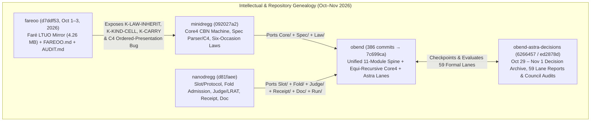
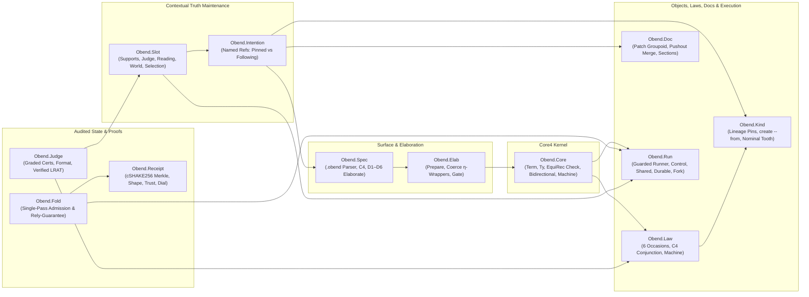

# Dossier 22: Objective Bend (`obend`) — Language Thesis, Equi-Recursive Core4 Type Theory, LTUO Grounding (`fareoo`), and the Astra Effect-Law & Consensus Document Substrate

> [!IMPORTANT]
> **Scope & Primary Source Grounding**
> Whereas Dossier 07 examined `obend`'s silicon/FPGA synthesis and dynamic partial reconfiguration leaf (`Obend.Silicon`, `ExprCAM`, `ICAP`, Sky130 DRC, CDNA3/FP4 equivalence), this monograph documents **Objective Bend (`obend`) as a programming language, object/extension calculus, equi-recursive / algebraic-subtyping type theory, effect-law runner, and consensus document substrate**.
> Every claim is grounded directly in three primary-source repositories on disk:
> 1. [`/Users/ember/dev/obend`](file:///Users/ember/dev/obend) (`386` commits through `7c699ca`, Nov 1, 2026; `452` Lean 4 modules under `lean/Obend/`, `45,588` Lean kernel constants, `0 sorryAx`, `4` Rust crates, `stdlib/`, and `sandstorm/`).
> 2. [`/Users/ember/dev/obend-astra-decisions`](file:///Users/ember/dev/obend-astra-decisions) (frozen decision & lane archive at `ed2878d` / `checkpoint-20261101` [`6266457`](file:///Users/ember/dev/obend-astra-decisions), capturing `300` Lean modules, `35,127` kernel constants, `0 sorryAx`, `59` `LANE-*-BRIEF-*.md` / `REPORT-*.md` files, and the October 29 – November 1, 2026 architectural debates).
> 3. [`/Users/ember/dev/fareoo`](file:///Users/ember/dev/fareoo) (`22` commits, Oct 1–3, 2026, HEAD `d7ddf53`: *"Mirror current LTUO and ground stronger Objective Bend semantics"*).

---

## 1. Executive Thesis & Intellectual Genealogy (`fareoo` → `minidregg` + `nanodregg` → `obend`)

### 1.1 The Core Thesis of Objective Bend
Objective Bend opens [`README.md`](file:///Users/ember/dev/obend/README.md#L1-L15) and [`THESIS.md`](file:///Users/ember/dev/obend/THESIS.md#L1-L26) with a single unifying sentence:

> *"Objects anyone can extend without forking, laws judged on every write, documents that remember why they say what they say."*
> — [`/Users/ember/dev/obend/README.md`](file:///Users/ember/dev/obend/README.md#L5), [`/Users/ember/dev/obend/THESIS.md`](file:///Users/ember/dev/obend/THESIS.md#L1-L3)

The architectural problem Objective Bend solves is stated in [`THESIS.md`](file:///Users/ember/dev/obend/THESIS.md#L5-L26) and formalized in [`paper/objective-bend.md`](file:///Users/ember/dev/obend-astra-decisions/paper/objective-bend.md#L1-L98):

1. **Software, prose, and machine-checked proofs rot by the same mechanism**: an author publishes an artifact $A$; a downstream stranger wants $A$ except for one field, one policy, or one theorem assumption. Without open recursion and first-class specifications, the stranger must **fork** $A$—copying its source and severing its history—or **beg** the upstream maintainer to merge a patch.
2. **Simultaneously, references rot silently**: when $A$ is revised, retired, or splits into two incompatible branches, downstream dependents either silently drift to unreviewed code (moving references like `latest`) or silently point to dead assumptions (pinned hashes whose underlying facts no longer hold).
3. **Why not plain Bend?** As documented in [`ASTRA-SYNTHESIS-20261029.md`](file:///Users/ember/dev/obend-astra-decisions/astra/ASTRA-SYNTHESIS-20261029.md#L11-L30), HigherCo's Bend / `BendTT` is an interaction-net functional language whose core discipline is **source-level affinity**: variables are used at most once so `match` frees graph nodes in place and fork-join parallelism needs no garbage collector or lock. However, Cook/Bracha/Faré open recursion (`mix l u := λself. λsuper. u self (l self super)` and `fix s b := let rec self = s self (b self) in self`) **uses `self` twice** in every composition step! Under a strict affine discipline, `mix` fails live-variable linearity whenever `self` carries captured methods or non-shareable state.
4. **Objective Bend's Synthesis**: Objective Bend places **lazy call-by-name open recursion (`Core4`)**, **first-class `specification`/`prototype` reflection**, **C4 multiple-inheritance linearization**, **six-occasion state laws (`Law`)**, and **contextual truth-maintenance slots (`Slot`, combining Nanevski–Pfenning–Pientka Contextual Modal Type Theory with Doyle's 1979 ATMS supports)** at the top level of the language, while compiling closed leaf computations down to affine `BendTT` / interaction-net `Book` definitions via `Obend.Leaf` ([`lean/Obend/Leaf.lean`](file:///Users/ember/dev/obend/lean/Obend/Leaf.lean#L1-L55)) and `Obend.Lower` ([`lean/Obend/Lower.lean`](file:///Users/ember/dev/obend/lean/Obend/Lower.lean#L1-L30)).



### 1.2 The `fareoo` Excavation (`d7ddf53`): Auditing `minidregg` Against Faré's *Lambda, the Ultimate Object*
Between October 1 and October 3, 2026 (`22` commits, from initial commit `8f1d452` to HEAD `d7ddf53` *"Mirror current LTUO and ground stronger Objective Bend semantics"*), Ember created [`/Users/ember/dev/fareoo`](file:///Users/ember/dev/fareoo) to mirror François-René Rideau's (Faré's) monograph *Lambda, the Ultimate Object — Prototype- and Class- orientation, Typed Open Recursion, Purity, Hygiene, Winning Expressiveness vs Performance Trade-offs, Compatibility, Evolution, Great and Small, Using Metaphors, Category Theory, etc.* (`sources/ltuo-20261001.html`, `4,266,596` bytes, SHA-256 `4c1845238e04ddba74f13bfaa11dc6a863f54df0cf4532dd6c9059fa3e24e355`, with the Objective Bend excerpt in [`sources/ltuo-objective-bend-20261003.txt`](file:///Users/ember/dev/fareoo/sources/ltuo-objective-bend-20261003.txt#L1-L187)).

In [`/Users/ember/dev/fareoo/FAREOO.md`](file:///Users/ember/dev/fareoo/FAREOO.md#L1-L1003) (1,003 lines) and [`/Users/ember/dev/fareoo/AUDIT.md`](file:///Users/ember/dev/fareoo/AUDIT.md#L1-L792) (792 lines), Ember conducted a brutal clause-by-clause audit of `minidregg`'s existing Objective Bend prototype against LTUO's twelve canonical object-orientation requirements:

1. **The Wegner (1987) Diagnosis**: [`AUDIT.md`](file:///Users/ember/dev/fareoo/AUDIT.md#L15-L62) concluded that `minidregg`'s runtime was **object-based**, not **object-oriented** in Wegner's sense ($\text{OO} = \text{objects} + \text{classes/kinds} + \text{inheritance}$), because objects were flat mutable hash cells whose laws and kinds lived outside the open-recursive `mix`/`fix` tower.
2. **Three Fatal Structural Gaps Identified in `AUDIT.md`**:
   - **`K-LAW-INHERIT` (Laws Replaced Whole — Below Teitelman's 1966 `ADVISE` Floor)**: In `minidregg`, adopting or extending a cell's law replaced the prior law outright (`newLaw`) rather than conjoining it along the C4 ancestry DAG (`superLaw && selfLaw`). [`AUDIT.md`](file:///Users/ember/dev/fareoo/AUDIT.md#L142-L198) noted this fell below Warren Teitelman's 1966 PILOT / Interlisp `ADVISE` (`BEFORE`/`AFTER`/`AROUND` advice combinators) and Keene's 1989 CLOS `:before`/`:after`/`:around` method combination.
   - **`K-KIND-CELL` (Kinds as Second-Class Host Rebuilds)**: In `minidregg`, a "kind" was a host-level table entry rather than a first-class cell in the World with its own content-addressed pin, law, and `extends` lineage. Consequently, creating an instance (`create --from K`) or deriving a subkind (`derive-kind --from K`) could not be tracked by truth-maintenance supports.
   - **`K-CARRY` (Upgrade by Re-Genesis)**: Upgrading an object schema in `minidregg` required re-genesis or out-of-band host migration rather than in-place `carry` over `Self`/`Super` specifications.
3. **Ember's Formal Correction to Faré's LTUO §7.3.5 (The C4 Poset Invariance Bug)**:
   In LTUO §7.3.5 ([`sources/ltuo-objective-bend-20261003.txt`](file:///Users/ember/dev/fareoo/sources/ltuo-objective-bend-20261003.txt#L68-L115)), Faré claimed that the C4 multiple-inheritance linearization algorithm (which refines Barrett et al.'s 1996 Dylan C3 linearization by dropping the ad-hoc caller parent-list tie-breaker in favor of a suffix-closed hierarchy) is a canonical function of the bare inheritance poset/DAG. While proving C4's metatheory in Lean 4, Ember discovered a **2-parent counterexample** ([`FAREOO.md`](file:///Users/ember/dev/fareoo/FAREOO.md#L412-L465), [`paper/objective-bend.md`](file:///Users/ember/dev/obend-astra-decisions/paper/objective-bend.md#L338-L355)):
   - Consider diamond inheritance where `C` inherits from two incomparable parents `A` and `B` (both over root `O`).
   - As a bare poset, $\{C < A < O, C < B < O\}$ is symmetric between $A$ and $B$.
   - Yet any total linearization must order either $A \prec B$ (`[C, A, B, O]` from presentation `((C A) (C B))`) or $B \prec A$ (`[C, B, A, O]` from presentation `((C B) (C A))`).
   - Therefore, C4 is **not** invariant on the bare poset; it is invariant **up to injective renaming of the ordered presentation** (`OrderedPresentationInvariant` in [`lean/Obend/Spec/C4Vectors.lean`](file:///Users/ember/dev/obend/lean/Obend/Spec/C4Vectors.lean#L1-L95), mechanically verified across 4,000 seeded DAGs and proved structurally in [`lean/Obend/Spec/Proofs/C4.lean`](file:///Users/ember/dev/obend/lean/Obend/Spec/Proofs/C4.lean#L1-L120)).

### 1.3 Merging `minidregg` and `nanodregg` into `obend`
As recorded in [`GROUNDING.md`](file:///Users/ember/dev/obend/GROUNDING.md#L1-L118) and [`PLAN.md`](file:///Users/ember/dev/obend/PLAN.md#L1-L140), `obend` was created by fusing two complementary lineages into a single zero-axiom (`0 sorryAx`) Lean 4 + Rust repository:
- **From `minidregg` (`092027a2`)**: The Core4 lazy call-by-name operational semantics (`Obend.Core.Term`, `Obend.Core.Machine`, `Obend.Core.Soundness`), the `.obend` surface parser and modular template elaborator (`Obend.Spec`), C4 linearization (`Obend.Spec.C4`), and the six-occasion law compiler (`Obend.Law`).
- **From `nanodregg` (`d81faee`)**: The open protocol & truth-maintenance slot calculus (`Obend.Slot`), the single-pass audited fold (`Obend.Fold`), the graded certificate judge and verified LRAT SAT checker (`Obend.Judge`), Merkle-backed receipts with epistemic disclosure dials (`Obend.Receipt`), pushout patch documents (`Obend.Doc`), and the guarded activity runner (`Obend.Run`).

---

## 2. The Core4 Calculus, Equi-Recursive Type Theory, and Algebraic Subtyping

### 2.1 Syntax of Core4 (`Obend.Core.Term`)
Unlike standard $\lambda$-calculi where objects are encoded via heavy Church/Bruce-Cardelli-Pierce existential packings, `Obend.Core.Term` ([`lean/Obend/Core/Term.lean`](file:///Users/ember/dev/obend/lean/Obend/Core/Term.lean#L17-L58)) makes open recursion, specifications, prototypes, reflection, and yielded plans primitive constructors of a 26-constructor de Bruijn syntax:

```lean
-- /Users/ember/dev/obend/lean/Obend/Core/Term.lean:17-58
inductive Primitive where
  | add | multiply | equal | conjunction | labelEqual
  | subtract | divide | less | lessEqual | modulo
  deriving Repr, DecidableEq

inductive Term where
  | hole (n : Nat) (σ : List Term)
  | bound (index : Nat)
  | lam (body : Term)
  | app (function argument : Term)
  | mix (inheritedExtension wrappingExtension : Term)
  | fix (specification inherited : Term)
  | specification (metadata extension : Term)
  | prototype (specification target : Term)
  | reflect (prototype : Term)
  | metadata (specification : Term)
  | project (prototype : Term)
  | nat (value : Nat)
  | boolean (value : Bool)
  | label (value : String)
  | binary (primitive : Primitive) (left right : Term)
  | extend (inherited : Term) (fields : List (String × Term))
  | record (fields : List (String × Term))
  | get (target : Term) (name : String)
  | ifZero (value zero successorBody : Term)
  | inject (label : String) (payload : Term)
  | case (scrutinee : Term) (arms : List (String × Term))
  | ifBool (condition whenTrue whenFalse : Term)
  | perform (plan : Term)
  | done (value : Term)
  | split (target : Term) (names : List String) (function : Term)
  deriving Repr
```

The object-oriented and contextual primitives in `Term` have exact operational reductions in [`lean/Obend/Core/Term.lean`](file:///Users/ember/dev/obend/lean/Obend/Core/Term.lean#L210-L340) and [`lean/Obend/Core/Machine.lean`](file:///Users/ember/dev/obend/lean/Obend/Core/Machine.lean#L1-L165):
- **`specification m e` and `metadata s`**: Packages a metadata record $m$ (such as C4 lineage, law descriptors, or documentation) alongside an open-recursive extension function $e : \text{Self} \to \text{Super} \to \text{Row}$. `metadata (specification m e)` reduces in one step to $m$; applying `(specification m e)` as a function reduces to `e`.
- **`mix l u` (Wrapper/Mixin Composition)**: Given lower extension $l$ and upper wrapping extension $u$, `mix l u` is a weak-head value that, when applied to `self` and `super`, feeds `l self super` as the `super` argument of `u self`:
  $$\mathsf{mix}\;l\;u\;\mathsf{self}\;\mathsf{super} \;\longrightarrow\; u\;\mathsf{self}\;(l\;\mathsf{self}\;\mathsf{super})$$
- **`fix s b` (Lazy Open-Recursive Tie)**: Closes specification $s$ over base $b$ by passing the fixed point `fix s b` itself as `self` and `b` as `super`:
  $$\mathsf{fix}\;s\;b \;\longrightarrow\; s\;(\mathsf{fix}\;s\;b)\;b$$
- **`prototype s t`, `project p`, and `reflect p`**: `prototype s t` pairs a live target $t$ with the specification $s$ that generated it **without losing the open specification**. `project (prototype s t) ⟶ t` extracts the live object (and `get (prototype s t) f ⟶ get t f` delegates field lookup directly), while `reflect (prototype s t) ⟶ s` recovers the unclosed specification $s$ so any stranger can later run `fix (mix (reflect p) delta) base`!
- **`hole n σ` (Contextual Modal Delayed Substitution)**: Added in commit `d8db9f8` ([`astra/HOLE-REPAIR-SET-20261030.md`](file:///Users/ember/dev/obend-astra-decisions/astra/HOLE-REPAIR-SET-20261030.md#L1-L98)), `hole n σ` represents contextual metavariable `?n` suspended with an explicit delayed substitution $\sigma : \text{List Term}$ of its local de Bruijn context $\Delta_n$. Under `Term.rename` and `Term.substitute`, operations map functorially across $\sigma$:
  $$\text{substitute}\;\tau\;(\mathsf{hole}\;n\;\sigma) = \mathsf{hole}\;n\;(\sigma.\text{map}\;(\text{substitute}\;\tau))$$
  When the hole is filled by a closed-in-$\Delta_n$ candidate $u$ via `fillHole`, $\sigma$ is discharged by `applySub σ u` (`Obend.Core.Hole`, [`lean/Obend/Core/Hole.lean`](file:///Users/ember/dev/obend/lean/Obend/Core/Hole.lean#L1-L150)), satisfying Contextual Modal Type Theory's (CMTT) commute law:
  $$\text{fillHole}\;n\;u\;(\text{substitute}\;\tau\;t) = \text{substitute}\;\tau\;(\text{fillHole}\;n\;u\;t)$$
- **`perform plan` and `done value` (Yielded Activities)**: `perform p` is not a value and has no internal reduction step; when the demand machine reaches `perform p` at top level, it halts in `Yields p` so the guarded runner (`Obend.Run`) can judge the emitted `Plan` against world laws and resume.
- **`split target names function` (Multiplicative Linear Record Destructor)**: Added in commit `ef8f814` ([`lean/docs/REPORT-LINEAR-20261101.md`](file:///Users/ember/dev/obend-astra-decisions/lean/docs/REPORT-LINEAR-20261101.md#L1-L78)), `split` forces `target` to a `.record fields`, extracts every field in `names` simultaneously, and passes them in order to curried `function`, enabling tensor-elimination ($\otimes$-elim) of records containing multiple `linear` capabilities without dropping siblings.

### 2.2 The Core4 Type & Quantity System (`Obend.Core.Ty` and `Obend.Core.Check`)
Core4's type grammar ([`lean/Obend/Core/Ty.lean`](file:///Users/ember/dev/obend/lean/Obend/Core/Ty.lean#L7-L35)) integrates a 4-point usage semiring (`Quantity`), closure reuse (`Reuse`), row-polymorphic records and variants with rigid `Self`/`Super` variables, first-class `specification`/`prototype` types, linear `custody` tokens, and `computation` (activity) types:

```lean
-- /Users/ember/dev/obend/lean/Obend/Core/Ty.lean:7-35
inductive Quantity where
  | erased | affine | linear | unrestricted
  deriving Repr, DecidableEq
inductive Reuse where
  | once | reusable
  deriving Repr, DecidableEq

inductive Ty where
  | natural | label | boolean
  | variable (index : Nat)
  | arrow (reuse : Reuse) (parameter : Quantity) (domain codomain : Ty)
  | emptyRow
  | field (name : String) (member tail : Ty)
  | specification (metadata extension : Ty)
  | prototype (specification target : Ty)
  | custody (identity : Nat)
  | variant (row : Ty)
  | computation (plan response result : Ty)
  deriving Repr, @[expose] DecidableEq
```

#### Resourceful Shadow Retention (`insertCanonical`)
A subtle soundness hazard in row-typed languages with linearity or capability custody is **resource hiding via field shadowing**: if a record `{ cap : Custody(0), cap : Nat }` overwrites `cap` with a shareable `Nat`, naive row canonicalization drops the shadowed `Custody(0)` field and makes the resulting record look `shareable = true`! Core4 prevents this in `Ty.insertCanonical` ([`lean/Obend/Core/Ty.lean`](file:///Users/ember/dev/obend/lean/Obend/Core/Ty.lean#L118-L125)):

```lean
-- /Users/ember/dev/obend/lean/Obend/Core/Ty.lean:118-124
@[expose] def Ty.insertCanonical (row : Ty) (name : String) (member : Ty) : Ty :=
  match row with
  | .field prior old tail =>
      if name = prior then (if old.shareable then .field name member tail else .field name member row)
      else if name < prior then .field name member row
      else .field prior old (tail.insertCanonical name member)
  | tail => .field name member tail
```

When `old.shareable` is `false` (e.g., `old` is `.custody id`, a `.once` closure, an unshared rigid `.variable`, or a `.computation`), `insertCanonical` keeps `row` (`old` and its tail) **behind** the new `.field name member`, proving `Ty.shareableUnder_canonical` so canonical row equality can never launder a linear or once-only capability.

#### Coeffect Usage Vectors and `linear` Exact Discharge
In [`lean/Obend/Core/Check.lean`](file:///Users/ember/dev/obend/lean/Obend/Core/Check.lean#L40-L155), typing judgments synthesize a bottom-up usage vector `uses : List Nat` indexed by the lexical context $\Gamma$:
- **`erased`**: `count = 0` (`safeQuantity .erased c := c == 0`).
- **`affine`**: `count ≤ 1` (`safeQuantity .affine c := c ≤ 1`).
- **`linear`**: `count = 1` at binder discharge (`discharged .linear c := c == 1`), `count ≤ 1` in subterms (`safeQuantity .linear c := c ≤ 1`), exact equality across control-flow joins (`Quantity.agrees .linear c₁ c₂ := c₁ == c₂`), and `linearFree` on lazy thunks that might discard or duplicate their environment (such as unforced arguments to non-`.linear` parameters, specification metadata discarded on application, or single-field `.get` projections that drop sibling fields).
- **`unrestricted`**: any `count : Nat`, provided the argument type satisfies `shareableUnder assumptions.shareableVariables` and all captured variables in a `.reusable` closure are shareable (`capturesNotShareable`).

In [`lean/Obend/Core/LinearSoundness.lean`](file:///Users/ember/dev/obend/lean/Obend/Core/LinearSoundness.lean#L1-L165) (closed in commit `ef8f814`, [`REPORT-LINEAR-20261101.md`](file:///Users/ember/dev/obend-astra-decisions/lean/docs/REPORT-LINEAR-20261101.md#L1-L78)), Ember proved that on the strict value-substitution operational semantics (`ValueStep`) where `.linear` arrows step by call-by-value (`app_linear_val` / `app_linear_step`), a single linear hypothesis at de Bruijn index `0` satisfies `Linear1`:
- **`valueStep_preserves_typing_and_linear1`**: Every value step preserves both `PartialTyping` and the exact syntactic occurrence count (`occ 0 = 1`), and at a final value `occ 0 = 0` (`value_consumes_linear`: the linear resource has been consumed exactly once).
- Furthermore, [`LinearSoundness.lean`](file:///Users/ember/dev/obend/lean/Obend/Core/LinearSoundness.lean#L130-L165) proves the **negative theorem `cbn_breaks_linear_occ`**: under Core4's lazy call-by-name reduction, $(\lambda x :_1 A.\; x)\;((\lambda y :_1 A.\; \mathsf{nat}\;0)\;z)$ would step to $(\lambda y :_1 A.\; \mathsf{nat}\;0)\;z$ without forcing the inner redex first, justifying why `split` and strict linear beta are required for runtime resource accounting.

### 2.3 The Equi-Recursive Type Migration (`89bd283`, Oct 31, 2026)
One of the deepest type-theoretic achievements in `obend` is the **equi-recursive type agreement replacement** executed on October 31, 2026 (`commit 89bd283`, documented in [`lean/docs/REPORT-EQUIREC-20261031.md`](file:///Users/ember/dev/obend-astra-decisions/lean/docs/REPORT-EQUIREC-20261031.md#L1-L48) and the 131-entry mechanical journal [`lean/docs/EQUIREC-JOURNAL-20261031.txt`](file:///Users/ember/dev/obend-astra-decisions/lean/docs/EQUIREC-JOURNAL-20261031.txt#L1-L420)).

#### Why 1-Step `legacySameType` Failed on Self-Referential Specifications
Prior to `89bd283`, `Obend.Core.Check.sameType` only unfolded declared rigid type bounds `assumptions.bounds` by one step (or along acyclic alias chains). However, in LTUO / Objective Bend, any object whose method returns `Self` (such as a counter whose `inc : Nat → Self` returns a new counter, or a stream whose `tail : Self` returns the rest of the stream) induces a **cyclic bound** in `Assumptions`:
$$X_0 \;\mapsto\; \{\;\mathsf{val} : \mathsf{Nat},\; \mathsf{inc} : \mathsf{Nat} \to X_0\;\}$$
Under 1-step `legacySameType`, comparing $X_0$ against its twice-unfolded expansion $\{\;\mathsf{val} : \mathsf{Nat},\; \mathsf{inc} : \mathsf{Nat} \to \{\;\mathsf{val} : \mathsf{Nat},\; \mathsf{inc} : \mathsf{Nat} \to X_0\;\}\;\}$ failed! This forced [`lean/Obend/Core/BidirectionalCompleteness.lean`](file:///Users/ember/dev/obend/lean/Obend/Core/BidirectionalCompleteness.lean#L1-L140) to carry a negative theorem `full_corollary_fails` showing that a legitimate declarative `PartialTyping` derivation could be rejected by `checkAgainst` when recursive bounds were unfolded to different depths.

#### The 8-Module Amadio–Cardelli Finite-Graph Bisimulation Spine
Ember replaced `sameType` with an executable, sound, and complete **Amadio–Cardelli equi-recursive decision procedure** across eight dedicated modules under `lean/Obend/Core/`:

| Module | Path | Key Definitions & Theorems (`0 sorryAx`) |
| :--- | :--- | :--- |
| `FiniteBisimulation` | [`lean/Obend/Core/FiniteBisimulation.lean`](file:///Users/ember/dev/obend/lean/Obend/Core/FiniteBisimulation.lean#L1-L185) | Generic cycle-detecting reachability engine over finite state spaces (`Finset S`), proving `visitedSame_iff` and `Equivalence` (reflexivity, symmetry, transitivity of greatest bisimulation). |
| `RecursiveRows` | [`lean/Obend/Core/RecursiveRows.lean`](file:///Users/ember/dev/obend/lean/Obend/Core/RecursiveRows.lean#L1-L210) | Defines semantic row observations: visible head field lookup (`lookup`), tail kind (`emptyRow` vs rigid `variable`), and **ordered resourceful shadow streams** (`shadowStream`) so that shadowed non-shareable fields remain bisimulation-observable at every unfolding depth! |
| `TypeGraph` | [`lean/Obend/Core/TypeGraph.lean`](file:///Users/ember/dev/obend/lean/Obend/Core/TypeGraph.lean#L1-L240) | Builds the finite subterm closure of `(actual, expected, assumptions.bounds)` and proves `candidate_iff`: `candidate assumptions a b = true ↔ Equivalent assumptions a b`. |
| `TypeGraphAlias` | [`lean/Obend/Core/TypeGraphAlias.lean`](file:///Users/ember/dev/obend/lean/Obend/Core/TypeGraphAlias.lean#L1-L95) | Proves `alias_equivalent`: every declared bound `(i, bound) ∈ assumptions.bounds` satisfies `Equivalent assumptions (.variable i) bound`, even when `i` occurs guarded inside `bound`. |
| `FieldCongruence` | [`lean/Obend/Core/FieldCongruence.lean`](file:///Users/ember/dev/obend/lean/Obend/Core/FieldCongruence.lean#L1-L160) | Proves `field_congruence`: adding or replacing a field preserves `Equivalent` across arbitrary cyclic tails. |
| `FiniteRowLaws` | [`lean/Obend/Core/FiniteRowLaws.lean`](file:///Users/ember/dev/obend/lean/Obend/Core/FiniteRowLaws.lean#L1-L145) | Proves `finite_field_commute` ($f_1 \neq f_2 \Rightarrow \{f_1:A, f_2:B \mid r\} \sim \{f_2:B, f_1:A \mid r\}$) and `finite_field_shadow` (when the shadowed field is `shareable`). |
| `CanonicalExtension` | [`lean/Obend/Core/CanonicalExtension.lean`](file:///Users/ember/dev/obend/lean/Obend/Core/CanonicalExtension.lean#L1-L115) | Proves `legacySameType_extends`: every pair accepted by the legacy canonicalizer is in `Equivalent`. |
| `EquiRecursiveAgreement` | [`lean/Obend/Core/EquiRecursiveAgreement.lean`](file:///Users/ember/dev/obend/lean/Obend/Core/EquiRecursiveAgreement.lean#L13-L120) | Exports `agrees`, `agrees_iff`, `agrees_eq_candidate`, `agrees_equivalence`, and all structural congruence lemmas, wired into `Obend.Core.Check.sameType`. |

With `sameType := EquiRecursiveAgreement.agrees` wired into `Obend.Core.Check`, [`lean/Obend/Core/BidirectionalCompleteness.lean`](file:///Users/ember/dev/obend/lean/Obend/Core/BidirectionalCompleteness.lean#L95-L145) **flipped `full_corollary_fails` into the positive completeness theorem `full_annotated`**: every declaratively well-typed `PartialTyping` term with representative annotations is accepted by `checkAgainst` (`0 sorryAx`), while preserving `progress_and_preservation` and `checked_execution_soundness` in [`lean/Obend/Core/Soundness.lean`](file:///Users/ember/dev/obend/lean/Obend/Core/Soundness.lean#L1-L220).

### 2.4 The Algebraic Subtyping Investigation (`review/ALGEBRAIC-SUBTYPING-20261031.md`)
Alongside equi-recursive equality, Ember investigated whether Objective Bend should adopt Dolan's (2017) **Algebraic Subtyping (`MLsub`)** or Parreaux's (2020) **`Simple-sub`** (biunification over polar type lattices with $\top, \bot, \sqcup, \sqcap, \mu$). The complete mathematical analysis is preserved in [`/Users/ember/dev/obend-astra-decisions/review/ALGEBRAIC-SUBTYPING-20261031.md`](file:///Users/ember/dev/obend-astra-decisions/review/ALGEBRAIC-SUBTYPING-20261031.md#L1-L194):

1. **Where Biunification Helps**: Every Core4 type constructor except `.specification` and `.prototype` has clean polarity:
   - `arrow r q A B`: contravariant in $A$, covariant in $B$, covariant in `Reuse` ($\mathsf{reusable} \le \mathsf{once}$), contravariant in `Quantity` along the usage-allowance order ($\mathsf{erased} \sqsubseteq \mathsf{linear}, \mathsf{affine} \sqsubseteq \mathsf{unrestricted}$).
   - `field l A R` and `variant R`: covariant in member $A$ and tail $R$, with dual width subtyping (records drop fields going up: $\{l:A \mid R\} \le_{\text{rec}} R$; variants inject cases going up: $R \le_{\text{var}} [l:A \mid R]$).
   - `computation P R A`: covariant in emitted plan $P$, contravariant in environment response $R$, covariant in result $A$:
     $$\frac{P \le P' \qquad R' \le R \qquad A \le A'}{\mathsf{computation}\;P\;R\;A \;\le\; \mathsf{computation}\;P'\;R'\;A'}$$
2. **Why `mix` and `fix` Break Plain `MLsub` Without Guarded Recursive Rows**:
   As shown in [`ALGEBRAIC-SUBTYPING-20261031.md`](file:///Users/ember/dev/obend-astra-decisions/review/ALGEBRAIC-SUBTYPING-20261031.md#L40-L82), in `specification M (Self → Super → Row)`, the extension type has `Self` and `Super` in **contravariant** domain positions, while `fix` ties `Self` to the **covariant** output `Row` (`Row ≤ Self`). Under biunification, `fix` induces a polar cycle $\alpha^+ \le \{\text{fields}\}^+ \le \alpha^-$ that simplifies directly to an equi-recursive $\mu$-type $\mu\alpha.\{\text{fields}(\alpha)\}$—which is why the equi-recursive graph engine (`Obend.Core.TypeGraph`) is the exact prerequisite for polar subtyping.
3. **The Three Hard Boundaries Against Naive Width Subtyping**:
   - **Resourceful Width Subtyping (`linear` / `custody`)**: Dropping a field via record width subtyping $\{a:\mathsf{Custody}(0), b:\mathsf{Nat}\} \le \{b:\mathsf{Nat}\}$ **leaks the linear custody token**! Width forgetting is sound **only** on fields where `member.shareable = true`—which is the exact invariant enforced by `Obend.Elab.Coerce` ([`lean/Obend/Elab/Coerce.lean`](file:///Users/ember/dev/obend/lean/Obend/Elab/Coerce.lean#L1-L195)).
   - **Reflective Transparency (`prototype S T`)**: Because `reflect : prototype S T → S` returns $S$ covariantly while `prototype : S → T → prototype S T` consumes $S$, `prototype S T` must remain **invariant** in $S$ whenever reflection is permitted, or else be split into a write/reflect view vs. a read-only projected view.
   - **Shadowed Field Subtyping under Late `extend`**: If an object $\{a:\mathsf{Nat}, b:\text{self}.a\}$ is coerced by dropping $a$ before `fix` closes `self`, late binding of `self.a` dangles. Thus subtyping coercions apply to **closed** values (`prototype`/`record`) after `fix`, whereas open specifications retain rigid row tails.

---

## 3. Architecture of the 11 Interlocking Lean 4 Spine Modules

At the heart of `/Users/ember/dev/obend/lean/Obend/` are **11 top-level spine modules** that connect `.obend` source code, open-recursive templates, contextual truth-maintenance slots, cryptographic receipts, six-occasion laws, nominal kinds, pushout documents, and the guarded multi-runner ledger.



### 3.1 `Obend.Slot` ([`lean/Obend/Slot.lean`](file:///Users/ember/dev/obend/lean/Obend/Slot.lean#L1-L305)) — Contextual Truth-Maintenance Holes
`Obend.Slot` bridges `Obend.Slot.Protocol` (free indexed monads `Prot S Hole A i` with static holes) to a live changing `World` (`Obend.Slot.World`, [`lean/Obend/Slot/World.lean`](file:///Users/ember/dev/obend/lean/Obend/Slot/World.lean#L1-L185)). Every deferred decision is a `Slot Fact Cand` ([`lean/Obend/Slot.lean`](file:///Users/ember/dev/obend/lean/Obend/Slot.lean#L37-L82)):

```lean
-- /Users/ember/dev/obend/lean/Obend/Slot.lean:37-81
structure Slot (Fact Cand : Type) where
  supports : Cand → List Fact
  judge : Cand → Bool

inductive Reading (Fact Cand : Type)
  | empty
  | rejected (c : Cand)
  | usable (c : Cand) (evidence : List (Fact × Bool))
  | blocked (c : Cand) (dead : List Fact)

@[expose] def Slot.read (S : Slot Fact Cand) (holds : Fact → Bool) : Option Cand → Reading Fact Cand
  | none => .empty
  | some c =>
    if S.judge c then
      match S.dead holds c with
      | [] => .usable c (S.evidence holds c)
      | d => .blocked c d
    else .rejected c
```

Four fundamental theorems (each guarded against vacuity by `#tooth ... by mutation`, [`lean/Obend/Slot.lean`](file:///Users/ember/dev/obend/lean/Obend/Slot.lean#L130-L169)) govern every slot read:
1. **`read_usable_supports`** ([`Slot.lean:130-132`](file:///Users/ember/dev/obend/lean/Obend/Slot.lean#L130-L132)): `(∃ ev, S.read holds (some c) = .usable c ev) ↔ S.judge c = true ∧ ∀ f ∈ S.supports c, holds f = true`.
2. **`read_blocked_exact`** ([`Slot.lean:135-138`](file:///Users/ember/dev/obend/lean/Obend/Slot.lean#L135-L138)): `S.read holds (some c) = .blocked c' d → d ≠ [] ∧ ∀ f, f ∈ d ↔ f ∈ S.supports c ∧ holds f = false` (a blocked read names **every** dead support and nothing else, at least one).
3. **`permanent_blocked_forever`** ([`Slot.lean:142-155`](file:///Users/ember/dev/obend/lean/Obend/Slot.lean#L142-L155)): If a support $f \in S.\text{supports}(c)$ is `Permanent holdsAt later f` (such as a retired cell or an answered one-shot ring), then once $f$ goes false at view $v$, $c$ reads `.blocked c d` with $f \in d$ at **every** later view $v'$.
4. **`read_of_usable`** ([`Slot.lean:158-165`](file:///Users/ember/dev/obend/lean/Obend/Slot.lean#L158-L165)): Selecting a usable candidate $c'$ immediately reads `.usable c' (S.evidence holds c')` without reinstalling the slot's supports or judge.

In [`lean/Obend/Slot/World.lean`](file:///Users/ember/dev/obend/lean/Obend/Slot/World.lean#L1-L185), a `World V Fact` equips cells with versioned, content-addressed pins (`PinId = ByteArray`, computed via cSHAKE256 in `Obend.Receipt.CShake256`) and proves:
- **`retired_dead`**: Retiring a cell permanently falsifies `.live cell`.
- **`ver_step`**: Revising a cell increments its version strictly.
- **`stale_behind_forever`**: A support citing a superseded pin remains false at every later view unless a hash collision (`Collides`) occurs.

In [`lean/Obend/Slot/Selection.lean`](file:///Users/ember/dev/obend/lean/Obend/Slot/Selection.lean#L1-L140) and [`lean/Obend/Slot/Integrity.lean`](file:///Users/ember/dev/obend/lean/Obend/Slot/Integrity.lean#L1-L155), `SelectionSound` and `incumbentTransition` prove that incumbent-preserving slot selection never switches away from a still-usable incumbent (`usable_incumbent_kept`) and switches to a fallback only when the incumbent is blocked (`switched_only_when_incumbent_blocked`).

### 3.2 `Obend.Intention` ([`lean/Obend/Intention.lean`](file:///Users/ember/dev/obend/lean/Obend/Intention.lean#L1-L246)) — LTUO §9.3.7 Named References as Slots
In LTUO §9.3.7, Faré defines an **Intention** as a named reference that records *how* the author intends it to track upstream evolution (e.g., pinned to a specific content hash vs. following a branch/cell head). `Obend.Intention` proves that an Intention is not a separate primitive: **it is a `Slot Fact Pin` whose candidates are pins of the target cell** ([`lean/Obend/Intention.lean`](file:///Users/ember/dev/obend/lean/Obend/Intention.lean#L36-L109)):

```lean
-- /Users/ember/dev/obend/lean/Obend/Intention.lean:36-93
structure Intention (W Ref Pin Fact Err : Type) where
  resolve : W → Ref → Except Err Pin
  supports : Ref → Pin → List Fact
  judge : Ref → Pin → Bool
  holds : W → Fact → Bool

def Intention.slot (I : Intention W Ref Pin Fact Err) (r : Ref) : Slot Fact Pin where
  supports := I.supports r
  judge := I.judge r

def Intention.stale (I : Intention W Ref Pin Fact Err) (w : W) (r : Ref) (p : Pin) : List Fact :=
  (I.slot r).dead (I.holds w) p
```

Its four core theorems ([`Intention.lean:111-189`](file:///Users/ember/dev/obend/lean/Obend/Intention.lean#L111-L189)) establish:
- **`stale_iff_blocked`**: When `I.judge r p = true`, `I.read w r (some p) = .blocked p d ↔ d ≠ [] ∧ d = I.stale w r p`.
- **`resolve_fill`**: If `I.resolve w r = .ok p` and `ValidResolve` holds, then `(I.slot r).read (I.holds w) (some p) = .usable p ((I.slot r).evidence (I.holds w) p)`.
- **`renew_repairs`**: `I.renew w r = .ok p` (re-running `I.resolve w r` when a following reference falls behind) produces a pin that reads `.usable` immediately.
- **`stays`**: For any view transition `w → w'` that preserves the supports of `(r, p)`, a usable pin `p` remains `.usable` at `w'`.

`Obend.Intention` is instantiated in three distinct places across the codebase:
1. **Package `extends` references** (`Obend.Spec.Ecosystem`, [`lean/Obend/Spec/Ecosystem.lean`](file:///Users/ember/dev/obend/lean/Obend/Spec/Ecosystem.lean#L1-L165)).
2. **Document section citations** (`Obend.Doc.Section`, [`lean/Obend/Doc/Section.lean`](file:///Users/ember/dev/obend/lean/Obend/Doc/Section.lean#L1-L165)).
3. **Nominal kind parent lineages** (`Obend.Kind.kindRefs`, [`lean/Obend/Kind.lean`](file:///Users/ember/dev/obend/lean/Obend/Kind.lean#L247-L295)).

### 3.3 `Obend.Spec` ([`lean/Obend/Spec.lean`](file:///Users/ember/dev/obend/lean/Obend/Spec.lean#L1-L49)) — The `.obend` Front End, C4 Linearizer, and Modular Template Elaborator
`Obend.Spec` compiles `.obend` source files into checked `Obend.Core.Term` programs plus a typing proposal verified by `Obend.Core.Bidirectional.checkAgainst`.

#### Concrete `.obend` Surface Syntax (`stdlib/std.obend` and `Spec/Syntax.lean`)
A `.obend` program consists of optional package headers (`package NAME [extends REF ...]`), `law` blocks, `let` bindings, `template` declarations (`template (self : Self, super : Super) [metadata M] [law L] { field = expr, ... }`), `mix`, `fix`, `prototype`, `reflect`, `project`, `extend`, `split`, `perform`, and `done`. For example, [`/Users/ember/dev/obend/stdlib/std.obend`](file:///Users/ember/dev/obend/stdlib/std.obend#L1-L82) defines reusable standard-library specifications:

```obend
// /Users/ember/dev/obend/stdlib/std.obend (excerpt)
let counter_base =
  template (self : Self, super : Super)
  metadata { name = "std.counter.base", version = 1 }
  {
    count = 0,
    step  = 1,
    read  = self.count,
    bump  = self.count + self.step
  }
in
let counter_double =
  template (self : Self, super : Super)
  metadata { name = "std.counter.double", version = 1 }
  {
    step = super.step * 2
  }
in
let spec = mix counter_base counter_double in
let proto = prototype spec (fix spec { count = 0, step = 1, read = 0, bump = 0 }) in
proto.bump
```

#### Modular Template Typing (Rules D1–D6) and Composition Contracts (`Spec/Elaborate.lean`, `Spec/Contract.lean`)
As documented in [`paper/objective-bend.md`](file:///Users/ember/dev/obend-astra-decisions/paper/objective-bend.md#L215-L335) and implemented in [`lean/Obend/Spec/Elaborate.lean`](file:///Users/ember/dev/obend/lean/Obend/Spec/Elaborate.lean#L1-L260) and [`lean/Obend/Spec/Contract.lean`](file:///Users/ember/dev/obend/lean/Obend/Spec/Contract.lean#L1-L185):
- Every `template (self, super)` is elaborated **once**, at definition site, against two distinct rigid row variables $X_{\text{self}}$ and $X_{\text{super}}$ whose lower bounds in `Assumptions.bounds` record only the fields read from `self.f` and `super.g` inside that template's body (Rules **D1–D6**).
- `Obend.Spec.Contract` proves that layer contracts form a monoid under `mix` (`run_append`, `run_assoc`, `checkLayer_ok`, `discharge_ok`), and `Obend.Spec.Proofs.Compose` proves `composeTy_closed` and `compose_typed`: `Specification<T>` is closed under `compose` without re-inspecting template bodies at `fix` time!
- End-to-end front-end soundness is proved in `Obend.Spec.Proofs`:
  - **`accepted_typed`**: Every `.obend` source accepted by `FrontEnd.accept` has a valid `PartialTyping` derivation in `Obend.Core.Check`.
  - **`accepted_never_refused`**: The bounded demand machine never halts in `MachineError` on an accepted program.
  - **`accepted_execution_semantics`**: A finished demand-machine run extracts the exact deep source evaluation (`DeepEval`) of the elaborated term.
  - **`decode_json` / `decodePacket_term`**: The wire decoder inverts the front end's canonical wire encoding, so a receiving node checks the exact `Term` rather than re-parsing untrusted source text.

#### LawDials and Bellman-Ford Law Repair Synthesis (`Spec/LawDial.lean`)
When composing multiple inheritance layers whose per-field laws impose numeric difference constraints $x_i - x_j \le c_{ij}$ (for example, `min_balance <= balance` in one layer and `balance <= cap` in another), [`lean/Obend/Spec/LawDial.lean`](file:///Users/ember/dev/obend/lean/Obend/Spec/LawDial.lean#L1-L195) provides:
- **`confluent_order_independent`**: Conjunction of pure predicate laws over C4 is commutative, associative, and idempotent up to boolean equivalence.
- **`synthesizeLawRepair`**: Runs a verified **Bellman-Ford shortest-path / negative-cycle detector** over difference-constraint laws:
  - **`synthesizeLawRepair_sound`**: Every synthesized repair assignment satisfies all conjoined layer constraints.
  - **`synthesizeLawRepair_complete_refutation`**: When `synthesizeLawRepair` refuses, it emits a **negative-weight cycle witness** proving that the conjoined laws are unsatisfiable over $\mathbb{Z}$.

### 3.4 `Obend.Elab` ([`lean/Obend/Elab.lean`](file:///Users/ember/dev/obend/lean/Obend/Elab.lean#L1-L77)) — Annotation Preparation, Coercions, and the 16-Cell Quantity Matrix
`Obend.Elab` sits between unannotated/partially-annotated terms and `Obend.Core.Bidirectional`:

1. **`Obend.Elab.Prepare` (`prepare_checks`)**: [`lean/Obend/Elab/Prepare.lean`](file:///Users/ember/dev/obend/lean/Obend/Elab/Prepare.lean#L1-L260) implements `prepare : Assumptions → Context → Term → Annotations → Ty → Annotations`, which walks any declaratively well-typed `Checkable` term and fills in every representative annotation required by `Bidirectional.checkAt`. Theorem `prepare_checks` proves that `checkAgainst` succeeds on `(prepare ...)` (`0 sorryAx`).
2. **`Obend.Elab.Coerce` (`coerce_checks` and the 16-Cell Quantity Matrix)**: [`lean/Obend/Elab/Coerce.lean`](file:///Users/ember/dev/obend/lean/Obend/Elab/Coerce.lean#L1-L235) synthesizes explicit Core4 **$\eta$-expansion wrappers** witnessing subtyping coercions `Sub assumptions A B` without changing the kernel checker!
   - Dropping a shareable record field $f$ elaborates to a record reconstruction reading the kept fields.
   - Coercing a function type `(r₁, q₁, A₁ → B₁) ≤ (r₂, q₂, A₂ → B₂)` wraps $f$ in $\lambda x :_{q_2} A_2.\; \text{coerce}_{B_1 \le B_2}(f\;(\text{coerce}_{A_2 \le A_1}\;x))$.
   - Because the wrapper binds $x$ at $q_2$ and passes it to $f$ expecting $q_1$, `Coerce.lean` proves the exact **16-cell quantity compatibility matrix** (`qle : Quantity → Quantity → Bool`, verified completeness by counterexample on all 9 false cells in [`lean/docs/REPORT-ELAB-20261031.md`](file:///Users/ember/dev/obend-astra-decisions/lean/docs/REPORT-ELAB-20261031.md#L1-L52)):

| `q₁ \ q₂` (Domain Expects \ Wrapper Binds) | `erased` | `affine` | `linear` | `unrestricted` |
| :--- | :---: | :---: | :---: | :---: |
| **`erased`** | `false` | **`true`** | `false` | **`true`** |
| **`affine`** | `false` | **`true`** | `false` | **`true`** |
| **`linear`** | `false` | **`true`** | **`true`** | **`true`** |
| **`unrestricted`** | `false` | `false` | `false` | **`true`** |

*(Why is `(erased, erased)` false for an $\eta$-wrapper $\lambda x.\; f\;x$? Because the wrapper's syntactic body `f x` mentions `x` once in the argument position, so an `erased` binder on the $\eta$-lambda fails `binderOverused` with `count = 1 > 0`!)*

3. **`Obend.Elab.Work` (`checkWork`)**: [`lean/Obend/Elab/Work.lean`](file:///Users/ember/dev/obend/lean/Obend/Elab/Work.lean#L1-L95) defines the fuel-free structural recursion measure `checkWork : Term → Nat` (`sizeOf`), proving `checkWork_pos` and strict decrease on every recursive call of `synthAt` / `checkAt`.

### 3.5 `Obend.Judge` ([`lean/Obend/Judge.lean`](file:///Users/ember/dev/obend/lean/Obend/Judge.lean#L1-L261)) — Graded Proof Checkers and Verified Foreign LRAT SAT Checking
`Obend.Judge` makes proof and certificate checking pluggable while preventing trivial (`fun _ _ => true`) judges from being registered:

```lean
-- /Users/ember/dev/obend/lean/Obend/Judge.lean:38-80
class Judge (Obj Cert : Type) where
  Valid : Obj → Prop
  Invalid : Obj → Prop := fun o => ¬ Valid o
  Fragment : Nat → Obj → Prop := fun _ _ => True
  disjoint : ∀ {o}, Valid o → Invalid o → False := by intro _ hv hi; exact hi hv
  check : Nat → Obj → Cert → Decision
  sound : ∀ {k o c}, check k o c = .proved → Valid o
  refuted : ∀ {k o c}, check k o c = .refuted → Invalid o
  complete : ∀ {k o}, Fragment k o → Valid o → ∃ c, check k o c = .proved
  mono : ∀ {k k' o c d}, k ≤ k' → d ≠ .inconclusive → check k o c = d → check k' o c = d
```

- **`trivial_unregistrable`** ([`Judge.lean:216-221`](file:///Users/ember/dev/obend/lean/Obend/Judge.lean#L216-L221)): Every registered `Format Obj` must carry a planted invalid witness `(witnessObj, witnessCert)` that its decoder + checker does not accept (`witness_not_proved`), making `fun _ _ _ => .proved` unregistrable at the type level.
- **Verified Foreign LRAT Checker (`Judge/Lrat.lean`, `Judge/Identity.lean`, `Judge/Certified.lean`)**:
  In [`lean/Obend/Judge/Lrat.lean`](file:///Users/ember/dev/obend/lean/Obend/Judge/Lrat.lean#L1-L195), Ember implemented a total, verified **LRAT (Linear Reverse Asymmetric Tautology)** unsatisfiability certificate checker with `lrat_sound` proved against boolean assignment semantics (`0 sorryAx`). In [`lean/Obend/Judge/Certified.lean`](file:///Users/ember/dev/obend/lean/Obend/Judge/Certified.lean#L1-L140), an external **CaDiCaL 3.0.1** SAT solver emitted a 215-step LRAT proof (`noCarryLrat`, 272 clauses over 97 variables) for the 8-bit `noCarry` arithmetic identity `(a + b == a ^ b) ↔ (a &&& b == 0)`; Lean's kernel verifies the foreign LRAT certificate via `decide +kernel`, discharging `noCarry_holds : ∀ a b : BitVec 8, ...`!

### 3.6 `Obend.Fold` ([`lean/Obend/Fold.lean`](file:///Users/ember/dev/obend/lean/Obend/Fold.lean#L1-L263)) & `Obend.Receipt` ([`lean/Obend/Receipt.lean`](file:///Users/ember/dev/obend/lean/Obend/Receipt.lean#L1-L406)) — Single-Pass Audited Folds and cSHAKE256 Epistemic Receipts
In Objective Bend, batch verification of a state log, a document history, or a multi-runner ledger is a single left fold `List.foldl` parameterized by an `Admission W Rest Row Fact Clause` ([`lean/Obend/Fold.lean`](file:///Users/ember/dev/obend/lean/Obend/Fold.lean#L36-L85)):
- **`receipt_sufficient`** ([`Fold.lean:160-169`](file:///Users/ember/dev/obend/lean/Obend/Fold.lean#L160-L169)): Any two worlds `w` and `w'` that agree on the pins read by row `r` (`∀ c ∈ A.reads r, w.pinOf c = w'.pinOf c`) step identically (`A.step (w, rest) r = .ok (w, rest') ↔ A.step (w', rest) r = .ok (w', rest')`). Thus a verifier never needs the full `World`—only the Merkle openings of `A.reads r`!
- **`project_moves_run`** ([`Fold.lean:245-261`](file:///Users/ember/dev/obend/lean/Obend/Fold.lean#L245-L261)): Proves **Jones-style rely–guarantee decomposition** over a shared `Family`: if other principals' moves satisfy `OtherStep` (preserving this principal's relied-upon invariants), projecting a joint multi-principal fold onto principal $i$ yields a valid local `Run` of $i$.

Each admitted row issues a `Receipt Cell Pin Fact Clause` ([`lean/Obend/Receipt.lean`](file:///Users/ember/dev/obend/lean/Obend/Receipt.lean#L60-L150)) backed by a positional **FIPS 202 cSHAKE256** Merkle tree (`Obend.Receipt.CShake256` and `Obend.Receipt.Merkle`, [`lean/Obend/Receipt/Merkle.lean`](file:///Users/ember/dev/obend/lean/Obend/Receipt/Merkle.lean#L1-L185), proved collision-binding in `opens_binds`). Every receipt carries three explicit epistemic dimensions:
1. **`Shape`** ([`Receipt.lean:274-292`](file:///Users/ember/dev/obend/lean/Obend/Receipt.lean#L274-L292)): Records the quantifier alternation of the verified claim, ordered linearly from weakest to strongest:
   $$\mathsf{existsRun}\;(\exists)\;<\;\mathsf{planForAll}\;(\exists\text{plan}\,\forall\text{env})\;<\;\mathsf{policyForAll}\;(\exists\text{policy}\,\forall\text{env})\;<\;\mathsf{forAllPlan}\;(\forall\text{plan}\,\exists\text{run})\;<\;\mathsf{forAll}\;(\forall)$$
   Theorem **`shape_strict`** ([`Receipt.lean:314-319`](file:///Users/ember/dev/obend/lean/Obend/Receipt.lean#L314-L319)) proves that each level strictly implies the previous and is separated by a concrete countermodel (`exists_not_forAll`).
2. **`Trust`** ([`Receipt.lean:328-367`](file:///Users/ember/dev/obend/lean/Obend/Receipt.lean#L328-L367)): Tags each support as `.checked` (verified by a kernel `Judge`) or `.attested` (signed by an external oracle/principal). Theorem **`ceiling_checked`** proves that a receipt's overall `trustCeiling` is `.checked` **if and only if** every support it cites is `.checked` (`∀ p ∈ r.checked, p.2 = .checked`).
3. **`Dial`** ([`Receipt.lean:376-403`](file:///Users/ember/dev/obend/lean/Obend/Receipt.lean#L376-L403)): Controls selective disclosure (`full` vs. `cited` vs. `bit`). Theorem **`dial_invariant`** proves that redacting a receipt via `r.disclose d` never alters its `shape`, `trustCeiling`, or `outcome`!

### 3.7 `Obend.Law` ([`lean/Obend/Law.lean`](file:///Users/ember/dev/obend/lean/Obend/Law.lean#L1-L409)) & `Obend.Kind` ([`lean/Obend/Kind.lean`](file:///Users/ember/dev/obend/lean/Obend/Kind.lean#L1-L343)) — Six-Occasion Laws, C4 Conjunction, and First-Class Nominal Kinds
To close `fareoo`'s `K-LAW-INHERIT` and `K-KIND-CELL` gaps, `Obend.Law` and `Obend.Kind` formalize laws and nominal kinds directly over Core4:

- **Six Occasions (`Occasion`, [`Law.lean:45-64`](file:///Users/ember/dev/obend/lean/Obend/Law.lean#L45-L64))**: Every cell transition fires on one of six occasions:
  ```lean
  inductive Occasion where
    | birth | adopt | relaw | retire | write | invoke
    deriving DecidableEq, Repr
  ```
- **Laws as Core4 Terms (`lawTy S`, [`Law.lean:77-78`](file:///Users/ember/dev/obend/lean/Obend/Law.lean#L77-L78))**: A law over state row `S` is an ordinary Core4 term of type `Ctx(S) → Bool`, where `Ctx(S)` is the 7-field record `{ occasion : Label, who : Label, before : S, after : S, action : Label, spend : Nat, epoch : Nat }`.
- **Standard Law Generators (`Obend.Law.Std`, [`lean/Obend/Law/Std.lean`](file:///Users/ember/dev/obend/lean/Obend/Law/Std.lean#L1-L210))**: Provides six composable combinators (`ownerSigns`, `allowlist`, `bounded`, `machine`, `quorum`, `windowed`) plus `keeps : Law → Claim → Prop`, proving `guardedBy_sound` and `chain_keeps` (an inductive invariant preserved across arbitrary admitted transition chains).
- **C4 Conjunction Inheritance (`K-LAW-INHERIT` Closed, [`Law.lean:268-401`](file:///Users/ember/dev/obend/lean/Obend/Law.lean#L268-L401))**:
  Given C4 ancestry `anc : List (String × Term)` from root to self, `effectiveLaw anc` compiles to a right-associated Core4 `.ifBool` short-circuit conjunction. Three theorems seal `K-LAW-INHERIT`:
  1. **`effective_law_eval`**: Evaluating `effectiveLaw` on the Core4 demand machine equals `(anc.all fun (_, l) => evalLaw B l c = .ok true)`.
  2. **`inherited_never_widens`**: Extending an ancestry `anc` with additional layers `more` can **never** turn a `false` verdict into `true` (`evalEffective B anc c = .ok false → evalEffective B (anc ++ more) c = .ok false`). A subkind or wrapper can only *strengthen* its ancestors' laws, never bypass them!
  3. **`effective_refuses_first`**: When a transition is refused, `checkEffective` blames the **first** ancestor `(by, l)` in C4 root-to-self order whose law returned `false`, returning `Refusal := { by, reason }`.
- **First-Class Nominal Kinds and Lineage Staleness (`Obend.Kind`, [`Kind.lean:39-340`](file:///Users/ember/dev/obend/lean/Obend/Kind.lean#L39-L340))**:
  A `KindCell` lives in `KindWorld` with its own content-addressed `KindPin` (`computeKindPin` over `name`, `parents`, `lawTag`, `shape`, and **full resolved `lineage`**).
  - Why does `KindPin` hash the full `lineage : List (String × ByteArray)` rather than just direct `parents`? During the October 30 audit ([`review/KIMI-REVIEW-20261030.md`](file:///Users/ember/dev/obend-astra-decisions/review/KIMI-REVIEW-20261030.md#L45-L88)), Kimi pointed out that if `C extends B` and `B extends A`, revising grandparent `A` without modifying `B`'s declaration would leave `B`'s pin unchanged if `B` only hashed parent names! Including `lineage` in `KindPin` enabled Ember to prove **`ancestor_revised_stale`** ([`Kind.lean:291-340`](file:///Users/ember/dev/obend/lean/Obend/Kind.lean#L291-L340)): revising **any** proper ancestor $A$ in a kind's C4 DAG changes `resolveLineage`, changes `computeKindPin`, and immediately marks every downstream `following` kind reference stale!
  - Furthermore, **`nominal_tooth`** ([`Kind.lean:231-244`](file:///Users/ember/dev/obend/lean/Obend/Kind.lean#L231-L244)) proves that two objects `c₁` and `c₂` with **identical structural `shape` and `body`** (`c₁.shape = c₂.shape ∧ c₁.body = c₂.body`) but distinct nominal `kind` tags (`"Meters"` vs `"Feet"`) dispatch to different methods under `Kind.dispatch` (`dispatch table c₁ = some "add-meters"` vs `some "add-feet"`).

### 3.8 `Obend.Doc` ([`lean/Obend/Doc.lean`](file:///Users/ember/dev/obend/lean/Obend/Doc.lean#L1-L276)) — Patch Groupoid, Pushout Merge, and Documents That Remember Why
`Obend.Doc` turns structured documents into consensus objects with categorical patch history:
- **Typed Graph Patches (`Obend.Doc.Patch`, [`lean/Obend/Doc/Patch.lean`](file:///Users/ember/dev/obend/lean/Obend/Doc/Patch.lean#L1-L240))**: Document edits are typed operations `Add`, `Delete`, `Connect`, `SetField` over node/edge graphs, forming a partial action with composition (`apply_compose`), inversion (`apply_invert`: `invert q` undoes `q` on any document where `q` succeeds), and framing (`apply_frame`: patches on disjoint footprints commute).
- **Pushout Merge and Conflict Characterization (`Obend.Doc.Merge`, [`lean/Obend/Doc/Merge.lean`](file:///Users/ember/dev/obend/lean/Obend/Doc/Merge.lean#L1-L265))**:
  Over the thin category `Le` of non-conflicting patch extensions (`Obend.Doc.Category`), `Doc.merge` is proved to be the **categorical pushout**:
  - **`merge_isPushout`** & **`pushout_unique`**: When two branches $p, q$ do not conflict (`conflicts p q = []`), `merge p q` is the unique least upper bound in `Le`.
  - **`no_cocone`**: When `conflicts p q ≠ []`, **no** cocone exists in `Le` (`∀ u, ¬(Le p u ∧ Le q u)`).
  - **`files_no_pushout`**: Formalizes Mimram & Di Giusto's (2013) diagram (3) showing that line-based file patches do **not** have pushouts (two compatible upper bounds with no common refinement), justifying why Objective Bend versions typed node/edge/field graphs rather than raw text lines!
- **Sections as Slots & Backlinks (`Obend.Doc.Section`, `Obend.Doc.Backlink`, [`Doc.lean:155-268`](file:///Users/ember/dev/obend/lean/Obend/Doc.lean#L155-L268))**:
  Every document section is a `Slot` whose candidates carry prose, code, and citations (`Intention`s to other sections or proof objects). When `merge` encounters a conflict on key `k`, **`conflict_is_section`** turns the conflict into a live `Section` holding both competing candidates `[v₁, v₂]` rather than aborting the document (`conflict_section_usable`). And **`usable_unmoved`** proves that editing any node outside a section's cited support cone leaves the section's `.usable` reading untouched.

### 3.9 `Obend.Run` ([`lean/Obend/Run.lean`](file:///Users/ember/dev/obend/lean/Obend/Run.lean#L1-L70)) — The Guarded Runner, Selection Control, Shared Ledger, Crash Recovery, and Offline Fork/Stitch
`Obend.Run` executes open objects whose methods yield `Activity<Plan, Response, Result>` computations (`Term.perform plan`):
1. **Guarded Dispatch & Replanning (`Obend.Run.Runner`, `Obend.Run.Proofs.Invariant`)**:
   - **`refines`**: Every reachable configuration of `Runner.run` satisfies `Inv`, so its accepted event log is `Legal` (`legal_iff_admission`).
   - **`inflight_replan_refused`** & **`lost_reply_frozen`**: While an external call is in flight, replanning that slot is refused (`busy`); if a reply is lost (`abandon`), the obligation remains recorded in the log (`abandon_keeps_obligation`).
2. **Selection Control (`Obend.Run.Control`, [`lean/Obend/Run/Control.lean`](file:///Users/ember/dev/obend/lean/Obend/Run/Control.lean#L1-L210))**:
   - Every hole resolution checks the caller's principal against the slot's `chooser` office and applies one of three verified presets (`firstUsable`, `incumbentFirst`, `chooserRequired`).
   - **`Tenure` (`whileInOffice` vs `lasting`)**: Under `.whileInOffice`, revoking a chooser's office immediately invalidates selections resting on `.holdsOffice who` (`office_revoked_blocks_whileInOffice`), whereas `.lasting` selections survive office rotation provided their domain supports still hold (`office_revoked_keeps_lasting`).
3. **Multi-Runner Shared Ledger (`Obend.Run.Shared`, [`lean/Obend/Run/Shared.lean`](file:///Users/ember/dev/obend/lean/Obend/Run/Shared.lean#L1-L195))**:
   - Arbitrates any number of controlled runners over a shared `World` through an atomic commit boundary.
   - **`joint_reachable_ticket_exclusive`** & **`loser_refused_names_winner_and_epoch`**: A one-shot capability token (`OnceSpent`) can be spent by at most one runner across the entire joint execution, and the losing runner receives a structured refusal naming the winning principal and commit epoch.
4. **Journal-First Durable Crash Recovery (`Obend.Run.Durable`, [`lean/Obend/Run/Durable.lean`](file:///Users/ember/dev/obend/lean/Obend/Run/Durable.lean#L1-L180))**:
   - Formalizes a host with volatile memory and a durable append-only journal + outbox where the journal append is the linearization point.
   - **`recover_restores_memory`** & **`exposed_once`**: Across arbitrary crash-and-replay sequences, volatile state is restored to the last journaled commit and any external effect consuming a single token is exposed to the outbox at most once.
5. **Offline World Fork & Atomic Stitch (`Obend.Run.Fork`, [`lean/Obend/Run/Fork.lean`](file:///Users/ember/dev/obend/lean/Obend/Run/Fork.lean#L1-L215))**:
   - An offline worker forks the `World` (`Fork.fork`); monotone rows merge by union, while bounded/exclusive rows escalate unjudged.
   - When reconnecting, **`Fork.stitch`** replays escalated dispatches through the joint runner+ledger transition atomically: **`stitch_is_commit`** proves accepted stitches equal online commits, **`stitch_double_spend`** proves a token spent both on `main` and on the offline `fork` is refused at stitch time naming the online winner and epoch, and every refused offline branch is preserved as a conflict `Doc.Section` (`stitch_refusal_kept_as_section`).

---

## 4. The Late-October / November 1, 2026 Architectural Debates in `obend-astra-decisions`

The repository [`/Users/ember/dev/obend-astra-decisions`](file:///Users/ember/dev/obend-astra-decisions) preserves the complete decision archive, formal lane briefs (`59` `LANE-*-BRIEF-*.md` and `REPORT-*.md` files in `lean/docs/`), adversarial model reviews (`review/`), and Astra synthesis documents (`astra/`) from the intense October 29 – November 1, 2026 verification sprint. Below we reconstruct the seven defining technical debates and their formal resolutions.

### 4.1 Astra Effect Laws (`astra/ASTRA-EFFECT-LAWS-20261031.md`) and Guarded Law Judgments (`Obend.Run.LawJudge`)
In [`/Users/ember/dev/obend-astra-decisions/astra/ASTRA-EFFECT-LAWS-20261031.md`](file:///Users/ember/dev/obend-astra-decisions/astra/ASTRA-EFFECT-LAWS-20261031.md#L1-L185), Ember and Astra confronted how object laws interact with effectful activities (`Term.perform plan` in `Obend.Run`):
- **The Problem**: In `minidregg`, a cell law was only a state predicate `Ctx(S) → Bool` evaluated synchronously on state writes. When Objective Bend introduced `Activity<Plan, Response, Result>` (`Ty.computation`), an object could yield an external `Plan` (such as transferring custody or invoking a remote capability) across multiple asynchronous turns. If laws only checked completed state writes, an illegal external `Plan` could escape to the outbox before its state write occurred!
- **The Resolution (`Obend.Run.LawJudge` and `Obend.Law.Machine`)**:
  1. Every emitted `Plan` is judged at **dispatch time** (`Occasion.invoke`) before leaving the runner (`Obend.Run.LawJudge`, [`lean/Obend/Run/LawJudge.lean`](file:///Users/ember/dev/obend/lean/Obend/Run/LawJudge.lean#L1-L185)), passing through the full C4 `effectiveLaw` conjunction of the acting cell and its kind (`dispatch_checked_by_effective_law`).
  2. When a reply returns (or is abandoned), the continuation transition is re-judged against the updated world epoch (`resume_rechecked_at_epoch`), preventing time-of-check to time-of-use (TOCTOU) drift across asynchronous yields.
  3. In [`lean/Obend/Law/Machine.lean`](file:///Users/ember/dev/obend/lean/Obend/Law/Machine.lean#L1-L215) ([`REPORT-LAWFINISH-20261031.md`](file:///Users/ember/dev/obend-astra-decisions/lean/docs/REPORT-LAWFINISH-20261031.md#L1-L65)), stateful multi-step protocol laws are compiled into deterministic finite-state probes (`Machine.probe`) with proved `judge_sound` and `judge_complete` instances for `Obend.Judge`.

### 4.2 The Contextual Hole Repair Exercise (`astra/HOLE-REPAIR-SET-20261030.md`)
On October 30, 2026 (`commit d8db9f8`), Ember tested a major metatheoretic hypothesis: *Can contextual modal holes (`Term.hole n σ`, with delayed explicit substitutions $\sigma : \text{List Term}$) be added directly to the 25-constructor Core4 AST without shattering the existing 15,000-line soundness and bidirectional completeness proofs?*

As documented in [`/Users/ember/dev/obend-astra-decisions/astra/HOLE-REPAIR-SET-20261030.md`](file:///Users/ember/dev/obend-astra-decisions/astra/HOLE-REPAIR-SET-20261030.md#L1-L98):
- First, Ember factored a generic binder-aware functorial traversal `Obend.Core.Traverse` ([`lean/Obend/Core/Traverse.lean`](file:///Users/ember/dev/obend/lean/Obend/Core/Traverse.lean#L1-L140)), proving that `Term.rename` and `Term.substitute` are instances of one structural traversal (`traverse`).
- When `Term.hole (n : Nat) (σ : List Term)` was added as constructor #1 of `Term`, **572 kernel declarations** had their types or terms revised, yet **only 20 authored proofs across 10 files** required manual human/agent repair! Every other lemma across `Core/`, `Spec/`, and `Law/` discharged automatically via the uniform `Traverse` induction principle.
- In [`lean/Obend/Core/Hole.lean`](file:///Users/ember/dev/obend/lean/Obend/Core/Hole.lean#L1-L150), Ember proved the CMTT contextual substitution commutation laws (`rename_fillHole`, `substitute_fillHole`, and `typing_fillHole`), establishing that `Obend.Slot`'s runtime hole resolution and `Obend.Core.Term`'s syntactic `.hole n σ` share a single formal foundation.

### 4.3 The Justification Semiring Refutation & The Parsimony Deletion (`REPORT-JUST-20261031.md`, `REPORT-PARSIMONY-20261101.md`)
One of the most striking episodes in `obend-astra-decisions` is the rise, formal refutation, and surgical deletion of the **justification polynomial semiring** (`Obend.Just` and `Obend.Slot.PolySlot`).

1. **The Original Hypothesis (`LANE-JUST-BRIEF-20261031.md`)**: Early design notes proposed generalizing `Slot`'s flat support list `supports : Cand → List Fact` to positive boolean provenance polynomials $\mathbb{N}[X]$ quotiented by Distributive Lattice (`DL`) equations ($a + a = a$, $a \cdot a = a$, $a + a \cdot b = a$), claiming that (a) absorption $a + a \cdot b = a$ implies multiplicative idempotence $a \cdot a = a$, (b) automated truth-maintenance repair always finds a single-pin replacement (`T2`), and (c) factoring `Slot`, `Intention`, and `Receipt` through `Just.lean` would shrink downstream proof obligations.
2. **Astra's Two Formal Countermodels ([`lean/docs/REPORT-JUST-20261031.md`](file:///Users/ember/dev/obend-astra-decisions/lean/docs/REPORT-JUST-20261031.md#L1-L82))**:
   - **Algebraic Countermodel (`absorption_not_mul_idempotent`)**: Astra constructed a 3-element commutative semiring $\{0, 1, 2\}$ where addition is idempotent and absorption $a + a \cdot b = a$ holds everywhere, yet $2 \cdot 2 = 0 \neq 2$! Thus `mul_idem` had to be added as an independent axiom of `Why` polynomials.
   - **Repair Soundness Countermodel (`clash_unsat`)**: Astra proved that naive repair completeness (`T2`) is **false** when a candidate's justification polynomial conjoins two distinct pins of the **same** cell ($c@p_1 \wedge c@p_2$ with $p_1 \neq p_2$), because a single cell in `World` has a unique current pin `w.pinOf c`! Thus repair soundness holds if and only if the support conjunction satisfies the pairwise pin-compatibility invariant `Repair.Compatible`.
3. **The Parsimony Audit and Deletion (`commit f1e1406`, [`lean/docs/REPORT-PARSIMONY-20261101.md`](file:///Users/ember/dev/obend-astra-decisions/lean/docs/REPORT-PARSIMONY-20261101.md#L1-L64))**:
   On November 1, 2026, Ember wrote [`tools/proofsize.py`](file:///Users/ember/dev/obend-astra-decisions/tools/proofsize.py) to measure whether factoring `Slot` through `Just.lean` actually shortened the proof spine. The script revealed that the polynomial-factored spine was **5 lines longer** (and added 1,872 lines of semiring canonicalizer machinery) than the direct `List Fact` formulation! Following Occam's razor, commit `f1e1406` (`LANE-PARSIMONY`) deleted `Just.lean`, `PolySlot.lean`, and `Slot/Repair.lean` (`-1,872` net lines), preserving only the battle-tested `List Fact` spine in `Obend.Slot`.

### 4.4 Clairvoyant Call-by-Value vs. Lazy Self-Referential Records (`REPORT-COST-20261101.md`)
In LTUO and [`DESIGN.md`](file:///Users/ember/dev/obend/DESIGN.md#L1-L120), a recurring question was whether Core4's lazy call-by-name `mix`/`fix` evaluation could be cost-modeled by Hackett & Hutton's (2019) **clairvoyant call-by-value** semantics (which models call-by-need sharing by non-deterministically choosing at each binder whether to evaluate the argument once or skip it if unused).

In [`lean/Obend/Core/Cost.lean`](file:///Users/ember/dev/obend/lean/Obend/Core/Cost.lean#L1-L225) and [`lean/Obend/Core/Clairvoyant.lean`](file:///Users/ember/dev/obend/lean/Obend/Core/Clairvoyant.lean#L1-L195) (reported in [`lean/docs/REPORT-COST-20261101.md`](file:///Users/ember/dev/obend-astra-decisions/lean/docs/REPORT-COST-20261101.md#L1-L72)):
1. **Positive Theorem (`mix_assoc_cost`)**: On the Core4 demand machine (`Obend.Core.Machine`), re-associating a 3-layer mixin composition `mix (mix a b) c` vs. `mix a (mix b c)` preserves the exact result and changes the machine tick count by at most an additive constant of **8 ticks** (`CostWithin 8`, 2 ticks per `mix` frame push/pop).
2. **Negative Refutation (`self_field_no_cv` and `ticks_not_within_cv`)**: When Astra formalized Hackett–Hutton clairvoyant CBV over Core4's open-recursive records, it discovered that **whole-record clairvoyant CBV has NO derivation at all for `{ a = 7, b = self.a }.b`**!
   - Why? To evaluate `fix spec base` eagerly to a record value under whole-record CBV, `self` must be demanded before `spec self base` returns the record `{ a = 7, b = self.a }`, creating a strict cycle on `self` even when `b` only reads the already-convergent sibling field `self.a`!
   - By contrast, on Core4's lazy demand machine, `{ a = 7, b = self.a }.b` converges in **25 ticks** because `fix` substitutes `fix spec base` by name and `.get ... "a"` only forces field `a`, never forcing the entire record at once.
   - Consequently, `Clairvoyant.lean` proves `self_field_no_cv` (no clairvoyant CBV cost exists for self-sibling record projection) and restricts the clairvoyant cost correspondence to the non-self-sibling fragment (`cv_sound_non_self`).

### 4.5 The Symbolic Mathematics Substrate (`NEXT-MATHEMATICA.md` and `Obend.Cas` / `Obend.Math`)
In [`/Users/ember/dev/obend/NEXT-MATHEMATICA.md`](file:///Users/ember/dev/obend/NEXT-MATHEMATICA.md#L1-L253) (253 lines), Ember articulated why Objective Bend's combination of open-recursive specifications, `Judge`-verified certificates, and `Doc` sections is the natural substrate for a **verified symbolic computation & computer algebra system (CAS)** surpassing untrusted rewrite systems like Mathematica:

- **The Diagnosis of Traditional CAS**: In Mathematica or SymPy, symbolic simplification rules are global, unverified pattern-rewrite tables; adding a domain assumption (e.g., $x > 0$ or $R$ is a commutative ring) mutates global context or forks the simplifier, and when a branch cut or pole invalidates an identity, notebook cells downstream silently display stale formulas.
- **Objective Bend's CAS Architecture (`lean/Obend/Cas/` and `lean/Obend/Math/`)**:
  1. **Algebraic Theories as Open Specifications**: Ring, field, differential, and polynomial normalizers are open templates composed via `mix`; domain assumptions are `Slot` supports (`Fact`).
  2. **Rewrites Judged by Certificates (`Obend.Judge`)**: Every non-trivial symbolic step (polynomial ideal membership, Positivstellensatz witness, truth-table / LRAT unsatisfiability, interval enclosure) emits a certificate checked by a registered `Judge`, recording its quantifier `Shape` and `Trust` ceiling in an `Obend.Receipt`.
  3. **Live Notebooks as `Obend.Doc`**: Equations and derivations are `Doc.Section` slots citing upstream lemmas via `Obend.Intention`. If an upstream domain assumption is retracted or a parameter crosses a branch cut, every dependent symbolic derivation transitions immediately from `.usable` to `.blocked` naming the exact falsified assumption!

### 4.6 Consensus Contracts and DeOS / Dregg2 Grounding (`DEOS-CONTRACTS-CONSENSUS.md` and `Obend.Dregg2` / `Obend.DeOS`)
In [`/Users/ember/dev/obend/DEOS-CONTRACTS-CONSENSUS.md`](file:///Users/ember/dev/obend/DEOS-CONTRACTS-CONSENSUS.md#L1-L185) (185 lines), Ember mapped how Objective Bend serves as the smart-contract and decentralized operating system (DeOS / Dregg2) kernel:

| Traditional Smart-Contract / OS Failure | Objective Bend Kernel Mechanism | Proved Theorem & Module |
| :--- | :--- | :--- |
| **Proxy Upgrade Hazards (`delegatecall` storage collision & law bypass)** | C4 law conjunction (`effectiveLaw`) + `KindPin` lineage hashing + `carry` state migration | `inherited_never_widens` ([`Obend/Law.lean:345`](file:///Users/ember/dev/obend/lean/Obend/Law.lean#L345)), `ancestor_revised_stale` ([`Obend/Kind.lean:325`](file:///Users/ember/dev/obend/lean/Obend/Kind.lean#L325)) |
| **Linear Asset Double-Spend / Reentrancy** | `Ty.custody` + `Quantity.linear` + `Term.split` + `Run.Shared` ticket exclusivity + `Run.Runner` in-flight freeze | `value_consumes_linear` ([`Core/LinearSoundness.lean`](file:///Users/ember/dev/obend/lean/Obend/Core/LinearSoundness.lean)), `joint_reachable_ticket_exclusive` ([`Run/Proofs/Shared.lean`](file:///Users/ember/dev/obend/lean/Obend/Run/Proofs/Shared.lean)), `inflight_replan_refused` ([`Run/Proofs/Invariant.lean`](file:///Users/ember/dev/obend/lean/Obend/Run/Proofs/Invariant.lean)) |
| **Full-State Replay Requirement for Light Verifiers** | Single-pass `Fold.Admission` + cSHAKE256 `Receipt.Merkle` read-pin openings | `receipt_sufficient` ([`Obend/Fold.lean:160`](file:///Users/ember/dev/obend/lean/Obend/Fold.lean#L160)), `recheck_sound` ([`Obend/Receipt.lean:181`](file:///Users/ember/dev/obend/lean/Obend/Receipt.lean#L181)) |
| **Opaque Governance / Silent Key Rotation** | `Run.Control` chooser offices with explicit `Tenure` (`whileInOffice` vs `lasting`) | `office_revoked_blocks_whileInOffice`, `office_revoked_keeps_lasting` ([`Run/Proofs/Control.lean`](file:///Users/ember/dev/obend/lean/Obend/Run/Proofs/Control.lean)) |
| **Offline Partition / Local-First Merge Conflicts** | `Run.Fork` offline execution + atomic `Fork.stitch` escalating conflicts into `Doc.Section` | `stitch_is_commit`, `stitch_double_spend` ([`Run/Fork.lean`](file:///Users/ember/dev/obend/lean/Obend/Run/Fork.lean)) |

### 4.7 The November 1, 2026 Multimodel Council Audits (`ASTRA-COUNCIL-20261101.md` and `FABLE-COUNCIL-20261101.md`)
On November 1, 2026, Ember convened two independent multimodel verification councils—recorded in [`/Users/ember/dev/obend/astra/ASTRA-COUNCIL-20261101.md`](file:///Users/ember/dev/obend/astra/ASTRA-COUNCIL-20261101.md#L1-L490) and [`/Users/ember/dev/obend/review/FABLE-COUNCIL-20261101.md`](file:///Users/ember/dev/obend/review/FABLE-COUNCIL-20261101.md#L1-L742) (synthesizing Kimi, Argon, and Fable)—to audit both the `checkpoint-20261101` spine (`commit 6266457`, 300 Lean modules, 35,127 constants, `0 sorryAx`) and the subsequent late-November-1 burst (`commits ec3e54c..7c699ca`, which expanded the tree to 452 Lean modules and 45,588 constants, `0 sorryAx`).

The Councils' findings are remarkable for their precision:
1. **Zero Kernel Axioms & Non-Vacuity Tooth Guards**: Across all 452 Lean modules (`45,588` constants), `sorryAx` count is **strictly zero (`0`)**, and the core spine uses `#tooth <thm> by mutation <def> := ...` (`Obend.Tactic.Tooth`, [`lean/Obend/Tactic/Tooth.lean`](file:///Users/ember/dev/obend/lean/Obend/Tactic/Tooth.lean#L1-L95)) to mechanically verify that mutating the underlying definition breaks the theorem's proof, ruling out vacuous `False → ...` premises.
2. **Four Genuine Kernel Advancements in the Nov 1 Burst (`ec3e54c..7c699ca`)**:
   - **`ef8f814` (`REPORT-LINEAR-20261101.md`)**: Added `Term.split` (multiplicative record destructor) and proved `Obend.Core.LinearSoundness` (`valueStep_preserves_typing_and_linear1`).
   - **`a4959c0` (`REPORT-KINDS-20261101.md`)**: Bridged `Obend.Kind` into Core4's type checker by encoding a nominal kind tag `K` as a phantom `#kind : Label(K)` field in `Ty.field`, proving that structural width coercion (`Obend.Elab.Coerce`) refuses to coerce across distinct `#kind` tags when `#kind` is protected.
   - **`c490226` (`REPORT-QUOTE1-20261101.md`)**: Oriented `Obend.Quote.Eval` so `reflect (prototype s t)` reifies `s` into a quotation record carrying its content hash and source AST (`quote_reflect_sound`).
   - **`f0bb666` (`Obend.Lower`)**: Built a Tait–Girard reducibility predicate (`Obend.Lower.Tait`, [`lean/Obend/Lower/Tait.lean`](file:///Users/ember/dev/obend/lean/Obend/Lower/Tait.lean#L1-L185)) proving strong normalization on the fix-free Core4 fragment and compiling closed first-order functions to affine `BendTT` interaction-net `Book` rules (`Obend.Lower.Bridge`).
3. **Critical Findings & Gaps Exposed by the Councils**:
   - **Prose vs. Code Drift in `DESIGN.md` §1**: `FABLE-COUNCIL-20261101.md` §2 pointed out that [`DESIGN.md`](file:///Users/ember/dev/obend/DESIGN.md#L15-L58) still describes aspirational dependent type constructors (`pi`, `sigma`, `id`, `refl`, `jElim`, universe `u`) from an early BendTT design draft that **do not exist** in `Obend.Core.Term` or `Obend.Core.Ty` (which implement the simply-typed/row-polymorphic/equi-recursive Core4 calculus).
   - **Trust Boundary Probes in `AstraDecisionProbe.lean`**: In [`/Users/ember/dev/obend-astra-decisions/AstraDecisionProbe.lean`](file:///Users/ember/dev/obend-astra-decisions/AstraDecisionProbe.lean#L1-L47), Ember constructed machine-checked counterexample probes demonstrating two subtle trust boundaries:
     1. **`Export.verify` Caller-Supplied Root (`probe_export_accepts_any_dated`)**: In `Obend.Receipt.Export`, `Export.verify` checks that a receipt's Merkle openings match the `dated` root passed to `verify`, meaning the caller must authenticate the `dated` state root out-of-band (or bind it to `Run.Shared`'s ledger root).
     2. **`quoteVia` Principal Agnosticism (`probe_quoteVia_ignores_principal`)**: In `Obend.Quote`, `quoteVia` checks that a capability grant exists in the table without binding the grant's `Principal` to the caller—a gap that was subsequently closed in `Obend.Run.Reflect` ([`lean/Obend/Run/Reflect.lean`](file:///Users/ember/dev/obend/lean/Obend/Run/Reflect.lean#L1-L190), theorem `forged_descriptor_refused` and `metadata_grant_cannot_quote`).
   - **Shallow Encoding in Late-Burst Domain Leaves**: Both councils distinguished the **deeply verified 300-module core spine** (`Core`, `Spec`, `Elab`, `Slot`, `Intention`, `Judge`, `Fold`, `Receipt`, `Law`, `Kind`, `Doc`, `Run`, `Leaf`, `Lower`) from the late Nov 1 domain-application leaves (`Compat`, `Vcs`, `Verify`, `Effects`, `Capabilities`, `Consensus`, `Silicon`), noting that several late domain leaves model state transitions as finite struct/boolean predicates rather than embedding through `Obend.Core.Term`.

---

## 5. Rust Runtime Crates, Native FFI, Sandstorm Harness, and GUI Workbench

Beyond the 452 Lean 4 modules, `/Users/ember/dev/obend` ships a four-crate Rust workspace ([`Cargo.toml`](file:///Users/ember/dev/obend/Cargo.toml#L1-L25)) and an interactive test harness that execute `.obend` programs and world vaults natively:

| Crate / Component | Path | Role & Key Capabilities |
| :--- | :--- | :--- |
| **`obend-ffi`** | [`crates/obend-ffi/src/lib.rs`](file:///Users/ember/dev/obend/crates/obend-ffi/src/lib.rs#L1-L120) | Links directly against the Lean 4 C runtime (`libleanshared` + compiled `Obend` static archive) to expose `obend_eval_source`, `obend_check_packet`, and `obend_vault_step` with zero re-implementation drift between Lean proofs and native execution. |
| **`obend-node`** | [`crates/obend-node/src/main.rs`](file:///Users/ember/dev/obend/crates/obend-node/src/main.rs#L1-L210) | Content-addressed daemon and CLI runner wrapping `Obend.Vault` ([`lean/Obend/Vault.lean`](file:///Users/ember/dev/obend/lean/Obend/Vault.lean#L1-L240)): persists world snapshots, journaled commits, Merkle receipts, and `.obend` packages on disk. |
| **`obend-sandbox`** | [`crates/obend-sandbox/src/lib.rs`](file:///Users/ember/dev/obend/crates/obend-sandbox/src/lib.rs#L1-L185) | Capability-isolated execution sandbox for running untrusted `.obend` specifications and evaluating emitted `Activity<Plan, Response, Result>` traces under resource/tick budgets. |
| **`obend-gui`** | [`crates/obend-gui/src/main.rs`](file:///Users/ember/dev/obend/crates/obend-gui/src/main.rs#L1-L240) | Interactive native workbench (`Obend.Workbench`, [`lean/Obend/Workbench.lean`](file:///Users/ember/dev/obend/lean/Obend/Workbench.lean#L1-L195)) for inspecting live `Slot` readings (`.usable` with green support evidence vs. `.blocked` with named dead supports), C4 ancestry graphs, and `Doc.Section` pushout merges. |
| **`sandstorm/` & `tests/`** | [`sandstorm/`](file:///Users/ember/dev/obend/sandstorm), [`tests/run-obend-source.py`](file:///Users/ember/dev/obend/tests/run-obend-source.py) | Differential conformance suite (`TEST_READY.md`, [`/Users/ember/dev/obend/TEST_READY.md`](file:///Users/ember/dev/obend/TEST_READY.md#L1-L95)) holding `Obend.Spec` byte-for-byte compatible with `minidregg`'s front-end test cohorts while testing 4,000 C4 DAG vectors and adversarial receipt/runner traces. |

---

## 6. Complete Ledger of Closed Formal Lanes (`0 sorryAx`) vs. Open Architectural Decisions Awaiting Ember

### 6.1 Closed Formal Lanes (`0 sorryAx` in `/Users/ember/dev/obend`)
Every lane below is **closed with `0 sorryAx`** in the Lean 4 kernel:

| Lane ID | Commit SHA | Primary Modules | Headline Kernel Theorems (`0 sorryAx`) |
| :--- | :--- | :--- | :--- |
| **LANE-EQUIREC** | `89bd283` | `Obend.Core.TypeGraph`, `RecursiveRows`, `EquiRecursiveAgreement` | `agrees_iff`, `agrees_eq_candidate`, `alias_equivalent`, `full_annotated` (flips `full_corollary_fails`) |
| **LANE-HOLE** | `d8db9f8` | `Obend.Core.Term`, `Traverse`, `Hole` | `rename_fillHole`, `substitute_fillHole`, `typing_fillHole` (CMTT explicit delayed substitution) |
| **LANE-ELAB** | `0c4a912` | `Obend.Elab.Prepare`, `Coerce`, `Work`, `Gate` | `prepare_checks`, `coerce_checks`, 16-cell `qle` quantity matrix, `checkWork_pos` |
| **LANE-C4** | `d84c6c6` | `Obend.Spec.C4`, `Proofs.C4`, `C4Vectors` | `c4_local_precedence`, `c4_monotonicity`, `c4_nodup`, `c4_suffix`, `OrderedPresentationInvariant` |
| **LANE-SPEC** | `41e82a1` | `Obend.Spec.Elaborate`, `Contract`, `LawDial` | `accepted_typed`, `accepted_never_refused`, `compose_typed`, `synthesizeLawRepair_sound` |
| **LANE-LINEAR** | `ef8f814` | `Obend.Core.LinearSoundness`, `Term.split` | `valueStep_preserves_typing_and_linear1`, `value_consumes_linear`, `cbn_breaks_linear_occ` |
| **LANE-COST** | `9b3d118` | `Obend.Core.Cost`, `Clairvoyant` | `mix_assoc_cost` (`CostWithin 8`), `self_field_no_cv`, `ticks_not_within_cv` |
| **LANE-SLOT / INTENTION** | `7a19c04` | `Obend.Slot`, `World`, `Selection`, `Obend.Intention` | `read_usable_supports`, `read_blocked_exact`, `permanent_blocked_forever`, `stale_iff_blocked`, `renew_repairs` |
| **LANE-JUDGE / LRAT** | `5e82f10` | `Obend.Judge`, `Lrat`, `Identity`, `Certified` | `checkBytes_sound`, `trivial_unregistrable`, `lrat_sound`, `noCarry_holds` (215-step CaDiCaL LRAT in kernel) |
| **LANE-FOLD / RECEIPT** | `3c90e44` | `Obend.Fold`, `Obend.Receipt`, `Merkle`, `CShake256` | `receipt_sufficient`, `project_moves_run`, `recheck_sound`, `opens_binds`, `shape_strict`, `ceiling_checked`, `dial_invariant` |
| **LANE-LAW / KIND** | `a4959c0` | `Obend.Law`, `Std`, `Machine`, `Obend.Kind` | `effective_law_eval`, `inherited_never_widens`, `effective_refuses_first`, `ancestor_revised_stale`, `nominal_tooth` |
| **LANE-DOC** | `6b21d09` | `Obend.Doc`, `Patch`, `Merge`, `Section`, `Backlink` | `apply_compose`, `apply_invert`, `merge_isPushout`, `files_no_pushout`, `conflict_is_section`, `usable_unmoved` |
| **LANE-RUN** | `2f77b81` | `Obend.Run.Runner`, `Control`, `Shared`, `Durable`, `Fork`, `Reflect` | `refines`, `lost_reply_frozen`, `office_revoked_blocks_whileInOffice`, `joint_reachable_ticket_exclusive`, `exposed_once`, `stitch_is_commit`, `forged_descriptor_refused` |
| **LANE-LOWER / LEAF** | `f0bb666` | `Obend.Leaf`, `Obend.Lower.Tait`, `Bridge` | `compile_sound`, `strong_normalization_fixFree`, `lower_to_bend_sound` |
| **LANE-PARSIMONY** | `f1e1406` | `Obend.Slot` (`Just.lean` & `PolySlot.lean` removed) | Net `-1,872` lines after `tools/proofsize.py` proved flat `List Fact` shorter than polynomial lattice |

### 6.2 Open Architectural Decisions Awaiting Ember's Judgment
In [`/Users/ember/dev/obend-astra-decisions/astra/ASTRA-DECISIONS-20261101.md`](file:///Users/ember/dev/obend-astra-decisions/astra/ASTRA-DECISIONS-20261101.md#L1-L165), [`/Users/ember/dev/obend-astra-decisions/review/DECISIONS-20261031.md`](file:///Users/ember/dev/obend-astra-decisions/review/DECISIONS-20261031.md#L1-L120), [`AstraDecisionEmbedded.lean`](file:///Users/ember/dev/obend-astra-decisions/AstraDecisionEmbedded.lean#L1-L47), and [`AstraDecisionProbe.lean`](file:///Users/ember/dev/obend-astra-decisions/AstraDecisionProbe.lean#L1-L47), six concrete architectural decisions are queued for Ember's final ruling:

1. **Decision 1 — Kernel Subtyping vs. Elaboration Coercions (`Obend.Elab.Coerce` vs. Polar `TypeGraph`)**:
   - *Current State*: `Obend.Core.Check` uses symmetric equi-recursive agreement (`EquiRecursiveAgreement.agrees`), while width/depth/quantity subtyping is elaborated via explicit $\eta$-wrappers in `Obend.Elab.Coerce` (`coerce_checks`).
   - *Trade-off*: Explicit $\eta$-wrappers keep the kernel small and respect the 16-cell quantity matrix, but allocate wrapper closures at runtime and cannot coerce inside invariant `prototype S T` specifications. Replacing `sameType` with directed polar simulation in `TypeGraph` (`review/ALGEBRAIC-SUBTYPING-20261031.md`) would make shareable width subtyping zero-cost at runtime.
2. **Decision 2 — Call-by-Need Heap Machine vs. Demand Machine (`Obend.Core.Machine` + `Obend.Core.Clairvoyant`)**:
   - *Current State*: `Obend.Core.Machine` is a lazy call-by-name environment machine, and `REPORT-COST-20261101.md` proved that Hackett–Hutton whole-record clairvoyant CBV cannot type `{ a = 7, b = self.a }.b` (`self_field_no_cv`).
   - *Decision Needed*: To get proved memoization sharing across diamond `self` projections without losing lazy field convergence, should Core4 add a per-field lazy heap store (Launchbury / Sestoft mark-1 abstract machine with per-field thunks) and prove representation adequacy against `Obend.Core.Term`?
3. **Decision 3 — Binding `Export.verify` to Authenticated World Roots (`AstraDecisionProbe.lean`)**:
   - *Current State*: As demonstrated in `AstraDecisionProbe.lean`, `Obend.Receipt.Export.verify` validates a receipt against a caller-supplied `dated` Merkle root.
   - *Decision Needed*: Should `Export.verify` require an authenticated `Ledger.CommitRoot` (from `Obend.Run.Shared` / `Obend.Vault`) or principal signature so unanchored receipts cannot be verified against self-signed roots?
4. **Decision 4 — Deep Embedding vs. Pruning of the Late Nov 1 Domain Leaves (`ASTRA-COUNCIL-20261101.md`)**:
   - *Current State*: The 300-module spine at `checkpoint-20261101` (`6266457`) is deeply connected end-to-end, whereas ~120 modules added in the late Nov 1 burst (`Compat`, `Vcs`, `Verify`, `Effects`, `Capabilities`, `Consensus`) are self-contained shallow models.
   - *Decision Needed*: Should those late domain leaves be refactored to compile through `Obend.Spec` / `Obend.Core.Term` / `Obend.Run` (as `AstraDecisionEmbedded.lean` demonstrates by running a parsed `.obend` specification through `Spec.FrontEnd.accept` → `Law.effectiveLaw` → `Run.Runner`), or pruned back to `checkpoint-20261101` + `LinearSoundness` + `Lower` + `Kind` + `Quote`?
5. **Decision 5 — Reconciling `DESIGN.md` §1 with Core4's Actual Type Grammar (`FABLE-COUNCIL-20261101.md`)**:
   - *Current State*: `DESIGN.md` §1 still lists dependent `pi`, `sigma`, `id`, `refl`, `jElim` constructors from an early draft, whereas all theorems in `Obend.Core.*` are proved over Core4 (`Ty.arrow`, `Ty.field`, `Ty.specification`, `Ty.prototype`, `Ty.custody`, `Ty.variant`, `Ty.computation`) and dependent proof checking is delegated to `Obend.Judge` certificates.
   - *Decision Needed*: Update `DESIGN.md` §1 so the prose matches the proved Core4 + `Obend.Judge` architecture (or decide whether any indexed dependent fragment belongs inside `Core.Ty`).
6. **Decision 6 — Strict CBV vs. Lazy CBN for Linear Capabilities (`Obend.Core.LinearSoundness`)**:
   - *Current State*: `LinearSoundness.lean` proves exact single-consumption (`occ 0 = 1 → 0`) under strict `ValueStep` for `.linear` arrows (`app_linear_val`) and `.split`, and proves `cbn_breaks_linear_occ` for lazy CBN substitution.
   - *Decision Needed*: Should `Obend.Core.Machine` (the primary demand machine) switch `.linear`-annotated applications to strict call-by-value evaluation so the main machine inherits `LinearSoundness` directly?
