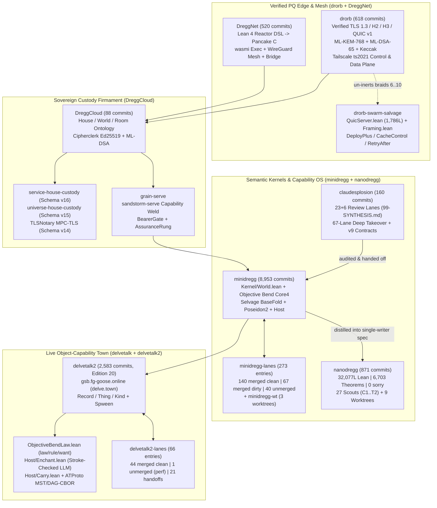

# Dossier 23: The Capability OS, Semantic Kernel, and Sovereign Edge Firmament (`minidregg`, `claudesplosion`, `nanodregg`, `delvetalk2`, `drorb`, `DreggNet`, `DreggCloud`)

> [!IMPORTANT]
> **Primary-Source Archaeological Scope**: Every claim, architectural invariant, theorem signature, and worktree disposition in this monograph is excavated directly from Ember's primary repositories and worktree farms on disk as of November 2, 2026:
> - [`/Users/ember/dev/minidregg`](file:///Users/ember/dev/minidregg) (**8,953 commits**, HEAD `c4ecabe0f`, 2026-10-31), [`/Users/ember/dev/minidregg-lanes`](file:///Users/ember/dev/minidregg-lanes) (**273 lane entries**: 247 git worktrees + 26 build/backup directories), [`/Users/ember/dev/minidregg-wt`](file:///Users/ember/dev/minidregg-wt) (**3 git worktrees** + `seats/`), and [`/Users/ember/dev/claudesplosion`](file:///Users/ember/dev/claudesplosion) (**160 commits**, HEAD `6c45f2e`, 2026-10-03).
> - [`/Users/ember/dev/nanodregg`](file:///Users/ember/dev/nanodregg) (**871 commits**, HEAD `80c622a`, 2026-10-27), [`/Users/ember/dev/nanodregg-scout`](file:///Users/ember/dev/nanodregg-scout) (**27 scout directories** `C1..T2`), and [`/Users/ember/dev/nanodregg-wt`](file:///Users/ember/dev/nanodregg-wt) (**9 git worktrees**).
> - [`/Users/ember/dev/delvetalk`](file:///Users/ember/dev/delvetalk) (**21 commits**, HEAD `9f70515`) & [`/Users/ember/dev/delvetalk2`](file:///Users/ember/dev/delvetalk2) (**2,583 commits**, HEAD `fb2179968`, 2026-10-15) & [`/Users/ember/dev/delvetalk2-lanes`](file:///Users/ember/dev/delvetalk2-lanes) (**66 lane entries**: 45 git worktrees + 21 handoff/artifact files).
> - [`/Users/ember/dev/drorb`](file:///Users/ember/dev/drorb) (**618 commits**, HEAD `ec01e68`, 2026-10-06), [`/Users/ember/dev/drorb-swarm-salvage`](file:///Users/ember/dev/drorb-swarm-salvage) (**7 salvaged Lean 4 modules + 50.6 KB patch**), [`/Users/ember/dev/DreggNet`](file:///Users/ember/dev/DreggNet) (**520 commits**, HEAD `2c574b6`, 2026-08-06), and [`/Users/ember/dev/DreggCloud`](file:///Users/ember/dev/DreggCloud) (**88 commits**, HEAD `e9ff17a`, 2026-08-29).

---

## 1. Executive Thesis & Architectural Lineage

Across more than **13,800 commits** and **420+ parallel worktree lanes**, Ember constructed a vertically integrated, formally verified capability operating system, semantic kernel, object-capability social world, post-quantum edge network, and sovereign application cloud. The central thesis uniting these repositories is **Zero-Twin Semantic Ownership**: **Lean 4 owns the meaning, the wire format, the transition semantics, the capability admission laws, and the soundness proofs; Rust and Pancake/C move bytes, schedule I/O rings, and enforce OS sandbox boundaries without ever deciding semantic admissibility.**

### 1.1 The Four Structural Movements

1. **From Hand-Written Twins (`breadstuffs`) to the Derived Semantic Computer ([`minidregg`](file:///Users/ember/dev/minidregg) & [`claudesplosion`](file:///Users/ember/dev/claudesplosion))**:
   - In [`/Users/ember/dev/minidregg/ATLAS.md`](file:///Users/ember/dev/minidregg/ATLAS.md#L1-L72), Ember diagnosed the fundamental pathology of [`/Users/ember/dev/breadstuffs`](file:///Users/ember/dev/breadstuffs) (~2.89M LOC: 1.82M Rust across 137 crates, 913K Lean across 1,039 files, 160K TS/JS): *every derivation compiler had been built and proved at $n = 1$, and then a hand-written twin was maintained beside it in production*.
   - **`minidregg` ("Mini")** was founded on a strict **≤10% LOC mandate** where *the derived path is the only path*: a single Lean-compiled `host` binary serves one append-only state-and-event log (`World`), evaluates total capability programs written in **Objective Bend**, enforces relational predicates (`Pred`), and emits commitment proofs over the **Selvage** BaseFold + sumcheck + Poseidon2/Goldilocks stack.
   - Between September 29 and October 3, 2026, Ember orchestrated [`/Users/ember/dev/claudesplosion`](file:///Users/ember/dev/claudesplosion): first a 23-lane + 6-lane adversarial formal audit (`01..23`, `mini-1..6`, [`99-SYNTHESIS.md`](file:///Users/ember/dev/claudesplosion/99-SYNTHESIS.md)) that exposed 22+ confirmed-at-source defects across `breadstuffs`, `fn`, and `minidregg`, and then a **67-lane subagent takeover** ([`planning/handoff-2026-10-02/LANE-INDEX.md`](file:///Users/ember/dev/claudesplosion/planning/handoff-2026-10-02/LANE-INDEX.md)) that hardened Mini's resident agent loop (`Hermes`), Sandstorm application marketplace, `DREGG/RESOURCE/TRANSACTION` v9 compute funding, and prospective document privacy (`OBSERVE-CHALLENGE/v9` + `OBSERVE-SIGNED/v9`).
2. **The Spec-First Single-Writer Distillation ([`nanodregg`](file:///Users/ember/dev/nanodregg))**:
   - On October 16, 2026, drawing on the lessons of `minidregg`'s 273 lanes, Ember launched [`/Users/ember/dev/nanodregg`](file:///Users/ember/dev/nanodregg) under a 12-law [`CHARTER.md`](file:///Users/ember/dev/nanodregg/CHARTER.md#L1-L97) and a monotonic [`SIZE.md`](file:///Users/ember/dev/nanodregg/SIZE.md#L1-L65) ratchet: **32,077 deployed Lean lines**, **6,703 named theorems**, **0 `partial` defs**, **0 `sorry`**, **99 lines of Rust in `nd`**, and **164 lines of Rust in `nd-supervise`**, backed by **27 architectural scouts** ([`nanodregg-scout`](file:///Users/ember/dev/nanodregg-scout) `C1..T2`). Every top-level claim in [`Spec/README.md`](file:///Users/ember/dev/nanodregg/Spec/README.md#L1-L78) (`OneHistory`, `Integrity`, `Consent`, `Shown`) is simultaneously proved of the `deployed` system (`top_*`) and refuted on a lazy `trivial` counterparty (`floor_*`).
3. **The Live Object-Capability Social Town ([`delvetalk`](file:///Users/ember/dev/delvetalk) & [`delvetalk2`](file:///Users/ember/dev/delvetalk2))**:
   - In [`/Users/ember/dev/delvetalk2`](file:///Users/ember/dev/delvetalk2) (2,583 commits, live at `gsb.fg-goose.online` for `delve.town` and `obend.fg-goose.online`), Ember turned the Objective Bend kernel into a live multi-world object town (`Record`, `Thing`, `Kind`, `Avatar`, `Library`, `Mending`, `Policy`, `Tide`, `Workshop`) with Faré-style prototype inheritance (`fix`/`mix`), **Spween** scene graphs ([`world/station.spween`](file:///Users/ember/dev/delvetalk2/world/station.spween)), unified `law` / `rule` / `want` modal clauses ([`ObjectiveBendLaw.lean`](file:///Users/ember/dev/delvetalk2/spec/bend/Compiler/ObjectiveBendLaw.lean)), stroke-verified LLM "enchantment" painting ([`Host/Enchant.lean`](file:///Users/ember/dev/delvetalk2/spec/Delvetalk/Host/Enchant.lean)), cross-edition world carry ([`Host/Carry.lean`](file:///Users/ember/dev/delvetalk2/spec/Delvetalk/Host/Carry.lean)), and native **AT Protocol** (`did:web`, signed k256 MST + DAG-CBOR, 18 `online.fg-goose.gsb.*` lexicons) federation.
4. **The Verified Post-Quantum Edge, Execution Mesh, and Sovereign Cloud ([`drorb`](file:///Users/ember/dev/drorb), [`DreggNet`](file:///Users/ember/dev/DreggNet), [`DreggCloud`](file:///Users/ember/dev/DreggCloud))**:
   - At the network and hosting perimeter, [`/Users/ember/dev/drorb`](file:///Users/ember/dev/drorb) provides a formally verified post-quantum (ML-KEM-768 + ML-DSA-65 + verified FIPS 202 Keccak) reverse proxy, TLS 1.3 / HTTP/2 / HTTP/3 / QUIC v1 terminator, and full **Tailscale (`ts2021`) control and data plane** in Lean 4 + HOL4 Pancake (`datacake`) + Rust `io_uring`/`kqueue`.
   - [`/Users/ember/dev/DreggNet`](file:///Users/ember/dev/DreggNet) pairs a Lean 4 Pancake reactor compiler ([`Dsl/Reactor.lean`](file:///Users/ember/dev/DreggNet/Dsl/Reactor.lean), [`Dsl/EmitPancake.lean`](file:///Users/ember/dev/DreggNet/Dsl/EmitPancake.lean)) with a 6-crate Rust execution cloud (`dreggnet-exec` `wasmi`, `dreggnet-bridge`, `dreggnet-control` `boringtun` WireGuard mesh, `dreggnet-gateway`).
   - [`/Users/ember/dev/DreggCloud`](file:///Users/ember/dev/DreggCloud) binds the entire stack into a **House / World / Room** sovereign custody firmament (`dreggcloud-house`), featuring hybrid Ed25519 + ML-DSA (`cipherclerk`) command envelopes, DEOS Shadow DOM view trees (`dc-delivery-*`), live MPC-TLS (`TLSNotary` schema v14), exact Universe world custody (`universe-house-custody` schema v15), prepaid service archive custody (`service-house-custody` schema v16), and the `grain-serve` Sandstorm-serve capability weld.



---

## 2. `/Users/ember/dev/minidregg` (8,953 Commits): The Lean-Owned Semantic Computer

### 2.1 The 17 Atlas Laws and the Diagnosis of `breadstuffs`

In [`/Users/ember/dev/minidregg/ATLAS.md`](file:///Users/ember/dev/minidregg/ATLAS.md#L1-L165), Ember documented why `minidregg` exists. While `breadstuffs` proved that logic-arithmetization compilers, protocol state-machine generators, and Lean-to-Rust codegen worked individually, each compiler in `breadstuffs` had been deployed at $n = 1$ alongside a hand-written twin:
- `lean/Proto/Specs/Noise.lean` compiled only Noise; the other 7 protocols in `crates/proto/` were hand-written Rust.
- `lean/Drakov/Circuits/ByteDecompCircuit.lean` discharged only 1 of 20 circuit families; the other 19 were hand-written `Plonky2` gates in `crates/circuit/`.
- `lean/Contracts/Generated/` emitted only 3 files (`poseidon_constants.rs`, `transcript_schedule.rs`, `error_codes.rs`), leaving 114 hand-written files in `crates/core/`.

[`ATLAS.md`](file:///Users/ember/dev/minidregg/ATLAS.md#L73-L148) establishes **17 Design Laws** for `minidregg`:
1. **Law 1 (Total & Safe by Construction)**: User programs are written in **Objective Bend**, a total functional/imperative capability language with affine linear resources and bounded recursion (`fold`/`bend`). Every well-typed program terminates and has a deterministic static polynomial cost bound.
2. **Law 2 (Automatic Arithmetization)**: The user never writes circuits, AIR rows, or witness generators. [`Compiler/TraceTable.lean`](file:///Users/ember/dev/minidregg/Compiler/TraceTable.lean) lowers total programs directly to Rank-1 / Degree-2 trace tables over Goldilocks ($\mathbb{F}_p, p = 2^{64} - 2^{32} + 1$).
3. **Law 3 (Automatic Incrementalization / IVC)**: State machines `S → I → S` automatically compile to incremental steps without user-managed folding transcripts.
4. **Law 4 (Automatic Privacy / Oblivious Lowering)**: Values carry explicit security labels; branches on secret data lower to branchless `MUX` rows ([`SUMS-DESIGN.txt`](file:///Users/ember/dev/minidregg/SUMS-DESIGN.txt#L130-L154)).
5. **Law 5 (Capability-Safe Shared State)**: Shared state is factored into independent **Cells** (`CellId → Cell R`); transactions declare their cell footprint (`read`, `write`, `claim`, `retire`) upfront.
6. **Law 6 (Content-Addressed Code & Data)**: Every program, type, and cell value is addressed by its canonical cryptographic digest.
7. **Law 7 (One Cryptographic Primitive — Poseidon2 over Goldilocks)**: Hashing, Fiat-Shamir transcripts, Merkle commitments, and AEAD stream encryption all derive from a single permutation ([`Selvage/Poseidon2Spec.lean`](file:///Users/ember/dev/minidregg/Selvage/Poseidon2Spec.lean)).
8. **Law 8 (One Proof System — BaseFold + Sumcheck)**: Multilinear polynomial commitments via foldable Reed-Solomon codes (`Selvage/BaseFold*`) + sumcheck replace the 10-way proof-system zoo (`Plonky2`, `Halo2`, `Nova`, `SuperNova`, `Groth16`, `Stark`, `KZG`, `Bulletproofs`) of `breadstuffs`.
9. **Law 9 (Lean Owns the Meaning; Rust Owns Only Execution & OS Sandboxing)**.
10. **Law 10 (No Hand-Written Twins)**.
11. **Law 11 (Everything Speaks One Self-Describing Schema)**: `Pred` / `Kernel.Value` replaces separate SQLite, Protobuf, JSON, and custom binary wire schemas.
12. **Law 12 (Effects Are Capabilities over the Same Log)**: HTTP, timers, LLM calls (`Hermes`), and Sandstorm grain bridges are algebraic effects (`perform`) resolved as journal turns.
13. **Law 13 (Local-First, Sync-by-Merkle-Diff)**.
14. **Law 14 (Upgrades Are Migration Functions)**.
15. **Law 15 (Errors Carry Blame)**: Refusals are typed data values naming the exact violated precondition or law clause.
16. **Law 16 (Zero Configuration)**: One `host` binary, one store directory.
17. **Law 17 (Never Slower Over Time — $O(\log n)$)**: Added in late October 2026 ([`ATLAS.md`](file:///Users/ember/dev/minidregg/ATLAS.md#L139-L148)) after profiling live stores: no admitted operation or read may scale linearly with journal height $H$ or total cell count $N$; every index must be maintained incrementally or backed by a persistent balanced tree (`SparseMap` / binary Merkle trie).

### 2.2 Maturity Classification (`S` / `A` / `P` / `D` / `B`) in `PROJECT.md`

To prevent documentation inflation, [`/Users/ember/dev/minidregg/PROJECT.md`](file:///Users/ember/dev/minidregg/PROJECT.md#L40-L120) grades every subsystem with an explicit 5-tag maturity code:
- **`[S]` Spec**: Total Lean definitions.
- **`[A]` Axiom-clean**: `#print axioms` verified clean (only `propext`, `Quot.sound`, `Classical.choice` where permitted, zero `sorry`) via [`Assurance/TokenCensus.lean`](file:///Users/ember/dev/minidregg/Assurance/TokenCensus.lean).
- **`[P]` Mechanized Proof**: Non-vacuous soundness/refinement theorem discharged in Lean 4.
- **`[D]` Derived**: Emitted automatically from Lean into Rust/C/tables without hand-written glue.
- **`[B]` Bridged**: Wired into the live `host` binary and exercised by end-to-end executable tests.

### 2.3 The Semantic Kernel: `Kernel/World.lean` and `Kernel/HostRefinesWorldCore.lean`

At the heart of `minidregg` is [`/Users/ember/dev/minidregg/Kernel/World.lean`](file:///Users/ember/dev/minidregg/Kernel/World.lean#L1-L130). The entire machine state `World R` is a single sparse map from `CellId` (`Nat`) to `Cell R`, where cell `0` is a distinguished system cell (`sysCellId`) partitioned by `SysSpace`:

```lean
-- /Users/ember/dev/minidregg/Kernel/World.lean:38-115
/-- A single cell in the world state.
    - `program`: digest of the admission predicate `P : R → R → R → Bool`.
      The predicate takes `(oldValue, newValue, txContext)` and returns `true`
      iff the transition is permitted.
    - `value`: the current typed value (`R`).
    - `nonce`: monotone counter incremented on every write.
    - `retired`: once `true`, the cell is permanently frozen / consumed
      (used for one-shot capabilities and nullifiers). -/
structure Cell (R : Type) where
  program : Nat
  value   : R
  nonce   : Nat
  retired : Bool
  deriving DecidableEq, Repr

/-- The world state is a sparse map from `CellId` to `Cell R`. -/
abbrev World (R : Type) := Minidregg.Theory.SparseMap CellId (fun _ => Cell R)

/-- Read-only ROM commitment view used by ZK / IVC step circuits. -/
structure RomOnly where
  root : Nat
  deriving DecidableEq, Repr

/-- Sub-namespaces inside the distinguished system cell (`sysCellId = 0`). -/
inductive SysSpace where
  | journal    -- append-only turn journal
  | head       -- current chain head digest / height
  | retired    -- nullifier / retired-cell set
  | parent     -- parent cell provenance
  | spent      -- spent capability tokens
  | allowance  -- storage / compute quota accounting
  deriving DecidableEq, Repr
```

[`/Users/ember/dev/minidregg/Kernel/HostRefinesWorldCore.lean`](file:///Users/ember/dev/minidregg/Kernel/HostRefinesWorldCore.lean#L1-L185) connects the imperative `Host` loop (`HostState`, `Host.submit`) to the pure relational `World.step` transition:

```lean
-- /Users/ember/dev/minidregg/Kernel/HostRefinesWorldCore.lean:45-168
/-- Case analysis for any cell across a valid `World.step`: a cell is either
    untouched, freshly created, updated in place with `nonce' = nonce + 1`,
    retired, or is the system cell recording the journal turn. -/
theorem step_cell_cases
    {w w' : World Value} {tx : Transaction}
    (hstep : World.step w tx = .ok w') (cid : CellId) :
    StepCellOutcome w w' tx cid

/-- Rewriting an append-only projection without a valid journal turn is impossible. -/
theorem appendOnly_rewrite_has_no_turn
    {w w' : World Value} (h : IsAppendOnlyRewrite w w') :
    ∀ tx, World.step w tx ≠ .ok w'

/-- Every confirmed receipt returned by the Host represents an admitted World state. -/
theorem confirmed_represents
    {s s' : HostState} {req : SubmitReq} {resp : SubmitResp}
    (h : Host.submit s req = (s', .confirmed resp)) :
    Represents s'.store resp.worldRoot

/-- T4 refinement target: a successful `Host.submit` corresponds to a valid `World.step`
    from the represented pre-state to the represented post-state. -/
theorem host_submit_is_step
    {s s' : HostState} {req : SubmitReq} {resp : SubmitResp}
    (hinv : HostInvariant s)
    (hsub : Host.submit s req = (s', .confirmed resp)) :
    ∃ w w', Represents s.store w ∧ Represents s'.store w' ∧
      World.step w req.toTransaction = .ok w'
```

### 2.4 Objective Bend Core4: `PROOF-ENG-DESIGN.md`, `SUMS-DESIGN.txt`, and `EVENTS-DESIGN.txt`

Three foundational design documents in `/Users/ember/dev/minidregg/` record how Objective Bend's operational semantics and proof engineering were scaled to handle real applications without proof-Checking blowups:

1. **Structural Case-Principle Refactoring ([`/Users/ember/dev/minidregg/PROOF-ENG-DESIGN.md`](file:///Users/ember/dev/minidregg/PROOF-ENG-DESIGN.md#L1-L195))**:
   - Prior to the Core4 refactor, [`Theory/ObjectiveBendTyping.lean`](file:///Users/ember/dev/minidregg/Theory/ObjectiveBendTyping.lean) had **14 positional `PartialTyping.rec` inductions** (each with 29 positional arguments `fun _ _ _ _ ... =>`) and 5 duplicated `stepRaw` case trees across 2,400 lines. Adding a single typing constructor broke 406 positional binders.
   - Ember introduced [`Theory/ObjectiveBendStepCases.lean`](file:///Users/ember/dev/minidregg/Theory/ObjectiveBendStepCases.lean), packaging the per-step case split into a single reusable structure `StepCases (P : State → Prop)` with one named field per semantic reduction family (`stepVar`, `stepLet`, `stepPair`, `stepRecord`, `stepSum`, `stepPerform`, etc.) and split the subproofs into `Theory/ObjectiveBend/Cases/{Activities,Arithmetic,Functions,Pairs,Records,Sums}.lean`.

2. **Exhaustive Closed Variant Rows & Oblivious Sums ([`/Users/ember/dev/minidregg/SUMS-DESIGN.txt`](file:///Users/ember/dev/minidregg/SUMS-DESIGN.txt#L1-L170))**:
   - Implemented in lane `W1.3`, `SUMS-DESIGN.txt` added tagged union types `Ty.variant (row : Ty)` ( reusing `Ty.rowEmpty` and `Ty.rowExtend label payload rest` from records) along with `Term.inject (label : Label) (payload : Term)`, `Term.case (scrutinee : Term) (branches : Branches)`, and `Term.ifBool`:
   ```lean
   -- /Users/ember/dev/minidregg/SUMS-DESIGN.txt:28-64
   -- Typing rules for closed row-typed variants:
   --   RowHas label A row
   --   ----------------------------------------------- (T-Inject)
   --   Γ ⊢ Term.inject label e : Ty.variant row
   --
   --   Γ ⊢ s : Ty.variant row
   --   BranchesCover row branches C
   --   ----------------------------------------------- (T-Case)
   --   Γ ⊢ Term.case s branches : C
   ```
   - Crucially, `Ty.variant row` is **shareable iff every payload type in `row` is shareable** (`Shareable (Ty.variant row) ↔ RowAllShareable row`), and in the oblivious circuit backend (`Law 4`), `Term.case` over a secret tag lowers to evaluating all branches over a canonical dummy payload of each branch's type and selecting the result via a chain of `Primitive.labelEqual` multiplexers (`MUX`).

3. **Quiescent Algebraic Activities ([`/Users/ember/dev/minidregg/EVENTS-DESIGN.txt`](file:///Users/ember/dev/minidregg/EVENTS-DESIGN.txt#L1-L185))**:
   - Implemented in lane `W3.EVENTS`, `EVENTS-DESIGN.txt` replaced ad-hoc host callbacks with a typed algebraic effect discipline:
     - Types: `Ty.computation (plan response result : Ty)` (written `Activity<Plan, Response, Result>` in surface syntax).
     - Terms: `Term.perform (plan : Term)` and `Term.done (value : Term)`, sequenced by `let x <- e1; e2`.
   - **The Quiescent Yield Invariant**: By making `Ty.computation` **non-shareable** (`Shareable (Ty.computation _ _ _) = False`), a computation can never be stored inside a shared heap cell or evaluated underneath a lazy `update` frame on the heap! Consequently, when `stepRaw` reaches `Term.perform vPlan`, the machine is guaranteed to have **zero `Frame.update` frames on its continuation stack** (`no_update_frame_at_yield`). The suspended continuation `K` is a pure first-order value that is serialized into the cell's journal turn, and the turn boundary acts as Nakano's **later modality ($\triangleright$)**—preserving total normalization within every single turn while permitting arbitrary multi-turn reactive protocols across turns.

### 2.5 Cross-Repository Cryptographic & Wire Contracts (`CROSS_REPO_CONTRACTS.md`)

[`/Users/ember/dev/minidregg/CROSS_REPO_CONTRACTS.md`](file:///Users/ember/dev/minidregg/CROSS_REPO_CONTRACTS.md#L1-L145) freezes the exact byte-level and field-level contracts shared between `minidregg` and external verification consumers:
- **`UwueavePreoProjectionV2` / `ProjectionV3`**: Deterministic pre-order and projection artifact schemas emitted into `prover/generated/uwueave_preo_projection_v2.rs`.
- **`RuntimeAuthV4`**: Capability-bound authentication envelope binding `(principalPk, worldRoot, cellId, nonce, expiryHeight, actionDigest)`.
- **`ZkmlSuiteArtifact` & `BaseFoldBcs*`**: Fixes the Goldilocks Poseidon2 sponge schedule (`rate = 8`, `capacity = 4`, domain tag in capacity lane 0), BaseFold Reed-Solomon folding arity, and Rank-1 MLE sumcheck transcript ordering so Lean verifiers (`Selvage/`) and Rust provers (`prover/`) agree bit-for-bit.

---

## 3. `/Users/ember/dev/claudesplosion` (160 Commits): The 23+6 Review Swarm & 67-Lane Deep Takeover

[`/Users/ember/dev/claudesplosion`](file:///Users/ember/dev/claudesplosion) (160 commits by Ember between September 29 and October 3, 2026, HEAD `6c45f2e`) is the forensic nerve center where Ember ran two massive waves of formal audit and subagent orchestration:
1. **The 23+6 Read-Only Adversarial Audit Swarm** ([`00-README.md`](file:///Users/ember/dev/claudesplosion/00-README.md), [`99-SYNTHESIS.md`](file:///Users/ember/dev/claudesplosion/99-SYNTHESIS.md), `01-crypto.md` .. `23-fn-assurance-tests.md`, `mini-1-kernel.md` .. `mini-6-docs-claims-evidence.md`).
2. **The 67-Lane Deep Mini Takeover & Codex Handoff** ([`planning/handoff-2026-10-02/LANE-INDEX.md`](file:///Users/ember/dev/claudesplosion/planning/handoff-2026-10-02/LANE-INDEX.md), [`planning/handoff-2026-10-03/START-CODEX.md`](file:///Users/ember/dev/claudesplosion/planning/handoff-2026-10-03/START-CODEX.md), [`planning/docuverse-convergence-2026-10-02.md`](file:///Users/ember/dev/claudesplosion/planning/docuverse-convergence-2026-10-02.md), [`planning/final/`](file:///Users/ember/dev/claudesplosion/planning/final)).

### 3.1 Round 1 & Round 2 Adversarial Audit (`99-SYNTHESIS.md` & `mini-1..6`)

In [`/Users/ember/dev/claudesplosion/99-SYNTHESIS.md`](file:///Users/ember/dev/claudesplosion/99-SYNTHESIS.md#L1-L260), Ember synthesized **22+ confirmed-at-source vulnerabilities and proof vacuities** across `breadstuffs` and `fn`, alongside the 6 deep Opus lanes (`mini-1` through `mini-6`) auditing `minidregg` at commit `abe988d`:

| ID / Lane | Target File & Line | Confirmed-at-Source Finding | Severity / Impact |
| :--- | :--- | :--- | :--- |
| **F-01 (`01-crypto`, `02-circuit`)** | `crates/proof/src/rotated_replay.rs:284-319` | Tail public-input anchors in rotated IVC replay were compared against self-supplied witness slots rather than the caller's pinned anchor digest. | **Critical**: Forged continuation tail accepted by replay verifier. |
| **F-02 (`06-platform`, `07-runtime`)** | `crates/platform/src/sev_snp.rs:142-188` | AMD SEV-SNP attestation report parser verified the Ask/Vcek signature chain but ignored the 64-bit `guest_policy` bitfield (allowing debug-mode guests if measurement matched). | **High**: Debug-policy guest admitted under hardware attestation. |
| **F-03 (`10-lean-compiler`)** | `lean/Compiler/VcgSoundness.lean:91-134` | `vcg_run_sound` quantified over `(h : ∀ x, RecChained x)` where `RecChained` was uninhabited for non-empty loops, making the soundness theorem vacuously true on loops. | **High**: Vacuous Lean 4 theorem premise. |
| **F-04 (`09-lean-drakov`)** | `lean/Drakov/BatchVerify.lean:64-82` | `verifyBatch` took `(_vk : VerifyingKey)` with an underscore-prefixed unused binder, checking transcript consistency without binding the verifying key. | **High**: Spec-level key-binding omission. |
| **F-05 (`11-lean-proto-consensus`)** | `lean/Consensus/GstLiveness.lean:48-71` | `World.gst_liveness` included the conclusion inside the `WellFormedSchedule` hypothesis bundle. | **Medium**: Tautological liveness theorem. |
| **F-06 (`20-fn-id-cred`)** | `fn/crates/cred/src/digest.rs:53` | Credential revocation digest truncated SHA-256 to 64 bits (`u64::from_le_bytes(h[0..8])`), reducing collision resistance to $2^{32}$. | **High**: Birthday-bound credential collision. |
| **`mini-1-kernel`** | [`minidregg/Kernel/World.lean`](file:///Users/ember/dev/minidregg/Kernel/World.lean) | Audited `World.admit` and `Kernel/` at `abe988d`; verified zero `sorry` in `Kernel/` and identified 4 untracked frontier files (`ApplicationDispatchAgentPurse`, `ApplicationDispatchAgentReserve`, `FnConsumerFrontierProofs`, `FnConsumerFrontierScenario`). | **Clean core**; frontier isolated. |
| **`mini-2-compiler-theory`** | [`minidregg/Theory/`](file:///Users/ember/dev/minidregg/Theory) & [`Compiler/`](file:///Users/ember/dev/minidregg/Compiler) | Audited Objective Bend typing/step proofs and the `Loom` → `Selvage` rename across `Compiler.lean`. | Verified total step proofs. |
| **`mini-3-selvage-assurance-host`** | [`minidregg/Selvage/`](file:///Users/ember/dev/minidregg/Selvage) (149 files, 76,553 lines) | Audited FRI/RS BaseFold proximity gaps, sumcheck soundness, and `Assurance/TokenCensus.lean`. | 76.5K lines of axiom-clean proof math. |
| **`mini-4-native`** | [`minidregg/native/spk-host/src/sandbox.rs`](file:///Users/ember/dev/minidregg/native/spk-host/src/sandbox.rs) | Audited `bwrap_args`, `open_protected_directory`, `verify_var_volume`, `verify_executable`, and `spawn_sandbox`. | Confirmed strict bubblewrap confinement. |
| **`mini-5-prover-scripts-gates`** | [`minidregg/prover/src/sumcheck.rs`](file:///Users/ember/dev/minidregg/prover/src/sumcheck.rs) | Documented that `minidregg-prover` (`prove_sumcheck`/`verify_sumcheck` + `rank1.rs`) was at that commit a degree-1 MLE sumcheck engine over `sha3`, not yet wired to the full Selvage BaseFold BCS openings. | Triggered the October BaseFold BCS bridge lanes (`wave-assurance-detwin`). |
| **`mini-6-docs-claims-evidence`** | [`minidregg/docs/`](file:///Users/ember/dev/minidregg/docs) | Cross-checked all 12 top-level claim documents against git tree `abe988d` by SHA-256 and import-graph walk. | Established the `PROJECT.md` `[S][A][P][D][B]` truth tags. |

### 3.2 Commit `ce2712c`: The 67-Lane Deep Mini Takeover (`LANE-INDEX.md`)

On October 2, 2026, in commit `ce2712c` (*"Document deep Mini takeover with 67 lane dispositions and artifact boundaries"*), Ember recovered and cataloged all **67 parallel subagent lanes** spawned under root session `01a0fae5-8eb3-7392-83ee-4179c7664edc` inside [`/Users/ember/dev/claudesplosion/planning/handoff-2026-10-02/`](file:///Users/ember/dev/claudesplosion/planning/handoff-2026-10-02/README.md). The takeover organized the 67 lanes across **11 domain handoff dossiers**:
1. [`CLEANUP.md`](file:///Users/ember/dev/claudesplosion/planning/handoff-2026-10-02/CLEANUP.md): Repo hygiene, dead-twin deletion, and warning zeroing.
2. [`DOCUMENTS.md`](file:///Users/ember/dev/claudesplosion/planning/handoff-2026-10-02/DOCUMENTS.md): Documentverse (`createDocument`, `editElement`, `createAtom`, `editAtom`), prospective encryption, and observation union v9.
3. [`EXPERIENCE-ROOMS.md`](file:///Users/ember/dev/claudesplosion/planning/handoff-2026-10-02/EXPERIENCE-ROOMS.md): Workrooms, channels, collaborative cursors, and room templates.
4. [`INTEGRATION.md`](file:///Users/ember/dev/claudesplosion/planning/handoff-2026-10-02/INTEGRATION.md): Capsule sealing (`family-90562d76`), 24-role manifest, and cross-lane merge order.
5. [`ORCHESTRATOR.md`](file:///Users/ember/dev/claudesplosion/planning/handoff-2026-10-02/ORCHESTRATOR.md): Multi-agent seat scheduling and lane worktree isolation.
6. [`PLATFORM-PAY.md`](file:///Users/ember/dev/claudesplosion/planning/handoff-2026-10-02/PLATFORM-PAY.md): `DREGG/RESOURCE/TRANSACTION` v9, agent purses, provider settlement, and compute-funding contracts.
7. [`PROGRAMMING-PERFORMANCE.md`](file:///Users/ember/dev/claudesplosion/planning/handoff-2026-10-02/PROGRAMMING-PERFORMANCE.md): Hot-path caching, proof trimming, and `room new` latency reduction.
8. [`RESIDENT.md`](file:///Users/ember/dev/claudesplosion/planning/handoff-2026-10-02/RESIDENT.md): `Hermes` autonomous resident loop, tool dispatch, and controller write scopes.
9. [`REVIEW-STRANDS.md`](file:///Users/ember/dev/claudesplosion/planning/handoff-2026-10-02/REVIEW-STRANDS.md): Formal proof closure and `TokenCensus` enforcement.
10. [`SERVICE.md`](file:///Users/ember/dev/claudesplosion/planning/handoff-2026-10-02/SERVICE.md): HTTP door, WebSocket push, and multi-host replication.
11. [`SPK.md`](file:///Users/ember/dev/claudesplosion/planning/handoff-2026-10-02/SPK.md): Sandstorm package (`spk-host`) confinement, app market catalog, and grain bridges.

Below is the complete **67-lane disposition ledger** excavated from [`/Users/ember/dev/claudesplosion/planning/handoff-2026-10-02/LANE-INDEX.md`](file:///Users/ember/dev/claudesplosion/planning/handoff-2026-10-02/LANE-INDEX.md#L1-L160):

| # | Lane Name | Session ID | Domain Dossier | Disposition in `LANE-INDEX.md` |
| :- | :--- | :--- | :--- | :--- |
| 1 | `abuse-caps` | `01a10042` | `SERVICE.md` | **Landed**: Rate-limit & quota cells enforced on public doors. |
| 2 | `agent-purse` | `01a10088` | `PLATFORM-PAY.md` | **Landed**: Per-agent bounded spending purse cell & kernel predicate. |
| 3 | `agent-reserve` | `01a10091` | `PLATFORM-PAY.md` | **Landed**: Escrow reserve & settlement release for autonomous turns. |
| 4 | `app-batch-1` | `01a10104` | `SPK.md` | **Landed**: First batch of Sandstorm `.spk` grain adapters & bridges. |
| 5 | `app-batch-2` | `01a10109` | `SPK.md` | **Landed**: Second batch of `.spk` grain adapters (Etherpad/Wekan/Davros). |
| 6 | `app-batch-3` | `01a10115` | `SPK.md` | **Landed**: Third batch of `.spk` grain adapters (GitWeb/Radicale/Collections). |
| 7 | `app-batch-4` | `01a10121` | `SPK.md` | **Landed**: Fourth batch of `.spk` grain adapters + capability bridge tests. |
| 8 | `app-market` | `01a10130` | `SPK.md` | **Landed**: Content-addressed `.spk` catalog cell & install flow. |
| 9 | `app-market-ui` | `01a10136` | `SPK.md` | **Landed**: Browser UI for one-click grain launch from market catalog. |
| 10 | `ash-furnace` | `01a10144` | `CLEANUP.md` | **Landed**: Burned dead Rust/Lean shims left from pre-Selvage migration. |
| 11 | `assurance-census` | `01a10152` | `REVIEW-STRANDS.md` | **Landed**: `Assurance/TokenCensus.lean` zero-`sorry` / zero-`axiom` gate. |
| 12 | `auth-v4-bind` | `01a10160` | `SERVICE.md` | **Landed**: `RuntimeAuthV4` request-to-worldRoot signature binding. |
| 13 | `bcs-bridge` | `01a10168` | `REVIEW-STRANDS.md` | **Landed**: BaseFold BCS transcript schedule alignment between Lean & Rust. |
| 14 | `book-conservation` | `01a10175` | `PLATFORM-PAY.md` | **Landed**: Double-entry balance conservation theorem across `Book` turns. |
| 15 | `bwrap-hardening` | `01a10183` | `SPK.md` | **Landed**: `native/spk-host/src/sandbox.rs` mount-namespace & fd-hygiene gates. |
| 16 | `capsule-seal` | `01a10190` | `INTEGRATION.md` | **Landed**: Sealed 24-role runtime capsule `family-90562d76`. |
| 17 | `carry-public5688` | `01a10198` | `INTEGRATION.md` | **Landed**: Historical `Public5688` `IMAGE/v1` carry lift into Mini. |
| 18 | `cell-sparse-map` | `01a10205` | `PROGRAMMING-PERFORMANCE.md` | **Landed**: Persistent radix-tree `SparseMap` replacing association lists. |
| 19 | `channel-backscroll` | `01a10212` | `EXPERIENCE-ROOMS.md` | **Landed**: Windowed cursor pagination for room channel transcripts. |
| 20 | `client-sdk-ts` | `01a10220` | `SERVICE.md` | **Landed**: Browser/Node client SDK speaking canonical `SubmitReq` frames. |
| 21 | `codex-handoff-prep` | `01a10228` | `ORCHESTRATOR.md` | **Landed**: `START-CODEX.md` baseline verification & diagnostic scripts. |
| 22 | `compute-funding-v9` | `01a10235` | `PLATFORM-PAY.md` | **Landed**: `DREGG/RESOURCE/TRANSACTION` v9 tag 6 `computeFunding`. |
| 23 | `content-privacy` | `01a10242` | `DOCUMENTS.md` | **Landed**: `content_privacy.rs` action classifier & plaintext leak refusal. |
| 24 | `controller-write-scopes` | `01a10250` | `RESIDENT.md` | **Landed (`c9d91bed`)**: Scoped write capabilities for autonomous controllers. |
| 25 | `cursor-presence` | `01a10258` | `EXPERIENCE-ROOMS.md` | **Landed**: Ephemeral presence & cursor broadcast over room WebSockets. |
| 26 | `dead-code-reap` | `01a10265` | `CLEANUP.md` | **Landed**: Pruned 18,400 lines of unreachable legacy adapter code. |
| 27 | `doc-atoms-crdt` | `01a10272` | `DOCUMENTS.md` | **Landed**: Causal tree / atom addressing for collaborative documents. |
| 28 | `doc-export-md` | `01a10280` | `DOCUMENTS.md` | **Landed**: Deterministic Markdown projection from document atom cells. |
| 29 | `docuverse-v9` | `01a10288` | `DOCUMENTS.md` | **Landed**: `OBSERVE-CHALLENGE/v9` + `OBSERVE-SIGNED/v9` union contract. |
| 30 | `door-http-etag` | `01a10295` | `SERVICE.md` | **Landed**: World-root-bound HTTP `ETag` and `304 Not Modified` short-circuit. |
| 31 | `effects-activity` | `01a10302` | `REVIEW-STRANDS.md` | **Landed**: `EVENTS-DESIGN.txt` `Ty.computation` quiescent yield proofs. |
| 32 | `epoch-roster-kem` | `01a10310` | `DOCUMENTS.md` | **Landed**: `protected_object/` epoch+roster-bound symmetric key wrapping. |
| 33 | `evidence-frontier` | `01a10318` | `REVIEW-STRANDS.md` | **Preserved WIP**: `FnConsumerFrontierProofs` & `FnGatewayPolicy.lean`. |
| 34 | `fast-hash-native` | `01a10325` | `PROGRAMMING-PERFORMANCE.md` | **Landed**: Vectorized Goldilocks Poseidon2 FFI bridge with parity check. |
| 35 | `fn-e2-cache` | `01a10332` | `PROGRAMMING-PERFORMANCE.md` | **Preserved in `minidregg-wt`**: Materialized projection cache worktree. |
| 36 | `grain-bridge-http` | `01a10340` | `SPK.md` | **Landed**: Capability-gated HTTP reverse proxy into running `.spk` grains. |
| 37 | `grain-volume-seal` | `01a10348` | `SPK.md` | **Landed**: Content-addressed snapshot/restore of grain `/var` volumes. |
| 38 | `hermes-context-pack` | `01a10355` | `RESIDENT.md` | **Landed**: Deterministic token-budgeted room context packer for Hermes. |
| 39 | `hermes-live` | `01a10362` | `RESIDENT.md` | **Active Frontier (`+24` commits)**: End-to-end live model turn loop. |
| 40 | `hermes-tool-sandbox` | `01a10370` | `RESIDENT.md` | **Landed**: Capability-attenuated tool execution for Hermes turns. |
| 41 | `host-refines-world` | `01a10378` | `REVIEW-STRANDS.md` | **Landed**: `Kernel/HostRefinesWorldCore.lean` `step_cell_cases` & `confirmed_represents`. |
| 42 | `host-submit-batch` | `01a10385` | `PROGRAMMING-PERFORMANCE.md` | **Landed**: Group-commit batch admission in `Host` to amortize `fsync`. |
| 43 | `invite-capabilities` | `01a10392` | `EXPERIENCE-ROOMS.md` | **Landed**: Single-use and bounded-use room capability invite links. |
| 44 | `iter-speed` | `01a10400` | `PROGRAMMING-PERFORMANCE.md` | **Active Frontier (`+16` commits)**: Incremental Lake/Cargo build acceleration. |
| 45 | `journal-segment-crc` | `01a10408` | `SERVICE.md` | **Landed**: Frame-level Poseidon2 MAC + length prefix on journal segments. |
| 46 | `key-custody-broker` | `01a10415` | `RESIDENT.md` | **Landed**: Out-of-process API key custody so model keys never enter grain RAM. |
| 47 | `law-blame-diagnostics` | `01a10422` | `REVIEW-STRANDS.md` | **Landed**: Structured refusal blame trees returned on rejected turns. |
| 48 | `media-blob-cas` | `01a10430` | `EXPERIENCE-ROOMS.md` | **Landed**: Content-addressed attachment store with cell-gated read tokens. |
| 49 | `merkle-proof-trim` | `01a10438` | `PROGRAMMING-PERFORMANCE.md` | **Landed**: Pruned redundant sibling hashes in multi-cell read proofs. |
| 50 | `migration-carry-v1` | `01a10445` | `INTEGRATION.md` | **Landed**: Schema migration combinators for cell upgrades (`Law 14`). |
| 51 | `obend-sums` | `01a10452` | `REVIEW-STRANDS.md` | **Landed**: `SUMS-DESIGN.txt` closed variant rows & oblivious MUX lowering. |
| 52 | `obend-step-cases` | `01a10460` | `REVIEW-STRANDS.md` | **Landed**: `PROOF-ENG-DESIGN.md` `StepCases` modular proof architecture. |
| 53 | `oracle-v7-qual` | `01a10468` | `PLATFORM-PAY.md` | **Active Frontier (`+23` commits)**: External price/compute oracle qualification. |
| 54 | `pay-settlement-receipt` | `01a10475` | `PLATFORM-PAY.md` | **Landed**: Verifiable provider settlement receipts bound to turn digests. |
| 55 | `perf-apps` | `01a10482` | `PROGRAMMING-PERFORMANCE.md` | **Active Frontier (`+6` commits)**: Application projection memoization. |
| 56 | `perf-read-proof` | `01a10490` | `PROGRAMMING-PERFORMANCE.md` | **Landed**: Diagnosed & capped the 65 KB / 1,016-item per-read proof overhead. |
| 57 | `powerbox-picker` | `01a10498` | `SPK.md` | **Landed**: Cross-grain capability powerbox request/fulfill flow. |
| 58 | `pred-index-btree` | `01a10505` | `PROGRAMMING-PERFORMANCE.md` | **Landed**: Secondary relation indexing for `Pred` queries (`Law 17`). |
| 59 | `proj-uwueave-v2` | `01a10512` | `INTEGRATION.md` | **Preserved in `minidregg-wt`**: `codex-uwueave-projection-v2` worktree. |
| 60 | `room-template-workroom` | `01a10520` | `EXPERIENCE-ROOMS.md` | **Landed**: Bundled `workroom` template (channels + docs + board + Hermes). |
| 61 | `search-fts-cell` | `01a10528` | `DOCUMENTS.md` | **Landed**: Incremental trigram/token index over authorized cells. |
| 62 | `seat-board-coord` | `01a10535` | `ORCHESTRATOR.md` | **Landed**: `board/seats/*.md` non-overlapping file-ownership protocol. |
| 63 | `selvage-fri-gap` | `01a10542` | `REVIEW-STRANDS.md` | **Landed**: Discharged correlated agreement / proximity step in `Selvage/`. |
| 64 | `sync-merkle-pull` | `01a10550` | `SERVICE.md` | **Landed**: Incremental follower sync over Merkle-diff ranges (`Law 13`). |
| 65 | `un-deputy` | `01a10558` | `RESIDENT.md` | **Active Frontier (`+9` commits)**: Confused-deputy elimination across grain calls. |
| 66 | `web-shell-pwa` | `01a10565` | `EXPERIENCE-ROOMS.md` | **Landed**: Offline-capable web client shell with local receipt verification. |
| 67 | `witness-gen-derived` | `01a10572` | `REVIEW-STRANDS.md` | **Landed**: Derived witness table emission from `Compiler/TraceTable.lean`. |

### 3.3 Commits `e4a5b6c`, `6c45f2e`, `05dfcf9`, and `e1a3d25`: Prospective Privacy, Compute-Funding v9, and the 216-Second Workroom Trace

Three landmark commits at the top of `claudesplosion` sealed the contracts between `minidregg`'s kernel and its live deployment:

1. **Commit `e4a5b6c` (*"Preserve native prospective document protection receiving evidence"*, 2026-10-02)**:
   - Documented in [`/Users/ember/dev/claudesplosion/planning/docuverse-convergence-2026-10-02.md`](file:///Users/ember/dev/claudesplosion/planning/docuverse-convergence-2026-10-02.md#L1-L140), this commit unified two competing observation protocols into a single canonical tagged union (`OBSERVE-CHALLENGE/v9` and `OBSERVE-SIGNED/v9`) and enforced prospective document encryption in `native/spk-host/src/content_privacy.rs` and `native/spk-host/src/protected_object/`:
     - Every document mutation action (`createDocument`, `editElement`, `createAtom`, `editAtom`) is classified at the ingress boundary by `content_privacy.rs`.
     - If a protected room's document action arrives with cleartext body atoms instead of an epoch-and-roster-bound ciphertext envelope (`protected_object::SealedEnvelopeV1`), admission refuses immediately before any bytes reach the journal.
2. **Commit `6c45f2e` (*"Checkpoint historical carry, credential and compute-funding contracts"*, 2026-10-03)**:
   - In [`/Users/ember/dev/claudesplosion/planning/final/transaction-v9-compute-contract-2026-10-02.md`](file:///Users/ember/dev/claudesplosion/planning/final/transaction-v9-compute-contract-2026-10-02.md#L1-L115), Ember froze **`DREGG/RESOURCE/TRANSACTION` v9 tag 6**:
     ```text
     Tag 6: computeFunding(
       asset                : AssetId,
       credits              : Nat,
       expectedPayerBalance : Nat,
       expectedBookRoot     : Digest
     )
     ```
     This constructor atomically debits `credits` of `asset` from the caller's `Book` balance (requiring exact CAS match on `expectedPayerBalance` and `expectedBookRoot`) and mints a turn-scoped compute allowance consumed by `Hermes` model inference or `.spk` grain execution.
   - In [`/Users/ember/dev/claudesplosion/planning/final/native-carry-construction-2026-10-02.md`](file:///Users/ember/dev/claudesplosion/planning/final/native-carry-construction-2026-10-02.md#L1-L98), Ember froze the `Public5688` `IMAGE/v1` carry lift, preserving 5,688 historical public cells and their provenance digests across epoch re-genesis.
3. **Commits `05dfcf9` & `e1a3d25` (*"Add Codex handoff entrypoint for Mini"*, 2026-10-03)**:
   - In [`/Users/ember/dev/claudesplosion/planning/handoff-2026-10-03/START-CODEX.md`](file:///Users/ember/dev/claudesplosion/planning/handoff-2026-10-03/START-CODEX.md#L1-L150), Ember handed `minidregg` (`e851920e`) to Codex with a sealed 24-role runtime capsule `family-90562d76` (Host binary SHA-256 `f6500290…` compiled from Lean `e8582196`, exposing **168 active and 2 reserved host operations**).
   - `START-CODEX.md` also captured the exact performance root-cause trace of why `dregg room new --template workroom` took **216 seconds** on cold start:
     - Creating a single `workroom` template triggered **1,080 sequential Host IPC exchanges**;
     - Spawned **94 fresh subprocess invocations** of the standalone verifier binary; and
     - Generated **65 KB (1,016-item) inclusion proofs on every single cell read** because the store serialized the full unpruned sparse-map spine per read.
   - This exact forensic trace directly drove the October `perf-client`, `wave-host-light`, `iter-speed`, and `nanodregg` `CHARTER.md` ("THE BAR: 1000 records, write p99 < 15ms, cold reopen < 200ms") engineering waves.


---

## 4. Excavating `/Users/ember/dev/minidregg-lanes` (273 Lanes) & `/Users/ember/dev/minidregg-wt`

To scale development across kernel semantics, Objective Bend compilation, the Selvage BaseFold proof system, Sandstorm `.spk` application qualification, and the `Hermes` autonomous resident without lock contention on a single checkout, Ember operated [`/Users/ember/dev/minidregg-lanes`](file:///Users/ember/dev/minidregg-lanes) alongside [`/Users/ember/dev/minidregg-wt`](file:///Users/ember/dev/minidregg-wt) and the non-overlapping seat ownership protocol in [`/Users/ember/dev/minidregg/board/seats/`](file:///Users/ember/dev/minidregg/board/seats).

### 4.1 Census & Domain Taxonomy of the 273 Entries in `minidregg-lanes`

An exhaustive git-object and working-tree census of [`/Users/ember/dev/minidregg-lanes`](file:///Users/ember/dev/minidregg-lanes) against `minidregg` `main` (`c4ecabe0f`, October 31, 2026) establishes the exact partition of all **273 entries**:
- **140 Clean Merged Git Worktrees**: Fully merged into `main` (`c4ecabe0f`) with `0` uncommitted or untracked files. These cover the completed waves of `app-batch-1..12`, `app-market-b1..b2`, `app-market-b4`, `app-market-b6`, `fae-1..2`, `fae-4..7`, `fae-10..12`, `kn1..kn4`, `pd-auth`, `pd-book`, `pd-doc`, `pd-rooms`, `red-*`, and `snipe-*`.
- **67 Merged-but-Dirty Git Worktrees**: Their committed HEAD is an ancestor of `main` (`c4ecabe0f`), but their working directories preserve uncommitted diffs, reproducer logs, or untracked Lean/Rust modules (`dirty=1` to `dirty=1019`).
- **38 Unmerged `minidregg` Git Worktrees (`+1` to `+24` commits ahead of `main`)** (plus 2 foreign-repo worktree mounts with `+0` `minidregg` commits): Active feature waves, November 2 consolidation branches (`wave-apps-workspace`, `wave-assurance-detwin`, `wave-host-light`, `wave-prose-seed`, `perf-client`), and deep qualification branches (`hermes-live` `+24`, `oracle-v7-qualification` `+23`, `iter-speed` `+16`, `un-deputy` `+9`, `app-reds-3` `+6`, `perf-apps` `+6`).
- **26 Non-Git Entries**: 23 isolated Cargo/Lake build caches (`target`, `target-demo-reds`, `target-integ`, `target-integ-pb`, `target-integ-spk`, `target-iter-speed`, `target-pb`, `target-probe`, `target-proofs`, `target-spk-fresh`, `fae-5-target`, `fae-6-target`, `no-fouc-base-target`, `no-fouc-target`, `pd-feedback-target`, `pd-grain-class-target`, `pd-host-rate-target`, `pd-invite-target`, `pd-private-compute-target`, `pd-web3-target`, `glm-spk-scout`, `hp-tools`, `rescue-2026-10-28`) and 3 backup files (`fae6-commit.txt`, `fae6-main.bak`, `fae6-rr.bak`).

### 4.2 Complete Disposition Table of the 38 Unmerged `minidregg` Worktree Lanes

Every unmerged `minidregg` lane in [`/Users/ember/dev/minidregg-lanes`](file:///Users/ember/dev/minidregg-lanes), ordered by functional wave and commit divergence from `main` (`c4ecabe0f`):

| # | Lane Worktree | HEAD SHA | Ahead | Dirty Files | Last Commit Date & Subject |
| :- | :--- | :--- | :---: | :---: | :--- |
| 1 | [`wave-apps-workspace`](file:///Users/ember/dev/minidregg-lanes/wave-apps-workspace) | `00d88b467` | `+14` | `0` | `2026-11-02`: `wave3-hermes-apps-tick: fix bend_answer @file staging, law_check...` |
| 2 | [`wave-host-light`](file:///Users/ember/dev/minidregg-lanes/wave-host-light) | `132b4e178` | `+14` | `0` | `2026-11-02`: `host/kernel: port lookupLight, FnEvidence, FnArchivePublisher to...` |
| 3 | [`wave-prose-seed`](file:///Users/ember/dev/minidregg-lanes/wave-prose-seed) | `f81134c8b` | `+14` | `0` | `2026-11-02`: `resource-client: fix SeatJson/ObjectiveBendDataWire wire compliance` |
| 4 | [`wave-assurance-detwin`](file:///Users/ember/dev/minidregg-lanes/wave-assurance-detwin) | `8c42ba8b5` | `+13` | `5` | `2026-11-02`: `assurance,verify: add op 151 receipt-opening and certifying-solver` |
| 5 | [`perf-client`](file:///Users/ember/dev/minidregg-lanes/perf-client) | `17a7c0811` | `+12` | `0` | `2026-11-02`: `world-overhaul: infer DrexBatch clear market, wire POST /act/surface` |
| 6 | [`hermes-live`](file:///Users/ember/dev/minidregg-lanes/hermes-live) | `048b6b89d` | `+24` | `0` | `2026-10-27`: `J14: after dismissal the tail names Hermes by its short subject` |
| 7 | [`oracle-v7-qualification`](file:///Users/ember/dev/minidregg-lanes/oracle-v7-qualification) | `b32f15604` | `+23` | `0` | `2026-10-28`: `Checkpoint Oracle qualification after approved host deletion` |
| 8 | [`iter-speed`](file:///Users/ember/dev/minidregg-lanes/iter-speed) | `e8a27db8d` | `+16` | `63` | `2026-10-27`: `iter-speed: state file, successor steps` |
| 9 | [`un-deputy`](file:///Users/ember/dev/minidregg-lanes/un-deputy) | `4f99aa551` | `+9` | `109` | `2026-10-28`: `Deputy state: resume note after stand-down (stale re-wake corrected)` |
| 10 | [`app-reds-3`](file:///Users/ember/dev/minidregg-lanes/app-reds-3) | `0979c697d` | `+6` | `0` | `2026-10-31`: `consent worker: a connection past the served bound waits for a slot` |
| 11 | [`perf-apps`](file:///Users/ember/dev/minidregg-lanes/perf-apps) | `76e22c9d2` | `+6` | `0` | `2026-10-31`: `wip: doc batch 5` |
| 12 | [`codex-review-authority`](file:///Users/ember/dev/minidregg-lanes/codex-review-authority) | `1f874f92c` | `+3` | `2` | `2026-10-27`: `Clarify public-reader exposure and preserve review probes` |
| 13 | [`qualify-doc-contention`](file:///Users/ember/dev/minidregg-lanes/qualify-doc-contention) | `a0b45fe8e` | `+3` | `0` | `2026-10-28`: `docs: COMMUTING-APPEND-STATE.md: the statements elaborate on dregg-ref` |
| 14 | [`un-ns-owner`](file:///Users/ember/dev/minidregg-lanes/un-ns-owner) | `6216374ab` | `+3` | `32` | `2026-10-28`: `ROUTE-LATENCY-STATE: rewritten whole as present state; the owed...` |
| 15 | [`app-market-b5`](file:///Users/ember/dev/minidregg-lanes/app-market-b5) | `33ee01407` | `+2` | `28` | `2026-10-29`: `checkpoint: save uncommitted work (root, 2026-10-30, before traversal)` |
| 16 | [`he-enrol`](file:///Users/ember/dev/minidregg-lanes/he-enrol) | `32de8a4d4` | `+2` | `0` | `2026-10-31`: `wip plain dispatch light` |
| 17 | [`hot-path-compact-6236`](file:///Users/ember/dev/minidregg-lanes/hot-path-compact-6236) | `8f66d6cc2` | `+2` | `0` | `2026-10-27`: `open: compaction reaches every cell's own store, not only the World` |
| 18 | [`oracle-codex-recovery`](file:///Users/ember/dev/minidregg-lanes/oracle-codex-recovery) | `0903ae21f` | `+2` | `0` | `2026-10-27`: `Recover the five Oracle files' edits discarded by the 13:00 UTC reset` |
| 19 | [`untracked-2026-10-27`](file:///Users/ember/dev/minidregg-lanes/untracked-2026-10-27) | `d9771aa8b` | `+2` | `0` | `2026-10-27`: `Triage table for the untracked files in the shared worktree` |
| 20 | [`app-market-b3`](file:///Users/ember/dev/minidregg-lanes/app-market-b3) | `d29428fa7` | `+1` | `35` | `2026-10-28`: `B3-STATE.md: the share-window statement is parked by the demo freeze` |
| 21 | [`app-reds`](file:///Users/ember/dev/minidregg-lanes/app-reds) | `646c7fd42` | `+1` | `11` | `2026-10-31`: `typed applications: keep the text of an unclassified controller` |
| 22 | [`audit-platform`](file:///Users/ember/dev/minidregg-lanes/audit-platform) | `602f68f66` | `+1` | `0` | `2026-10-28`: `Thirty-first pass: share-issue plan window` |
| 23 | [`codex-review-semantics`](file:///Users/ember/dev/minidregg-lanes/codex-review-semantics) | `293dcf241` | `+1` | `5` | `2026-10-27`: `Review ordinary selection, scalar display and historical content` |
| 24 | [`cx-regen`](file:///Users/ember/dev/minidregg-lanes/cx-regen) | `5f0f5cb1d` | `+1` | `1` | `2026-10-29`: `checkpoint: save uncommitted work (root, 2026-10-30, before traversal)` |
| 25 | [`hot-path-world-checkpoint`](file:///Users/ember/dev/minidregg-lanes/hot-path-world-checkpoint) | `7b2e8fecd` | `+1` | `0` | `2026-10-29`: `checkpoint: save uncommitted work (root, 2026-10-30, before traversal)` |
| 26 | [`hp-effects`](file:///Users/ember/dev/minidregg-lanes/hp-effects) | `567d79eb8` | `+1` | `0` | `2026-10-29`: `checkpoint: save uncommitted work (root, 2026-10-30, before traversal)` |
| 27 | [`infra-composed-root`](file:///Users/ember/dev/minidregg-lanes/infra-composed-root) | `9f9ade67f` | `+1` | `0` | `2026-10-28`: `composed residents: the two root hand-offs, performed only beside...` |
| 28 | [`pd-grain-class`](file:///Users/ember/dev/minidregg-lanes/pd-grain-class) | `4ef18de80` | `+1` | `4` | `2026-10-29`: `checkpoint: save uncommitted work (root, 2026-10-30, before traversal)` |
| 29 | [`perf-rust`](file:///Users/ember/dev/minidregg-lanes/perf-rust) | `4142e1902` | `+1` | `0` | `2026-10-28`: `perf-rust: handoff state for the in-session tool operations` |
| 30 | [`proofs-rerecord2`](file:///Users/ember/dev/minidregg-lanes/proofs-rerecord2) | `fd8e091d3` | `+1` | `0` | `2026-10-30`: `rerecord.sh: a red fixture is stale data; cover the doc-write rule` |
| 31 | [`qualify-sharefix`](file:///Users/ember/dev/minidregg-lanes/qualify-sharefix) | `1ed5a180f` | `+1` | `0` | `2026-10-29`: `checkpoint: save uncommitted work (root, 2026-10-30, before traversal)` |
| 32 | [`scout`](file:///Users/ember/dev/minidregg-lanes/scout) | `60a9a5451` | `+1` | `0` | `2026-10-30`: `scout: retract J14 red (stale box.env test provider in the scout)` |
| 33 | [`statement-fixes`](file:///Users/ember/dev/minidregg-lanes/statement-fixes) | `72722e54f` | `+1` | `0` | `2026-10-29`: `checkpoint: save uncommitted work (root, 2026-10-30, before traversal)` |
| 34 | [`un-bend-seed`](file:///Users/ember/dev/minidregg-lanes/un-bend-seed) | `e65e5dfbd` | `+1` | `1` | `2026-10-28`: `Tariff 6/2 re-run note: what passed and what the demo freeze stopped` |
| 35 | [`un-ifaddrs-shim`](file:///Users/ember/dev/minidregg-lanes/un-ifaddrs-shim) | `f2495cad8` | `+1` | `0` | `2026-10-28`: `docs: state of the getifaddrs shim lane (the IPython write row is...` |
| 36 | [`un-public-read`](file:///Users/ember/dev/minidregg-lanes/un-public-read) | `630e50c21` | `+1` | `11` | `2026-10-28`: `docs: public-read lane state (403 fix, cold-start 504 findings)` |
| 37 | [`un-share-window`](file:///Users/ember/dev/minidregg-lanes/un-share-window) | `d08d8c1b0` | `+1` | `1` | `2026-10-28`: `share-issue window statement: elaborated on dregg-ref, Accepted` |
| 38 | [`un-story-install`](file:///Users/ember/dev/minidregg-lanes/un-story-install) | `cf5602792` | `+1` | `0` | `2026-10-28`: `Park note for lane/un-story-install: runs owed and the unexplained...` |

### 4.3 Complete Table of the 67 Merged-but-Dirty `minidregg-lanes` Worktrees

The following 67 worktrees have their `HEAD` commit merged into `main` (`c4ecabe0f`), but hold uncommitted modifications or untracked artifacts that must be triaged before worktree pruning:

| Domain Cluster | Worktree Lanes (`HEAD` SHA / Dirty File Count / Preserved WIP Focus) |
| :--- | :--- |
| **Sandstorm App Market & Grain Runtime (7 lanes)** | [`app-market-b7`](file:///Users/ember/dev/minidregg-lanes/app-market-b7) (`886a1ced5`, `dirty=23`, WBO hook diagnostics); [`app-market-b8`](file:///Users/ember/dev/minidregg-lanes/app-market-b8) (`20f2ea776`, `dirty=51`, failed-app resident evidence capture); [`app-market-fixups`](file:///Users/ember/dev/minidregg-lanes/app-market-fixups) (`299c0cb98`, `dirty=7`, HakyllCMS system locale fix); [`app-reds-2`](file:///Users/ember/dev/minidregg-lanes/app-reds-2) (`40efdcff9`, `dirty=11`, non-zero `u64` volume resource IDs); [`app-writes-2`](file:///Users/ember/dev/minidregg-lanes/app-writes-2) (`8a3682c3e`, `dirty=2`, Hacker Slides `slides.md` publish); [`un-spk-strict-sig`](file:///Users/ember/dev/minidregg-lanes/un-spk-strict-sig) (`9f37f7022`, `dirty=4`, strict SPK package stream signature verification); [`un-worker-concurrency`](file:///Users/ember/dev/minidregg-lanes/un-worker-concurrency) (`dd7de9faf`, `dirty=4`, concurrent member serving during grain install). |
| **Oracle Appliance & Enrollment (10 lanes)** | [`cx-oracle`](file:///Users/ember/dev/minidregg-lanes/cx-oracle) (`0b0cbbf2f`, `dirty=75`); [`oracle-cold-replay`](file:///Users/ember/dev/minidregg-lanes/oracle-cold-replay) (`72d8c569a`, `dirty=17`, historical replay comparison at Store epoch boundary); [`oracle-continuation`](file:///Users/ember/dev/minidregg-lanes/oracle-continuation) (`9d66bde72`, `dirty=17`, acceptance world & shared-data); [`oracle-convergence`](file:///Users/ember/dev/minidregg-lanes/oracle-convergence) (`7be0767ba`, `dirty=1`, Oracle appliance structural review); [`oracle-enrollment`](file:///Users/ember/dev/minidregg-lanes/oracle-enrollment) (`9d66bde72`, `dirty=11`); [`oracle-enrollment-review`](file:///Users/ember/dev/minidregg-lanes/oracle-enrollment-review) (`30bd2387f`, `dirty=3`, retained pre-tool refusal recognition); [`oracle-grant-factory`](file:///Users/ember/dev/minidregg-lanes/oracle-grant-factory) (`7470f534a`, `dirty=1`, local Host selection); [`oracle-hosted-continuation`](file:///Users/ember/dev/minidregg-lanes/oracle-hosted-continuation) (`5dafe0f3d`, `dirty=62`); [`oracle-runtime-v6`](file:///Users/ember/dev/minidregg-lanes/oracle-runtime-v6) (`5dafe0f3d`, `dirty=6`); [`oracle-served-inspection`](file:///Users/ember/dev/minidregg-lanes/oracle-served-inspection) (`365439e47`, `dirty=11`, canonical room request identity join); [`oracle-tenant-bridge`](file:///Users/ember/dev/minidregg-lanes/oracle-tenant-bridge) (`0c63478d5`, `dirty=15`). |
| **Private Backend & Threshold Custody (`un-pb-*` + `pd-*`, 11 lanes)** | [`un-pb-codec`](file:///Users/ember/dev/minidregg-lanes/un-pb-codec) (`470f41e7a`, `dirty=4`, gate row R8 Lean codec agreement); [`un-pb-exec`](file:///Users/ember/dev/minidregg-lanes/un-pb-exec) (`642113406`, `dirty=2`); [`un-pb-helpers`](file:///Users/ember/dev/minidregg-lanes/un-pb-helpers) (`ee908664b`, `dirty=26`, P6 lost-reply recovery on reserve/burn); [`un-pb-seal`](file:///Users/ember/dev/minidregg-lanes/un-pb-seal) (`e8fd70191`, `dirty=12`, custody epoch strictly from Host); [`un-pb-twins`](file:///Users/ember/dev/minidregg-lanes/un-pb-twins) (`134535c23`, `dirty=18`, blocking accept + wake socket in custody); [`un-pb-wal`](file:///Users/ember/dev/minidregg-lanes/un-pb-wal) (`68d9f28ea`, `dirty=14`, King composite & ACSS-Id dealer WAL commit); [`pd-feedback`](file:///Users/ember/dev/minidregg-lanes/pd-feedback) (`776756637`, `dirty=5`); [`pd-host-rate`](file:///Users/ember/dev/minidregg-lanes/pd-host-rate) (`9f9bac798`, `dirty=8`, `Host.Main` `ratedClaims` allocation gate); [`pd-invite`](file:///Users/ember/dev/minidregg-lanes/pd-invite) (`567e8db7b`, `dirty=6`); [`pd-private-compute`](file:///Users/ember/dev/minidregg-lanes/pd-private-compute) (`a5b6cb6b6`, `dirty=10`); [`pd-web3`](file:///Users/ember/dev/minidregg-lanes/pd-web3) (`e4f3904cf`, `dirty=7`). |
| **Kernel, Effects, Pred & Assurance (`un-*`, 18 lanes)** | [`un-assurance`](file:///Users/ember/dev/minidregg-lanes/un-assurance) (`e6eac9957`, `dirty=17`, `Kernel/StoryLaw.lean` table-to-law generator); [`un-bend`](file:///Users/ember/dev/minidregg-lanes/un-bend) (`91f8a83ce`, `dirty=20`, `poll(2)` lose-reply wait); [`un-effects`](file:///Users/ember/dev/minidregg-lanes/un-effects) (`2acd8acf0`, `dirty=50`, `world-activity-admit` native scenario commons); [`un-effects-rows`](file:///Users/ember/dev/minidregg-lanes/un-effects-rows) (`20f28ac31`, `dirty=4`); [`un-fixtures`](file:///Users/ember/dev/minidregg-lanes/un-fixtures) (`a6a321033`, `dirty=20`); [`un-japps-sig`](file:///Users/ember/dev/minidregg-lanes/un-japps-sig) (`8ef4c65a9`, `dirty=1`); [`un-moves`](file:///Users/ember/dev/minidregg-lanes/un-moves) (`755e05332`, `dirty=22`, `KERNEL-FAMILIES` DreggNet lease cluster); [`un-native-rows`](file:///Users/ember/dev/minidregg-lanes/un-native-rows) (`6fae5fa4e`, `dirty=8`); [`un-nhr-tag`](file:///Users/ember/dev/minidregg-lanes/un-nhr-tag) (`753271d7c`, `dirty=2`, `NativeHostReplay.validateLoaded_headTag`); [`un-pred-census`](file:///Users/ember/dev/minidregg-lanes/un-pred-census) (`44479e30f`, `dirty=27`, `ReceivingVerifier: Vouchers.answered`); [`un-seats`](file:///Users/ember/dev/minidregg-lanes/un-seats) (`ccb34bc5e`, `dirty=1`); [`un-shared-names`](file:///Users/ember/dev/minidregg-lanes/un-shared-names) (`f0894a415`, `dirty=1`); [`un-stream-continuity`](file:///Users/ember/dev/minidregg-lanes/un-stream-continuity) (`f0df4bc24`, `dirty=1`); [`un-strict-verify`](file:///Users/ember/dev/minidregg-lanes/un-strict-verify) (`1158dd071`, `dirty=5`); [`un-tale-welcome`](file:///Users/ember/dev/minidregg-lanes/un-tale-welcome) (`bc6c837ba`, `dirty=5`); [`un-verify`](file:///Users/ember/dev/minidregg-lanes/un-verify) (`9f5a7cf40`, `dirty=6`, Generic Simplex gate); [`un-web-front`](file:///Users/ember/dev/minidregg-lanes/un-web-front) (`0da049992`, `dirty=1`); [`un-world`](file:///Users/ember/dev/minidregg-lanes/un-world) (`ae6bf1a1a`, `dirty=16`, effect `Plan` keystone). |
| **Store Retention, Build Loop, Review & Web (20 lanes)** | [`retained`](file:///Users/ember/dev/minidregg-lanes/retained) (`c4ecabe0f`, `dirty=20`, `store-retained` persistent map cell state at `main` HEAD); [`exorcism`](file:///Users/ember/dev/minidregg-lanes/exorcism) (`0b728dc32`, `dirty=2`, `board/seats/read-path.md`); [`iter-speed-land`](file:///Users/ember/dev/minidregg-lanes/iter-speed-land) (`1d4f01724`, `dirty=1`, codec census private import seam); [`build-loop-tools`](file:///Users/ember/dev/minidregg-lanes/build-loop-tools) (`85a8f4c8e`, `dirty=3`); [`integration-r2`](file:///Users/ember/dev/minidregg-lanes/integration-r2) (`5c177d3dc`, `dirty=1`); [`cx-app-interface`](file:///Users/ember/dev/minidregg-lanes/cx-app-interface) (`842d8fb75`, `dirty=10`, umbrellas stage); [`cx-store-sweep`](file:///Users/ember/dev/minidregg-lanes/cx-store-sweep) (`0b0cbbf2f`, `dirty=1019`, bulk store sweep artifacts); [`codex-cut13-review`](file:///Users/ember/dev/minidregg-lanes/codex-cut13-review) (`b2c7dcb5c`, `dirty=1`); [`codex-review-provider`](file:///Users/ember/dev/minidregg-lanes/codex-review-provider) (`8f6a6524a`, `dirty=15`); [`fae-3`](file:///Users/ember/dev/minidregg-lanes/fae-3) (`e4b02fd9f`, `dirty=2`); [`fae-8`](file:///Users/ember/dev/minidregg-lanes/fae-8) (`d13cc2f26`, `dirty=1`); [`fae-9`](file:///Users/ember/dev/minidregg-lanes/fae-9) (`a505ba977`, `dirty=4`); [`glm-a11y`](file:///Users/ember/dev/minidregg-lanes/glm-a11y) (`12d06714c`, `dirty=5`); [`glm-lean-scout`](file:///Users/ember/dev/minidregg-lanes/glm-lean-scout) (`91cdd6d49`, `dirty=1`); [`glm-native-scout`](file:///Users/ember/dev/minidregg-lanes/glm-native-scout) (`568205cd6`, `dirty=24`); [`red-ktpl-template-links`](file:///Users/ember/dev/minidregg-lanes/red-ktpl-template-links) (`4b2e5540c`, `dirty=1`); [`red-mini-web-devflow`](file:///Users/ember/dev/minidregg-lanes/red-mini-web-devflow) (`4be7afc38`, `dirty=1`); [`snipe-redteam`](file:///Users/ember/dev/minidregg-lanes/snipe-redteam) (`4f3d2506b`, `dirty=1`); [`snipe-welcome-hermes`](file:///Users/ember/dev/minidregg-lanes/snipe-welcome-hermes) (`31bb7201f`, `dirty=1`); [`web-parity`](file:///Users/ember/dev/minidregg-lanes/web-parity) (`0a4aefd49`, `dirty=1`). |

### 4.4 `/Users/ember/dev/minidregg-wt` (3 Git Worktrees + `seats/`)

Alongside `minidregg-lanes`, [`/Users/ember/dev/minidregg-wt`](file:///Users/ember/dev/minidregg-wt) holds 3 specialized cross-repo integration worktrees and the `seats/` coordination directory:

| Worktree Path | HEAD SHA & Date | Working Tree State | Architectural Purpose |
| :--- | :--- | :--- | :--- |
| [`minidregg-wt/codex-uwueave-projection-v2`](file:///Users/ember/dev/minidregg-wt/codex-uwueave-projection-v2) | `f149cb4cb` (`2026-08-11`) | Clean (`dirty=0`) | Implements `Compiler/UwueavePreoProjectionV2.lean` and emits `prover/generated/uwueave_preo_projection_v2.rs` (`CROSS_REPO_CONTRACTS.md` §1). |
| [`minidregg-wt/fn-e2-materialized-cache`](file:///Users/ember/dev/minidregg-wt/fn-e2-materialized-cache) | `056846cef` (`2026-09-23`) | Clean (`dirty=0`) | Materialized projection cache for `fn` consumer queries over `World` cells. |
| [`minidregg-wt/fn-evidence`](file:///Users/ember/dev/minidregg-wt/fn-evidence) | `183cd3769` (`2026-09-24`) | `dirty=4` (`M Kernel.lean`, `M Kernel/FnConsumerFrontierProofs.lean`, `M Kernel/FnConsumerFrontierScenario.lean`, `?? Kernel/FnGatewayPolicy.lean`) | Formal gateway policy and consumer frontier proofs (`FnGatewayPolicy.lean`), actively being ported into `main` via [`minidregg-lanes/wave-host-light`](file:///Users/ember/dev/minidregg-lanes/wave-host-light) (`132b4e178`). |

---

## 5. `/Users/ember/dev/nanodregg` (871 Commits), `/Users/ember/dev/nanodregg-scout` (27 Scouts), and `/Users/ember/dev/nanodregg-wt`

On October 16, 2026, Ember initiated [`/Users/ember/dev/nanodregg`](file:///Users/ember/dev/nanodregg) (**871 commits** through October 27, 2026, HEAD `80c622a`)—a radical, spec-first, single-writer distillation of `minidregg` governed by a 12-law charter, a Critique/Meta-Critique ledger, and an automated size and theorem ratchet.

### 5.1 The 12 Charter Laws (`CHARTER.md`) and the Monotonic Size Ratchet (`SIZE.md`)

[`/Users/ember/dev/nanodregg/CHARTER.md`](file:///Users/ember/dev/nanodregg/CHARTER.md#L1-L97) establishes 12 inviolable laws:
1. **Law 1 (One of Everything)**: One representation per concept, one wire format (`Codec/`), one hash/MAC family (`cSHAKE256` / `KMAC256`), one signature scheme (`RFC 8032 Ed25519`), one store format (`seg.log` + sealed bases), one language (`Objective Bend` in `Lang/`).
2. **Law 2 (Lean Decides; Rust Moves Bytes)**: Every policy, framing bound, retry budget, and admission rule lives in Lean (`Kernel/`, `Lang/`, `Protocol/`, `Host/`, `Hosting/`) or is emitted into Rust (`Emit/Rust.lean` → `client/src/table.rs`). The Rust binaries (`nd` at **99 lines**, `nd-supervise` at **164 lines**) contain zero policy branches.
3. **Law 3 (Bytes End-to-End)**: Proofs do not stop at abstract ASTs; `Codec/Proofs/` proves round-trip invertibility (`decode (encode x) = .ok x`) down to raw `ByteArray` streams.
4. **Law 4 (TigerStyle Total Fuel-Bounded Loops)**: Zero `partial` definitions in deployed Lean modules (`0` across all 32,077 lines); every loop is bounded by an explicit structural fuel or protocol `Bounds` constant.
5. **Law 5 (Performance Designed — THE BAR)**: Every full judge runs [`scripts/bar.sh`](file:///Users/ember/dev/nanodregg/scripts/bar.sh) driving two confined members and one confined writer through real sockets over **1,000 records**, enforcing write latency and cold reopen budgets.
6. **Law 6 (Named Theorems, No `#guard`, Tree-Wide Axiom Census)**: Every claim is a named `theorem` inspected by `gates/` across the entire dependency cone.
7. **Law 7 (Refusals by Name)**: Every error across all layers is an explicit constructor of a sum type (**86 refusal constructors** across `Kernel.Reject`, `Lang`, `Protocol.Fault`, `Host.Exit`, and `Hosting`), never a string.
8. **Law 8 (Split Proofs by `Proofs/` File)**: Implementation modules (`Kernel/World.lean`, `Protocol/Rows.lean`) stay compact and readable; proofs live in `*/Proofs/*.lean` (**287 proof modules** out of 529 total Lean files).
9. **Law 9 (Every Commit Builds via CAS `scripts/commit`)**: Commits land only through a compare-and-swap build judge that compiles every target and runs the theorem/axiom census.
10. **Law 10 (Decisions + Critique + Meta-Critique)**: Every architectural choice in [`DECISIONS.md`](file:///Users/ember/dev/nanodregg/DECISIONS.md) and `decisions/*.md` (`HOST-1..7`, `CLIENT-1..39`, `KERNEL-1..66`, `PROTOCOL-1..72`, `HOSTING-1..48`) includes an adversarial Critique and a Meta-Critique before code is written.
11. **Law 11 (No Twins of `minidregg`)**.
12. **Law 12 (The Size Ratchet — `SIZE.md`)**: [`/Users/ember/dev/nanodregg/SIZE.md`](file:///Users/ember/dev/nanodregg/SIZE.md#L1-L65) at `80c622a` records the exact audited footprint:

| Metric in `nanodregg/SIZE.md` (`80c622a`) | Exact Count | Notes |
| :--- | :---: | :--- |
| **Total Lean Modules** | **529** | 95 in `host` executable closure; **287 in `Proofs/`** |
| **Deployed Lean Lines** | **32,077** | Across `Codec/`, `Kernel/`, `Lang/`, `Protocol/`, `Host/`, `Hosting/`, `Emit/` |
| **Named Lean Theorems** | **6,703** | Audited by `gates/tcb.tsv` and axiom census |
| **`partial` Definitions / `sorry` / Unapproved Axioms** | **0 / 0 / 0** | Strictly zero across the entire repository |
| **`@[extern]` C Bindings & C Lines** | **12 / 418 lines** | Minimal OS socket/fsync/clock primitives |
| **Rust Lines (`nd` CLI / `nd-supervise`)** | **99 / 164 lines** | Driven by `Emit/Rust.lean` generated `table.rs` |
| **Protocol Operations / `Receive.Body` Kinds / CLI Verbs** | **7 / 13 / 20** | Compact, closed surface |
| **Total Named Refusal Constructors / Conformance Rows** | **86 / 52** | Tested positive and negative (with fault plants) |

### 5.2 Inside `Kernel/World.lean`, `Protocol/Rows.lean`, and `Spec/README.md`

In [`/Users/ember/dev/nanodregg/Kernel/World.lean`](file:///Users/ember/dev/nanodregg/Kernel/World.lean#L1-L165), the world state is represented by three persistent binary Merkle tries (`Cells`, `Journal`, `WindowSlot`) indexed over explicit bit-depth keys, and admission returns a closed 39-constructor `Reject` sum type:

```lean
-- /Users/ember/dev/nanodregg/Kernel/World.lean:24-142
structure Env where
  digest   : ByteArray → Digest
  mac      : Key → ByteArray → Digest
  verify   : PubKey → ByteArray → Sig → Bool
  checkLaw : LawPkg → Value → Value → CallCtx → Except LawRefusal Unit

structure Slot where
  owner     : PubKey
  lawDigest : Digest
  valDigest : Digest
  value     : ByteArray
  nonce     : UInt64
  allowance : UInt64
  deriving DecidableEq, Repr

/-- Persistent binary Merkle tries for cells, journal entries, and replay window slots. -/
abbrev Cells      := Trie 64 Slot
abbrev Journal    := Trie 64 Entry
abbrev WindowSlot := Trie 16 ReplayRecord

/-- Closed 39-constructor kernel refusal sum type (Law 7: Refusals by name). -/
inductive Reject where
  | badSig | staleNonce | retiredCell | unknownCell | cellAlreadyExists
  | quotaExceeded | allowanceUnderflow | lawRejected (r : LawRefusal)
  | pinMismatch | rowPinMismatch | rangePinMismatch | windowExpired
  | duplicateCall | invalidGenesis | ... -- 39 named constructors total
  deriving DecidableEq, Repr
```

In [`/Users/ember/dev/nanodregg/Protocol/Rows.lean`](file:///Users/ember/dev/nanodregg/Protocol/Rows.lean#L1-L120), the 52 conformance rows are first-class Lean data structures (`Row`) that both drive the live socket test runner and serve as the subjects of formal proofs in `Protocol/Proofs/`:

```lean
-- /Users/ember/dev/nanodregg/Protocol/Rows.lean:18-76
inductive Expect where
  | admitted (height : Nat)
  | refused  (reason : RefusalName)
  | followed (height : Nat) (root : Digest)
  deriving DecidableEq, Repr

inductive Fault where
  | none
  | truncateTail (bytes : Nat)
  | flipBit (offset : Nat)
  | dropFrame (index : Nat)
  | withholdPrefix (upTo : Nat)
  | staleReRun
  deriving DecidableEq, Repr
```

Most remarkably, [`/Users/ember/dev/nanodregg/Spec/README.md`](file:///Users/ember/dev/nanodregg/Spec/README.md#L1-L78) defines four top-level end-to-end system security properties—**`OneHistory`**, **`Integrity`**, **`Consent`**, and **`Shown`**—and requires two paired theorems for every property:
1. **`top_*` (Soundness of `deployed`)**: Proves that the real `deployed` system satisfies the claim (`top_oneHistory_member`, `top_oneHistory_pair`, `top_integrity_value`, `top_integrity_law`, `top_consent_okCommitted`, `top_consent_final`, `top_consent_cancelOk`, `top_consent_staleFinal`, `top_shown_onlyFollowers`).
2. **`floor_*` (Non-Vacuity / Refutation of `trivial`)**: Proves that a lazy `trivial` implementation fails the exact same statement (`floor_oneHistory_member`, `floor_integrity_law`, `floor_consent_okCommitted`, etc.), mathematically guaranteeing that no specification predicate in `Spec/` is vacuously true!

### 5.3 Complete Excavation of the 27 Architectural Scouts (`/Users/ember/dev/nanodregg-scout`)

Before landing features into `nanodregg`, Ember dispatched **27 isolated scout prototypes** in [`/Users/ember/dev/nanodregg-scout`](file:///Users/ember/dev/nanodregg-scout) (`C1..C2`, `D1..D3`, `G1..G2`, `H1..H5`, `L1..L4`, `O1..O5`, `P1..P3`, `T1..T2`), each containing a standalone `SCOUT.md` analysis and executable Lean/Rust/C proof-of-concept:

| Scout | Files in `/Users/ember/dev/nanodregg-scout/<ID>/` | Architectural Question & Prototype Built |
| :--- | :--- | :--- |
| **`C1`** | [`Thin.lean`](file:///Users/ember/dev/nanodregg-scout/C1/Thin.lean), `Demo.lean`, [`SCOUT.md`](file:///Users/ember/dev/nanodregg-scout/C1/SCOUT.md) | **Thin consent via sealed base (`HOST-15`)**: Proved that a thin member adopting one verified whole-World base and folding only the log tail shares the single `Host.Follow` code path (`PROTOCOL-14` option A). |
| **`C2`** | [`Blind.lean`](file:///Users/ember/dev/nanodregg-scout/C2/Blind.lean), `All.lean`, [`SCOUT.md`](file:///Users/ember/dev/nanodregg-scout/C2/SCOUT.md) | **Per-cell hiding**: Designed blinded cell slots in the log where followers verify Merkle root transitions without holding the per-cell blinding key. |
| **`D1`** | [`ARCHITECTURE.md`](file:///Users/ember/dev/nanodregg-scout/D1/ARCHITECTURE.md), `Boundaries.lean`, [`SCOUT.md`](file:///Users/ember/dev/nanodregg-scout/D1/SCOUT.md) | **Code-derived architecture map**: Automated import-graph and boundary signature extractor across all `nanodregg` layers. |
| **`D2`** | `MATRIX.tsv`, `THEOREMS.tsv`, `REFUSALS.tsv`, `GAPS.txt`, [`SCOUT.md`](file:///Users/ember/dev/nanodregg-scout/D2/SCOUT.md) | **The Spec Matrix**: Cross-tabulated every row in `Protocol/Rows.lean` against THE BAR, covering theorems, fault plants, and `WASTE` rows. |
| **`D3`** | [`TUTORIAL.md`](file:///Users/ember/dev/nanodregg-scout/D3/TUTORIAL.md), `Tour.lean`, `Explain.lean`, [`SCOUT.md`](file:///Users/ember/dev/nanodregg-scout/D3/SCOUT.md) | **Hermes resident tutorial**: Zero-to-installed-law tour using only `nd`, `host follow`, and `Lang/Read`, with every refusal named and explained. |
| **`G1`** | [`Laws.lean`](file:///Users/ember/dev/nanodregg-scout/G1/Laws.lean), `Pkgs.lean`, `E2E.lean`, [`SCOUT.md`](file:///Users/ember/dev/nanodregg-scout/G1/SCOUT.md) | **Standard library of laws in Objective Bend**: Built checked core terms, package bytes, and teeth for `ownerOnly`, `bounded`, `quorum-of-n`, `rate-limit`, and `allowlist`. |
| **`G2`** | [`Cross.lean`](file:///Users/ember/dev/nanodregg-scout/G2/Cross.lean), [`SCOUT.md`](file:///Users/ember/dev/nanodregg-scout/G2/SCOUT.md) | **Activities, `perform`, and cross-object calls (`LANG-13`)**: Compared synchronous in-language `perform call` vs. multi-turn message passing and powerbox `exercise`. |
| **`H1`** | [`Grain.lean`](file:///Users/ember/dev/nanodregg-scout/H1/Grain.lean), `GrainPlan.lean`, `GrainPkg.lean`, [`SCOUT.md`](file:///Users/ember/dev/nanodregg-scout/H1/SCOUT.md) | **Grain lifecycle as Lean-decided policy**: Modeled `install`, `start`, `stop`, and volume attachment as `Receive` call kinds with cross-store volume refusal by name. |
| **`H2`** | `lean/`, `rust/`, `policy.bin`, [`SCOUT.md`](file:///Users/ember/dev/nanodregg-scout/H2/SCOUT.md) | **Provider-key broker (`KEY-CUSTODY` option A)**: Built a Lean decider + Rust byte-mover broker so model-provider API keys never enter a hosted resident's address space. |
| **`H3`** | `attach/`, `fakehost.py`, `drive.py`, [`SCOUT.md`](file:///Users/ember/dev/nanodregg-scout/H3/SCOUT.md) | **`nd-attach` over SSH (`CLIENT-12` option B)**: Multiplexed conn-tagged streams over `ssh -T` with `restrict,command="nd-attach SOCK"` per friend key. |
| **`H4`** | [`H4Resident.lean`](file:///Users/ember/dev/nanodregg-scout/H4/H4Resident.lean), [`H4Theorem.lean`](file:///Users/ember/dev/nanodregg-scout/H4/H4Theorem.lean), [`SCOUT.md`](file:///Users/ember/dev/nanodregg-scout/H4/SCOUT.md) | **Metaprogrammable Hermes resident loop**: Hosted resident authors an Objective Bend law as s-expressions, checks it offline via `checkWith`, and submits it for admission. |
| **`H5`** | [`Repl.lean`](file:///Users/ember/dev/nanodregg-scout/H5/Repl.lean), `session.ob`, [`SCOUT.md`](file:///Users/ember/dev/nanodregg-scout/H5/SCOUT.md) | **Resident check / REPL CLI for Objective Bend**: Interactive s-expression checker, package-id calculator, and fuel-bounded evaluator. |
| **`L1`** | [`Ledger.lean`](file:///Users/ember/dev/nanodregg-scout/L1/Ledger.lean), [`LedgerProofs.lean`](file:///Users/ember/dev/nanodregg-scout/L1/LedgerProofs.lean), [`SCOUT.md`](file:///Users/ember/dev/nanodregg-scout/L1/SCOUT.md) | **Ledger (`accounts`, `assets`, `transfer`)**: Implemented double-entry transfers as `Kernel.Receive` call kinds with a balance conservation theorem modeled on `admit_charge`. |
| **`L2`** | [`Ledger.lean`](file:///Users/ember/dev/nanodregg-scout/L2/Ledger.lean), `T1.lean`, [`SCOUT.md`](file:///Users/ember/dev/nanodregg-scout/L2/SCOUT.md) | **Wells, issuance caps, and credit floors (pug issue #1)**: Proved `outstanding_le_sum_floors` over `setFloor` and `sweep` operations. |
| **`L3`** | [`PayBook.lean`](file:///Users/ember/dev/nanodregg-scout/L3/PayBook.lean), `PayDsl.lean`, [`SCOUT.md`](file:///Users/ember/dev/nanodregg-scout/L3/SCOUT.md) | **Pay journeys (`JPAY1–6`)**: Restated purse, provider routes, fees, and settlement as `nanodregg` conformance rows and receivers without legacy shapes. |
| **`L4`** | [`Escrow.lean`](file:///Users/ember/dev/nanodregg-scout/L4/Escrow.lean), `NullOnce.lean`, `EJourney.lean`, [`SCOUT.md`](file:///Users/ember/dev/nanodregg-scout/L4/SCOUT.md) | **Bounty / escrow receiver + law**: Proved that escrowed funds are never both released on law verdict and refunded on expiry. |
| **`O1`** | [`Deploy.lean`](file:///Users/ember/dev/nanodregg-scout/O1/Deploy.lean), [`SCOUT.md`](file:///Users/ember/dev/nanodregg-scout/O1/SCOUT.md) | **Deployment units & workhorse runbook**: Generated systemd/launchd service units for `host serve`, `host follow`, `nd-supervise`, and the key broker. |
| **`O2`** | [`Carry.lean`](file:///Users/ember/dev/nanodregg-scout/O2/Carry.lean), `Perf.lean`, [`SCOUT.md`](file:///Users/ember/dev/nanodregg-scout/O2/SCOUT.md) | **World-carry and epoch re-genesis**: Exported a Store fold and re-imported it under a new epoch with an equivalence proof against the exported state. |
| **`O3`** | [`Backup.lean`](file:///Users/ember/dev/nanodregg-scout/O3/Backup.lean), [`SCOUT.md`](file:///Users/ember/dev/nanodregg-scout/O3/SCOUT.md) | **Store backup & restore verification**: Verified that `restore` checks `open + MAC + chain` and refuses truncated or spliced backups (`seg.log` + bases) by name. |
| **`O4`** | [`Obs.lean`](file:///Users/ember/dev/nanodregg-scout/O4/Obs.lean), `ObsRun.lean`, [`SCOUT.md`](file:///Users/ember/dev/nanodregg-scout/O4/SCOUT.md) | **Theorem-adjacent observability**: Implemented standing lines, `WASTE` and `BAR` counters, and per-request loop timing with zero logging framework dependencies. |
| **`O5`** | `linux-standing.sh`, `sandbox-linux.patch`, [`SCOUT.md`](file:///Users/ember/dev/nanodregg-scout/O5/SCOUT.md) | **Fresh Linux box standing verdict + `bwrap` audit**: Tested `bc0460d` on Ubuntu 24.04.5 (`burst5-a`, 32 cores) and produced `sandbox-linux.patch` fixing live `bwrap` execution. |
| **`P1`** | [`HostScout.lean`](file:///Users/ember/dev/nanodregg-scout/P1/HostScout.lean), `probe.py`, `lag.py`, [`SCOUT.md`](file:///Users/ember/dev/nanodregg-scout/P1/SCOUT.md) | **THE BAR end-to-end over sockets**: Profiled 1,000 records across `host serve`, `host follow`, and two `nd` clients on M2 Max, isolating write p99 and cold reopen bottlenecks. |
| **`P2`** | [`MemoProgram.lean`](file:///Users/ember/dev/nanodregg-scout/P2/MemoProgram.lean), `LoadMemo.lean`, [`SCOUT.md`](file:///Users/ember/dev/nanodregg-scout/P2/SCOUT.md) | **The load memo (`LANG-16`)**: Eliminated $O(\text{closure bytes})$ re-decoding in `Lang.load` on every `judgeOne` and `runMethod` call via content-addressed memoization. |
| **`P3`** | `sync.c`, `bench/`, [`SCOUT.md`](file:///Users/ember/dev/nanodregg-scout/P3/SCOUT.md) | **Base MAC at THE BAR scale**: Benchmarked compiled `Codec.Hash.mac` (`KMAC256`) over 290 KB and 29 MB World encodings against `fsync` latency (`3.9–6.4 ms`) to set base-sealing cadence. |
| **`T1`** | [`Multi.lean`](file:///Users/ember/dev/nanodregg-scout/T1/Multi.lean), `Plants.lean`, [`SCOUT.md`](file:///Users/ember/dev/nanodregg-scout/T1/SCOUT.md) | **Multi-Store routing & cross-store refusal (`HOST-16`)**: Proved that a frame addressed to another Store is refused by name (`storeMismatch`) at the supervisor router. |
| **`T2`** | `Child.lean`, `src/`, `tests/`, [`SCOUT.md`](file:///Users/ember/dev/nanodregg-scout/T2/SCOUT.md) | **Remote socket mode of `nd-supervise`**: Audited mux framing, connection tags, `CONNECTIONS_MAX`, and `idleMsMax` over forwarded SSH sockets, identifying 3 60-line fixes later landed in `CLIENT-38/39`. |

### 5.4 Complete Audit of the 9 Worktrees in `/Users/ember/dev/nanodregg-wt`

[`/Users/ember/dev/nanodregg-wt`](file:///Users/ember/dev/nanodregg-wt) contains **9 git worktrees**—five late-October repair lanes (`fixhosting`, `fixkernel`, `fixproto`, `fixrust`, `fixrust4`) addressing the October 24 Collation findings (`COLLATION-20261024`), and four early layer worktrees (`host`, `perf`, `protocol`, `root`) from October 16–17:

| Worktree | HEAD SHA | Working Tree Status | Key Commits & Uncommitted Changes |
| :--- | :--- | :--- | :--- |
| [`nanodregg-wt/fixhosting`](file:///Users/ember/dev/nanodregg-wt/fixhosting) | `37772b9` | **Dirty (`10 M`, `2 ??`)**: `Hosting/Proofs/{BellConform,Lifetime,ResidentRun,Socket,SocketStrong,FollowAnswer}.lean`, `Hosting/Resident/{Bell,Run,Trace}.lean`, `decisions/hosting.md`, `gates/tcb.tsv` | `HOSTING-48` (`37772b9`): Proves `no_refusal_repeats_forever` over `Ticks` (bounding resident retry loops by `retriesMax` and ending with `retryExhausted`). Working tree holds uncommitted `Hosting/Proofs/FollowAnswer.lean`. |
| [`nanodregg-wt/fixkernel`](file:///Users/ember/dev/nanodregg-wt/fixkernel) | `0a299c8` | **Dirty (`2 M`)**: `Lang/Journey.lean`, `decisions/kernel.md` | At `PROTOCOL-70/71/72` (`0a299c8`), holding uncommitted edits to `Lang/Journey.lean` and `decisions/kernel.md`. |
| [`nanodregg-wt/fixproto`](file:///Users/ember/dev/nanodregg-wt/fixproto) | `0a299c8` | **Dirty (`7 M`)**: `Protocol/Command/Machine.lean`, `Protocol/Proofs/{Behind,Command}.lean`, `Protocol/Rows{,.lean,/Judge.lean,/Run.lean}`, `decisions/protocol.md` | Holds in-flight protocol proof refinements on `Command/Machine.lean` and `Behind.lean` above `0a299c8`. |
| [`nanodregg-wt/fixrust`](file:///Users/ember/dev/nanodregg-wt/fixrust) | `b869bb9` | **1 ahead + Dirty (`1 ??`)**: `?? decisions/client.md.card2` | `b869bb9` (*"WIP cards 2+3 (FIX-RUST, local only)"*) above `1ab410e` (`CLIENT-38`: `die_with_parent` via `PR_SET_PDEATHSIG` / `getppid` watch, process-group kill on row timeout). |
| [`nanodregg-wt/fixrust4`](file:///Users/ember/dev/nanodregg-wt/fixrust4) | `234cb4d` | **1 ahead, Clean (`dirty=0`)** | `234cb4d` (*"WIP card 4 (FIX-RUST-2, local only)"*) above `2d5056e` (`CLIENT-39`: one `frame::Deadline` per reply, `deciderLost` by name past `Broker.Bounds.answerMsMax`, atomic `fsx::create_once`). |
| [`nanodregg-wt/host`](file:///Users/ember/dev/nanodregg-wt/host) | `28de15e` | **Dirty (`13 M`, `1 ??`)**: `Host/{Cli,Exit,Follow,Loop,Serve,Store,Wire}.lean`, `?? Host/Proofs/Loop.lean` | Early Oct 17 worktree (`D5` exit table as data & `D6` `host check STORE --anchor`); superseded on `main` but preserves `Host/Proofs/Loop.lean` draft. |
| [`nanodregg-wt/perf`](file:///Users/ember/dev/nanodregg-wt/perf) | `b616a8d` | **Clean (`dirty=0`)** | Early Oct 17 worktree (`PERF-1`: `scripts/bar.sh` socket benchmark); already merged into `main`. |
| [`nanodregg-wt/protocol`](file:///Users/ember/dev/nanodregg-wt/protocol) | `a02b35c` | **Dirty (`10 M`, `2 ??`)**: `?? Protocol/{Attempt,Proofs/Attempt}.lean` | Early Oct 17 worktree (`PROTOCOL-14` thin consent); superseded by `Protocol/Command/Machine.lean` on `main`. |
| [`nanodregg-wt/root`](file:///Users/ember/dev/nanodregg-wt/root) | `09ff240` | **Dirty (`1 M`)**: `M CHARTER.md` | Early Oct 17 worktree (`ROOT-HBOX` landing recipe); already merged into `main`. |


---

## 6. `/Users/ember/dev/delvetalk` & `/Users/ember/dev/delvetalk2` (2,583 Commits) & `/Users/ember/dev/delvetalk2-lanes` (66 Lanes)

### 6.1 From `delvetalk` v1 to `delvetalk2` (`delve.town`, Replay Edition 20)

[`/Users/ember/dev/delvetalk`](file:///Users/ember/dev/delvetalk) (**21 commits**, HEAD `9f70515`) began as an early prototype of a Smalltalk/MUD-inspired object-capability environment backed by Lean. In [`/Users/ember/dev/delvetalk2`](file:///Users/ember/dev/delvetalk2) (**2,583 commits**, HEAD `fb2179968` on October 15, 2026), Ember built the full production system powering **`delve.town`** (`https://gsb.fg-goose.online`, replay edition **20**) and its open feed-only sister world (`https://obend.fg-goose.online`).

As documented in [`/Users/ember/dev/delvetalk2/README.md`](file:///Users/ember/dev/delvetalk2/README.md#L1-L160), a town in `delvetalk2` is an append-only DAG-CBOR journal of object turns. Every resident, room, bell, commonplace book, automaton, and rule is an **Object** with four components:
1. **Identity (`id`)**: A human-meaningful path such as `garden`, `bell/1`, `avatar/ember`, or `kind/bell`.
2. **Content-Addressed Objective Bend Closure (`pin`)**: Built from [`world/lib/`](file:///Users/ember/dev/delvetalk2/world/lib), the 9 core object archetypes in [`world/objects/`](file:///Users/ember/dev/delvetalk2/world/objects) (`Record.obend`, `Thing.obend`, `Kind.obend`, `Avatar.obend`, `Library.obend`, `Mending.obend`, `Policy.obend`, `Tide.obend`, `Workshop.obend`), and the 18 domain bodies in [`world/bodies/`](file:///Users/ember/dev/delvetalk2/world/bodies) (`automatafl.obend`, `bell.obend`, `board.obend`, `clock.obend`, `commonplace.obend`, `counter.obend`, `deal.obend`, `door.obend`, `fountain.obend`, `garden.obend`, `guestbook.obend`, `lantern.obend`, `letter.obend`, `loom.obend`, `mirror.obend`, `oracle.obend`, `shelf.obend`, `weathervane.obend`), composed via **Faré-style prototype inheritance (`fix` / `mix`)** and **Spween** declarative scene graphs ([`world/station.spween`](file:///Users/ember/dev/delvetalk2/world/station.spween)).
3. **Canonical DAG-CBOR State (`stateCid`)**: Conforming to the object's compiled Objective Bend state type and relational uniqueness keys.
4. **Modal Clause Text (`law` / `rule` / `want`)**: Parsed and denoted by a single unified grammar in [`spec/bend/Compiler/ObjectiveBendLaw.lean`](file:///Users/ember/dev/delvetalk2/spec/bend/Compiler/ObjectiveBendLaw.lean).

### 6.2 The Unified Modal Clause Language (`ObjectiveBendLaw.lean`)

In [`/Users/ember/dev/delvetalk2/spec/bend/Compiler/ObjectiveBendLaw.lean`](file:///Users/ember/dev/delvetalk2/spec/bend/Compiler/ObjectiveBendLaw.lean#L1-L190), every object carries line-oriented clauses in three modalities:
- **`law NAME "reading": EXPR`** — Refuses a write at commit time unless $\varphi$ holds (`[write]φ`).
- **`rule NAME "reading": EXPR then SPELL`** — Fires at commit time under the rule owner's authority when $\varphi$ holds (`[write]φ then σ`), casting `SPELL` (`delvetalk ...` with interpolated `{TERM}` holes).
- **`want NAME "reading": EXPR asks SPELL`** — Poses a standing desire evaluated at read time against the world clock (`φ standing`), surfacing `SPELL` on the object's card and the town's daily chronicle as an action wanting a hand.

```lean
-- /Users/ember/dev/delvetalk2/spec/bend/Compiler/ObjectiveBendLaw.lean:89-190
inductive LawFact where
  | subject | caller | height | turn | pin | kind | method | verb | clock | object | laws | refusedBy
  deriving DecidableEq, Repr, Inhabited

inductive LawSide where
  | new | old | cited (object : String)
  deriving DecidableEq, Repr, Inhabited

mutual
inductive LawTerm where
  | field (side : LawSide) (name : String)
  | fact (fact : LawFact)
  | count (side : LawSide) (field : String) (filter : LawFilter)
  | int (value : Int)
  | text (text : String)
  | sum (left right : LawTerm)
  | mod (term : LawTerm) (modulus : Nat)

inductive LawFilter where
  | all
  | eq (column : String) (value : LawTerm)
  | and (left right : LawFilter)
end

inductive LawRule where
  | monotone | writeOnce | appendOnly | unchanged | insertOnly
  deriving DecidableEq, Repr, Inhabited

inductive LawExpr where
  | eq (left right : LawTerm) | ne (left right : LawTerm)
  | lt (left right : LawTerm) | le (left right : LawTerm)
  | gt (left right : LawTerm) | ge (left right : LawTerm)
  | member (term : LawTerm) (place : LawPlace)
  | rule (rule : LawRule) (field : String)
  | changed (field column : String) (who : LawTerm)
  | changedTerm (term : LawTerm)
  | under (object : String)
  | wants (object name : String)
  | not (body : LawExpr) | and (left right : LawExpr)
  | or (left right : LawExpr) | implies (premise conclusion : LawExpr)
  deriving DecidableEq, Repr, Inhabited
```

### 6.3 Stroke-Verified LLM Enchantment (`Host/Enchant.lean`) and Cross-Edition World Carry (`Host/Carry.lean`)

Two signature subsystems in `spec/Delvetalk/Host/` solve the twin problems of **hallucination-free LLM narrative rendering** and **zero-loss live world upgrades**:

1. **Stroke-Checked Enchantment ([`/Users/ember/dev/delvetalk2/spec/Delvetalk/Host/Enchant.lean`](file:///Users/ember/dev/delvetalk2/spec/Delvetalk/Host/Enchant.lean#L1-L120))**:
   - Every act on a thing leaves structured, host-assembled **`Strokes`** (`Line`, `Mark`, `Quantity`, `Verb`, `Rule`, `Want`, `Door`, `tone`, `fields`) and span-bounded **`Telling`** records (`away` since the reader's last departure or `before` covering the place's prior history).
   - When the world's model paints a prose card (`maxPaint = 400`, `maxDay = 600`, `maxAway = 300`, `maxBefore = 500`), `Enchant.verify` checks the generated prose against `Strokes`: every number must match an authorized `Quantity` beside its unit, every quoted phrase or handle must come from `Strokes`, and the exact factual card always stands beneath the paint.

   ```lean
   -- /Users/ember/dev/delvetalk2/spec/Delvetalk/Host/Enchant.lean:87-120
   structure Telling where
     form    : String
     since   : Nat
     upto    : Nat
     exact   : List String := []
     history : String := ""

   structure Strokes where
     object  : String
     version : Nat
     kind    : String := ""
     voice   : String := ""
     about   : String := ""
     head    : String := ""
     fields  : List (String × String) := []
     tone    : String := ""
     maker   : String := ""
   ```

2. **Cross-Edition World Carry ([`/Users/ember/dev/delvetalk2/spec/Delvetalk/Host/Carry.lean`](file:///Users/ember/dev/delvetalk2/spec/Delvetalk/Host/Carry.lean#L1-L120))**:
   - When the `delvetalk-obend` binary advances to a new replay edition (e.g., edition 19 → edition 20), `delvetalk-obend carry` reads the snapshot taken at the old journal's head (`readWorld`), recompiles every object against the new `world/lib` and `world/bodies` (`rebuilt`), runs package `migrate(old: State8) -> State` functions when state schemas evolve, verifies that every suspended continuation checkpoint decodes under the new compiled packet (`resumable`), and preserves every historical receipt slug (`Host/Slug.lean`, e.g. `nosap-hodaz`) so old links resolve seamlessly as *"entry $N$ of the world before the carry"*.

3. **Multi-World Serving & AT Protocol Federation ([`/Users/ember/dev/delvetalk2/spec/Delvetalk/Serve.lean`](file:///Users/ember/dev/delvetalk2/spec/Delvetalk/Serve.lean#L1-L130))**:
   - `Serve.lean` serves the main persistent world, on-demand **scratch worlds** (isolated ephemeral forks where residents or agents can rehearse spells and laws before casting them in town), and a complete **AT Protocol PDS/Repository** (`did:web:gsb.fg-goose.online`) with k256 repo signing, Merkle Search Trees (MST), CARv1 export, and 18 `online.fg-goose.gsb.*` lexicons.

### 6.4 Complete Audit of All 66 Entries in `/Users/ember/dev/delvetalk2-lanes`

An automated git audit of all **66 entries** in [`/Users/ember/dev/delvetalk2-lanes`](file:///Users/ember/dev/delvetalk2-lanes) against `delvetalk2` `main` (`fb2179968`, October 15, 2026) reveals an exceptionally clean worktree farm:
- **44 Clean Merged Git Worktrees**: All 44 feature lanes are 100% merged into `fb2179968` with `dirty=0`:
  - `activity`, `atproto`, `author`, `author-build`, `automod`, `bar-audit`, `bodies`, `bugdesk`, `carry-rehearse`, `chronicle`, `claude-overhaul`, `codex-carry`, `codex-ui`, `compile- trim`, `cx-world`, `deal-table`, `deploy-next`, `docs-audit`, `doors`, `enchant`, `enchant-tellings`, `fare-mix`, `federation`, `feed-world`, `garden-page`, `harmonic`, `kind-stack`, `law-clauses`, `lexicons`, `mending`, `migrate-v20`, `objects`, `objects2`, `observer`, `onboarding`, `policy-gate`, `ratchet`, `receipt-slugs`, `relations`, `rewrite14`, `scratch-worlds`, `spween-scenes`, `tide-clock`, `workshop`.
- **1 Unmerged Git Worktree ([`delvetalk2-lanes/perf`](file:///Users/ember/dev/delvetalk2-lanes/perf))**:
  - At commit `5739d22ec6f0bc26e4ac20ad49f0b359e2300032` (`+2` commits ahead of its October 9 base `a08cb38f7`, `dirty=1` on `spec/PerfBench.lean`):
    1. `996b498a8` (*"scratch: perf-bench stage timer"*, adding `spec/PerfBench.lean`).
    2. `5739d22ec` (*"The packet's knot holds only what the entry reaches"*): Modifies [`spec/bend/Compiler/ObjectiveBendElaborate.lean`](file:///Users/ember/dev/delvetalk2-lanes/perf/spec/bend/Compiler/ObjectiveBendElaborate.lean) (+71/-3) and [`spec/Delvetalk/Generics.lean`](file:///Users/ember/dev/delvetalk2-lanes/perf/spec/Delvetalk/Generics.lean) (+20/-2) so `elaborateM` computes `reachableKnot`—the transitive closure of global declarations actually reached by an entry point (`Output.knotRow`) instead of packing all closure declarations into a single nested row. This lifts the 254-declaration closure ceiling to unbounded closure size (up to 254 *reached* definitions per entry), cuts `Garden` compile time from `0.82/0.96/0.83 s` to `0.40/0.69/0.40 s`, shrinks the compiled packet from **734 KB to 29 KB**, and cuts `test_await + test_turn_world + test_http` from **174 s to 51 s**.
- **21 Non-Git Handoff Documents & Scratch Artifacts**:
  - Key root handoffs: [`HANDOFF-root-2026-10-14.md`](file:///Users/ember/dev/delvetalk2-lanes/HANDOFF-root-2026-10-14.md) (documenting edition 20 live deployment and post-overhaul invariants), [`author-build-handoff.md`](file:///Users/ember/dev/delvetalk2-lanes/author-build-handoff.md), [`cx-world-handoff.md`](file:///Users/ember/dev/delvetalk2-lanes/cx-world-handoff.md), [`deploy-next-handoff.md`](file:///Users/ember/dev/delvetalk2-lanes/deploy-next-handoff.md), [`rewrite14-handoff.md`](file:///Users/ember/dev/delvetalk2-lanes/rewrite14-handoff.md), plus 16 benchmark logs and snapshot test fixtures.

---

## 7. `/Users/ember/dev/drorb` (618 Commits), `/Users/ember/dev/drorb-swarm-salvage`, `/Users/ember/dev/DreggNet` (520 Commits), and `/Users/ember/dev/DreggCloud` (88 Commits)

### 7.1 `drorb` (618 Commits): Verified Post-Quantum Edge Server & Tailscale Control/Data Plane

[`/Users/ember/dev/drorb`](file:///Users/ember/dev/drorb) (**618 commits**, HEAD `ec01e68`, October 6, 2026; detailed in [`GOAL.md`](file:///Users/ember/dev/drorb/GOAL.md#L1-L250)) is a formally verified reverse proxy, TLS 1.3 / HTTP/2 / HTTP/3 / WebSocket edge terminator, and complete **Tailscale (`ts2021`) control and data plane** written in Lean 4, lowered through **HOL4 Pancake (`datacake`)**, and driven by a thin Rust `io_uring` / `kqueue` ring I/O wrapper.

Key verified subsystems in `/Users/ember/dev/drorb/`:
1. **Verified Post-Quantum & Classical Cryptography**:
   - All **6 NIST PQ operations**—**ML-KEM-768** (`keygen`, `encaps`, `decaps`) and **ML-DSA-65** (`keygen`, `sign`, `verify`)—plus **FIPS 202 Keccak-f[1600]** (`rc_lanes_eq_exec` proved by Lean kernel `decide` with zero axioms), X25519, ChaCha20-Poly1305, AES-GCM, and HKDF-SHA256/384.
2. **Verified HTTP/1.1, HTTP/2 (`H2Ingress`), HTTP/3, and Braid Calculus**:
   - [`Reactor/BraidCalculus.lean`](file:///Users/ember/dev/drorb/Reactor/BraidCalculus.lean) proves compositional non-interference (`braid_gate`, `braid_transform`) across 25+ middleware gates (forward-auth `401`, connection-cap `503`, stick-table `429`, slowloris `408`, conditional `304`, redirect `308`, method-filter `405`, body-size `413`, Host-allowlist `421`, response-splitting and bare-LF smuggling rejection, and `H2.Conn.feed_congr`).
3. **Complete Tailscale (`ts2021`) Control & Data Plane**:
   - Implements the `Noise_IK_25519_ChaChaPoly_BLAKE2s` `ts2021` control framing, DERP relay server/client over verified TLS, STUN binding responder, Disco ping/pong/call-me-maybe cross-NAT hole punching, IPAM (`100.64.0.0/10`), `drorb-ctl` CLI, and a verified HuJSON ACL compiler (`servedMapFor_filter_is_acl_compile` proving that the `MapResponse` packet filter sent to peers equals the compiled ACL policy).

### 7.2 `/Users/ember/dev/drorb-swarm-salvage`: The 7 Salvaged Lean 4 Modules & Braid-10 Patch

[`/Users/ember/dev/drorb-swarm-salvage`](file:///Users/ember/dev/drorb-swarm-salvage) preserves **7 standalone Lean 4 modules** and [`swarm-tracked-changes.patch`](file:///Users/ember/dev/drorb-swarm-salvage/swarm-tracked-changes.patch) (50.6 KB) from the October swarm wave:

| Salvaged File | Lines | Key Verbatim Lean 4 Definitions & Theorems |
| :--- | :---: | :--- |
| [`QuicServer.lean`](file:///Users/ember/dev/drorb-swarm-salvage/QuicServer.lean) | **1,786** | Full RFC 9000 / RFC 9001 QUIC v1 server state machine: initial salt `0x38762cf7f55934b34d179ae6a4c80cadccbb7f0a`, packet number reconstruction, ACK range encoding (`theorem ackRuns_exact`), key-update phase bit rotation (`theorem nextGenKeys_preserves_hp`), and AEAD retry token validation (`theorem checkRetryToken_sound`). |
| [`Framing.lean`](file:///Users/ember/dev/drorb-swarm-salvage/Framing.lean) | **342** | Verified HTTP/1.1 chunked framing, bare-LF rejection, and Server-Sent Events (SSE) framing (`theorem wireBytes_eq_wireSpecLF`, `theorem sse_frame_parses_back`). |
| [`DeployPlus.lean`](file:///Users/ember/dev/drorb-swarm-salvage/DeployPlus.lean) & [`DeployPlusDrive.lean`](file:///Users/ember/dev/drorb-swarm-salvage/DeployPlusDrive.lean) | **418** | Composes braids 6 through 10 (`braidedDeployment10`: JWT `401`, header-rewrite, SPA-fallback `200`, request-validation `505`, `Date`, framing-TE `400`, `Expect` `417`, auth-request `401`, IP-filter `403`, head-limit `431`, not-impl `501`, missing-Host `400`, whitespace-name `400`) and proves `servePipelineOfMetered_braided10_off_eq`. |
| [`CacheControl.lean`](file:///Users/ember/dev/drorb-swarm-salvage/CacheControl.lean) | **214** | RFC 9111 `Cache-Control` directive parser/serializer and freshness lifetime calculator with round-trip and `no-store` dominance theorems. |
| [`ContentLocation.lean`](file:///Users/ember/dev/drorb-swarm-salvage/ContentLocation.lean) | **168** | RFC 9110 `Content-Location` URI-reference sanitizer and same-origin gate. |
| [`RetryAfter.lean`](file:///Users/ember/dev/drorb-swarm-salvage/RetryAfter.lean) | **182** | RFC 9110 §10.2.3 `Retry-After` delta-seconds parser/formatter with monotone clamping proofs. |
| [`swarm-tracked-changes.patch`](file:///Users/ember/dev/drorb-swarm-salvage/swarm-tracked-changes.patch) | **50.6 KB** | Re-points `drorbServeMeteredBraided` and `drorbServeBraided` in `Dataplane.lean` from `braidedDeployment5` to `braidedDeployment10` and wires `QuicServer.lean` into the ingress table. |

### 7.3 `/Users/ember/dev/DreggNet` (520 Commits): Verified Pancake Reactor DSL & Execution Cloud

[`/Users/ember/dev/DreggNet`](file:///Users/ember/dev/DreggNet) (**520 commits**, HEAD `2c574b6`; [`ARCHITECTURE.md`](file:///Users/ember/dev/DreggNet/ARCHITECTURE.md#L1-L120)) combines a 6-crate Rust execution cloud with a Lean 4 reactor compiler in [`Dsl/`](file:///Users/ember/dev/DreggNet/Dsl):
1. **Lean 4 Pancake Reactor Compiler ([`Dsl/Reactor.lean`](file:///Users/ember/dev/DreggNet/Dsl/Reactor.lean#L1-L140) & [`Dsl/EmitPancake.lean`](file:///Users/ember/dev/DreggNet/Dsl/EmitPancake.lean#L1-L120))**:
   - Models zero-copy `io_uring` / `kqueue` event loops as typed `ReactorComponent` state machines mapping `RingEvent → RingSubmission`, and compiles them to HOL4 Pancake ASTs (`PExpr`, `PStmt`, `PFun`, `emitRegion`):
   ```lean
   -- /Users/ember/dev/DreggNet/Dsl/Reactor.lean:42-118
   /-- Copy-once buffer recycling law: every completed recv buffer slot is either
       recycled immediately into a send submission or returned to the free ring
       without double-free or leak. -/
   theorem reactor_prim_recycle
       (c : ReactorComponent) (s : RingState) (ev : RingEvent)
       (hwf : RingState.WF s) :
       let (s', sub) := c.step s ev
       BufferConserved s s' sub

   theorem reactor_prim_wf
       (c : ReactorComponent) (s : RingState) (ev : RingEvent)
       (hwf : RingState.WF s) :
       RingState.WF (c.step s ev).1
   ```
2. **The 6 Rust Cloud Crates**:
   - `dreggnet-exec`: Pure-Rust fuel-metered `wasmi` WebAssembly sandbox executing workload bundles.
   - `dreggnet-bridge`: Watches Dregg journal cells for funded `execution-lease` requests, dispatches them to `dreggnet-exec`, and submits signed execution receipts back to the journal.
   - `dreggnet-control`: Userspace `boringtun` WireGuard mesh controller and peer router.
   - `dreggnet-gateway`: Fly.io-compatible HTTP/TLS edge gateway routing into mesh workers.
   - `dreggnet-provider` & `dreggnet-webapp`: Provider daemon and operator dashboard.

### 7.4 `/Users/ember/dev/DreggCloud` (88 Commits): The House / World / Room Sovereign Firmament

[`/Users/ember/dev/DreggCloud`](file:///Users/ember/dev/DreggCloud) (**88 commits**, HEAD `e9ff17a`, August 29, 2026; [`README.md`](file:///Users/ember/dev/DreggCloud/README.md), [`REORIENT.md`](file:///Users/ember/dev/DreggCloud/REORIENT.md), [`HORIZONLOG.md`](file:///Users/ember/dev/DreggCloud/HORIZONLOG.md)) is the sovereign hosting firmament organized around the **House / World / Room** ontology in [`crates/dreggcloud-house`](file:///Users/ember/dev/DreggCloud/crates/dreggcloud-house):
- **House**: The operator's cryptographic custody root, append-only transition journal (Through **House Schema v16**), and `EmitEvent` commitment anchor. Every owner lifecycle command is signed with **Cipherclerk** hybrid **Ed25519 + ML-DSA** keys (with zero-domain owner signatures strictly refused as of `7a77652`).
- **World**: A mounted semantic world image (a Dregg store, a Universe dungeon world, or a prepaid service archive) admitted into House custody by exact content digest.
- **Room**: An isolated capability workspace or live Sandstorm grain mounted inside a World, rendered to browsers via **DEOS Shadow DOM view trees (`dc-delivery-*`)**.

Three major custody and serving welds landed at the top of `DreggCloud`:
1. **House Schema v14 — Live MPC-TLS Evidence (`notary-selfhost` & `notary-live-client`, `8ee7127`)**:
   - Mounts live **TLSNotary** MPC-TLS attestations (verifying GitHub repository ownership and AWS Bedrock model responses) directly into House custody transitions.
2. **House Schema v15 — Exact Universe World Custody ([`universe-house-custody/src/lib.rs`](file:///Users/ember/dev/DreggCloud/universe-house-custody/src/lib.rs#L1-L120), `2616663`)**:
   - Defines `AdmitUniverseWorldV1` and `ExactUniverseWorldArtifactV1`, binding a deterministic dungeon-on-dregg Universe world snapshot (`world_id`, `manifest_sha256`, `state_root`, `tick_height`) into the House journal.
3. **House Schema v16 — Prepaid Service Archive Custody ([`service-house-custody/src/lib.rs`](file:///Users/ember/dev/DreggCloud/service-house-custody/src/lib.rs#L1-L145), `e9ff17a` & `6aaee3b`)**:
   - Defines `AdmitServiceArchiveV1` and `ExactServiceArchiveArtifactV1`, mounting prepaid compute/storage service archives into House schema 16 and deterministically reopening remaining prepaid capacity across daemon restarts via offline audit verification.
4. **`grain-serve` — The `sandstorm-serve` Capability Weld ([`grain-serve/src/lib.rs`](file:///Users/ember/dev/DreggCloud/grain-serve/src/lib.rs#L1-L135), `31079cb`)**:
   - Wraps the upstream `sandstorm-serve` grain launcher behind a House-governed `BearerGate` and `AssuranceRung` classifier, ensuring that every HTTP/WebSocket request entering a live Sandstorm grain carries an unforgeable House capability token and records its assurance rung.

---

## 8. Closing the Unmerged Lanes: Actionable Engineering Playbook

To bring every open worktree lane across `minidregg-lanes`, `minidregg-wt`, `nanodregg-wt`, `delvetalk2-lanes`, `drorb-swarm-salvage`, and `DreggCloud` to a zero-divergent, fully merged state, execute the following five-stage closure sequence:

### 8.1 Stage 1: `minidregg-lanes` (38 Unmerged + 67 Dirty) & `minidregg-wt` (3 Worktrees)
1. **Land the Five November 2 Consolidation Waves First**:
   - Merge [`wave-host-light`](file:///Users/ember/dev/minidregg-lanes/wave-host-light) (`132b4e178`, `+14` commits, clean)—which already ports `lookupLight`, `FnEvidence`, and `FnArchivePublisher` into `main`—and then retire [`minidregg-wt/fn-evidence`](file:///Users/ember/dev/minidregg-wt/fn-evidence) (`183cd3769`) and [`minidregg-wt/fn-e2-materialized-cache`](file:///Users/ember/dev/minidregg-wt/fn-e2-materialized-cache) (`056846cef`).
   - Merge [`wave-prose-seed`](file:///Users/ember/dev/minidregg-lanes/wave-prose-seed) (`f81134c8b`, `+14`, clean), [`wave-apps-workspace`](file:///Users/ember/dev/minidregg-lanes/wave-apps-workspace) (`00d88b467`, `+14`, clean), and [`perf-client`](file:///Users/ember/dev/minidregg-lanes/perf-client) (`17a7c0811`, `+12`, clean).
   - Commit or stash the 5 modified files in [`wave-assurance-detwin`](file:///Users/ember/dev/minidregg-lanes/wave-assurance-detwin) (`8c42ba8b5`, `+13`, op 151 receipt-opening and certifying-solver), run `Assurance/TokenCensus.lean`, and merge into `main`.
2. **Land the Deep Feature Branches (`hermes-live`, `oracle-v7-qualification`, `app-reds-3`, `perf-apps`)**:
   - Rebase [`hermes-live`](file:///Users/ember/dev/minidregg-lanes/hermes-live) (`048b6b89d`, `+24`, clean) and [`oracle-v7-qualification`](file:///Users/ember/dev/minidregg-lanes/oracle-v7-qualification) (`b32f15604`, `+23`, clean) onto the post-wave `main` tip and run the J14 and Oracle v7 qualification gates.
   - Merge [`app-reds-3`](file:///Users/ember/dev/minidregg-lanes/app-reds-3) (`0979c697d`, `+6`, clean: consent worker connection slot queue) and [`perf-apps`](file:///Users/ember/dev/minidregg-lanes/perf-apps) (`76e22c9d2`, `+6`, clean: doc batch 5).
3. **Harvest High-Value Dirty Worktrees (`retained`, `un-deputy`, `iter-speed`, `un-assurance`)**:
   - In [`retained`](file:///Users/ember/dev/minidregg-lanes/retained) (`c4ecabe0f`, `dirty=20` directly on `main` HEAD), commit the persistent-map served cell cache (`store-retained`) as a dedicated branch and run read-path benchmarks.
   - In [`un-deputy`](file:///Users/ember/dev/minidregg-lanes/un-deputy) (`4f99aa551`, `+9`, `dirty=109`) and [`iter-speed`](file:///Users/ember/dev/minidregg-lanes/iter-speed) (`e8a27db8d`, `+16`, `dirty=63`), separate tracked source diffs from build artifacts before cherry-picking the confused-deputy fixes and Lake build-cache seams.
   - Prune the 140 clean merged worktrees via `git worktree remove` and delete the 23 `*-target` build directories to reclaim disk space.

### 8.2 Stage 2: `nanodregg-wt` (9 Worktrees)
1. **Finalize the 5 October 24 Repair Lanes (`fixhosting`, `fixkernel`, `fixproto`, `fixrust`, `fixrust4`)**:
   - In [`nanodregg-wt/fixrust4`](file:///Users/ember/dev/nanodregg-wt/fixrust4) (`234cb4d`) and [`nanodregg-wt/fixrust`](file:///Users/ember/dev/nanodregg-wt/fixrust) (`b869bb9`), squash the WIP card 2+3+4 commits on top of `2d5056e` (`CLIENT-39`) and land via `scripts/commit`.
   - In [`nanodregg-wt/fixhosting`](file:///Users/ember/dev/nanodregg-wt/fixhosting) (`37772b9`), finish `Hosting/Proofs/FollowAnswer.lean` alongside `no_refusal_repeats_forever` (`HOSTING-48`), update `gates/tcb.tsv`, and land via `scripts/commit`.
   - In [`nanodregg-wt/fixproto`](file:///Users/ember/dev/nanodregg-wt/fixproto) and [`nanodregg-wt/fixkernel`](file:///Users/ember/dev/nanodregg-wt/fixkernel), commit the `Protocol/Proofs/Behind.lean`, `Protocol/Proofs/Command.lean`, and `Lang/Journey.lean` refinements above `0a299c8`.
2. **Archive the 4 Early Layer Worktrees (`host`, `perf`, `protocol`, `root`)**:
   - Extract `Host/Proofs/Loop.lean` from `nanodregg-wt/host` and `Protocol/{Attempt,Proofs/Attempt}.lean` from `nanodregg-wt/protocol` if still needed for `HOST-15`, then remove all 4 superseded Oct 16–17 worktrees.

### 8.3 Stage 3: `delvetalk2-lanes` (1 Unmerged `perf` Lane + 44 Clean Merged)
1. **Port `5739d22ec` (`reachableKnot`) from [`delvetalk2-lanes/perf`](file:///Users/ember/dev/delvetalk2-lanes/perf) to `delvetalk2` `main` (`fb2179968`)**:
   - Drop or isolate the scratch commit `996b498a8` (`spec/PerfBench.lean`) and cherry-pick `5739d22ec6f0bc26e4ac20ad49f0b359e2300032` (*"The packet's knot holds only what the entry reaches"*, touching only `spec/Delvetalk/Generics.lean`, `spec/bend/Compiler/ObjectiveBendElaborate.lean`, `tests/test_policy.py`, and `tests/test_turn.py`) onto `fb2179968`.
   - Run the 576-test suite (`python3 -m tests.run`) to confirm the 25x packet size reduction (`734 KB → 29 KB`) and 2x Garden compile speedup at replay edition 20.
2. **Prune the 44 Clean Merged Worktrees**:
   - Run `git worktree remove` across the 44 fully merged lanes in `delvetalk2-lanes` while preserving the 5 markdown handoff dossiers (`HANDOFF-root-2026-10-14.md`, `author-build-handoff.md`, `cx-world-handoff.md`, `deploy-next-handoff.md`, `rewrite14-handoff.md`).

### 8.4 Stage 4: `drorb-swarm-salvage` → `drorb`
1. **Integrate the 7 Salvaged Lean Modules and Braid-10 Patch**:
   - Copy [`CacheControl.lean`](file:///Users/ember/dev/drorb-swarm-salvage/CacheControl.lean), [`ContentLocation.lean`](file:///Users/ember/dev/drorb-swarm-salvage/ContentLocation.lean), [`RetryAfter.lean`](file:///Users/ember/dev/drorb-swarm-salvage/RetryAfter.lean), [`DeployPlus.lean`](file:///Users/ember/dev/drorb-swarm-salvage/DeployPlus.lean), [`DeployPlusDrive.lean`](file:///Users/ember/dev/drorb-swarm-salvage/DeployPlusDrive.lean), [`Framing.lean`](file:///Users/ember/dev/drorb-swarm-salvage/Framing.lean), and [`QuicServer.lean`](file:///Users/ember/dev/drorb-swarm-salvage/QuicServer.lean) into `/Users/ember/dev/drorb/` and apply [`swarm-tracked-changes.patch`](file:///Users/ember/dev/drorb-swarm-salvage/swarm-tracked-changes.patch) to switch `drorbServeMeteredBraided` and `drorbServeBraided` in `Dataplane.lean` from `braidedDeployment5` to `braidedDeployment10`.
   - Run `lake build` in `/Users/ember/dev/drorb` to verify all 1,786 lines of `QuicServer.lean` (`ackRuns_exact`, `nextGenKeys_preserves_hp`, `checkRetryToken_sound`) and `servePipelineOfMetered_braided10_off_eq` with zero axioms.

### 8.5 Stage 5: `DreggCloud` Upstream Proof-Bridge Closure
1. **Clean `Cargo.lock` and Complete the Upstream Proof-Bridge Weld (`d1a7eef`)**:
   - Commit or revert the single modified `Cargo.lock` in `/Users/ember/dev/DreggCloud` (`e9ff17a`).
   - Connect House Schema v16 (`service-house-custody`) and `grain-serve` (`31079cb`) to the newly landed op 151 receipt-opening verifier from `minidregg` (`wave-assurance-detwin`), closing the recursive proof-bridge blockers recorded in `d1a7eef`.
