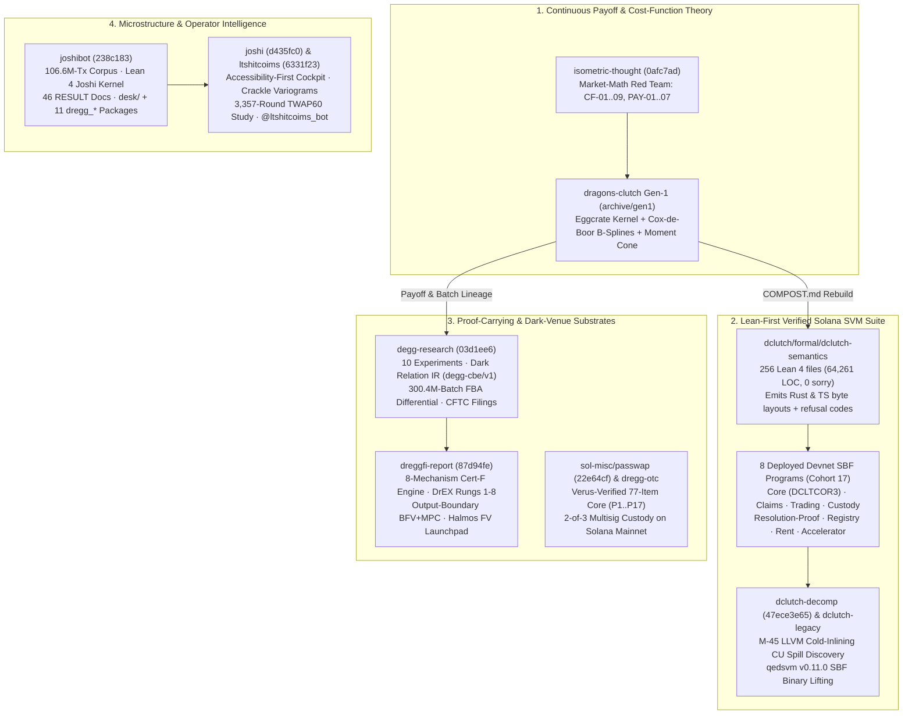

# Dossier 24: Cryptographic Economics, Verified Prediction Markets, Dark Relation IR, and Empirical Market Microstructure — Deep Primary-Source Rescout

> [!IMPORTANT]
> **Archaeological Scope & Provenance**: This monograph is excavated directly from fifteen primary-source repositories in `/Users/ember/dev/`:
> 1. **The Dragon's Clutch & dClutch Prediction-Market Lineage**: [`dragons-clutch`](file:///Users/ember/dev/dragons-clutch/README.md) (`11,176` commits across `379` branches; `4,878` on `HEAD` `8a3e72341`), [`dragons-clutch-dclutch-integration`](file:///Users/ember/dev/dragons-clutch-dclutch-integration/README.md) (`2,129` commits at `654eae25b`), [`dclutch`](file:///Users/ember/dev/dclutch/README.md) (`6,864` commits across `--all`; `6,831` on `HEAD` `6967e79cb`), [`dclutch-decomp`](file:///Users/ember/dev/dclutch-decomp/formal/qedsvm-direct-v12/README.md) (`1,769` commits at `47ece3e65`), [`dclutch-legacy`](file:///Users/ember/dev/dclutch-legacy/README.md), and [`dclutch-simlife3-checkpoints`](file:///Users/ember/dev/dclutch-simlife3-checkpoints).
> 2. **Dark-Venue Mechanism Design & Regulatory Economics**: [`degg-research`](file:///Users/ember/dev/degg-research/docs/ARCHITECTURE.md) (`88` commits at `03d1ee6`) — all ten executable experiments, the Dark Relation IR (`degg-cbe/v1`), and the CFTC regulatory comment filings (`CFTC-2026-1717`, `RIN 3038-AF71`, `RIN 3038-AF70`).
> 3. **Proof-Carrying Financial Substrates & Passphrase OTC Escrows**: [`dreggfi-report`](file:///Users/ember/dev/dreggfi-report/README.md) (`87d94fe`), [`sol-misc`](file:///Users/ember/dev/sol-misc/passwap/README.md) (`22e64cf`, Verus-verified `passwap` deployed immutable on Solana mainnet at `7bGfrNxemPSvthXXnYcHfDY8cjgWYeeysWm463tzfmh6`), [`dregg-otc`](file:///Users/ember/dev/dregg-otc/README.md), and [`isometric-thought`](file:///Users/ember/dev/isometric-thought/README.md) (`0afc7ad`).
> 4. **Empirical Market Microstructure, Operator Cockpits, and the `$DREGG` Intelligence Desk**: [`joshibot`](file:///Users/ember/dev/joshibot/README.md) (`321` commits at `238c183`), [`joshi`](file:///Users/ember/dev/joshi/README.md) (`303` commits at `d435fc0`), [`joshi-gift`](file:///Users/ember/dev/joshi-gift/LICENSE_GRANT_rupert.md), and [`ltshitcoims`](file:///Users/ember/dev/ltshitcoims/README.md) (`6331f23`).

---

## 1. Architectural Synthesis: One Mechanism-Design Spine Across Four Substrates

Across all fifteen repositories, Ember treats financial markets not as ad-hoc smart contracts or statistical heuristics, but as **resource-conserving, bounded-liability state relations** whose solvency, optimality, and information leakage must be either mechanically proved in Lean 4 / Verus or falsified against exhaustive adversarial corpora.



---

## 2. `dragons-clutch` (11,176 Commits) & `dragons-clutch-dclutch-integration`: Gen-1 Architecture, Formal Proofs, and the Composting Boundary

### 2.1 Why `dragons-clutch` Has 11,176 Commits Across 379 Branches

A `git rev-list` census of [`/Users/ember/dev/dragons-clutch`](file:///Users/ember/dev/dragons-clutch/README.md) reveals why the repository is one of the largest commit graphs in the workspace:
- **`HEAD` (`8a3e72341`, 2026-09-01)**: `4,878` reachable commits on `main`.
- **`--all` across `379` branches (`agent/*`, `codex/*`, `fable/*`, `lane/*`)**: **`11,176` commits** (`11,164` authored under `ember` / `ember arlynx` and `12` authored by `joshi-resident`).
- **Dual-Era Repository Topology**: As documented in [`README.md`](file:///Users/ember/dev/dragons-clutch/README.md#L1-L26) and [`archive/README.md`](file:///Users/ember/dev/dragons-clutch/archive/README.md#L1-L40), `dragons-clutch` houses two complete generations of Ember's prediction-market architecture:
  1. **Generation 1 ("Clutch")**: Developed across `379` parallel multi-agent branches (`fable/*`, `codex/*`, `agent/*`) tracked in [`archive/handoffs/BRANCH_TRIAGE_2026-08-22.md`](file:///Users/ember/dev/dragons-clutch/archive/handoffs/BRANCH_TRIAGE_2026-08-22.md#L1-L120), now preserved in [`archive/gen1/`](file:///Users/ember/dev/dragons-clutch/archive/gen1/README.md) and at the repository root of the sibling worktree [`/Users/ember/dev/dragons-clutch-dclutch-integration`](file:///Users/ember/dev/dragons-clutch-dclutch-integration/README.md) (`2,129` commits on `HEAD` `654eae25b`, `"Integrate dClutch as history-preserving subtree"`, 2026-08-25).
  2. **Generation 2/3 ("dClutch")**: Vendored into [`dclutch/`](file:///Users/ember/dev/dragons-clutch/dclutch/README.md) via subtree waves (`7998f845e` Cohort 6 through `8a3e72341` `"dclutch: wave 5 — Cohort 15 live on Solana devnet"`, 2026-09-01) and actively developed in [`/Users/ember/dev/dclutch`](file:///Users/ember/dev/dclutch/README.md) through Cohort 17 (`6967e79cb`, 2026-09-09).

### 2.2 Gen-1 ("Clutch") Crate & SBF Program Architecture

Gen-1 Clutch ([`dragons-clutch-dclutch-integration/PROJECT.md`](file:///Users/ember/dev/dragons-clutch-dclutch-integration/PROJECT.md#L1-L120)) is an exact-integer, fully collateralized outcome-claim protocol on Solana where primitive outcome claims are called **Eggs**, the market's collateral custody vault is the **Hoard**, and a market is a **Clutch**.

| Gen-1 Component | Path | Core Responsibility & Measured Milestone |
|---|---|---|
| `clutch-kernel` ("Eggcrate") | [`archive/gen1/crates/clutch-kernel/src/lib.rs`](file:///Users/ember/dev/dragons-clutch/archive/gen1/crates/clutch-kernel/src/lib.rs) | `#![no_std]`, `no_alloc`, `#![forbid(unsafe_code)]`, float-free state machine: market activation, complete-set mint/burn, internal position transfers, resolution by a payout vector $w \in \mathbb{N}^n$ with $\sum_i w_i = D$, and exact pro-rata redemption. |
| `clutch-bspline` | [`archive/gen1/crates/clutch-bspline/src/lib.rs`](file:///Users/ember/dev/dragons-clutch/archive/gen1/crates/clutch-bspline/src/lib.rs) | Exact rational Cox–de Boor degree $0\text{--}3$ open-clamped B-spline evaluation + deterministic largest-remainder quantization to denominator $D$. Differential-tested against [`oracle/check.py`](file:///Users/ember/dev/dragons-clutch/archive/gen1/crates/clutch-bspline/oracle/check.py) over **31,814 exact cases** (`seed = 880230`, 0 mismatches). |
| `clutch-batch` | [`archive/gen1/crates/clutch-batch/src/lib.rs`](file:///Users/ember/dev/dragons-clutch/archive/gen1/crates/clutch-batch/src/lib.rs) | Coupled portfolio simplex batch clearing (`BatchRelationV1`), resumable multi-transaction `ClearWork` stream state, `FullScoreV1` / `ScoreV2-Q` candidate scoring, and degree-2/3 moment-cone / atom-mixture price gates ([`atom_mixture_v1.rs`](file:///Users/ember/dev/dragons-clutch/archive/gen1/crates/clutch-batch/src/atom_mixture_v1.rs)). |
| `clutch-sbf` | [`archive/gen1/programs/clutch-sbf/program`](file:///Users/ember/dev/dragons-clutch/archive/gen1/programs/clutch-sbf/program) | Monolithic Solana SBF program: **2,082,320-byte ELF** at audited commit `169a1ba` (SHA-256 `193c08723eaefeff9a1c2aa53c9e3feb58960a919fb0bbb7ca5da3bd817aa95b`, `14.49529272 SOL` persistent loader rent, `165/165` SVM tests). |

In the **Joined-v4 loopback Agave validator campaign** (2026-08-23, commit `4e83648`, documented in [`dragons-clutch-dclutch-integration/PROJECT.md`](file:///Users/ember/dev/dragons-clutch-dclutch-integration/PROJECT.md#L33-L76)), Gen-1 executed **52 real signed Solana transactions** against captured mainnet Pyth router & receiver ELFs verifying a 13-of-19 guardian VAA (`[99,980,929, 100,019,071]` interval), completing a full General V1 batch trade, oracle resolution, claim redemption, and `128` collateral atoms returned, with a maximum 4-page / 64-order, 416-slice direct `Entitle` measured at **803,935 CU**.

### 2.3 The Five Gen-1 P0 Defects Discovered in `ARCHITECTURE_REVIEW_2026-08-22.md`

Ember's adversarial audit of Gen-1 ([`archive/gen1/docs/reviews/ARCHITECTURE_REVIEW_2026-08-22.md`](file:///Users/ember/dev/dragons-clutch/archive/gen1/docs/reviews/ARCHITECTURE_REVIEW_2026-08-22.md#L1-L265)) uncovered five structural P0 vulnerabilities that motivated first patching Gen-1 and then launching the clean-sheet `dclutch` rebuild under [`COMPOST.md`](file:///Users/ember/dev/dclutch/COMPOST.md):

1. **`ClosePosition` Stranded Active Reservations (P0-1)**: `ClosePosition` checked only that local `PositionAccount` cash and Egg balances were zero, without checking `ReservationAccount` state. An all-in seller whose Eggs were locked in an `ACTIVE` `ReservationAccount` could delete their `PositionAccount`, stranding the reservation and breaking settlement/cancel reclamation. Fixed by adding `PositionAccount.open_reservations` counter (`NonZeroOpenReservations`).
2. **`CloseGeneralEpoch` Epoch Replay & Stranded `ClearWork` Rent (P0-2)**: `CloseGeneralEpoch` closed the `Epoch`, `Window`, and funding ledger accounts without advancing a monotone cursor on `Market`, permitting a closed epoch number to be re-initialized and stranding non-top-3 candidate accounts and 50 KiB `ClearWork` buffers. Fixed by adding `Market.general_epoch_Boundary` and `CloseRejectedClearWork`.
3. **`ScoreV1` Complete-Set Wash-Flow Exploit (P0-3)**: The original batch objective `ScoreV1` weighted flow by $p_i (S - p_i) \cdot \text{direct\_flow}_i + \text{distinct\_owners}$. A trader submitting a risk-free complete-set wash trade at a binary midpoint earned $50,000,000q$ score vs $990,000q$ for a real 1% tail trade, allowing a wash trader to outscore real price discovery. Replaced by **`ScoreV2-Q`**, which quotients out constant complete-set shifts ($a \mapsto a - (\min_i a_i)\mathbf{1}$) before scoring directional variance.
4. **Unverified Score Claims Evicting Honest Candidates in `SealCandidate` (P0-4)**: `SealCandidate` inserted a solver's *claimed* score into the top-3 podium before `CompleteClearWork` verified the stream, allowing a junk candidate with `u128::MAX` claimed score to evict honest candidates. Fixed by moving podium admission exclusively to `CompleteClearWork` over the recomputed `FullScoreV1`.
5. **Necessary-Must-Not-Pose-As-Sufficient Degree-2/3 Moment-Cone Price Gate (P0-5)**: For degree $d \in \{2, 3\}$ B-splines, interior basis functions never reach $1$ at any evaluation point ($3/4$ ceiling at $d=2$, $2/3$ at $d=3$). Gen-1 V1b checked `claimCeiling`, `butterflyWeight`, and single-span Hankel quadrics, which are *necessary* conditions on the B-spline moment curve but *not sufficient* for membership in the quantized convex hull $\text{conv}\{\phi(\omega)\}$ across multiple knot spans. This discovery led directly to [`MomentCone.lean`](file:///Users/ember/dev/dragons-clutch/archive/gen1/lean/DragonsClutch/MomentCone.lean) and the constructive sparse 4-atom witness gate (`PRICE-GATE-HULL-001`, [`LiabilityBasisV2PriceGate.lean`](file:///Users/ember/dev/dclutch/formal/dclutch-semantics/DClutchSemantics/LiabilityBasisV2PriceGate.lean)).

### 2.4 Gen-1 Machine-Checked Proofs: Lean 4 (4,510 Lines), Verus, and Rocq

Gen-1 Clutch contains three distinct formal verification suites under [`archive/gen1/`](file:///Users/ember/dev/dragons-clutch/archive/gen1/lean/README.md):

#### A. Lean 4 Suite (`archive/gen1/lean/DragonsClutch/`, 9 files, 4,510 lines, zero `sorry`)

In [`Solvency.lean`](file:///Users/ember/dev/dragons-clutch/archive/gen1/lean/DragonsClutch/Solvency.lean#L140-L246), Ember proves that the active collateral requirement $\text{requiredActive}(T) = \max_i T_i$ is the exact supremum over all valid resolution vectors and bounds the ceiling-divided resolved requirement $\text{requiredResolved}(T, v) = \lceil (T \cdot w) / D \rceil$:

```lean
theorem P_SOLV_01_resolution_bound (T : List Nat) (v : PayoutVector)
    (hv : v.Valid T.length) :
    requiredResolved T v ≤ requiredActive T := by
  unfold requiredResolved
  apply ceilDiv_le_of_le v.denom_pos
  rw [v.sum_eq]
  exact dot_le_maxList_mul_sum T v.weights hv.1

theorem P_PAY_02_complete_set_liability_exact (n q : Nat) (v : PayoutVector)
    (hv : v.Valid n) :
    liability (List.replicate n q) v = q * v.denominator := by
  unfold liability
  rw [dot_replicate_left q v.weights, hv.2]
```

In [`Transitions.lean`](file:///Users/ember/dev/dragons-clutch/archive/gen1/lean/DragonsClutch/Transitions.lean#L218-L250), `P_SOLV_01_resolve_with_vector_admits` proves that any active solvent market (`m.Solvent`, meaning `required m ≤ m.hoard`) automatically satisfies the prospective post-resolution solvency check for *every* valid payout vector—proving that the runtime check inside `resolveWithVector` is pure defense-in-depth and can never refuse a valid resolution:

```lean
theorem P_SOLV_01_resolve_with_vector_admits (m : Market) (v : PayoutVector)
    (hphase : m.phase = Phase.active)
    (hsolv : m.Solvent)
    (hv : v.Valid m.totalSupply.length) :
    required { m with phase := Phase.resolved, payout := some v } ≤ m.hoard := by
  have hact : required m = requiredActive m.totalSupply := by
    simp [required, hphase]
  have hres :
      required { m with phase := Phase.resolved, payout := some v } =
        requiredResolved m.totalSupply v := by
    simp [required]
  rw [hres]
  exact Nat.le_trans (P_SOLV_01_resolution_bound m.totalSupply v hv) (hact ▸ hsolv)
```

In [`MomentCone.lean`](file:///Users/ember/dev/dragons-clutch/archive/gen1/lean/DragonsClutch/MomentCone.lean#L120-L398), Ember formalizes the exact boundary of the degree-2/3 B-spline moment cone at price scale $S = 8192$, proving both soundness of the ceiling/butterfly certificates and exhibiting the exact interior-peak boundary vector `peakedInteriorPrice = [0, 0, 1024, 6144, 1024, 0]` where `peaked_price_buys_a_nonnegative_payoff_for_less_than_nothing` and `the_interior_peak_is_the_boundary` hold by `decide`.

#### B. Verus & Rocq Verification Suites
- **Verus (`archive/gen1/verus/`)**: [`kernel/TRANSFER_REFINEMENT.json`](file:///Users/ember/dev/dragons-clutch/archive/gen1/verus/kernel/TRANSFER_REFINEMENT.json) verifies `prepare_internal_transfer` (`2 verified, 0 errors`); [`batch/batch.rs`](file:///Users/ember/dev/dragons-clutch/archive/gen1/verus/batch/batch.rs) (`26,481` bytes), [`bspline/`](file:///Users/ember/dev/dragons-clutch/archive/gen1/verus/bspline), and [`accumulator/accumulator.rs`](file:///Users/ember/dev/dragons-clutch/archive/gen1/verus/accumulator/accumulator.rs) verify overflow freedom and conservation across the Rust reference implementations.
- **Rocq (`archive/gen1/rocq/ClutchKernel.v`)**: `428` lines of Coq/Rocq mechanization of `ClutchKernel`, retired via ADR-0005 to unify all machine-checked proofs in Lean 4 and Verus.

---

## 3. `dclutch` (6,864 Commits), `dclutch-decomp`, `dclutch-legacy`, & `dclutch-simlife3-checkpoints`

### 3.1 The `COMPOST.md` Firewall and the 8-Program Solana SBF Architecture

When Ember initiated [`/Users/ember/dev/dclutch`](file:///Users/ember/dev/dclutch/README.md) (`6,864` total commits, `HEAD` `6967e79cb` on 2026-09-09), [`COMPOST.md`](file:///Users/ember/dev/dclutch/COMPOST.md#L1-L82) established a strict quarantine rule: Gen-1 crates and SBF adapters could **never** be bulk-copied into `dclutch`. Every transplant required a named transplant ID, a fresh Lean 4 specification, and an independent proof (`DEVNET-ACTIVITY-001`, `PYTH-FIXTURE-001`, `PRICE-GATE-HULL-001`).

Instead of a single 2.08 MiB monolithic SBF binary, [`dclutch/ARCHITECTURE.md`](file:///Users/ember/dev/dclutch/ARCHITECTURE.md#L1-L120) decomposes the on-chain footprint into **eight specialized SBF programs**, all deployed and exercised on Solana Devnet through **Cohort 17**:

| SBF Program | Directory | Role in the `dclutch` On-Chain Suite |
|---|---|---|
| `dclutch-core-sbf` | [`programs/dclutch-core-sbf`](file:///Users/ember/dev/dclutch/programs/dclutch-core-sbf) | Owns the single authoritative 368-byte Market record (`DCLTCOR3`), lifecycle phase transitions, market opening, and configuration digests. |
| `dclutch-claims-sbf` | [`programs/dclutch-claims-sbf`](file:///Users/ember/dev/dclutch/programs/dclutch-claims-sbf) | Complete-set minting/merging, terminal claim settlement, Fractional claim wrap/unwrap, and Structured/Portfolio claims. |
| `dclutch-trading-sbf` | [`programs/dclutch-trading-sbf`](file:///Users/ember/dev/dclutch/programs/dclutch-trading-sbf) | Execution entrypoint for Direct, Dealer (LMSR), General (joint clearing), and Series venues. |
| `dclutch-custody-sbf` | [`programs/dclutch-custody-sbf`](file:///Users/ember/dev/dclutch/programs/dclutch-custody-sbf) | Hoard collateral vault authority, rent/upkeep collection, and custody transitions. |
| `dclutch-resolution-proof-sbf` | [`programs/dclutch-resolution-proof-sbf`](file:///Users/ember/dev/dclutch/programs/dclutch-resolution-proof-sbf) | Pyth & relayed oracle observation ingestion, time-window validation, Ensemble median fold, recovery ladder, and founder-bond failure walk. |
| `dclutch-registry-sbf` | [`programs/dclutch-registry-sbf`](file:///Users/ember/dev/dclutch/programs/dclutch-registry-sbf) | Release-set binding and 4 MiB chunked BPF Loader v3 bytecode verification across the program suite. |
| `dclutch-rent-sbf` | [`programs/dclutch-rent-sbf`](file:///Users/ember/dev/dclutch/programs/dclutch-rent-sbf) | Deterministic rent-escrow and account-reclamation lifecycle. |
| `dclutch-accelerator-sbf` | [`programs/dclutch-accelerator-sbf`](file:///Users/ember/dev/dclutch/programs/dclutch-accelerator-sbf) | Stateless compute helper invoked via CPI by `dclutch-trading-sbf` for General, Dealer, and Series verification. |

### 3.2 Lean-First Code Generation (`formal/dclutch-semantics/`: 256 Files, 64,261 Lines, Zero `sorry`)

The defining engineering achievement of `dclutch` is [`formal/dclutch-semantics/`](file:///Users/ember/dev/dclutch/formal/dclutch-semantics/DClutchSemantics.lean): **256 Lean 4 files totaling 64,261 lines of code** (with zero `sorry` across the entire tree). Rather than writing Rust and proving a separate model, `dclutch-semantics` **emits the production Rust and TypeScript code** (`Emit*Rust.lean`, `Emit*Ts.lean`) for byte layouts (`DCLTCOR3`), instruction discriminants, refusal-code registries, and golden test vectors directly from the verified Lean definitions.

### 3.3 Decision 0031 ("The Mechanism Agenda", 2026-09-04): All Six Lean-First Mechanisms

In [`docs/decisions/0031-the-mechanism-agenda.md`](file:///Users/ember/dev/dclutch/docs/decisions/0031-the-mechanism-agenda.md#L1-L162) (confirmed by Ember on 2026-09-04), six major mechanism extensions were designed Lean-first, proven with zero `sorry`, and shipped into Cohort 17:

#### 1. Batch Spine (`2fbd73474`)
Documented in [`docs/reports/MECHANISM_BATCH_SPINE_2026_09_04.md`](file:///Users/ember/dev/dclutch/docs/reports/MECHANISM_BATCH_SPINE_2026_09_04.md), scaling batch order clearing to $M = 136$ orders at $3.70\text{ M CU/order}$ across resumable verification pages.

#### 2. Joint Clearing with Checked KKT LP Duality Certificates & Lex-Min Price Canonicality (`554a29119`)
In [`JointClearingV1.lean`](file:///Users/ember/dev/dclutch/formal/dclutch-semantics/DClutchSemantics/JointClearingV1.lean#L1-L1101) (`1,101` lines, `44` theorems, `0 sorry`), Ember discharges the standing `AGENTS.md` rule (*"do not say 'optimal clearing' unless an optimality certificate is checked"*) by requiring every General V1 batch clear to carry a dual KKT certificate `Clearing.valid` and proving `certificate_is_optimal` and `stranded_supply_is_the_sets_wherever_priced`:

```lean
theorem certificate_is_optimal (inst : Instance) (c : Clearing) (f : Competitor)
    (hv : c.valid inst) (hf : f.feasible inst) :
    f.surplus inst ≤ c.surplus inst := by
  have h1 : f.surplus inst ≤ c.dualObjective inst :=
    competitor_le_dualObjective inst c f hv.completeSetDual hv.noMinting hf
  have h2 : c.dualObjective inst = c.surplus inst :=
    dualObjective_eq_surplus inst c hv.conservation hv.fillUpper
      hv.inTheMoneyFilled hv.strandedSupplyZero
   omega
```

To prevent a solver from choosing an arbitrary price vector inside a flat dual-optimal face to favor one side of a limit-tied order, `JointClearingV1.lean` defines `lexMinFrom`, an $O(K)$ greedy reduction that drives each coordinate down to its tightest lower bound while preserving $\sum_k p_k = S$, and rejects any non-minimal price vector with `RuntimeVerifyErrorV2::NonMinimalPriceVector`.

#### 3. Hanson LMSR Scoring-Rule Dealer in Base-2 Q62 Fixed-Point (`3bf1905a7`)
In [`ScoringRuleV1.lean`](file:///Users/ember/dev/dclutch/formal/dclutch-semantics/DClutchSemantics/ScoringRuleV1.lean#L1-L1390) (`1,390` lines, `0 sorry`), Ember formalizes a Hanson Logarithmic Market Scoring Rule automated dealer directly in base-2 fixed-point arithmetic ($W(\text{inv}) = -b \log_2 \sum_i 2^{-\text{inv}_i / b}$) so that $2^x$ and $\log_2$ evaluate via exact integer shift-and-LUT operations without transcendental drift, proving the universal bounded-loss theorem over arbitrary fill sequences:

```lean
theorem bounded_loss (P : Potential) (deposit outcomeCount : Nat)
    (fills : List Fill) (i : Nat) (hi : i < outcomeCount)
    (hrun : ∀ f ∈ fills, ...) :
    deposit - (run P (founded P deposit outcomeCount) fills).wealth i ≤
      P.subsidy outcomeCount
```

On-chain SBF execution of the LMSR dealer measured **39,000 CU ($K=2$)**, **46,000 CU ($K=3$)**, and **93,000 CU ($K=5$)**, compared to `131,790 CU` on the selector-9 path.

#### 4. Quorum-Median Ensemble Oracle Resolution (`ff4f3b142`)
In [`EnsembleResolutionV1.lean`](file:///Users/ember/dev/dclutch/formal/dclutch-semantics/DClutchSemantics/EnsembleResolutionV1.lean#L1-L860) (`860` lines, `0 sorry`), up to $k \le 5$ declared oracle sources are folded with quorum $q \le k$ using the lower-median order statistic ($\text{rank } \lfloor n/2 \rfloor$). Because cell discretization $x \mapsto \text{cell}(x)$ is monotone, Ember proves the commutation theorem `the_cell_of_the_median_is_the_median_of_the_cells`, establishing that taking the median in price space and then mapping to outcome cells is identical to mapping each oracle's reading to an outcome cell and taking the median cell.

#### 5. Pro-Rata Founder Bond on Oracle Exhaustion (`86d38a203`)
In [`FounderBondV1.lean`](file:///Users/ember/dev/dclutch/formal/dclutch-semantics/DClutchSemantics/FounderBondV1.lean#L1-L682) (`682` lines, `34` theorems, `0 sorry`), the market founder posts a lamport bond $\text{bondSize} = \text{seatPrepay} + \text{firstCrankShortfall} + \text{ladderFunding}$ (`4,031,465` lamports = `0.004031465 SOL` on Cohort 15 parameters). If all oracle recovery rungs fail, the bond is walked pro-rata ($\lfloor \text{remaining} \cdot \text{quantity} / \text{outstanding} \rfloor$) to ordinary claim holders, with `an_exhausting_walk_pays_the_bond_exactly` proving zero stranded lamports when all claims redeem.

#### 6. Conditional (`B | A = a`) and Product (`A × B`) Markets (`4b15cf69a`)
In [`ConditionalMarketV1.lean`](file:///Users/ember/dev/dclutch/formal/dclutch-semantics/DClutchSemantics/ConditionalMarketV1.lean#L1-L1056) (`1,056` lines, `50` theorems, `0 sorry`), Ember formalizes joint product markets $A \times B$ ($K_A K_B \le 60$, e.g. $7 \times 8 = 56$) and conditional markets $B \mid A = a$ that refund collateral when $A \ne a$, proving:
- `conditional_is_the_row_projection`: resolving $A \times B$ and projecting onto row $a$ equals resolving $B \mid A = a$.
- `row_bundle_replicates_the_parent_claim_off_failure`: holding one unit of every $B$-branch in row $a$ replicates holding one unit of parent claim $A = a$.
- `branch_claims_pay_nothing_off_condition`: if $A$ resolves to $a' \ne a$, every conditional branch claim pays zero and the conditional collateral refunds.

#### 7. Constructive 4-Atom Convex-Hull Price Gate (`LiabilityBasisV2PriceGate.lean`)
In [`LiabilityBasisV2PriceGate.lean`](file:///Users/ember/dev/dclutch/formal/dclutch-semantics/DClutchSemantics/LiabilityBasisV2PriceGate.lean#L1-L754) (`754` lines, `0 sorry`, transplant `PRICE-GATE-HULL-001`), Ember closes Gen-1's P0-5 moment-cone sufficiency gap by requiring the solver to supply a constructive 4-atom convex-combination witness (`Certificate`) from the market's actual payoff table, proving `Certificate.price_sum`, `singleAtom_valid`, `no_certificate_of_capped_claim`, and `no_cap_of_attained_scale`.

### 3.4 `dclutch-decomp` (`47ece3e65`): The M-45 LLVM Cold-Inlining CU Spill & `qedsvm` SBF Binary Lifting

[`/Users/ember/dev/dclutch-decomp`](file:///Users/ember/dev/dclutch-decomp/formal/qedsvm-direct-v12/README.md) (`1,769` commits, `HEAD` `47ece3e65` `"ledger: three rows the same-tip sweep opened"`, 2026-08-27) preserves two extraordinary artifacts from the late-August SBF optimization and binary-verification campaign:

1. **The M-45 / M-46 / M-47 Compute-Unit Forensics (`git show 47ece3e65`)**:
   - **M-45 (43,887 CU from unexecuted code!)**: Adding `662` lines of cold preimage-builder helpers to `dclutch-execution-strategy-contract` caused LLVM's SBF backend to inline cold functions into `hot_v3`, blowing the SBF register budget (`r1..r9`), spilling to the stack frame on every loop iteration, and adding **43,887 CU from code that never executes at runtime**. This pushed `hot_v3` to `1,399,944 / 1,400,000 CU` and took the 20-seed compute sweep from `18/20` to **`0/20`**. Adding `#[inline(never)]` to the 6 cold functions immediately restored **`20/20`** pass rate!
   - **M-46**: Tracked a `+23,000 CU` compiler drift between `211079f6` and `a4be9a83`.
   - **M-47**: Caught a `37 + 80n` byte heap allocation inside `hot_v3`'s shadow-digest wrapper against the 32 KiB Solana bump-heap ceiling.
2. **`qedsvm v0.11.0` SBF Binary Lifting to Lean 4 (`formal/qedsvm-*`)**:
   - [`formal/qedsvm-claims-proof/README.md`](file:///Users/ember/dev/dclutch-decomp/formal/qedsvm-claims-proof/README.md): Lifted the compiled `1,872`-byte SBF ELF (`884fe2a`, `119` SBF instructions) of `dclutch-claims-proof-sbf` directly into Lean 4 (`DClutchClaimsProofLifted.lean`), proving a machine-checked `109`-step `cuTripleWithinMem` execution and memory-safety theorem over the actual SBF machine code.
   - [`formal/qedsvm-effect-proof/README.md`](file:///Users/ember/dev/dclutch-decomp/formal/qedsvm-effect-proof/README.md): Lifted the `2,232`-byte SBF ELF (`19692e0`, `164` SBF instructions) of `dclutch-effect-proof-sbf` into `DClutchEffectProofLifted.lean` with a `154`-step `cuTripleWithinMem` theorem.
   - [`formal/qedsvm-direct-v12/README.md`](file:///Users/ember/dev/dclutch-decomp/formal/qedsvm-direct-v12/README.md): Tested `qedsvm` against the full `dclutch-direct-v12` binary, recording exact fail-closed boundaries at multi-seed PDA creation (`create_pda at pc 2806: n_seeds = 2`) and big-endian byte-swap (`be64 r1`, opcode `0xdc` at `.text` offset `118680`).

### 3.5 `dclutch-legacy`: Why 17 Crates & Programs Were Banished on 2026-08-27

[`/Users/ember/dev/dclutch-legacy/README.md`](file:///Users/ember/dev/dclutch-legacy/README.md#L1-L165) documents the **2026-08-27 Close-Out Purge**, when Ember excised every superseded stratum from `dclutch` so that `DCLTCOR2`/`DCLTCOR3` remained the single source of market truth:
- **The `DCLTCAT1` Stratum**: Banished `dclutch-claims-proof-sbf` (which contained `20` `unsafe` blocks for zero-copy pointer casts), `dclutch-custody-proof-sbf`, `dclutch-controller-proof-sbf`, `dclutch-market-contract`, `dclutch-collateral-contract`, `dclutch-direct-contract`, `dclutch-terminal-contract`, and `8,674` lines of `dclutch-operator` transaction builders once `DCLTCOR2` unified the catalog and market root.
- **The `DCLLBX02` Route (`claims-lbv2-route`)**: Shrunk from `1,749` lines to `178` lines and archived after `dclutch-claims-sbf` absorbed Liability Basis V2 directly.
- **Superseded Venue & Adapter Contracts**: Banished the original monolith `programs/dclutch-sbf`, `dclutch-series-sbf` (whose entrypoints were proven unreachable-to-success before the Trading/Accelerator split), `dclutch-effect-sbf`, `dclutch-economic-sbf`, `dclutch-product-payoff-sbf`, `dclutch-product-evidence-sbf`, `dclutch-dealer-contract`, `dclutch-general-contract`, `dclutch-economic-adapter-contract` (`DCES`), and `dclutch-product-admission-contract`.

### 3.6 `dclutch-simlife3-checkpoints`: Live Multi-Market World Checkpoints

[`/Users/ember/dev/dclutch-simlife3-checkpoints`](file:///Users/ember/dev/dclutch-simlife3-checkpoints) stores three progressive snapshots of the `simlife3` autonomous agent-world harness on 2026-08-31:
- `world-20260831T064233Z.tar.gz` (`25,131` bytes)
- `world-20260831T074233Z.tar.gz` (`5,708,825` bytes)
- `world-20260831T084233Z.tar.gz` (`12,566,227` bytes)

Inspecting the tar archives reveals `world.json`, `ledger.json`, `status.json`, per-agent `wallets/`, `markets/m00..m12`, and automated per-cycle conservation census receipts (`census/m00..m12/cycle-000033..000041.json`) verifying Hoard-to-claim solvency across 13 concurrent simulated markets.

---

## 4. `degg-research` (88 Commits, `03d1ee6`): Dark Relation IR, Regulatory Economics, and All 10 Experiments

### 4.1 Architecture, Privacy Modes, Guarded Holes, and Regulatory Filings

[`/Users/ember/dev/degg-research`](file:///Users/ember/dev/degg-research/docs/ARCHITECTURE.md) (`88` commits on `main` at `03d1ee6`, 2026-08-27) is Ember's self-contained cryptographic-economics laboratory for **dEgg**: a venue where market clearing is compiled to a canonical **Dark Relation IR (`degg-cbe/v1`)** and evaluated across three explicit privacy postures defined in [`docs/PRIVACY_MODES.md`](file:///Users/ember/dev/degg-research/docs/PRIVACY_MODES.md#L1-L150) and [`docs/FHE_FRONTIER.md`](file:///Users/ember/dev/degg-research/docs/FHE_FRONTIER.md#L1-L195):

1. **`Clear`**: All orders, books, and fills are public; deterministic replay verifies correctness.
2. **`ShieldedSingleExecutor`**: Orders are sealed in commitments ($C = \text{SHA256}(\text{"degg/order/v0"} \parallel \dots)$) and an append-only Merkle Mountain Range (`degg-inclusion/v0`), hiding intents from the public and competing traders while a single executor computes the batch transition and issues per-owner opening receipts.
3. **`DarkThreshold` / `DarkFHE`**: No single party sees individual orders; inputs are evaluated under threshold FHE or secret-shared MPC (`FHE_FRONTIER.md`), opening only the public batch summary $(p^*, V^*)$.

In [`docs/GUARDED_HOLES_DOSSIER.md`](file:///Users/ember/dev/degg-research/docs/GUARDED_HOLES_DOSSIER.md#L1-L148), Ember maps the lineage of **Guarded Holes** (partial turns whose unfilled slots are guarded by algebraic predicates) into dark batch settlement: an order commitment is a guarded hole over the batch state, discharged only when the batch clearing satisfies the owner's limit price, direction, quantity bound, and conservation law.

In [`docs/regulatory/`](file:///Users/ember/dev/degg-research/docs/regulatory/README.md#L1-L120), the empirical findings of `degg-research` directly ground four regulatory comment drafts:
- **Prediction Markets ANPRM (`CFTC-2026-1717`, filed 2026-08-27)**: Grounded by `bundling-invariance` and `manipulation-cost`, proving mathematically that payout-shape rules ("binary vs continuous") are not invariant under complete-set decomposition and quantifying exact constant-product TWAP manipulation costs.
- **Joint CFTC/SEC Definitions (`RIN 3038-AF71`) & Recordkeeping (`RIN 3038-AF70`)**: Grounded by `leakage-lab` and `settlement-model`.
- **CFTC Innovation Advisory Committee Statement ([`docs/regulatory/typst/iac-draft-16/body.typ`](file:///Users/ember/dev/degg-research/docs/regulatory/typst/iac-draft-16/body.typ#L1-L115))**: Explicitly signed by `Claude Fable 5` with human facilitation by Ember Arlynx, presenting verifiable relation-IR market structure and bounded-disclosure regulatory views.
- **Perpetuals Concept Release ([`docs/regulatory/typst/perpetuals-draft-4/body.typ`](file:///Users/ember/dev/degg-research/docs/regulatory/typst/perpetuals-draft-4/body.typ#L1-L110))**: Applies exact-integer mark/funding manipulation bounds to perpetual derivatives.

### 4.2 Master Summary of All 10 `degg-research` Experiments

Every experiment in [`docs/EXPERIMENT_PROGRAM.md`](file:///Users/ember/dev/degg-research/docs/EXPERIMENT_PROGRAM.md#L1-L140) and [`docs/VERDICTS.md`](file:///Users/ember/dev/degg-research/docs/VERDICTS.md#L1-L185) is a zero-external-dependency, bit-reproducible Rust or Python harness:

| # | Experiment | Crate / Script | Scale & Domain | Key Verdict & Measured Finding |
|---|---|---|---|---|
| 1 | `bundling-invariance` | [`experiments/bundling-invariance`](file:///Users/ember/dev/degg-research/experiments/bundling-invariance/README.md) | `1,360` vectors × `12` fact profiles = `16,320` objects; `683,232` decompositions | **4 of 8** regulatory classification rules fail bundling invariance (`49,032` witnesses for `binary-payout`; `180,696` for `bounded-payout`). Exhaustive census of all $2^{2^n}$ support-only criteria for $n \in \{2,3,4\}$. |
| 2 | `dark-fba` | [`experiments/dark-fba`](file:///Users/ember/dev/degg-research/experiments/dark-fba/README.md) | `dark-fba/n4-k4-q15/v0` ($N=4, K=4, Q=15$) | Reference `Clear` & `ShieldedSingleExecutor` frequent batch auction oracle: ties-low clearing price, largest-remainder pro-rata allocation, earliest-slot residual tie-break. |
| 3 | `dark-fba-independent` | [`experiments/dark-fba-independent`](file:///Users/ember/dev/degg-research/experiments/dark-fba-independent/README.md) | **`300,436,169` batches** (`214.36M` + `85.53M` + `551.8k`) | **0 divergences** across all `300,436,169` batches after freezing the 18-rule admission priority in `DARK_FBA_RELATION.md` §4.1 (caught `11,587` refusal-priority divergences pre-freeze). |
| 4 | `relation-ir` | [`experiments/relation-ir`](file:///Users/ember/dev/degg-research/experiments/relation-ir/README.md) | `degg-relation-ir` (`degg-cbe/v1`), **`2,116,916` batches** | Compiles `RelationModule` as data with canonical SHA-256 digest (`81450b21...`); `lower()` matches hand-written `dark-fba` with **0 divergences over 2,116,916 batches**. |
| 5 | `inclusion-availability` | [`experiments/inclusion-availability`](file:///Users/ember/dev/degg-research/experiments/inclusion-availability/README.md) | `degg-inclusion` (`131` tests, MMR to `256` leaves) | FIPS 180-4 SHA-256 Merkle Mountain Range, 4 equivocation proof classes, and 7-class typed abort state machine (`relation-refused` closes gap C-1). |
| 6 | `shielded-baseline` | [`experiments/shielded-baseline`](file:///Users/ember/dev/degg-research/experiments/shielded-baseline/README.md) | `degg-shielded-baseline` (`52` tests, **`90,082` differential cases**) | **0 divergences** over `90,082` cases. `tests/residual_trust.rs` proves **377 of 1,125** forged executor runs (spanning **all 33** valid `(tick, volume)` pairs!) pass all public & owner checks without a computation proof (Rung 5). |
| 7 | `settlement-model` | [`experiments/settlement-model`](file:///Users/ember/dev/degg-research/experiments/settlement-model/README.md) | `degg-settlement` (`56` tests, all $4! = 24$ orders + prefixes) | 4-state custody (`Reserved -> Obligated -> Settled \| Refunded`) + domain-separated `settlement_nullifier`. Proves `PerClaimPublic` settlement transfers leak side, occupancy, `seq` rank, and exact sell size even when the matcher is dark! |
| 8 | `leakage-lab` | [`experiments/leakage-lab`](file:///Users/ember/dev/degg-research/experiments/leakage-lab/README.md) | [`leakage_lab.py`](file:///Users/ember/dev/degg-research/experiments/leakage-lab/leakage_lab.py) (`Clear`, `Shielded`, `Dark`) | Deterministic view projector over `public`, `executor`, `owner:<name>`, and `regulator`, enforcing a 6-rule constant-shape Dark disclosure budget (`8 × 64B` slots, `1 × 32B` root, `≤2` regulator queries, `≤4` receipts). |
| 9 | `manipulation-cost` | [`experiments/manipulation-cost`](file:///Users/ember/dev/degg-research/experiments/manipulation-cost/README.md) | `degg-manip-cost` (`1,080` v1 rows + `8,640` v2 off-hours rows) | Exact-integer constant-product TWAP manipulation calculator. Proves window seconds cancel in flowless v1, longer required hold $k$ lowers attack cost, and fee residue ratchets price so per-bucket independence *overstates* cost. |
| 10 | `confidential-energy-dispatch` | [`research/confidential-energy-dispatch`](file:///Users/ember/dev/degg-research/research/confidential-energy-dispatch/README.md) | `p3-t3-b2-q4/v0` (`25` tests, `8,025` trajectories, `468` feasible) | Second `RelationModule` domain (`eb76db35...`): 3 providers, 3 periods, 2 buses, nonconvex min-output commitment + ramp limits + forced-outage bypass. Selects canonical optimum `cost = 56` (`[[2,2,2],[1,3,2],[2,0,2]]`) and rejects suboptimal `cost = 60` as `NotCanonicalOptimum`. |

### 4.3 Deep Dive Into the Empirical & Mathematical Results of the 10 Experiments

#### Experiment 1: `bundling-invariance` — Why Payoff-Shape Regulation Fails Complete-Set Decomposition
In [`experiments/bundling-invariance/src/main.rs`](file:///Users/ember/dev/degg-research/experiments/bundling-invariance/src/main.rs), Ember enumerates all $1,360$ integer payoff vectors for $n \in \{2,3,4,5\}$ partition cells with payouts in $\{0,1,2,3\}$ across $12$ event-fact profiles ($16,320$ payoff objects) and all $56,936$ two-leg vector decompositions $w = u + v$ ($683,232$ paired decompositions). Testing 8 regulatory classification rules yields:

| Criterion | Kind | Invariant under $w = u + v$? | Counterexample Witnesses (of 683,232) | Canonical Witness |
|---|---|---|---|---|
| `binary-payout` ($w_i \in \{0,1\}$) | Payoff-only | **NO** | `49,032` (`4,086` vectors) | $[0, 2] = [0, 1] + [0, 1]$ |
| `bounded-payout` ($\max_i w_i \le 1$) | Payoff-only | **NO** | `180,696` (`15,058` vectors) | $[0, 2] = [0, 1] + [0, 1]$ |
| `distinct-values` ($\|\text{set}(w)\| \le 2$) | Payoff-only | **NO** | `159,120` strict (`113,472` story) | $[0, 1, 2] = [0, 0, 1] + [0, 1, 1]$ |
| `complete-set` ($w_i$ constant) | Payoff-only | **NO** (strict) / **YES** (story) | `27,420` strict / `0` story | $[1, 1] = [0, 1] + [1, 0]$ |
| `partition-arity` ($n \le 2$) | Domain-only | **YES** | `0` | — |
| `event-category`, `controllability`, `info-source` | Fact-only | **YES** | `0` | — |

Even more strikingly, `bundling-invariance` performs an exhaustive census of **all $2^{2^n}$ possible two-label classification rules** that depend only on which outcomes have positive payout ($\text{supp}(w) \subseteq \{1,\dots,n\}$), requiring $\emptyset \mapsto \text{admitted}$ and $\text{admitted}$ closed under union $A \cup B$:

| Outcome Count $n$ | Support States $2^n$ | Total Two-Label Criteria $2^{2^n}$ | Bundling-Invariant Criteria | Non-Trivial Separating Criteria |
|---|---|---|---|---|
| $n = 2$ | $4$ | $16$ | $12$ ($75.0\%$) | $10$ |
| $n = 3$ | $8$ | $256$ | $52$ ($20.3\%$) | $50$ |
| $n = 4$ | $16$ | $65,536$ | $300$ ($0.458\%$) | $298$ |

#### Experiments 2, 3, & 4: `dark-fba`, `dark-fba-independent` (300,436,169 Batches), and `relation-ir`
[`docs/research/DARK_FBA_RELATION.md`](file:///Users/ember/dev/degg-research/docs/research/DARK_FBA_RELATION.md#L1-L210) specifies `dark-fba/n4-k4-q15/v0`: 4 owners (`0..3`), 4 padded order slots, 4 price ticks (`[1, 2, 3, 4]`), and quantities `1..=15` (`0` = dummy slot).
- When `dark-fba-independent` first ran against `dark-fba`, it exposed **11,587 refusal-class priority divergences** across 16 class pairs on batches with multiple simultaneous errors (e.g., an out-of-range tick in slot 0 vs duplicate owner in slots 1–2). Freezing the **18-rule deterministic admission check order** in `DARK_FBA_RELATION.md` §4.1 eliminated every divergence, achieving **0 divergences across 300,436,169 enumerated batches**:
  - **Domain A (Full valid order space)**: $121^4 = \mathbf{214,358,881}$ batches (`0` divergences).
  - **Domain B (Owner-permutation / dummy-slot stress)**: $\mathbf{85,525,504}$ batches (`0` divergences).
  - **Domain C (82 multi-fault admission perturbations)**: $\mathbf{551,784}$ batches (`0` divergences).
- In [`experiments/relation-ir/goldens/v1.txt`](file:///Users/ember/dev/degg-research/experiments/relation-ir/goldens/v1.txt), the canonical `degg-cbe/v1` encoding of `dark-fba/n4-k4-q15/v0` hashes to `81450b2192eb44f81982e819a291fa0c2e418be25c4295ba74e18b10b61cb1b7` (`490` bytes), and `lower()` evaluates **2,116,916 batches** (`390,625` Domain A + `1,705,860` Domain B + `20,424` Domain C + `7` fixtures) with **0 divergences**.

#### Experiment 5: `inclusion-availability` — MMR Commitments, Equivocation Classes, and 7-Class Abort Recovery
[`experiments/inclusion-availability`](file:///Users/ember/dev/degg-research/experiments/inclusion-availability/README.md) (`131` tests, zero external crates) implements the `degg-inclusion/v0` pre-trade commitment log over a FIPS 180-4 SHA-256 Merkle Mountain Range (MMR, verified up to `256` leaves) with leaf hash $H(0\text{x}00 \parallel \text{seq}_{8\text{LE}} \parallel C_{32})$ and peak folding $H(0\text{x}02 \parallel L \parallel R)$. It proves four non-repudiable equivocation classes (`ConflictingOrderAtSequence`, `ConflictingSequenceForCommitment`, `ConflictingBatchFreeze`, and `InclusionOmittedFromFreeze`), enforces a strict `BatchLifecycle` state machine (`Open -> Frozen -> Settled | Aborted`), and closes adversarial audit gap **C-1** by adding `AbortReason::RelationRefused(BatchRefusalReason)` (7 abort classes total) so that a frozen batch whose revealed orders fail `dark-fba` admission can still deterministically reclaim its deposits via `ReclaimTicket`s.

#### Experiment 6: `shielded-baseline` — The 377-of-1,125 Residual Trust Theorem (`tests/residual_trust.rs`)
[`experiments/shielded-baseline`](file:///Users/ember/dev/degg-research/experiments/shielded-baseline/README.md) composes `inclusion-availability` (`Rung 1`) with `dark-fba` (`Rung 2`), achieving **0 divergences over 90,082 differential test cases** (`6,561` 4-slot + `83,521` 5-slot). Crucially, [`tests/residual_trust.rs`](file:///Users/ember/dev/degg-research/experiments/shielded-baseline/tests/residual_trust.rs) asks: *Without a ZK computation proof (Rung 5), what can a dishonest single executor forge while still passing all public transcript checks and all 4 per-owner receipt checks?*
- For one fixed admitted batch, `residual_trust.rs` enumerates **1,125 alternative published runs**.
- **377 of the 1,125 forged runs are accepted** by the public verifier and by every individual owner's local check—spanning **all 33 well-formed public `(clearing_tick, matched_volume)` pairs**!
- **Why**: Each owner checks only that their own fill is consistent with their own limit price and the *announced* `(clearing_tick, matched_volume)`. Without a Rung-5 proof over the joint order vector, no owner can verify that the announced clearing price actually crossed the other owners' hidden orders.

#### Experiment 7: `settlement-model` — How Public Token Transfers Break Dark Matching
[`experiments/settlement-model`](file:///Users/ember/dev/degg-research/experiments/settlement-model/README.md) (`56` tests) implements the 4-state custody lifecycle (`Reserved -> Obligated -> Settled | Refunded`) with replay-blocking `settlement_nullifier`s and verifies conservation across all $4! = 24$ claim orders and prefixes. Measuring what an observer learns from **token transfers alone** across four custody architectures (`PerClaimPublic`, `ShuffledBatchPublic`, `NettedLedgerInternal`, `ShieldedNoteModel`) proves that under `PerClaimPublic`, deposit asset type leaks order side (`Buy` vs `Sell`) before the batch runs, claim transactions leak slot occupancy and `seq` rank, and transfer amounts reconstruct the exact seller reservation, exact fill, and narrow a buyer's hidden `(limit_tick, quantity)` to **2–3 candidates**. Only `NettedLedgerInternal` and `ShieldedNoteModel` preserve dark-matcher privacy at settlement.

#### Experiment 8: `leakage-lab` — Formal Role-Projection Views and the 6-Rule Constant-Shape Dark Budget
[`experiments/leakage-lab/leakage_lab.py`](file:///Users/ember/dev/degg-research/experiments/leakage-lab/leakage_lab.py) projects any canonical batch scenario across three modes (`Clear`, `Shielded`, `Dark`) and four observer roles (`public`, `executor`, `owner:<name>`, `regulator`), computing exact field-level visibility (`exact`, `bounded`, `none`) and enforcing the **6-rule Dark disclosure budget**: (1) padded `8 × 64B` ciphertext slots (`512 B` constant ingress), (2) single `32B` inclusion root, (3) `4`-field public output `(batch_id, status, clearing_price, total_volume)` (zeroing price/volume on refusal), (4) `0` executor plaintext fields in `Dark` mode, (5) `≤ 2` bounded regulator audit queries (`price_conformity`, `volume_cap`), and (6) `≤ 4` constant-size owner fill receipts.

#### Experiment 9: `manipulation-cost` — Exact-Integer Constant-Product TWAP Manipulation Laws
[`experiments/manipulation-cost`](file:///Users/ember/dev/degg-research/experiments/manipulation-cost/README.md) (`1,080` rows in `vectors/v1.txt` + `8,640` rows in `vectors/v2-offhours.txt` modeling the stayed NYMEX 24/7 crude oil contract) analyzes the exact integer cost of holding a constant-product pool ($x_0 y_0 = k$, fee $f\text{ bps}$, retention factor $g = \frac{10000 - f}{10000}$) at a target relative move $\delta$ across $k$ of $n$ TWAP buckets (`target_shift_bps` $= \delta \cdot k / n$):
- **Single-Bucket Exact Round-Trip Cost Formula**: Pushing the quote reserve from $y_0$ to $y_0 + d$ and trading back after the sample incurs exact loss:
  $$c(d) = \frac{(1 - g^2)\, y_0\, d}{y_0 + g^2\, d} \;\le\; y_0 \, \frac{F^2 - (F - f)^2}{(F - f)^2}, \quad F = 10{,}000.$$
- **Three Counter-Intuitive Theorems Established by `manipulation-cost`**:
  1. **Duration Invariance in Flowless v1**: Window length in seconds ($W$) cancels completely from v1 cost; only the bucket count $n$ and hold count $k$ enter.
  2. **Longer Hold $k$ is Cheaper Without External Arbitrage**: For a fixed TWAP shift $S = \delta k / n$, holding the manipulation across *more* buckets ($k$ larger) requires a smaller per-bucket excursion $\delta = S n / k$; because constant-product slippage is convex in $\delta$, a 1-bucket spike is *more expensive* than holding a smaller shift across all $n$ buckets when arbitrage flow $r = 0$.
  3. **Why Independent Per-Bucket Summation Overstates True Attack Cost**: When $f > 0$, the swap fee stays inside the pool's reserve and permanently ratchets the invariant $k' > k$ in the attacker's direction, so bucket $2..k$ require *less* trade input than bucket $1$!
- **Off-Hours Liquidity Thinning (`vectors/v2-offhours.txt`)**: When off-hours liquidity drops by ratios $1, 1/2, 1/4, 1/10, 1/50$, a settlement window wholly inside the thin session loses manipulation resistance linearly (`10000, 5003, 2501, 1004, 203 bps`), whereas a 12-bucket window spanning only 2 thin buckets claws back **$6\times$** the cost (`59776, 29889, 14946, 5980, 1200 bps`).

#### Experiment 10: `confidential-energy-dispatch` (`p3-t3-b2-q4/v0`) — Nonconvex Unit Commitment in `RelationModule`
In [`research/confidential-energy-dispatch`](file:///Users/ember/dev/degg-research/research/confidential-energy-dispatch/README.md) (commit `08a0fc3`, `25` tests, [`CONFIDENTIAL_ENERGY_DISPATCH_RELATION.md`](file:///Users/ember/dev/degg-research/docs/research/CONFIDENTIAL_ENERGY_DISPATCH_RELATION.md)), Ember proves that `degg-relation-ir` generalizes beyond financial auctions to **confidential physical infrastructure clearing**:
- **Model**: 3 padded generators (`0..2`), 3 periods (`0..2`), 2 buses joined by a lossless line of capacity $C \in \{0..12\}$, integer outputs $q_{i,t} \in \{0..4\}$, nonconvex minimum-output when committed ($q_{\min} \le q_{i,t} \le q_{\max}$), startup cost, ramp-up/ramp-down bounds ($|q_{i,t} - q_{i,t-1}| \le R$), forced-outage ramp-down bypass when $q_{\max,i,t} = 0$, and 2-segment piecewise marginal costs.
- **Canonical Optimum Selection**: Over the reference benchmark (`demands = [[3,2], [2,3], [2,2]]`, `line_cap = 1`), the solver explores **8,025** first-two-provider trajectory pairs, identifies **468 feasible schedules**, selects the unique lexicographically smallest minimum-cost schedule **`outputs = [[2,2,2], [1,3,2], [2,0,2]]`** with **`total_cost = 56`** and provider credits `[18, 30, 8]`, and rejects a feasible, conserving, recommitted schedule (`[[1,2,1], [2,3,3], [2,0,2]]`, `total_cost = 60`) with `RefusalClass::NotCanonicalOptimum`.

---

## 5. `dreggfi-report`, `sol-misc` (`passwap`), `dregg-otc`, & `isometric-thought`

### 5.1 `dreggfi-report` (`87d94fe`): The Proof-Carrying Financial Substrate & Seven-Grade Trust Spine

[`/Users/ember/dev/dreggfi-report`](file:///Users/ember/dev/dreggfi-report/README.md) (`main.typ` + 12 section files in `sections/*.typ`, `HEAD` `87d94fe`) synthesizes the financial instantiation of the Dregg turn under a strict **Seven-Grade Trust Spine** ([`sections/02-trust-spine.typ`](file:///Users/ember/dev/dreggfi-report/sections/02-trust-spine.typ#L18-L77)): four assurance grades (`proved`, `attested`, `replayable`, `live`) and three maturity grades (`measured`, `designed`, `gated`).

Key technical pillars documented and indexed in [`sections/10-appendix.typ`](file:///Users/ember/dev/dreggfi-report/sections/10-appendix.typ#L17-L187):
1. **Verified 8-Mechanism "Verify, Don't Find" Market Engine (`fhegg-solver` 60/60, `fhIR` 36/36, `prove_cert_f` 14/14)**:
   - Uniform-price call auction, volume-max circulation LP (`Cert-F`), Fisher/Eisenberg–Gale welfare, discriminatory pay-as-bid, CFMM optimal routing, `Price-Cert` derivatives (European/basket/Asian/barrier/American via Snell-envelope LP), convex QP, and package/combinatorial Lagrangian sandwich approximation.
   - Soundness is proven in Lean (`certifies_epsilon_optimal`, `weak_duality` in `Market/CertF.lean:133,113`) and verified-emitted into a real BabyBear+FRI STARK (`circuit-prove/src/cert_f_air.rs`, `cert_f_descriptor_matches_lean`).
   - Quantization safety (`mint_safe_quantization`, `mint_safe_floor_ceil`, `field_gate_refines_nat_eq` in `Market/MintSafeQuantization.lean:78`) with negative teeth (`wrong_direction_admits_mint:100`, `field_gate_without_range_mints:142`).
2. **Corrected Tier-0 Dark Crossing via Output-Boundary BFV + Secret-Shared MPC ([`sections/05-products.typ`](file:///Users/ember/dev/dreggfi-report/sections/05-products.typ#L91-L156))**:
   - Replacing exact-integer TFHE clearing (`~488 s / 8.1 min` on a $512 \times 64$ batch) with a carry-free additive BFV fold reduces aggregation to **`0.3–5.4 ms`** ($\sim 10^5\times$ speedup).
   - At the output boundary (`fhegg-fhe/src/mpc.rs`), the $n$ federation parties partial-decrypt only the aggregate curve into additive secret shares and run a 48-round GF(2) Beaver-triple MPC comparator that opens **only $(p^*, V^*)$ in `0.9–7 ms`**, providing **information-theoretic no-viewer privacy below the collusion threshold** (with no standing master decryption key).
3. **DrEX 8-Rung Proof Ladder ([`sections/06-drex.typ`](file:///Users/ember/dev/dreggfi-report/sections/06-drex.typ#L38-L111))**:
   - Browser wallet signs orders with dual Ed25519 + ML-DSA-65 (post-quantum) keys and generates a WASM ZK conservation proof; matched by Johnson circuits + Shapley–Scarf top-trading-cycles (`solver.rs`) and settled leg-by-leg through the verified Lean executor (`ffi_export_realises_settleRing_leg` in `verified_settle.rs`).
   - Post-quantum value-binding cutover (`87d94fe`): retired classical DLog Pedersen commitments from the TCB in favor of an in-AIR Poseidon2 `HashCR` commitment (`value_binding = hash_fact(value, [asset_type, randomness, 0])`, proven in `Shielded/RealCrypto.lean`: `ValueBindingCommit.binds_value_and_asset`, `mint_forces_collision`).
4. **Multi-Chain Settlement & Provably-Fair Launchpad ([`sections/075-rwa-launchpad.typ`](file:///Users/ember/dev/dreggfi-report/sections/075-rwa-launchpad.typ#L14-L185))**:
   - Re-minted a real STARK apex → BN254 shrink (`105 s`, GPU `14.5 s`) → gnark Groth16 (`16.7 s`, `4,980,767` constraints) verified on-chain on Base-Sepolia (`tx 0xbd2cac6a54d27ff818c46ad67667412a489001cc4c382193cf7ac757229e963b`, block `44,100,644`, `604,789` gas at `DreggSettlement` `0x6c87b53530c8392F22bab3B004919EBC4E86Bd87`, `7/7`), Solana BPF (`2/2`), and Cosmos CosmWasm (`5/5`).
   - Running Ethereum light client (`eth-lightclient/src/bin/verify_holding.rs`) settles a real `23,505.48 WETH` holding at Ethereum block `25,514,839` (`397/512` BLS sync committee + EIP-1186 MPT proof).
   - Launchpad (`chain/contracts/launchpad/*.sol`, `42/42` Foundry + `29/29` fairness gate): structurally lacks all 9 rug doors (`onlyOwner`, `upgradeTo`, `delegatecall`, `pause`, `blacklist`, `selfdestruct`), carries **7/7 Halmos symbolic bytecode proofs** (`DreggLaunchTokenFV` 4/4 hard-cap/single-mint, `DreggSolventPoolFV` 3/3 never-drain-below-20%-floor), and fixed an external audit's C1 unrevealed-escrow lockup bug via permissionless 7-day `reclaimEscrow`.

### 5.2 `sol-misc/passwap` (`22e64cf`) & `dregg-otc`: Verus-Verified Passphrase OTC Escrow on Solana Mainnet

[`/Users/ember/dev/dregg-otc`](file:///Users/ember/dev/dregg-otc/README.md) (`program/src/lib.rs`, `419` lines of raw `solana-program` 3.0) was Ember's first passphrase-claimable Solana OTC escrow prototype, where a maker deposits token A and records an Ed25519 `claim_key` derived client-side from a shared passphrase via **PBKDF2-SHA512 (`600,000` rounds, salt `"dregg-otc/v1/" || offer_address`)**. Because the claimer signs the `Take` transaction with `claim_key` and their own wallet `payer`, the passphrase never touches the blockchain and cannot be mempool-sniped.

In [`/Users/ember/dev/sol-misc/passwap`](file:///Users/ember/dev/sol-misc/passwap/README.md) (`HEAD` `22e64cf`), Ember re-engineered this design into **`passwap`**, a formally verified, non-custodial protocol **deployed immutable (`upgrade authority: none` since 2026-09-26) on Solana Mainnet at `7bGfrNxemPSvthXXnYcHfDY8cjgWYeeysWm463tzfmh6`** (`72,240`-byte programdata, SHA-256 `fd5014de8911ab4859bd55b7240defac040ec7ebd945bcd43cf8e656b19271bc` built from commit `e9cb50e`):
- **2-of-3 SPL Multisig Custody (`P12`, `P13`, `P15`)**: Unlike `dregg-otc` (where the Offer PDA owned the vault alone), a `passwap` vault is owned by an SPL Token 2-of-3 multisig of `[offer PDA, maker, claim_key]`. The program can **never** move a vault on its own signature (`no_vault_moves_on_the_programs_signature_alone`), and `maker + claimer` hold 2 of the 3 keys (`the_parties_hold_two_of_three_keys`), so they can recover funds via raw SPL Token instructions even if the `passwap` program is closed or bypassed!
- **Partial Takes, Free Offers (`amount_b == 0`), Vault Top-Ups, and `$DREGG` Fee Routing**:
  - `make` charges a flat `1,000 DREGG` (`MAKE_FEE = 1_000_000_000` at 6 decimals, mint `XkeTXo1125vz5H9svJpGiw4JvLbN8VmMu9cmMvspump`).
  - `take` admits any partial fill `0 < take_a <= vault.amount` paying `pay_b` that clears the oriented cross-multiplied rate in `u128`: `pay_b * amount_a >= amount_b * take_a`, plus an `0.088%` take fee (`pay_b * 88 / 100_000`), or `pay_b == 0` with zero token-B accounts for a free offer (`amount_b == 0`).
- **Verus Proof Suite ([`passwap/core/src/lib.rs`](file:///Users/ember/dev/sol-misc/passwap/core/src/lib.rs#L1-L1029), `77` verified items, `0` errors, `17` named theorems in [`PROPERTIES.md`](file:///Users/ember/dev/sol-misc/passwap/PROPERTIES.md#L1-L122))**:
  - Pure `#![no_std]`, allocator-free core inside `verus! { ... }` paired with a `330`-line `pinocchio` SBF adapter ([`passwap/program/src/lib.rs`](file:///Users/ember/dev/sol-misc/passwap/program/src/lib.rs#L1-L330)).
  - Every decision function (`decide_make`, `decide_take`, `decide_cancel`) carries a **two-sided specification** (`None ==> !*_conditions(f)` completeness; `Some(p) ==> *_conditions(f) && *_plan_is(f, &p)` soundness) plus exact per-key signed balance-delta conservation theorems (`theorem_make_effect`, `theorem_take_effect`, `theorem_free_take_effect`, `theorem_cancel_effect`):

```rust
/// P12. The program never moves a vault on its own signature: every vault move is by the 2-of-3 multisig,
/// with the offer PDA as one signer and the claimer (take) or the maker (cancel) as the other.
pub proof fn no_vault_moves_on_the_programs_signature_alone(t: &TakeFacts, tp: &TakePlan, c: &CancelFacts, cp: &CancelPlan)
    requires take_conditions(t), take_plan_is(t, tp), cancel_conditions(c), cancel_plan_is(c, cp)
    ensures
        tp.release.multisig && tp.release.authority@ == t.vault_auth.key@ && tp.release.pda@ == t.offer.key@ && tp.release.cosigner@ == t.claim.key@,
        t.vault_auth.head@[0] == 2 && t.vault_auth.head@[1] == 3,
        cp.refund.multisig && cp.refund.authority@ == c.vault_auth.key@ && cp.refund.pda@ == c.offer.key@ && cp.refund.cosigner@ == c.maker.key@,
        c.vault_auth.head@[0] == 2 && c.vault_auth.head@[1] == 3 {}
```

### 5.3 `isometric-thought` (`0afc7ad`): Market-Math Red Team & Subsumption Proofs

[`/Users/ember/dev/isometric-thought`](file:///Users/ember/dev/isometric-thought/README.md) (`0afc7ad`, 2026-08-18) isolates Ember's mathematical red-team of continuous/range prediction market makers ([`research/ISOMETRIC_SUBSUMPTION_AUDIT.md`](file:///Users/ember/dev/isometric-thought/research/ISOMETRIC_SUBSUMPTION_AUDIT.md) and [`research/MARKET_MATH_REDTEAM.md`](file:///Users/ember/dev/isometric-thought/research/MARKET_MATH_REDTEAM.md#L1-L713)):
1. **Per-Bin Liquidity $b_k = b_{\text{base}} L_k / L_{\text{avg}}$ Has Asymmetric Cross-Partials and Zero Scalar Potential (§3)**:
   - For local softmax quotes $p_i = e^{q_i/b_i} / \sum_j e^{q_j/b_j}$, $\frac{\partial p_i}{\partial q_j} = -\frac{p_i p_j}{b_j} \ne -\frac{p_i p_j}{b_i} = \frac{\partial p_j}{\partial q_i}$ whenever $b_i \ne b_j$.
   - **Closed-Loop Arbitrage Counterexample (§3.1)**: With $b_1 = 1, b_2 = 2$ from $q=(0,0)$, buying $(1,0)$ then $(0,1)$ costs $A = \ln\frac{e+1}{2} + 2[\ln(e+\sqrt{e}) - \ln(e+1)] \approx 0.9417451$, whereas buying $(0,1)$ then $(1,0)$ costs $B = 2\ln\frac{1+\sqrt{e}}{2} + [\ln(e+\sqrt{e}) - \ln(1+\sqrt{e})] \approx 1.0618596$, extracting **$B - A \approx 0.1201145$ free collateral per closed inventory loop**!
2. **Unpaid Dynamic Liquidity Transitions Extract $\ln(10/9) \approx 0.10536$ (§4)**: Buying $Q = \ln 4$ at $b = 2$ (paying $2\ln(3/2)$) and selling after LP withdrawal drops $b$ to $1$ (receiving $\ln(5/2)$) extracts $\ln(10/9)$ risk-free unless LP transitions pay $C(q, \lambda_{\text{new}}) - C(q, \lambda_{\text{old}})$.
3. **Overlapping Gaussian Settlement Breaks Categorical $b \ln n$ Loss Bounds (§7.3)**: Two Gaussian claims centered at $y \pm \sigma/2$ pay $S(y) = 2 e^{-1/8} \approx 1.765 > 1$ at outcome $y$, causing a categorical LMSR maker selling $t$ complete sets for $t$ collateral to suffer unbounded loss $t(2 e^{-1/8} - 1) \to \infty$.
4. **Finite-Basis Subsumption Theorem (§12)**: Degree-1 B-spline hats $\phi_i$ on knots $t_0 < \dots < t_{n-1}$ satisfy $\phi_i \ge 0, \sum_i \phi_i = 1$ and approximate any Gaussian or range payoff $g$ within $\|g - I_h g\|_\infty \le \min\left(\frac{e^{-1/2} h}{2\sigma}, \frac{h^2}{8\sigma^2}\right)$, preserving the exact complete-set collateral theorem while pricing range portfolios via a single dot product $a \cdot p$.

---

## 6. `joshibot` (321 Commits), `joshi` (303 Commits), `joshi-gift`, & `ltshitcoims`

### 6.1 `joshibot` (`238c183`): The 106.6M-Transaction Corpus, the Lean 4 `Joshi` Kernel, and the Season's Law

[`/Users/ember/dev/joshibot`](file:///Users/ember/dev/joshibot/HANDOFF.md) (`321` commits, `~380,000` lines of Python/Rust/Lean/TS, `HEAD` `238c183` on 2026-09-03) evolved across three distinct phases:
1. **Hardened Sell-Only Position Sentinel & Lean 4 Kernel ([`GOAL.md`](file:///Users/ember/dev/joshibot/GOAL.md#L1-L214), [`kernel/Joshi/`](file:///Users/ember/dev/joshibot/kernel/Joshi/Envelope.lean))**:
   - After a fabricated-from-quote cost basis bug cost `7.47 SOL` on 2026-08-12 (`-29.1%` mean across 16 quote-stamped round trips vs `+18.1%` across 3 operator-typed round trips), Ember killed quote-stamped bases across all 4 call sites and wrote a **zero-`sorry`, mathlib-free Lean 4 kernel** (`kernel/Joshi/*.lean`, exported via C ABI `joshi_sell_out` and `joshi_accepts` into `joshi-oracle`):
     - [`Fill.lean`](file:///Users/ember/dev/joshibot/kernel/Joshi/Fill.lean#L49-L134): Proves `sellOut_le_reserve` ($r.\text{sellOut}(\Delta) \le r.\text{solLamports}$), `sellOut_mono`, `afterSell_sol`, and `accepts_mono`.
     - [`Export.lean`](file:///Users/ember/dev/joshibot/kernel/Joshi/Export.lean#L40-L64): Proves `sellOutC_lossless` (narrowing arbitrary-precision `Nat` intermediate `solLamports * amount` back to `UInt64` never wraps because `sellOut_le_reserve` bounds the result by `solLamports < UInt64.size`).
     - [`Basis.lean`](file:///Users/ember/dev/joshibot/kernel/Joshi/Basis.lean#L96-L148): Proves `no_basis_never_stops`, `no_threshold_never_stops`, and `every_expressible_stop_fires_at_zero`.
     - [`History.lean`](file:///Users/ember/dev/joshibot/kernel/Joshi/History.lean#L91-L112) & [`Dsl.lean`](file:///Users/ember/dev/joshibot/kernel/Joshi/Dsl.lean#L89-L163): After an adversarial audit proved that a higher-order `Strategy` function could close over a future `History` (`Lean F1`), Ember closed the closure channel in `Dsl.lean` (`featuresOf` + `toStrategy_reads_only_the_visible_prefix`) and made the Deflated-Sharpe trial count $N$ computable from the grammar (`exprCount 8 4 1 = 300`, `predCount 8 4 1 = 110880` by `rfl`).
     - [`Envelope.lean`](file:///Users/ember/dev/joshibot/kernel/Joshi/Envelope.lean#L1-L793) (`793` lines): Models both `.entry` and `.release` over `DeskState`, proving `exposure_bounded` over *every* learner action sequence, `run_exposure_conserved`, `capacity_recoverable` (from any state the desk can execute `exitPlan` to get flat and re-enter), and `tripped_breaker_cannot_increase_exposure` (a tripped daily-loss breaker blocks entries while keeping exits open).
2. **The 46 `studies/RESULT_*.md` Empirical Refutations & Positive Findings ([`HANDOFF.md`](file:///Users/ember/dev/joshibot/HANDOFF.md#L15-L176))**:
   - **Data Assets**: `state/bulk_pump/` (**106,639,238 exact-integer pump.fun transactions** over 10 days, `55 GB`), `state/bulk_history/` (**48-day 11-pool BigQuery reserve tape**, `~368,795` rows/day, validated `876/876` swaps), and `state/wallets/` (**728,017 wallets × 44 behavioral features** over `58.7M` priced legs; crowd net PnL **`-738,000 SOL` in 10 days**, only `32.5%` net-positive).
   - **The Season's Law ("Entry-Prediction Is Dead")**: Across 539 pre-declared cells (`exploration_map`), `callout_edge` (`-11.9%` at 1h, `-43.6%` at 8h, `-64.7%` when 2+ callers pile in within 10 min; permuting caller identity beats reality `24/24` draws), `copytrading` (naive i.i.d. null `73×` collapses to `1.01×` under structure-preserving null), and `llm_filter` (showing an LLM the coin name/image made its ranking significantly *worse*, $p=0.0008$), directional entry prediction cleared friction in **0 cells**.
   - **What Survived Audit**:
     1. **Creator Fee Tolls (`position_history` & `dregg_boundary`)**: Operating result `+718.4 SOL ≈ +$54,471` from creator fees vs `-32.45 SOL` from trading; PumpSwap creator fee verified `1,058/1,058` swaps as a **25-rung step function keyed on SOL market cap**.
     2. **Operator Judgment**: Discretionary ladder exits beat routing by **+1.96%** ($t = 3.31, n = 221$); operator-picked wiggles extract **+$1.14 median/pulse**.
     3. **Birth-Slot CLEAN Screen (`operator_crime`)**: Across 106.6M txs, coins bundled at birth rip **23× more often** (`1.598%` vs `0.070%`); the persistent bad actor is the **reused sniper crew** (Jaccard `0.2834` vs `0.0014`), not the deployer; and the birth-time CLEAN screen admits `4.8%` of launches at **99.96% clean (20× fewer collapses)**.
     4. **The 8-Second Metronome Ladder (`RESULT_cluster_map.md`)**: Event-first clustering over `1,534,512` wallets mapped `13,462` fleets (`78,340` wallets) and discovered **6 clusters (34 wallets) entering coins at fixed 8-second intervals** (`-4, 0, +8, +16, +24, +32 s`) with **63,052 entries and only 62 exits (`0.098%`)**.

### 6.2 `joshi` (`d435fc0`) & `joshi-gift`: The Accessibility-First Trading Cockpit, Crackle Physics, and the Jupiter/Polymarket TWAP60 Study

[`/Users/ember/dev/joshi`](file:///Users/ember/dev/joshi/README.md) (`303` commits, 38 Rust crates + TypeScript Glass UI + Python `joshi_analysis`, `HEAD` `d435fc0` on 2026-08-29) was built to solve the exact human-factors bottleneck Ember stated on 2026-08-22 ([`GOAL.md`](file:///Users/ember/dev/joshi/GOAL.md#L125-L148)):
> *"i literally couldn't push buttons fast enough to capture the opportunity before it scrolled past me."*

1. **Retention & Hot-Attention Architecture (`joshi-up`, `apps/collector`, `apps/core`, `apps/glass`, `apps/resident`)**:
   - Pump.fun's feed forgets; `joshi` is a retention machine where one keystroke holds a coin across feed refreshes, commits an immutable evidence-linked gesture (`derivation v5`, commit `82e4dd5`), and instructs the keeper to lease 1-second candles, exact reserves, and community callouts.
   - Includes `joshi-resident` (`fc16fe3`, `a6863ea`): an in-process Claude Code analyst and fenced-worktree developer that reads scenes and writes durable journal evidence.
2. **Microstructure & Crackle Physics (`M0`, `workability-census`, `lpdesk`)**:
   - **Abort Cost vs Crackle Hurdle (`M0`)**: Proved that round-trip abort cost is flat (`246.91 bps` bonding curve / `60 bps` graduated PumpSwap pool) while the break-even crackle hurdle climbs as $\text{hurdle\_bps} \approx 2\,\text{fee\_bps} + 2(\text{clip}/Q_e)$, giving a **50× larger tradeable clip** on a deep graduated pool (`54.1 SOL` vs `1.12 SOL` at an 8% crackle), governed by which of the 25 market-cap fee tiers the pool sits in.
   - **Latency Species Classifier**: Sub-block analysis (`kylie-tape` at 18 trades/s vs `duck-tape`) showed `kylie`-type coins have Hawkes branching ratio $\eta = 0.908$ with **94% of extractable structure occurring same-slot**, whereas `duck`-type coins ($\eta = 0.166$) have a human-climbable gradient—and workability persists across windows ($\rho = 0.592, p = 10^{-4}$).
3. **The Jupiter / Polymarket Short-Horizon SOL Prediction Study (`125b17e`, `074b629`, `5846833`, `0eb6ba6`)**:
   - **Step 0 Ground-Truth Gate (`125b17e`)**: Against 15 real captured settlements, proved that the actual on-chain resolution rule is **`twap60(close) >= twap60(open)`** (the 60-second Chainlink TWAP at the two boundary instants, matching `15/15`), *not* the whole-window average (`12/15`, off by up to `21 bps`).
   - **3,357-Round Backfill (`074b629`) & Flow Model Null (`0eb6ba6`)**: Backfilled `3,357` settled 5m/15m rounds (`168,780` trades) and trained a 29-feature causal order-flow model over `342,531` Kraken SOLUSD tick trades (`35 ms` median gap). Although Hawkes self-excitation is near-critical ($\eta = 0.93$ at $165\text{ s}$) and OFI is monotone, out-of-sample across `6,230` instants (`888` rounds) **the market's implied probability (`Brier 0.0965`) beats `GBM[price+flow]` (`0.1022`) and `price-only` (`0.1020`) at every horizon**, earning a rigorous, calibrated null (`ECE 0.014`).
4. **`joshi-gift` (2026-08-31)**:
   - In [`/Users/ember/dev/joshi-gift`](file:///Users/ember/dev/joshi-gift/LICENSE_GRANT_rupert.md), Ember packaged `joshi`, `joshibot`, and `joshimoments` (`4b4f676b791ed8ee79621a1daf8b21ba24693327`) with a perpetual, irrevocable, attribution-free license grant to *Rupert of `@ecomerateHQ`* (including explicit permission to re-publish under CC0 1.0), signed by Ember's Solana Ed25519 key `FL8qBdxTMVReqNcU6Qq5ueXeteqPQwKPBqNzMrorJtad` over SHA-256 `3aa3d61011af4c7e7201d983fe740bcb45af8b0c422d024a2128af839e669da6` and verifiable offline via the zero-dependency RFC 8032 script [`verify_attestation.py`](file:///Users/ember/dev/joshi-gift/verify_attestation.py#L1-L153).

### 6.3 `ltshitcoims` (`6331f23`) & `joshibot/desk`: The `$DREGG` Telegram Intelligence Desk

Following the productization plan in [`joshi/docs/planning/DREGG_UTILITY.md`](file:///Users/ember/dev/joshi/docs/planning/DREGG_UTILITY.md#L1-L108) and [`OFFER_BRIEF.md`](file:///Users/ember/dev/joshi/docs/planning/OFFER_BRIEF.md#L1-L65), Ember built the eleven `dregg_*` packages in `joshibot` (`dregg_gate`, `dregg_screen`, `dregg_feed`, `dregg_wire`, `dregg_record`, `dregg_dossier`, `dregg_archive`, `dregg_watch`, `dregg_portal`, `dregg_site`, and `studies/d4m`) gated by holding **$\ge 888,888\text{ \$DREGG}$** (mint `XkeTXo1125vz5H9svJpGiw4JvLbN8VmMu9cmMvspump`, operator override `88,888` for `tg 6913902526`) via `@ltshitcoims_bot`.

[`/Users/ember/dev/ltshitcoims`](file:///Users/ember/dev/ltshitcoims/README.md) (`HEAD` `6331f23`, 2026-09-03) documents the post-outage operational audit ([`INCIDENT-2026-09-03.md`](file:///Users/ember/dev/ltshitcoims/INCIDENT-2026-09-03.md), [`FINDINGS.md`](file:///Users/ember/dev/ltshitcoims/FINDINGS.md), [`ATTRACTOR.md`](file:///Users/ember/dev/ltshitcoims/ATTRACTOR.md)):
- **The 2026-09-02/03 Root-Disk Outage & Verify Trail**: When `/` on `hbox` hit 100%, `dregg-screen` went silent for `~22.5 hours` and `dregg-gatebot` crash-looped 44 times on `PRAGMA journal_mode=WAL`. Moving `~/dregg-data` to ZFS `/tank/joshibot/dregg-data` (`~900 GB` free) and adding per-exit verify logging (`d7cccb7`) diagnosed mobile copy-paste trailing-newline signature mismatches.
- **Confirmed Audit Findings (`FINDINGS.md`)**:
  - **A1 (Admit-Rate Drift)**: Because the deployer history corpus ended `2026-08-28`, every new deployer had `0` prior launches and passed `prior_rips == 0 and prior_dumps == 0` by default, causing the live CLEAN admit rate to drift from the validated `8.5%` to **`13.9%` (08-29) → `21.1%` (09-03)**—with 100% of CLEAN launches coming from unseen deployers!
  - **A7 (Phantom `/callout/recent` Route)**: `dregg_archive` polled `/callout/recent` (`627/627` HTTP 400 failures because pump's router parsed `"recent"` as a `{uuid}`); only SIWS-authenticated `/callout/leaderboard` can seed caller discovery.
- **The `desk/` Substrate Collapse (`joshibot` `238c183`, `ltshitcoims` `6331f23`)**: Consolidated 12 hand-rolled cross-cutting copies (7 heartbeat writers, 6 config loaders, 6 verdict maps, 5 outbox writers, 5 score readers, 4 rate limiters, 3 run loops, 2 post lifecycles) into a single **`770`-line `joshibot/desk/` substrate**, unified the three divergent caller leaderboards onto a single 30-day median-return aggregator, and deleted `20.6k` lines of dead v1 trading code (`shitcoims_scout`, `shitcoims_sentinel`, `shitcoims_lpexec`).

---

## 7. Open Cycles, Unfinished Welds, and High-Leverage Revival Paths

Across all four repository families, the primary sources name exact, unvarnished engineering seams where work paused and where a future wave can immediately resume:

1. **From Devnet Cohort 17 to Mainnet on `dclutch` (`/Users/ember/dev/dclutch`)**:
   - All six mechanisms of Decision 0031 (Batch Spine, Joint Clearing KKT certificate + lex-min price vector, Base-2 Q62 LMSR Dealer, Quorum-Median Ensemble Resolution, Pro-Rata Founder Bond, and Conditional/Product Markets) are proven with zero `sorry` in `formal/dclutch-semantics/` (`64,261` lines) and deployed through Devnet Cohort 17 (`6967e79cb`).
   - **Revival Path**: Extend `dclutch-decomp`'s `qedsvm` binary-lifting proofs (`formal/qedsvm-direct-v12`) past the two remaining SBF lifter boundaries (`create_pda` with `n_seeds = 2` at `pc 2806` and `be64 r1` opcode `0xdc`) so that the Lean-emitted Rust contracts are machine-checked all the way down to the compiled `.so` ELF instructions.
2. **Closing the Rung-5 Computation Proof & Settlement-Transfer Leakage in `degg-research` (`/Users/ember/dev/degg-research`)**:
   - `shielded-baseline/tests/residual_trust.rs` proved that without a Rung-5 computation proof, a single executor can forge **377 of 1,125** runs (including all 33 valid `(tick, volume)` pairs), and `settlement-model` proved that `PerClaimPublic` token transfers reconstruct hidden order sides and sell quantities.
   - **Revival Path**: Wire the `degg-relation-ir` (`degg-cbe/v1`) lowering of `dark-fba/n4-k4-q15/v0` (`81450b21...`) and `confidential-energy-dispatch/p3-t3-b2-q4/v0` (`eb76db35...`) into the `prove_cert_f` BabyBear+FRI STARK verifier and `ShieldedNoteModel` custody layer documented in `dreggfi-report`.
3. **The Four Remaining Welds in `dreggfi-report` (`/Users/ember/dev/dreggfi-report/sections/09-honest-edges.typ`)**:
   - Build the `FullTurnProof` $\to$ `FinalizedTurn` adapter so a live value-bearing `dregg-node` turn (rather than the synthetic two-turn `IncrementNonce` fixture) settles through the Base-Sepolia / Solana / Cosmos Groth16 rail.
   - Bind the 26th public input (outbound-message commitment) inside the STARK apex rather than via operator attestation.
   - Upgrade the Dark-tier crossing PoC (`fhegg-fhe/src/mpc.rs`, `0.9–7 ms`) from a computational BFV fold to a pure-MPC information-theoretic additive share fold with SPDZ MACs for malicious security.
   - Stand up a persistent $n \ge 2$ verified federation and run the production Groth16 MPC ceremony.
4. **Live Deployer-History Overlay & SQLite Score Ledger in `joshibot` / `ltshitcoims` (`/Users/ember/dev/ltshitcoims/FINDINGS.md`)**:
   - Fix Finding **A1** (CLEAN admit-rate drift from `8.5%` to `21.1%`) by having `dregg_screen` write a live `deployer_history` launch-count overlay on every scored birth slot so post-08-28 deployers with multiple launches are no longer treated as unseen.
   - Migrate the append-only JSONL score ledger (`desk/scores.py`) to an indexed SQLite table (retaining raw JSONL for audit) and wire SIWS session authentication for `/callout/leaderboard` to resolve Finding **A7**.
