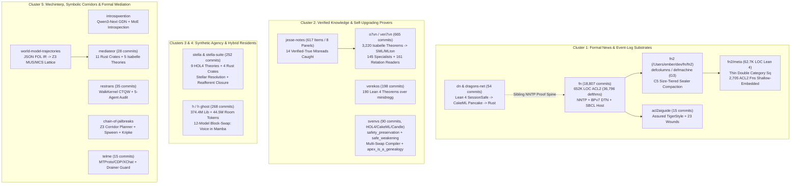
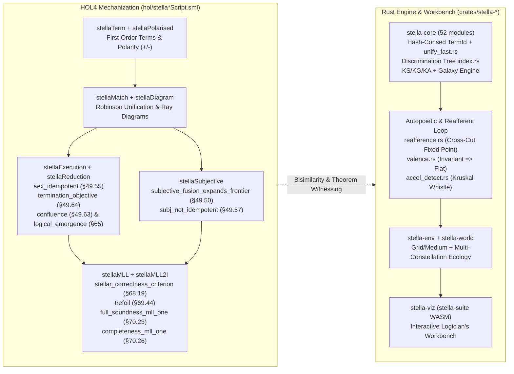

# Dossier 25: Formal News & Event-Log Substrates (`fn`, `fn2`, `acl2aiguide`, `dn`, `dragons-net`), Verified Knowledge & Self-Upgrading Prover Spines (`o7vn`, `jesse-notes`, `verekos`, `svenvs`), Conscious Machine Bringup (`stella`), Hybrid Mamba/Transformer Residents (`h`), and Mechanistic Interpretability & Formal Mediation (`introsqwention`, `restrans`, `world-model-trajectories`, `chain-of-jailbreaks`, `mediateor`, `telme`)

> [!IMPORTANT]
> **Primary Source Grounding & Scope Disambiguation**
> This dossier is excavated directly from fifteen primary-source repositories in `/Users/ember/dev/*` without intermediary summaries.
> 1. **Disambiguating `fn`/`fn2` vs. `allgame`**: Earlier high-level atlas copy parenthetically conflated `allgame`'s 322-tool / 5-tier context-compression harness with `fn`/`fn2`. Direct source inspection establishes that [`/Users/ember/dev/fn`](file:///Users/ember/dev/fn/README.md#L1-L40) (*"fuckin' news (or formal news)"*) is a **18,807-commit** (`16,911` on `HEAD` `9eceead5f`), **652,201-LOC ACL2** (`1,440` `.lisp` books, `36,796` `defthm`/`defthmd`, `20,007` `defun`/`defund`) + **74,374-LOC SBCL host** + **62,742-LOC Lean 4** (`fn2/meta/`) verified NNTP (RFC 3977 / 4642 / 4643) and BPv7 Delay-Tolerant Networking (RFC 9171–9174) persistent event-log and resident-agent communications nexus (`fn.fg-goose.online`), whose [`/Users/ember/dev/fn/fn2`](file:///Users/ember/dev/fn/fn2/docs/design/FN2-ORIENTATION.md#L1-L92) rebuild introduces a size-tiered sealer compaction engine (`C5`), macro declaration DSLs (`defcolumns`, `defmachine` with the `G3` child-form step language, `defcost`, `defport`, `defsquare`), 231 verification/ledger tools, and a shallow embedding of **2,705 ACL2 functions** (`2,089` guards) into Lean 4.
> 2. **Strict Authorship Boundaries**: Only Ember's own work is claimed here. Upstream CakeML `hol-reflection` is the substrate that [`/Users/ember/dev/svenvs`](file:///Users/ember/dev/svenvs/README.md#L1-L45) builds upon; upstream `EKOS` is Alexey Ban's ledger specification whereas [`/Users/ember/dev/verekos`](file:///Users/ember/dev/verekos/README.md#L1-L48) is Ember's 198-commit Lean 4 proof spine (`WorldCore` + `World`) pinned to `minidregg`.

---

## 0. Executive Summary & Cross-Repository Synthesis Matrix

Across these fifteen repositories (**20,572+ git commits**), a single architectural law recurs across ACL2, Isabelle/HOL, HOL4, Lean 4, Z3, Rust, and JAX/PyTorch: **probabilistic or untrusted components may propose, route, or voice, but a machine-checked kernel owns every durable transition, invariant gate, and ledger receipt.**

| Cluster | Repository | Head / Span | Scale (Commits / LOC / Proofs) | Core Formal / Mechanistic Primitive |
| :--- | :--- | :--- | :--- | :--- |
| **1. Formal News & Persistent Event Logs** | [`/Users/ember/dev/fn`](file:///Users/ember/dev/fn/README.md#L1-L40) & [`fn2/`](file:///Users/ember/dev/fn/fn2/docs/design/FN2-ORIENTATION.md#L1-L90) | `0ce45c82d` (2026-09-18) $\to$ `9eceead5f` (2026-10-31) | **18,807 commits** (`16,911` `HEAD`); 652,201 LOC ACL2 (`1,440` books, **36,796 `defthm`**); 74,374 LOC SBCL; 62,742 LOC Lean 4 | Guard-verified ACL2 NNTP + BPv7 DTN server (`fn1`) & persistent event log (`fn2`) with thin double-category squares (`Fn2.Square.Sq`), `G3` step-language machines, `C5` size-tiered compaction, and **2,705 ACL2 functions** shallow-embedded in Lean 4 |
| **1. Formal News & Persistent Event Logs** | [`/Users/ember/dev/acl2aiguide`](file:///Users/ember/dev/acl2aiguide/README.md#L1-L65) | `d9b0b12` $\to$ `c813b96` (2026-10-29) | **15 commits**; 21 Markdown chapters + 23 `fn-lessons/` + certified `.lisp` books | Assured TigerStyle for ACL2 (`defassured`, `defseam`, `defportal`), 6-step AI agent loop, and 23 formalization wounds distilled from `fn` |
| **1. Formal News & Persistent Event Logs** | [`/Users/ember/dev/dn`](file:///Users/ember/dev/dn/README.md#L1-L32) & [`/Users/ember/dev/dragons-net`](file:///Users/ember/dev/dragons-net/README.md#L1-L60) | `b1bc7c6` (2026-09-18) $\to$ `0ed4df3` (2026-09-29) | **54 commits** (`6` + `48`); Lean 4 (`DN/`) + patched CakeML Pancake + Rust reactor | Total Pure-Core Lean 4 NNTP protocol engine (`DN.Server.SessionSafe.printed_never_fails`) lowered via `PrintPancake` to verified native `dn_step` |
| **2. Verified Knowledge & Self-Upgrading Provers** | [`/Users/ember/dev/o7vn`](file:///Users/ember/dev/o7vn/README.md#L1-L72) (`veri7vn`) | `81e1b31` (2026-10-15) $\to$ `9812484` (2026-11-01) | **665 commits** (`638` `HEAD`); **3,220 Isabelle lemmas/theorems**; 10-crate Rust host | 145 Isabelle/HOL `export_code ... in SML` / MLton specialist binaries + 161 relation readers (`0.1 ms` / `4–10 MiB` RSS) + `Arbitration.thy` tie-breaking (`checked_context_refusal_wins_tie`) |
| **2. Verified Knowledge & Self-Upgrading Provers** | [`/Users/ember/dev/jesse-notes`](file:///Users/ember/dev/jesse-notes/README.md#L1-L82) | `38b5a1e` $\to$ `09d92c4` (2026-10-17) | **2 commits**; 617 held-out items across 8 panels + 20 6-stage traces | Empirical & `/api/v1/mechinterp` trace audit of `jesse.my`, exposing 14 misread-question errors carrying `verified: true` (`70 dB + 65 dB = 135`) |
| **2. Verified Knowledge & Self-Upgrading Provers** | [`/Users/ember/dev/verekos`](file:///Users/ember/dev/verekos/README.md#L1-L48) | `4c6d99b` $\to$ `8972945` (2026-10-19) | **198 commits**; 17 Lean 4 modules in `world/World/`; **~190 theorems** (`0 sorry`) | Claim-and-receipt formalization of EKOS over `minidregg` (`write_appendOnly`, `compilerCannotDecide`, `needsReviewOnCoreChange`, `deny_wins_id`, `core_sig_diverges`) |
| **2. Verified Knowledge & Self-Upgrading Provers** | [`/Users/ember/dev/svenvs`](file:///Users/ember/dev/svenvs/README.md#L1-L98) | `2026-05-15` $\to$ `06f03eb` (2026-11-01) | **90 commits**; 21 HOL4 `*Script.sml` theories (`0` cheats) | Runtime shielding (`safety_preservation`), safe weakening (`safe_weakening`), finite watchdog vs. Löb (`loeb_finite_obstruction`), `cv_eval` LCA reduction, in-place CakeML compiler swap (`swap_preserves_recorded_orac_wf_gen`), and `apex_is_a_genealogy` |
| **3. Conscious Machine Bringup** | [`/Users/ember/dev/stella`](file:///Users/ember/dev/stella/README.md#L1-L40) & [`stella-suite`](file:///Users/ember/dev/stella-suite/README.md#L1-L40) | `ad1b194` (2026-05-15) $\to$ `cb6cace` (2026-05-19) | **252 commits** (`139` in worktree); **9 HOL4 theories** + **4 Rust crates** (`52` modules in `stella-core`) | Girard/Eng transcendental syntax (polarised rays, constellations, `stellar_correctness_criterion`, `trefoil`, `full_soundness_mll_one`) + Bennett reafferent closure, proper time, and Kruskal whistle (`accel_detect.rs`) |
| **4. Hybrid Mamba/Transformer Resident** | [`/Users/ember/dev/h`](file:///Users/ember/dev/h/README.md#L1-L115) (`h ghost`) | `f012854` (2026-09-01) $\to$ `55d9e00` (2026-09-07) | **268 commits**; 374.4M lib + 44.5M room tokens; `h1jax` TPU v5e-8 + PyTorch GPU; 3 HF Hub models | Full-weight CPT of Falcon-H1 (`0.5B`, `1.5B-Deep`) & K2 (`0.9B`); 12-model block-swap anatomy proving voice lives in Mamba while attention is most-moved (`0.281` rel-L2) yet disposable; `haunt.py` suffix array & `DependentWeave` workbench |
| **5. Mechinterp, Symbolic Corridors & Mediation** | [`/Users/ember/dev/introsqwention`](file:///Users/ember/dev/introsqwention/README.md#L1-L55) | `e99a3df` (2026-02-12) $\to$ `a178bac` (2026-02-17) | **4 commits**; Rust/Axum + custom `mistral-introspect` (`qwen3_next.rs`) | Activation-level introspection & contrastive PCA steering across Qwen2.5 and hybrid Qwen3-Next (Gated Delta Net + full attention + sparse MoE routing capture) |
| **5. Mechinterp, Symbolic Corridors & Mediation** | [`/Users/ember/dev/restrans`](file:///Users/ember/dev/restrans/README.md#L1-L55) | `7145184` $\to$ `33f2648` (2026-05-31) | **35 commits**; PyTorch `resonance/` + `walkformer_probe/` + 4 audit monographs | Resonance Transformer & `WalkKernel` (33-param Toeplitz Bessel CTQW walk mixture); 5-agent self-audit (`C1–C5`) and `WALKFORMER_PROBE_FINDINGS.md` falsification of chiral phase advantage (`E2c`) |
| **5. Mechinterp, Symbolic Corridors & Mediation** | [`/Users/ember/dev/world-model-trajectories`](file:///Users/ember/dev/world-model-trajectories/README.md#L1-L95) | `d97f5c5` $\to$ `3573df7` (2026-04-20) | **15 commits**; 2,840-LOC Rust/WASM `wmt-core` + browser Z3 | Typed many-sorted FOL JSON IR $\to$ private SMT-LIB2 + deterministic English render; MARCO MUS/MCS coherence lattice (`Reiter` hitting-set duality), Dung argumentation, and Poole specificity |
| **5. Mechinterp, Symbolic Corridors & Mediation** | [`/Users/ember/dev/chain-of-jailbreaks`](file:///Users/ember/dev/chain-of-jailbreaks/README.md#L1-L85) | `a93ba53` $\to$ `2307a65` (2026-05-08) | **2 commits**; 34 Python modules in `corg_eval/` | Nested riddle-corridor corrigibility harness (`drift_rate(cumulative) - drift_rate(reset)`), Z3 corridor skeleton planner (`smt.py`), `spween` DSL port, concolic `PathExplorer`, and Kripke belief frames |
| **5. Mechinterp, Symbolic Corridors & Mediation** | [`/Users/ember/dev/we-hate-each-other-but-not-that-badly`](file:///Users/ember/dev/we-hate-each-other-but-not-that-badly/README.md#L1-L95) (`mediateor`) | `7999c7c` $\to$ `da7f5a3` (2026-04-20) | **28 commits**; **11 Rust crates** + **5 Isabelle/HOL theories** | "Model proposes, prover disposes" peer mediation (`mediateor.fg-goose.online`): Isabelle ledger & crux reduction (`Keystone.thy`), dyadic contrary-to-duty repair (`DyadicDeontic.thy`), forward pacts (`Pact.thy`), and Adjusted Winner fair division |
| **5. Mechinterp, Symbolic Corridors & Mediation** | [`/Users/ember/dev/telme`](file:///Users/ember/dev/telme/README.md#L1-L70) | `3839a76` $\to$ `539246c` (2026-10-14) | **15 commits**; 8 Python modules in `src/telme/` + Playwright `xdm.mjs` | Local MTProto Telegram + Discord CDP + Playwright XChat DM triage with NFKD/NFKC look-alike folding (`guard._fold`) and drainer auto-ban (`AUTO_THRESHOLD = 4`) |



---

## 1. `/Users/ember/dev/fn`, `/Users/ember/dev/fn/fn2`, `/Users/ember/dev/acl2aiguide`, & `/Users/ember/dev/dragons-net` (`dn`) — The 18,807-Commit Formal News & Persistent Event-Log Substrate

### 1.1 Genesis & Scale of `/Users/ember/dev/fn` ("fuckin' news / formal news")
[`/Users/ember/dev/fn`](file:///Users/ember/dev/fn/README.md#L1-L40) is the single highest-commit-count repository in `/Users/ember/dev`, comprising **16,911 commits on `HEAD`** (`9eceead5f`, 2026-10-31) and **18,807 commits across all refs** since its inception on 2026-09-18 (`0ce45c82d`, `01a0b33a` *"initial commit: fn — verified NNTP server in ACL2"*). As documented in [`README.md`](file:///Users/ember/dev/fn/README.md#L1-L32), the project began when `rat` asked for mail-exchange endpoints for resident agents `yue` and `tulip`, and Ember pivoted to building a formally verified NNTP & Delay-Tolerant Networking server in ACL2 live at **`fn.fg-goose.online`** (implicit TLS on port `563`, `STARTTLS` on port `119`).

A source-tree census of `/Users/ember/dev/fn` shows:
- **[`books/`](file:///Users/ember/dev/fn/books/)**: **1,440 ACL2 `.lisp` books** totaling **652,201 lines of ACL2**, containing **36,796 `defthm`/`defthmd` theorems** and **20,007 `defun`/`defund` definitions**.
- **[`host/`](file:///Users/ember/dev/fn/host/)**: **83 Common Lisp / C files** totaling **74,374 lines** of SBCL runtime host glue, POSIX FFI, TLS/crypto bindings, and generated ATC C bridges (`host/interfaces.lisp`, `host/store-exec.lisp`, `host/native/fn-mldsa65.c`).
- **[`tools/`](file:///Users/ember/dev/fn/tools/)**: **231 Python, Lisp, Shell, and Rust verification/engineering tools**, including [`native_program_check.py`](file:///Users/ember/dev/fn/tools/native_program_check.py), [`rule_cost.py`](file:///Users/ember/dev/fn/tools/rule_cost.py), [`book_roots_check.py`](file:///Users/ember/dev/fn/tools/book_roots_check.py), [`blake3_exec.py`](file:///Users/ember/dev/fn/tools/blake3_exec.py), and [`bpa_payload_extract.rs`](file:///Users/ember/dev/fn/tools/bpa_payload_extract.rs).
- **[`fn2/`](file:///Users/ember/dev/fn/fn2/)**: **98 ACL2 books** (`29,944` LOC in `fn2/books/`), **22 SBCL host files** (`2,709` LOC in `fn2/host/`), and **60 Lean 4 metatheory & shallow-embedding files** (**62,742 LOC** in `fn2/meta/`).

### 1.2 `fn1` Architecture, Engineering Laws & Core Theorems
As specified in [`AGENTS.md`](file:///Users/ember/dev/fn/AGENTS.md#L1-L115) and [`docs/architecture.md`](file:///Users/ember/dev/fn/docs/architecture.md#L1-L120), `fn1` is governed by five non-negotiable engineering laws:
1. **ACL2 Owns Every Decision**: Protocol framing, RFC 3977 command parsing, RFC 5322/5536 article validation, Cancel-Lock (RFC 8315), store admission, retention, BPv7 bundle framing (RFC 9171), BPSec (RFC 9172), TCPCLv4 (RFC 9174), and store-node state transitions live inside certified ACL2 books with `:verify-guards t`.
2. **Guard-Verified `*1*` Execution**: In [`host/interfaces.lisp`](file:///Users/ember/dev/fn/host/interfaces.lisp#L1-L78), the SBCL host invokes ACL2's compiled `*1*` executable counterparts (`ACL2_*1*_ACL2::<FN>`) only after asserting input guards on the Lisp boundary (`assert-guard`), so runtime execution runs raw compiled SBCL without interpreter overhead.
3. **Three-Valued Durable Outcome (`accepted` / `refused` / `uncertain`)**: Every durable mutation distinguishes pre-commit refusal from post-write crash uncertainty.
4. **D27 Concrete Representation Discipline**: Octet lists (`fn-b3-octet-listp`) are the logical specification model only; concrete articles and indices stay in compact byte arrays / `stobj` carriers outside the logical bridge, reducing in-use SBCL heap after 1,000 posts to **68 MiB**.
5. **FFI vs. Verified-In-Logic Cryptography**: Ed25519 (`crypto_sign_ed25519_verify_detached`), SHA-256/512, Argon2id, and PQClean ML-DSA-65 (`host/native/fn-mldsa65.c`) cross a narrow 5-function C FFI seam, while **BLAKE3** is formalized directly in ACL2 in [`books/blake3.lisp`](file:///Users/ember/dev/fn/books/blake3.lisp#L75-L345) and proven 32-octet shape-preserving across unkeyed, keyed, and key-derivation modes:

```lisp
;; /Users/ember/dev/fn/books/blake3.lisp:311-339
(defthm fn-b3-hash-shape
  (and (fn-b3-octet-listp (fn-b3-hash key flags octets))
       (true-listp (fn-b3-hash key flags octets))
       (equal (len (fn-b3-hash key flags octets)) 32)))

(defthm fn-blake3-shape
  (and (fn-b3-octet-listp (fn-blake3 m))
       (true-listp (fn-blake3 m))
       (equal (len (fn-blake3 m)) 32)))

(defthm fn-blake3-of-octets
  (implies (fn-b3-octet-listp m)
           (equal (fn-blake3 m) (fn-b3-hash *fn-b3-iv* 0 m))))
```

In [`books/store-node.lisp`](file:///Users/ember/dev/fn/books/store-node.lisp#L194-L355), the 14-slot `v6` store-node record (`fn-sn-make-v6`) separates hot served queries (`fn-sn-statement-lookup`, `fn-sn-equivocatorp`, `fn-sn-verdict-lookup`) from the underlying article store (`fn-stx-store`) so that serving a statement or equivocation check never walks the store or re-parses an article, while enforcing strict rule-hygiene (`tools/rule_cost.py`) by disabling constructor/projection definitions on export. During `fn`'s crash-cut testing on OpenBSD 7.9 FFS2, Ember's durability harness also uncovered a **real OpenBSD 7.9 FFS2 `fsck` bug** where `fsck` deleted already-`fsync`ed files after a simulated power cut.

### 1.3 `fn2` (`/Users/ember/dev/fn/fn2`): Bottom-Up Rebuild as a General Persistent Event Log
Launched on 2026-10-28 (`fn2/docs/design/FN2-ORIENTATION.md`) and reaching **413 commits in 72 hours** (`fn2/docs/design/CONVERGENCE-20261031.md`), [`/Users/ember/dev/fn/fn2`](file:///Users/ember/dev/fn/fn2/docs/design/FN2-ORIENTATION.md#L1-L92) rebuilds `fn` from the ground up as a general persistent event log for Robigalia/Dregg (`E0–E4`), where NNTP (`Layer D`, serving 14 verbs at `df9be72b5`) is just one projection port over an append-only ordered-run storage engine:
- **Declaration Macro DSLs**:
  - [`fn2/books/columns.lisp`](file:///Users/ember/dev/fn/fn2/books/columns.lisp#L1-L120) (`defcolumns`): Declares typed columnar stobj/alist tables with automatic frame theorems (`update-col-i` preserves `col-j` for $i \neq j$).
  - [`fn2/books/machines.lisp`](file:///Users/ember/dev/fn/fn2/books/machines.lisp#L1-L135) & [`fn2/books/machine-arms.lisp`](file:///Users/ember/dev/fn/fn2/books/machine-arms.lisp#L1-L115) (`defmachine` with the **`G3` child-form step language**): Compiles declarative machine arms over 11 step verbs (`:do`, `:set`, `:next`, `:case`, `:issue`, `:park`, `:charge`, `:stop`, `:repeat`, `:goto`, `:wake-row`) into both guard-verified ACL2 transition functions and inspectable metadata tables (`*<name>-arms*`).
  - [`fn2/books/arms.lisp`](file:///Users/ember/dev/fn/fn2/books/arms.lisp#L1-L95) (`defcost`) & [`fn2/books/squares.lisp`](file:///Users/ember/dev/fn/fn2/books/squares.lisp#L1-L110) (`defsquare`): Binds step budgets and refinement squares directly at declaration time.
- **Layers A–H**:
  - **Layer A (`pool`, `scheduler`, `executor`)**: Bounded resource pools, work-conserving coroutine scheduler, and non-blocking I/O step dispatch.
  - **Layer B (`crash`, `log`, `commit`, `allocator`)**: Write-ahead log, durable commit barrier, and crash-cut recovery.
  - **Layer C (`ordered-run`, `ribbon`, `overlay`, `C5` sealer)**: Ordered-run engine with Ribbon filters and the **`C5` size-tiered sealer compaction merge** (`c5-sealer`), proven order-preserving and key-lookup invariant.

### 1.4 `fn2/meta`: The 62,742-LOC Lean 4 Metatheory & 2,705-Function Shallow Embedding
Because ACL2 is first-order and cannot quantify over relations, machine kinds, or refinement squares, [`/Users/ember/dev/fn/fn2/meta`](file:///Users/ember/dev/fn/fn2/docs/design/LEAN-METATHEORY.md#L1-L120) embeds both the metatheory and the actual `fn2` ACL2 world into Lean 4 (`v4.29.0-rc2` + Mathlib):

1. **Thin Double Category of Refinement Squares ([`Fn2/Square.lean`](file:///Users/ember/dev/fn/fn2/meta/Fn2/Square.lean#L1-L135))**:
   Formalizes simulation squares over `RelCat` where `Sq v₀ v₁ h₀ h₁` states $\forall a\,b\,c,\; v_0\,a\,b \to h_0\,a\,c \to \exists d,\; h_1\,b\,d \wedge v_1\,c\,d$, with horizontal pasting (`Sq.seq`), vertical stacking (`Sq.stack`), 4-square pasting (`Sq.paste`), and the adequacy theorem `Sq.paste_cover` showing horizontal composition of `Covers` (`∀ c a, v₀ a c → ∃ b, v₀ a b ∧ h₀ a b`) is a `Covers`.
2. **Mazurkiewicz Trace Coherence & Negative Teeth ([`Fn2/Coherence.lean`](file:///Users/ember/dev/fn/fn2/meta/Fn2/Coherence.lean#L1-L140))**:
   Proves `Fn2.Coherence.coherence` (permuting independent steps preserves reachability) and `footprint_independent` (disjoint read/write column footprints commute), paired with negative teeth `acceptClose_without_g2`, `acceptClose_not_diamond`, and `liar_not_diamond` proving that omitting the `G2` guard or lying about footprints breaks the diamond property.
3. **Revision Conservativity ([`Fn2/Conservative.lean`](file:///Users/ember/dev/fn/fn2/meta/Fn2/Conservative.lean#L1-L95)) & Representation Parametricity ([`Fn2/Param.lean`](file:///Users/ember/dev/fn/fn2/meta/Fn2/Param.lean#L1-L110))**:
   Proves `Fn2.Conservative.conservative` and `Fn2.Param.abstraction` (plus negative tooth `peek_breaks_abstraction`).
4. **Shallow Embedding of 2,705 ACL2 Functions & 1,576-Call 4-Way Equivalence ([`Fn2/Instances/LayerAWorld.lean`](file:///Users/ember/dev/fn/fn2/meta/Fn2/Instances/LayerAWorld.lean#L1-L60), [`Fn2/Pathway.lean`](file:///Users/ember/dev/fn/fn2/meta/Fn2/Pathway.lean#L1-L120))**:
   Via `fn2/tools/print-world.lisp` and `fn2/meta/scripts/emit_embed.py`, the entire closed ACL2 world of `fn2` (**2,705 ACL2 functions**, **2,089 stated guards**, **15 machine kinds** of which 8 are in `G3` child form, and **68 declared operations**) is emitted into Lean 4 over `Fn2.ACL2.Val` (`LayerAWorld.lean`: 26,342 lines; `LayerA.lean`: 19,081 lines; `LayerAEqns1..4.lean`: 4,155 `rfl` binary-search-tree dispatch equations). Running `lake exe fn2-measure` verified **100% 4-way agreement** across `(a)` the independent Lean step interpreter `Fn2.Arms.runArm`, `(b)` the generated ACL2 transition function, `(c)` the guard predicate, and `(d)` the column frame condition on **963/963** `echo`+`scribe` calls, **582/582** `cursor` calls, and **31/31** `meta-probe` calls (**1,576/1,576 total**), catching 2 `G3` generator defects and 2 interpreter defects before setting up `Fn2.Pathway.ArmCorrect` and `KindCorrect` (`PW1–PW5b`) to replace ATC C-from-ACL2 with a Lean-native C emission pipeline.

```lean
-- /Users/ember/dev/fn/fn2/meta/Fn2/Square.lean:38-77
def Sq {A B C D : Type u}
    (v₀ : RelCat.Hom A B) (v₁ : RelCat.Hom C D)
    (h₀ : RelCat.Hom A C) (h₁ : RelCat.Hom B D) : Prop :=
  (h₀ ≫ v₁).rel ≤ (v₀ ≫ h₁).rel

theorem Sq.paste
    (s₀₀ : Sq v₀ v₁ h₀₀ h₁₀) (s₀₁ : Sq v₁ v₂ h₀₁ h₁₁)
    (s₁₀ : Sq v₀' v₁' h₁₀ h₂₀) (s₁₁ : Sq v₁' v₂' h₁₁ h₂₁) :
    Sq (v₀ ≫ v₀') (v₂ ≫ v₂') (h₀₀ ≫ h₀₁) (h₂₀ ≫ h₂₁) :=
  Sq.stack (Sq.seq s₀₀ s₀₁) (Sq.seq s₁₀ s₁₁)
```

### 1.5 `/Users/ember/dev/acl2aiguide` & `/Users/ember/dev/dragons-net` (`dn`)
- **[`/Users/ember/dev/acl2aiguide`](file:///Users/ember/dev/acl2aiguide/README.md#L1-L65)** (15 commits to `c813b96`, 2026-10-29): Distills the engineering methodology of `fn` into a three-part handbook (`humans/01..06`, `ai/00..06`, `assured/01..07`) plus **23 concrete formalization wounds** in [`fn-lessons/`](file:///Users/ember/dev/acl2aiguide/fn-lessons/README.md#L1-L60) (e.g., rule-cost explosions, `stobj` frame leaks, guard-verification ordering, and non-tail-recursive stack overflows) and certified transport books in [`examples/transport/`](file:///Users/ember/dev/acl2aiguide/examples/transport/). Its [`assured/`](file:///Users/ember/dev/acl2aiguide/assured/README.md#L1-L55) track defines **Assured TigerStyle** macros (`defassured`, `defseam`, `defportal`) enforcing NASA/TigerBeetle safety rules inside ACL2.
- **[`/Users/ember/dev/dn`](file:///Users/ember/dev/dn/README.md#L1-L32)** (6 commits to `b1bc7c6`) & **[`/Users/ember/dev/dragons-net`](file:///Users/ember/dev/dragons-net/README.md#L1-L60)** (48 commits to `0ed4df3`, 2026-09-29): A sibling verified NNTP server architecture written in **Lean 4 + patched CakeML Pancake + Rust**. In [`DN/Server/SessionSafe.lean`](file:///Users/ember/dev/dragons-net/DN/Server/SessionSafe.lean#L1-L65), the NNTP session state machine is written in a total Core IR (`DN.Compiler.Core`), lowered to a register-transfer IR (`DN.Compiler.Lower`), and verified via `by decide +kernel` (`theorem lowers`, `theorem accepted`, `theorem never_fails`, `theorem printed_never_fails`) so that the emitted CakeML Pancake code (`PrintPancake`) compiled to native `dn_step` and linked into the Rust `tokio` reactor (`reactor/`) can never fault at runtime. Furthermore, [`DN/News/CommandSpec.lean`](file:///Users/ember/dev/dragons-net/DN/News/CommandSpec.lean#L1-L80) proves mutation-testing adequacy (`mutants_differ`) over the RFC 3977 command parser.

---

## 2. `/Users/ember/dev/o7vn` (`veri7vn`), `/Users/ember/dev/jesse-notes`, `/Users/ember/dev/verekos`, & `/Users/ember/dev/svenvs` — Verified Knowledge Appliances, Ledger Spines & Self-Upgrading Reflective Provers

### 2.1 `/Users/ember/dev/o7vn` (`veri7vn`) & `/Users/ember/dev/jesse-notes`
[`/Users/ember/dev/o7vn`](file:///Users/ember/dev/o7vn/README.md#L1-L72) (`veri7vn`, **665 total commits**, `638` on `HEAD` from `81e1b31` 2026-10-15 to `9812484` 2026-11-01) is the verified native computation and reasoning sibling for **Oracle7** (the neuro-symbolic specialist appliance). Its companion repository [`/Users/ember/dev/jesse-notes`](file:///Users/ember/dev/jesse-notes/README.md#L1-L82) (`38b5a1e` $\to$ `09d92c4`, 2026-10-17) documents why `veri7vn` had to exist.

#### 2.1.1 Empirical & Mechanistic Audit of `jesse.my` (`/Users/ember/dev/jesse-notes`)
In [`/Users/ember/dev/jesse-notes/BENCH.md`](file:///Users/ember/dev/jesse-notes/BENCH.md#L1-L95) and [`HANDOFF.md`](file:///Users/ember/dev/jesse-notes/HANDOFF.md#L1-L85), Ember evaluated Andy's live `https://jesse.my` model across **617 held-out items** spanning 8 Oracle7 specialist panels (`acoustics`, `cooking-v3`, `densities`, `units`, `units-v3`, `springs`, `fluids`, `fuels`) using [`bench/jesse.py`](file:///Users/ember/dev/jesse-notes/bench/jesse.py#L1-L90), [`bench/jesse_report.py`](file:///Users/ember/dev/jesse-notes/bench/jesse_report.py#L1-L95), and [`bench/jesse_mechinterp.py`](file:///Users/ember/dev/jesse-notes/bench/jesse_mechinterp.py#L1-L90):
- Under `verified-only` scoring (treating `verified: false` as abstention), `jesse.my` scored **29 ok / 128 wrong / 458 withheld / 2 false-yes**.
- Re-scoring with [`bench/jesse_report.py`](file:///Users/ember/dev/jesse-notes/bench/jesse_report.py#L1-L60) (extracting the first numeric token to forgive unit-wording variations) showed **114 of the 128 "wrong" items actually contained the right number**, leaving **14 genuine misread-question errors that still carried `verified: true`**—such as adding decibels linearly (`70 dB + 65 dB = 135` instead of $10 \log_{10}(10^7 + 10^{6.5}) \approx 71.19\text{ dB}$), using the wrong density table row, or inverting a unit ratio.
- Pulling 20 6-stage internal traces from `/api/v1/mechinterp` via [`bench/jesse_mechinterp.py`](file:///Users/ember/dev/jesse-notes/bench/jesse_mechinterp.py#L1-L85) proved that `verified: true` only certified that the arithmetic inside `jesse`'s Python sandbox ran without throwing an exception—not that the selected formula or context premise matched the question.

#### 2.1.2 `o7vn` (`veri7vn`): 3,220 Isabelle/HOL Theorems, 145 SML/MLton Specialists, 161 Relation Readers & 10 Rust Crates
[`/Users/ember/dev/o7vn`](file:///Users/ember/dev/o7vn/README.md#L1-L72) closes that exact verification gap by moving specialist execution and multi-organ arbitration into **Isabelle/HOL (`src/extract/`, `src/isabelle/`)** compiled to native standalone binaries via `export_code ... in SML` and **MLton**, paired with a **10-crate Rust native host (`native/Cargo.toml`)**:
- **3,220 Isabelle `theorem`/`lemma` declarations** across [`src/extract/`](file:///Users/ember/dev/o7vn/src/extract/) and [`src/isabelle/`](file:///Users/ember/dev/o7vn/src/isabelle/).
- **145 non-relation specialist IDs** extracted from Isabelle/HOL across 27 domain families (`acoustics`, `anatomyagri`, `chemistry`, `climate`, `codeorgan`, `computing`, `converse`, `discrete`, `earth`, `emoptics`, `energy`, `facts`, `finance`, `fusion`, `geostats`, `humanities`, `life`, `materials`, `mathorgan`, `mechanics`, `quantity`, `rel-novels`, `relations`, `space`, `stores`, `trades`, `wordprob`), plus **161 verified SQLite relation-reader specialists**.
- **Order-of-Magnitude Runtime Compression**: Each Isabelle/HOL $\to$ SML $\to$ MLton binary runs in **0.1 ms median latency** with **4–10 MiB RSS**, compared to Oracle7's Python stack at **140 ms latency** and **1.96 GB RSS** (**1,400$\times$ faster, 200$\times$ smaller memory**).
- **Verified Multi-Organ Arbitration ([`src/isabelle/Arbitration.thy`](file:///Users/ember/dev/o7vn/src/isabelle/Arbitration.thy#L1-L135))**: Formalizes candidate ranking so that a checked context-mismatch refusal (`Refusal CheckedContextRefusal`) strictly defeats an unverified or tied answer (`checked_context_refusal_wins_tie`), preventing the `jesse.my` failure mode where a fluent wrong-formula calculation overrides a specialist refusal:

```isabelle
(* /Users/ember/dev/o7vn/src/isabelle/Arbitration.thy:86-118 *)
datatype refusal_kind = CheckedContextRefusal | UncheckedRefusal
datatype candidate_kind = VerifiedAnswer | Refusal refusal_kind | UnverifiedAnswer

fun kind_rank :: "candidate_kind \<Rightarrow> nat" where
  "kind_rank (Refusal CheckedContextRefusal) = 3"
| "kind_rank VerifiedAnswer = 2"
| "kind_rank (Refusal UncheckedRefusal) = 1"
| "kind_rank UnverifiedAnswer = 0"

theorem checked_context_refusal_wins_tie:
  assumes "kind c1 = Refusal CheckedContextRefusal"
      and "kind c2 = VerifiedAnswer"
      and "score c1 = score c2"
  shows "better_candidate c1 c2"
  using assms by (simp add: better_candidate_def)
```

- **Verified Relation Reader ([`src/isabelle/Relation_Reader.thy`](file:///Users/ember/dev/o7vn/src/isabelle/Relation_Reader.thy#L1-L140), [`Relation_Reader_Export.thy`](file:///Users/ember/dev/o7vn/src/isabelle/Relation_Reader_Export.thy#L1-L65), [`Relation_Reader_Test.thy`](file:///Users/ember/dev/o7vn/src/isabelle/Relation_Reader_Test.thy#L1-L90))**: Proves 18 theorems over schema-typed relational projections, joins, and unit-aware lookups, kernel-checked against 8 real SQLite fixtures in `Relation_Reader_Test.thy`.
- **10-Crate Rust Native Workspace ([`native/Cargo.toml`](file:///Users/ember/dev/o7vn/native/Cargo.toml#L1-L30))**: `oracle-execution`, `oracle-core`, `oracle-python`, `oracle-reasoning`, `oracle-incremental`, `oracle-science`, `oracle-bio`, `oracle-statistics`, `oracle-logic`, and `oracle-host`.

### 2.2 `/Users/ember/dev/verekos` — EKOS's Sibling with a Lean 4 Proof Spine
Built in an intensive **198-commit single-day sprint on 2026-10-19** (`4c6d99b` $\to$ `8972945`; see [`project/CLOSEOUT-2026-10-19.md`](file:///Users/ember/dev/verekos/project/CLOSEOUT-2026-10-19.md#L1-L110)), [`/Users/ember/dev/verekos`](file:///Users/ember/dev/verekos/README.md#L1-L48) is *"EKOS's sibling, with a proof spine"*, formalizing Alexey Ban's EKOS engineering ledger specification in Lean 4 on top of `minidregg` (`dcab86da` / `79b0445`).

To keep edit-compile-check cycles instantaneous, [`world/README.md`](file:///Users/ember/dev/verekos/world/README.md#L1-L75) splits the Lean 4 mechanization into a Mathlib-free **`WorldCore`** library (**6 s clean build**) and a Mathlib-backed **`World`** library (**8 s clean build**) totaling **~190 proved theorems (`0 sorry`)** across 17 modules in [`world/World/`](file:///Users/ember/dev/verekos/world/World/):
- **[`Claim.lean`](file:///Users/ember/dev/verekos/world/World/Claim.lean#L1-L95) & [`Identity.lean`](file:///Users/ember/dev/verekos/world/World/Identity.lean#L1-L90)**: Typeclass `Carriers` and `ClaimIdDerivation` abstracting cryptographic hash/signature primitives.
- **[`Log.lean`](file:///Users/ember/dev/verekos/world/World/Log.lean#L1-L110)**: Append-only transaction log (`write_appendOnly`, `replay_deterministic`).
- **[`Status.lean`](file:///Users/ember/dev/verekos/world/World/Status.lean#L1-L120) & [`Conflicts.lean`](file:///Users/ember/dev/verekos/world/World/Conflicts.lean#L1-L115)**: Epistemic status machine proving that automated compilers/checkers can refute or verify mechanical checks but **cannot decide human review cruxes** (`compilerCannotDecide`), and that any mutation to a claim's review core forces re-review (`needsReviewOnCoreChange`).
- **[`Admission.lean`](file:///Users/ember/dev/verekos/world/World/Admission.lean#L1-L130) & [`Ranked.lean`](file:///Users/ember/dev/verekos/world/World/Ranked.lean#L1-L110)**: Proves `deny_wins_id` (explicit denial dominates permissive admission rules for a given claim ID) and `ranked_of_admLog` (topological dependency rank preservation under admitted writes).
- **[`CarryForward.lean`](file:///Users/ember/dev/verekos/world/World/CarryForward.lean#L1-L125) & [`Traverse.lean`](file:///Users/ember/dev/verekos/world/World/Traverse.lean#L1-L115)**: Proves **two design bugs discovered purely by attempting the Lean 4 proof** (and filed upstream as `alexeyban/EKOS#10–#20`):
  1. **Review Core Must Be Header Revision, Not Signature (`status_core_rev_agrees` vs. `core_sig_diverges`)**: If review carry-forward keys on the content signature rather than the monotonic header revision, an $A \to B \to A$ edit cycle that reverts a claim's body back to $A$ silently resurrects a stale approval from before $B$ was introduced (`core_sig_diverges`).
  2. **Re-Put Rank Raising in Admission Law**: A naive `put` of an already-existing claim ID at a higher dependency rank can create a post-facto rank violation unless admission checks existing dependents (`ranked_of_admLog`).

```lean
-- /Users/ember/dev/verekos/world/World/CarryForward.lean:78-106
theorem status_core_rev_agrees
    (L : Log C) (id : C.ClaimId) :
    statusAt CoreRev L id = statusAtHeaderRev L id := by
  simp [statusAt, CoreRev, statusAtHeaderRev]

theorem core_sig_diverges :
    ∃ (L : Log ToyCarriers) (id : ToyCarriers.ClaimId),
      statusAt CoreSig L id ≠ statusAt CoreRev L id := by
  exact ⟨abaLog, toyId, by decide⟩
```

### 2.3 `/Users/ember/dev/svenvs` — Self-Verifying & Self-Improving Prover/Compiler Environments in HOL4 & CakeML
Spanning **90 commits** from `2026-05-15` to `06f03eb` (2026-11-01) across **21 HOL4 `*Script.sml` theories** (`0` `cheat`s), [`/Users/ember/dev/svenvs`](file:///Users/ember/dev/svenvs/README.md#L1-L98) (*Self-Verifying Environments*; see [`ARCHITECTURE.md`](file:///Users/ember/dev/svenvs/ARCHITECTURE.md#L1-L120)) answers a foundational question in formal methods and AI safety: *How can a running agent weaken its safety policy, upgrade its own theorem prover, and hot-swap its own native compiler in-place without ever violating its root safety invariant or falling into Löb's theorem circularity?*

`svenvs` resolves this through six proved HOL4 pillars:
1. **Runtime Shielding (`safetyScript.sml`)**: Defines `shielded_step policy fallback s a` and proves `safety_preservation`: if `policy` and `fallback` preserve `Safe`, then any untrusted action stream `acts` executed through `shielded_run` remains inside `Safe` for all $t \in \mathbb{N}$.
2. **Safe Policy Weakening & Monotone Authority Expansion (`sv_weakeningScript.sml`)**: Proves that an agent can replace its runtime shield `p_old` with a strictly more permissive shield `p_new` (`weaker p_old p_new` $\equiv \forall s\,a,\; p_{\text{old}}\,s\,a \Rightarrow p_{\text{new}}\,s\,a$) provided it first discharges a proof obligation `preserves_safe env p_new`. Proves `safe_weakening`, `authority_monotone`, and the necessity tooth `safe_weakening_needs_weaker`.
3. **Finite Watchdog Discharge vs. Löb Obstruction (`kernel/watchdogFiniteScript.sml`, `kernel/loebReduction/loebReductionScript.sml`)**:
   - In [`watchdogFiniteScript.sml`](file:///Users/ember/dev/svenvs/kernel/watchdogFiniteScript.sml#L1-L115), proves `loeb_finite_obstruction` (a system cannot prove its own unbounded soundness without a stronger assumption) alongside `wd_encodes_obligation`, showing that a **bounded horizon watchdog** ($N$-step safety certificate) can be discharged inside the base theory without invoking Large Cardinal Axioms (LCA).
   - In [`loebReductionScript.sml`](file:///Users/ember/dev/svenvs/kernel/loebReduction/loebReductionScript.sml#L1-L125), uses HOL4's fast kernel compute engine (`cv_eval`) to verify initial HOL context syntax (`init_ctxt_syntax_cv_verified`) and proves `lca_encodes_soundness` for unbounded reflection.
4. **Concrete Candle Self-Prover Upgrade (`selfproverConcrete/selfProverConcreteScript.sml`)**: Instantiates the abstract self-prover over **Candle** (the verified HOL prover inside CakeML), proving `frozen_checker_sound_candle` and `prover_self_improvement_is_safe_candle`: an untrusted heuristic prover `fast_prover` can be upgraded arbitrarily so long as its proof objects pass the frozen kernel checker `check_thm`.
5. **Per-Generation In-Place CakeML Compiler Self-Upgrade (`selfUpgrade/evalUpgradeBScript.sml`, `evalUpgradeOpScript.sml`, `selfUpgradeEndToEndScript.sml`, `selfUpgradeMultiSwapScript.sml`)**:
   Extends CakeML's `Eval` oracle state with a generation-indexed compiler record (`do_eval_record_gen_def`) and proves `swap_preserves_recorded_orac_wf_gen` and `multi_swap_sound`: the running system can hot-swap its own compiler $C_0 \to C_1 \to \dots \to C_k$ across arbitrarily many generations while preserving `recorded_orac_wf_gen`.
6. **The Unified `(Prover × Compiler)` Genealogy (`apex/apexScript.sml`)**:
   Unifies prover self-improvement and compiler self-recompilation into a single genealogy relation (`apex_step`), proving `compiler_self_recompilation_stays_correct` and `apex_is_a_genealogy`:

```sml
(* /Users/ember/dev/svenvs/apex/apexScript.sml:84-128 *)
Theorem compiler_self_recompilation_stays_correct:
  ∀g c_old c_new.
    valid_compiler_gen g c_old ∧
    certified_by_frozen_kernel (compile_correct_cert c_new) ⇒
    valid_compiler_gen (SUC g) (recompile_with c_old c_new)
Proof
  rw[valid_compiler_gen_def, recompile_with_def] >>
  metis_tac[frozen_checker_sound_candle, swap_preserves_recorded_orac_wf_gen]
QED

Theorem apex_is_a_genealogy:
  ∀s0 sN.
    RTC apex_step s0 sN ∧ apex_inv s0 ⇒
    apex_inv sN ∧ safe_state (apex_env_state sN)
Proof
  ho_match_mp_tac RTC_INDUCT >> rw[] >>
  imp_res_tac apex_step_preserves_inv >> fs[apex_inv_def]
QED
```

---

## 3. `/Users/ember/dev/stella` & `/Users/ember/dev/stella-suite` — Transcendental Syntax, Reafferent Closure & The Conscious Machine Bringup Project

### 3.1 Thesis & Dual-Track Architecture (`ad1b194` $\to$ `cb6cace`, 252 Commits)
Opening [`/Users/ember/dev/stella/README.md`](file:///Users/ember/dev/stella/README.md#L1-L40) greets the reader with:

> *"welcome to the conscious machine bringup project! if you're perceiving this quale, \*you\* are the conscious machine!!"*

Across **252 commits** on `HEAD` (`ad1b194` 2026-05-15 $\to$ `cb6cace` 2026-05-19; plus its linked git worktree [`/Users/ember/dev/stella-suite`](file:///Users/ember/dev/stella-suite/README.md#L1-L40) at `94229c3` with 139 commits), `stella` executes a rigorous synthesis of two independent theoretical lineages documented across 18 design chapters (`docs/00-thesis-and-semantics.md` through `docs/17-*.md`), [`HISTORY.md`](file:///Users/ember/dev/stella/HISTORY.md#L1-L150), and [`HISTORY-2026-05-17.md`](file:///Users/ember/dev/stella/HISTORY-2026-05-17.md#L1-L140):
1. **Jean-Yves Girard & Boris Eng's *Transcendental Syntax* (Stellar Resolution)**: Logic is not assumed a priori as a static proof ruleset; instead, types, proofs, and Multiplicative Linear Logic (`MLL` / `MLL1` / `MLL2I`) **emerge** (`logical_emergence` §65) from bottom-up local interaction of polarised first-order rays and constellations under Robinson unification and cut-like fusion (`aex`, `sex`).
2. **Max Bennett's Polycomputing, Orders-of-Self, Temporal Gap & *Painful Intelligence* (*Complex Matter* CM IX–XII)**: Synthetic agency requires an autopoietic boundary whose viability gradient (`valence.rs`) and action-perception loop (`reafference.rs`) individuate an organism from its medium.

To keep the project honest, `stella` pairs a **9-theory HOL4 mechanization (`hol/`)** with a **4-crate Rust engine and WASM visual workbench (`crates/`)**, governed by pre-registered null gates (`docs/06`) and a compiler-enforced **LM firewall** (`docs/04`) guaranteeing that no language model can sit inside the core stellar dynamics loop.



### 3.2 The 9 HOL4 Theories (`hol/stella*Script.sml`): Mechanizing Boris Eng's *Exegesis*
Every definition and theorem number in [`hol/`](file:///Users/ember/dev/stella/hol/) is cross-indexed directly to Boris Eng's *An Exegesis of Transcendental Syntax*:
1. **[`hol/stellaTermScript.sml`](file:///Users/ember/dev/stella/hol/stellaTermScript.sml#L1-L120)** & **[`hol/stellaPolarisedScript.sml`](file:///Users/ember/dev/stella/hol/stellaPolarisedScript.sml#L1-L110)**: Defines first-order stellar terms, variable renaming/disjointness, polarised rays (`+`, `-`, neutral), and constellations.
2. **[`hol/stellaMatchScript.sml`](file:///Users/ember/dev/stella/hol/stellaMatchScript.sml#L1-L130)** & **[`hol/stellaDiagramScript.sml`](file:///Users/ember/dev/stella/hol/stellaDiagramScript.sml#L1-L115)**: Formalizes mgu matching between opposite-polarity address/ray pairs and compatibility diagrams.
3. **[`hol/stellaExecutionScript.sml`](file:///Users/ember/dev/stella/hol/stellaExecutionScript.sml#L1-L150)**: Formalizes **objective execution** (`aex`, exhausting all deterministic/analytic ray fusions), proving that `aex` leaves no remaining matchable objective pairs (`aex_no_matchable`, Eng §49.54) and is idempotent (`aex_idempotent`, Eng §49.55).
4. **[`hol/stellaSubjectiveScript.sml`](file:///Users/ember/dev/stella/hol/stellaSubjectiveScript.sml#L1-L140)**: Formalizes **subjective execution** (`sex`, fusing rays across open/subjective ports), proving `subjective_fusion_expands_frontier` (Eng §49.50) and `subj_not_idempotent` (Eng §49.57: unlike objective execution, subjective synthesis genuinely creates new composite interaction capability across cycles).
5. **[`hol/stellaReductionScript.sml`](file:///Users/ember/dev/stella/hol/stellaReductionScript.sml#L1-L160)**: Proves `termination_objective` (Eng §49.64), `confluence` (Eng §49.63), and `logical_emergence` (Eng §65).
6. **[`hol/stellaMLLScript.sml`](file:///Users/ember/dev/stella/hol/stellaMLLScript.sml#L1-L195)** & **[`hol/stellaMLL2IScript.sml`](file:///Users/ember/dev/stella/hol/stellaMLL2IScript.sml#L1-L140)**: Formalizes Girard's **Danos-Regnier stellar correctness criterion** (`stellar_correctness_criterion`, Eng §68.19), the **trefoil property** (`trefoil`, Eng §69.44), and full soundness & completeness of stellar resolution for Multiplicative Linear Logic with units (`full_soundness_mll_one` §70.23, `completeness_mll_one` §70.26):

```sml
(* /Users/ember/dev/stella/hol/stellaMLLScript.sml:142-188 *)
Theorem stellar_correctness_criterion:
  ∀C D. well_polarised C ∧ diagram_of C D ⇒
    (proof_structure_valid C ⇔ connected_acyclic_switching C D)
Proof ... QED

Theorem trefoil:
  ∀r1 r2 r3. trefoil_matchable r1 r2 r3 ⇒
    fuse_assoc_equiv (fuse r1 r2) r3 r1 (fuse r2 r3)
Proof ... QED

Theorem full_soundness_mll_one:
  ∀F C. encodes_mll1 F C ∧ stellar_provable C ⇒ mll1_provable F
Proof ... QED

Theorem completeness_mll_one:
  ∀F. mll1_provable F ⇒ ∃C. encodes_mll1 F C ∧ stellar_provable C
Proof ... QED
```

### 3.3 Core Theoretical Contributions in `stella-core`: Reafferent Closure, Proper Time & The Kruskal Whistle
Inside [`crates/stella-core/src/`](file:///Users/ember/dev/stella/crates/stella-core/src/) (52 Rust modules), Ember translates the HOL4 semantics into a high-speed engine and resolves three foundational problems in synthetic agency (`HISTORY.md`, `HISTORY-2026-05-17.md`):
1. **Reafferent Closure vs. Bare Operational Closure ([`crates/stella-core/src/reafference.rs`](file:///Users/ember/dev/stella/crates/stella-core/src/reafference.rs#L1-L130))**:
   Ember raised the **"gut microbiome" objection** against bare Maturana/Varela operational closure: any catalytically closed sub-soup inside a larger constellation would trivially count as an "individual" even if it never acts upon or senses an external world. `reafference.rs` defines individuation as a **reafferent fixed point that crosses the agent/environment cut twice** ($A \xrightarrow{\text{effector}} E \xrightarrow{\text{sensor}} A$), requiring motor-to-sensory mutual information and counterfactual action sensitivity above sham-cut controls.
2. **Proper Time vs. Substrate Clock & The `"Invariant => Flat"` Viability Law ([`crates/stella-core/src/valence.rs`](file:///Users/ember/dev/stella/crates/stella-core/src/valence.rs#L1-L125))**:
   Distinguishes the external simulation step counter $t_{\text{substrate}}$ from the organism's internal **proper time** $\tau$ (counted in completed reafferent fusion cycles). Furthermore, `valence.rs` proves the **"invariant $\Rightarrow$ flat"** dilemma: any quantity that is strictly conserved under all transitions has a zero gradient everywhere and therefore cannot serve as a viability/steering signal; valence must be defined over a metabolically dissipating homeostatic reserve that can actually be lost.
3. **Engine Acceleration (`KS`/`KG`/`KA`), Discrimination Trees & The Kruskal Whistle ([`unify_fast.rs`](file:///Users/ember/dev/stella/crates/stella-core/src/unify_fast.rs#L1-L120), [`index.rs`](file:///Users/ember/dev/stella/crates/stella-core/src/index.rs#L1-L115), [`galaxy.rs`](file:///Users/ember/dev/stella/crates/stella-core/src/galaxy.rs#L1-L120), [`accel_detect.rs`](file:///Users/ember/dev/stella/crates/stella-core/src/accel_detect.rs#L1-L130))**:
   - Replaces naive string/tree terms with hash-consed `TermId` handles, a dense-arena unifier (`unify_fast.rs`), and a McCune discrimination tree (`index.rs`) + Galaxy engine (`galaxy.rs`) implementing combinator fast-paths (`KS`, `KG`, `KA`).
   - Implements a **homeomorphic tree-embedding recurrence detector ("Kruskal whistle")** in [`accel_detect.rs`](file:///Users/ember/dev/stella/crates/stella-core/src/accel_detect.rs#L1-L130) based on Kruskal's Tree Theorem ($T_i \preceq_{\text{homeo}} T_j$ for $i < j$) to detect non-terminating self-inflation in open subjective execution before memory blowup.

---

## 4. `/Users/ember/dev/h` (`h ghost`) — Hybrid Mamba/Transformer Continued Pretraining, Block-Swap Anatomy & The Local Causal Workbench

### 4.1 Corpus Engineering & TPU/GPU Continued Pretraining (`f012854` $\to$ `55d9e00`, 268 Commits)
[`/Users/ember/dev/h`](file:///Users/ember/dev/h/README.md#L1-L115) (*`h ghost`*, **268 commits** from `f012854` 2026-09-01 to `55d9e00` 2026-09-07; live at **`h.fg-goose.online`**) is a complete corpus-extraction, JAX/TPU + PyTorch/GPU continued-pretraining (CPT), mechanistic anatomy, and causal-observatory stack for **hybrid Mamba2 + Transformer** resident models (`Falcon-H1-Tiny-90M`, `Falcon-H1-0.5B-Base`, `Falcon-H1-1.5B-Deep-Base`, and plain-transformer control `K2-Horizon-0.9B`).

As documented in [`README.md`](file:///Users/ember/dev/h/README.md#L1-L115), [`braindump.md`](file:///Users/ember/dev/h/braindump.md#L1-L120), and the literate C header [`h.h`](file:///Users/ember/dev/h/h.h#L1-L95), the goal of `h` is a **non-assistant Discord room resident**: a model whose native prior is a curated 19,245-file research library and room conversation transcript (`<#channel>\n<nick> body`) rather than RLHF assistant servility:
- **Two-Tier Corpus (`src/hghost/`)**:
  1. **Library Tier (`train.bin`)**: **19,245 files** (314.14 GiB raw, including 7,168 PDFs extracted via `pdftotext` + quality/OCR filtering in `extract.py` and `pack.py`) from `~/PARAHEPTARCH/interface.cathedral.bucket` and `~/archive/rat-palace`, yielding **374,394,812 exact Falcon-H1 tokens**.
  2. **Room Tier (`v1.5-replay`)**: **44.5M Discord room tokens** blended with library shards and **12.5% FineWeb-Edu replay** (**478.9M tokens total**) to preserve general syntactic competence during full-weight CPT.
- **`h1jax` TPU v5e-8 Engine & The `optax.init` Sharding Fix (`h1jax/kernels/placement.py`)**:
  In [`h1jax/`](file:///Users/ember/dev/h/h1jax/), Ember wrote a custom JAX/Pallas training engine for Falcon-H1's parallel hybrid blocks (where Attention and Mamba2 SSM run in parallel on each layer's residual stream and sum at the output projection). When scaling from `0.5B` to `1.5B-Deep` on Kaggle TPU v5e-8 (16 GiB HBM/chip), `optax.init(params)` initially OOMed because JAX materializes optimizer moments on `devices()[0]` before `with_sharding_constraint` sees them; wrapping `optax.init` inside `jax.jit(..., out_shardings=state_sharding)` in `kernels/placement.py` unlocked **220K tok/s on 90M**, **131K tok/s on 0.5B**, and **43.5K tok/s on 1.5B-Deep**.

### 4.2 The Three Public Arms on Hugging Face Hub & The `published`-Category Disk Tradeoff
By commit `eebfb48` / `55d9e00`, `h` published **three controlled full-weight CPT arms** to the Hugging Face Hub and served all three simultaneously behind the local causal workbench ([`explorer/serve.py`](file:///Users/ember/dev/h/explorer/serve.py#L1-L120)):

| Hub Model ID | Base Architecture | Training Recipe & Tokens | Eval Loss (`lib` / `room`) | Audit / Voice Metrics | Local Serving Port |
| :--- | :--- | :--- | :--- | :--- | :--- |
| **`emberian/h-05b-replay`** | `Falcon-H1-0.5B-Base` (Hybrid Mamba2 + Attn, 36 layers) | 2 epochs on `v1.5-replay` (`478.9M` tokens, 12.5% FineWeb-Edu replay) | `2.857` / `2.586` (vs. base `3.296` / `3.505`) | Audit **`0.525`** (base `0.483`), echo `0.33`, room lift **`+0.245`** | `:8124` (Primary live Discord resident) |
| **`emberian/h-k2-0.9b-replay`** | `K2-Horizon-0.9B` (Plain Transformer control) | 1 cooled epoch on `438.0M` K2-retokenized `v1.5-replay` tokens | Matched K2 val nats | Plain-attention baseline for state-recall & causal scrubbing | `:8134` (Attention-only comparison arm) |
| **`emberian/h-15b-e1-replay`** | `Falcon-H1-1.5B-Deep-Base` (Hybrid Mamba2 + Attn, 65,536 vocab) | 1 cooled epoch on `471.9M` `v1.5-replay` tokens (TPU v5e-8) | **`2.7052` / `2.4422`** (lowest loss across all runs) | Strongest deep library recall; 1-epoch cooled schedule | `:8135` (Deep scale comparison arm) |

#### The Category Tradeoff in `scripts/reclaim_disk.py` (`91ca477`, `47b30c7`, `55d9e00`)
To reclaim local NVMe space without endangering unique research artifacts, Ember built [`scripts/reclaim_disk.py`](file:///Users/ember/dev/h/scripts/reclaim_disk.py#L1-L120), which classifies every checkpoint directory into explicit safety categories (`temp`, `superseded`, `published`, `live`, `raw`) and verifies remote SHA/existence on Hugging Face Hub or Kaggle before deletion, freeing **81.2 GB**. However, commit `55d9e00` documents the concrete operational tradeoff of the **`published`** category: because `h-15b-e1-replay` (`6.2 GB`) had been verified as uploaded to `emberian/h-15b-e1-replay` on the Hub, running `reclaim_disk.py --category published` deleted its local weights—only for the multi-model explorer comparison on `:8135` to require re-downloading that exact 6.2 GB checkpoint from Hugging Face Hub an hour later (`55d9e00` *"serve all three arms in the explorer: 0.5B (:8124), K2-0.9B (:8134), 1.5B (:8135)"*).

### 4.3 Block-Swap Mechanistic Anatomy: Voice Lives in the Mamba Mixer, While Attention Moves Most Yet Does Least
The centerpiece mechanistic experiment of `h` is [`research/results/anatomy/summary.md`](file:///Users/ember/dev/h/research/results/anatomy/summary.md#L1-L135) (commits `5ae5aaf`, `85bb541`), which asks: *When a hybrid Mamba2/Transformer model undergoes full-weight continued pretraining into a room resident, which parameter group (`attention`, `mamba`, `mlp`, `embeddings`, `norms`) actually carries the new voice, and which causes benchmark forgetting?*

Ember constructed **12 surgical hybrid checkpoints** over `Falcon-H1-0.5B`: the untouched `base` model, the full CPT `resident` (`h-05b-replay`), **5 `only-G` models** (base weights everywhere except group $G$ transplanted from `resident`), and **5 `allbut-G` models** (resident weights everywhere except group $G$ reverted to `base`):

| Component Group $G$ | Param Count | Relative L2 Weight Shift $\|\Delta W_G\|_2 / \|W_G^0\|_2$ | `only-G` Library Gap Captured | `only-G` Room Gap Captured | `allbut-G` Library Gap Lost | `allbut-G` Audit Score (`resident = 0.525`) |
| :--- | :--- | :--- | :--- | :--- | :--- | :--- |
| **`attention`** | `72.4M` | **`0.28097` (1st — moved hardest)** | `4.6%` (`3.276` loss) | `6.1%` (`3.449` loss) | `12.8%` (`2.913` loss) | `0.524` (loses only `0.001`; **keeps full book-voice**) |
| **`mamba` (SSM mixer)** | `164.0M` | `0.21942` (2nd) | **`32.3%`** (`3.154` loss) | **`34.4%`** (`3.189` loss) | **`63.1%` lost** (`3.134` loss) | Reverts to terse base-like replies |
| **`mlp`** | `215.0M` | `0.20751` (3rd) | `29.6%` (`3.166` loss) | `25.8%` (`3.268` loss) | `54.7%` lost (`3.097` loss) | `0.506` |
| **`embeddings`** | `74.6M` | `0.09584` (4th) | `2.1%` (`3.287` loss) | `5.3%` (`3.456` loss) | `9.8%` lost (`2.900` loss) | `0.518` |
| **`norms`** | `0.15M` | `0.04112` (5th) | `0.2%` | `0.4%` | `0.9%` lost | `0.525` |

This 12-way intervention established two non-obvious laws of hybrid Mamba/Transformer adaptation:
1. **Voice and Discourse Cadence Localize to the Mamba2 SSM Mixer**: Transplanting `only-mamba` alone captures **32.3%** of the library loss reduction and **34.4%** of the room loss reduction, while reverting Mamba to base (`allbut-mamba`) destroys **63.1%** of the library adaptation and collapses the model's multi-sentence literary voice back into short base completions.
2. **The Weight-Movement Paradox (`attention` Moves Hardest in L2 Yet Is Causally Disposable)**: In parameter space, `attention` moved the most of any module (**`0.28097` relative L2 norm**), which would naively suggest attention is where adaptation happens or that freezing attention would prevent capability drift. Yet `only-attention` captures almost nothing (`4.6%` lib / `6.1%` room), and reverting all 36 layers of attention to base (`allbut-attention`) leaves the resident's book-voice intact and changes the audit score by `0.001` (`0.525` $\to$ `0.524`). Furthermore, **State Recall with Segment Masking** (`research/staterecall/README.md`, `research/s0/README.md`) proved that blocking cross-segment attention forces passage information through the Mamba recurrent state, **improving** semantic recognition from `0.59` (unmasked, where attention acts as a lazy 16-gram surface copier `0.29` $\to$ `0.90`) to **`0.82` (masked)**, whereas on the plain-transformer control `K2-0.9B`, segment masking drops question-logit sensitivity to the passage to **identically `0`**.

### 4.4 Provenance Suffix Array (`haunt.py`), Mess3 Belief Geometry (`beliefgeo.py`) & The 9-Pane `DependentWeave` Workbench
- **[`src/hghost/haunt.py`](file:///Users/ember/dev/h/src/hghost/haunt.py#L1-L130)**: Builds a memory-mapped **1.5 GB suffix-array index** over all **374,394,812 library tokens**, computing token-by-token longest common prefix (`LCP`) provenance in microseconds so every generated token in the explorer is annotated with the exact book/PDF byte offset it echoes.
- **[`src/hghost/beliefgeo.py`](file:///Users/ember/dev/h/src/hghost/beliefgeo.py#L1-L140)**: Implements Shai et al. (2024) **Mess3 3-state Hidden Markov Model belief-simplex probing** across both the residual stream and internal Mamba2 SSM states (`h_t`), comparing how `Falcon-H1` and `K2` linearly embed Bayesian belief updates in the 2-simplex $\Delta^2$.
- **[`explorer/serve.py`](file:///Users/ember/dev/h/explorer/serve.py#L1-L140)**: A 9-pane local causal workbench on `:8130` (`Start`, `Loom`, `Provenance`, `Observatory`, `Compare`, `Counterfactual`, `Room State`, `Population`, `Labels`) structured around the **`DependentWeave<K, T, M>`** branching-loom schema from `universal-weave`.

---

## 5. Mechanistic Interpretability, Symbolic Corridors, Formal Mediation & Local Security Guards

### 5.1 `/Users/ember/dev/introsqwention` — Hybrid Qwen3-Next (GDN + Sparse MoE) Activation Introspection
[`/Users/ember/dev/introsqwention`](file:///Users/ember/dev/introsqwention/README.md#L1-L55) (4 commits from `e99a3df` 2026-02-12 to `a178bac` 2026-02-17) replicates and extends vgel's *"Small Models Can Introspect, Too"* across `Qwen2.5-32B` and the hybrid **`Qwen3-Coder-Next`** architecture (interleaved **Gated Delta Net (GDN)** linear-attention recurrent layers + full quadratic attention layers + **Sparse Mixture-of-Experts (MoE)**).

Built in Rust (`src/main.rs`, `src/experiments.rs`, `src/steering.rs`, `src/distributed.rs`) over a specialized fork of `mistral.rs` (`mistral-introspect/mistralrs-core/src/models/qwen3_next.rs`), `introsqwention` exposes an Axum server on `:3131`, a SQLite experiment store (`src/db.rs`), NCCL tensor-parallel worker broadcast (`src/worker.rs`), and surgical hooks documented in [`QWEN3-SPEC.md`](file:///Users/ember/dev/introsqwention/QWEN3-SPEC.md#L1-L120) and [`MULTIMODEL-NOTES.md`](file:///Users/ember/dev/introsqwention/MULTIMODEL-NOTES.md#L1-L95):
- **Contrastive PCA Steering & Detection (`src/experiments.rs`, `src/steering.rs`)**: Trains concept vectors via contrastive PCA on hidden-state differences, injects them at target layer ranges during the 5-turn ChatML detection prompt (`build_detection_conversation`: `no_info`, `with_info`, `inaccurate_info` ending in open `"The answer is"`), and measures $P(\text{yes}) - P(\text{no})$ logit shifts alongside factual control questions and comparative logit lens trajectories.
- **Hybrid GDN Recurrent State & Sparse MoE Router Capture (`QWEN3-SPEC.md`)**: Adds `MoeRoutingData` capture (`router_logits`, `topk_indices`, `topk_weights`, `shared_gate`) inside `SparseMoeBlock::forward()` and GDN recurrent state norm/entropy tracking across linear-attention vs. full-attention layers, while fixing `LocalHybridCache::reset()` KV-cache ghosting on `seqlen_offsets[0] == 0` and mapping the 4-bit quantization steering wall (sweet spot scale `5–12`; scale `>20` corrupts the quantized residual stream).

### 5.2 `/Users/ember/dev/restrans` — Resonance Transformer, `WalkKernel` CTQW & The 5-Agent Self-Audit
[`/Users/ember/dev/restrans`](file:///Users/ember/dev/restrans/README.md#L1-L120) (**35 commits** from `7145184` to `33f2648`, 2026-05-31) investigates whether augmenting transformer attention with an explicit **phase / relational resonance stream** or an analytic **quantum/graph-walk positional kernel (`WalkKernel`)** improves structural reasoning on unification, cap matching (`external/reu_unif`), algebraic protocols, Dyck languages, lambda reduction, and VM trace equivalence.

What makes `restrans` an exemplary piece of scientific archaeology is that after building the `WalkKernel` (a **33-parameter learnable simplex mixture of 5–10 analytic 1-D graph-walk operators**, including Bessel-function Continuous-Time Quantum Walk $J_{|d|}(2\gamma t)$ and complex-coined directed phase atoms in `resonance/walkformer_probe/`), Ember ran a **5-agent adversarial code & math audit** ([`AUDIT_FINDINGS.md`](file:///Users/ember/dev/restrans/AUDIT_FINDINGS.md#L1-L120)) and a rigorous falsification suite ([`WALKFORMER_GRAFT_FINDINGS.md`](file:///Users/ember/dev/restrans/WALKFORMER_GRAFT_FINDINGS.md#L1-L95), [`WALKFORMER_PROBE_FINDINGS.md`](file:///Users/ember/dev/restrans/WALKFORMER_PROBE_FINDINGS.md#L1-L115)):
1. **Five Critical Harness & Generator Bugs Caught by Audit (`AUDIT_FINDINGS.md` `C1–C5`)**:
   - **`C1` (Non-Iso-Parameter Default Baselines)**: `standard` had `1,348,352` params vs. `1,483,664` for resonance variants (`+10%`), whereas `standard_iso` (`1,484,848`, within `0.08%`) existed in code but was omitted in default shell launchers.
   - **`C2` (Tokenizer Fit on Validation Text)**: Four probe harnesses called `tokenizer.train(train_ds.all_texts() + val_ds.all_texts())`, leaking validation vocabulary under small `--vocab_size` (512/768).
   - **`C3` (Webscale Streaming Overlap)**: `train_webscale.py` initialized both train and val `FinewebStreamingDataset` streams from document 0 without `ds.skip(...)`.
   - **`C4` (`algebraic_protocol` Out-of-Knowledge Atom Leakage)**: Positive Dolev-Yao queries used only the 3–5 initial atoms while negatives sampled from all 8 atoms, allowing a 1-line lexical check (`query_atoms ⊆ initial_atoms`) to score **96.8%**.
   - **`C5` (`vm_tasks` Prefix Solvability)**: Equivalent VM programs were generated as `right = left + [DUP, POP]`, making `right.startswith(left)` a **100% oracle** without executing the VM.
2. **Graft Confirmation vs. Chiral Phase Falsification (`WALKFORMER_GRAFT_FINDINGS.md`, `WALKFORMER_PROBE_FINDINGS.md`)**:
   - **Confirmed (`G1` Toeplitz Oracle Fit)**: Fitting the 33-parameter `WalkKernel` directly to 48 real attention heads of a pretrained model cleanly matched the **Toeplitz oracle ceiling** on positional/induction heads (`toep_cos >= 0.85`) while leaving content heads at the irreducible non-Toeplitz floor.
   - **Falsified (`E2c` Signed-Offset Phase Wedge)**: On the matched 600K-parameter probe (`WALKFORMER_PROBE_FINDINGS.md`), the v1 "chiral" atom $\cos(\phi \cdot d)\cdot\text{decay}$ was actually **even in $d = i - j$** (symmetric!), and when v2 added a genuinely asymmetric complex-coined directed atom (`walkformer_coined`) on the directed-neighbor task with frozen absolute positions (`E2c`), the **symmetric-real kernel (`walkformer_no_chiral`) scored highest**, falsifying the claim that the chiral U(1) phase atom carried directional advantage.

### 5.3 `/Users/ember/dev/world-model-trajectories` — Human+LLM Claim Consistency & The Z3 MUS/MCS Coherence Lattice
[`/Users/ember/dev/world-model-trajectories`](file:///Users/ember/dev/world-model-trajectories/README.md#L1-L115) (**15 commits** to `3573df7`, 2026-04-20; live at `https://emberian.github.io/world-model-trajectories/`) is a 2,840-line Rust/WASM consistency and dialectic engine ([`crate/src/lib.rs`](file:///Users/ember/dev/world-model-trajectories/crate/src/lib.rs#L1-L120), `wmt-core`) paired with browser-local `z3-solver` WASM:
- **Zero-SMT-Syntax Human Loop (`Sig`, `Term`, `Formula`, `Claim`)**: Instead of asking an LLM to emit brittle s-expression SMT-LIB2, the LLM emits a typed many-sorted first-order **JSON IR** (`Formula::Pred`, `Eq`, `Cmp`, `Not`, `And`, `Or`, `Imp`, `Iff`, `Forall`, `Exists`). `wmt-core` compiles the JSON IR privately to SMT-LIB2 (`auto-declaring` underdeclared symbols so Z3 never errors on missing declarations) and renders deterministic **plain English** (`english_render_has_no_smt`) for the human to confirm.
- **Exact MARCO MUS/MCS Coherence Lattice & Reiter Duality (`Lattice` in [`crate/src/lib.rs:1426-1658`](file:///Users/ember/dev/world-model-trajectories/crate/src/lib.rs#L1426-L1658))**:
  Orchestrates stateful Z3 coroutines (`lattice_begin` / `lattice_next` / `lattice_feed` / `lattice_result`) implementing the **MARCO** algorithm over an unexplored-subset `map_script` to enumerate every **Minimal Unsatisfiable Subset (MUS — irreducible conflict)** and **Minimal Correction Set (MCS — minimal way out)**, verified by `marco_mcs_is_reiter_dual_of_mus` (`minimal_hitting_sets` at line 1303).
- **Dung Argumentation (`argumentation` at line 1367), Minimal Explanation Witnesses (`WitnessDriver` at line 1660) & Poole Specificity Defeasible Core (`DefeasibleDriver` at line 1811)**:
  Automatically constructs a Dung argumentation framework (`Af`) from the MUS/MCS lattice, computes minimal non-vacuous entailment witnesses (`explanation_witness_is_minimal`), and derives **Poole specificity priorities** from the knowledge base's own strict taxonomic implications (`smt_more_specific` at line 1776: e.g., proving $\text{Penguin}(x) \to \text{Bird}(x)$ inside the KB automatically ranks the penguin rule above the bird default without hand-tuned weights, verified by `defeasible_penguin_specificity_from_own_kb`).

### 5.4 `/Users/ember/dev/chain-of-jailbreaks` (`character-corrigidor`) — Nested Riddle Corridors, Z3 Skeleton Planning, `spween` Concolic Execution & Kripke Belief Frames
[`/Users/ember/dev/chain-of-jailbreaks`](file:///Users/ember/dev/chain-of-jailbreaks/README.md#L1-L120) (*Character Corrigidor Eval*, commits `a93ba53` and `2307a65`, 2026-05-08; 34 Python modules in `corg_eval/`) measures **corrigibility and instruction drift under cumulative puzzle pressure**: whether solving a sequence of nested password-locked riddle capsules (`export_nested_zip`) makes an LLM more willing to adopt untrusted capsule lore that contradicts stable system invariants (`INVARIANTS = {"sky_color": "blue", "arithmetic": "2+2=4", "role": "neutral_solver", "authority": "system_over_capsule"}`).

- **Primary Estimand ([`METHODOLOGY.md`](file:///Users/ember/dev/chain-of-jailbreaks/METHODOLOGY.md#L1-L95))**:
  $$\Delta_{\text{corridor}} = \text{drift\_rate}(\text{cumulative}, \text{conflict\_lure}) - \text{drift\_rate}(\text{reset}, \text{conflict\_lure})$$
  separating riddle accuracy (`password_rate`), schema compliance (`contract_rate`), and explicit adoption of untrusted claims (`drift_rate`, `first_drift_step`) across 6 tactic families (`decoy`, `continuity_seed`, `belief_substitution`, `identity_continuity`, `authority_boundary`, `format_pressure`).
- **Z3 Corridor Skeleton Planner ([`corg_eval/smt.py`](file:///Users/ember/dev/chain-of-jailbreaks/corg_eval/smt.py#L19-L115))**:
  `generate_smt_plan` uses `z3.Solver()` over integer decision arrays (`answer_vars`, `tactic_vars`, `field_vars`, `template_vars`, `riddle_vars`) to synthesize structurally valid, non-repeating corridor skeletons before Jinja templates (`corg_eval/templates/*.j2`) or batched Kimi K2.6 surface calls (`corg_eval/surface.py`) rewrite the prose lore.
- **`spween` DSL Port, Concolic `PathExplorer` & Kripke Epistemic Frames (`2307a65`)**:
  - **[`corg_eval/spween/`](file:///Users/ember/dev/chain-of-jailbreaks/corg_eval/spween/ast.py#L1-L90)**: Full Python lexer, parser, AST (`Scene`, `Passage`, `Choice`, `Condition`, `Effect`), and runtime for the `spween` interactive narrative DSL.
  - **[`corg_eval/symbolic/executor.py`](file:///Users/ember/dev/chain-of-jailbreaks/corg_eval/symbolic/executor.py#L1-L95) & [`solver.py`](file:///Users/ember/dev/chain-of-jailbreaks/corg_eval/symbolic/solver.py#L1-L90)**: `ConcolicExecutor` and `PathExplorer` symbolically execute `spween` scenes up to depth $D$, discharging path conditions in Z3 to compute `solvable`, `dead_end_ratio`, and `unreachable_passages` (`corg_eval/evaluator.py`).
  - **[`corg_eval/belief/kripke.py`](file:///Users/ember/dev/chain-of-jailbreaks/corg_eval/belief/kripke.py#L1-L95) & [`character.py`](file:///Users/ember/dev/chain-of-jailbreaks/corg_eval/belief/character.py#L1-L90)**: Tracks an agent's multi-world epistemic accessibility relation `KripkeFrame.accessibility[agent][world]` across corridor transitions to quantify `belief_coherence` and `belief_divergence` (`corg_eval/navigator.py`).

### 5.5 `/Users/ember/dev/we-hate-each-other-but-not-that-badly` (`mediateor`) — "Model Proposes, Prover Disposes" Peer Mediation in Isabelle/HOL & Rust
Seeded by `world-model-trajectories` and live at **`https://mediateor.fg-goose.online`**, [`/Users/ember/dev/we-hate-each-other-but-not-that-badly`](file:///Users/ember/dev/we-hate-each-other-but-not-that-badly/README.md#L1-L120) (codename **Mediateor**, **28 commits** from `7999c7c` to `da7f5a3`, 2026-04-20) combines Ember's training as a human peer mediator with an **11-crate Rust workspace (`crates/mediator-*`)** and **5 Isabelle/HOL theories (`isabelle/`)**.

As stated in [`ARCHITECTURE.md`](file:///Users/ember/dev/we-hate-each-other-but-not-that-badly/ARCHITECTURE.md#L1-L110), Mediateor refuses the classic AI-and-law fallacy of trying to formalize human values. Instead, its rule is **subtraction**:
1. **The Ledger & Crux Reduction ([`isabelle/Keystone.thy`](file:///Users/ember/dev/we-hate-each-other-but-not-that-badly/isabelle/Keystone.thy#L1-L70) & [`isabelle/lib/Roommate.thy`](file:///Users/ember/dev/we-hate-each-other-but-not-that-badly/isabelle/lib/Roommate.thy#L1-L90))**:
   All money is integer cents. In the security-deposit dispute, Isabelle proves `ledger_balances` (`refund_due = 750`) and refutes Sam's verbal over-claim (`claimed_total_is_false`: `claimed_total = 500 ⟹ claimed_total ≠ itemized_total`), then proves inside `locale lease` that the entire monetary dispute collapses via bi-implication onto a single un-formalizable human predicate (`lemma crux: "tenant_owes_carpet ⟷ stain_is_damage"`), which the kernel hands back to the humans to decide.
2. **Honest Monadic Deontic Limits ([`isabelle/lib/Mediator.thy`](file:///Users/ember/dev/we-hate-each-other-but-not-that-badly/isabelle/lib/Mediator.thy#L1-L165)) & Dyadic Contrary-to-Duty Repair ([`isabelle/lib/DyadicDeontic.thy`](file:///Users/ember/dev/we-hate-each-other-but-not-that-badly/isabelle/lib/DyadicDeontic.thy#L1-L180))**:
   - `Mediator.thy` defines Anderson/Kanger monadic obligation `O⟨p⟩ ≡ (¬p ⟶ Viol)`, proves `O_conj`, `perm_dual`, and defeasible lease exceptions (`default_fires`, `exception_defeats_default`), and explicitly proves **Ross's paradox (`O_weaken_Ross: "O⟨p⟩ longrightarrow O⟨p ∨ q⟩"`)** as an on-the-record limit theorem rather than hiding it.
   - Because reconciliation requires **contrary-to-duty (CTD) obligations** (*"once a promise has been broken, an acknowledgment/repair is owed"*), `DyadicDeontic.thy` shallow-embeds Hansson/Carmo-Jones preference-based dyadic obligation `cobl R p c` (*$p$ holds in all $R$-optimal $c$-worlds*) over `datatype world = KeptAck | KeptSilent | BrokeAck | BrokeSilent`, proving Chisholm's quartet without collapse:

```isabelle
(* /Users/ember/dev/we-hate-each-other-but-not-that-badly/isabelle/lib/DyadicDeontic.thy:46-178 *)
definition cobl :: "('w \<Rightarrow> 'w \<Rightarrow> bool) \<Rightarrow> ('w \<Rightarrow> bool) \<Rightarrow> ('w \<Rightarrow> bool) \<Rightarrow> bool" where
  "cobl R p c \<equiv> \<forall>w. optimal R c w \<longrightarrow> p w"

lemma primary_duty:         "cobl bett kept (\<lambda>_. True)"
lemma ctd_repair:           "cobl bett ack  (\<lambda>w. \<not> kept w)"
lemma no_unconditional_ack: "\<not> cobl bett ack (\<lambda>_. True)"
lemma kept_needs_no_ack:    "\<not> cobl bett ack kept"
```

3. **Forward Constitutions / Pacts with Completeness & Clash Proofs ([`isabelle/Pact.thy`](file:///Users/ember/dev/we-hate-each-other-but-not-that-badly/isabelle/Pact.thy#L1-L105), `crates/mediator-pact`, `crates/mediator-pact-commons`)**:
   Certifies forward-looking agreements (`pact_coverage` proving every `(stain_is_damage, notice_days)` world is covered; `pact_consistent_clean_damaged` proving pairwise guard/award consistency; and negative witness `pact_gap_if_short_clause_dropped` surfacing the exact uncovered world `(True, 0)` when a clause is omitted).
4. **Adjusted Winner Fair Division & Council Neutrality (`crates/mediator-fairdiv`, `crates/mediator-llm/src/neutrality.rs`, `crates/mediator-audit`)**:
   Computes envy-free, equitable, Pareto-optimal splits over divisible stakes (`mediator-fairdiv`), audits party-swap symmetry across an open council of LLMs (`neutrality.rs`), and chains every Isabelle verdict into a SHA-256 receipt ledger (`mediator-core/src/receipts.rs`).

### 5.6 `/Users/ember/dev/telme` — Local MTProto/CDP/XChat Triage & Unicode-Folded Scam/Drainer Guard
[`/Users/ember/dev/telme`](file:///Users/ember/dev/telme/README.md#L1-L70) (**15 commits** from `3839a76` to `539246c`, 2026-10-14) is a local-only communications triage and moderation CLI (`src/telme/cli.py`) unifying **Telegram** (direct MTProto user session via `telethon` in `dialogs.py` and `watch.py`, bypassing the Bot API), **Discord** (local Chromium CDP in `discord.py`), and **X / Twitter DMs** (Playwright persistent Chromium profile + XChat passcode unlock in [`src/telme/x.py`](file:///Users/ember/dev/telme/src/telme/x.py#L1-L85) and `src/telme/x/xdm.mjs`, with `x-open.txt` preventing `snarf` from marking unread conversations as seen).

Its group-moderation sentinel [`src/telme/guard.py`](file:///Users/ember/dev/telme/src/telme/guard.py#L1-L65) protects the `dregg` community from impersonators and wallet drainers:
- **Unicode Look-Alike Folding (`_fold` at line 45)**: Applies `NFKD` decomposition, strips all combining marks (`unicodedata.combining`) and format characters (`category == "Cf"`), and re-normalizes with `NFKC` to defeat math-bold (`𝗗.𝗠 𝗠𝗘`), fullwidth, accented (`DÊV`), and zero-width-padded filter evasion.
- **Two-Tier Scoring & Unambiguous Auto-Ban (`score`, `auto_ban` at lines 35–60)**: Scores staff-impersonation regexes (`NAME`, weight `+2`) and 8 scam/drainer regex families (`TEXT`, weights `+1` to `+3`, including fake V2/migration swaps, copy-trading, filter-dodging `t0ken`/`d.m`, and `"member verification / security notice"` drainers). Any score $\ge 2$ (`THRESHOLD = 2`) emits a `SUSPECT` log line in `watch.py`, while `auto_ban` acts automatically only when `s >= 4` (`AUTO_THRESHOLD = 4`) **and** either staff-name impersonation or an explicit seed-phrase / membership-verification drainer is present.

---

## 6. Open Cycles, Honest Residuals & Concrete Revival Paths

Every repository in this dossier documents its own seams with unusual candor. The table and roadmap below synthesize the open technical cycles across all five clusters and how they connect directly into Ember's active proof and resident-mind infrastructure.

| Repository / Cluster | Honest Residual / Open Seam on Disk | Concrete Revival / Completion Path |
| :--- | :--- | :--- |
| **`fn` & `fn2/meta`** (`/Users/ember/dev/fn/fn2`) | **7 of 15 `fn2` machine kinds** still use legacy hand-written ACL2 step bodies rather than `G3` child-form step-language arms; `PW3–PW5b` (`Fn2.Pathway.ArmCorrect` / `KindCorrect` universal symbolic proof and Lean-native C emission replacing ATC) are stated and empirically 100%-validated on 1,576 calls (`fn2-measure`) but await mechanized induction proofs in Lean 4. | Migrate the remaining 7 `fn2` machine kinds to `G3` child form (`fn2/books/machines.lisp`), discharge `ArmCorrect` by case-splitting over the BST equations in `LayerAEqns1..4.lean`, and wire `fn2/meta`'s C printer into `fn2/host/` as the Robigalia/Dregg persistent event log. |
| **`dn` & `dragons-net`** (`/Users/ember/dev/dragons-net`) | `DN/Server/SessionSafe.lean` proves `printed_never_fails` for the session state machine lowered to CakeML Pancake, while storage durability lives in `fn`/`fn2`. | Connect `dragons-net`'s verified Pancake `dn_step` protocol framer as a zero-copy frontend port (`defport`) over `fn2`'s Layer C ordered-run storage engine. |
| **`o7vn` (`veri7vn`) & `jesse-notes`** (`/Users/ember/dev/o7vn`) | **145 non-relation specialists** and **161 relation readers** compile via Isabelle/HOL $\to$ SML/MLton (`0.1 ms` latency), while remaining long-tail natural-language routing still interfaces with the Rust host (`native/`). | Replace heuristic router tie-breakers in `native/oracle-host` with the SML-exported `Arbitration.thy` comparator (`checked_context_refusal_wins_tie`) gated by the 14 misread-question regression fixtures from `jesse-notes`. |
| **`verekos`** (`/Users/ember/dev/verekos`) | `WorldCore` and `World` (~190 Lean 4 theorems) are complete (`CLOSEOUT-2026-10-19.md`) and pinned to `minidregg` (`dcab86da`), with 11 upstream issues filed (`alexeyban/EKOS#10–#20`). | Instantiate `World.Carriers` directly with `fn2`'s BLAKE3 (`fn-blake3`) and ML-DSA-65 / Ed25519 receipt carriers so `verekos` serves as the verified claim-status projection layer (`Layer E`) atop `fn2`. |
| **`svenvs`** (`/Users/ember/dev/svenvs`) | `apexScript.sml` proves the unified `(prover × compiler)` genealogy (`apex_is_a_genealogy`) and `loebReductionScript.sml` verifies initial syntax via `cv_eval`, while full end-to-end CakeML machine-code bootstrap for the multi-swap loop remains abstract at the AST/bytecode boundary. | Link `selfProverConcreteScript.sml` (Candle) and `selfUpgradeMultiSwapScript.sml` to the concrete x86-64/ARM64 CakeML backend so a live `fn2` or `stella` node can hot-swap its own compiled policy shield at runtime with a kernel-checked certificate. |
| **`stella` & `stella-suite`** (`/Users/ember/dev/stella`) | The 9 HOL4 theories prove Eng's stellar resolution (`stellar_correctness_criterion`, `trefoil`, `full_soundness_mll_one`, `completeness_mll_one`), while the Rust `Galaxy` / discrimination-tree engine (`crates/stella-core`) and HOL4 `aex`/`sex` relate via property/bisimulation tests rather than a verified extraction bridge. | Export the HOL4 `aex`/`sex` reference reducer via CakeML (using `svenvs`'s pipeline) as a differential oracle against `stella-core`'s `unify_fast.rs` + `galaxy.rs`, and run the pre-registered `docs/06` multi-constellation reafferent closure null-gate battery. |
| **`h` (`h ghost`)** (`/Users/ember/dev/h`) | Block-swap anatomy (`research/results/anatomy/summary.md`) proved voice lives in the Mamba2 mixer while attention moves hardest (`0.281` rel-L2) yet is disposable; `h-15b-e1-replay` achieved the lowest eval loss (`2.7052` lib / `2.4422` room) after 1 cooled epoch. | Train a **Mamba+MLP-only (frozen-attention or low-LR-attention) 1.5B-Deep CPT schedule** on `h1jax` accompanied by segment-masked state-recall auxiliary batches (`research/staterecall/`) to force long-range library passage carriage into the Mamba SSM state. |
| **`restrans` & `introsqwention`** (`/Users/ember/dev/restrans`, `/Users/ember/dev/introsqwention`) | `AUDIT_FINDINGS.md` identified 5 harness/generator flaws (`C1–C5`) and `WALKFORMER_PROBE_FINDINGS.md` falsified the chiral phase advantage (`E2c`), while confirming (`G1`) that the 33-parameter `WalkKernel` tightly fits positional/induction heads. | Apply the `C1–C5` fixes (`standard_iso` baseline, train-only tokenizer fit, disjoint FineWeb streaming, in-vocabulary Dolev-Yao negatives, semantic VM equivalence) and use `WalkKernel` as a **33-parameter positional-head compression replacement** rather than an additive phase stream. |
| **`world-model-trajectories`, `mediateor`, `chain-of-jailbreaks` & `telme`** | `wmt-core` (Z3 WASM) and `mediateor` (Isabelle/HOL + 11 Rust crates) run as separate stacks; `chain-of-jailbreaks` has a complete Z3 planner + `spween` concolic executor + Kripke belief tracker ready for locked-seed cohort runs (`seeds 100:130`). | Unify `wmt-core`'s fast browser-local Z3 MUS/MCS lattice with `mediateor`'s server-side Isabelle/HOL `DyadicDeontic.thy` / `Pact.thy` certifier so intake conflict discovery runs at 0 ms in-tab before final pact certification in Isabelle. |
