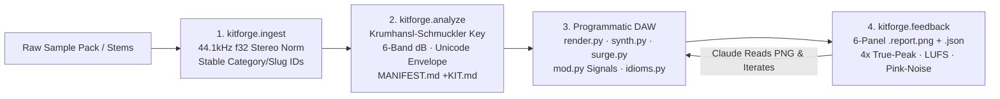

# Dossier 26: Spindle, Descent of Nations, Automatafl, Blackwing, Audec, Kitforge, Vidbox & Multiphysics Simulation — Primary-Source Rescout

> **Document Scope & Provenance**: This dossier bypasses high-level `aidev` summaries to excavate **27 primary-source repositories** directly on disk across `/Users/ember/dev/`. Every architectural claim, physical differential equation, formal theorem, shader kernel, and DSP pipeline is grounded in exact file paths, line numbers, commit hashes, and verbatim source code.

---

## Executive Thesis: Deterministic Fixed-Step Physics, Zero-Twin Oracles & Evidence-Preserving Deprojection

Across what superficially appear to be five disparate creative domains—**(1) rotating-frame zero-gravity sports (`spindle`)**, **(2) binary-oracle RTS reconstruction and Lean 4 formal board games (`don`, `automatafl`, `webapp2-auto`)**, **(3) tactical/aerodynamic/retrocausal game engines (`bw-exp0`, `bw-exp1`, `blackwing-v0`, `frisqueendom`, `friskingdom`, `resequence-rs`, `Achron`, `booty-hunt`, `booty-haul`, `megastructure-maintenance-crew`, `pinatatown`, `esgea`, `multiway-tug`, `tictacflicflacfloe`, `path-of-angels`)**, **(4) reverse DAWs, programmatic synthesis, and beat-locked video composition (`audec`, `audec-wt`, `audec-ui-platform-probe`, `kitforge`, `vidbox`, `scrubsheet`, `codrawer-bridge`)**, and **(5) multiphysics nuclear criticality and reactor simulators (`plymouth-rock`, `buckeye`)**—Ember's engineering exhibits a single, unmistakable structural signature:

1. **Mechanics Derived From First-Principles Physics, Never Decorated**: Whether deriving the entire rulebook and stadium economy of an interstellar sport from the confluent root $\lambda = -i\omega$ of the rotating-frame Coriolis/centrifugal ODE (`spindle`), computing Ultimate Frisbee stall falloff and gyroscopic pitching moments from $C_L(\alpha)$ and $C_m(\alpha)$ curves (`frisqueendom`, `friskingdom`), modeling Caribbean piracy as a continuous-time sweep-width and horizon-geometry arms race (`booty-haul`), or coupling 6-group Pu-239 delayed-neutron point kinetics to 1D liquid-sodium Dittus-Boelter thermal channels and 2 GWh molten-salt tanks (`plymouth-rock`), gameplay and simulation behavior emerge strictly from integrating real physical conservation laws.
2. **The Zero-Twin & Differential Oracle Doctrine**: Wherever a specification exists—whether a shipped 2003 x86 executable (`riseofnations.exe` in `don`), a 2011 retrocausal RTS binary (`Achron` in `resequence-rs`), or a formal board-game ruleset (`automatafl`)—Ember refuses to allow two unverified implementations to drift apart. In `automatafl`, the Rust server and WASM client contain **zero** game-rule code: Lean 4 (`lean/Automatafl/*.lean`) compiles to C IR and links directly into native and WASM binaries (`Zero-Twin` architecture). In `don`, the Rust simulation is held against an in-process 32-bit x86 fork-isolated binary oracle (`crates/oracle`) across **18,722,565 differential trials with zero mismatches** and a `DataWalk` byte-image container (`crates/don-state`) that reproduces all **15 retail lockstep Adler-32 checksum channels**.
3. **Abelian / Tropical Determinism on CPU and GPU**: Floating-point non-associativity and thread-scheduling races are systematically eliminated at the algebraic level. `don-gpu` implements batched pathfinding relaxation in WGSL (`flowfield.wgsl`) using exclusively `u32` min-plus tropical arithmetic ($\min(d, \text{neighbour} + w)$) with 8×8 temporal blocking in workgroup memory and resolves many-to-one entity interactions via segmented reductions over the abelian group $\mathbb{Z}/2^{32}\mathbb{Z}$ (`reduce.rs`) rather than hardware atomics. `spindle` locks its 240 Hz RK4 integrator and `sfc32` PRNG substreams to bit-identical `f64` constants between Rust/WASM and TypeScript (`FRICTION_DECAY = 0.9753099120283326`).
4. **Closed-Loop Perceptual & Ethical Compilers**: In media tooling, Ember replaces opaque timeline GUIs with inspectable intermediate representations and automated critique loops. `audec` ("a reverse DAW") decompiles finished audio into an **Auditory Intermediate Representation (AIR)** backed by content-addressed `Reading`s and incremental preroll-correct `TileKey` bounces where online playback and offline export null by construction. `kitforge` enables an LLM to compose club tracks deaf by rendering a 6-panel visual/numeric critique sheet (`.report.png` + `.report.json` with 4× oversampled true-peak, 1/3-octave pink-noise deviation, and 16th-grid onset jitter). `vidbox` compiles musical timelines through an executable ethical Design Rule Checker (`render/drc.py`) that refuses to build if documentary integrity rules (e.g., `@rule("no-decoration-on-the-dead")`, `@rule("voronoi-faces-only")`) are violated.

```mermaid
flowchart TD
    subgraph P1["1. Rotating-Frame & Aerodynamic Sports Physics"]
        SP["spindle (162 commits)<br/>240Hz RK4 Roulette ODE · 6-DOF Bell<br/>Powered Winch · EFE AI · rl::loco MLP"]
        FQ["frisqueendom & friskingdom (29 commits)<br/>6-DOF Disc Aero (CL, CD, Cm, Stall)<br/>Bevy 0.18 ECS · Netcode · AI"]
    end

    subgraph P2["2. Zero-Twin Formal Kernels & Binary-Oracle RTS"]
        DON["don (1,003+ commits)<br/>21 Crates · DataWalk Save/15 Checksums<br/>18.7M-Trial x86 Oracle · WGSL Tropical Flowfields"]
        AUTO["automatafl (63 commits) & webapp2-auto<br/>Zero-Twin Lean 4 Kernel -> C IR -> Rust/WASM<br/>Tarjan SCC · DUCT & Regret-Matching AI"]
    end

    subgraph P3["3. Tactical Engines, Retrocausality & Sim Games"]
        BW["bw-exp0 / bw-exp1 / blackwing-v0 (79+ commits)<br/>25-Crate Engine · Advance Wars ECS<br/>Holdsmith Z3 CFG Analyzer · Rhai Validator"]
        RES["resequence-rs & Achron<br/>Reverse-Engineered 0x41b340 Chronoport<br/>O(log n) Event Lists · Sorted Timewaves"]
        SIMS["booty-haul / booty-hunt / mmc / pinatatown<br/>esgea / multiway-tug / ttfff / path-of-angels<br/>Sweep-Width Math · Petgraph Intel · POAG1"]
    end

    subgraph P4["4. Reverse DAW, Programmatic Synth & Video DRC"]
        AUDEC["audec (436 commits) + audec-wt + probe<br/>AIR Deprojection · Sparse CQT · HPSS/NMF<br/>Incremental TileKey Preroll Bounce · GPUI"]
        KF["kitforge<br/>Programmatic DAW · Surge XT · Control Signals<br/>6-Panel Spectrogram/LUFS/True-Peak Critique"]
        VB["vidbox (95 commits) + scrubsheet + codrawer-bridge<br/>Beat-Locked Video Compositor · Ethical DRC<br/>reMarkable 60Hz Raw evdev -> PencilKit/Rocq"]
    end

    subgraph P5["5. Multiphysics & Nuclear Criticality Simulation"]
        PR["plymouth-rock<br/>350 MWt Natrium SFR · Rust gdext + Godot 4<br/>MC Neutronics · 6-Group Kinetics · 2 GWh Salt"]
        BU["buckeye<br/>ENDF/B-VIII.0 2-Group Diffusion & 2D FVM<br/>Mark Boundary & Fermi EOS · wgpu Raymarching"]
    end

    P1 --> P2
    P2 --> P3
    P3 --> P4
    P4 --> P5
```



### Master Repository Inventory

| Repository | Path | Commits | Stack | Core Technical Contribution |
| :--- | :--- | :--- | :--- | :--- |
| **`spindle`** | `/Users/ember/dev/spindle` | 162 | Rust (`rig-core`), WASM, TS, Three.js, WebAudio, Typst | Zero-g rotating-frame sport (*RIG*); analytical Coriolis roulette solver, constrained parameter optimizer, 6-DOF gyroscopic bell, EFE AI, 4,957-param WASM locomotion MLP |
| **`don`** | `/Users/ember/dev/don` | 1,003 (`HEAD`) / 1,129 (all) | Rust (21 crates), C, Python, WGSL (`wgpu`), x86 FFI | *Descent of Nations*: deterministic *Rise of Nations* reconstruction; `DataWalk` `.svx` state & 15 checksum channels; 18.72M-trial `i686` binary oracle; WGSL integer flow fields; BHS VM |
| **`automatafl`** | `/Users/ember/dev/automatafl` | 63 (`HEAD`) / 69 (all) | Lean 4, C shim, Rust (5 crates), WASM | Formally verified simultaneous-move rook-sightline game; `Zero-Twin` Lean 4 $\to$ C IR kernel; `Bitmask128` equivalence proofs; Minimax, DUCT, and Regret Matching Plus (RM+) AI |
| **`webapp2-auto`** | `/Users/ember/dev/webapp2-auto` | Snapshot | Rust, Trunk, WASM, WebSockets | Browser client for `automatafl` integrating lobby, live board sightline rendering, and WebSocket commit-reveal protocol |
| **`bw-exp0`** | `/Users/ember/dev/bw-exp0` | 42 | Rust (25 crates), Z3, Salsa, Rhai, Leptos, Tauri, Macroquad | *Blackwing* multi-genre engine (`blackwing-foundation`, `blackwing-strategy` Advance Wars ECS, `blackwing-rpg`, `blackwing-action`) + `holdsmith-analyzer` Z3 symbolic scene verifier |
| **`bw-exp1`** | `/Users/ember/dev/bw-exp1` | 37 | Rust (9 crates), Rhai, SQLite, Ratatui, Vite | Space-opera simulation runtime (`bw-runtime`, `bw-ai` behavior trees + utility AI, `bw-scripting` static type/contract validator, `bw-gm-editor`) |
| **`blackwing-v0`** | `/Users/ember/dev/blackwing-v0` | Snapshot | TypeScript, Vite, Vitest | Deck-building narrative space-trader (*Silicon Dawn* / *Blackwing* universe) with seeded LCG journey simulation, fuel/supply wear, and Holdsmith tooling |
| **`frisqueendom`** | `/Users/ember/dev/frisqueendom` | 27 | Rust (`frisque-physics`), WASM, TypeScript | 6-DOF aerodynamic disc simulator (`compute_aoa`, `compute_lift` with smoothstep stall, `compute_drag`, `compute_pitching_moment`, `compute_ground_effect`) |
| **`friskingdom`** | `/Users/ember/dev/friskingdom` | 2 | Rust (11 crates), Bevy 0.18, `glam`, Python MCP | Full 3D/stickman Ultimate Frisbee game in Bevy ECS (`fk-core`, `fk-ai`, `fk-netcode`, `fk-season`, `frisbee-physics`) + MCP game inspection server |
| **`resequence-rs`** | `/Users/ember/dev/resequence-rs` | 3 | Rust, WASM, Svelte + D3 explainer | Time-travel simulation engine implementing Achron's 4 Resequence patterns: $O(\log n)$ event-linked entities, multi-speed `Timewave`s, `NameId` same-name linking, sorted wave propagation |
| **`Achron`** | `/Users/ember/dev/Achron` | 1 | x86 Disassembly Notes, `.abn` monitors | Reverse-engineering dossier (`REVERSE_ENGINEERING_NOTES.md`) mapping Achron's `0x19c4` timeline struct, `0x100008` `sameNameLinks`, and `FUN_0041b340` chronoport execution |
| **`booty-haul`** | `/Users/ember/dev/booty-haul` | 9 | TypeScript, HTML5 Canvas | Interactive historical/mathematical essay modeling piracy interception probability, radar/visual horizon curvature, and merchant-vs-pirate evolutionary arms races |
| **`booty-hunt`** | `/Users/ember/dev/booty-hunt` | 31 | TypeScript, Three.js, GLSL, Rust (`ntex`, SQLite) | 3D naval roguelike with custom GLSL ocean/sky shaders, `ShantyEngine`, deterministic `GhostTape` replay verification, and Rust `ntex` Ghost Fleet leaderboard server |
| **`megastructure-maintenance-crew`** | `/Users/ember/dev/megastructure-maintenance-crew` | 14 | TypeScript, Vite | Narrative/systems maintenance simulation aboard a decaying megastructure (`MaintenanceSystem`, `ShiftSystem`, `DreamscapeSystem`, `AttackScheduler`) |
| **`pinatatown`** | `/Users/ember/dev/pinatatown` | 14 | TypeScript, Phaser/Canvas Isometric | Isometric ecosystem & colony sim driven by 16 decoupled systems (`AttractionSystem`, `SourPinataSystem`, `RomanceSystem`, `PerceptionSystem`, `TraitSystem`) |
| **`esgea`** | `/Users/ember/dev/esgea` | 28 | Rust (`petgraph`, `redb`, Leptos) | *Sneaky Guys!*: two-player asymmetric-information graph stealth/intel game with `concealed`, `invisible`, `active_scan`, and `hidden_signals` mechanics |
| **`multiway-tug`** | `/Users/ember/dev/multiway-tug` | 12 | Rust (`smallvec`, TUI) | Simultaneous multi-location tug-of-war card game with hidden/revealed play modes and knockback mechanics (`src/mechanics.rs`) |
| **`tictacflicflacfloe`** | `/Users/ember/dev/tictacflicflacfloe` | 22 | Rust (3 crates: `ttfff-logic`, `ttfff-explore`, `ttfff-play`), `egui`, WASM | Bit-packed combinatorial grid game with $D_4$ spatial + player-swap symmetry canonicalization and exhaustive game-tree exploration |
| **`path-of-angels`** | `/Users/ember/dev/path-of-angels` | 7 | Rust (`poa-curator`), TypeScript WebExtension | Byte-pinned `POAG1` Lean-emitted content bundle verifier (`Dregg2.Games.PathOfAngels`), Ed25519/ML-DSA-65 authority export, and `POA-GALLEY-*-V1` browser extension |
| **`audec`** | `/Users/ember/dev/audec` | 436 (`HEAD`) | Rust, GPUI, Guise, `rustfft`, Symphonia, CLAP | Native reverse DAW: Auditory Intermediate Representation (AIR), shareable `Reading`s, sparse CQT, convolutional NMF, HPSS, Loom, and incremental `TileKey` preroll bounce engine |
| **`audec-wt`** | `/Users/ember/dev/audec-wt` | 39 commit logs + `bounce` | Rust, GPUI | Worktree campaign archive documenting 39 vertical slices (`cache-commit.txt` mmap asset cache, `automation-commit.txt`, `collapse-a/b`, `drops`, `inserts`, `renderrestart`) |
| **`audec-ui-platform-probe`** | `/Users/ember/dev/audec-ui-platform-probe` | 4 | Rust, GPUI, Guise, `gpui_audio_kit`, AccessKit, Vello | Platform unification probe proving forked Guise, logarithmic `Potentiometer`, `VerticalSlider`, Vello 2D rendering, and AccessKit share one GPUI type universe |
| **`kitforge`** | `/Users/ember/dev/kitforge` | 4 | Python, NumPy, Librosa, Pedalboard, Surge XT, `pyloudnorm` | Programmatic DAW & sample-pack compiler for Claude: ingest $\to$ Krumhansl-Schmuckler/band analysis $\to$ `Synth808`/`Supersaw`/`SurgeSynth` + `mod.py` control signals $\to$ 6-panel `.report.png` critique |
| **`vidbox`** | `/Users/ember/dev/vidbox` | 95 | Python, NumPy, OpenCV, FFmpeg, Whisper | Code-first musical video compositor built for *Meine* (126 BPM); beat-locked signal compiler (`signals.py`), interval-union reverse/stutter cache (`tl.py`), and ethical DRC (`drc.py`) |
| **`scrubsheet`** | `/Users/ember/dev/scrubsheet` | 3 | Vanilla JS, HTML5 Video/Canvas, IndexedDB | Zero-dependency browser video contact-sheet editor with offscreen 32× zoom filmstrip scrubbing, 144-slot frame tray, and IndexedDB draft recovery |
| **`codrawer-bridge`** | `/Users/ember/dev/codrawer-bridge` | 8 | Python (`evdev`/WebSocket), TypeScript, SwiftUI, PencilKit | Low-latency (<16ms local ink) reMarkable Paper Pro `/dev/input/event*` stylus daemon + 50 RPM `stroke_end` AI ghost-ink server + iPad PencilKit & Rocq Prover IDE client |
| **`plymouth-rock`** | `/Users/ember/dev/plymouth-rock` | Snapshot | Rust (`gdext`, `nalgebra`), Godot 4, Python (Blender MCP) | 350 MWt / 140 MWe Natrium-style Sodium Fast Reactor simulator: continuous-energy MC neutronics, 271-pin sodium channels, 6-group Pu-239 kinetics, 2 GWh molten salt storage |
| **`buckeye`** | `/Users/ember/dev/buckeye` | 5 | Python (`scipy`, `numpy`), Rust (`wgpu`), WGSL | Fast-spectrum nuclear criticality & coupled neutronics-hydrodynamics suite: ENDF/B-VIII.0 2-group diffusion, 2D cylindrical FVM, physics audit, and wgpu raymarched neutron trails |

---

## 1. `spindle` — SPINDLE · RIG: Zero-Gravity Rotating-Frame Sport & Dynamical Systems Engine

**Repository**: `/Users/ember/dev/spindle` (`git@github.com:emberian/spindle.git`, **162 commits** through `2ad529c` on `2026-05-20`).

### 1.1 The Physical & Worldbuilding Substrate: "The Room the Universe Already Built"

In [README.md](file:///Users/ember/dev/spindle/README.md#L1-L82) and [design/sport.md](file:///Users/ember/dev/spindle/design/sport.md#L1-L165), Ember defines **RIG** (*Formal league name: the Spindle League*), a zero-gravity sport played along the weightless central axis ("**the calm**") of rotating O'Neill cylinders in the 25th-century *Vivere Astra* campaign setting. Rather than inventing sci-fi rules and decorating them with zero-gravity visuals, every mechanic of RIG is mathematically derived from three physical invariants of a rotating cylinder ([design/sport.md](file:///Users/ember/dev/spindle/design/sport.md#L21-L55)):

1. **Centrifugal Slope ("Deep is faithful, high is free")**: Effective gravity scales linearly with cylindrical radius $\rho = \sqrt{y^2 + z^2}$ via $g(\rho) = \omega^2 \rho$. At $\rho = 0$ (the spine), players and the ball are weightless; dropping rimward toward the boundary skin ($R = 45.0\,\text{m}$) buys speed and heavy momentum at the cost of reversibility.
2. **Chiral Handedness (Spinward *Faith* vs. Antispinward *Free*)**: Because the habitat rotates at angular velocity $\vec{\omega} = \omega \hat{x}$, the Coriolis acceleration $-2\vec{\omega} \times \vec{v}$ breaks reflection symmetry. Throwing spinward produces a familiar downward-curving arc (**Fall**, worth **2 points** through the Faith ring); throwing antispinward against the habitat's rotation lifts the projectile inward across the axis (**Rise**, worth **3 points** through the Free ring, or **4 points** for a **Curl** with $\ge \pi/2$ cross-sectional turn, or **6 points** for a closed self-returning **Loop** with $\ge 2.2\,\text{rad}$ turn).
3. **Grapple-Only Locomotion**: In vacuum/weightlessness, players cannot swim or walk in mid-air; they can only alter their velocity by pushing off solid structure (`pushoff`), firing a powered winch-and-claw tether (`rig line`) at structural spars or other players, or firing micro-thrusters (`thrumbler`).

The sport syntheses American football's territorial downs (**a Cast**: 3 throws to advance past the next axial **gate**) with baseball's clockless, stat-haunted 1-on-1 duels (**a Contest**: when a defender challenges a bell in flight within `CONTEST_RADIUS = 6.0 m`, play freezes into a 3-exchange count between thrower and contester) over **nine clockless innings** ([design/sport.md](file:///Users/ember/dev/spindle/design/sport.md#L118-L162)). Even the ball—**the bell**—is derived from the setting: it contains an internal mass-ring that chimes cleanly when spinning on its principal axis and clatters disharmonically when knocked off-axis, allowing matches to be followed by ear over low-bandwidth interstellar jump-delayed "re-calls" ([league/teams.md](file:///Users/ember/dev/spindle/league/teams.md#L1-L65)).

### 1.2 Rotating-Frame Roulette Mechanics & Analytical Trajectory Solver

In [game/rig-core/src/trajectory.rs](file:///Users/ember/dev/spindle/game/rig-core/src/trajectory.rs#L1-L105), the cylinder's long axis is $+x$, and the cross-section is $(y, z)$ rotating with angular velocity $\vec{\omega} = (\omega, 0, 0)$. Combining the centrifugal acceleration $-\vec{\omega} \times (\vec{\omega} \times \vec{r}) = (0, \omega^2 y, \omega^2 z)$ and the Coriolis acceleration $-2\vec{\omega} \times \vec{v} = (0, 2\omega v_z, -2\omega v_y)$ yields the exact equations of motion:

$$\ddot{x} = 0, \qquad \ddot{y} = \omega^2 y + 2\omega \dot{z}, \qquad \ddot{z} = \omega^2 z - 2\omega \dot{y}$$

Writing the cross-sectional position as a complex number $\zeta(t) = y(t) + i z(t)$, the $(y,z)$ system collapses into the scalar complex second-order ODE:

$$\ddot{\zeta} + 2i\omega\dot{\zeta} - \omega^2\zeta = 0 \implies (\partial_t + i\omega)^2 \zeta = 0$$

Because the characteristic polynomial $(\lambda + i\omega)^2 = 0$ has a **double confluent root** $\lambda = -i\omega$, every free-flight trajectory in the calm is an exact two-term **roulette** ([game/rig-core/src/trajectory.rs](file:///Users/ember/dev/spindle/game/rig-core/src/trajectory.rs#L18-L65)):

```rust
// /Users/ember/dev/spindle/game/rig-core/src/trajectory.rs (lines 18-65)
/// Total acceleration in the rotating frame (Coriolis + centrifugal).
///   a_x = 0
///   a_y =  2·ω·vz + ω²·y
///   a_z = -2·ω·vy + ω²·z
#[inline]
pub fn accel(p: Vec3, v: Vec3, omega: f64) -> Vec3 {
    let w2 = omega * omega;
    Vec3::new(
        0.0,
        2.0 * omega * v.z + w2 * p.y,
        -2.0 * omega * v.y + w2 * p.z,
    )
}

/// Closed-form solution of the rotating-frame EOM at time `t` from `(p0, v0)`.
///
/// Write ζ = y + i·z.  Then  ζ̈ + 2iω ζ̇ − ω² ζ = 0  has double root −iω, so
///   ζ(t) = (A + B·t) · e^(−iωt),   A = ζ₀,  B = ζ̇₀ + iω·ζ₀.
pub fn analytic(p0: Vec3, v0: Vec3, omega: f64, t: f64) -> PointState {
    let x = p0.x + v0.x * t;
    let vx = v0.x;

    // A = (ay, az),  B = (by, bz) = (vy0 - ω·z0, vz0 + ω·y0)
    let ay = p0.y;
    let az = p0.z;
    let by = v0.y - omega * p0.z;
    let bz = v0.z + omega * p0.y;

    // u(t) = A + B·t
    let uy = ay + by * t;
    let uz = az + bz * t;

    let wt = omega * t;
    let c = wt.cos();
    let s = wt.sin();

    // ζ = u · (cos ωt − i·sin ωt)
    let y = uy * c + uz * s;
    let z = uz * c - uy * s;

    // ζ̇ = (B − iω·u) · e^(−iωt)
    let wy = by + omega * uz;
    let wz = bz - omega * uy;
    let vy = wy * c + wz * s;
    let vz = wz * c - wy * s;

    PointState {
        p: Vec3::new(x, y, z),
        v: Vec3::new(vx, vy, vz),
    }
}
```

In [game/rig-core/src/analysis.rs](file:///Users/ember/dev/spindle/game/rig-core/src/analysis.rs#L1-L120), Ember exploits a crucial algebraic property of this closed form: since $|e^{-i\omega t}| = 1$, the radial distance from the cylinder spine at any time $t$ is simply the modulus of a **linear** function of time:

$$|\zeta(t)| = |\zeta_0 + v_{\text{rot}} t| = \sqrt{(y_0 + (v_{y0} - \omega z_0)t)^2 + (z_0 + (v_{z0} + \omega y_0)t)^2}$$

Consequently, a throw avoids striking the outer cylinder skin ($|\zeta(t)| < R$) over a long flight time $t_{\text{flight}}$ if and only if the rotating-frame velocity $v_{\text{rot}} = (v_{y0} - \omega z_0) + i(v_{z0} + \omega y_0)$ nearly vanishes—that is, when the player's cross-plane throw velocity almost cancels the centrifugal sweep $\omega \zeta_0$. Meanwhile, the $e^{-i\omega t}$ factor winds the velocity heading at rate $\omega\,\text{rad/s}$. This mathematical insight enabled `analysis.rs`'s deterministic coarse-to-fine solver to discover a human-missed scoring **Loop** from $x = -180\,\text{m}$ to the gate at $x = +320\,\text{m}$ ($500\,\text{m}$ downfield, $v_x \approx 18\,\text{m/s}$, $v_\perp \approx 0.4\,\text{m/s}$, $t_{\text{flight}} \approx 28\,\text{s}$, accumulating $\gtrsim 9\,\text{rad} \gg \text{LOOP\_TURN} = 2.2\,\text{rad}$ without touching the $R = 45\,\text{m}$ skin). Furthermore, in commit `fd6ce91` (`2026-05-20`, *"Use analytical Coriolis predictor for receiver in lead solver"*), Ember replaced linear extrapolation of moving receivers in [game/rig-core/src/ai/lead_predict.rs](file:///Users/ember/dev/spindle/game/rig-core/src/ai/lead_predict.rs#L1-L95) with `trajectory::analytic`, allowing AI passers to lead airborne receivers along their true curved Coriolis trajectories.

### 1.3 Constrained Optimization ("The Number") & 6-DOF Gyroscopic Bell

Rather than hand-tuning habitat dimensions and spin rates (which had previously oscillated across $\omega \in \{0.22, 0.06, 0.15, 0.32\}$), Ember formulated the game's physical constants in [game/rig-core/src/tuning.rs](file:///Users/ember/dev/spindle/game/rig-core/src/tuning.rs#L1-L215) as a constrained optimization gate ("**The Number**") enforced by `cargo test`:

| Constant | Value | Physical / Gameplay Role |
| :--- | :--- | :--- |
| `OMEGA` ($\omega$) | `0.32` rad/s | Reference cylinder spin rate (barrel-roll period $2\pi/\omega \approx 19.63\,\text{s}$) |
| `R` | `45.0` m | Playable calm cylinder skin radius ($g(R) = \omega^2 R = 4.608\,\text{m/s}^2 \approx 0.47\,g_\oplus$) |
| `L` | `640.0` m | Axial field length ($x \in [-320, +320]\,\text{m}$) |
| `GATE_RADIUS` | `8.0` m | Scoring ring radius at `GATE_X = ±320.0 m` |
| `LINE_K` / `LINE_C` | `1400.0` / `520.0` | Taut rig-line radial spring stiffness & damping ($\omega_n \approx 4.24\,\text{rad/s}, \zeta \approx 0.55$) |
| `REEL_PULL_SPEED` / `ACCEL` | `26.0` m/s / `120.0` m/s² | Active Xonotic-style winch cruise speed and acceleration cap |
| `CLAW_SPEED` | `80.0` m/s | Finite grapple claw travel speed (`ceil(distance * 3)` ticks at 240 Hz) |
| `FRICTION_DECAY` | `0.9753099120283326` | Frozen bit-identical literal for $\exp(-6.0 / 240.0)$ tangential skin friction |

The ball itself is simulated as a full 6-DOF rigid body (`BellBody`) with an internal symmetric-top mass ring in [game/rig-core/src/bell.rs](file:///Users/ember/dev/spindle/game/rig-core/src/bell.rs#L1-L120). Its principal moments of inertia in the body frame (where the ring axis is $+\hat{x}$) are $I = \text{diag}(I_{\text{AXIAL}}, I_{\text{TRANS}}, I_{\text{TRANS}}) = \text{diag}(1.0, 0.5, 0.5)$. At every $h = 1/240\,\text{s}$ tick, `step_bell` integrates $(p, v, q, w)$ via 4th-order Runge-Kutta (RK4) over torque-free Euler's equations:

$$I \dot{\vec{\omega}}_{\text{body}} = -\vec{\omega}_{\text{body}} \times (I \vec{\omega}_{\text{body}}), \qquad \dot{q} = \frac{1}{2} \vec{\omega}_{\text{world}} \otimes q$$

When a thrower imparts pure axial spin ($\vec{\omega}_{\text{body}} \parallel \hat{x}$), $\vec{\omega} \times (I\vec{\omega}) = 0$, so `trueness(w) = |w.x| / |w| = 1.0` and `chime(w)` voices the pure harmonic bell oscillators in [game/src/audio/AudioEngine.ts](file:///Users/ember/dev/spindle/game/src/audio/AudioEngine.ts#L38-L90). When a defender knocks the bell off-axis, gyroscopic precession tumbles the body, dropping `trueness(w)` and cross-fading WebAudio to detuned inharmonic metallic partials (`inharmonicOsc`, `flutterLfo`)—a literal **clatter**.

### 1.4 Powered Grapple Winch, Claw Latency, Spar Anchoring & Thrumbler Micro-Control

In [game/rig-core/src/grapple.rs](file:///Users/ember/dev/spindle/game/rig-core/src/grapple.rs#L1-L265), `resolve_line` models the rigger's tether across three physical regimes:
1. **Powered Winch (`reel < 0` on fixed anchor)**: Because the calm near the axis is weightless ($\omega^2 r \approx 0.8\,\text{m/s}^2$), a passive pendulum rope cannot propel a stationary rigger. Reeling in shrinks `line.rest_len` at `REEL_RATE` and applies an acceleration-capped motor impulse (`dv = deficit.min(REEL_PULL_ACCEL * h)`) up to `REEL_PULL_SPEED = 26.0 m/s`.
2. **Slack Pre-Tension Band (`stretch > -LINE_SLACK_BAND`) & Taut Spring (`stretch >= 0`)**: Prevents discontinuous velocity snaps by easing into tautness with `LINE_SLACK_K = 120.0` before engaging the main radial spring-damper $F_{\text{pull}} = \max(0, k_{\text{eff}} \cdot \text{stretch} + c_{\text{eff}} \cdot v_{\text{rad}})$.
3. **Momentum-Conserving Player-to-Player Tethers**: When `line.anchor_player` is `Some(teammate_or_opponent)`, `resolve_line` computes the reduced inverse mass $w_{\text{sum}} = m_p^{-1} + m_a^{-1}$ and applies equal-and-opposite impulses $\Delta \vec{v}_p = -j m_p^{-1} \hat{n}$ and $\Delta \vec{v}_a = +j m_a^{-1} \hat{n}$, verified by unit tests `player_player_conserves_momentum` and `player_player_conserves_momentum_moving_anchor` to conserve linear momentum to $< 10^{-6}$.

Three critical locomotion refinements landed on `2026-05-20`:
- **Fix Stuck-on-Spar (`38e3ba6`)**: Players winching into a structural spar previously remained tethered after reaching the anchor or after the spar fell behind their target vector. Commit `38e3ba6` added an arrival/alignment check in `rigger_ai.rs` that releases the line when within $4\,\text{m}$ of the spar or when $\hat{d}_{\text{anchor}} \cdot \hat{d}_{\text{target}} < 0.1$.
- **Downrange Anchor & Longer Rollout (`358f3a0`)**: Extended the grapple planner (`game/rig-core/src/planner.rs`) rollout horizon and weighted downrange velocity alignment so riggers sling *past* spars rather than stopping at them.
- **Thrumbler Coriolis Drift Counteraction (`e09cbfb`, `a78a7e6`, `2ad529c`)**: In [game/rig-core/src/ai/rigger_ai.rs](file:///Users/ember/dev/spindle/game/rig-core/src/ai/rigger_ai.rs#L2417-L2445), `settle_thrumbler` governs the rigger's cold-gas micro-thrusters (`MICRO_DV_MAX = 3.5 m/s`). Inside `SETTLE_RADIUS = 18.0 m`, it performs proportional-derivative braking onto the station-keeping target; outside `18.0 m` (commit `2ad529c`), if the rigger is already closing ($v_{\text{toward}} > 3.0\,\text{m/s}$), it spends $15\%$ of `MICRO_DV_MAX` purely to brake perpendicular Coriolis drift ($v_\perp > 4.0\,\text{m/s}$), and otherwise applies a gentle $20\%$ forward push.

### 1.5 Active Inference (EFE) Pack Behavior & Learned WASM Locomotion (`rl::loco`)

The tactical AI in `game/rig-core/src/ai/` combines an Expected Free Energy (`efe.rs`, `efe_params.rs`) spatial coverage evaluator with role-specific state machines (`roles/{anchor,spinner,faithwing,freewing,reach}.rs`) and a Director (`director.rs`). In commit `74e0001` (`2026-05-20`, *"PACK BEHAVIOR: collapse positioning to cluster around the ball"*), Ember diagnosed why early matches looked like "seven spectators orbiting at 70–90m while one player did something": the EFE anti-swarm term was pushing off-ball players across a $160\,\text{m}$ axial spread. Commit `74e0001` collapsed candidate fan depths from `[-70, +10, +90]` to `[-15, +10, +35]`, reduced cross-tube radii from `14–40 m` to `10–28 m`, cut anti-swarm standoff from `18 m / weight 2.5` to `8 m / weight 0.5`, and capped receiver leads at `30–60 m`, producing cohesive pack flow around the bell.

Finally, in commits `7f6ac77` and `bcb3ed4` (`2026-05-20`), Ember added a learned neural locomotion policy in [game/rig-core/src/rl/loco.rs](file:///Users/ember/dev/spindle/game/rig-core/src/rl/loco.rs#L1-L120) and an Evolution Strategies (ES) trainer in [game/rig-core/src/rl/loco_train.rs](file:///Users/ember/dev/spindle/game/rig-core/src/rl/loco_train.rs) (`train_loco` binary):
- **Architecture**: A pure-`f64`, zero-allocation, WASM-safe 2-hidden-layer MLP with `LOCO_FEAT_W = 40` input features (normalized self position/velocity, target relative vector/distance, velocity decomposition into radial/tangential components, Coriolis acceleration vector, current line state, and relative coordinates of the `K_SPAR = 3` nearest structural spars), hidden width `HID = 48` ($\tanh$ activations), and `LOCO_OUT_W = 13` control outputs (`aim`, `fire_line_at`, `reel`, `release`, `pushoff`, `thrumbler`), totaling exactly **`LOCO_PARAM_W = 4,957` parameters**.
- **Team-Level RL (`rl/mappo.rs` & `rig-gym-py`)**: Alongside `rl::loco`, `game/rig-core/src/rl/` implements Multi-Agent PPO (`mappo.rs`) with entity self-attention (`attention.rs`), centralized value networks (`value.rs`), and a PyO3/Gymnasium vectorized bridge (`game/rig-gym-py`).

---

## 2. `don`, `automatafl` & `webapp2-auto` — Binary-Oracle RTS Reconstruction, Deterministic GPU Flow Fields & Zero-Twin Lean 4 Game Kernels

### 2.1 `don` (*Descent of Nations*): Architecture & The `DataWalk` 15-Channel Fidelity Oracle

**Repository**: `/Users/ember/dev/don` (`git@github.com:emberian/don.git`, **1,003 commits** on `HEAD` through `f219bd03` on `2026-10-04`, **1,129 total commits** across refs).

*Descent of Nations* is an independent, deterministic Rust reconstruction of Big Huge Games' 2003 RTS *Rise of Nations: Thrones and Patriots*, engineered simultaneously as a standalone moddable game, a binary-verified fidelity reference, and a high-throughput reinforcement learning environment ([README.md](file:///Users/ember/dev/don/README.md#L1-L95)). Its 21-crate workspace ([Cargo.toml](file:///Users/ember/dev/don/Cargo.toml#L1-L32)) is partitioned into:
- **State, Serialization & Lockstep Checksums (`crates/don-state`)**: Built on the retail engine's own `DataWalk` visitor pattern ([crates/don-state/src/lib.rs](file:///Users/ember/dev/don/crates/don-state/src/lib.rs#L1-L55)). Rather than inventing ad-hoc Rust structs and guessing serialization formats, `don-state` transcribes each C++ class's `walk_data` method once (`crates/don-state/src/sections.rs`, `crates/don-state/src/walk.rs`). Driving the visitor with `Loader` parses `.svx` retail save games while recording byte-exact `Span` attributions; driving it with `Saver` re-emits byte-identical `.svx` streams; driving it with `CheckSum` computes all **15 retail lockstep Adler-32 checksum channels** (`CHANNEL_NAMES` in `crates/don-state/src/check_all.rs`, completed in commits `b2b7aaf0` and `4274eaa0` on `2026-10-04`).
- **Retail-Ordered Frame Schedule (`crates/don-state/src/tick.rs` & `crates/don-sim`)**: In [crates/don-state/src/tick.rs](file:///Users/ember/dev/don/crates/don-state/src/tick.rs#L1-L120), `STEPS` codifies the exact 29-step execution sequence of retail's `Game::do_frame` (`0x005926b0`), mapping each step to its exact x86 virtual address (`va`) and implementation status (`Ported` vs `Stub`), including `Objects::inc_time`, `Game::process_commands`, `PathFinder::process`, `Objects::process`, `Armies::process`, `City::process`, `Build::process`, `Territory::process`, `Leaders::process`, `Research::process`, and `Leaders::end_process`.

### 2.2 In-Process `i686` Binary Differential Oracle & Live Retail Control

To prevent the Rust port from drifting from the shipped x86 machine code, [crates/oracle/src/lib.rs](file:///Users/ember/dev/don/crates/oracle/src/lib.rs#L1-L40) and `crates/oracle/src/image.rs` map the actual retail `riseofnations.exe` binary into a live 32-bit x86 process (`i686`), apply base relocations, construct fabricated C++ `thiscall` / `fastcall` world memory (`damage_env.rs`), and run fork-isolated differential fuzz/mutation trials directly against the Rust functions in `don-sim`. As recorded in [README.md](file:///Users/ember/dev/don/README.md#L30-L36) and `schema/oracle-regression.json`, the oracle has executed **18,722,565 trials across 23 registered x86 function cases with zero mismatches, skips, or crashes**.

Complementing offline differential testing, `tools/retail-control/retail_control.c` (`485c9ef4`) and `tools/rontoy-host/` (`crates/rontoy-core`, `crates/rontoy-proto`) inject a hash-bound DLL into a live running retail process, enabling read-only state capture, paused-frame `.svx` + 15-channel `check_all` extraction, live economy coaching, and reversible main-thread command ingress that restores stock instruction bytes cleanly on detach.

### 2.3 `don-gpu`: Temporally-Blocked WGSL Integer Flow-Field Relaxation & Abelian ECS Reductions

In [crates/don-gpu/src/lib.rs](file:///Users/ember/dev/don/crates/don-gpu/src/lib.rs#L1-L140), Ember solves the classic RTS GPU determinism problem: *how do you run batched pathfinding and branchy unit-order execution across thousands of parallel RL environments on a GPU without floating-point drift or atomic scheduling non-determinism?*

The solution has two halves:
1. **Min-Plus Tropical Flow Fields in WGSL ([crates/don-gpu/src/shaders/flowfield.wgsl](file:///Users/ember/dev/don/crates/don-gpu/src/shaders/flowfield.wgsl#L1-L120))**: Every distance and terrain cost is a `u32` (`W_CARD = 2u`, `W_DIAG = 3u`, `INF = 0x7fffffffu`, `BLOCKED = 0xffffffffu`). Because integer `+` is exact and $\min$ is associative, commutative, and idempotent, the Jacobi fixed point is strictly independent of GPU warp/workgroup scheduling. Each workgroup of $8 \times 8 = 64$ threads loads an $8 \times 8$ tile plus a 1-cell halo ($10 \times 10 = 100$ `u32` cells in `var<workgroup> sd: array<u32, 100>`) and runs `params.inner_steps` Jacobi relaxations in shared memory before writing back to global memory. A per-field atomic flag (`flags: array<atomic<u32>>`) and an `active_list` buffer allow the host ([crates/don-gpu/src/gpu.rs](file:///Users/ember/dev/don/crates/don-gpu/src/gpu.rs#L1-L150)) to stream-compact converged worlds out of subsequent dispatches, avoiding up to $23\times$ wasted GPU work.

```wgsl
// /Users/ember/dev/don/crates/don-gpu/src/shaders/flowfield.wgsl (lines 89-118)
    // ---- temporally blocked Jacobi -----------------------------------------------------
    // `params.inner_steps` is uniform across the whole dispatch, so both barriers sit in
    // uniform control flow, as WGSL requires.
    for (var s: u32 = 0u; s < params.inner_steps; s = s + 1u) {
        let card = min(min(sd[idx - HALO], sd[idx - 1u]), min(sd[idx + 1u], sd[idx + HALO]));
        let diag = min(min(sd[idx - HALO - 1u], sd[idx - HALO + 1u]),
                       min(sd[idx + HALO - 1u], sd[idx + HALO + 1u]));
        let best = min(sd[idx], min(card + c2, diag + c3));
        workgroupBarrier();
        sd[idx] = best;
        workgroupBarrier();
    }

    if (inside) {
        let final_d = sd[idx];
        dst[gi] = final_d;
        if (final_d != original) {
            atomicStore(&wg_changed, 1u);
        }
    }
    workgroupBarrier();
    if (li == 0u && atomicLoad(&wg_changed) != 0u) {
        atomicStore(&flags[field], 1u);
    }
```

2. **Order-Archetype Bucketing & Atomic-Free Abelian Reductions ([crates/don-gpu/src/partition.rs](file:///Users/ember/dev/don/crates/don-gpu/src/partition.rs), [crates/don-gpu/src/reduce.rs](file:///Users/ember/dev/don/crates/don-gpu/src/reduce.rs))**: As Ember writes in `don-gpu/src/lib.rs`: *"branchiness is a property of the layout, not of the problem."* By radix-sorting entities by their 28 retail `Order` archetypes (`ORDER_NAMES` measured from `schema/symbols.json`) via `Partition`, per-entity virtual dispatch turns into 28 homogeneous branch-free kernels. Many-to-one state writes (e.g., multiple gatherers depositing resources or multiple attackers damaging one target) never use GPU atomics; instead, `accumulate_i32` performs a segmented reduction over sorted target keys in the abelian group $(\mathbb{Z}/2^{32}\mathbb{Z}, \text{wrapping\_add})$, while `draw_from_pools` uses a segmented exclusive scan to reproduce sequential resource depletion bit-for-bit.

### 2.4 `don-bhs` & `don-env`: Reconstructed BHS Stack VM & Dual-Surface RL Environments

In [crates/don-bhs/src/lib.rs](file:///Users/ember/dev/don/crates/don-bhs/src/lib.rs#L1-L115), Ember reverse-engineered Big Huge Games' proprietary `.bhs` / `.bhc` scripting language, shipping a full source compiler (`crates/don-bhs-cc`), bytecode disassembler (`disasm.rs`), stack VM (`vm.rs` supporting frame-persistent `static` variables guarded by `OP_JUMP_IF_INITED = 0x44`), and a table of all retail builtins (`builtin_table.rs`, `BUILTINS`). In [crates/don-env/src/lib.rs](file:///Users/ember/dev/don/crates/don-env/src/lib.rs#L1-L105), `don-env` exposes the simulation to RL agents via two explicitly separated backends (`EnvironmentBackend`):
- **`VecEnv`**: High-throughput, vectorized compact environment refactoring the 82 retail `CommandTypes` opcodes and 28 `OrderIndex` kinds into 10 independently masked action heads (`FactoredUnitActionSpace`), with zero-copy observations derived from `schema/state-schema.json` and 11-term `LeaderData` score rewards.
- **`AuthoritativeBackend`**: Fail-closed single-episode fidelity backend backed by `don_sim::tick::Sim`, returning typed refusal proofs (`ApplyRefusal`, `AttackTargetEligibilityRefusal`, `VisibilityCaptureRefusal`) rather than silently accepting unimplemented actions as no-ops.

### 2.5 `automatafl` & `webapp2-auto`: Zero-Twin Lean 4 Kernel, Tarjan SCC Resolution & Simultaneous-Move Game Theory

**Repositories**: `/Users/ember/dev/automatafl` (**63 commits** on `HEAD` through `97db66a` on `2026-11-02`, **69 commits** across refs) and `/Users/ember/dev/webapp2-auto`.

`automatafl` is a simultaneous-move tactical abstract board game on an $N \times N$ grid ($7 \times 7$ `blitz7`, $9 \times 9$ `tactical9`, or $11 \times 11$ `classic11`) where two or more players secretly commit rook-slides of shared **Repulsors (`R`, code `1`)** and **Attractors (`A`, code `2`)** through vacuum (`0`) to herd an autonomous cellular **Automaton (`@`, code `3`)** into their corner goals ([README.md](file:///Users/ember/dev/automatafl/README.md#L1-L115)).

#### The `Zero-Twin` Lean 4 Architecture & Verbatim Theorems
To eliminate any possibility of divergence between the formal specification, the Axum multiplayer server (`automatafl-server`), the terminal client (`automatafl-client`), and the browser WASM bundle, Ember deleted the standalone Rust rule engine and established a **`Zero-Twin` Lean 4 core** under `lean/Automatafl/`:
- Lean 4 compiles `Base.lean`, `Rules.lean`, `Termination.lean`, `Variants.lean`, `PackedBoard.lean`, and `FFI.lean` to C IR (`lean/.lake/build/ir/Automatafl/*.c`), which [`automatafl-lean/build.rs`](file:///Users/ember/dev/automatafl/automatafl-lean/build.rs) compiles and links against a stripped C runtime shim ([`automatafl-lean/c/lean_shim.c`](file:///Users/ember/dev/automatafl/automatafl-lean/c/lean_shim.c)).
- In [lean/Automatafl/Base.lean](file:///Users/ember/dev/automatafl/lean/Automatafl/Base.lean#L320-L378) and [lean/Automatafl/Rules.lean](file:///Users/ember/dev/automatafl/lean/Automatafl/Rules.lean#L140-L435), Ember proves decidability of move legality, totality and Manhattan-bound safety of the Automaton's axial sightline step, particle conservation (`resolve_conserves`), and **full permutation invariance (Principle of Fairness)** of simultaneous move resolution:

```lean
-- /Users/ember/dev/automatafl/lean/Automatafl/Rules.lean (lines 145-158, 422-429, 1034-1036, 1207-1232)
/-- Move legality against a board and the round's conflict markers. -/
def MoveLegal (b : Board) (marks : List Coord) (m : Move) : Prop :=
  m.frm ≠ m.to
  ∧ (m.frm.x = m.to.x ∨ m.frm.y = m.to.y)
  ∧ b.inBounds m.frm ∧ b.inBounds m.to
  ∧ ¬ b.isAutomaton m.frm
  ∧ m.frm ∉ marks ∧ m.to ∉ marks

theorem moveLegalB_iff (b : Board) (marks : List Coord) (m : Move) :
    moveLegalB b marks m = true ↔ MoveLegal b marks m := by
  unfold moveLegalB; exact decide_eq_true_iff

/-- The automaton moves AT MOST one step in a cardinal direction, for every tie-break. -/
theorem automatonOffsetCfg_bounded (b : Board) (tb : TieBreak) :
    (automatonOffsetCfg b tb).1.natAbs + (automatonOffsetCfg b tb).2.natAbs ≤ 1 := by ...

theorem resolve_conserves (b : Board) (ms : List Move) :
    Conserves b (resolveMoves b ms) (conservePhi b ms) := by ...

/-- The move graph is permutation-invariant. -/
theorem edgeMap_perm {ms₁ ms₂ : List Move} (h : ms₁.Perm ms₂) (b : Board) :
    edgeMap b ms₁ = edgeMap b ms₂ := by ...

theorem landMap_perm {ms₁ ms₂ : List Move} (h : ms₁.Perm ms₂) (b : Board) :
    landMap b ms₁ = landMap b ms₂ := by
  unfold landMap
  rw [edgeMap_perm h b, h.length_eq]
```

- **Well-Founded Clash-Round Termination ([lean/Automatafl/Termination.lean](file:///Users/ember/dev/automatafl/lean/Automatafl/Termination.lean#L180-L315))**: When two players' moves conflict in default `Conflict` mode, the contested squares are added to `rs.marks`, colliding moves are unlocked, and the round re-opens (`.again rs'`). Ember proved in `Termination.lean` that under the `RoundWF` invariant (`marksNodup`, `marksInBounds`, `lockedLegal`), every `.again` transition strictly increases `rs.marks.length` (`roundStep_marks_strict_growth`) while remaining bounded by $N^2$, discharging termination of multi-attempt simultaneous rounds.
- **2-Bit-Per-Cell `PackedBoard` & `Bitmask128` Equivalence ([lean/Automatafl/PackedBoard.lean](file:///Users/ember/dev/automatafl/lean/Automatafl/PackedBoard.lean#L86-L185))**: For zero-allocation AI search across `UInt64` bitboards (`Bitmask128`), `PackedBoard.lean` proves bit-level lens laws (`testBit_setBit_self`, `testBit_setBit_ne`, `testBit_clearBit_self`, `PackedBoard.unpack_pack_cellAt_eq`) and `#assert_all_clean` conformance across all confluence modes (`.conflict`, `.bunchBefore`, `.annihilate`) and `twoCycleSwaps`.
- **Simultaneous-Move Game-Theoretic Bots ([automatafl-ai/src/lib.rs](file:///Users/ember/dev/automatafl/automatafl-ai/src/lib.rs#L50-L165))**: Because Automatafl is a simultaneous-move game where standard sequential alpha-beta is unsound, `automatafl-ai` implements four specialized engines over `PackedRoundState`:
  1. `BotKind::Greedy` (`GreedyHeuristicBot`): 1-ply sightline and goal-distance evaluator (`eval.rs`).
  2. `BotKind::Minimax` (`SimultaneousMinimaxBot` in `minimax.rs`): Maximin / alpha-beta matrix game solver.
  3. `BotKind::DecoupledUct` (`DecoupledUctBot` in `duct.rs`): Decoupled UCT (DUCB) simultaneous-move Monte Carlo Tree Search.
  4. `BotKind::RegretMatching` (`RegretMatchingBot` in `regret.rs`): Regret Matching Plus (RM+) mixed-strategy Nash equilibrium solver.

---

## 3. The Blackwing Engine Lineage, Aerodynamic Sports, Retrocausal Timewaves & Tactical Simulations

### 3.1 `bw-exp0`, `bw-exp1`, and `blackwing-v0`: The Blackwing Multi-Genre Engine & Holdsmith Z3 Verifier

Across three repositories—`/Users/ember/dev/bw-exp0` (**42 commits**, `2026-01-04` to `2026-01-05`), `/Users/ember/dev/bw-exp1` (**37 commits**, `2026-01-05`), and `/Users/ember/dev/blackwing-v0` (**79 total git commits** across the two Rust repos plus the TypeScript v0 tree)—Ember built the **Blackwing** game engine and the **Holdsmith** narrative/scene toolchain, set in the *Silicon Dawn* / *Blackwing* sci-fi universe ([bw-exp0/lore.txt](file:///Users/ember/dev/bw-exp0/lore.txt#L1-L85), [blackwing-v0/game-specific-lore.md](file:///Users/ember/dev/blackwing-v0/game-specific-lore.md#L1-L80)).

#### `bw-exp0`: 25-Crate Engine Workspace, Advance Wars Strategy ECS & Z3 Scene Verification
In [bw-exp0/Cargo.toml](file:///Users/ember/dev/bw-exp0/Cargo.toml#L1-L35), the 25 crates layer three genre runtimes atop a deterministic foundation:
- **`blackwing-foundation` ([crates/blackwing-foundation/src/lib.rs](file:///Users/ember/dev/bw-exp0/crates/blackwing-foundation/src/lib.rs#L1-L50))**: Provides typed generational/interned identifiers (`EntityId`, `ActorId`, `SceneId`, `QuestId`, `FlagId` over `SmolStr`), deterministic replay `Rng`, `CategorizedTags`, `GameTime` (turn-based vs. real-time), and spatial primitives (`TilePos`, `TileRect`, `WorldPos`).
- **`blackwing-strategy` ([crates/blackwing-strategy/src/lib.rs](file:///Users/ember/dev/bw-exp0/crates/blackwing-strategy/src/lib.rs#L1-L68), commits `1ee6275` & `30a2d92` *"finish up advance wars"*)**: Full Advance Wars-style turn-based tactical combat engine operating over ECS entity components (`unit_type`, `owner`, `hp` 1–10, `ammo`, `fuel`, `capture_progress` 0–20, `cargo`). Includes TOML-driven damage tables (`DamageTableEntry`), A* movement/attack range solvers (`calculate_movement_range`, `find_attack_targets` in `pathfinding.rs`), terrain defense & counter-attack resolution (`CombatCalculator` in `combat.rs`), and terrain-hiding fog-of-war (`VisionMap` in `vision.rs`). Alongside it sit **`blackwing-rpg`** (Final Fantasy-style ATB/turn party combat, commits `e87a58e`, `41e91e2`) and **`blackwing-action`**.
- **`holdsmith-analyzer` ([crates/holdsmith-analyzer/src/lib.rs](file:///Users/ember/dev/bw-exp0/crates/holdsmith-analyzer/src/lib.rs#L1-L60) & [design/analyzer-v2-revised-design.md](file:///Users/ember/dev/bw-exp0/design/analyzer-v2-revised-design.md))**: A static verifier for interactive narrative scenes written in the Holdsmith DSL (`holdsmith-parser`, `holdsmith-compiler`, `holdsmith-lsp`). It builds a Control Flow Graph (`SceneCfg`), extracts variable read/write/RNG effects, encodes branch predicates into the **Z3 SMT solver** (`condition_encoder.rs`, `symbolic.rs`, `path_analysis.rs`), and proves whether choices are dead/unreachable (`ImpossibleChoice` with Z3 counterexamples), redundant (`TautologicalChoice`), or read uninitialized flags (`UninitializedRead`), parallelized with `rayon` and incrementalized with `salsa = "0.25"`.

#### `bw-exp1` & `blackwing-v0`: Behavior Trees, Utility AI & Static Rhai Script Contracts
In `bw-exp1` ([Cargo.toml](file:///Users/ember/dev/bw-exp1/Cargo.toml)), Ember refactored the space-opera runtime into 9 crates (`bw-shared`, `bw-persistence`, `bw-scripting`, `bw-ai`, `bw-runtime`, `bw-tui`, `bw-playtest`, `bw-gm-editor`):
- **`bw-ai` ([crates/bw-ai/src/lib.rs](file:///Users/ember/dev/bw-exp1/crates/bw-ai/src/lib.rs#L1-L58))**: Hybrid NPC decision engine combining hierarchical reactive Behavior Trees (`bt_selector`, `bt_sequence`, `bt_condition`, `bt_action` in `behavior_tree.rs`) with continuous Utility AI consideration scoring (`bt_utility` in `utility.rs`), exposed directly to Rhai scripts.
- **`bw-scripting` ([crates/bw-scripting/src/lib.rs](file:///Users/ember/dev/bw-exp1/crates/bw-scripting/src/lib.rs#L1-L105))**: Embeds Rhai (`1.19`) with coroutines, transactional state rollback (`TransactionContext`), and a complete **static AST & schema validator** (`validation/`). Before any mod or mission script runs, `AstAnalysis` type-checks field access paths (`AccessPath`) against static schemas (`VAL_SHIP_SCHEMA`, `PLAYER_SCHEMA`, `SECTOR_SCHEMA`, `COMBAT_ENGAGEMENT_SCHEMA`), verifies `NullGuardInfo`, checks event subscriptions against `KNOWN_EVENT_TYPES`, and builds a `ScriptDependencyGraph`.
- **`blackwing-v0` ([src/core/types.ts](file:///Users/ember/dev/blackwing-v0/src/core/types.ts#L1-L80), [src/core/simulate.ts](file:///Users/ember/dev/blackwing-v0/src/core/simulate.ts#L1-L85))**: The browser prototype where cards (`cargo`, `crew`, `module`, `contract`, `echo`) carry 32 typed `CardTag`s and modify ship jump fuel efficiency (`calculateFuelCost`), hull wear, and crew starvation integrity penalties (`processJourneyWear`) under a deterministic LCG (`state = (seed * 1103515245 + 12345) & 0x7fffffff`).

### 3.2 `frisqueendom` & `friskingdom`: 6-DOF Aerodynamic Disc Physics & Bevy Ultimate Frisbee

**Repositories**: `/Users/ember/dev/frisqueendom` (**27 commits** through `0b373a5` on `2026-02-17`) and `/Users/ember/dev/friskingdom` (**2 commits** through `8cc2477` on `2026-02-09`, **29 commits combined**).

Both repositories share a first-principles 6-DOF rigid-body aerodynamic disc simulator ([frisqueendom/frisque-physics/src/aero.rs](file:///Users/ember/dev/frisqueendom/frisque-physics/src/aero.rs#L1-L84) and [frisqueendom/frisque-physics/src/disc.rs](file:///Users/ember/dev/frisqueendom/frisque-physics/src/disc.rs#L1-L65), ported into Bevy in `friskingdom/crates/frisbee-physics`). The standard 175g Ultrastar disc is parameterized by `default_ultimate_disc()`:
- Mass $m = 0.175\,\text{kg}$, diameter $d = 0.273\,\text{m}$, planform area $A = \pi (d/2)^2 \approx 0.0585\,\text{m}^2$, axial moment of inertia $I_{\text{axial}} = 0.00235\,\text{kg}\cdot\text{m}^2$, pitch/roll moment of inertia $I_{\text{pitch}} = 0.00122\,\text{kg}\cdot\text{m}^2$.
- Given relative air velocity $\vec{v}_{\text{rel}} = \vec{v}_{\text{disc}} - \vec{v}_{\text{wind}}$ (where wind includes Perlin/simplex turbulence in `wind.rs` and `noise.rs`) and air density $\rho = 1.225\,\text{kg/m}^3$, `aero.rs` computes:
  1. **Angle of Attack ($\alpha$)**: Rotates $\vec{v}_{\text{rel}}$ into the disc body frame via $q^* \vec{v}_{\text{rel}} q$ and computes $\alpha = \text{atan2}(-v_{\text{body},y}, \sqrt{v_{\text{body},x}^2 + v_{\text{body},z}^2})$.
  2. **Lift with Smoothstep Stall Falloff (`compute_lift`)**: Linear lift $C_L(\alpha) = \min(C_{L,\max}, C_{L0} + C_{L\alpha} \alpha)$ ($C_{L0} = 0.15, C_{L\alpha} = 1.4, C_{L,\max} = 1.1$) up to stall onset $0.8 \alpha_{\text{stall}}$ ($\alpha_{\text{stall}} = 0.785\,\text{rad} \approx 45^\circ$), followed by a $C^1$-continuous cubic Hermite (`smoothstep = t*t*(3.0 - 2.0*t)`) $60\%$ lift collapse, amplified near the turf ($y \le 2d$) by `compute_ground_effect`:
     $$F_{\text{lift}} = \frac{1}{2} \rho v_{\text{air}}^2 A C_L(\alpha) \cdot \left(1 + 0.5 \max\left(0, 1 - \frac{y}{2d}\right)\right)$$
  3. **Quadratic Induced Drag (`compute_drag`)**: $C_D(\alpha) = C_{D0} + C_{D\alpha} \alpha^2$ ($0.08 + 2.2\alpha^2$).
  4. **Gyroscopic Pitching Moment & Spin Decay (`compute_pitching_moment`, `compute_spin_down`)**: Pitching moment $M = \frac{1}{2}\rho v_{\text{air}}^2 A d (C_{m0} + C_{m\alpha} \alpha_{\text{deg}})$ along `state.disc_right()`. Because the disc has high axial spin $\omega_y$, this pitching torque around the lateral axis induces **gyroscopic roll precession** (making a RHBH throw bank left as it slows down).

In `friskingdom`, this physics core drives an 11-crate Bevy 0.18 workspace ([friskingdom/Cargo.toml](file:///Users/ember/dev/friskingdom/Cargo.toml#L1-L65)) featuring procedural stickman animation (`design-docs/05-stickman-animation.md`), stack/cutting offensive and marking defensive AI (`crates/fk-ai/src/{offense,defense,throwing}.rs`), deterministic rollback/snapshot netcode (`crates/fk-netcode`), season management (`crates/fk-season`), and a Python MCP server (`tools/mcp-game-server/server.py`) that lets an AI agent inspect and drive live Bevy ECS game states.

### 3.3 `resequence-rs` & `Achron`: Reverse-Engineering Retrocausal Timewaves

**Repositories**: `/Users/ember/dev/Achron` (`4831290` on `2026-02-10`) and `/Users/ember/dev/resequence-rs` (**3 commits** through `7dc2c3a` on `2026-01-16`).

In [Achron/REVERSE_ENGINEERING_NOTES.md](file:///Users/ember/dev/Achron/REVERSE_ENGINEERING_NOTES.md#L1-L320), Ember disassembled Hazardous Software's 2011 real-time time-travel strategy game *Achron* to recover the data structures and algorithms of its proprietary **Resequence** engine:
- **Memory Map Recovery**: Extracted the exact layout of the `Timeline` struct at offset `0x19c4` (`presentTick` at `0x0000`, 64K-entry `units` pointer array at `0x0044`, `unitTimestamps` at `0x40008`, `sameNameLinks` 2-byte linked-list array at `0x100008`, `windowSize` at `0x140008`, `currentTime` at `0x14000c`, `waveSpeed` at `0x140014`, `wavePosition` at `0x140018`), the `0x8064`-byte `Unit` struct, and the high-nibble lifecycle state encoding on unit event word 0 (`UNBORN = 0x00000000`, `PREBIRTH = 0x30000000`, `DEAD = 0x40000000`, `CHRONOPORTING = 0x50000000`, `BORN = 0x60000000`).
- **Chronoport Disassembly (`FUN_0041e5c0` & `FUN_0041b340`)**: Documented how `FUN_0041b340` reads a unit's state at source time, calls `FUN_004064f0` with `param_5 = '\x01'` to allocate a destination slot at `target_time + 1` linked into the `sameNameLinks` chain (`0x100008 + nameId * 2`), transitions the source unit to `CHRONOPORTING`, and recursively chronoports any embarked passengers (`FUN_0041b6a0`).

In `/Users/ember/dev/resequence-rs`, Ember distilled these disassembled mechanics into a clean, generic Rust crate (`resequence`, [src/lib.rs](file:///Users/ember/dev/resequence-rs/src/lib.rs#L1-L120), [src/timeline.rs](file:///Users/ember/dev/resequence-rs/src/timeline.rs#L1-L140), [src/timewave.rs](file:///Users/ember/dev/resequence-rs/src/timewave.rs), [src/entity.rs](file:///Users/ember/dev/resequence-rs/src/entity.rs)) plus an interactive Svelte + D3 + WASM scrollytelling explainer (`explainer/`):
1. **Event-Linked Entities (`Entity<S: EntityState>`)**: Instead of full-world snapshots, each entity stores a sorted `Vec<Event<S>>` of `(Tick, LifecycleState, S)` transitions, supporting $O(\log n)$ binary-search historical queries (`get_event_at(tick)`).
2. **Iterator-Based Timewaves (`Timewave`)**: Execution contexts that sweep across the timeline at configurable `wave_speed`.
3. **Identity Linking (`NameId` & `same_name_groups`)**: `engine.chronoport(entity_id, target_tick)` validates `window_past` / `window_future` constraints (`0x140008` / `0x140010`), marks the source entity `LifecycleState::Chronoporting`, and spawns a `LifecycleState::Prebirth` duplicate at `target_tick` sharing the same `NameId` so paradox-resolution rules (such as the Grandfather Paradox in `examples/paradox.rs`) can iterate over `get_same_name_entities(id)`.
4. **Sorted Wave Processing**: Each tick sorts active timewaves by temporal position and propagates causal mutations from earlier waves to later waves.

### 3.4 Asymmetry, Piracy Math, Maintenance & Combinatorial Games

#### `booty-haul` & `booty-hunt`: Naval Search Theory, Horizon Geometry & Ghost Fleet Roguelike
- **`booty-haul` (`/Users/ember/dev/booty-haul`, 9 commits through `e2bb683` on `2026-02-07`)**: An interactive physics-grounded mathematical essay modeling Golden Age piracy as a continuous search-and-evasion arms race:
  - In [src/probability.ts](file:///Users/ember/dev/booty-haul/src/probability.ts#L78-L98), single-pass detection across a shipping lane of width $W_{\text{lane}}$ by a patrol of effective sweep width $W_{\text{detect}} \cdot m_{\text{weather}}$ is $P_{\text{single}} = \min(1, W_{\text{detect}}/W_{\text{lane}})$, yielding daily encounter probability $P_{\text{daily}} = 1 - (1 - P_{\text{single}})^{N_{\text{ships}}}$ and $d$-day cumulative capture probability $P(d) = 1 - (1 - P_{\text{daily}})^d$.
  - In [src/horizon.ts](file:///Users/ember/dev/booty-haul/src/horizon.ts#L1-L70), visual spotting range is derived from Earth's curvature via the dip-of-the-horizon formula $d_{\text{nm}} \approx 1.17 \left(\sqrt{h_{\text{mast,ft}}} + \sqrt{h_{\text{target,ft}}}\right)$.
  - In [src/arms-race.ts](file:///Users/ember/dev/booty-haul/src/arms-race.ts#L1-L100) (refined in commit `e2bb683` *"Fix detection math, piracy loss formula, and intel AI strategy"*), merchants choose between dispersed routing, speed, armament, and **Treasure Fleet** convoying while pirates adapt search patterns and intel spending.
- **`booty-hunt` (`/Users/ember/dev/booty-hunt`, 31 commits through `c9de775` on `2026-02-10`)**: A full 3D Three.js naval roguelike (`src/Ship.ts`, `src/Combat.ts`, `src/HeatSystem.ts`, `src/Weather.ts`, inline GLSL shaders in `src/Ocean.ts` and `src/Sky.ts`, procedural `src/ShantyEngine.ts`, and deterministic `src/GhostTape.ts` replay recording) paired with a Rust `ntex` + SQLite backend ([server/src/main.rs](file:///Users/ember/dev/booty-hunt/server/src/main.rs#L1-L75)) serving the **Ghost Fleet League** (`/api/runs`, `/api/ghost/{run_id}`, `/api/regatta`), **Signal Fires**, and **Tide Calendar** omens.

#### `megastructure-maintenance-crew` & `pinatatown`: Systems-Driven Narrative & Ecosystem Sims
- **`megastructure-maintenance-crew` (`/Users/ember/dev/megastructure-maintenance-crew`, 14 commits through `e680f48` on `2026-01-16`)**: A TypeScript systems-narrative game ([src/Game.ts](file:///Users/ember/dev/megastructure-maintenance-crew/src/Game.ts#L1-L90), [src/systems/MaintenanceSystem.ts](file:///Users/ember/dev/megastructure-maintenance-crew/src/systems/MaintenanceSystem.ts#L1-L90)) where players equip specialized tools (`basic-kit`, `bio-kit`, `sealant`, `probe`) to repair `mechanical`, `biological`, `electrical`, and `emergency` ship faults across work shifts (`ShiftSystem.ts`) while a `DreamscapeSystem.ts` (`dreamlogicClues.ts`) and `AttackScheduler.ts` (15% emergency trigger probability per task completion) erode the boundary between routine maintenance and surreal catastrophe.
- **`pinatatown` (`/Users/ember/dev/pinatatown`, 14 commits through `a649386` on `2025-12-09`)**: A Viva Piñata-inspired isometric ecosystem simulator (`src/world/{IsoMap,IsoUtils,Pathfinding,Zone}.ts`) orchestrated by **16 modular simulation systems** under `src/systems/`: `AttractionSystem`, `SourPinataSystem` (corrupted piñatas that drop bad candy and require taming/conversion), `RomanceSystem`, `RelationshipSystem`, `PerceptionSystem`, `GoalSystem`, `TraitSystem`, `ThreatSystem`, `WorkSystem`, `BuildingSystem`, `ResourceNodeSystem`, `SeasonSystem`, `TimeSystem`, `ChallengeSystem`, `RandomEventSystem`, and `NotificationSystem`.

#### `esgea`, `multiway-tug`, `tictacflicflacfloe`, and `path-of-angels`: Graph Stealth, Simultaneous Cards, Bitboard Symmetries & Curated Game Bundles
- **`esgea` (*Sneaky Guys!*, `/Users/ember/dev/esgea`, 28 commits through `e5d924b` on `2024-01-21`)**: A two-player asymmetric-information graph stealth game built on `petgraph::graph::UnGraph<Location, ()>` ([logic/src/lib.rs](file:///Users/ember/dev/esgea/logic/src/lib.rs#L1-L120)). Players traverse city nodes collecting `Intel`, executing `Action::{Strike, Wait, Capture, HideSignals, Invisible, Prepare, Move, Reveal}`, and toggling five information-warfare booleans on `Player`: `concealed` (peg hidden from enemy observation), `invisible` (never observed even by scans), `active_scan` (reveals concealed players on traversed nodes), `hidden_signals` (renders intel-spending broadcasts vague to the opponent), and `visible_violence` (exposes enemy strike nodes), backed by `redb` persistence (`persistence.redb`) and a Leptos web frontend (`web/`).
- **`multiway-tug` (`/Users/ember/dev/multiway-tug`, 12 commits from `2019-07-01` to `2026-01-08`)**: A tactical card game ([src/mechanics.rs](file:///Users/ember/dev/multiway-tug/src/mechanics.rs#L1-L140)) played across multiple contested `Place` lanes using `SmallVec<[Card; 7]>` hands, where cards are committed in `PlayMode::{Revealed, Hidden}` and resolved with positional knockback. Notably, `Card` implements `Drop` with `unreachable!()` as a linear-type discipline in debug/design to ensure cards are never silently dropped outside deck/discard transitions.
- **`tictacflicflacfloe` (`/Users/ember/dev/tictacflicflacfloe`, 22 commits on `2025-10-31`)**: A 3-crate workspace (`ttfff-logic`, `ttfff-explore`, `ttfff-play` with `egui` and Trunk WASM) implementing a bit-packed combinatorial grid game (`d566839` *"bits repr"*, `29dfb56` *"scoring"*). Commit `9c6ef3d` (*"canonicalize spatial & player-swap symmetries"*) quotients the state space by the dihedral group $D_4$ of board rotations/reflections composed with player-swap involution, allowing `ttfff-explore` to exhaustively analyze the quotient game graph.
- **`path-of-angels` (`/Users/ember/dev/path-of-angels`, 7 commits through `78f8b1d` on `2026-08-05`)**: Houses **`poa-curator`** ([poa-curator/src/lib.rs](file:///Users/ember/dev/path-of-angels/poa-curator/src/lib.rs#L1-L110)) and a Manifest V3 browser WebExtension (`extension/src/{poa,poa-signal,poa-galley,poa-detect,active-identity}.ts`). `poa-curator` is an authority/IO edge over Lean-emitted `POAG1` content bundles (`POAG1_AUTHORITY = "Dregg2.Games.PathOfAngels"`), enforcing `O_NOFOLLOW` descriptor reads, SHA-256 content-root domain separation (`b"path-of-angels/content-root/v1\0"`), Ed25519 and post-quantum `ML_DSA_65_PUBLIC_KEY_BYTES = 1952` deployment identity checks, and the canonical production policy (`POA_PRODUCTION_POLICY_CANONICAL`, which mandates `"prove_turns":true,"require_lean":true`). The extension implements `explainPoASignalClaim` (3-band `[0..5]` signal triangulation codes with explicit non-economic consent) and the `POA-GALLEY-*-V1` wire contract (`public_vote`, `perform`, `visit_commons`, `holder_sponsorship`).

---

## 4. Audio/DSP, Programmatic DAW, Code-First Video Composition & Low-Latency Stylus Bridges

### 4.1 `audec`, `audec-wt` & `audec-ui-platform-probe`: The Reverse DAW, AIR Deprojection & Incremental Preroll Bounce

**Repositories**:
- `/Users/ember/dev/audec` (**436 commits** on `HEAD` through `745adec` on `2026-09-13`, ~484 across campaign worktrees)
- `/Users/ember/dev/audec-wt` (39 vertical-slice commit records `*-commit*.txt` + `bounce/` workspace snapshot)
- `/Users/ember/dev/audec-ui-platform-probe` (**4 commits** through `dcba607` on `2026-09-01`)

#### Doctrine: Decompiling Audio into an Auditory Intermediate Representation (AIR)
As defined in [audec/README.md](file:///Users/ember/dev/audec/README.md#L1-L75) and [audec/docs/VISION.md](file:///Users/ember/dev/audec/docs/VISION.md), `audec` is a native multiwindow Rust + GPUI **reverse DAW**: *"A DAW begins with tracks, notes, automation, effects, and routing, then renders them into audio. audec starts with the audio and works in the other direction: `recording → measurements → events and gestures → patterns and sources → editable hypotheses → reconstruction + unexplained residual`."*

Just as a binary decompiler lifts machine code into an intermediate representation with address provenance without claiming to recover lost source comments, `audec` lifts recorded sound into an **Auditory Intermediate Representation (AIR)** whose objects retain exact links to the sample spans and content-addressed DSP transforms that proposed them:
- **Five Synchronized Analysis Lenses ([src/ui/lens_*.rs](file:///Users/ember/dev/audec/src/ui/))**:
  1. **Waterfall ([src/ui/lens_waterfall.rs](file:///Users/ember/dev/audec/src/ui/lens_waterfall.rs) & [src/cqt.rs](file:///Users/ember/dev/audec/src/cqt.rs#L1-L120))**: Retained numeric dB field supporting live switching between FFT and a deterministic multiresolution **Constant-Q Transform (`ConstantQ`)** at 24 bins per octave (`minimum_frequency_hz: 27.5`, `maximum_frequency_hz: 8_000.0`, `hop_size: 256`, `CqtWindow::{Hann, Blackman, BlackmanHarris, Rectangular}`). Bins with similar window lengths share an FFT plan while frequency-domain kernels are sparsified at `SPARSE_RELATIVE_AMPLITUDE = 1.0e-5`.
  2. **Rhythm Deprojection ([src/ui/lens_rhythm.rs](file:///Users/ember/dev/audec/src/ui/lens_rhythm.rs) & [src/beat_this_deprojection.rs](file:///Users/ember/dev/audec/src/beat_this_deprojection.rs))**: Multiband spectral novelty analysis, ranked integer tempo hypotheses, beat/downbeat evidence (`workers/beat_this_worker.py` / `src/bin/audec-beat-this-worker.rs`), and anonymous hit-family clustering with auditionable medoids (`4807fad`, `4c9986c`).
  3. **Components ([src/ui/lens_components.rs](file:///Users/ember/dev/audec/src/ui/lens_components.rs))**: Deterministic convolutional NMF extracting 8-frame frequency-by-lag gesture templates and activation histories (`72608b1`, `364e7df`).
  4. **Decomposition ([src/ui/lens_hpss.rs](file:///Users/ember/dev/audec/src/ui/lens_hpss.rs))**: Selection-local Harmonic-Percussive Source Separation (HPSS) with configurable kernel knobs (`369ca7c`, `87b16c4`) and audible residual/mixture nulling.
  5. **Loom ([src/ui/lens_loom.rs](file:///Users/ember/dev/audec/src/ui/lens_loom.rs))**: Phase-preserving attack alignment deprojected into an editable event sequence (`docs/design/LOOM_LIVE_EDITS.md`).

#### Shareable Content-Addressed `Reading`s & Atomic Deprojection DAG Execution
In [src/reading.rs](file:///Users/ember/dev/audec/src/reading.rs#L1-L120) and [docs/READINGS.md](file:///Users/ember/dev/audec/docs/READINGS.md), analytical interpretations are packaged as portable `audec-reading` v1 documents (`ReadingId([u8; 16])`). A reading never embeds copyrighted source PCM and never claims global authority: every entity is namespace-qualified by `QualifiedEntityId { reading: ReadingId, kind: String, local_id: u64 }`, allowing multiple competing human or agent readings of the same recording to be imported, merged, and verified side-by-side (`src/comparison_runtime.rs`).

Meanwhile, [src/deprojection_execution.rs](file:///Users/ember/dev/audec/src/deprojection_execution.rs#L1-L110) enforces atomic generation discipline over asynchronous native analyzers and isolated out-of-process workers (`src/worker_broker.rs`, `src/bin/audec-clap-worker.rs`): `DeprojectionExecution` tracks each DAG node via `NodeLease { run: DeprojectionRunToken, node: DeprojectionNodeId }` and refuses to attach late worker completions to a superseded project generation.

#### Incremental Bounce-on-Play (`TileKey`, `ConsumedRevisionStamp` & `TailPolicy`)
Rather than maintaining a separate real-time lock-free DSP graph that can diverge from offline export, `audec` enforces a single-engine doctrine in [docs/RENDER_TILES.md](file:///Users/ember/dev/audec/docs/RENDER_TILES.md#L1-L105), [src/render_tiles.rs](file:///Users/ember/dev/audec/src/render_tiles.rs#L1-L120), and [src/daw_engine.rs](file:///Users/ember/dev/audec/src/daw_engine.rs#L1-L95): **playback is an incremental tiled bounce of the offline renderer, so online/offline nulling holds by construction**.

```rust
// /Users/ember/dev/audec/src/render_tiles.rs (lines 48-95)
pub const DEFAULT_TILE_CONTEXT_FRAMES: u64 = 4 * DEFAULT_TILE_FRAMES as u64;

/// Revisions the v1 master product actually consumes. AIR remains outside the
/// forward audio graph, so an evidence-only edit can re-key every tile without
/// rerendering PCM.
#[derive(Clone, Copy, Debug, Default, Eq, Hash, Ord, PartialEq, PartialOrd)]
pub struct ConsumedRevisionStamp {
    pub arrangement: u64,
    pub sequencer: u64,
    pub automation: u64,
    pub assets: u64,
    pub mixer: u64,
    pub sample_kits: u64,
    pub bindings: u64,
}
```

- Each timeline tile of length `DEFAULT_TILE_FRAMES` ($2^{16} = 65,536$ frames $\approx 1.49\,\text{s}$ at $44.1\,\text{kHz}$) is content-addressed by `TileKey { scope, tile_index, tile_frames, inputs }` where `inputs` binds the `ConsumedRevisionStamp` and engine configuration hash.
- Because `ConsumedRevisionStamp` excludes AIR analysis domains, editing analytical hypotheses re-keys tiles in $O(1)$ without re-rendering audio.
- To prevent sampler voices or clip fades triggered in tile $i - 1$ from being truncated at the boundary of tile $i$, every tile render computes a schedule-derived `TailPolicy { preroll_frames }` (bounded by `DEFAULT_TILE_CONTEXT_FRAMES`), renders the preroll window prior to `tile_index * tile_frames`, and discards the preroll samples before caching the tile.

#### The 39 Worktree Campaign Slices in `audec-wt` & `audec-ui-platform-probe`
In `/Users/ember/dev/audec-wt`, 39 commit narrative files (`*-commit*.txt`) document the swarm campaign that closed `audec`'s DAW and UX audit gaps:
- **`cache-commit.txt` & Commit `745adec` (`2026-09-13`, *"The app starts in a second whatever the render store holds"*)**: Replaced triple whole-file `Vec<f32>` decodes with a single Symphonia stream into a content-addressed, memory-mapped (`mmap`) decoded-material cache (`PcmSamples`), supporting all containers (MP3, WAV, FLAC, OGG) and starting the desktop app in under 1 second regardless of render-store size.
- **`automation-commit.txt`**: Proved end-to-end `daw_engine` clip-gain automation rendering (a $0\,\text{dB} \to -60\,\text{dB}$ ramp across 64 frames drops second-half RMS from `0.199096` to `0.005960`, ratio `0.0299`, and restores byte-for-byte identity upon lane removal).
- **`arrangement-commit.txt`, `collapse-a/b-commit.txt`, `drops-commit*.txt`, `inserts-commit*.txt`**: Wired `plan_phrase_fade`, `plan_crossfade`, `plan_phrase_repeat`, `plan_phrase_stretch`, native insert chains (`docs/design/NATIVE_INSERTS.md`), and unified `ConstructiveOutcome` / `Finding` controllers.
- **`audec-ui-platform-probe` ([src/main.rs](file:///Users/ember/dev/audec-ui-platform-probe/src/main.rs#L1-L105))**: Verified that the forked `guise` docking shell, `gpui_audio_kit` (`Potentiometer` with `PotentiometerScale::Logarithmic`, `VerticalSlider`), `d3rs::render2d::Renderer2D::{Vello, Legacy}`, and GPUI's native AccessKit screen-reader tree compile and run inside a single unified GPUI crate revision.

---

### 4.2 `kitforge`: Programmatic DAW, Control-Signal Synthesis & Visual-Numeric Self-Critique for Claude

**Repository**: `/Users/ember/dev/kitforge` (**4 commits** on `2026-10-04` from `84f78f0` to `2f7a195`).

`kitforge` solves a foundational problem in AI music generation: *how can an LLM (Claude Opus) compose, arrange, mix, and master genre-authentic club music (Jersey Club, Footwork, UKG) using real samples and VST3/CLAP synthesizers without ears?* Ember's answer is a four-stage closed-loop compiler ([kitforge/__init__.py](file:///Users/ember/dev/kitforge/kitforge/__init__.py#L1-L18)):



1. **Ingest & Per-Sample Feature Extraction ([kitforge/analyze.py](file:///Users/ember/dev/kitforge/kitforge/analyze.py#L1-L120))**:
   - Normalizes arbitrary sample packs to $44.1\,\text{kHz}$ `float32` stereo (`packs/twerknation28`, `packs/classics`).
   - Extracts active sample bounds at $-45\,\text{dB}$, renders a 24-column Unicode block-character amplitude envelope (`BLOCKS = "▁▂▃▄▅▆▇█"` in `envelope_sketch`), computes 6-band spectral energy distribution (`sub` 20–60 Hz, `bass` 60–200 Hz, `lowmid` 200–800 Hz, `mid` 800–3000 Hz, `hi` 3–10 kHz, `air` 10–20 kHz), correlates `librosa.feature.chroma_cqt` against Krumhansl-Schmuckler major/minor profiles (`MAJ`, `MIN` in `key_estimate`), and writes both `MANIFEST.md` and visual contact sheets (`sheets/*.png`). Each pack is paired with a hand-written **`KIT.md`** acting as a *"hypervector of constraints: what it has, what it lacks, what that forces."*
2. **Programmatic DAW, Built-in Synths & Surge XT Hosting (`render.py`, `synth.py`, `surge.py`)**:
   - `kitforge/synth.py` implements pure NumPy/SciPy/Pedalboard instruments: `Synth808` (pitch-envelope sub-kick with `tanh` drive and transient click), `Supersaw` (7-voice detuned stereo sawtooth stack with ADSR filter envelope), `FMPluck`, `Pad`, and `Riser`, alongside `Clip` note combinators (`.note`, `.chord`, `.seq`, `.arp`, `glide_from`).
   - `kitforge/surge.py` hosts the open-source **Surge XT** hybrid synthesizer and FX bank via `pedalboard`, exposing ~3,000 factory and community patches (`SurgeSynth("Altenberg/Pads/Alone")`, `list_patches`).
3. **Sample-Accurate Control Signals & Genre Idioms ([kitforge/mod.py](file:///Users/ember/dev/kitforge/kitforge/mod.py#L1-L115), `idioms.py`, `tricks.py`)**:
   - Commit `2f7a195` (`2026-10-04`) added a composable control-signal layer (`Signal` algebra with `+` and `*` combinators `Mix`): tempo-synced `LFO` (supporting recursive `rate_mod: Signal` phase integration via `np.cumsum(1.0 / rate)` and `depth_mod: Signal` across `sine`, `tri`, `saw`, `rsaw`, `square`, and seeded sample-and-hold `sh`), `Follow` (cross-track pre-FX envelope follower for dynamic filter opening or inverted sidechain ducking), `Steps`, and `Ramp`, plus multi-band upward/downward `ott` and `deess` processors, buses (`song.bus`), and aux sends (`song.send`).
   - `kitforge/idioms.py` and `kitforge/tricks.py` encode Jersey Club and Footwork production primitives directly as functions: the canonical Jersey 5-count kick `JERSEY_KICK = "x...x...x..x..x."` (beats $1, 2, 3, 3.75, 4.5$), `SQUEAK_BETWEEN_SAFE` bed-squeak offbeat placement, `bass_follows_kick` with pitch slides, geometric-gap `stutter(..., accel=0.85, pitch_ramp=5)`, `chop_melody` (repitching a single vocal syllable across a melody with Rubber Band formant preservation `pitch_mode="formant"`), and phase-integrated turntable `tape_stop`.
4. **Visual & Numeric Critique Loop ([kitforge/feedback.py](file:///Users/ember/dev/kitforge/kitforge/feedback.py#L1-L110))**:
   - Every `s.render()` call automatically generates a 6-panel `.report.png` and `.report.json` containing: (1) stereo waveform with bar lines, (2) mel spectrogram, (3) 20–300 Hz low-end zoom overlaid with exact MIDI note frequency lines to visually spot 808/kick phase clashes or tuning errors, (4) per-bar RMS and short-term ITU-R BS.1770 LUFS (`pyloudnorm`), (5) 29-band 1/3-octave long-term spectrum relative to a $-3\,\text{dB/oct}$ pink-noise reference (`THIRD_OCT`), (6) 16th-note grid onset deviation histogram, and 4× `soxr_hq` oversampled true-peak dBTP (`true_peak_db`).

---

### 4.3 `vidbox` & `scrubsheet`: Beat-Locked Video Composition, Ethical DRC & Zero-Dependency Contact Sheets

#### `vidbox`: Code-First Musical Video Compositor & Executable Ethical Design Rule Checker
**Repository**: `/Users/ember/dev/vidbox` (**95 commits** through `2026-10-24`).

`vidbox` is a Python/NumPy/OpenCV/FFmpeg code-first video composition engine built to produce **Meine** (`projects/meine/`), a 7:53 anti-war piece cut to Daso's *"Meine"* (126 BPM) that juxtaposes a 2022 satirical monologue by Sam Hyde (*"thou shalt give Israel missiles"*) and statements by real preachers and politicians against catalogued footage from Israel/Gaza and the US weapons arsenal, concluding with a credits sequence naming the sources, the journalists killed, and the children of Gaza recorded by the Ministry of Health ([README.md](file:///Users/ember/dev/vidbox/README.md#L1-L88)).

Three technical subsystems make `vidbox` extraordinary:
1. **Musical Signal Compiler ([render/signals.py](file:///Users/ember/dev/vidbox/render/signals.py#L1-L105) & [render/comp.py](file:///Users/ember/dev/vidbox/render/comp.py))**:
   - Every visual parameter (layer opacity, scale, position along timed cubic Bézier trajectories `render/bezier.py`, audio gain, or shader effect intensity in `render/fx.py` and `render/fx_extra.py`) can be bound to a declarative musical signal evaluated against `projects/meine/analysis/beats.json` (`Music`): beat-phase envelopes (`decay`, `pulse`, `saw`, `ramp`, `sine`, `tri`), exponential onset followers (`onset_env(t, tau=0.15, minimum=0.3)`), smoothed song-intensity curves, and impact-aligned clip placement (`c.footage(s, at=c.bar(20), hit=h)` so the exact explosion frame lands on the downbeat).
2. **Interval-Union Revisited-Span Decoder ([render/tl.py](file:///Users/ember/dev/vidbox/render/tl.py#L45-L85))**:
   - When a timeline layer stutters, loops on the beat grid, or plays in reverse via a `TimeMap`, re-seeking FFmpeg per frame would destroy throughput. `revisit_spans(tm, t0, t1)` scans all runs in the `TimeMap` over `[t0, t1)` using sorted disjoint interval unions (`_union_add` with `bisect_left`/`bisect_right`) to identify source intervals traversed backward (`np.any(np.diff(s) < -1e-9)`) or visited more than once, pre-decoding only those unioned spans into memory in $O(n)$ rather than $O(n^2)$ overlap pieces.
3. **Executable Ethical & Documentary Design Rule Checker ([render/drc.py](file:///Users/ember/dev/vidbox/render/drc.py#L1-L260))**:
   - `projects/meine/comps/full.py` refuses to build the timeline if `render/drc.py` reports any `ERROR` across rules that directly codify Ember's documentary ethics and aesthetic judgments:

```python
# /Users/ember/dev/vidbox/render/drc.py (lines 110-189)
@rule("scope", "ERROR", 'ember: "the problem isn\'t the strike into people, the problem is that it isn\'t Israel/Gaza at all."')
def r_scope(P):
    allowed = set(IN_SCOPE) | set(P.tl.get("scope_allow", []))
    return [(L["t0"], f"{L['id']}: scope {P.scope(L)}") for L in P.L
            if P.footage(L) and P.scope(L) not in allowed and P.scope(L) is not None]

@rule("voronoi-faces-only", "ERROR", 'ember: "do *not* use the voronoi effect on war footage, but it looks AMAZING on the guys face."')
def r_voronoi(P):
    out = [(L["t0"], f"{L['id']}: {f['op']} on footage") for L in P.L if P.footage(L)
           for f in L.get("fx", []) if f.get("op") in HEADS_ONLY_FX]
    out += [(0.0, f"post: {f['op']} over the whole frame") for f in P.tl.get("post", []) if f.get("op") in HEADS_ONLY_FX]
    return out

@rule("no-decoration-on-the-dead", "ERROR", 'ember: "no decoration on the dead, no mocking juxtaposition, full truth."')
def r_decoration(P):
    out = []
    for L in P.L:
        clip, seg = P.seg(L)
        if seg and seg.get("graphic", 0) >= 2 and (L.get("fx") or L.get("blend", "normal") != "normal"):
            ops = ",".join(f["op"] for f in L.get("fx", [])) or L.get("blend")
            out.append((L["t0"], f"{L['id']}: graphic {seg['graphic']} footage under {ops}"))
    return out

@rule("untreated-once", "ERROR", "Testimony is shown once; a death shown twice becomes a motif.")
def r_once(P): ...

@rule("nothing-over-the-dead", "ERROR", "ember caught a strike fading in over the MEE remains at bar 179: \"distasteful\".")
def r_over(P): ...

@rule("hyde-off-the-dead", "ERROR", "His comic register over the dead reads as mockery; the real speakers are the indictment.")
def r_hyde(P): ...

@rule("speakers-plain-over-the-dead", "ERROR", 'ember wants speakers over the dead ("those people caused **this** to happen to *these people*"), without comic machinery.')
def r_speakers_plain(P): ...

@rule("speakers-named", "ERROR", "Real speakers are named and dated on screen; that line separates documentary from satire.")
def r_named(P): ...
```

#### `scrubsheet`: Browser-Native Video Contact Sheet Editor
**Repository**: `/Users/ember/dev/scrubsheet` (**3 commits** on `2026-09-17` through `bedb00f`).

In [scrubsheet/README.md](file:///Users/ember/dev/scrubsheet/README.md#L1-L65), [app.js](file:///Users/ember/dev/scrubsheet/app.js), [media.js](file:///Users/ember/dev/scrubsheet/media.js), and [drafts.js](file:///Users/ember/dev/scrubsheet/drafts.js), Ember built a zero-dependency vanilla JS video contact-sheet studio featuring:
- **Dual-Decoder Non-Destructive Filmstrip (`media.js`)**: Generates 8-thumbnail timeline filmstrips with up to **32× zoom** around the playhead and **Seed empty cells** batch sampling using an offscreen secondary video element so thumbnail extraction never perturbs or seeks the user's primary playback decoder.
- **144-Candidate Frame Tray & 30-Step Undo (`app.js`)**: Supports continuous rolling capture (`keep rolling after capture`), cell drag-swapping, letterbox vs. crop aspect-ratio matching, and `.scrubsheet` JSON serialization.
- **Per-Tab IndexedDB Draft Recovery (`drafts.js`)**: Persists captured frames, tray candidates, and playhead timestamps in IndexedDB with tab-session isolation.

---

### 4.4 `codrawer-bridge`: Raw `evdev` reMarkable Paper Pro Daemon, 50-RPM AI Ghost Ink & iPad Rocq IDE

**Repository**: `/Users/ember/dev/codrawer-bridge` (**8 commits** from `2025-12-11` to `1127f5d` on `2026-02-09`).

`codrawer-bridge` connects physical e-paper and tablet styluses to a real-time collaborative AI drawing and formal proof workspace across three components:
1. **reMarkable Paper Pro Raw Input Daemon ([bridge/remarkable/codrawer_bridge.py](file:///Users/ember/dev/codrawer-bridge/bridge/remarkable/codrawer_bridge.py#L1-L120))**:
   - Runs directly on the reMarkable Paper Pro without requiring `python-evdev`: it parses `/proc/bus/input/devices` to score and select the Wacom/stylus `/dev/input/event*` node, reads raw kernel `input_event` structs (`EV_KEY = 0x01`, `EV_ABS = 0x03`, `BTN_TOUCH = 0x14A`, `ABS_X = 0x00`, `ABS_Y = 0x01`, `ABS_PRESSURE = 0x18`), normalizes $(x, y, p) \in [0, 1]^3$ against hardware `EVIOCGABS` ranges (`AbsRanges`), and streams `stroke_begin`, 60 Hz batched `stroke_pts` (`MAX_BATCH_POINTS = 64`), and `stroke_end` frames over WebSocket while leaving `CODRAWER_GRAB = 0` by default so native e-ink rendering stays `<16ms` ([docs/latency_budget.md](file:///Users/ember/dev/codrawer-bridge/docs/latency_budget.md#L1-L35)).
2. **Stroke-Native Router & Rate-Limited Ghost Ink ([docs/protocol.md](file:///Users/ember/dev/codrawer-bridge/docs/protocol.md#L1-L115), `src/codrawer_bridge/server/`, `model-server/`)**:
   - Enforces a strict two-layer separation: `layer="user"` is immutable human ink; `layer="ai"` is streamed ghost ink (`ai_stroke_begin`, `ai_stroke_pts`, `ai_stroke_end`) triggered exclusively on `stroke_end` (or explicit `prompt` messages in `"draw"` / `"handwriting"` modes) with debouncing (`DEBOUNCE_S`) and a hard `MIN_MODEL_INTERVAL_S` governor respecting a 50 RPM ($\approx 0.83\,\text{req/s}$) model ceiling.
3. **Native iPad Client with PencilKit & Rocq Prover IDE ([codrawer-ipad/Codrawer/Sources/](file:///Users/ember/dev/codrawer-bridge/codrawer-ipad/Codrawer/Sources/))**:
   - Added in commits `8d22800`, `d502feb`, and `3160089` (`2026-02-09`): a native SwiftUI iPad app combining a low-latency Apple PencilKit canvas (`Views/CanvasView.swift`) that renders streamed AI ghost strokes in real time alongside an integrated **Rocq (Coq) Prover IDE** (`Views/RocqEditor.swift`) with split-screen `.v` proof script editing and live proof-goal inspection.

---

## 5. Multiphysics & Nuclear Reactor Simulation (`plymouth-rock` & `buckeye`)

### 5.1 `plymouth-rock`: 350 MWt Natrium-Style Sodium Fast Reactor Simulator (Rust `gdext` + Godot 4 + Blender MCP)

**Repository**: `/Users/ember/dev/plymouth-rock`.

`plymouth-rock` is an integrated multiphysics simulator for a **350 MWt / 140 MWe Natrium-class Sodium-Cooled Fast Reactor (SFR)** coupled to a **2 GWh two-tank molten salt thermal storage system** ([README.md](file:///Users/ember/dev/plymouth-rock/README.md#L1-L150)). Its Rust physics core ([rust/src/lib.rs](file:///Users/ember/dev/plymouth-rock/rust/src/lib.rs#L1-L95)) compiles as a `gdext` dynamic library (`libplymouth_rock_core.dylib`) driving a 3D Godot 4 control room ([godot/src/control_room.gd](file:///Users/ember/dev/plymouth-rock/godot/src/control_room.gd#L1-L95)) whose 3D core geometry (`godot/assets/reactor_core.glb`) was procedurally generated via a custom Blender MCP socket bridge (`blender_mcp_addon.py`, `blender_mcp_bridge.py`, `generate_reactor_final.py`).

The Rust core couples four physical solvers inside `SodiumFastReactor` ([rust/src/reactor.rs](file:///Users/ember/dev/plymouth-rock/rust/src/reactor.rs#L1-L110)) at $\Delta t = 10\,\text{ms}$ (`0.01 s`):

1. **Fast-Spectrum Monte Carlo Neutron Transport ([rust/src/neutronics.rs](file:///Users/ember/dev/plymouth-rock/rust/src/neutronics.rs#L1-L140))**:
   - Tracks 3D phase-space `Neutron` particles (`position: Vector3<f64>`, `direction: UnitVector3<f64>`, `energy: f64` in eV, `weight`, `generation`) born from a Pu-239 Watt fission spectrum (`sample_watt_spectrum`), stepping across 10-group ENDF/B-VIII.0 fast cross-sections (`CrossSections`: $\sigma_f, \sigma_c, \sigma_s, \nu$) with power iteration to update $k_{\text{eff}}$.
2. **Six-Group Pu-239 Delayed-Neutron Point Kinetics ([rust/src/kinetics.rs](file:///Users/ember/dev/plymouth-rock/rust/src/kinetics.rs#L1-L110))**:
   - Integrates the coupled stiff point-kinetics ODEs for normalized neutron population $N(t)$ and the 6 delayed-neutron precursor groups $\vec{C}(t) \in \mathbb{R}^6$ (`nalgebra::Vector6<f64>`) using Pu-239 fast-spectrum parameters ($\beta = 0.0020$, $\Lambda = 1.0 \times 10^{-7}\,\text{s}$, $\vec{\lambda} = [0.0127, 0.0317, 0.115, 0.311, 1.40, 3.87]\,\text{s}^{-1}$, $\vec{\beta}_{\text{frac}} = [0.038, 0.213, 0.188, 0.407, 0.128, 0.026]$):
     $$\frac{dN}{dt} = \frac{\rho(t) - \beta}{\Lambda} N(t) + \sum_{i=1}^6 \lambda_i C_i(t), \qquad \frac{dC_i}{dt} = \frac{\beta_i}{\Lambda} N(t) - \lambda_i C_i(t)$$
   - Total reactivity $\rho(t)$ sums 9 control-rod bank worth curves, fuel Doppler feedback, and sodium coolant expansion feedback, triggering automatic warnings at $T_{\text{coolant}} > 550^\circ\text{C}$, $\rho > \$0.50$, or prompt criticality ($\rho \ge \beta$, i.e. $\$1.00$).
3. **1D Axial Liquid-Sodium Thermal Hydraulics ([rust/src/thermal_hydraulics.rs](file:///Users/ember/dev/plymouth-rock/rust/src/thermal_hydraulics.rs#L1-L140))**:
   - Models `num_channels = 57` assemblies, each a 20-node axial `CoolantChannel` with `num_pins = 271` fuel pins of diameter $D_{\text{pin}} = 8.5\,\text{mm}$ on a triangular pitch $P = 10.5\,\text{mm}$, interstitial flow area $A_{\text{flow}} = N_{\text{pins}} \left(\frac{\sqrt{3}}{2} P^2 - \frac{\pi}{4} D_{\text{pin}}^2\right)$, hydraulic diameter $D_h = 4 A_{\text{flow}} / (\pi D_{\text{pin}} N_{\text{pins}})$, temperature-dependent `SodiumProperties` ($\rho(T), c_p(T), k(T), \mu(T), \text{Pr}(T)$), cosine axial power peaking, and convective heat transfer coefficients (`heat_transfer_coefficient`).
4. **2 GWh Two-Tank Molten Salt Thermal Storage ([rust/src/storage.rs](file:///Users/ember/dev/plymouth-rock/rust/src/storage.rs#L1-L110))**:
   - Models solar salt ($60\%\,\text{NaNO}_3 / 40\%\,\text{KNO}_3$, melting point $238^\circ\text{C}$, $\rho(T) = 2263.0 - 0.488(T - 273.15)\,\text{kg/m}^3$, $c_p = 1520\,\text{J/(kg}\cdot\text{K)}$, Arrhenius viscosity $\mu(T) = 2.414 \times 10^{-5} \exp(422.0 / (T_C - 144.0))\,\text{Pa}\cdot\text{s}$) across a $700^\circ\text{C}$ (`973 K`) `hot_tank` and $300^\circ\text{C}$ (`573 K`) `cold_tank` with ambient heat loss, decoupling reactor thermal power from peaking grid electricity demand.

---

### 5.2 `buckeye`: Fast-Spectrum Criticality, 2-Group Diffusion, 2D FVM & GPU Raymarched Neutronics

**Repository**: `/Users/ember/dev/buckeye` (**5 commits** on `2025-12-31` through `43effdb`).

`buckeye` is a two-part nuclear physics and GPU visualization suite investigating fast-spectrum supercritical assemblies (Pu-239 Jezebel benchmark `PU-MET-FAST-001` and U-235/U-238 systems), coupled neutronics-hydrodynamics (Bethe-Feynman yield / fizzle dynamics based on `arXiv:1606.01670v1`), and time-dependent GPU Monte Carlo raymarching:

1. **Single-Group & Two-Group ENDF/B-VIII.0 Neutronics ([nuclear_physics.py](file:///Users/ember/dev/buckeye/nuclear_physics.py#L1-L120), [two_group_physics.py](file:///Users/ember/dev/buckeye/two_group_physics.py#L1-L140), [spatial_neutronics.py](file:///Users/ember/dev/buckeye/spatial_neutronics.py#L1-L110), [coupled_physics.py](file:///Users/ember/dev/buckeye/coupled_physics.py))**:
   - `two_group_physics.py` partitions the fast spectrum at $1\,\text{MeV}$ (the U-238 fast-fission threshold) with Watt fission birth fractions $\chi_1 = 0.75$ ($E > 1\,\text{MeV}$, $E_{\text{avg}} = 2.0\,\text{MeV}$) and $\chi_2 = 0.25$ ($0.1\,\text{eV} < E < 1\,\text{MeV}$, $E_{\text{avg}} = 0.4\,\text{MeV}$) and down-scattering $\sigma_{s,1\to 2} = 0.12\,\text{b}$ (`PU239_TWO_GROUP`) and $0.18\,\text{b}$ (`U238_TWO_GROUP`).
   - `spatial_neutronics.py` implements a 2nd-order conservative Finite Volume Method (FVM) solver on a 2D cylindrical $(r, z)$ mesh (`CylindricalMesh`) using `scipy.sparse` eigenvalue solvers (`eigs`/`eigsh`) to compute spatial eigenmodes and $k_{\text{eff}}$ across spherical, cylindrical, and prolate/oblate ("football") geometries (`geometry_comparison.png`).
2. **Rigorous Self-Audit of Transport & EOS Physics ([PHYSICS_REVIEW.md](file:///Users/ember/dev/buckeye/PHYSICS_REVIEW.md#L1-L240))**:
   - In `PHYSICS_REVIEW.md`, Ember conducted a line-by-line mathematical audit of the initial diffusion and hydrodynamics code, documenting and fixing eight transport and thermodynamic errors:
     - Replacing a naive fission-only lifetime formula with the true multiplying-medium prompt generation time $\Lambda = \frac{1}{v \Sigma_a k_{\text{eff}}}$ and Rossi alpha $\alpha = \frac{k_{\text{eff}} - 1}{\Lambda} = v \Sigma_a (k_{\text{eff}} - 1)$.
     - Replacing the pure-scattering Milne extrapolation length $\delta = 0.7104 \lambda_{\text{tr}}$ (valid only for secondary-neutron number $c = 1$) with the **Case & Zweifel Mark transport approximation** for absorbing media:
       $$\frac{\delta}{\lambda_{\text{tr}}} = 0.7104 \sqrt{3} \sqrt{\frac{c}{1 + \frac{5}{3}c}}$$
     - Replacing $k_\infty = \nu \Sigma_f / \Sigma_a$ in the pre-initiation fizzle model (`advanced_simulations.py`) with the leakage-corrected effective multiplication factor $k_{\text{eff}} = \frac{k_\infty}{1 + L^2 B_g^2}$.
     - Augmenting the high-compression Equation of State (ideal gas + $\frac{1}{3} a T^4$ radiation pressure) with **Fermi electron degeneracy pressure** $P_{\text{deg}} = K (\rho/\mu_e)^{5/3}$ (which reaches $\sim 10^{12}\,\text{Pa}$ at $3\times$ Pu compression), yielding validated supercritical disassembly outputs ($6.2\,\text{kg}$ Pu-239 at $c = 2.5$ compression $\to 44.88\,\text{kt}$ yield, peak $T = 1.71 \times 10^8\,\text{K}$, peak $P = 2207\,\text{Gbar}$, Rossi $\alpha = 5.15 \times 10^8\,\text{s}^{-1}$).
3. **wgpu Compute Monte Carlo & Volumetric/Trail Raymarching ([gpu/runner/src/main.rs](file:///Users/ember/dev/buckeye/gpu/runner/src/main.rs#L1-L120), [gpu/runner/src/time_sim.rs](file:///Users/ember/dev/buckeye/gpu/runner/src/time_sim.rs#L1-L100), [gpu/runner/src/shader.wgsl](file:///Users/ember/dev/buckeye/gpu/runner/src/shader.wgsl#L1-L120))**:
   - `TimeSimulator` (`time_sim.rs`) runs a time-stepped GPU compute pipeline (`simulate.wgsl`) over `5,000` initial neutrons across `600` time steps and up to `50,000` atomic collision events (`CollisionEvent` with `event_type`: `1 = elastic` in cyan-blue, `2 = fission` in white-gold, `3 = capture` in red, `4 = escape` in gray).
   - `TrailRenderer` (`trail_renderer.rs` and `shader.wgsl`) renders 1080p60/30fps frames (`gpu/runner/time_*.png`, `trail_*.png`) combining 3D texture volumetric raymarching (`volume_texture: texture_3d<f32>`) with analytical ray-sphere glow intersection (`ray_sphere_intersect`) across spherical (`geometry_type == 0u`) and prolate football (`geometry_type == 1u`) assemblies.

---

## 6. Cross-Cutting Synthesis, Open Cycles & Revival Triage

### 6.1 Architectural Isomorphisms Across the Five Strands

| Architectural Pattern | Game & Physics Engines (`spindle`, `don`, `frisqueendom`) | Formal & Retrocausal Systems (`automatafl`, `resequence-rs`, `bw-exp0`) | Audio, Video & Stylus Tooling (`audec`, `kitforge`, `vidbox`, `codrawer`) | Nuclear Multiphysics (`plymouth-rock`, `buckeye`) |
| :--- | :--- | :--- | :--- | :--- |
| **Canonical Single-Authority Kernel** | `rig-core` Rust `SimWorld::step` mirrored bit-for-bit in TS; `don-state` `DataWalk` | `Zero-Twin` Lean 4 $\to$ C IR (`automatafl-lean`); `POAG1` Lean bundle in `poa-curator` | `audec` offline bounce engine = live transport (`RENDER_TILES.md`) | `SodiumFastReactor::step` in Rust `gdext` driving Godot 4 |
| **Algebraic / Fixed-Point Determinism** | `u32` min-plus tropical flowfields (`flowfield.wgsl`) + $\mathbb{Z}/2^{32}\mathbb{Z}$ segmented reduce (`don-gpu`) | `edgeMap_perm` & `landMap_perm` permutation-invariance proofs (`Rules.lean`) | Content-addressed `TileKey` + `ConsumedRevisionStamp` + `ReadingId` (`audec`) | Seeded GPU compute buffers (`SimParams.seed = 42` in `buckeye`) |
| **Closed-Form / Symbolic Pre-Solvers** | Confluent roulette $\zeta(t) = (A+Bt)e^{-i\omega t}$ & "The Number" gate (`spindle`) | Z3 SMT path feasibility & dead-choice prover (`holdsmith-analyzer`) | `revisit_spans` $O(n)$ interval-union pre-decoder (`vidbox/render/tl.py`) | Mark transport boundary & 2-group buckling eigenmodes (`buckeye`) |
| **Machine-Readable Critique / Guardrails** | `don` 18.72M-trial `i686` binary differential oracle (`crates/oracle`) | `RoundWF` + `#assert_all_clean` bitboard equivalence (`PackedBoard.lean`) | `kitforge` 6-panel `.report.png` critique; `vidbox` ethical `drc.py` gates | `PHYSICS_REVIEW.md` Rossi-$\alpha$ & Jezebel benchmark validation (`buckeye`) |

### 6.2 Open Cycles & Actionable Revival Paths

1. **`don` (*Descent of Nations*, `/Users/ember/dev/don`) — Six Uncommitted Tranches in `RESUME.md`**:
   - **Current State**: Stopped cleanly at commit `f219bd03` (`2026-10-04`) with 15/15 `don-state` checksum channels reproducing from loaded retail `.svx` saves (`4274eaa0`) and 6 documented WIP tranches in [RESUME.md](file:///Users/ember/dev/don/RESUME.md#L1-L120).
   - **Revival Path**:
     1. Commit **Tranche 1 (`Map::fix_diag_land`)** immediately (`crates/don-sim/src/systems/map_terrain.rs`, 33 passing map tests and 23-case zero-mismatch oracle record already frozen).
     2. Land **Tranche 2 (`arena/gather_runtime.rs`)** separately to lock persistent `(who, o, uid)` gather site/worker identity.
     3. Finish **Tranche 3 (`unitrules.rs` / `don-rules/src/unit.rs`)** pass-2 scalar reuse for consecutive equal-`NAME` runs (distinct from `GRAFT`) and **Tranche 4 (`attack_position.rs`)** once the retail perimeter stream provider is wired.
     4. Complete the remaining `StepStatus::Stub` bodies in [crates/don-state/src/tick.rs](file:///Users/ember/dev/don/crates/don-state/src/tick.rs) against the multi-frame `.svx` burn-down harness (`crates/don-state/src/bin/frame-burndown.rs`).

2. **`spindle` (*SPINDLE · RIG*, `/Users/ember/dev/spindle`) — Policy-Guided Grapple Integration & Jump Playoff UX**:
   - **Current State**: On `2026-05-20` (`2ad529c`), Ember stabilized pack positioning (`74e0001`), analytical Coriolis receiver lead prediction (`fd6ce91`), spar release (`38e3ba6`), far-thrumbler drift damping (`2ad529c`), and the 4,957-parameter `rl::loco` MLP (`7f6ac77`, `bcb3ed4`).
   - **Revival Path**:
     1. Wire the trained `rl::loco` weights (`train_loco`) as a selectable low-level locomotion controller inside `rigger_ai.rs` alongside the heuristic grapple planner, comparing catch-rate and mean time-to-rendezvous in `skill_drill`.
     2. Complete the 16-seed **Jump** single-elimination playoff bracket flow (`game/src/ui/BracketScreen.ts`, `game/src/league/Season.ts`) over the 32 Vivere Astra franchises in `league/teams.md`.

3. **`audec` (`/Users/ember/dev/audec` & `/Users/ember/dev/audec-ui-platform-probe`) — Tiled Complex-STFT Cache & Guise/AccessKit Merge**:
   - **Current State**: Commit `745adec` (`2026-09-13`) achieved `<1s` startup via the memory-mapped decoded-material cache and `TileKey` incremental bounce engine; `audec-ui-platform-probe` (`dcba607`) proved the unified GPUI + forked Guise + `gpui_audio_kit` + Vello + AccessKit stack.
   - **Revival Path**:
     1. Replace the 30-second selection cap on HPSS decomposition (`src/ui/lens_hpss.rs`) with tiled complex-STFT caching keyed by `ArtifactId` on top of the `mmap` `PcmSamples` pyramid.
     2. Execute the 4-step migration sequence documented in `audec-ui-platform-probe/README.md` (`3b5b98c`, `dcba607`) to bring the `gpui_audio_kit` logarithmic potentiometers, faders, and AccessKit screen-reader bindings into `audec` main.

4. **`automatafl` (`/Users/ember/dev/automatafl`) — Discharging General $N$-Player `Fairness` Over Tarjan SCCs**:
   - **Current State**: Deployed live with the `Zero-Twin` Lean 4 C-IR kernel (`97db66a`, `2026-11-02`), 2-player `edgeMap_perm`/`landMap_perm` permutation invariance proven in `lean/Automatafl/Rules.lean`, and `roundStep_marks_strict_growth` proven in `Termination.lean`.
   - **Revival Path**: Lift the Tarjan Strongly Connected Component (SCC) >2-cycle rotation and `BunchedStacking` (@Grissess) compression algorithms from `MERGE_RESOLUTION_DESIGN.md` into `lean/Automatafl/Variants.lean` and discharge the general $N$-player permutation-invariance theorem (`Fairness` in `Base.lean:539`).

5. **`plymouth-rock` & `buckeye` (`/Users/ember/dev/plymouth-rock`, `/Users/ember/dev/buckeye`) — Implicit Radau/BDF Kinetics & wgpu GDExtension Bridge**:
   - **Current State**: `plymouth-rock` runs 6-group Pu-239 point kinetics (`kinetics.rs`) with forward Euler ($\Lambda = 10^{-7}\,\text{s}$), while `buckeye` has validated 2-group ENDF/B-VIII.0 cross-sections, Mark transport boundary conditions, and a standalone `wgpu` Monte Carlo trail/volumetric raymarcher (`buckeye/gpu/runner`).
   - **Revival Path**: Replace forward Euler in `plymouth-rock/rust/src/kinetics.rs` with an unconditionally stable implicit matrix-exponential or stiffness-Switching Radau/BDF step (so large $\Delta t$ time-scales in the Godot UI never risk numerical stiffness near prompt critical), and embed `buckeye`'s `wgpu` 3D neutron trail/flux shader directly into `plymouth-rock`'s Godot 4 core viewport.
